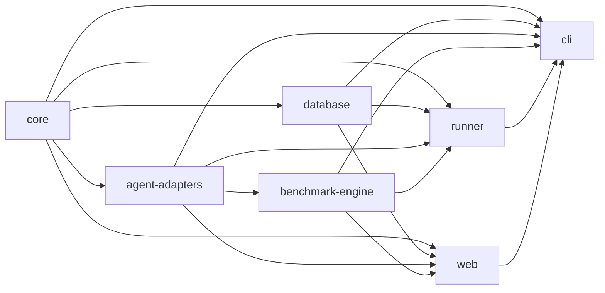

# ADR-0003: Monorepo with pnpm workspaces and Turborepo

- **Status:** Accepted
- **Date:** 2026-10-14
- **Deciders:** Project maintainers (bootstrap proposal — pending maintainer review)
- **Related:** [System architecture](../specs/2026-10-14-system-architecture.md),
  [Technology stack](../specs/2026-10-14-technology-stack.md),
  [ADR-0004](0004-native-cli-distribution.md)

## Context

DirectiveBench has a CLI, a Next.js web UI, and several domain areas (artifact parsing, persistence,
agent adapters, benchmark engine, job runner) that must evolve together but keep clear dependency
boundaries. The benchmark engine must stay independent of the database and UI so it can be tested in
isolation and later run in remote runners. Only one package is published to npm (the CLI).

## Decision

Use a single repository with **pnpm workspaces** and **Turborepo** for task orchestration
(build, lint, typecheck, test) with caching.

Packages created in bootstrap:

| Path | Name | Responsibility |
| --- | --- | --- |
| `apps/cli` | `directivebench` (published) | Commands, lifecycle, data dir, migrations, runner loop, spawns Next.js |
| `apps/web` | `@directivebench/web` (private) | Next.js UI, server actions, `/api/*`; enqueues jobs, never executes them |
| `packages/core` | `@directivebench/core` | Domain types, Zod schemas, artifact parsers, data dir, config, hashing, redaction |
| `packages/database` | `@directivebench/database` | Drizzle schema, migrations, `node:sqlite` adapter, repository functions |
| `packages/agent-adapters` | `@directivebench/agent-adapters` | `AgentAdapter` contract, Mock Agent, CLI detection |
| `packages/benchmark-engine` | `@directivebench/benchmark-engine` | Definition format, fixtures, workspaces, assertions, scoring, RED/GREEN |
| `packages/runner` | `@directivebench/runner` | SQLite-backed job processing executed inside the CLI |

Dependency direction (no cycles):

Arrows point from dependency to dependent. `web` uses `agent-adapters` for CLI detection only and
`benchmark-engine` only through its side-effect-free subpath exports `./definition`, `./load` and
`./scoring` (validation, display status, types), never the orchestrator.

**Just-in-time internal packages:** internal packages are TypeScript-source packages whose
`exports` point to `src/*.ts`. They have no build step of their own; `apps/web` transpiles them via
Next.js `transpilePackages`, and `apps/cli` bundles them with tsup.

**Not created yet** (contracts are specified in `.ai/specs`, but there is no meaningful code):

- `packages/model-providers` — no provider is implemented in bootstrap.
- `packages/git-providers` — repository registration/sync is not implemented.
- `packages/shared` — merged into `core`; a second "misc" package would blur boundaries.
- `packages/config` — shared configuration lives at the root (`tsconfig.base.json`, ESLint config).
- `apps/runner` — the runner is a library executed by the CLI; a standalone/remote runner is future.

A package is created when it has real code and a dependency boundary worth enforcing, not in
advance.

## Alternatives considered

- **Single package.** Simpler, but no enforced boundaries; the engine would drift into depending on
  DB/UI code.
- **Multiple repositories.** Coordinated changes across CLI/web/engine would need versioned
  releases of internal packages; too heavy for one published artifact.
- **npm/Yarn workspaces, Nx.** npm workspaces lack pnpm's strict dependency isolation; Nx is more
  than needed. Turborepo adds caching with minimal configuration.
- **Built internal packages** (each emits `dist/`). Adds build ordering and watch complexity without
  benefit, since nothing internal is published.
- **Creating all planned packages up front.** Empty packages imply functionality that does not
  exist and make boundaries guesswork.

## Benefits

- Atomic changes across packages; one lockfile.
- Enforced dependency direction; engine testable without DB/UI.
- Fast local iteration: no internal build step, Turborepo caching for CI.

## Drawbacks

- Just-in-time packages require every consumer to transpile TypeScript; non-bundling consumers
  (e.g. a future remote runner) need a build step or bundling.
- pnpm symlinked `node_modules` complicate packaging the Next.js output
  ([ADR-0004](0004-native-cli-distribution.md)).
- Contributors must use pnpm (via corepack).

## Consequences

- New domain areas start inside an existing package or as a new package only when they have code.
- Cross-package imports go through package `exports`, never relative paths into another package.
- Dependency rules should be checked in CI (lint rule or script) to keep the graph acyclic.

## Status

Accepted.
