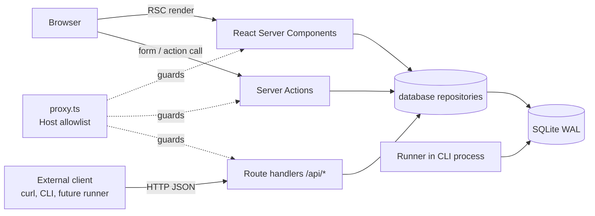
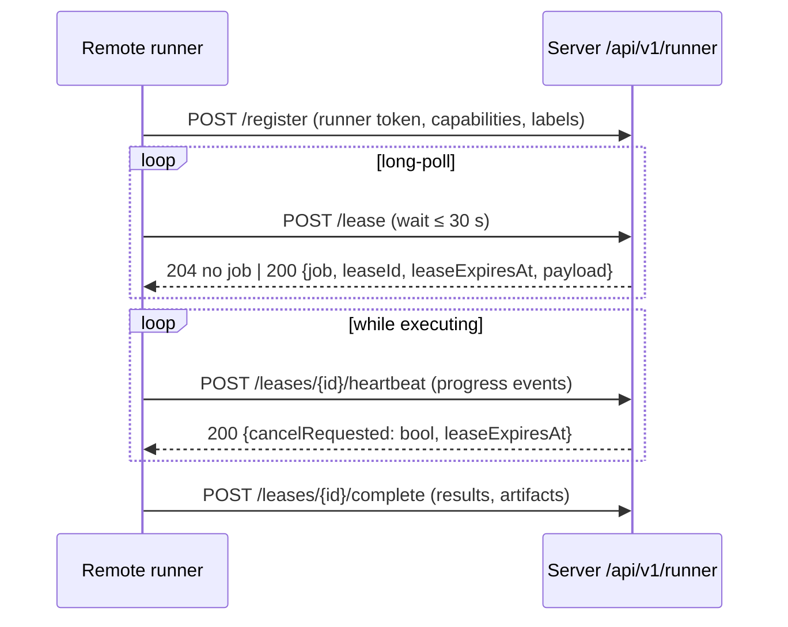

# SPEC-008 — API Architecture

## 1. Scope

How the web application (`apps/web`, Next.js App Router) reads and mutates data, which HTTP endpoints exist, how requests are protected in local mode, and the intended shape of the future JSON API and runner protocol. Process topology is in [SPEC-003](2026-10-14-system-architecture.md); persistence in [SPEC-006](2026-10-14-database-schema.md); threat model in [SPEC-007](2026-10-14-security-and-privacy.md).

## 2. Principles

1. **The web process never executes benchmarks.** It only validates input and writes jobs to the database. Execution happens in the runner ([SPEC-114](2026-10-14-runner-management.md), [ADR-0007](../decisions/0007-local-runner-execution-and-isolation.md)), which in local mode runs inside the CLI process.
2. **Repositories are the persistence boundary.** UI code calls repository functions from `@directivebench/database`; it never issues ad-hoc SQL. This keeps a future PostgreSQL backend practical ([ADR-0009](../decisions/0009-self-hosted-readiness.md)).
3. **Validate at the boundary.** Every mutation input and every JSON request body is parsed with a Zod schema (shared from `@directivebench/core` where the type is domain-level) before touching the database.
4. **No internal HTTP hops.** Server Components do not call the app's own `/api` routes; `/api` exists for external clients (health checks, future CLI/remote use).

## 3. Interaction layers



| Layer | Used for | Rules |
| --- | --- | --- |
| React Server Components | All reads for pages (dashboard counts, artifact/benchmark lists and detail, jobs, run detail) | Read via repository functions; render `dynamic` (no build-time caching of database content). |
| Server Actions | UI mutations | Zod-validated input; return a typed result `{ ok: true, data } \| { ok: false, error }` (target; bootstrap actions return nothing, throw on invalid input and redirect/revalidate); revalidate affected paths. |
| Route handlers (`app/api/**/route.ts`) | Machine-readable endpoints | JSON only; stable error envelope (§5). |

### 3.1 Server Actions (bootstrap scope)

| Action | Effect | Notes |
| --- | --- | --- |
| Enqueue benchmark run | Inserts a `jobs` row (`pending`) for a benchmark suite version and the latest version of the selected artifact, then redirects to `/executions` | Rejected if the suite or artifact version does not exist. Before enqueueing, the stored definition is validated and `executionBlockers` (unapproved suites that run commands, unsupported environments such as `docker`) is checked; on blockers the action redirects to `/benchmarks/<suiteId>?error=…` and nothing is enqueued ([SPEC-114](2026-10-14-runner-management.md) FR-114-02). The runner re-checks when it executes the job. |
| Cancel job | Sets `cancel_requested_at` on a `pending` or `running` job | Pending jobs become `cancelled` directly; running jobs are aborted by the runner ([SPEC-114](2026-10-14-runner-management.md)). |

Further actions (category CRUD, repository registration, settings) are specified in their feature specs and are not part of bootstrap.

### 3.2 Route handlers

| Endpoint | Status | Contract |
| --- | --- | --- |
| `GET /api/health` | Implemented | `200 {"status":"ok","database":"ready"\|"not-initialized"}` with `cache-control: no-store`; used by the CLI startup probe ([SPEC-009](2026-10-14-cli-architecture.md)). Must not touch secrets. |
| `/api/v1/*` | Planned | Versioned JSON API, see §4. |

## 4. Planned versioned JSON API (`/api/v1`)

Purpose: let the CLI (`benchmark run`, `export`, …) and remote clients act on a running instance without the browser. Not implemented.

- **Versioning:** path prefix `/api/v1`. Breaking changes require `/api/v2`; additive fields are allowed in v1.
- **Contracts:** request and response schemas defined once with Zod in a shared module and used by both server and client. JSON Schema may be generated from them for documentation.
- **Resources (indicative):** `artifacts`, `artifact-versions`, `categories`, `benchmarks` (suites + versions), `jobs` (create, list, get, cancel), `benchmark-runs` (get, results). IDs are the prefixed ids from [SPEC-006](2026-10-14-database-schema.md).
- **Pagination:** cursor-based (`?cursor=…&limit=…`, `limit` ≤ 100), response `{ data: [...], nextCursor: string | null }`.
- **Idempotency:** job creation accepts an optional `Idempotency-Key` header (Assumption — requires validation as a need).

## 5. Error envelope

All `/api` responses with status ≥ 400 use:

```json
{
  "error": {
    "code": "validation_failed",
    "message": "Human-readable summary",
    "details": [{ "path": ["cases", 0, "id"], "message": "Required" }],
    "requestId": "req_…"
  }
}
```

| HTTP | `code` | When |
| --- | --- | --- |
| 400 | `validation_failed` | Zod parse failure (`details` lists issues) |
| 403 | — | Rejected by the Host allowlist (§6); plain-text body `Forbidden: unexpected Host header`, not the envelope |
| 401 / 403 | `unauthenticated` / `forbidden` | Future self-hosted mode only |
| 404 | `not_found` | Unknown resource id |
| 409 | `conflict` | Invalid state transition (e.g. cancel a completed job) |
| 422 | `not_executable` | Suite not approved for execution, or unsupported environment |
| 500 | `internal_error` | Unexpected failure; message is generic, details are logged locally (redacted) |

Server Actions return the same `code` values in their `{ ok: false, error }` result. Messages never contain secrets or absolute paths outside the data directory.

## 6. Request protection in local mode

- **Binding:** the server listens on `127.0.0.1` by default; non-loopback binding requires `--allow-network-access` ([SPEC-009](2026-10-14-cli-architecture.md)).
- **DNS-rebinding protection:** `apps/web/proxy.ts` (Next.js 16 replacement for middleware) rejects (403) any request whose `Host` header host name (any port) is not in the allowlist: `localhost`, `127.0.0.1`, `[::1]`, plus the explicitly configured non-loopback host when network access is allowed. The extra host is passed from the CLI to the web child process in `DIRECTIVEBENCH_ALLOWED_HOSTS`.
- **CSRF:** Server Actions rely on Next.js built-in Origin/Host comparison; route handlers that mutate state (future) must require `Content-Type: application/json` and check `Origin` against the allowlist.
- **Authentication:** none in local mode (single user, loopback). `--allow-network-access` prints a warning that the instance is unauthenticated. Authentication and authorization for self-hosted deployments are future work ([SPEC-011](2026-10-14-self-hosting-architecture.md), [ADR-0008](../decisions/0008-secret-storage-and-authentication.md)).

## 7. Planned runner protocol (sketch only)

For remote runners in self-hosted mode ([SPEC-011](2026-10-14-self-hosting-architecture.md)). Not implemented; local mode uses direct database access from the in-process runner.



- Runners connect **outbound over HTTPS only**; no inbound ports on runner hosts.
- A lease is exclusive and time-bounded; missed heartbeats expire the lease and the job becomes `interrupted` (same semantics as local stale-heartbeat recovery).
- Cancellation is delivered in the heartbeat response.
- Runner credentials are scoped runner tokens; agent/provider credentials stay on the runner host and are never sent to the server.
- Payload includes suite version, fixture hashes (runner fetches content-addressed fixtures) and artifact version; results reuse the engine's result schema.

## 8. Implementation status

- **Implemented (verified by `pnpm verify:pack` on 2026-10-14):** `GET /api/health` returning `{"status":"ok","database":"ready"}`; Host allowlist in `proxy.ts` (foreign `Host` → 403); RSC pages reading through database repositories (`/results` and `/results/[id]` render the demo run).
- **Implemented (verified by `pnpm test:e2e` on 2026-10-15):** approval/environment checks at enqueue time — the enqueue action validates the stored definition and calls `executionBlockers` before inserting the job, and reports blockers on the benchmark page (`data-testid="enqueue-error"`; Playwright test "enqueueing re-checks execution approval on the server (FR-114-02)").
- **Partially implemented:** Server Actions for enqueue benchmark run and cancel job exist (`apps/web/lib/actions.ts`, Zod-validated) but return no typed result (errors are reported via redirect query parameters); enqueue is verified by `pnpm test:e2e` (Run → `/executions` → `completed`), cancel is not covered by a test; no error envelope is used yet (there is no `/api` endpoint that can fail with 4xx).
- **Not implemented:** `/api/v1/*` JSON API, error envelope, pagination, idempotency keys, authentication/authorization, remote runner protocol.
