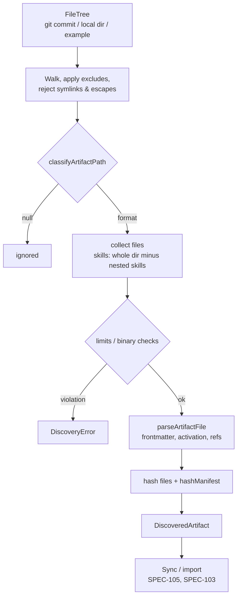

# SPEC-102 — Artifact Discovery

## 1. Summary

Artifact discovery turns a file tree (a repository checkout, a local directory, a fixture, an example folder) into a list of **parsed artifacts**: skills, instructions and rules in the formats used by today's coding agents. It is an extensible, path-driven parser system living in `@directivebench/core`: each supported format declares how it is **detected** (from the path), how it is **parsed** (frontmatter, activation conditions, references), and which files belong to it. Discovery is a pure read operation: it never executes, imports or evaluates discovered content.

## 2. Motivation and problem statement

Agent guidance is spread over many conventions (`SKILL.md` directories, `AGENTS.md`, `CLAUDE.md`, Cursor `.mdc` rules, Copilot instructions, GitLab Duo rules…). Each format has its own activation semantics: a Cursor rule with `globs` behaves differently from one with `alwaysApply: true`; a Copilot `*.instructions.md` without `applyTo` applies to nothing. Treating them all as "markdown files" loses meaning, and treating every markdown file as a skill produces noise (READMEs, changelogs, docs). DirectiveBench needs a precise, testable, extensible discovery layer that preserves format semantics.

## 3. Goals

- Detect all supported formats by path, deterministically, with no content-based guessing.
- Preserve format semantics losslessly: raw frontmatter, activation (alwaysApply, globs/applyTo/paths, description), scope (directory), file references, tool metadata.
- Collect the full file set of directory-based skills (scripts, references, assets) as data.
- Never read the agents' **user-level folders** ([D05](research/decisions/D05-user-level-skills-opt-in.md), maintainer, 2026-10-19): `~/.agents`, `~/.claude`, `~/.codex`, `~/.cursor` and `$XDG_CONFIG_HOME/cursor` (default `~/.config/cursor`), plus `CLAUDE_CONFIG_DIR` and `CODEX_HOME` when set — the folders the integration specs name ([SPEC-203](2026-10-14-integration-claude-code.md), [SPEC-204](2026-10-14-integration-openai-codex.md), [SPEC-205](2026-10-14-integration-cursor.md)), as spelled below the canonical home directory and where they resolve to when they are symlinks. A scan always skips them, also when the registered location is the home directory or one of its ancestors; a location that is or lies inside one of them reads nothing. They are reported as one informational line of the scan result, not as discovery errors. Opt-in user-level discovery is future work (§4, §19).
- Make adding a new format a local change (one handler + test fixtures).
- Be safe on hostile input: size limits, binary files, symlinks, path traversal, malformed YAML.

## 4. Non-goals

- Executing, linting or "trying out" discovered scripts or instructions.
- Semantic classification of arbitrary markdown ("is this README actually a skill?").
- Resolving agent-specific precedence at runtime (which rule wins for a given file) — that is the agent's job; DirectiveBench records the metadata needed to explain it.
- Fetching repositories — see [SPEC-105](2026-10-14-repository-synchronization.md).
- User-level/global artifacts outside repositories (e.g. `~/.claude/skills`) — future, opt-in only ([SPEC-007](2026-10-14-security-and-privacy.md)).

## 5. User stories

- US-102-01: As a user, I want DirectiveBench to find all skills and rules in my repository without listing READMEs and docs as artifacts.
- US-102-02: As a user, I want to see that a Cursor rule applies only to `src/**/*.tsx` and a Copilot instruction to `**/*.php`.
- US-102-03: As a skill author, I want the scripts and reference files of my skill captured with the skill, so a benchmark installs the exact same package.
- US-102-04: As a contributor, I want to add support for a new agent's rule format by implementing one handler and adding fixtures.
- US-102-05: As a security-conscious user, I want assurance that scanning a repository never runs any of its code.

## 6. Functional requirements

| ID | Requirement |
|----|-------------|
| FR-102-01 | Detection SHALL be path-based: a file is an artifact candidate only if its repository-relative POSIX path matches a registered format pattern (§8.2). Any other file — including other `.md` files — SHALL be ignored. |
| FR-102-02 | Paths SHALL be normalised before matching: backslashes → `/`, `posix.normalize`, leading `./` stripped. Matching is case-sensitive (`SKILL.md`, `AGENTS.md`, `CLAUDE.md` exactly). |
| FR-102-03 | The system SHALL support the formats in §8.2: `skill-md`, `agents-md`, `claude-md`, `claude-rule`, `copilot-instructions`, `copilot-path-instructions`, `cursor-rule`, `gitlab-duo-chat-rules`. |
| FR-102-04 | Each format SHALL map to exactly one artifact type ([SPEC-101](2026-10-14-artifact-registry.md) §8.1). |
| FR-102-05 | Parsing SHALL split an optional leading YAML frontmatter block (`---` … `---`, UTF-8 BOM tolerated, CRLF tolerated). Invalid frontmatter SHALL NOT throw: the result has empty `frontmatter` and a warning `Invalid frontmatter: …`. |
| FR-102-06 | Raw frontmatter SHALL be preserved verbatim as a key/value mapping in `ParsedArtifact.frontmatter`, including keys DirectiveBench does not interpret (e.g. tool metadata such as `allowed-tools`, `license`, `metadata`). |
| FR-102-07 | Activation semantics SHALL be normalised into `ParsedArtifact.activation` (`alwaysApply`, `globs`, `description`) per format as defined in §8.2, without discarding the raw values. Glob values given as a comma-separated string or a YAML list SHALL both be accepted. |
| FR-102-08 | Name resolution: `skill-md` → frontmatter `name`, else skill directory basename; `cursor-rule` → file basename without `.mdc`; `copilot-path-instructions` → basename without `.instructions.md`; `claude-rule` → basename without `.md`; whole-repo/directory instruction files (`agents-md`, `claude-md`, `copilot-instructions`, `gitlab-duo-chat-rules`) → the relative path (e.g. `AGENTS.md`, `packages/api/AGENTS.md`). |
| FR-102-09 | Description resolution: frontmatter `description` (trimmed, non-empty), else the first level-1 Markdown heading of the body, else `null`. |
| FR-102-10 | Missing recommended fields SHALL produce warnings, not errors (e.g. `SKILL.md has no name in frontmatter`; `Path-specific instructions without applyTo apply to no files`). |
| FR-102-11 | Relative file references in the body (Markdown links whose target has no URL scheme and is not a pure `#anchor`) SHALL be extracted into `references` (sorted, de-duplicated, fragment stripped). |
| FR-102-12 | **Directory-based skills**: for `skill-md`, the artifact root is the directory containing `SKILL.md`; all regular files beneath it SHALL belong to the artifact (supporting scripts, `references/`, `assets/`, templates), except subtrees that contain their own `SKILL.md` (nested skills are separate artifacts). |
| FR-102-13 | **Scope**: for `agents-md` and `claude-md`, the directory containing the file SHALL be recorded as the scope (repository root = `""`). Nested files are separate artifacts. |
| FR-102-14 | Discovery output SHALL include, per artifact, a file manifest `{ path, sha256, size }[]` plus text content (POSIX paths relative to the skill directory for skills; the file basename for single-file artifacts — [SPEC-103 FR-103-05](2026-10-14-artifact-versioning.md)) and the content hash computed with `hashManifest` ([SPEC-103](2026-10-14-artifact-versioning.md)). |
| FR-102-15 | Discovery SHALL skip directories `.git/`, `node_modules/` and any path matched by the repository's configured exclude globs ([SPEC-104](2026-10-14-repository-management.md)). For git repositories, only files tracked at the scanned commit are considered ([SPEC-105](2026-10-14-repository-synchronization.md)). |
| FR-102-16 | Safety limits (defaults, configurable later via [SPEC-115](2026-10-14-settings-and-configuration.md)): primary file ≤ 1 MiB; any single supporting file ≤ 5 MiB; total artifact size ≤ 20 MiB; ≤ 500 files per artifact; ≤ 10 000 candidate artifacts per scan. Exceeding a limit SHALL yield a discovery error for that artifact (not the whole scan), except the per-scan cap which aborts the scan with a clear error. |
| FR-102-17 | **Binary files**: a file is binary if its first 8 KiB contain a NUL byte or it is not valid UTF-8. In the MVP, artifact versions store text files only (`StoredArtifactFile.content: string` in `packages/database/src/schema.ts`; `ArtifactFile` in `packages/core/src/models.ts`): binary supporting files are skipped with a warning and listed in `skipped` (reason `binary`), and are therefore not part of the content hash. Planned: store binary files as content-addressed blobs, hashed and never rendered. A binary **primary** file is a discovery error. |
| FR-102-18 | **Symlinks** SHALL never be followed. A symlink at a candidate path is a discovery error; a symlink inside a skill directory is skipped with a warning and listed in `skipped`. Paths that resolve outside the scanned root (after normalisation) SHALL be rejected. |
| FR-102-19 | Discovery SHALL NEVER execute, `require`/`import`, `eval`, or spawn any discovered file, and SHALL NOT run git hooks, package scripts or LFS filters. |
| FR-102-20 | The result of a scan SHALL be deterministic: same tree → same artifacts, same order (sorted by path), same hashes, same warnings. |
| FR-102-21 | Adding a format SHALL require only: a new entry in `ARTIFACT_FORMATS`, a format handler (detect + parse + file collection), a compatibility entry, and fixture-based tests. No change in database schema, sync logic or UI code beyond labels. |

## 7. Non-functional requirements

- NFR-102-01: Scanning a repository with 50 000 files and 200 artifacts completes in < 5 s on a laptop (excluding clone time).
- NFR-102-02: Memory bounded by the size limits: files are streamed for hashing; only primary files are held fully in memory for parsing.
- NFR-102-03: Parsers are pure functions of `(relPath, content)`; no I/O inside `parse` — enables exhaustive unit testing.
- NFR-102-04: Cross-platform: identical results on Linux, macOS and Windows checkouts (paths normalised to POSIX).

## 8. Domain entities and contracts

### 8.1 Current code contract (`packages/core/src/artifacts.ts`, `frontmatter.ts`, `hash.ts`)

The bootstrap exposes `ARTIFACT_TYPES`, `ARTIFACT_FORMATS`, `classifyArtifactPath(relPath)`, `parseArtifactFile(relPath, content)`, `parseFrontmatter(content)`, `hashManifest(entries)`, `slugify(value)`. These are authoritative; the shapes below mirror them.

```ts
type ArtifactType = 'skill' | 'instruction' | 'rule';
type ArtifactFormat =
  | 'skill-md' | 'agents-md' | 'claude-md' | 'claude-rule'
  | 'copilot-instructions' | 'copilot-path-instructions'
  | 'cursor-rule' | 'gitlab-duo-chat-rules';

interface ArtifactClassification {
  format: ArtifactFormat;
  type: ArtifactType;
  rootDir: string | null;   // skills: directory holding SKILL.md ('' = scan root); single-file artifacts: null
}

interface ArtifactActivation {
  alwaysApply?: boolean;    // Cursor alwaysApply; implied true for always-on instruction files and path-less Claude rules
  globs?: string[];         // Cursor globs, Copilot applyTo, Claude rules paths
  description?: string;     // relevance description (skills, Cursor rules)
}

interface ParsedArtifact {
  format: ArtifactFormat;
  type: ArtifactType;
  name: string;
  description: string | null;
  activation: ArtifactActivation;
  frontmatter: Record<string, unknown>; // verbatim
  body: string;
  references: string[];
  warnings: string[];
}
```

### 8.2 Supported formats

| Format id | Type | Detection (normalised relative path) | Interpreted metadata | Notes |
|-----------|------|---------------------------------------|----------------------|-------|
| `skill-md` | skill | basename `SKILL.md` anywhere (typical roots: `.claude/skills/<name>/`, `.agents/skills/<name>/`, `skills/<name>/`) | `name`, `description` (→ `activation.description`); other keys (e.g. `license`, `allowed-tools`, `metadata`, `compatibility`) preserved raw | Directory-based (FR-102-12). Optional-field list follows the Agent Skills convention — Assumption — requires validation per agent ([SPEC-203](2026-10-14-integration-claude-code.md), [SPEC-204](2026-10-14-integration-openai-codex.md)). |
| `agents-md` | instruction | basename `AGENTS.md` anywhere | none required; `alwaysApply: true` | Nested files scope to their directory (FR-102-13). |
| `claude-md` | instruction | basename `CLAUDE.md` anywhere (incl. `.claude/CLAUDE.md`) | none; `alwaysApply: true` | `CLAUDE.local.md` (personal, usually git-ignored) is not discovered. `@path` import syntax is a file reference — planned (see §18). |
| `claude-rule` | rule | `(^\|/).claude/rules/**/*.md` | `paths` (→ `globs`); without `paths` → `alwaysApply: true` | Frontmatter key `paths` — Assumption — requires validation against current Claude Code docs. |
| `copilot-instructions` | instruction | exactly `.github/copilot-instructions.md` | none; `alwaysApply: true` | Repository-wide Copilot custom instructions. |
| `copilot-path-instructions` | rule | `.github/instructions/**/*.instructions.md` | `applyTo` (→ `globs`, comma-separated) | Without `applyTo` → warning. Other keys (e.g. `excludeAgent`) preserved raw — Assumption — requires validation. |
| `cursor-rule` | rule | `(^\|/).cursor/rules/**/*.mdc` (nested `.cursor/rules` allowed) | `description`, `globs`, `alwaysApply` (boolean only) | Cursor rule kinds (always / auto-attached / agent-requested / manual) are derivable from these three fields ([SPEC-205](2026-10-14-integration-cursor.md)). Legacy `.cursorrules` not supported. |
| `gitlab-duo-chat-rules` | rule | exactly `.gitlab/duo/chat-rules.md` | none; `alwaysApply: true` | Format semantics — Assumption — requires validation against GitLab docs ([SPEC-202](2026-10-14-integration-gitlab.md)). |

**Not artifacts**: `README.md`, `CHANGELOG.md`, `docs/**/*.md`, `.github/*.md` other than the above, `.cursorrules`, arbitrary `*.mdc` outside `.cursor/rules/`, `*.md` in a skill directory other than `SKILL.md` (those are supporting files of the skill).

### 8.3 Target extensible contract (planned refactor)

The bootstrap implements detection and parsing as a single `switch`. When a format needs file collection or scope logic, the code SHOULD be refactored into a handler registry without changing the public functions above:

```ts
interface ArtifactFormatHandler {
  format: ArtifactFormat;
  type: ArtifactType;
  /** Agent ecosystems that natively consume this format (SPEC-101 FR-101-09). */
  compatibility: readonly string[];
  detect(relPath: string): ArtifactClassification | null;
  parse(relPath: string, content: string): ParsedArtifact;   // pure
  /** Which files of the tree belong to the artifact (default: the primary file only). */
  collectFiles?(classification: ArtifactClassification, tree: FileTree): string[];
}

interface FileTree {             // abstraction over git tree / local directory / fixture
  list(): AsyncIterable<{ path: string; kind: 'file' | 'symlink' | 'dir'; size: number }>;
  read(path: string, maxBytes: number): Promise<Uint8Array>;
}

interface DiscoveredArtifact {
  primaryPath: string;           // e.g. '.agents/skills/validate-external-input/SKILL.md'
  occurrencePath: string;        // skill dir for skills, else primaryPath
  parsed: ParsedArtifact;
  files: { path: string; sha256: string; size: number; content: string }[]; // = StoredArtifactFile
  contentHash: string;           // hashManifest(files)
  skipped: { path: string; reason: 'symlink' | 'too-large' | 'outside-root' | 'binary' }[];
}

interface DiscoveryError { path: string; code: 'too-large' | 'binary-primary' | 'symlink' | 'too-many-files' | 'read-failed'; message: string }

interface DiscoveryResult { artifacts: DiscoveredArtifact[]; errors: DiscoveryError[]; scannedFiles: number }

function discoverArtifacts(tree: FileTree, options: { exclude?: string[]; limits?: Partial<DiscoveryLimits> }): Promise<DiscoveryResult>;
```

Planned additions to `ParsedArtifact` (non-breaking, optional): `scopeDir?: string` (FR-102-13).

## 9. Data flow



## 10. API and interface design

- Package: `@directivebench/core` — pure functions listed in §8.1 (implemented) and `discoverArtifacts` (implemented for local roots; see §20).
- Consumers: repository sync ([SPEC-105](2026-10-14-repository-synchronization.md)), example/demo import (CLI `demo`), Mock Agent context loading (uses the same conventions to read `.agents/skills/*/SKILL.md` and `AGENTS.md` in a workspace — [SPEC-107](2026-10-14-benchmark-engine.md)).
- No HTTP endpoint of its own. A future "Preview discovery" UI action on a repository calls sync in dry-run mode.

## 11. UI/UX considerations

- Artifact detail shows "Detected as: Cursor rule (`.cursor/rules/react.mdc`)", the activation summary in plain language ("Applies automatically to files matching `src/**/*.tsx`", "Always applied", "Agent decides based on description", "Applies to no files — missing `applyTo`"), and the raw frontmatter.
- Warnings appear as non-blocking notices on the artifact and in the sync report.
- Discovery errors appear in the sync run report with path, code and message ([SPEC-105](2026-10-14-repository-synchronization.md)).
- Skills show a file tree; skipped files (binary, symlink, too large) are listed separately with the reason.

## 12. Security considerations

Discovered content is untrusted ([SPEC-007](2026-10-14-security-and-privacy.md)).
- No execution of any kind (FR-102-19); scripts are bytes.
- YAML parsing uses the `yaml` package's safe defaults (no custom tags executing code); frontmatter must be a mapping. Alias-expansion bombs are bounded by the primary-file size limit and the `yaml` library's alias limits.
- Symlinks never followed; path traversal rejected (FR-102-18).
- Size/count limits prevent resource exhaustion (FR-102-16).
- Regular expressions used for detection are anchored and linear; user-supplied exclude globs are matched with a glob library (no user regex).

## 13. Error handling

- Per-artifact errors (`DiscoveryError`) never abort the scan; they are reported and the previous version of that occurrence (if any) is kept ([SPEC-105](2026-10-14-repository-synchronization.md)).
- `parseArtifactFile` throws only when called with a non-artifact path (programming error).
- Invalid frontmatter → warning, artifact still discovered with empty frontmatter.
- Non-UTF-8 primary file → `binary-primary` error.

## 14. Edge cases

- `SKILL.md` at the scan root (`rootDir = ''`): the whole tree would be the skill — collect only the root directory's own files and non-skill subdirectories, subject to limits; emit a warning.
- Nested skills (`skills/a/SKILL.md` and `skills/a/sub/SKILL.md`): two artifacts; `sub/` excluded from `a`.
- Same skill under `.claude/skills/x` and `.agents/skills/x`: two discovered artifacts with equal hashes → one logical artifact, two occurrences ([SPEC-101](2026-10-14-artifact-registry.md) §8.3).
- `skill.md` (wrong case) → ignored (FR-102-02); a future lint hint may suggest renaming.
- Cursor `globs: "*.ts, *.tsx"` vs `globs: ["*.ts"]` → both normalised to arrays.
- `alwaysApply: "true"` (string) → not interpreted; raw value kept; warning recommended (future).
- Empty file or frontmatter-only file → artifact with empty body; warning.
- Frontmatter not at file start → treated as body.
- A subdirectory that cannot be listed (permissions, removed during the walk) → a `read-failed` discovery error with the directory path; the rest of the tree is scanned (an unreadable root still fails the scan).
- The registered root replaced by a symlink or moved → the scan reads nothing (`expectedRoot`).
- A directory inside the tree replaced by a symlink while the scan runs → before each directory is listed and before each file is opened, its directory must still `realpath` to itself; otherwise that directory (or the artifact of that file) becomes a `read-failed` discovery error and nothing behind the symlink is read. Residual risk: a swap that lands between that check and the `readdir`/`open` immediately after it is not detected — `O_NOFOLLOW` covers only the last path component and Node has no `openat`/`O_BENEATH` — so one read could still be redirected. Accepted for the local, single-user threat model ([SPEC-007](2026-10-14-security-and-privacy.md)): only a process of the same user that races the scan on purpose can do it.
- Windows checkouts with CRLF → frontmatter parsed; hashes reflect raw bytes (see [SPEC-103](2026-10-14-artifact-versioning.md) §14).
- `.github/instructions/sub/x.instructions.md` → detected (subdirectories allowed).

## 15. Testing strategy

Per [SPEC-012](2026-10-14-testing-strategy.md):
- Unit (Vitest, `packages/core`): table-driven tests for `classifyArtifactPath` (positive and negative paths for every format, case sensitivity, Windows separators); `parseArtifactFile` per format (name/description/activation/warnings/references); `parseFrontmatter` (BOM, CRLF, invalid YAML, non-mapping); `hashManifest` order independence.
- Fixture trees under `packages/core/test/fixtures/discovery/` containing every format, decoy markdown files, nested skills, symlinks, oversized and binary files; golden-file comparison of `DiscoveryResult`.
- Property test: permuting directory listing order never changes the result.
- Security test: fixture with an executable script that would create a marker file if run → marker never created.

## 16. Acceptance criteria

- [ ] Every path in §8.2's detection column is classified with the stated format and type; `README.md`, `docs/guide.md`, `.cursorrules`, `skill.md` return `null`.
- [ ] A Cursor rule with `globs: "src/**/*.ts, src/**/*.tsx"` yields `activation.globs` of length 2; `alwaysApply: true` yields `activation.alwaysApply === true`.
- [ ] A Copilot path-specific instruction without `applyTo` yields the warning and no globs.
- [ ] A `claude-rule` without `paths` yields `alwaysApply: true`.
- [ ] Invalid YAML frontmatter never throws and yields an `Invalid frontmatter` warning.
- [ ] A skill directory with `SKILL.md`, `scripts/run.sh`, `references/api.md` and a PNG asset yields one artifact with 3 manifest entries, the PNG listed in `skipped` as `binary` (MVP), and the content hash unchanged when the directory listing order changes.
- [ ] Symlinks are never followed; oversized files produce a `too-large` error for that artifact only.
- [ ] No discovered file is executed (security fixture).

## 17. Dependencies

`@directivebench/core` (`yaml`, `zod`, `node:crypto`); [SPEC-103](2026-10-14-artifact-versioning.md) (hashing/versioning), [SPEC-105](2026-10-14-repository-synchronization.md) (tree source), [SPEC-104](2026-10-14-repository-management.md) (exclude globs), integration specs SPEC-202…205 (format semantics validation).

## 18. Open questions

- OQ-102-01: Should `CLAUDE.md` `@path` imports and `AGENTS.md` cross-file references be resolved and included in the artifact's manifest (closure), or only listed as references? Proposed: list only; never read outside the artifact unless the referenced file is inside the repository and below the size limit (future).
- OQ-102-02: Should `SKILL.md` outside known skill roots (e.g. in `docs/`) be discovered by default? Code currently says yes; may add a per-repository "skill roots" setting.
- OQ-102-03: Are the default size limits appropriate for skills shipping large assets?
- OQ-102-04: `gitlab-duo-chat-rules` typed as `rule` (code) vs `instruction` (always-on semantics) — confirm.

## 19. Future extensions

- Additional formats: `.cursorrules` (legacy), `.windsurf/rules`, `.clinerules`, `GEMINI.md`, `.github/prompts/*.prompt.md`, `.github/chatmodes`, Claude Code subagents (`.claude/agents/*.md`) and commands — each requires a spec update (FR-101-01 type mapping).
- Lint rules per format (missing description, conflicting globs, unreachable rules).
- User-level artifact discovery (opt-in, read-only).
- Activation simulator: "which artifacts would apply to `src/app/page.tsx`?" per agent.

## Phasing

Implementation follows the backlog stories in `.ai/specs/backlog.md` (epic E01).

### Phase 1 — Local tree walker (issue #24)

`discoverArtifacts(root)` in `packages/core/src/discovery.ts`: walk, skipped directories, skill file collection, limits, binary detection, symlinks, determinism (FR-102-12…20). Library only.

### Phase 2 — Scan of a registered local repository (E01-S02, issue #16)

Scope: a `repository-scan` runner job triggered from the Repositories page reads a registered `local-git` or `local-directory` repository with `discoverArtifacts` and stores every artifact through the `importArtifactVersion` writer (SPEC-103, hashes recomputed); SPEC-104 FR-104-18 and OQ-104-06 ship with it. Out of scope: rescan rules beyond dedup (#19), cross-repository identity (#20), removed files (#21), exclude globs, user-level folders (D05), hosted repositories (#18).

1. Walker: abort signal, unreadable subdirectories as `read-failed` errors, `expectedRoot` (`core`).
2. `repository-scan` job type (one pending/running scan per repository), `applyRepositoryScan` in one transaction with location identity (SPEC-101 §8.3 rules 1 and 4), registration checks of FR-104-18 (`database`).
3. Scan job handler and the runner's short-job lane (`runner`).
4. Scan action, scan status and FR-104-18 confirmation on the Repositories page, Playwright coverage (`web`).

**Working tree, not a commit (decided by the maintainer for M1, 2026-10-19, issue #16).** Both local providers are scanned as files on disk — for `local-git` too: uncommitted and untracked (also git-ignored) files are included, submodule and nested-repository contents are walked like any directory, and no commit is recorded (`commit_sha = null`). The scan runs no process, so no hook, filter or fsmonitor can run. Restricting `local-git` to the files tracked at a commit (FR-102-15, second sentence; SPEC-105 FR-105-05/06) is deferred to local git awareness in M2 ([SPEC-013](2026-10-14-implementation-roadmap.md)); switching then changes manifests of skills with untracked files, which creates new versions once. Commit-based reads of `local-git` come in M2 (SPEC-104 OQ-104-02).

## 20. Implementation status

- **Implemented (verified by `packages/core/test/artifacts.test.ts` and the `core` hashing tests):** `ARTIFACT_TYPES`, `ARTIFACT_FORMATS`, `classifyArtifactPath` (incl. Windows separators and `./`), `parseArtifactFile` (SKILL.md frontmatter/activation/references and missing-metadata fallback, Cursor rule globs/`alwaysApply`, Copilot `applyTo`, Claude rules; unknown paths rejected), `parseFrontmatter`, `hashManifest`, `slugify` in `packages/core/src`. Not every one of the eight formats has a dedicated test.
- **Implemented (verified by `packages/core/test/discovery.test.ts` and `discovery-simulated-fs.test.ts`, issue #24):** `discoverArtifacts(root, { limits })` in `packages/core/src/discovery.ts` walks a local root without following symlinks, skips `.git/` and `node_modules/` at any depth (FR-102-15, first sentence), collects every regular file of a directory-based skill except nested skills (FR-102-12, incl. the root-`SKILL.md` warning of §14), returns a manifest and `hashManifest` content hash per artifact (FR-102-14), enforces the FR-102-16 defaults as the named `DISCOVERY_LIMITS` (per-artifact errors; the per-scan cap aborts the scan), detects binary files (NUL in the first 8 KiB or invalid UTF-8: supporting file skipped, primary file a `binary-primary` error — FR-102-17), reports a symlink at a candidate path as a `symlink` error and lists symlinks inside a skill in `skipped` (FR-102-18), reads files as bytes only (FR-102-19, security fixture), and returns the same artifacts, order, hashes and warnings for any directory listing order (FR-102-20). Since issue #16 the repository scan uses it (below).
- **Implemented — Phase 2, scan of a registered local repository (issue #16; verified on 2026-10-19 by `packages/core/test/discovery.test.ts`, `packages/runner/test/{repository-scan,repository-scan-errors,runner-lanes}.test.ts`, `packages/database/test/{artifacts,jobs}.test.ts`, the Playwright test "scanning a repository discovers its artifacts and reports discovery errors" and a manual run of the built CLI):**
  - A `repository-scan` job reads a registered local repository with `discoverArtifacts(location, { signal, expectedRoot: location })`: `.agents/skills/*/SKILL.md`, `AGENTS.md`, `.cursor/rules/*.mdc` and `.github/copilot-instructions.md` each become an artifact with type, format and occurrence path, and every regular file of a skill directory is in the version's manifest (FR-102-12, SPEC-013 M1 AC1).
  - FR-102-15 (first sentence), FR-102-18: `.git/` and `node_modules/` are skipped, symlinks are never followed, a symlink at a candidate path is a `symlink` discovery error listed in the scan result and on the page, a symlink inside a skill is in `skipped`.
  - FR-102-19: the scan spawns no process at all (a test spies on every `child_process` function) and a fixture whose git hooks, fsmonitor, filter driver, package script and executable skill script would create a marker leaves none.
  - No path outside the registered location is read **for a tree that does not change during the scan**: symlinked directories are not followed and a location replaced by a symlink is refused (`location-changed`). For a tree changed during the scan, each directory and each file's directory is re-checked with `realpath` before it is read, so a directory swapped for a symlink becomes a `read-failed` error (tests swap one between listing and descent and one between the walk and a read); the remaining window between that check and the read is the §14 residual risk.
  - User-level folders (§3, D05) are always skipped, also in a confirmed scan of the home directory or an ancestor, including when they are symlinks into the scanned tree or set through `XDG_CONFIG_HOME`, `CLAUDE_CONFIG_DIR` or `CODEX_HOME`; the scan result lists them as `skippedUserLevelFolders` and the page shows one informational line. A location that is itself one of them reads nothing (verified by `packages/core/test/discovery.test.ts` and `packages/runner/test/repository-scan.test.ts`, 2026-10-19).
  - Discovery error messages and scan failures name repository-relative paths and error codes only, never the absolute location (`read-failed`: `Cannot read <path> (<code>)`).
  - FR-102-20: the same tree scanned twice gives identical discovery output and a second scan creates no artifact and no version.
  - The walker stops on an abort signal (cancellation, shutdown) and reports an unreadable subdirectory as a `read-failed` error instead of failing the scan.
  - Performance (built CLI, 2026-10-19, Linux laptop): 1,000 files / 50 artifacts in 56 ms including the database write (M1 AC5, target < 5 s); 50,000 files / 200 artifacts in 207 ms (NFR-102-01).
- **Deviations from §8.3:** `discoverArtifacts` takes a local root path, not a `FileTree` (the abstraction waits for a second tree source, SPEC-105); it has no `exclude` option but takes `signal`, `expectedRoot` and `skipDirectories` (and returns `skippedDirectories`); `DiscoveredArtifact` adds `primaryFile` and `warnings` (parser plus discovery warnings, as in `LoadedArtifact`); `skipped` reasons are `symlink` and `binary` only, because an oversized file is an error (FR-102-16) and walked paths cannot leave the root.
- **Partially implemented:** file collection for a single local artifact (`loadLocalArtifact` in `packages/core/src/artifact-loader.ts`: sorted walk, symlinks skipped with a warning, limits of 200 files / 1 MiB, binary detection shared with the walker — supporting files with a NUL in the first 8 KiB or invalid UTF-8 are skipped with a warning and a binary primary file is rejected, FR-102-17, issue #39, verified by `packages/core/test/artifact-loader.test.ts`) used to import bundled examples.
- **Deviation (FR-102-15, second sentence):** `local-git` repositories are scanned as a working tree, not as the files tracked at a commit (Phasing; decided by the maintainer for M1 on 2026-10-19, commit-based reads in M2).
- **Not implemented:** binary file storage, handler registry, `FileTree` abstraction, exclude globs, restricting git repositories to files tracked at the scanned commit (FR-102-15, second sentence), `scopeDir`, `@path` import resolution, compatibility mapping per format, hosted-repository sync (SPEC-105).
