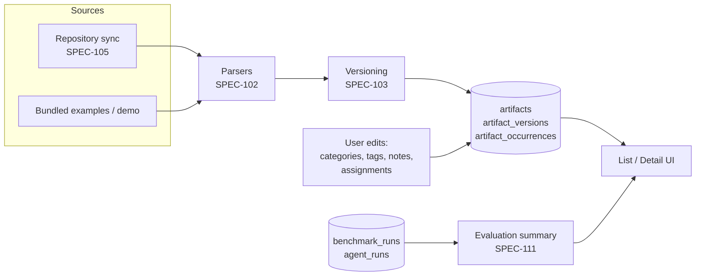

# SPEC-101 — Artifact Registry

## 1. Summary

The Artifact Registry is the central catalogue of AI agent **artifacts** known to a DirectiveBench installation. An artifact is a piece of guidance consumed by a coding agent: a **skill**, an **instruction** file, or a **rule**. The registry stores each artifact's logical identity, its immutable content versions ([SPEC-103](2026-10-14-artifact-versioning.md)), every place it occurs in registered repositories ([SPEC-104](2026-10-14-repository-management.md), [SPEC-105](2026-10-14-repository-synchronization.md)), local organisational metadata (categories, tags, notes, benchmark assignments) and a summary of its evaluation history ([SPEC-112](2026-10-14-red-green-evaluation.md), [SPEC-113](2026-10-14-results-and-reporting.md)). It provides the list / search / filter UI and the artifact detail view.

## 2. Motivation and problem statement

Teams accumulate skills, `AGENTS.md`/`CLAUDE.md` files, Cursor rules and Copilot instructions across many repositories and agent ecosystems. Nobody knows which ones exist, which copies have diverged, which actually change agent behaviour, and which have regressed. A registry that treats an artifact as a first-class, versioned entity — independent of where it was found — is the prerequisite for organising, benchmarking and comparing them.

## 3. Goals

- One record per **logical artifact**, with any number of **occurrences** (repository + path).
- Preserve original content byte-for-byte and the parsed, format-specific metadata.
- Make artifacts findable: full-text search, filters by type, format, category, tag, repository, compatibility, evaluation status.
- Show, per artifact, the latest evaluation summary and history without mixing non-comparable results ([SPEC-111](2026-10-14-benchmark-scoring.md)).
- Keep user-owned metadata (categories, tags, notes, assignments) independent of synchronisation so it survives re-scans ([SPEC-105](2026-10-14-repository-synchronization.md)).

## 4. Non-goals

- Editing artifact content inside DirectiveBench and pushing it back to repositories (future; repositories are read-only — [SPEC-104](2026-10-14-repository-management.md)).
- A public marketplace or cross-installation sharing of artifacts.
- Global rankings of artifacts across different benchmark suites ([SPEC-111](2026-10-14-benchmark-scoring.md)).
- Defining parsers — see [SPEC-102](2026-10-14-artifact-discovery.md).

## 5. User stories

- US-101-01: As a developer, I want to see every skill, instruction and rule from my repositories in one list so I know what exists.
- US-101-02: As a tech lead, I want to filter artifacts by category (e.g. Security) and see their latest benchmark verdict so I can find guidance that does not work.
- US-101-03: As a maintainer, I want to see that the same skill exists in three repositories and that one copy has diverged.
- US-101-04: As a user, I want to add notes and tags to an artifact that are not overwritten by the next sync.
- US-101-05: As a user, I want to open an artifact and read its exact content, parsed metadata, versions, benchmark assignments and evaluation history.
- US-101-06: As a user without repositories (bootstrap), I want to see the bundled example artifacts imported by `directivebench demo`.

## 6. Functional requirements

| ID | Requirement |
|----|-------------|
| FR-101-01 | The system SHALL support exactly three artifact types: `skill`, `instruction`, `rule` (definitions in §8). New types require a spec change. |
| FR-101-02 | Every artifact SHALL have a stable, prefixed, random ID (`art_…`) that never changes for its lifetime, including across renames, moves and content changes. |
| FR-101-03 | Every artifact SHALL record: name, slug, type, description, tags, user notes, created/updated timestamps; categories via `artifact_categories`. Source format, primary file, source repository/path/commit and parsed metadata are recorded per version (`artifact_versions`). Lifecycle (`active` / `removed`) is derived from occurrences; `archived` is planned. |
| FR-101-04 | Every artifact SHALL have ≥1 immutable version ([SPEC-103](2026-10-14-artifact-versioning.md)). Each version stores original content (all files; text files only in the MVP), the file manifest (path, sha256, size), the content hash and the parsed metadata produced by the parser that discovered it. |
| FR-101-05 | An artifact SHALL have one or more **occurrences** over its lifetime. An occurrence links the artifact to a repository, a path within that repository, the version found there (`latest_version_id`), the commit SHA (if git) and an occurrence status (`active` / `removed`). Bundled examples are imported through a repository row with provider `bundled-examples`, so every artifact has a provenance. A parse/discovery error on a known occurrence keeps the occurrence `active` with its last good version and is reported in the sync run ([SPEC-105](2026-10-14-repository-synchronization.md)). |
| FR-101-06 | The registry SHALL distinguish the **logical identity** of an artifact from its occurrences. Identity resolution rules are defined in §8.3. |
| FR-101-07 | Categories SHALL be many-to-many ([SPEC-106](2026-10-14-category-management.md)). Tags SHALL be free-form, lower-cased, trimmed, de-duplicated strings (max 64 chars, max 32 per artifact), stored in `artifacts.tags`. |
| FR-101-08 | The registry SHALL expose, per artifact: assigned benchmark suites (`artifact_benchmark_assignments`), the compatibility list, the latest evaluation summary per assigned suite, and the full evaluation history. |
| FR-101-09 | **Compatibility** SHALL be a derived list of agent ecosystems that natively consume the artifact's source format (e.g. `cursor-rule` → Cursor; `skill-md` → Claude Code, Codex, other Agent-Skills-compatible agents). The mapping lives in `@directivebench/core` next to the format registry. Compatibility claims for third-party agents are "Assumption — requires validation" until verified per integration spec (SPEC-203…205). Users MAY override compatibility per artifact (stored as user metadata). |
| FR-101-10 | The list view SHALL show the columns: name, type, description (truncated), categories, source repository (first occurrence + "+N"), occurrence count (active occurrences across all repositories), compatibility, latest score, improvement over baseline (delta), last evaluation (timestamp), evaluation status. |
| FR-101-11 | The list view SHALL support full-text search over name, slug, description, tags and content; filters on type, source format, category, tag, repository, compatibility, evaluation status, lifecycle (active/removed); sorting on name, type, latest score, delta, last evaluation, updated at; pagination (default 50 per page). Filter state SHALL be reflected in the URL query string. |
| FR-101-12 | **Evaluation status** SHALL use the display statuses defined in [SPEC-111](2026-10-14-benchmark-scoring.md): `error`, `not-comparable`, `unstable`, `regression`, `passed`, `failed`, `not-tested`. When an artifact has several assigned suites, the list shows the worst status by precedence `error > regression > unstable > not-comparable > failed > passed > not-tested`, with a tooltip listing per-suite statuses. |
| FR-101-13 | "Latest score" and "improvement over baseline" SHALL be shown per suite on the detail page. In the list, they are shown only when exactly one suite is assigned or when the user selects a suite filter; otherwise the cell shows "N suites" (no averaging across suites). |
| FR-101-14 | Results produced by the Mock Agent SHALL be visibly labelled "Mock agent — not an AI evaluation" wherever scores are shown. |
| FR-101-15 | The detail view SHALL contain tabs/sections: Overview (metadata, categories, tags, notes, compatibility, occurrences), Content (rendered + raw view of the selected version, file tree for multi-file skills), Parsed metadata (format-specific fields, e.g. frontmatter, globs, `applyTo`), Versions (list, hash, created at, source occurrence), Benchmarks (assigned suites, "Run benchmark" which enqueues a job — [SPEC-110](2026-10-14-benchmark-execution.md)), Evaluation history (runs with verdict, confidence, comparability key). |
| FR-101-16 | Users SHALL be able to edit: categories, tags, notes, benchmark assignments; and (planned columns) description override and compatibility override. Users SHALL NOT be able to edit content, parsed metadata, hash or version history. |
| FR-101-17 | Removing an artifact from all repositories SHALL mark all its occurrences `removed` (artifact lifecycle `removed`), never delete rows, so evaluation history remains intact ([SPEC-103](2026-10-14-artifact-versioning.md)). Hard delete is an explicit user action that is refused while evaluation results reference the artifact (future: allowed with cascade after confirmation + export). |
| FR-101-18 | Content SHALL be rendered safely: markdown rendered without raw HTML execution, scripts in supporting files shown as text only, never executed ([SPEC-007](2026-10-14-security-and-privacy.md)). |

## 7. Non-functional requirements

- NFR-101-01: List queries with ≤10 000 artifacts SHALL return in < 300 ms on a typical laptop (SQLite, indexed filters; full-text search via SQLite FTS5 if available in `node:sqlite`, otherwise `LIKE` fallback — Assumption — requires validation of FTS5 availability).
- NFR-101-02: Original content up to the discovery size limit ([SPEC-102](2026-10-14-artifact-discovery.md)) is stored losslessly; rendering of large content is virtualised/truncated in the UI with a "show raw" option.
- NFR-101-03: All registry reads/writes go through `@directivebench/database` repository functions (persistence boundary — [ADR-0002](../decisions/0002-sqlite-with-node-sqlite.md), [ADR-0009](../decisions/0009-self-hosted-readiness.md)).
- NFR-101-04: UI accessible (keyboard navigation of table, visible focus, status not conveyed by colour alone).

## 8. Domain entities and contracts

Full domain model: [SPEC-005](2026-10-14-domain-model.md); tables: [SPEC-006](2026-10-14-database-schema.md). This section defines registry-specific semantics. **If `packages/core` or `packages/database/src/schema.ts` define different field names, the code is authoritative and this spec must be updated.**

### 8.1 Artifact types

| Type | Meaning | Typical formats |
|------|---------|-----------------|
| `skill` | On-demand capability package with a name and a description the agent uses to decide when to load it; may include supporting files (scripts, references, assets). | `SKILL.md` directories under `.claude/skills/`, `.agents/skills/`, or other skill roots |
| `instruction` | Always-on (for its scope) context file loaded by the agent for a repository or directory. | `AGENTS.md`, `CLAUDE.md`, `.github/copilot-instructions.md` |
| `rule` | Guidance with explicit activation metadata (path globs, always-apply flags, apply-to patterns) or a tool-specific rules file. | `.cursor/rules/*.mdc`, `.github/instructions/*.instructions.md`, `.claude/rules/*.md`, `.gitlab/duo/chat-rules.md` |

Format identifiers (`ARTIFACT_FORMATS`) and the format → type mapping (`classifyArtifactPath`) live in `packages/core/src/artifacts.ts` and are specified in [SPEC-102](2026-10-14-artifact-discovery.md).

### 8.2 Contracts

Persistence follows `packages/database/src/schema.ts` (tables `artifacts`, `artifact_versions`, `artifact_occurrences`, `artifact_categories`, `artifact_benchmark_assignments`, `repositories`). Fields marked *planned* do not exist in the bootstrap schema and require a migration.

```ts
// ArtifactType / ArtifactFormat: exported by @directivebench/core (ARTIFACT_TYPES / ARTIFACT_FORMATS).
type DisplayStatus =
  | 'error' | 'not-comparable' | 'unstable' | 'regression'
  | 'passed' | 'failed' | 'not-tested';

/** Row of `artifacts` — logical identity. */
interface Artifact {
  id: string;                 // 'art_…', stable
  slug: string;               // slugify(name); globally unique (artifacts_slug_unique) → numeric suffix on collision
  name: string;
  type: ArtifactType;
  description: string | null; // from the parser (ParsedArtifact.description)
  notes: string | null;       // user metadata, never overwritten by sync
  tags: string[];             // user metadata (JSON column, default [])
  createdAt: string;          // ISO-8601 UTC
  updatedAt: string;
  // planned: archivedAt: string | null; descriptionOverride: string | null; compatibilityOverride: string[] | null
}

/** Row of `artifact_occurrences` — where the artifact was found. Unique (repositoryId, path). */
interface ArtifactOccurrence {
  id: string;
  artifactId: string;
  repositoryId: string;       // NOT NULL; bundled examples use a repository with provider 'bundled-examples'
  path: string;               // POSIX, relative to repository root; for skills, the skill directory
  latestVersionId: string;    // version found at this path in the latest sync/import
  commitSha: string | null;   // null for local-directory / bundled sources
  status: 'active' | 'removed';
  lastSeenAt: string;
  createdAt: string;
  updatedAt: string;
}

/** Derived, not stored. */
type ArtifactLifecycle = 'active' | 'removed';
// 'removed' ⇔ the artifact has ≥1 occurrence and every occurrence has status 'removed'.

interface ArtifactSummary {          // list-view projection (repository function result)
  artifact: Artifact;
  lifecycle: ArtifactLifecycle;
  format: ArtifactFormat;            // from the latest version (artifact_versions.format)
  latestVersion: { id: string; version: number; contentHash: string };
  categories: { id: string; slug: string; name: string }[];
  occurrences: { repositoryId: string; repositoryName: string; path: string; status: 'active' | 'removed' }[];
  compatibility: string[];
  evaluation: {
    suiteCount: number;
    status: DisplayStatus;           // worst across suites (FR-101-12)
    perSuite: {
      suiteId: string;
      status: DisplayStatus;         // benchmark_runs.verdict mapped to display status (SPEC-111)
      candidateMeanScore: number | null;
      delta: number | null;          // candidate − baseline
      confidence: 'low' | 'medium' | 'high' | null;
      lastEvaluatedAt: string | null;
      agentAdapterId: string;        // benchmark_runs.agent_adapter_id; the UI labels a score whose
                                     // adapter is the mock agent (MOCK_AGENT_ID) with isMockAgent()
                                     // from apps/web/lib/mock-agent.ts (FR-101-14)
    }[];
  };
}
```

The implemented list projection is `ArtifactListItem` in `packages/database/src/repositories/artifacts.ts`; it carries the latest evaluation of an artifact as `latestEvaluation` (with `agentAdapterId`), not the per-suite breakdown above, which is planned. No `mockAgent` boolean is stored or returned: pages derive the mock label from `agentAdapterId` through the one shared check, so a page cannot drift from the others.

"Latest version" of an artifact = the `artifact_versions` row with the highest `version`. `ArtifactVersion` is specified in [SPEC-103](2026-10-14-artifact-versioning.md); `ParsedArtifact` in [SPEC-102](2026-10-14-artifact-discovery.md) — the version's `parsed_metadata` column stores it (without `body`, which is in `files`).

### 8.3 Logical identity vs occurrences

An **artifact** answers "which piece of guidance is this?"; an **occurrence** answers "where was it found?". Identity resolution during sync ([SPEC-105](2026-10-14-repository-synchronization.md)) applies these rules in order:

1. **Same location**: an existing occurrence with the same `(repositoryId, path)` → same artifact (new version if the hash changed).
2. **Move/rename within a repository**: a newly discovered artifact of the same format whose content matches an occurrence in the same repository that disappeared in the same sync (rules in [SPEC-103 FR-103-09](2026-10-14-artifact-versioning.md)) → same artifact, occurrence path updated.
3. **Exact copy across repositories**: a new occurrence whose content hash equals an existing version of an artifact with the same type and the same parsed name → linked to that artifact.
4. Otherwise → new artifact.

Same-name artifacts with *different* content in different repositories are **not** merged automatically; the UI shows them as "possible duplicates" (same type + same parsed name; their slugs differ by suffix) and offers a manual **link** action (future) that moves occurrences under one artifact. Rationale: false merges corrupt evaluation history; false splits are cheap to fix.

## 9. Data flow



## 10. API and interface design

Conventions: [SPEC-008](2026-10-14-api-architecture.md) — pages read through React Server Components calling `@directivebench/database` repository functions; UI mutations are Zod-validated Server Actions returning `{ ok: true, data } | { ok: false, error }`; a versioned JSON API (`/api/v1`, cursor pagination, standard error envelope) is planned for external clients.

| Operation | Bootstrap / UI interface | Planned `/api/v1` resource |
|-----------|--------------------------|----------------------------|
| List/search | RSC page `/artifacts?q=&type=&format=&category=&tag=&repository=&compatibility=&evaluationStatus=&status=&sort=&order=&page=` → `listArtifacts(filter)` | `GET /api/v1/artifacts?…&cursor=&limit=` → `{ data: ArtifactSummary[], nextCursor }` |
| Detail | RSC page `/artifacts/[id]?tab=&version=&file=` → `getArtifactDetail(id)` (+ categories, occurrences, version metadata, assignments, evaluation summary) | `GET /api/v1/artifacts/:id` |
| Version content | `getArtifactVersion(versionId)` → manifest + text file contents (binary files: metadata only) | `GET /api/v1/artifact-versions/:id` |
| Update user metadata | Server Actions `addArtifactTagAction`, `removeArtifactTagAction`, `saveArtifactNotesAction` (issue #64; description and compatibility overrides planned) → `addArtifactTag`, `removeArtifactTag`, `setArtifactNotes` | `PATCH /api/v1/artifacts/:id` |
| Categories | Server Action `setArtifactCategories({ artifactId, categoryIds })` ([SPEC-106](2026-10-14-category-management.md)) | `PUT /api/v1/artifacts/:id/categories` |
| Assignments | Server Actions `assignArtifactSuiteAction`, `unassignArtifactSuiteAction` (issue #64) → `assignArtifactSuite`, `unassignArtifactSuite` | `POST/DELETE /api/v1/artifacts/:id/assignments` |
| Evaluation history | `listArtifactEvaluations(artifactId, { suiteId? })` | `GET /api/v1/artifacts/:id/evaluations` |

Function names are indicative; the authoritative names are those exported by `@directivebench/database`. Errors use the codes of [SPEC-008 §5](2026-10-14-api-architecture.md) (`validation_failed`, `not_found`, `conflict`).

## 11. UI/UX considerations

- **List** (`/artifacts`): table with the FR-101-10 columns; type shown as an icon + label; evaluation status as a badge with text; delta shown with sign and colour plus arrow (not colour only); "Mock agent" pill where applicable; empty state explains how artifacts arrive (register and scan a repository, or run `directivebench demo`).
- **List width (issue #122):** at a 1920x1080 viewport, 100% zoom, with the desktop sidebar visible, every FR-101-10 column (Status included) is visible without horizontal scrolling of the document or the table, with no hidden column and no smaller text. The list page opts into the wide layout (`data-layout="wide"`, `main` up to `max-w-wide`, 96rem, instead of `max-w-content`, 72rem); every other page keeps 72rem. The description stays one truncated line of at most 15rem; its full text stays in the cell for screen readers and is shown in the detail view. The "Mock agent: not an AI evaluation" label stays on one line with its icon at full size. Names and repository names may be paths (`dir/AGENTS.md`) or one long word, so the name and repository cells wrap anywhere within a minimum width (10rem and 8rem) instead of widening the table; category badges break only between words. On a narrower viewport, when the columns no longer fit, the table scrolls inside its own focusable container.
- **List filters (issue #17):** a GET form whose fields are the URL parameters `q`, `repository` (a repository id; artifacts with an active occurrence there), `type` and `category` (a category slug; the options are all non-archived categories). Each value is Zod-validated at the page boundary; an invalid or repeated value is ignored and named in a visible notice ("Ignored invalid value in the URL: type."), never a page error. Repository options show the name, plus the location when two repositories share a name. "Clear filters" returns to `/artifacts`.
- **Filters** in a left panel or toolbar; active filters as removable chips; URL-synchronised.
- **Detail** (`/artifacts/[id]`): header with name, type, format, status, compatibility badges; tabs per FR-101-15. Version selector in the Content tab. Multi-file skills show a file tree; binary files show size and hash only.
- **Detail URL (issue #17):** tabs are links, `?tab=overview|content|metadata|versions|benchmarks|evaluations` (default `overview`), so every tab is server-rendered and bookmarkable. The Content tab takes `version` (a version number) and `file` (a manifest path); an unknown version falls back to the latest version and an unknown file to the primary file, each with a notice. The Overview's occurrence table lists repository, provider, path, occurrence status and last seen.
- **Content tab (issue #17):** the file header (path, size, sha256 prefix, "primary file"), a **Rendered** view for Markdown files (`.md`, `.mdc`, `.markdown`) and a **Raw** view with the stored text exactly as stored. Other files (supporting scripts, data) are not rendered: the Rendered view says they are shown as text only. Markdown longer than `MAX_RENDERED_MARKDOWN_CHARS` (200 000 characters) is not rendered; the raw view still shows all of it. The browser turns CR LF and lone CR into LF, so for such files the raw view says that the stored content keeps them (lesson 2026-10-20).
- **Detail editing (issue #64):** the Overview has a **Tags** card and a **Notes** card under Metadata; the Benchmarks tab's "Assigned benchmarks" card assigns and unassigns suites. Each form follows the Storybook Form pattern: a visible label, the field error under the field (`aria-invalid`, `aria-describedby`, `role="alert"`), the entered value kept after an error, the controls disabled with a `role="status"` line while saving, and a `role="status"` result line. Server Actions return `MetadataFormState` (`idle`, `success`, `fieldError` with the entered value, `error`); input is parsed with Zod (`apps/web/lib/artifact-metadata.ts`) and written through `@directivebench/database` only.
  - **Tags:** one tag per submit, trimmed and lower-cased, 1 to 64 characters, no comma or control character; at most 32 per artifact (`MAX_ARTIFACT_TAGS`, checked and written in one transaction). A tag the artifact already has is a status, not an error. At 32 tags the field and "Add tag" are disabled and the reason is written next to them. Each tag is a `secondary` Badge with an `outline` `sm` "Remove" button named for its tag. Tags are listed in code-point order, sorted on the server. After an add, a remove or an error the focus is in the Tag field; when the field is disabled at the limit, on the new tag's Remove button. Focus the user moved outside the card while a save ran stays there. A visible hint under the field states the limits.
  - **Notes:** a Textarea, always editable, at most 10 000 characters (`MAX_ARTIFACT_NOTES_LENGTH`). The browser's CR LF line breaks are stored as LF; notes that are only whitespace are cleared (`null`).
  - **Suites:** a NativeSelect lists the suites that are not assigned (no placeholder option) with "Assign"; each assigned suite links to its page and has an `outline` `sm` "Unassign" button named for it. After an unassign the focus is on the select; after the last free suite is assigned, on that suite's Unassign button. Unassigning needs no confirmation: it is reversible and runs and results are kept. An artifact can have several suites; one is assigned or unassigned per submit. A deleted artifact or suite is a general error, never an exception. Note: a CLI run assigns its suite again (SPEC-118 FR-118-24).
- Removed artifacts are hidden by default (filter "Show removed").
- No decorative buttons: actions that are not implemented are not rendered (or rendered disabled with "Planned" tooltip and a link to the spec).

## 12. Security considerations

- Artifact content is untrusted input. Render markdown with raw HTML disabled; sanitise links (no `javascript:` URLs); never execute or import supporting scripts ([SPEC-007](2026-10-14-security-and-privacy.md)).
- Rendering contract (issue #17, `apps/web/lib/markdown.ts`): Markdown is parsed into a syntax tree and rendered as React elements — no HTML string is produced, so raw HTML (`<script>`, `<iframe>`, event-handler attributes) is shown as text. A link is a real link only when its destination parses (WHATWG URL) as an absolute `http:`, `https:` or `mailto:` URL, and it gets `rel="noopener noreferrer nofollow"`; every other link (scripts, `data:`, `file:`, relative paths into the repository) is inert text whose target is shown in a tooltip. Images are never loaded (no request to third-party hosts); they are shown as `[image: alt]`. Parsing is linear in the input (remembered delimiter searches, no backtracking regular expressions), nesting is capped (`MAX_MARKDOWN_NESTING`) and the output is linear in the input: a table row keeps its own cells, at most the header's count, and a short row gets one trailing cell spanning the columns it lacks (`colspan`), so it has the header's width without one padding cell per missing column (issue #56; browsers cap `colspan` at 1000, so a row of a wider table still ends short). Crafted content therefore cannot stall the page or blow up the rendered HTML (PR #50 review).
- Notes are user-authored markdown rendered with the same sanitiser.
- Content may contain secrets accidentally committed upstream; the registry stores content as-is (fidelity), but logs and traces must not echo artifact content, and exports (future) must warn.
- Local-only: no artifact content leaves the machine unless the user runs an evaluation with a real agent/model provider (future), in which case the UI states which provider receives it.

## 13. Error handling

- Unknown artifact ID → 404 page with link back to list.
- Invalid filter values → ignored with a visible notice (UI) / 400 with Zod issue paths (API).
- Parse/discovery errors are not registry errors: the affected occurrence stays `active` with its last good version; the error is shown from the latest sync run report ([SPEC-102](2026-10-14-artifact-discovery.md), [SPEC-105](2026-10-14-repository-synchronization.md)).
- Concurrent edits of user metadata: last write wins on individual fields; `updatedAt` is returned so clients can detect staleness.

## 14. Edge cases

- Same artifact present twice in one repository (e.g. `.claude/skills/x` and `.agents/skills/x`, identical content) → one artifact, two occurrences.
- Two different artifacts with the same name and type → distinct artifacts; slug uniqueness enforced with a numeric suffix (`validate-input-2`); "possible duplicate" hint.
- Artifact with no description (e.g. `AGENTS.md`) → the parser falls back to the first `# ` heading of the body (`parseArtifactFile` in core); if none, description is `null` and the list shows "—".
- Artifact whose every occurrence is removed but which has evaluation history → `removed`, still visible via filter, history intact.
- Artifact assigned to a suite whose latest version is not comparable with earlier runs → status `not-comparable` for that pair, history shows both comparability keys separately.
- Very large instruction files → stored fully up to limit; above limit not ingested ([SPEC-102](2026-10-14-artifact-discovery.md)).

## 15. Testing strategy

Per [SPEC-012](2026-10-14-testing-strategy.md):
- Unit: identity resolution rules (§8.3), worst-status aggregation (FR-101-12), slug generation and collision suffixing, tag normalisation.
- Database integration (temp SQLite): list filters, sorting, pagination, FTS/LIKE search, user metadata survives a simulated re-sync.
- Component/E2E (Playwright): list renders imported demo artifact, filter by type/category updates URL, detail tabs show content and evaluation history, mock-agent label visible.

## 16. Acceptance criteria

- [ ] After `directivebench demo`, `/artifacts` lists the bundled example skill with type `skill`, format `skill-md`, and its evaluation status.
- [ ] Artifact IDs are prefixed `art_` and unchanged after a content change creates a new version.
- [ ] Search by a word occurring only in the artifact content returns the artifact.
- [ ] Filtering by type/category/evaluation status narrows results and is reflected in the URL; reloading preserves filters.
- [ ] Detail view shows original content byte-identical to the source file (raw view), parsed metadata, versions, categories, assignments, evaluation history.
- [x] Editing tags/notes persists and survives a re-import of the same artifact (issue #64, `packages/database/test/artifacts.test.ts` "keeps tags, notes and suite assignments edited in the UI across a rescan", `apps/web/e2e/artifact-metadata.spec.ts`).
- [ ] Results from the mock agent carry the "Mock agent — not an AI evaluation" label in list and detail.
- [ ] No score is averaged across different suites in the list view.
- [x] Markdown containing `<script>` is displayed inertly (issue #17, `apps/web/e2e/registry.spec.ts`).
- [x] At 1920x1080 with the sidebar, the list shows every column without horizontal scrolling, in both themes, with a nested-path name, a long description, four categories, two repositories with one-word names and a mock evaluation (issue #122, `apps/web/e2e/artifacts-full-hd.spec.ts`).

## 17. Dependencies

[SPEC-102](2026-10-14-artifact-discovery.md) (parsers, formats), [SPEC-103](2026-10-14-artifact-versioning.md) (versions), [SPEC-105](2026-10-14-repository-synchronization.md) (occurrences), [SPEC-106](2026-10-14-category-management.md) (categories), [SPEC-111](2026-10-14-benchmark-scoring.md)/[SPEC-112](2026-10-14-red-green-evaluation.md)/[SPEC-113](2026-10-14-results-and-reporting.md) (evaluation summary), [SPEC-006](2026-10-14-database-schema.md) (tables `artifacts`, `artifact_versions`, `artifact_occurrences`, `artifact_categories`, `artifact_benchmark_assignments`).

## 18. Open questions

- OQ-101-01: Should tags be a separate table (for counts/autocomplete) instead of a JSON column? Proposed: JSON column in MVP, table later.
- OQ-101-02: Which version is "current" when occurrences of one artifact diverge — highest version number (proposed) or a user-pinned version?
- OQ-101-03: Should "worst status" ordering in FR-101-12 rank `failed` above `not-comparable`? Needs product validation.
- OQ-101-04: FTS5 availability in `node:sqlite` builds across platforms — requires validation.

## 19. Future extensions

- Manual link/unlink of occurrences between artifacts; duplicate detection by similarity.
- Editing artifacts and publishing changes as PR/MR ([SPEC-105](2026-10-14-repository-synchronization.md) future section, SPEC-201/202).
- AI-assisted categorisation and description ([SPEC-106](2026-10-14-category-management.md)).
- Export/import of the registry, shared registry on a self-hosted server ([SPEC-011](2026-10-14-self-hosting-architecture.md)).

## 20. Implementation status

- **Implemented (verified by `packages/core/test/artifacts.test.ts`, `packages/database/test/artifacts.test.ts` "creates immutable versions only for new content and preserves user metadata", `packages/runner/test/runner.test.ts` and `pnpm verify:pack`):** artifact type/format enums, path classification and `parseArtifactFile` (`packages/core/src/artifacts.ts`); tables `artifacts`, `artifact_versions`, `artifact_occurrences`, `artifact_categories`, `artifact_benchmark_assignments`; import of the bundled example artifact with categories and benchmark assignment (`importBundledExample`); `listArtifacts` with latest evaluation and categories.
- **Partially implemented:** identity resolution (issue #16, verified by `packages/database/test/artifacts.test.ts` "applyRepositoryScan" tests on 2026-10-19) — repository scans use rule 1 (the occurrence at the same repository and path keeps its artifact) and rule 4 (otherwise a new artifact whose slug gets the first free of `-2`, `-3`… when taken; one slug query per distinct base per transaction, verified on 2026-10-20 by the same tests), never a slug match (decided by the maintainer on 2026-10-19: repository content never merges by slug), so same-named artifacts in two repositories or two paths stay separate; bundled-example import (`importArtifactVersion`) still matches by slug, but only among artifacts that occur in a repository of the same provider (or, when the slug was suffixed, by name and type), so a scanned skill and the bundled demo skill never merge in either order. Rules 2–3 (moves, exact copies across repositories) are issue #20. No sorting controls, pagination, content search, or source-format/tag/compatibility/evaluation-status/lifecycle filters; compatibility mapping may be partial.
- **Implemented for issue #17 (verified on 2026-10-20 by `apps/web/e2e/registry.spec.ts`, `apps/web/e2e/management.spec.ts`, `apps/web/test/markdown.test.ts`, `apps/web/test/artifacts.test.ts` and `packages/database/test/artifacts.test.ts` "listArtifacts filters", plus a manual run of the built CLI):** the list shows artifacts of several registered repositories with type, repository (first + "+N") and active occurrence count; `listArtifacts(db, filter)` filters by `q`, `type`, `category` and `repository` (active occurrences) in the URL, invalid values ignored with a notice (positive category narrowing is verified by the database unit test only: categories cannot be assigned to scanned artifacts before #22; the e2e test shows the category filter in the URL and narrowing); the detail page has the FR-101-15 tabs as `?tab=` links — Overview (occurrences with repository and path, latest RED/GREEN comparison, categories, tags, notes), Content (version selector, file tree, rendered Markdown and raw view of the selected version and file; raw view byte-identical to the source file for LF content), Parsed metadata, Versions, Benchmarks (assigned suites; "Run benchmark" stays on the suite page), Evaluation history; content rendering per §12 (raw HTML as text, `javascript:` and relative links inert, images not loaded, supporting files text only).
- **Implemented for issue #54 (verified on 2026-10-21 by `apps/web/e2e/management.spec.ts` "artifact list and detail show the imported skill and its evaluation", `apps/web/e2e/registry.spec.ts`, `packages/database/test/artifacts.test.ts` (`latestEvaluation.agentAdapterId`) and a manual run of the built CLI after `demo`):** FR-101-14 on the artifacts list — a latest score from a mock-agent run (`latestEvaluation.agentAdapterId === 'mock'`) carries the shared "Mock agent — not an AI evaluation" badge in the Latest score cell; an artifact without an evaluation shows no label.
- **Implemented for issue #56 (verified on 2026-10-21 by `apps/web/test/markdown.test.ts` "gives a wide table with many empty rows the header width with linear cells", `apps/web/e2e/registry.spec.ts` "the Overview lists occurrences and the Content tab shows rendered and raw content" and a manual scan with the built CLI):** a short GFM table row renders its own cells plus one trailing `colspan` cell, so every row has the header's width and the cell count stays linear in the input (§12).
- **Implemented for issue #69 (verified on 2026-10-21 by `apps/web/test/mock-agent.test.ts`, `pnpm typecheck`, the existing mock-label assertions in `apps/web/e2e` and a manual run of the built CLI after `demo`):** every page that shows a score or a run's agent (dashboard, Artifacts list and detail, suite detail, Results list and detail) decides on the mock label through `isMockAgent()` (`apps/web/lib/mock-agent.ts`), whose id is type-checked against `MOCK_AGENT_ID`; §8.2 describes `agentAdapterId` instead of a `mockAgent` boolean.
- **Implemented for issue #64 (verified on 2026-10-28 by `packages/database/test/artifacts.test.ts` "user metadata editing (issue #64)" and the rescan regression test, `apps/web/test/actions.test.ts` "artifact metadata actions (issue #64)", `apps/web/e2e/artifact-metadata.spec.ts` and a manual run of the built CLI after `demo` at 1440px and 320px in both themes):** FR-101-16 for tags, notes and benchmark assignments on `/artifacts/[id]` as described in §11 "Detail editing"; a rescan keeps all three. Category editing stays with issue #22.
- **Not implemented:** identity resolution rules 2–3, category editing (issue #22), `archived_at`/description override/compatibility override columns, possible-duplicate hints, hard delete, FTS search, link/unlink.
