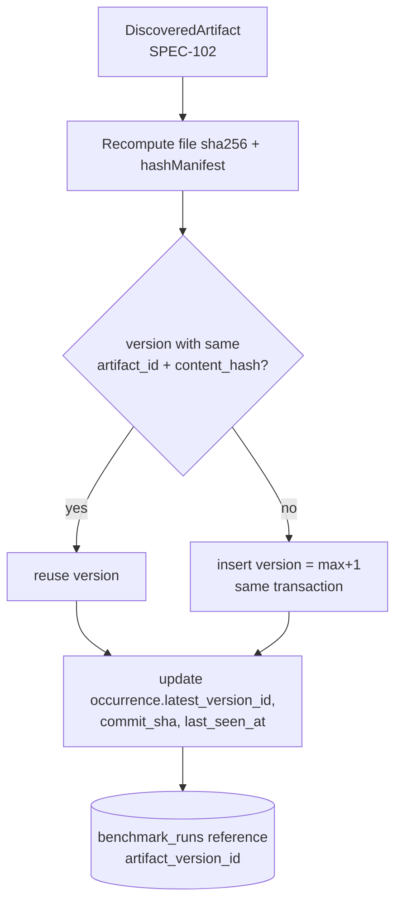

# SPEC-103 — Artifact Versioning

## 1. Summary

Every distinct content state of an artifact is captured as an **immutable artifact version**, identified by a content hash (SHA-256 over a sorted file manifest) and numbered sequentially per artifact. Versions are de-duplicated by hash, survive renames, moves and deletions, and are the unit that benchmarks evaluate: every benchmark result points to exactly one artifact version.

## 2. Motivation and problem statement

An evaluation is only meaningful for the exact bytes that were tested. Skills and rules change frequently in their repositories; without immutable versions, a "passed" badge would silently refer to content that no longer exists, and improvements or regressions between edits could not be measured. Versioning also lets DirectiveBench keep history when files are moved or deleted upstream.

## 3. Goals

- Immutable, content-addressed versions with human-friendly sequential numbers (v1, v2, …).
- Deterministic hashing independent of file order, timestamps and file modes.
- No duplicate versions for identical content of the same artifact.
- Identity preserved across renames/moves where detectable.
- Deleted artifacts keep their versions and evaluation history.
- Results always attributable to one version; version-over-version comparison possible when comparable.

## 4. Non-goals

- Mirroring git history (DirectiveBench versions only the states it observes during sync/import, not every commit).
- Branching/merging of artifact versions.
- Editing versions (they are immutable by definition).
- Rendering diffs in the bootstrap (future, §19).

## 5. User stories

- US-103-01: As a skill author, I want each change of my skill recorded as a new version so I can see whether v3 performs better than v2.
- US-103-02: As a user, I want a benchmark result to always show which exact version (hash) was tested.
- US-103-03: As a user, I want moving a skill directory to a new path to keep its history.
- US-103-04: As a user, I want an artifact deleted upstream to remain visible (as removed) with its past evaluations.

## 6. Functional requirements

| ID | Requirement |
|----|-------------|
| FR-103-01 | An artifact version SHALL be immutable: after insert, no column of an `artifact_versions` row is ever updated. Corrections create a new version. |
| FR-103-02 | Each version SHALL store: `artifact_id`, `version` (integer), `content_hash`, `format`, `primary_file`, `files` (array of `{ path, sha256, size, content }`), `parsed_metadata`, provenance (`source_repository_id`, `source_path`, `source_commit_sha`), `created_at`. |
| FR-103-03 | **File hash**: `sha256` (lowercase hex) of the file's raw bytes as read from the source, without line-ending or encoding normalisation. |
| FR-103-04 | **Content hash**: `hashManifest(entries)` from `@directivebench/core`: entries `{ path, sha256 }` sorted by `path` (JavaScript string comparison, i.e. UTF-16 code-unit order), each serialised as `` `${path}\0${sha256}` ``, joined with `\n`, then SHA-256 (lowercase hex) of the UTF-8 result. File sizes, modes and timestamps are NOT part of the hash. |
| FR-103-05 | **Manifest paths** SHALL be POSIX paths relative to the artifact root: for directory-based skills, relative to the skill directory (e.g. `SKILL.md`, `scripts/check.sh`); for single-file artifacts, the file's basename (e.g. `AGENTS.md`, `react.mdc`). Consequently, moving an artifact to another directory does not change its content hash. |
| FR-103-06 | **Version numbers** SHALL be sequential per artifact starting at 1, assigned as `max(version) + 1` inside the same transaction as the insert; uniqueness `(artifact_id, version)` is enforced by the database. |
| FR-103-07 | **Deduplication**: uniqueness `(artifact_id, content_hash)` is enforced. When observed content matches an existing version of the same artifact (including a revert to older content), the existing version SHALL be reused and no new version is created; the occurrence's `latest_version_id` points to it. |
| FR-103-08 | The same content in two different artifacts yields two versions (one per artifact) with equal `content_hash`; this is how possible duplicates are detected ([SPEC-101](2026-10-14-artifact-registry.md) §8.3). |
| FR-103-09 | **Rename/move detection** (during one sync of one repository, [SPEC-105](2026-10-14-repository-synchronization.md)): a newly discovered artifact of the same format as an occurrence that disappeared in the same sync is treated as moved if (a) for directory-based artifacts, `content_hash` is equal, or (b) for single-file artifacts, the primary file `sha256` is equal. The existing occurrence's `path` is updated (no new artifact, no new version). Ambiguous matches (several candidates with the same hash) are not auto-resolved: the old occurrence is marked removed and new artifacts are created, with a sync warning. |
| FR-103-10 | Moves combined with content changes are NOT detected automatically (they appear as remove + add). Manual re-linking is a future registry action ([SPEC-101](2026-10-14-artifact-registry.md)). |
| FR-103-11 | **Deleted artifacts**: when an occurrence disappears, its status becomes `removed`; versions, categories, notes and results remain. If the same content reappears at the same path later, the occurrence is reactivated (`active`) and points to the matching version. |
| FR-103-12 | Versions SHALL NOT be deleted while any `benchmark_runs.artifact_version_id` references them (the foreign key has no cascade). Artifact hard delete (future) must check this first. |
| FR-103-13 | **Relation to results**: every benchmark run references exactly one artifact version. The registry SHALL present results per version; an artifact's "latest evaluation" in the list refers to the latest *evaluated* version and SHALL be flagged "evaluated on vN, latest is vM" when N < M. |
| FR-103-14 | Version-over-version comparison (e.g. v3 vs v2 candidate scores) SHALL only be shown when both runs share the same comparability key ([SPEC-111](2026-10-14-benchmark-scoring.md)). The artifact version is deliberately not part of the comparability key, so baselines are shared across versions. |
| FR-103-15 | Provenance fields record where a version was **first** observed; later observations of the same content elsewhere are visible through occurrences, not by mutating the version. |

## 7. Non-functional requirements

- NFR-103-01: Hashing is streaming and linear in total artifact size; a 20 MiB skill hashes in < 1 s.
- NFR-103-02: Determinism across OSes: identical bytes and relative paths → identical hash on Linux, macOS, Windows.
- NFR-103-03: Version insert + occurrence update happen in one database transaction (no orphan versions on crash).

## 8. Domain entities and contracts

Authoritative types: `packages/database/src/schema.ts` (`artifactVersions`, `StoredArtifactFile`), `packages/core/src/hash.ts` (`hashManifest`, `ManifestEntry`, `sha256`), `packages/core/src/models.ts` (`ArtifactFile`, `ArtifactBundle`). Overview in [SPEC-005](2026-10-14-domain-model.md) / [SPEC-006](2026-10-14-database-schema.md).

```ts
interface ArtifactVersion {           // row of artifact_versions
  id: string;                         // prefixed random id
  artifactId: string;
  version: number;                    // 1, 2, 3 … per artifact
  contentHash: string;                // hashManifest(files.map(f => ({ path: f.path, sha256: f.sha256 })))
  format: ArtifactFormat;
  primaryFile: string;                // manifest path of the primary file, e.g. 'SKILL.md'
  files: { path: string; sha256: string; size: number; content: string }[]; // text files (MVP)
  parsedMetadata: Record<string, unknown>; // ParsedArtifact without body (SPEC-102)
  sourceRepositoryId: string | null;
  sourcePath: string | null;          // repository-relative occurrence path at first observation
  sourceCommitSha: string | null;
  createdAt: string;
}

/** What an agent adapter receives to install one exact version (packages/core/src/models.ts). */
interface ArtifactBundle {
  artifactId: string; versionId: string; slug: string; name: string;
  type: ArtifactType; format: ArtifactFormat; contentHash: string;
  files: ArtifactFile[];
}

/** Planned repository function. */
function recordObservedVersion(input: {
  artifactId: string;
  observed: { format: ArtifactFormat; primaryFile: string; files: ArtifactFile[]; parsedMetadata: Record<string, unknown> };
  provenance: { repositoryId: string | null; path: string | null; commitSha: string | null };
}): Promise<{ version: ArtifactVersion; created: boolean }>;
```

`recordObservedVersion` recomputes `contentHash` from `files` (never trusts a caller-supplied hash), returns the existing version when `(artifactId, contentHash)` exists, otherwise inserts with the next version number.

## 9. Data flow



## 10. API and interface design

- Database repository functions (indicative): `recordObservedVersion`, `listArtifactVersions(artifactId)`, `getArtifactVersion(versionId)`, `getArtifactBundle(versionId)` (used by job payloads and adapters).
- UI: Versions tab on artifact detail ([SPEC-101](2026-10-14-artifact-registry.md)); content tab with version selector.
- Planned `/api/v1/artifact-versions/:id` ([SPEC-008](2026-10-14-api-architecture.md)).
- No mutation endpoint for versions exists or will exist.

## 11. UI/UX considerations

- Versions table: `v3 · 3f2a9c1 (short hash) · created at · first seen at <repo>:<path>@<short sha> · evaluations (count, latest status)`.
- Badge "latest" on the highest version; "evaluated on vN, latest is vM" notice when applicable.
- Full hash copyable; hash explained in a tooltip ("SHA-256 over the sorted file manifest").
- Removed artifacts show a "Removed upstream on <date>" banner; versions remain browsable.

## 12. Security considerations

- Hashes are recomputed server-side from content; never accepted from clients or definition files.
- Immutability is enforced by repository code (no update function) and should be enforced by tests; a DB trigger forbidding `UPDATE` on `artifact_versions` is optional (portability, [ADR-0009](../decisions/0009-self-hosted-readiness.md)).
- SHA-256 is used for identity/deduplication, not as a security signature.

## 13. Error handling

- Unique violation on `(artifact_id, version)` from a concurrent insert → retry the transaction once with a fresh `max(version)`; then fail the sync item with a clear error.
- Unique violation on `(artifact_id, content_hash)` → treat as "version exists" and reuse it.
- Content that fails to read (I/O error) → no version created; occurrence keeps its previous version; error reported in the sync run.

## 14. Edge cases

- **Line endings**: a checkout with `core.autocrlf=true` on Windows changes bytes and therefore the hash, producing a new version without semantic change. Mitigation: for git sources read blobs from the object store at the commit (bytes as committed, [SPEC-105](2026-10-14-repository-synchronization.md)); local directories hash what is on disk. Normalisation is an open question.
- **Revert**: content A → B → A yields versions v1 (A), v2 (B) and the occurrence points back to v1; history shows the sequence through sync runs.
- **Same content, two paths, one repository** → one artifact, two occurrences, one version.
- **Skill gains a supporting file** → new version (manifest changed) even if `SKILL.md` unchanged.
- **Empty skill directory except SKILL.md** → one-entry manifest.
- **Unicode file names**: compared/sorted as JS strings; NFC vs NFD names (macOS) can produce different hashes for "the same" name — recorded as-is.
- **Rename of a single-file rule** (`a.mdc` → `b.mdc`, same bytes): detected as move (FR-103-09 b); the content hash changes because the manifest path (basename) changes, so a new version is created for the same artifact.

## 15. Testing strategy

Per [SPEC-012](2026-10-14-testing-strategy.md):
- Unit (`packages/core`): `hashManifest` order independence, known-answer test vector, path/sha separator robustness.
- Database integration: dedup on equal hash, sequential numbering, revert reuses old version, transaction rollback leaves no orphan version, FK prevents deleting a version referenced by a benchmark run.
- Sync integration (future, with fixture repositories): move detection for directories and single files, ambiguous move, delete + reappear.

## 16. Acceptance criteria

- [ ] Importing identical content twice for the same artifact yields one version.
- [ ] Changing one byte in any file yields a new version with `version = previous max + 1`.
- [ ] Reordering files never changes `content_hash`; a fixed test vector produces a documented hash.
- [ ] No code path updates an `artifact_versions` row (verified by test/grep of repository functions).
- [ ] Each benchmark run detail shows the artifact version number and hash it evaluated.
- [ ] (Sync, future) Moving a skill directory keeps the artifact ID and does not create a new version.
- [ ] (Sync, future) Deleting an artifact upstream marks its occurrences `removed` and keeps its evaluation history visible.

## 17. Dependencies

`@directivebench/core` (`hash.ts`), `@directivebench/database` (`artifact_versions`, `artifact_occurrences`, `benchmark_runs`), [SPEC-102](2026-10-14-artifact-discovery.md), [SPEC-105](2026-10-14-repository-synchronization.md), [SPEC-111](2026-10-14-benchmark-scoring.md).

## 18. Open questions

- OQ-103-01: Should line endings be normalised (CRLF → LF) before hashing text files to avoid spurious versions? Trade-off: fidelity vs stability.
- OQ-103-02: Should the manifest path of single-file artifacts be a fixed logical name (e.g. the format's canonical filename) so that renames do not create new versions?
- OQ-103-03: Should version-level provenance list *all* observations (separate `artifact_version_observations` table) rather than only the first?
- OQ-103-04: Should binary supporting files (planned) be part of the content hash once stored?

## 19. Future extensions

- Version diff view (unified diff per file, manifest changes, parsed-metadata changes, side-by-side evaluation deltas).
- Pinning a version as "current" for an artifact independent of the highest number.
- Blob storage for binary files and large content (content-addressed under the data dir).
- Version labels mapped to git tags/releases.

## 20. Implementation status

- **Implemented (verified by `packages/database/test/artifacts.test.ts` "creates immutable versions only for new content and preserves user metadata", `core` hashing tests and `runner.test.ts` re-import idempotency):** `hashManifest`/`sha256` in `packages/core/src/hash.ts`; `artifact_versions` table with unique `(artifact_id, content_hash)` and `(artifact_id, version)`; `importArtifactVersion` in `packages/database/src/repositories/artifacts.ts` (dedup by hash, `max(version)+1`, single transaction, occurrence upsert; ID prefixes `art_`, `artv_`, `occ_`) used when importing bundled examples; `getArtifactBundle` for adapters; benchmark runs reference `artifact_version_id`.
- **Partially implemented:** version history on the artifact detail page and per-version evaluation rows exist in `apps/web` but are not covered by a verified automated test.
- **Not implemented:** server-side recomputation of `contentHash` inside the repository function (bootstrap accepts the caller-computed hash from trusted import code — FR-103-04 / §12 require recomputation before any untrusted source is wired in), versions from repository sync, move/rename detection, removed-occurrence handling, "evaluated on vN, latest is vM" notice, version-over-version comparison, diff view, binary file storage.
