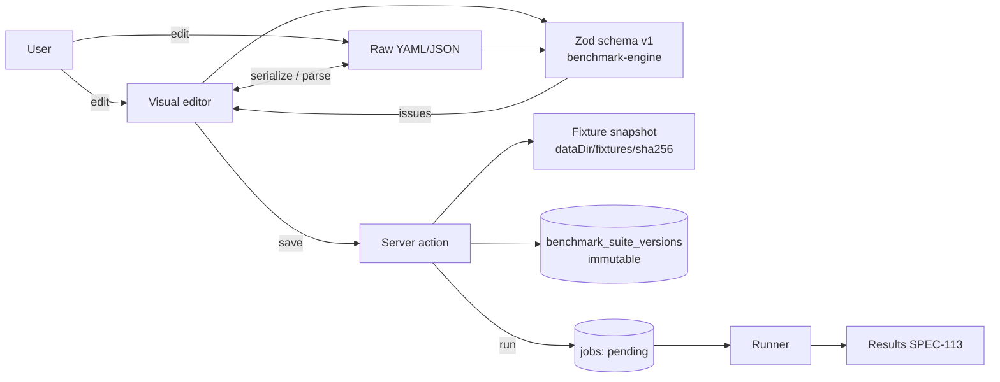

# SPEC-109 — Benchmark Builder

## 1. Summary

The Benchmark Builder is a future interactive web editor for creating and maintaining benchmark suites without hand-writing YAML/JSON. It offers a structured visual editor and a raw YAML/JSON view of the same definition, both validated by the exact Zod schema that defines the benchmark definition format v1 ([SPEC-108](2026-10-14-benchmark-definition-format.md)). Saving never mutates an existing suite version; it creates a new immutable `benchmark_suite_versions` row.

In the bootstrap, **no editor exists**. Only the format schema, the loader/importer and bundled example suites are available; the "Benchmark Builder" navigation entry shows an honest "Planned — not implemented" page that links to this spec.

## 2. Motivation and problem statement

Writing benchmark definitions by hand is error-prone: case ids must be unique, assertion weights and `required` flags have scoring consequences ([SPEC-111](2026-10-14-benchmark-scoring.md)), fixtures must be snapshot-able directories, and the selected agent/model/environment must be mutually compatible. Users who maintain skills and rules (not benchmark experts) need a guided way to author suites, see validation errors in context, preview the effective scoring, and run the suite — while keeping the text format as the canonical, reviewable, version-controllable representation.

## 3. Goals

- Create, edit, duplicate, export and import benchmark suites from the UI.
- Edit every field of format v1: name, description, technologies, categories, execution settings, cases (prompt, fixture, verification overlay, setup commands, allowed changes, assertions, mock playbook).
- Validate with the **same** Zod schema used by the loader (single source of truth in `@directivebench/benchmark-engine`).
- Visual editor and raw YAML/JSON view coexist with a round-trip guarantee.
- Validate agent/model/environment compatibility using adapter capabilities ([ADR 0006](../decisions/0006-agent-adapters-vs-model-providers.md)).
- Preview effective scoring (weights, required assertions, thresholds) before running.
- Saving produces a new immutable suite version; runs always reference a specific version.
- Launch a run and navigate to its results.

## 4. Non-goals

- Replacing the text format; the builder is a view over format v1, not a separate model.
- A general-purpose code/fixture IDE. Fixture contents are selected from a directory, not authored file-by-file (a minimal file editor is a future extension).
- Collaborative real-time editing (single-user local-first; see [SPEC-011](2026-10-14-self-hosting-architecture.md) for multi-user future).
- Auto-generating benchmarks with an LLM (possible future proposal; never in MVP).
- Cross-suite comparisons or global leaderboards ([SPEC-111](2026-10-14-benchmark-scoring.md) forbids them).

## 5. User stories

- As a skill author, I create a suite for my skill, add three cases with prompts and fixtures, and run it against the mock agent to check wiring.
- As a reviewer, I switch to the YAML view to read exactly what will be executed, and copy it into a pull request.
- As a user, I paste a YAML definition I received, see field-level validation errors, fix them in the visual editor, and save.
- As a user, I duplicate an existing suite to create a variant for another technology, keeping the original intact.
- As a user, I try to select Cursor Agent with an Anthropic API model and get an explanation why the combination is not compatible.
- As a user, I see that saving after a run creates version N+1 and that previous results remain attached to version N.

## 6. Functional requirements

| ID | Requirement |
|---|---|
| FR-109-01 | The builder SHALL create a new suite with `schemaVersion: 1`, a unique slug `id`, `name`, optional `description`. |
| FR-109-02 | The builder SHALL edit `technologies[]` (free-form tags) and `categories[]` (selected from the category registry, [SPEC-106](2026-10-14-category-management.md)). |
| FR-109-03 | The builder SHALL manage `cases[]`: add, remove, reorder, duplicate; each case edits `id`, `name`, `description`, `prompt`, `fixture.path`, `verification.overlay`, `setup[]`, `allowedChanges[]`, `assertions[]`, optional `mock.playbook[]`. |
| FR-109-04 | Case ids SHALL be unique within a suite; assertion ids SHALL be unique within a case; violations are shown inline. |
| FR-109-05 | Fixture selection SHALL choose a local directory (or, future, a repository path at a commit); the builder SHALL show the snapshot hash after snapshotting, and SHALL reject symlinks and paths escaping the root (same rules as import, [SPEC-110](2026-10-14-benchmark-execution.md)). |
| FR-109-06 | Execution settings SHALL edit `agent` (adapter id), optional `model {provider, model}`, `environment.kind` (`local-process` \| `docker`), `timeoutSeconds`, `repetitions`, `maxOutputBytes`. |
| FR-109-07 | The builder SHALL validate agent ↔ model ↔ environment compatibility from adapter capability descriptors and SHALL block saving an incompatible combination with an explanation. Unavailable-but-valid choices (e.g. `docker` not implemented) SHALL be saveable with a visible warning that the suite cannot run yet. |
| FR-109-08 | Assertions SHALL support all implemented types (`command`, `file-exists`, `file-contains`, `changed-files`) with `id`, `description`, `weight` (≥ 0, default 1), `required` (default false). Planned types SHALL appear disabled with a "Planned" label, never as working options. |
| FR-109-09 | Command fields (`setup`, `command` assertions) SHALL be edited as argv arrays, never as a shell string. |
| FR-109-10 | Scoring settings SHALL edit `passThreshold` (0..1, default 1), `minDelta` (default 0.05), `stabilityThreshold` (default 0.1). |
| FR-109-11 | A preview panel SHALL show per-case normalized weights (w / Σw), required assertions, the max achievable score and a warning when Σw = 0 or when `passThreshold` can never be reached without required assertions. |
| FR-109-12 | Validation SHALL use the exact Zod schema exported by `@directivebench/benchmark-engine`; errors SHALL map to the field path in both visual and raw views. |
| FR-109-13 | The raw view SHALL support YAML and JSON. Switching views SHALL be lossless for every schema-valid document (see round-trip guarantees, §8). |
| FR-109-14 | Saving SHALL create a new immutable suite version (`benchmark_suite_versions`), with sequential version number and content hash; saving identical content SHALL NOT create a new version. |
| FR-109-15 | A newly saved version SHALL have `execution_approved_at = null` unless the user explicitly approves execution in the same flow, in which case `execution_approved_at` is set and `execution_approval_source = "user"` (see [SPEC-110](2026-10-14-benchmark-execution.md)). |
| FR-109-16 | "Run" SHALL enqueue a job for a specific suite version and artifact version (candidate) via the same API used by the Benchmarks page; the builder SHALL never execute anything itself. |
| FR-109-17 | "Duplicate" SHALL create a new suite (new id/slug) whose version 1 copies the source definition and references the same fixture snapshots. |
| FR-109-18 | "Export" SHALL produce a portable bundle: definition file + fixture/overlay directories (or archive). "Import" SHALL run the same loader as `directivebench` import, including snapshotting and schema validation. |
| FR-109-19 | Unsaved changes SHALL be kept as a local draft (per-browser) and the user warned on navigation away. |
| FR-109-20 | Results for a suite SHALL be reachable from the builder (link to [SPEC-113](2026-10-14-results-and-reporting.md) views filtered by suite version). |

## 7. Non-functional requirements

- Validation feedback within 200 ms for definitions up to 200 cases.
- Keyboard-accessible editing; all controls labelled ([SPEC-116](2026-10-14-dashboard-and-navigation.md)).
- No network access required; fully local.
- The builder must not introduce a second schema; any format change is made once in the engine package.

## 8. Domain entities and contracts

```ts
// Single source of truth (benchmark-engine)
import type { BenchmarkDefinitionV1 } from "@directivebench/benchmark-engine";

interface BuilderDraft {
  suiteId: string | null;          // null for a not-yet-saved suite
  baseVersionId: string | null;    // version the draft was derived from
  definition: unknown;             // possibly invalid while editing
  rawText?: { format: "yaml" | "json"; text: string };
  updatedAt: string;               // ISO-8601 UTC
}

interface ValidationIssue {
  path: (string | number)[];       // Zod issue path, e.g. ["cases", 0, "assertions", 2, "weight"]
  message: string;
  severity: "error" | "warning";   // warnings: e.g. docker not implemented
}

interface CompatibilityResult {
  compatible: boolean;
  reasons: string[];               // human readable
  runnableNow: boolean;            // false if environment/adapter execution not implemented
}

interface SaveSuiteVersionResult {
  suiteId: string;
  versionId: string;
  versionNumber: number;
  contentHash: string;
  created: boolean;                // false when content identical to latest
}
```

**Round-trip guarantees.**

1. `parse(serialize(d))` deep-equals `d` for every schema-valid definition `d` (both YAML and JSON).
2. The stored canonical form is the **normalized JSON** (defaults applied, key order canonical); the content hash is computed over it. Comments and formatting of user YAML are preserved in the raw view while editing but are not part of the stored definition (documented limitation).
3. Visual edits never drop unknown-but-valid fields; if the schema rejects unknown keys, the raw view shows the error rather than silently removing them.
4. Switching from raw to visual with an invalid document is allowed only in a read-only "fix errors first" mode.

## 9. Data flow



## 10. API and interface design

Server actions / route handlers in `apps/web` (see [SPEC-008](2026-10-14-api-architecture.md)); all are future:

- `validateDefinition(input: unknown): ValidationIssue[]`
- `checkCompatibility(execution): CompatibilityResult`
- `snapshotFixture(path): { hash: string; fileCount: number; bytes: number }`
- `saveSuiteVersion(suiteId | null, definition, { approveExecution: boolean }): SaveSuiteVersionResult`
- `duplicateSuite(suiteId, newSlug): SaveSuiteVersionResult`
- `exportSuite(versionId): Blob` / `importSuite(bundle): SaveSuiteVersionResult`
- `enqueueBenchmarkRun({ suiteVersionId, artifactVersionId }): { jobId }` (shared with the Benchmarks page)

## 11. UI/UX considerations

- Two-pane layout: left tree (suite → cases → assertions), right form; tab toggle "Visual / YAML / JSON".
- Inline error badges per node in the tree; a summary list with jump-to-field.
- Environment selector shows `local-process` as **"Not sandboxed"** and `docker` as **"Planned — not implemented"**.
- Agent selector shows the Mock Agent as "Mock Agent (deterministic, no AI)".
- Command execution approval is an explicit, separate confirmation listing every command (setup and command assertions) with argv.
- Save button text states the effect: "Save as version N+1".

## 12. Security considerations

- Definitions contain commands that will execute on the user's machine. Imported or pasted definitions are untrusted: never auto-approve execution (only bundled examples are approved at import, per brief). See [SPEC-007](2026-10-14-security-and-privacy.md) and [ADR 0007](../decisions/0007-local-runner-execution-and-isolation.md).
- Fixture paths are resolved and checked for symlinks/escapes before snapshotting.
- Exported bundles must not contain secrets; secret references ([ADR 0008](../decisions/0008-secret-storage-and-authentication.md)) are exported by name only.
- Raw YAML parsing must disable custom tags/anchors abuse (alias expansion limits) to prevent billion-laughs style payloads.

## 13. Error handling

- Invalid schema: block save, show issues; draft is preserved.
- Fixture snapshot failure (permissions, symlink, size): field-level error with the offending path.
- Concurrent save from another tab: version numbers are allocated atomically; the second save becomes version N+2 (no overwrite) and the UI notes it.
- Import of a bundle with unknown `schemaVersion`: reject with "unsupported schema version".

## 14. Edge cases

- Σ weights = 0 in a case → warning; run score defined as 0 (see [SPEC-111](2026-10-14-benchmark-scoring.md)).
- All assertions `required` and `passThreshold` < 1 → allowed; preview explains interplay.
- Suite with zero cases → invalid.
- Renaming a case id changes comparability with older versions' per-case results; the UI warns.
- Very large fixtures → show size, warn above a configurable limit.
- Duplicate of a suite that references fixtures missing from the data dir → fail with a clear error.

## 15. Testing strategy

- Unit: round-trip property tests (YAML ↔ object ↔ JSON) over generated valid definitions; compatibility matrix tests.
- Component tests for the editor forms (validation error mapping by Zod path).
- E2E (Playwright): create suite → save → run with mock agent → open results; import invalid YAML → see errors.
- Regression: the builder and the CLI loader produce identical normalized JSON and content hash for the same input.

## 16. Acceptance criteria

- [ ] Creating and saving a suite produces `benchmark_suite_versions` row version 1 with content hash.
- [ ] Editing and saving creates version 2; version 1 is unchanged and still referenced by its runs.
- [ ] Saving identical content does not create a new version.
- [ ] YAML → visual → JSON → YAML round-trip yields a deep-equal definition for all bundled examples.
- [ ] Validation errors appear at the exact field for a wrong `weight` type.
- [ ] An incompatible agent/model combination cannot be saved; `docker` can be saved with a "cannot run yet" warning.
- [ ] A new version is not execution-approved unless the user confirms the command list.
- [ ] Duplicate creates a new suite id; export → import reproduces the same normalized definition hash.

## 17. Dependencies

[SPEC-108](2026-10-14-benchmark-definition-format.md) (schema), [SPEC-107](2026-10-14-benchmark-engine.md) (loader, snapshotting), [SPEC-110](2026-10-14-benchmark-execution.md) (approval, environments), [SPEC-111](2026-10-14-benchmark-scoring.md) (preview semantics), [SPEC-106](2026-10-14-category-management.md), [SPEC-114](2026-10-14-runner-management.md) (jobs), [SPEC-006](2026-10-14-database-schema.md).

## 18. Open questions

- Should YAML comments be persisted (store original text alongside normalized JSON)?
- Should drafts be stored in SQLite (survive browser change) instead of browser storage?
- How should fixture authoring work for repository-sourced fixtures (commit pinning UI)?
- Should "required" assertions be visually distinct in the preview score bar?

## 19. Future extensions

- Minimal in-browser fixture file editor with snapshot on save.
- Templates per technology (e.g. WordPress, Next.js) seeded from examples.
- Diff view between suite versions.
- LLM-assisted case suggestion (proposal; output always reviewed, never auto-approved).
- Promptfoo export ([SPEC-212](2026-10-14-integration-promptfoo-optional.md)).

## 20. Implementation status

- **Implemented in bootstrap:** none of the builder UI. The prerequisites exist as described in the architecture: format v1 Zod schema and loader/importer in `@directivebench/benchmark-engine`, fixture snapshotting, immutable `benchmark_suite_versions`, bundled example suites.
- **Partially implemented:** none.
- **Not implemented:** visual editor, raw view, compatibility validation UI, preview, save-as-version from UI, duplicate, export/import, execution approval UX. The "Benchmark Builder" page is a "Planned — not implemented" placeholder linking to this spec.
