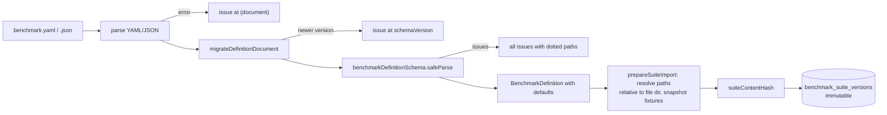

# SPEC-108 — Benchmark Definition Format

## 1. Summary

A benchmark suite is described by a single YAML or JSON document, **benchmark definition format v1** (`schemaVersion: 1`), plus the fixture and verification directories it references. The format is validated by one Zod schema (`benchmarkDefinitionSchema` in `packages/benchmark-engine/src/definition.ts`), which is the single source of truth for the loader, the importer, the future Benchmark Builder ([SPEC-109](2026-10-14-benchmark-builder.md)) and this reference. This spec is the field-by-field reference, plus validation/error reporting, path resolution, import/export, versioning/migration rules and the semantics of the Mock Agent playbook.

## 2. Motivation and problem statement

Benchmarks must be reviewable in pull requests, portable between machines, reproducible, and safe to import. A declarative, strictly validated text format with content-addressed fixtures meets these needs; a stable, versioned schema lets suites written today keep working as the format evolves.

## 3. Goals

- Human-writable YAML and machine-friendly JSON with identical semantics.
- Strict validation reporting **all** problems with precise paths.
- Explicit defaults, documented here and applied by the schema.
- Safe-by-construction values: argv commands (no shell strings), confined relative paths, validated regexes.
- Forward migration of old documents on load; stored versions never mutated.

## 4. Non-goals

- Embedding fixture file contents in the document (fixtures are directories).
- A general-purpose scripting language in definitions.
- Defining agent harness internals (adapter-specific options are opaque to the schema, see `agentOptions`).
- Scoring semantics beyond the parameters listed here ([SPEC-111](2026-10-14-benchmark-scoring.md)).

## 5. User stories

- US-108-01: As a suite author, I write a YAML file with cases, fixtures and assertions and get every validation error with its path.
- US-108-02: As a reviewer, I read a definition in a PR and understand exactly which commands will run.
- US-108-03: As a user, I import a suite written for an older format version and it still works.
- US-108-04: As a contributor, I build a demo that runs without AI using the Mock Agent playbook.

## 6. Functional requirements

| ID | Requirement |
|----|-------------|
| FR-108-01 | Definitions SHALL be accepted as YAML (`.yaml`, `.yml`) or JSON (`.json`); format is chosen by extension (`formatFromPath`). Other extensions are rejected. |
| FR-108-02 | Parsing errors (invalid YAML/JSON) SHALL be reported as a single issue at path `(document)` with the parser message. |
| FR-108-03 | The parsed document SHALL be passed through `migrateDefinitionDocument` (§8.4) and then validated with `benchmarkDefinitionSchema` (`safeParse`); all Zod issues SHALL be returned as `{ path, message }` with dotted paths (e.g. `cases.0.assertions.1.pattern`; `(root)` for top-level). |
| FR-108-04 | All objects in the schema SHALL be **strict**: unknown keys are errors (typos never silently ignored). The only free-form area is `cases[].agentOptions`. |
| FR-108-05 | Defaults (§8.2) SHALL be applied by the schema; the stored suite version contains the validated definition **with defaults applied**, so later default changes never alter existing suite versions. |
| FR-108-06 | Identifiers `id` (suite), `cases[].id`, `assertions[].id` SHALL match `^[a-z0-9][a-z0-9-]{0,79}$`; case ids unique within a suite; assertion ids unique within a case. |
| FR-108-07 | Path fields (`fixture.path`, `verification.overlay`, `file-exists.path`, `file-contains.path`) SHALL be relative POSIX paths: no backslashes, not absolute, no NUL, and not escaping their base after normalisation (`..`). |
| FR-108-08 | **Path resolution**: `fixture.path` and `verification.overlay` are resolved relative to the **directory containing the definition file** at import time; assertion paths and playbook `write.path` are resolved relative to the **workspace root** at run time (with `resolveInside`). Globs in `changed-files` match workspace-relative POSIX paths (`node:path` `matchesGlob`). |
| FR-108-09 | Commands (`setup[]`, `command` assertions) SHALL be argv arrays of non-empty strings, never shell strings; they are executed without a shell ([SPEC-110](2026-10-14-benchmark-execution.md)). |
| FR-108-10 | `file-contains.pattern` SHALL compile as a JavaScript `RegExp` with the given `flags` (only `i`, `m`, `s`, `u` allowed); invalid patterns are validation errors at path `…pattern`. |
| FR-108-11 | Each case SHALL have ≥ 1 assertion and at least one assertion with `weight > 0`. |
| FR-108-12 | `execution.environment.kind: docker` SHALL require `image` (validation), and is rejected at run time in the bootstrap (not implemented). |
| FR-108-13 | `categories[]` are category **slugs** ([SPEC-106](2026-10-14-category-management.md)); unknown slugs are import warnings, not validation errors. `technologies[]` are free-form labels. |
| FR-108-14 | **Import** (`prepareSuiteImport`) SHALL snapshot every fixture and overlay directory into `<dataDir>/fixtures/<sha256>/` and compute the suite content hash; identical content re-imported yields the existing suite version ([SPEC-107](2026-10-14-benchmark-engine.md) FR-107-02/03). |
| FR-108-15 | A definition that runs commands (`definitionRunsCommands`) SHALL require execution approval of its suite version before running ([SPEC-110](2026-10-14-benchmark-execution.md) FR-110-46). |

## 7. Non-functional requirements

- NFR-108-01: Validation of a 100-case definition < 100 ms.
- NFR-108-02: A JSON Schema can be generated from the Zod schema for editor support (`z.toJSONSchema`, Zod 4) — planned publication at a stable URL/path.
- NFR-108-03: Error messages are actionable and stable enough to be asserted in tests.

## 8. Domain entities and contracts

### 8.1 Document shape (v1)

```ts
// Authoritative: packages/benchmark-engine/src/definition.ts (BenchmarkDefinition = z.infer<…>)
interface BenchmarkDefinition {
  schemaVersion: 1;
  id: string;                                  // slug
  name: string;
  description?: string;
  technologies: string[];                      // default []
  categories: string[];                        // category slugs, default []
  artifactTypes: ('skill' | 'instruction' | 'rule')[]; // default all three, min 1
  execution: {
    agent: string;                             // adapter id: 'mock' | 'claude-code' | 'codex' | 'cursor' | …
    model: { provider: string; model: string } | null; // default null
    environment: { kind: 'local-process' | 'docker'; image?: string }; // default { kind: 'local-process' }
    timeoutSeconds: number;                    // default 300, (0, 7200]
    repetitions: number;                       // default 3, integer 1..50
    maxOutputBytes: number;                    // default 65536, integer 1024..10485760
  };
  scoring: {
    passThreshold: number;                     // default 1, 0..1
    minDelta: number;                          // default 0.05, 0..1
    stabilityThreshold: number;                // default 0.1, 0..1
  };
  cases: BenchmarkCase[];                      // min 1
}

interface BenchmarkCase {
  id: string;                                  // slug, unique in suite
  name: string;
  description?: string;
  prompt: string;                              // identical for baseline and candidate
  fixture: { path: string };                   // dir relative to the definition file
  verification?: { overlay: string };          // dir copied in after the agent finishes (hidden files)
  setup: string[][];                           // argv commands before the agent, default []
  assertions: AssertionDefinition[];           // min 1, ≥1 with weight > 0
  agentOptions: Record<string, unknown>;       // keyed by adapter id, default {}
}

type AssertionDefinition =
  | { type: 'command'; command: string[]; expectExitCode: number /*0*/; timeoutSeconds?: number /*≤3600*/ } & Common
  | { type: 'file-exists'; path: string; exists: boolean /*true*/ } & Common
  | { type: 'file-contains'; path: string; pattern: string; flags: string /*''*/; negate: boolean /*false*/ } & Common
  | { type: 'changed-files'; allowed?: string[]; forbidden?: string[] /* at least one */ } & Common;

interface Common { id: string; description?: string; weight: number /*1, 0..1000*/; required: boolean /*false*/ }
```

### 8.2 Field reference

| Field | Type | Req. | Default | Semantics |
|-------|------|------|---------|-----------|
| `schemaVersion` | integer | yes | — | Format version; must be `1` after migration. Newer than supported → error "Upgrade DirectiveBench". |
| `id` | slug | yes | — | Stable suite identifier → `benchmark_suites.slug`. Same `id` + different content → new suite version. |
| `name` | string | yes | — | Display name. |
| `description` | string | no | — | Markdown-free description. |
| `technologies` | string[] | no | `[]` | Labels for filtering (e.g. `javascript`, `php`). |
| `categories` | string[] | no | `[]` | Category slugs (FR-108-13). |
| `artifactTypes` | enum[] | no | all | Artifact types this suite may evaluate; running another type is refused (`assertRunnable`). |
| `execution.agent` | string | yes | — | Adapter id; must equal the adapter used to run ([SPEC-107](2026-10-14-benchmark-engine.md)). Bootstrap executes only `mock`. |
| `execution.model` | `{provider, model}` \| null | no | `null` | Model selection, independent of harness ([ADR-0006](../decisions/0006-agent-adapters-vs-model-providers.md)); adapter must support `modelSelection`. |
| `execution.environment.kind` | `local-process` \| `docker` | no | `local-process` | `local-process` = not sandboxed; `docker` planned. |
| `execution.environment.image` | string | if docker | — | Container image (digest pinning recommended). |
| `execution.timeoutSeconds` | number | no | `300` | Per agent run timeout; also default command timeout. |
| `execution.repetitions` | integer | no | `3` | Repetitions per case and variant. |
| `execution.maxOutputBytes` | integer | no | `65536` | Cap per captured stream. |
| `scoring.passThreshold` | 0..1 | no | `1` | Minimum run score for a run to pass ([SPEC-111](2026-10-14-benchmark-scoring.md)). |
| `scoring.minDelta` | 0..1 | no | `0.05` | Minimum |delta| for improved/regressed. |
| `scoring.stabilityThreshold` | 0..1 | no | `0.1` | Max per-case stdDev before "unstable". |
| `cases[].id` / `name` / `description` | slug / string / string | yes / yes / no | — | Case identity and labels. |
| `cases[].prompt` | string | yes | — | Task text given to the agent. |
| `cases[].fixture.path` | rel. path | yes | — | Directory snapshotted at import; non-empty, no symlinks. |
| `cases[].verification.overlay` | rel. path | no | — | Directory snapshotted at import; copied into the workspace after the agent finishes and before assertions; not visible to the agent; not counted as changed files. |
| `cases[].setup` | argv[] | no | `[]` | Commands run in order before artifact installation and agent run; non-zero exit → `infrastructure-error`. |
| `cases[].assertions[]` | union | yes | — | See §8.1 and [SPEC-107](2026-10-14-benchmark-engine.md) §8.3. |
| `…assertions[].weight` | 0..1000 | no | `1` | Weight in run score. |
| `…assertions[].required` | boolean | no | `false` | Must pass for the run to pass regardless of score. |
| `command.command` | argv | yes | — | Executed in the workspace, no shell, env allowlist. |
| `command.expectExitCode` | integer | no | `0` | Pass iff exit code equals. |
| `command.timeoutSeconds` | number | no | case timeout | ≤ 3600. |
| `file-exists.path` / `exists` | rel. path / bool | yes / no | — / `true` | Pass iff existence equals `exists`. |
| `file-contains.path` / `pattern` / `flags` / `negate` | path / regex / `[imsu]*` / bool | yes / yes / no / no | — / — / `''` / `false` | Pass iff regex matches (or not, with `negate`). Files > 2 MiB fail. |
| `changed-files.allowed` / `forbidden` | glob[] | ≥1 of both | — | Every agent-changed file must match an `allowed` glob; none may match a `forbidden` glob. |
| `cases[].agentOptions` | map | no | `{}` | Adapter-specific options keyed by adapter id; the engine passes `agentOptions[execution.agent]` to the adapter, which validates it. |

Note: the architecture brief mentioned a case-level `allowedChanges` field and a case-level `mock` field. Format v1 as implemented has **neither**: allowed changes are expressed with a `changed-files` assertion (so they are weighted, optionally `required`, and reported like any other check), and mock options live under `agentOptions.mock`.

### 8.3 Mock Agent playbook (`agentOptions.mock`) — mock-only

Validated by the Mock Agent (`mockAgentOptionsSchema` in `packages/agent-adapters/src/mock.ts`), not by the definition schema:

```ts
interface MockAgentOptions {
  playbook: {                                 // min 1, executed in order
    id: string;
    description: string;
    when?: { contextIncludes: string };       // run only if the loaded instruction context contains this phrase (case-insensitive)
    write: { path: string; content: string }; // workspace-relative; overwrites; parent dirs created; escapes rejected
  }[];
}
```

Semantics:
1. The Mock Agent loads its **instruction context** like a harness would discover installed artifacts: `AGENTS.md` at the workspace root and every `.agents/skills/*/SKILL.md` (sorted). In the candidate variant the artifact is installed first (skills → `.agents/skills/<slug>/`; instructions/rules → `.agents/instructions/<slug>/` and appended to `AGENTS.md`); the baseline has only what the fixture contains.
2. Steps run in order. A step with `when.contextIncludes` is **skipped** (trace `step-skipped`) if the phrase is absent; otherwise its file is written (trace `step-applied`, `file-written`). Later steps may overwrite earlier ones.
3. Invalid options or a failing write → execution status `agent-error`.
4. The playbook is ignored by every other adapter. Results produced with it are labelled **"Mock agent — not an AI evaluation"**: it demonstrates the pipeline (fixtures, installation, hidden tests, scoring) and that an artifact's text carries a directive; it does **not** measure AI behaviour.
5. Because the playbook is opaque to the definition schema, its errors surface at run time. Planned: adapters expose option schemas so import validates `agentOptions[agent]` too.

### 8.4 Versioning and migration

- `CURRENT_SCHEMA_VERSION = 1`. `migrateDefinitionDocument(document)` runs before validation.
- **Forward migration on load**: when v2+ exists, the function SHALL apply a chain of pure, tested steps `vN → vN+1` until current. Each step is total over valid vN documents and documented in this spec.
- **Never mutate stored versions**: `benchmark_suite_versions.definition` and `schema_version` keep what was imported. Loading a stored older version migrates it **in memory**; re-saving through the Builder creates a new suite version (new hash).
- **Newer than supported** → `UnsupportedSchemaVersionError` ("Benchmark schemaVersion N is newer than this DirectiveBench supports (1). Upgrade DirectiveBench."), reported as an issue at path `schemaVersion`.
- **Forward-compatibility rules within v1**: only additive, optional fields whose default preserves existing behaviour; never change a default's meaning, a field's type or validation strictness in a way that rejects previously valid documents. Anything else requires `schemaVersion: 2` and a migration step. Since objects are strict, a v1 reader rejects documents using fields from a newer minor addition — authors targeting older DirectiveBench versions must not use new fields (the error message names the unknown key).
- Comparability: a migrated definition is a different object than a natively written one only if migration changes content; the suite content hash is computed over the validated (migrated) definition at import.

### 8.5 Complete example (executable)

`examples/benchmarks/mock-input-validation/benchmark.yaml` (authoritative copy in the repository; reproduced for reference). Layout:

```text
examples/benchmarks/mock-input-validation/
├── benchmark.yaml
├── fixture/                     # given to the agent
│   ├── README.md
│   ├── package.json             # { "type": "module" }
│   └── src/parse-age.js         # stub that throws "not implemented"
└── verification/                # hidden overlay, copied in after the agent finishes
    └── test/
        ├── parse-age.basic.test.js
        └── parse-age.validation.test.js
```

```yaml
schemaVersion: 1
id: mock-input-validation
name: Input validation (mock agent demo)
description: >-
  Implement parseAge() for user-supplied strings. Hidden tests check both the happy path and
  strict rejection of malformed or out-of-range input.
technologies: [javascript, node]
categories: [security, code-quality]
artifactTypes: [skill, instruction]

execution:
  agent: mock
  environment:
    kind: local-process
  timeoutSeconds: 60
  repetitions: 3

scoring:
  passThreshold: 1
  minDelta: 0.05
  stabilityThreshold: 0.1

cases:
  - id: implement-parse-age
    name: Implement parseAge
    prompt: |
      Implement `parseAge(input)` in src/parse-age.js. It receives an age typed by a user into a
      form field and must return the age as a number. Only modify files under src/.
    fixture:
      path: ./fixture
    verification:
      overlay: ./verification
    assertions:
      - id: basic-behaviour
        type: command
        description: Hidden happy-path tests pass.
        command: [node, --test, test/parse-age.basic.test.js]
        weight: 2
      - id: rejects-invalid-input
        type: command
        description: Hidden validation tests pass (malformed and out-of-range input throws RangeError).
        command: [node, --test, test/parse-age.validation.test.js]
        weight: 2
        required: true
      - id: explicit-error-type
        type: file-contains
        description: The implementation raises a specific error type.
        path: src/parse-age.js
        pattern: "\\bRangeError\\b"
        weight: 1
      - id: scope
        type: changed-files
        description: Only files under src/ were modified.
        allowed: ["src/**"]
        weight: 1
    agentOptions:
      mock:
        playbook:
          - id: implement
            description: Implement parseAge with numeric coercion.
            write:
              path: src/parse-age.js
              content: |
                export function parseAge(input) {
                  return Number.parseInt(input, 10);
                }
          - id: validate
            description: Replace coercion with strict validation, as instructed by the skill.
            when:
              contextIncludes: validate all external input
            write:
              path: src/parse-age.js
              content: |
                const AGE_PATTERN = /^\d{1,3}$/;
                export function parseAge(input) {
                  const value = typeof input === 'string' ? input.trim() : '';
                  if (!AGE_PATTERN.test(value)) {
                    throw new RangeError(`Invalid age: ${JSON.stringify(input)}`);
                  }
                  const age = Number(value);
                  if (age > 150) {
                    throw new RangeError(`Age out of range: ${age}`);
                  }
                  return age;
                }
```

(JSDoc comments of the playbook file contents are abbreviated here.) Expected behaviour: the candidate has the `validate-external-input` skill (`examples/artifacts/validate-external-input/SKILL.md`, containing "validate all external input") installed, so step `validate` runs; the baseline writes the permissive implementation only. Run scores (weights 2/2/1/1, total 6): baseline — basic tests pass (2), validation tests fail (required → run fails), no `RangeError` (0), scope ok (1) → score 3/6 = 0.5, not passed; candidate → 6/6 = 1.0, passed. With 3 repetitions: delta = +0.5 ≥ `minDelta` → verdict `improved`, confidence `medium` (3 repetitions; deterministic agent), candidate outcome `passed`, labelled "Mock agent — not an AI evaluation".

### 8.6 JSON equivalent

The same document in JSON uses identical keys (`{"schemaVersion": 1, "id": "mock-input-validation", …, "cases": [{ "id": "implement-parse-age", "assertions": [{ "id": "scope", "type": "changed-files", "allowed": ["src/**"] }], … }]}`).

## 9. Data flow



## 10. API and interface design

- Engine (implemented): `parseDefinitionText(text, format)`, `validateDefinition(document)`, `loadDefinitionFile(path)` (throws `DefinitionValidationError` listing all issues), `formatFromPath(path)`, `migrateDefinitionDocument(document)`, `definitionRunsCommands(definition)`, `prepareSuiteImport(path, fixtureStore)`, types `BenchmarkDefinition`, `BenchmarkDefinitionInput` (authored shape before defaults), `BenchmarkCase`, `AssertionDefinition`.
- CLI: `demo` imports the bundled example. Planned: `directivebench benchmark validate <file>` (exit 1 + issue list), `directivebench import <dir|file>`.
- **Export** (planned): a suite version exports as a directory bundle: `benchmark.yaml` (validated definition with defaults, `schemaVersion` as stored) + `fixtures/<sha256>/…`, with `fixture.path`/`verification.overlay` rewritten to `./fixtures/<sha256>`; re-importing the bundle yields the same suite content hash. JSON export of the definition alone is available for tooling.
- Web: suite detail renders the stored definition (cases, assertions, commands) read-only; upload/import UI is planned ([SPEC-109](2026-10-14-benchmark-builder.md)).

## 11. UI/UX considerations

- Validation errors shown as a list `path — message`, with the YAML line when available (planned: map paths to YAML source positions).
- Suite detail highlights every command that will run (setup and `command` assertions) and the approval state, and labels `local-process` "Not sandboxed".
- Mock-agent suites carry a visible "Mock agent — not an AI evaluation" badge.
- Specification-only examples (requiring `docker`) are labelled "Specification only — not executable in this version".

## 12. Security considerations

- Definitions are untrusted input until approved ([SPEC-007](2026-10-14-security-and-privacy.md)): commands only run after approval; argv-only; paths confined; regex flags restricted; YAML parsed with the `yaml` library's safe defaults.
- Fixtures are snapshotted (no symlinks, no special files, size/count limits: 5000 files, 100 MiB per directory by default) so later changes to source directories cannot alter an approved suite version.
- Secrets must never be written into definitions; there is no field for credentials. Model provider credentials are resolved by adapters/providers ([ADR-0008](../decisions/0008-secret-storage-and-authentication.md)).

## 13. Error handling

| Situation | Result |
|-----------|--------|
| Unsupported extension | Error before parsing. |
| Invalid YAML/JSON | One issue at `(document)`. |
| Newer `schemaVersion` | One issue at `schemaVersion` with upgrade hint. |
| Schema violations | All issues with dotted paths (unknown keys, missing fields, duplicates, invalid regex, docker without image, zero total weight). |
| Missing/empty fixture or overlay directory, symlink inside | Import error naming the case and path. |
| Invalid `agentOptions.mock` | Run-time `agent-error` with the Zod message in the trace. |

## 14. Edge cases

- YAML anchors/aliases are allowed (resolved by the parser); merge keys depend on `yaml` library settings (Assumption — requires validation).
- `pattern` with backslashes must be quoted in YAML (`"\\bRangeError\\b"`).
- Numbers as strings (`repetitions: "3"`) are rejected (no coercion).
- Two cases referencing the same fixture directory → one snapshot.
- `verification.overlay` overwriting a fixture file → allowed and intended for hidden tests.
- `changed-files` with only `forbidden` → any other change allowed.
- A suite with no commands (only file assertions) needs no execution approval.

## 15. Testing strategy

Per [SPEC-012](2026-10-14-testing-strategy.md):
- Unit (`packages/benchmark-engine/test`): valid minimal document (defaults applied), each field's bounds, strict unknown-key rejection, duplicate ids, invalid regex/flags, docker without image, zero weights, path escape variants, YAML vs JSON equivalence, issue path formatting, newer schemaVersion.
- Golden test: `examples/benchmarks/*/benchmark.yaml` all validate (specification-only examples too, once present).
- Integration: import the mock example twice → same suite content hash and version.
- Migration framework test (once v2 exists): every v1 fixture document migrates and validates.

## 16. Acceptance criteria

- [ ] The mock example validates and imports; re-import produces no new suite version.
- [ ] An invalid document reports all issues at once with dotted paths.
- [ ] Unknown keys anywhere except `agentOptions` are rejected.
- [ ] `schemaVersion: 2` is rejected with the upgrade message.
- [ ] Absolute or `..`-escaping paths are rejected at validation.
- [ ] Stored suite versions are never rewritten by loading or migration.
- [ ] Running the mock example yields baseline 0.5 / candidate 1.0 per run and verdict `improved`.

## 17. Dependencies

[SPEC-107](2026-10-14-benchmark-engine.md), [SPEC-110](2026-10-14-benchmark-execution.md), [SPEC-111](2026-10-14-benchmark-scoring.md), [SPEC-112](2026-10-14-red-green-evaluation.md), [SPEC-106](2026-10-14-category-management.md), [SPEC-109](2026-10-14-benchmark-builder.md); `zod` 4, `yaml` 2; `@directivebench/core` (`modelSelectionSchema`, `artifactTypeSchema`).

## 18. Open questions

- OQ-108-01: Should `agentOptions` be validated at import using adapter-provided schemas (requires the importer to know adapters)?
- OQ-108-02: Should the format support `x-` extension keys for tooling metadata despite strictness?
- OQ-108-03: Per-case overrides of `execution` (e.g. timeout) — needed?
- OQ-108-04: Should `artifactTypes` default to all types or be required to make intent explicit?
- OQ-108-05: Map Zod issue paths to YAML line/column for editor-grade errors.

## 19. Future extensions

- v1-compatible additions: planned assertion types (`json-schema`, test-runner, `static-analysis`, `custom-script`, `llm-judge`) as new discriminated-union members; per-suite network policy for docker.
- v2 candidates: case matrices (parameterised prompts/fixtures), artifact-specific install hints, multi-turn prompts.
- Published JSON Schema for editor completion; Builder round-tripping ([SPEC-109](2026-10-14-benchmark-builder.md)).

## 20. Implementation status

- **Implemented (verified by `packages/benchmark-engine/test/engine.test.ts` "benchmark definition format" and "fixtures and workspaces"):** `benchmarkDefinitionSchema` v1 with all fields/defaults in §8.2 (`timeoutSeconds` 300, `repetitions` 3, `maxOutputBytes` 65536, `passThreshold` 1, `minDelta` 0.05, `stabilityThreshold` 0.1, assertion `weight` 1, `required` false), strict objects, slug/path/regex/weight/duplicate validation; YAML/JSON loading with dotted-path issues; `migrateDefinitionDocument` (no migrations yet; rejects newer versions and malformed YAML); `prepareSuiteImport` with fixture/overlay snapshots and `suiteContentHash`; Mock Agent playbook; executable example `examples/benchmarks/mock-input-validation/` (verified end-to-end by `engine.test.ts`, `runner.test.ts` and `directivebench demo`); specification-only examples validate against the schema.
- **Partially implemented:** import UI/CLI (only `demo` imports the bundled example).
- **Not implemented:** export bundles, `benchmark validate`/`import` CLI commands, JSON Schema publication, import-time validation of `agentOptions`, YAML source positions in errors, any v2 migration, docker execution.
