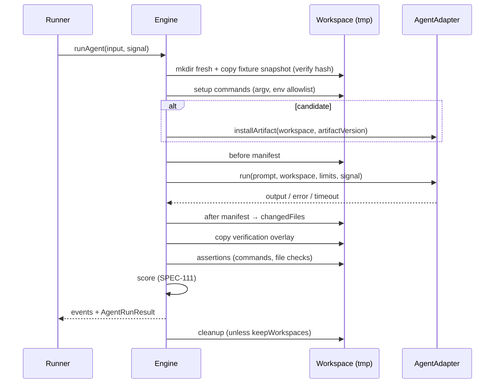

# SPEC-110 — Benchmark Execution

## 1. Summary

This spec defines how a single **agent run** (one case × one variant × one repetition) is executed: workspace preparation from an immutable fixture snapshot, setup commands, artifact installation (candidate only), agent invocation with timeout and cancellation, file-change tracking, verification overlay, assertions, scoring, trace capture and cleanup. It also defines execution environments (`local-process` — **not a sandbox**; `docker` — planned), the command execution rules that apply to every process DirectiveBench spawns, and the architecture and security model of a future custom coding harness for direct API models.

Orchestration of variants and repetitions is defined in [SPEC-112](2026-10-14-red-green-evaluation.md); formulas in [SPEC-111](2026-10-14-benchmark-scoring.md); job lifecycle in [SPEC-114](2026-10-14-runner-management.md).

## 2. Motivation and problem statement

Benchmarking instructions only means something if both variants run under controlled, reproducible conditions, and if running untrusted fixtures, commands and agents does not harm the user's machine. A local tool that executes arbitrary commands must be explicit about what is and is not isolated. The pipeline must be deterministic where possible, observable (traces), cancellable, and honest about its safety boundary.

## 3. Goals

- A deterministic, documented pipeline per agent run with explicit stages and events.
- Fresh, independent workspace per agent run built from a content-addressed fixture snapshot.
- Uniform command execution rules (argv only, env allowlist, isolated HOME, timeout, truncation, redaction, approval).
- Hidden verification files the agent cannot see or modify.
- Clear execution status taxonomy separating infrastructure failures from quality results.
- Environment abstraction that allows `docker` (and later remote) without changing the engine contract.

## 4. Non-goals

- Providing a security sandbox in the bootstrap. `local-process` is explicitly **not** a sandbox.
- Executing real agent CLIs (Claude Code, Codex, Cursor) in the bootstrap — detection only ([SPEC-203](2026-10-14-integration-claude-code.md), [SPEC-204](2026-10-14-integration-openai-codex.md), [SPEC-205](2026-10-14-integration-cursor.md)).
- Implementing the custom coding harness now (architecture only, §19).
- Network policy enforcement for `local-process`.

## 5. User stories

- As a user, I run a benchmark and trust that baseline and candidate started from byte-identical files.
- As a user, I cancel a long run and every child process is killed and the workspace cleaned.
- As a user, I can see exactly which files the agent created, modified or deleted.
- As a user, I understand from the UI that `local-process` runs commands with my user permissions.
- As a suite author, I keep hidden tests out of the agent's view so it cannot game them.
- As a user debugging a failure, I set `keepWorkspaces` and inspect the workspace afterwards.

## 6. Functional requirements

### Pipeline

| ID | Requirement |
|---|---|
| FR-110-01 | For each agent run the engine SHALL create a fresh directory `<os tmpdir>/directivebench/workspaces/<benchmarkRunId>/<caseId>/<variant>-<rep>/` that did not exist before, containing `workspace/` (the agent's working tree) and `home/` (the isolated `HOME` for commands). |
| FR-110-02 | The engine SHALL copy the fixture snapshot `<dataDir>/fixtures/<sha256>/` into the workspace and verify the resulting file manifest hash equals the snapshot hash. |
| FR-110-03 | Snapshotting (at import) and copying SHALL reject symlinks, hard-link tricks resolving outside the root, device files and paths escaping the root (`..`, absolute paths). |
| FR-110-04 | The engine SHALL run the case's `setup` commands in order, under the command execution rules; a non-zero exit SHALL end the run with `infrastructure-error`. |
| FR-110-05 | For the **candidate** variant only, the engine SHALL install the exact artifact version using the adapter's install convention (`AgentAdapter.installArtifact`), e.g. Mock Agent → `.agents/skills/<slug>/`. The baseline SHALL receive no artifact — except in an A/B run (planned, [SPEC-118](2026-10-22-benchmark-own-skills-s1.md) FR-118-11), where it receives the chosen baseline version of the same artifact through the same install convention. |
| FR-110-05a | Planned ([SPEC-118](2026-10-22-benchmark-own-skills-s1.md) FR-118-06): for the `claude-code` adapter, after setup and installation the workspace SHALL contain no Claude Code configuration except the installed artifact, and no file (artifact files included) may import an existing path outside the workspace, nor any symlink or hard link lead outside it; otherwise the agent run ends `infrastructure-error` (`workspace-contains-claude-config` / `workspace-imports-outside`, SPEC-118 FR-118-06/27) before the agent starts. |
| FR-110-06 | The engine SHALL compute a **before manifest** (relative path → sha256, mode, size) after setup and installation, excluding the installed-artifact paths from agent change attribution (recorded separately). |
| FR-110-07 | The engine SHALL invoke the agent through `AgentAdapter.run` with the case prompt, workspace path, model config, limits, and an `AbortSignal`; the call SHALL be bounded by `timeoutSeconds`. |
| FR-110-08 | On timeout the engine SHALL abort the agent, kill its process tree (SIGTERM, then SIGKILL after a grace period of 5 s), and record status `timeout`. |
| FR-110-09 | On cancellation (job cancel) the engine SHALL abort the same way and record `cancelled`; remaining stages SHALL NOT run. |
| FR-110-10 | After the agent finishes, the engine SHALL compute an **after manifest** and derive `changedFiles` = added, modified, deleted (persisted in `agent_runs.changed_files`). |
| FR-110-11 | The engine SHALL then copy the verification overlay (if any) into the workspace, overwriting same-path files; overlay files are not part of `changedFiles`. |
| FR-110-12 | The engine SHALL evaluate all assertions of the case (none skipped on failure of another) and record `assertion_results`. |
| FR-110-13 | `changed-files` assertions SHALL evaluate against `changedFiles` from FR-110-10 (agent changes only). |
| FR-110-14 | The engine SHALL compute the run score and pass flag per [SPEC-111](2026-10-14-benchmark-scoring.md). |
| FR-110-15 | The engine SHALL capture a trace: ordered stage events with timestamps, command argv/exit codes/durations, truncated & redacted stdout/stderr, adapter-reported steps, changed files, environment metadata. |
| FR-110-16 | The engine SHALL remove the workspace after the run unless `keepWorkspaces` is enabled; cleanup failures are logged as warnings and never change the result. |
| FR-110-17 | The engine SHALL emit progress events (`stage-started`, `stage-finished`, `command-output`, `run-finished`) consumed by the runner for persistence; the engine itself SHALL NOT access the database. |

### Execution status

| ID | Requirement |
|---|---|
| FR-110-20 | Each agent run SHALL end with exactly one execution status: `completed`, `agent-error`, `timeout`, `cancelled`, `infrastructure-error`. |
| FR-110-21 | `completed` means the agent returned normally and all assertions were evaluated, regardless of whether they passed. |
| FR-110-22 | `agent-error` means the adapter reported a failure (non-zero agent exit, crash, auth error). `infrastructure-error` means a DirectiveBench-side failure (workspace copy, setup command, overlay, assertion runner crash, disk full). |
| FR-110-23 | Non-`completed` runs SHALL be excluded from quality metrics and counted in `errorRate` ([SPEC-111](2026-10-14-benchmark-scoring.md)). |

### Environments

| ID | Requirement |
|---|---|
| FR-110-30 | `environment.kind: local-process` SHALL run commands and the agent as child processes of the runner with the user's OS permissions. It SHALL be recorded as `sandboxed: false` and labelled **"Not sandboxed"** in the UI. |
| FR-110-31 | `environment.kind: docker` SHALL be rejected in the bootstrap before any workspace is created: `assertRunnable` throws `BenchmarkConfigurationError` (`Execution environment "docker" is not implemented yet; only "local-process" is available.`), the runner marks the job `failed`, and no command is executed. |
| FR-110-32 | (Planned) `docker` SHALL use: network `none` by default (opt-in allowlist per suite), CPU/memory/pids limits, read-only mount of the fixture snapshot (copied into a writable container workspace), no host `HOME`, no SSH agent socket, no host credentials, non-root user, `--cap-drop=ALL`, `no-new-privileges`, and image digest pinning recorded in environment metadata. |
| FR-110-33 | Running authenticated agent CLIs inside containers is an **open problem** (§18); no credential forwarding SHALL be implemented without an accepted ADR. |

### Command execution rules (all spawned processes)

| ID | Requirement |
|---|---|
| FR-110-40 | Commands SHALL be argv arrays executed without a shell (`spawn(argv[0], argv.slice(1), { shell: false })`). |
| FR-110-41 | `cwd` SHALL be the workspace root (or a subdirectory inside it; escapes rejected). |
| FR-110-42 | Environment SHALL be built from an allowlist: `PATH`, `LANG`, `LC_ALL`, `TZ` (plus `SystemRoot`, `PATHEXT`, `COMSPEC` on Windows) copied from the runner; `HOME`, `USERPROFILE`, `TMPDIR`, `TEMP`, `TMP` pointed at the per-run `home/` directory outside the tracked tree; `CI=true`, `NO_COLOR=1`; nothing else is inherited (`buildCommandEnv`). Adapter-specific additions require an explicit adapter declaration. |
| FR-110-43 | Each command SHALL have a timeout (default: the case `timeoutSeconds`) and process-tree kill on expiry. |
| FR-110-44 | stdout/stderr SHALL be captured up to `maxOutputBytes` each; excess is dropped with a `[truncated N bytes]` marker. |
| FR-110-45 | Captured output SHALL pass through secret redaction (`@directivebench/core`) before persistence or display. |
| FR-110-46 | Commands SHALL execute only if the suite version is execution-approved (`benchmark_suite_versions.execution_approved_at` set, `execution_approval_source` ∈ {`bundled-example`, `user`}); otherwise a suite that runs commands fails before workspace creation with "This suite version runs commands but has not been approved for execution." Bundled examples are approved at import with approval source recorded. |

## 7. Non-functional requirements

- Stage overhead (excluding agent and commands) < 2 s for fixtures under 10 MB.
- Cancellation honoured within 10 s (grace period + kill).
- No orphaned processes after cancel/timeout (process group kill on POSIX, job objects on Windows — Windows: Assumption — requires validation).
- Cross-platform paths; Linux and macOS are primary targets.

## 8. Domain entities and contracts

```ts
type Variant = "baseline" | "candidate";
type ExecutionStatus = "completed" | "agent-error" | "timeout" | "cancelled" | "infrastructure-error";

interface AgentRunInput {
  benchmarkRunId: string;
  caseId: string;
  variant: Variant;
  repetition: number;                 // 1-based
  fixtureHash: string;                // sha256
  overlayHash?: string;
  artifactVersion?: { id: string; slug: string; files: { path: string; content: Uint8Array }[] }; // candidate only
  prompt: string;
  agent: { adapterId: string; adapterVersion: string };
  model?: { provider: string; model: string };
  environment: { kind: "local-process" | "docker" };
  limits: { timeoutSeconds: number; maxOutputBytes: number };
  signal: AbortSignal;
}

interface FileManifestEntry { path: string; sha256: string; size: number; mode: number }
interface ChangedFile { path: string; change: "added" | "modified" | "deleted" } // matches agent_runs.changed_files

interface CommandRecord {
  argv: string[]; cwd: string; exitCode: number | null; signal: string | null;
  durationMs: number; stdout: string; stderr: string; truncated: boolean; timedOut: boolean;
}

interface EnvironmentMetadata {
  kind: "local-process" | "docker";
  sandboxed: boolean;                 // false for local-process
  platform: NodeJS.Platform; arch: string; nodeVersion: string;
  adapterId: string; adapterVersion: string;
  imageDigest?: string;               // docker (future)
}

interface AgentRunResult {
  status: ExecutionStatus;
  error?: { code: string; message: string };
  changedFiles: ChangedFile[];
  assertions: { id: string; passed: boolean; score: number; weight: number; required: boolean; message?: string }[];
  score: number | null;               // null when status !== "completed"
  passed: boolean | null;
  durationMs: number;
  usage?: { inputTokens?: number; outputTokens?: number; costUsd?: number }; // only when adapter reports
  trace: TraceEvent[];
  environment: EnvironmentMetadata;
  warnings: string[];
}

interface TraceEvent { at: string; stage: string; kind: string; data?: unknown }
```

`AgentAdapter` (contract owned by `@directivebench/agent-adapters`, see [ADR 0006](../decisions/0006-agent-adapters-vs-model-providers.md)) exposes at least: `id`, `displayName`, `capabilities`, `detect()`, `installArtifact(workspace, artifactVersion)`, `run(input): Promise<AdapterRunOutput>`.

## 9. Data flow



## 10. API and interface design

Engine (pure library, [SPEC-107](2026-10-14-benchmark-engine.md)):

- `prepareWorkspace(input): Promise<Workspace>`
- `runCommand(argv, opts: { cwd, env, timeoutMs, maxOutputBytes, signal }): Promise<CommandRecord>`
- `runAgentRun(input, emit: (e: EngineEvent) => void): Promise<AgentRunResult>`

Runner persists results into `agent_runs` and `assertion_results` ([SPEC-006](2026-10-14-database-schema.md)).

## 11. UI/UX considerations

- Every run detail shows the environment badge: "local-process — Not sandboxed".
- Trace viewer groups events by stage with collapsible command output; truncation markers are visible.
- Changed files listed with change type; overlay files listed separately as "verification files (hidden from agent)".
- Docker option shown as "Planned — not implemented".

## 12. Security considerations

See [SPEC-007](2026-10-14-security-and-privacy.md) and [ADR 0007](../decisions/0007-local-runner-execution-and-isolation.md).

- **`local-process` is not a sandbox.** Commands and agents can read any file the user can read and access the network. Mitigations are hygiene, not isolation: argv-only, env allowlist, isolated HOME, approval gate, workspaces in tmp.
- Execution approval is the primary safety control; imported/user definitions are never auto-approved.
- Symlink and path-escape rejection prevents fixtures from pointing at host files.
- Redaction applies to outputs and traces; known secret patterns and values of configured secret references are masked.
- Future docker profile: §6 FR-110-32. Never mount the host home, SSH agent, docker socket or cloud credentials.
- Hidden overlay protects against test tampering only within the run; it is not a confidentiality boundary on `local-process` (the agent could read the data dir).

## 13. Error handling

| Failure | Status | Behaviour |
|---|---|---|
| Fixture snapshot missing / hash mismatch | infrastructure-error | Abort run, message with hash |
| Setup command non-zero / timeout | infrastructure-error | Remaining stages skipped |
| Artifact install fails | infrastructure-error | — |
| Adapter not executable (real CLIs in bootstrap) | agent-error | "Execution not implemented for adapter X" |
| Agent timeout | timeout | Process tree killed |
| Job cancelled | cancelled | Process tree killed |
| Assertion command fails to spawn | assertion fails (score 0) with message; if the assertion runner itself crashes → infrastructure-error |
| Cleanup fails | unchanged | Warning recorded |
| `docker` requested | infrastructure-error | Clear "not implemented" message |

## 14. Edge cases

- Agent deletes the entire workspace → after manifest empty; assertions run and fail; status `completed`.
- Agent writes outside the workspace → not detectable on `local-process`; recorded limitation.
- Agent spawns background processes that outlive it → killed via process group at stage end.
- Overlay path collides with an agent-written file → overlay wins; collision recorded as a warning.
- Binary files and very large files in manifests → hashed by streaming; size limits configurable.
- Case-insensitive file systems (macOS) → manifest uses the normalized relative path; collisions reported.
- Non-UTF-8 output → decoded lossily for display; raw bytes not stored.

## 15. Testing strategy

- Unit: manifest diffing, env builder (no leakage of non-allowlisted vars), truncation, redaction, path-escape and symlink rejection.
- Integration: full pipeline with the Mock Agent against `examples/benchmarks/mock-input-validation` (real `node --test` assertions).
- Process tests: timeout and cancellation kill a child that ignores SIGTERM; no orphans remain.
- Negative: unapproved suite version is refused; `docker` refused with the documented message.

## 16. Acceptance criteria

- [ ] Each agent run gets a new workspace directory; two runs never share one.
- [ ] Fixture containing a symlink is rejected at import with the offending path.
- [ ] Baseline workspace contains no `.agents/skills/<slug>/`; candidate does.
- [ ] `changedFiles` lists exactly the agent's additions/modifications/deletions and excludes overlay and installed artifact files.
- [ ] Overlay files are absent during agent execution and present during assertions.
- [ ] A spawned command sees only `PATH`, `LANG`, `TZ`, `HOME` (+ documented XDG/TMPDIR) env vars.
- [ ] Output larger than `maxOutputBytes` is truncated with a marker; a planted fake token is redacted.
- [ ] Timeout yields status `timeout`, cancel yields `cancelled`, both within 10 s, no surviving child processes.
- [ ] `docker` environment yields `infrastructure-error` with the documented message and runs no command.
- [ ] Workspaces are removed after the run unless `keepWorkspaces` is true.

## 17. Dependencies

[SPEC-107](2026-10-14-benchmark-engine.md), [SPEC-108](2026-10-14-benchmark-definition-format.md), [SPEC-111](2026-10-14-benchmark-scoring.md), [SPEC-112](2026-10-14-red-green-evaluation.md), [SPEC-114](2026-10-14-runner-management.md), [SPEC-115](2026-10-14-settings-and-configuration.md) (`keepWorkspaces`), [SPEC-007](2026-10-14-security-and-privacy.md), [ADR 0005](../decisions/0005-custom-benchmark-engine.md), [ADR 0007](../decisions/0007-local-runner-execution-and-isolation.md).

## 18. Open questions

- **Authenticated agent CLIs inside containers:** Claude Code, Codex and Cursor Agent rely on user-level login state. Options (mount a dedicated credentials dir read-only, pass API keys via secret references, device-code login inside the container) each have trade-offs; none is decided. Assumption — requires validation for each CLI.
- Ambient user-level configuration (e.g. user-wide skills/instructions) for real agents on `local-process`: can HOME isolation exclude it without breaking authentication?
- Should the before/after manifest also capture permissions/ownership changes on Windows?
- Default network policy for future `docker`: `none` with per-suite allowlist vs. a proxy with logging.

## 19. Future extensions

### Docker environment
Per FR-110-32. Image selection per suite (`environment.image`, digest-pinned), resource limits in the definition, container logs in traces.

### Custom coding harness for direct API models (architecture & security model only)

Allows benchmarking models from model providers ([SPEC-206](2026-10-14-integration-anthropic-api.md), [SPEC-207](2026-10-14-integration-openai-api.md), [SPEC-211](2026-10-14-integration-custom-model-providers.md)) without an agent CLI, as a separate adapter (`harness`).

- **Loop:** system prompt (+ installed artifact content for candidate, loaded with the same discovery convention as other adapters) → model → tool calls → results → repeat until the model stops or a limit is hit.
- **Tools:** `read_file(path)`, `list_dir(path)`, `write_file(path, content)`, `edit_file(path, old, new)`, `run_command(argv)`. Paths resolved inside the workspace; escapes rejected. `run_command` follows all command execution rules (FR-110-40…46) and inherits the environment's isolation.
- **Limits:** `maxSteps`, `maxWallSeconds`, `maxInputTokens`, `maxOutputTokens`, optional `maxCostUsd`; hitting a limit ends the run as `completed` with a `limit-reached` warning (assertions still evaluated) unless the limit is wall time (`timeout`).
- **Tool-call history:** every request/response, tool call, arguments, result (truncated, redacted), token usage and latency stored in the trace.
- **Security model:** the model is untrusted; tools are the only capabilities; no network tool; command tool disabled unless the suite is execution-approved; provider API keys come from secret references ([ADR 0008](../decisions/0008-secret-storage-and-authentication.md)) and are never exposed to tools or workspace env.
- **Comparability:** harness version, system prompt version and tool schema version are part of the comparability key ([SPEC-111](2026-10-14-benchmark-scoring.md)).

### Remote execution
Same `AgentRunInput`/`AgentRunResult` contracts executed by remote runners ([SPEC-114](2026-10-14-runner-management.md)).

## 20. Implementation status

- **Implemented (verified by `packages/benchmark-engine/test/engine.test.ts` and `packages/runner/test/runner.test.ts`):** `local-process` pipeline in `runBenchmark` — fresh `workspace/` + `home/` per agent run under `<os tmpdir>/directivebench/workspaces/<runId>/<caseId>/<variant>-<rep>/`, fixture copy from the content-addressed snapshot with symlink/escape rejection and verification that the copied workspace manifest hash equals the snapshot hash (FR-110-02; mismatch → `infrastructure-error` "Workspace does not match fixture snapshot…", test "records an infrastructure error when the fixture store was tampered with"), setup commands (failure → `infrastructure-error`), candidate-only artifact installation via the Mock Agent convention, agent invocation bounded by `timeoutSeconds` (+5 s grace for adapters ignoring the abort signal), cancellation (`cancelled`), before/after manifests and `changedFiles` excluding installed artifact files, verification overlay, the four assertion types, scoring, trace capture, cleanup unless `keepWorkspaces`; command rules (argv without shell, env allowlist of FR-110-42, isolated `HOME`, timeout and cancellation send `SIGTERM` to the process group on POSIX and `SIGKILL` after `killGraceMs` (default `DEFAULT_KILL_GRACE_MS` = 5000, FR-110-08; test "sends SIGTERM first and SIGKILL only after the grace period"), per-stream truncation to `maxOutputBytes` with a `truncated` flag, redaction); execution approval gate (bundled examples approved at import); `docker` rejected before any workspace is created.
- **Partially implemented:** execution approval — gate enforced (also re-checked by the web app before enqueueing, [SPEC-114](2026-10-14-runner-management.md) FR-114-02), user approval UX not implemented.
- **Implemented (2026-10-15):** FR-110-15 — ordered `stage` trace events with ISO timestamps (`prepare`, `setup`, `install`, `agent`, `verification`, `assertions`) and setup commands with argv, exit code and duration (`engine.test.ts`, RED/GREEN run asserts the stage order); FR-110-44 — truncated output ends with a `[truncated N bytes]` marker (`engine.test.ts`, "times out, truncates and reports spawn errors").
- **Not implemented:** stage-level progress events of FR-110-17 (planned; the current contract is the `onAgentRun(record)` callback, called after each agent run), `docker` environment, real agent execution for Claude Code / Codex / Cursor (detection only), custom coding harness (adapter id `harness`), remote execution, Windows-specific process-tree handling validation.
