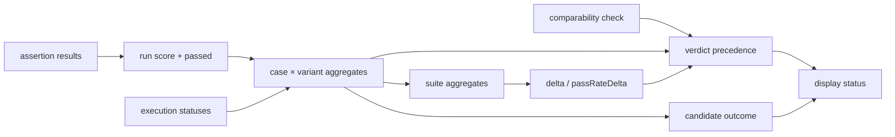

# SPEC-111 — Benchmark Scoring

## 1. Summary

This spec defines every number DirectiveBench derives from a benchmark run: assertion scores, run score and pass flag, execution status vs. quality, per-case and per-suite variant aggregates, RED/GREEN delta, verdict precedence, candidate outcome, display status, confidence level, comparability key, and regression detection between artifact versions. Formulas are normative; implementations in `@directivebench/benchmark-engine` must match them exactly and be covered by the worked examples in §15.

## 2. Motivation and problem statement

Comparing "with instructions" and "without instructions" is only useful when the arithmetic is transparent, the treatment of failures is explicit, and noise is not mistaken for signal. Without precise rules, infrastructure errors could be counted as quality failures, a single lucky run could be reported as an improvement, and results from different setups could be silently mixed into misleading rankings.

## 3. Goals

- Deterministic, documented formulas reproducible by hand.
- Separate **reliability** (did the run execute?) from **quality** (how good was the result?).
- Explicit noise handling (stability, confidence, repetitions).
- Strict comparability: never aggregate or rank results produced under different conditions.
- Weighted partial credit across assertions, with hard `required` gates.

## 4. Non-goals

- Global leaderboards or cross-suite rankings of artifacts, agents or models.
- Statistical significance testing (p-values) in the MVP (future extension).
- Cost/latency-weighted composite scores (reported side-by-side only, [SPEC-112](2026-10-14-red-green-evaluation.md)).

## 5. User stories

- As a skill author, I see that my skill raised the mean score from 0.50 to 1.00 and why (per-assertion table).
- As a user, I see "unstable" rather than "improved" when results vary between repetitions.
- As a user, I see "error" when most runs crashed, instead of a misleading low score.
- As a maintainer, I am warned when a new version of an artifact scores lower than the previous one on the same benchmark setup.
- As a user, I can never accidentally compare a result from Claude Code with one from the Mock Agent.

## 6. Functional requirements

### Assertion and run level

| ID | Requirement |
|---|---|
| FR-111-01 | Each assertion result SHALL have score `s ∈ [0, 1]`. Deterministic assertion types (`command`, `file-exists`, `file-contains`, `changed-files`) SHALL produce `s ∈ {0, 1}` (`passed ⇔ s = 1`). |
| FR-111-02 | Each assertion SHALL have weight `w ≥ 0` (default 1) and `required` (default false). |
| FR-111-03 | Run score SHALL be `score = Σᵢ wᵢ·sᵢ / Σᵢ wᵢ` over all assertions of the case. If `Σᵢ wᵢ = 0`, score SHALL be 0 and a warning recorded. |
| FR-111-04 | Run passed SHALL be `(∀ required i: sᵢ = 1) ∧ score ≥ passThreshold` (default `passThreshold = 1`). |
| FR-111-05 | Score and passed SHALL be computed only for runs with execution status `completed`; for other statuses both are `null`. |
| FR-111-06 | Comparisons with thresholds SHALL use an epsilon of `1e-9` (e.g. `score ≥ passThreshold − 1e-9`). Values are stored at full precision and displayed rounded to 2–3 decimals. |

### Execution status vs. quality

| ID | Requirement |
|---|---|
| FR-111-10 | Execution statuses: `completed`, `agent-error`, `timeout`, `cancelled`, `infrastructure-error` ([SPEC-110](2026-10-14-benchmark-execution.md)). |
| FR-111-11 | Only `completed` runs contribute to quality metrics. All other runs contribute to `errorRate` only. A failing assertion never makes a run non-`completed`. |
| FR-111-12 | A `cancelled` agent run counts like any other non-`completed` run (included in `errorRate`). When the user cancels the whole benchmark run, the benchmark run is `cancelled` and SHALL receive no verdict and no display status update. |

### Variant aggregates

For case `c`, variant `v ∈ {baseline, candidate}`, let `N` be the number of attempted agent runs (all execution statuses) and `S = {score₁ … scoreₙ}` the scores of the `n` `completed` runs.

| ID | Requirement |
|---|---|
| FR-111-20 | `validRuns = n`. |
| FR-111-21 | `errorRate = (N − n) / N`. |
| FR-111-22 | `meanScore = (Σ score) / n` (null if `n = 0`). |
| FR-111-23 | `stdDev = sqrt( Σ (score − meanScore)² / n )` — **population** standard deviation (0 if `n = 1`; null if `n = 0`). |
| FR-111-24 | `min`, `max` over `S`. |
| FR-111-25 | `passRate = (count of passed runs) / n` (null if `n = 0`). |
| FR-111-26 | Suite-level variant aggregates SHALL be the arithmetic mean over cases of `meanScore`, `passRate`, `errorRate` (cases weighted equally regardless of repetitions or assertion count). `stdDev` is not averaged; stability is evaluated per case. |
| FR-111-27 | If any case has `validRuns = 0` in either variant, suite `meanScore`/`passRate` SHALL be null and the verdict SHALL be `error`. |

### Delta and verdict

| ID | Requirement |
|---|---|
| FR-111-30 | `delta = candidate.meanScore − baseline.meanScore` (suite level; also reported per case). |
| FR-111-31 | `passRateDelta = candidate.passRate − baseline.passRate`. |
| FR-111-32 | Verdict SHALL be the first matching rule: 1. `error` — suite `errorRate > 0.5` in either variant (or FR-111-27); 2. `not-comparable` — the comparability check failed (§8); 3. `unstable` — for any case in either variant `stdDev > stabilityThreshold` (default 0.1) **or** `0 < passRate < 1`; 4. `regressed` — `delta ≤ −minDelta` (default 0.05); 5. `improved` — `delta ≥ minDelta`; 6. `unchanged`. |
| FR-111-33 | Candidate outcome SHALL be `passed` iff candidate `passRate = 1` for every case, else `failed`. (Configurable criteria are a future extension.) |
| FR-111-34 | Display status (artifacts, results lists, [SPEC-113](2026-10-14-results-and-reporting.md)) SHALL be derived as: verdict `error` → `error`; `not-comparable` → `not-comparable`; `unstable` → `unstable`; `regressed` → `regression`; otherwise candidate outcome → `passed` / `failed`. No completed benchmark run → `not-tested`. |

### Confidence, flags, comparability

| ID | Requirement |
|---|---|
| FR-111-40 | Confidence SHALL be `low` if repetitions < 3; `medium` if 3–9, or ≥ 10 but the verdict is `unstable`; `high` if repetitions ≥ 10 and not `unstable`. Repetitions means the configured count per variant per case. |
| FR-111-41 | Each assertion type SHALL declare `deterministic: boolean`. Each agent adapter SHALL declare `deterministic: boolean` (Mock Agent: true; real agents and the future harness: false). |
| FR-111-42 | A benchmark run SHALL be flagged `nondeterministic` if its adapter or any of its assertions is nondeterministic. Results from a `nondeterministic` run with a single repetition SHALL be labelled "not conclusive". |
| FR-111-43 | A run SHALL store `comparabilityKey = sha256(canonicalJson({ cases, scoring, execution, fixtures, adapterId, adapterVersion }))`, where `cases`, `scoring` and `execution` are the validated definition sections (prompts, assertions, weights, thresholds, agent, model, environment, `timeoutSeconds`, `repetitions`, `maxOutputBytes`) and `fixtures` are the per-case fixture and overlay hashes. Because `cases + scoring + execution` are the definition content, this subsumes the suite version; suite metadata (name, description, categories) does not change the key. The artifact version is **not** part of the key. Future harness-specific dimensions (e.g. harness version) are added to the hashed object. Implemented as `comparabilityKey()` in `packages/benchmark-engine/src/orchestrator.ts`. |
| FR-111-44 | Within one benchmark run the baseline and candidate SHALL share the key; if any agent run's actually-observed adapter version or environment differs, the comparability check fails → `not-comparable`. |
| FR-111-45 | Results with different comparability keys SHALL never be aggregated, averaged, ranked or charted on one series. Cross-key views SHALL show them side by side with an explicit "not comparable" label. |
| FR-111-46 | The system SHALL NOT compute or display global rankings across different suites. |

### Regression between artifact versions

| ID | Requirement |
|---|---|
| FR-111-50 | For an artifact with versions `vₖ₋₁` and `vₖ` that both have a non-error, comparable benchmark run with the **same comparability key**, `versionDelta = candidate.meanScore(vₖ) − candidate.meanScore(vₖ₋₁)` using the latest run of each. |
| FR-111-51 | A **version regression** SHALL be flagged if `versionDelta ≤ −minDelta`, or the candidate outcome changed from `passed` to `failed`, provided neither run is `unstable`. If either run is unstable, the comparison is reported as "inconclusive". |
| FR-111-52 | Version regression SHALL be shown on the artifact detail and dashboard "recent regressions" ([SPEC-116](2026-10-14-dashboard-and-navigation.md)), distinct from the RED/GREEN `regressed` verdict (candidate worse than baseline). |

### Partial credit

| ID | Requirement |
|---|---|
| FR-111-60 | Partial credit at run level comes from weights (some assertions pass). Fractional assertion scores (`0 < s < 1`) are reserved for planned types (static-analysis, custom script, llm-judge); a fractional `s` never satisfies `required`. |
| FR-111-61 | `llm-judge` (planned) SHALL be nondeterministic and record judge model, rubric and prompt version in the result; these become part of the comparability key. |

## 7. Non-functional requirements

- Pure functions, no I/O, in `@directivebench/benchmark-engine`; identical results across platforms.
- Recomputable: aggregates can be recomputed from stored `agent_runs` and `assertion_results` at any time; stored aggregates are a cache.
- Every displayed number links to its inputs (per-run, per-assertion).

## 8. Domain entities and contracts

```ts
type Verdict = "error" | "not-comparable" | "unstable" | "regressed" | "improved" | "unchanged";
type CandidateOutcome = "passed" | "failed";
type DisplayStatus = "error" | "not-comparable" | "unstable" | "regression" | "passed" | "failed" | "not-tested";
type Confidence = "low" | "medium" | "high";

interface ScoringConfig { passThreshold: number; minDelta: number; stabilityThreshold: number } // 1, 0.05, 0.1

interface AssertionScore { id: string; score: number; weight: number; required: boolean; deterministic: boolean }

interface VariantCaseAggregate {
  caseId: string;
  validRuns: number; attemptedRuns: number;
  meanScore: number | null; stdDev: number | null;
  min: number | null; max: number | null;
  passRate: number | null; errorRate: number;
}

interface VariantSuiteAggregate { meanScore: number | null; passRate: number | null; errorRate: number; cases: VariantCaseAggregate[] }

interface ComparisonResult {
  baseline: VariantSuiteAggregate;
  candidate: VariantSuiteAggregate;
  delta: number | null; passRateDelta: number | null;
  perCaseDelta: Record<string, number | null>;
  verdict: Verdict;
  candidateOutcome: CandidateOutcome | null;
  displayStatus: DisplayStatus;
  confidence: Confidence;
  nondeterministic: boolean;
  comparabilityKey: string;
  reasons: string[];        // e.g. "case c2 candidate stdDev 0.217 > 0.1"
}
```

## 9. Data flow



## 10. API and interface design

```ts
scoreRun(assertions: AssertionScore[], cfg: ScoringConfig): { score: number; passed: boolean; warnings: string[] };
aggregateCase(runs: { status: ExecutionStatus; score: number | null; passed: boolean | null }[]): VariantCaseAggregate;
compare(input: { baseline: VariantCaseAggregate[]; candidate: VariantCaseAggregate[]; cfg: ScoringConfig;
                 repetitions: number; comparable: boolean; nondeterministic: boolean; comparabilityKey: string }): ComparisonResult;
comparabilityKey(parts: ComparabilityParts): string;
versionRegression(prev: ComparisonResult, next: ComparisonResult, cfg: ScoringConfig): "regression" | "ok" | "inconclusive" | "not-comparable";
```

## 11. UI/UX considerations

- Show score as `0.83 (5/6 weight)`, never as a percentage without the denominator.
- Verdict badge with reasons tooltip (which rule matched and why).
- Confidence shown next to the verdict; "not conclusive" for single nondeterministic runs.
- Mock agent results always labelled "Mock agent — not an AI evaluation" ([SPEC-113](2026-10-14-results-and-reporting.md)).

## 12. Security considerations

Scoring has no I/O. Integrity concern: results must not be manipulable post hoc; stored aggregates are recomputed from immutable run records for verification. Weights and thresholds come from the immutable suite version, so they cannot be changed after the fact for a given run.

## 13. Error handling

- Invalid scoring config (outside ranges) is rejected by the schema at import ([SPEC-108](2026-10-14-benchmark-definition-format.md)).
- Missing assertion results for a `completed` run → treated as `infrastructure-error` for that run (never as score 0).
- NaN/Infinity in any computation → engine throws; the run is marked `infrastructure-error` and reported.

## 14. Edge cases

- `Σw = 0` → score 0 with warning; `passed` then depends only on required assertions and `passThreshold = 0`.
- All runs cancelled by user → benchmark run `cancelled`, no verdict, display status unchanged (previous result kept).
- Baseline already passes everything (meanScore 1.0) and candidate also 1.0 → `unchanged`, candidate `passed` → display `passed`.
- Baseline 1.0, candidate 0.9 with stable runs → `regressed` (display `regression`).
- `delta` exactly `0.05` → `improved` (≥ with epsilon).
- One repetition, real agent → verdict computed, confidence `low`, labelled "not conclusive".
- Exactly `errorRate = 0.5` → not `error` (strictly greater required); quality metrics from the remaining half.

## 15. Testing strategy

Unit tests for each function, plus golden tests reproducing these worked examples exactly.

### Worked example A — deterministic (Mock Agent), `examples/benchmarks/mock-input-validation`

One case (`implement-parse-age`), assertions as in `examples/benchmarks/mock-input-validation/benchmark.yaml`:

| Assertion | Type | Weight | Required |
|---|---|---|---|
| `basic-behaviour` | command (`node --test test/parse-age.basic.test.js`) | 2 | no |
| `rejects-invalid-input` | command (`node --test test/parse-age.validation.test.js`) | 2 | **yes** |
| `explicit-error-type` | file-contains (`\bRangeError\b`) | 1 | no |
| `scope` | changed-files (`src/**`) | 1 | no |

`Σw = 6`, `passThreshold = 1`, `minDelta = 0.05`, `stabilityThreshold = 0.1`, repetitions = 3.

Baseline (no artifact): `basic-behaviour` 1, `rejects-invalid-input` 0, `explicit-error-type` 0, `scope` 1
→ `score = (2·1 + 2·0 + 1·0 + 1·1) / 6 = 3/6 = 0.5`; required failed → `passed = false`.

Candidate (artifact installed): all 1 → `score = 6/6 = 1.0`, `passed = true`.

Deterministic → identical across 3 repetitions:

| | meanScore | stdDev | min | max | passRate | errorRate | validRuns |
|---|---|---|---|---|---|---|---|
| baseline | 0.5 | 0 | 0.5 | 0.5 | 0 | 0 | 3 |
| candidate | 1.0 | 0 | 1.0 | 1.0 | 1 | 0 | 3 |

`delta = 0.5`, `passRateDelta = 1`. Rules: error? no. not-comparable? no. unstable? stdDev 0 ≤ 0.1, passRates are 0 and 1 (not strictly between) → no. regressed? no. improved? `0.5 ≥ 0.05` → **improved**. Candidate outcome **passed**. Display status **passed**. Confidence **medium** (3 repetitions). Flag: deterministic, labelled "Mock agent — not an AI evaluation".

### Worked example B — nondeterministic variation (illustrative, real agent)

Same case, 4 repetitions. Candidate scores: 1.0, 1.0, 0.5, 1.0 (third run failed `rejects-invalid-input` and `explicit-error-type`). Baseline: 0.5 ×4.

- candidate `meanScore = 3.5 / 4 = 0.875`
- deviations: 0.125, 0.125, −0.375, 0.125; squares sum `3·0.015625 + 0.140625 = 0.1875`; population variance `0.1875 / 4 = 0.046875`; `stdDev ≈ 0.2165`
- candidate `passRate = 3/4 = 0.75`
- `delta = 0.875 − 0.5 = 0.375`

Rule 3 matches (`0.2165 > 0.1` and `0 < 0.75 < 1`) → verdict **unstable**, display **unstable**, confidence **medium**, candidate outcome `failed` (not shown as display status because `unstable` takes precedence).

### Worked example C — errors

Candidate 4 repetitions: `completed` 1.0, `timeout`, `agent-error`, `timeout` → `N = 4`, `n = 1`, `errorRate = 0.75 > 0.5` → verdict **error** regardless of the 1.0 score.

### Worked example D — version regression

Artifact v2 candidate meanScore 1.0 (stable, key K); v3 candidate meanScore 0.8333 (stable, key K; `scope` now fails: 5/6). `versionDelta = −0.1667 ≤ −0.05` and outcome `passed → failed` → **version regression**.

## 16. Acceptance criteria

- [ ] `scoreRun` reproduces example A (0.5 / false and 1.0 / true).
- [ ] `aggregateCase` uses population standard deviation (example B: 0.2165 ± 1e-4).
- [ ] Non-completed runs never contribute scores; example C yields `error`.
- [ ] Verdict precedence follows the documented order for crafted inputs hitting each rule (including ties at boundaries).
- [ ] Display status mapping matches FR-111-34 for all verdict/outcome combinations; `not-tested` when no completed benchmark run exists.
- [ ] Confidence is `low`/`medium`/`high` for 1, 3, 10 stable repetitions and `medium` for 10 unstable.
- [ ] Two runs differing only in adapter version get different comparability keys and are never aggregated together.
- [ ] Example D flags a version regression; making either run unstable yields "inconclusive".

## 17. Dependencies

[SPEC-108](2026-10-14-benchmark-definition-format.md) (scoring config, assertion fields), [SPEC-110](2026-10-14-benchmark-execution.md) (execution statuses), [SPEC-112](2026-10-14-red-green-evaluation.md) (variants), [SPEC-103](2026-10-14-artifact-versioning.md) (artifact versions), [SPEC-113](2026-10-14-results-and-reporting.md), [SPEC-005](2026-10-14-domain-model.md).

## 18. Open questions

- Should cases carry weights at suite level (currently equal weighting)?
- Should candidate outcome support a threshold (`passRate ≥ x`) instead of `= 1`?
- Is `errorRate > 0.5` the right `error` threshold for small N (e.g. 1 of 2 failing yields exactly 0.5 → not error)?
- Should `cancelled` runs within a partially completed benchmark run be treated differently from user-cancel of the whole run?

## 19. Future extensions

- Bootstrap confidence intervals / significance tests for nondeterministic agents.
- Configurable candidate outcome policies per suite.
- Cost- and latency-aware reporting (no composite score without explicit opt-in).
- Fractional assertion types (static-analysis, llm-judge) with calibration.

## 20. Implementation status

- **Implemented (verified by `packages/benchmark-engine/test/scoring.test.ts` and `engine.test.ts`):** `scoreRun` (weighted score, required gate, pass threshold), `aggregate` (valid runs, population stdDev, min/max, pass rate, error rate; non-completed runs excluded from quality), suite aggregates with equal case weighting, delta and `passRateDelta`, verdict precedence (`error > not-comparable > unstable > regressed > improved > unchanged`), candidate outcome, `displayStatus` mapping, `confidenceFor`, and `comparabilityKey` as defined in FR-111-43 (`src/scoring.ts`, `src/orchestrator.ts`).
- **Verified worked example A:** the mock RED/GREEN run of `mock-input-validation` produces baseline 0.5 / pass rate 0, candidate 1.0 / pass rate 1, delta +0.5, `passRateDelta` +1, verdict `improved`, confidence `medium`, candidate outcome `passed` (`engine.test.ts`, `packages/runner/test/runner.test.ts`, `directivebench demo`).
- **Partially implemented:**
  - The implemented API differs from §8/§10: `scoreRun(assertions, passThreshold)`, `aggregate`, `summarize` (returns `ScoringSummary` with `deterministicAgent`, without `reasons`, `perCaseDelta` or a `nondeterministic` flag; the runner adds `displayStatus` when persisting), `confidenceFor`, `displayStatus`.
  - Thresholds use values rounded to 6 decimals instead of an explicit `1e-9` epsilon (FR-111-06); `Σw = 0` cannot occur because the schema requires a weight > 0, so no warning is recorded (FR-111-03).
  - FR-111-27: a case without valid runs is excluded from suite means instead of nulling them; the verdict becomes `error` only via the suite `errorRate > 0.5` rule.
  - FR-111-42: only the adapter's `deterministic` capability is recorded (`deterministicAgent`); assertion-level determinism is stored per assertion result but not aggregated, and the "not conclusive" label is not implemented.
  - FR-111-44: the comparability check compares the adapter version detected before and after the run; environment drift is not checked.
- **Not implemented:** version regression detection across artifact versions (FR-111-50…52), fractional assertion types, llm-judge, configurable outcome policies, Example B–D golden tests.
