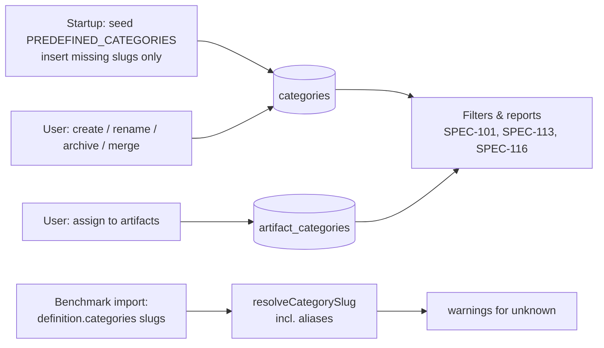

# SPEC-106 — Category Management

## 1. Summary

Categories are a small, curated taxonomy (e.g. Security, Testing, WordPress) used to organise artifacts and benchmark suites, filter lists and group results. A set of predefined categories is seeded on first start; users can create, edit, rename, archive and merge categories and assign them to artifacts (many-to-many). Category **slugs are stable identifiers**: renaming changes the display name only, so benchmark definitions and links that reference a slug keep working.

## 2. Motivation and problem statement

With dozens or hundreds of artifacts from many repositories, users need a way to answer "what do we have for security?" or "how do our React rules perform?". Free-form tags alone become inconsistent; a curated, editable category list with stable identifiers gives reliable filtering, reporting and benchmark-to-artifact matching.

## 3. Goals

- Predefined, sensible starting taxonomy without forcing it.
- Full lifecycle: create, edit (name, description), rename, archive/unarchive, merge.
- Many-to-many assignment to artifacts; benchmark suites declare categories by slug.
- Stable slugs referenced by definitions, URLs and exports.
- Fast filtering in artifact and benchmark lists.

## 4. Non-goals

- Hierarchical categories (parent/child) — future.
- Per-user/private categories (single-user local mode).
- Automatic categorisation in the MVP (AI-assisted is future, §19).
- Replacing tags ([SPEC-101](2026-10-14-artifact-registry.md)) — tags stay free-form.

## 5. User stories

- US-106-01: As a new user, I see useful categories (Security, Testing, PHP, React, …) without configuring anything.
- US-106-02: As a user, I assign "Security" and "WordPress" to a WordPress AJAX security skill.
- US-106-03: As a user, I rename "DevOps" to "CI/CD & Ops" and all filters, links and benchmark definitions keep working.
- US-106-04: As a user, I merge a duplicate "Tests" category into "Testing" so all artifacts move over.
- US-106-05: As a user, I archive "Python" because we don't use it; it disappears from pickers but history stays.
- US-106-06: As a user, I filter the artifact list by category and see results per category on the dashboard.

## 6. Functional requirements

| ID | Requirement |
|----|-------------|
| FR-106-01 | **Predefined categories** SHALL be seeded idempotently on startup (`serve`/`init`/`demo` after migrations) from `PREDEFINED_CATEGORIES` in `@directivebench/core`: Security (`security`), Code Quality (`code-quality`), Testing (`testing`), Documentation (`documentation`), Performance (`performance`), Architecture (`architecture`), Frontend (`frontend`), Backend (`backend`), DevOps (`devops`), WordPress (`wordpress`), PHP (`php`), React (`react`), Next.js (`nextjs`), TypeScript (`typescript`), Python (`python`), Database (`database`), Workflow (`workflow`). Seeded rows have `predefined = true`. |
| FR-106-02 | Seeding SHALL insert only missing slugs; it SHALL NOT overwrite names/descriptions edited by the user, nor unarchive archived categories, nor re-create categories merged away (tracked by alias, FR-106-09). |
| FR-106-03 | **Create**: name (1–64 chars, trimmed, unique case-insensitively among non-archived categories), optional description (≤ 500 chars), optional slug (default `slugify(name)`; must match `^[a-z0-9]+(?:-[a-z0-9]+)*$`, ≤ 64 chars, globally unique including archived). |
| FR-106-04 | **Edit/rename**: name and description are editable for all categories, predefined included. Renaming SHALL NOT change the slug. |
| FR-106-05 | **Slug change** is an explicit advanced action (not part of rename) that records the old slug as an alias so existing references resolve; it SHALL warn that external definitions using the old slug will resolve through the alias. |
| FR-106-06 | **Assign/unassign**: artifacts ↔ categories many-to-many via `artifact_categories` (`artifact_id`, `category_id`, `created_at`, composite primary key). Assign is idempotent. Bulk assign/unassign for multiple selected artifacts SHALL be supported. Archived categories cannot be newly assigned. |
| FR-106-07 | **Benchmark suites** declare categories as slugs in their definition (`categories: string[]`, [SPEC-108](2026-10-14-benchmark-definition-format.md)). On import, slugs are resolved (including aliases); unknown slugs SHALL produce an import warning and remain in the definition verbatim (definitions are immutable) — they are not auto-created. |
| FR-106-08 | **Archive/unarchive**: sets/clears `archived_at`. Archived categories are hidden from pickers and default filters, remain on existing assignments (shown muted), and remain resolvable by slug. Categories are never hard-deleted in the MVP. |
| FR-106-09 | **Merge** `source → target`: in one transaction, move all `artifact_categories` rows of the source to the target (skipping duplicates), record the source slug as an alias of the target (planned table `category_aliases(slug, category_id)`), and archive the source with `merged_into_id` (planned column). Benchmark definitions referencing the source slug resolve to the target. Merge is irreversible in the UI (audit via alias table). |
| FR-106-10 | **Filter**: artifact list ([SPEC-101](2026-10-14-artifact-registry.md)) and benchmark list support filtering by one or more categories (OR within categories by default; AND as an option), by slug in the URL (`?category=security&category=php`). |
| FR-106-11 | The Categories page SHALL list categories with name, slug, description, predefined flag, artifact count, suite count (by slug in latest suite versions), status (active/archived). |
| FR-106-12 | All mutations SHALL be Zod-validated Server Actions and go through `@directivebench/database` repository functions. |

## 7. Non-functional requirements

- NFR-106-01: Category filter on 10 000 artifacts < 100 ms (indexed join on `artifact_categories`).
- NFR-106-02: Category operations are transactional; merge of a category with 10 000 assignments < 1 s.
- NFR-106-03: Accessible pickers (keyboard, screen reader labels).

## 8. Domain entities and contracts

Bootstrap tables (`packages/database/src/schema.ts`): `categories(id, slug UNIQUE, name, description, predefined, archived_at, created_at, updated_at)`, `artifact_categories(artifact_id, category_id, created_at, PK(artifact_id, category_id))`. Predefined list: `packages/core/src/categories.ts`. Planned: `categories.merged_into_id`, table `category_aliases`.

```ts
interface Category {
  id: string;                 // prefixed id
  slug: string;               // stable identifier
  name: string;               // display name, editable
  description: string | null;
  predefined: boolean;
  archivedAt: string | null;
  createdAt: string;
  updatedAt: string;
  // planned: mergedIntoId: string | null
}

interface CategoryAlias { slug: string; categoryId: string; createdAt: string; reason: 'slug-change' | 'merge' }

// Server Action inputs (Zod)
type CreateCategoryInput = { name: string; description?: string; slug?: string };
type UpdateCategoryInput = { id: string; name?: string; description?: string | null };
type ChangeCategorySlugInput = { id: string; newSlug: string };
type SetArchivedInput = { id: string; archived: boolean };
type MergeCategoriesInput = { sourceId: string; targetId: string };
type AssignCategoriesInput = { artifactIds: string[]; categoryIds: string[]; mode: 'add' | 'remove' | 'replace' };

function resolveCategorySlug(slug: string): Promise<Category | null>; // checks categories.slug, then aliases
```

## 9. Data flow



Sync ([SPEC-105](2026-10-14-repository-synchronization.md)) never reads or writes category assignments.

## 10. API and interface design

Server Actions: `createCategory`, `updateCategory`, `changeCategorySlug`, `setCategoryArchived`, `mergeCategories`, `assignCategories` — all returning `{ ok, data | error }` with codes from [SPEC-008](2026-10-14-api-architecture.md) (`validation_failed`, `not_found`, `conflict` for duplicate name/slug or merging into an archived/same category).

Read functions: `listCategories({ includeArchived })`, `getCategory(idOrSlug)`, `countCategoryUsage(id)`.

Planned `/api/v1/categories` (CRUD + `POST /api/v1/categories/:id/merge`).

## 11. UI/UX considerations

- Bootstrap: Categories page is a read-only list of seeded categories.
- Planned: Categories page with inline "New category", row actions (Edit, Archive/Unarchive, Merge into…, Change slug in an "Advanced" menu); confirmation dialogs stating impact ("12 artifacts will move to Testing").
- Artifact detail: category chips with an add/remove picker (search, keyboard). Artifact list: bulk "Assign category" on selected rows.
- Archived categories shown muted with "(archived)".
- Predefined categories marked with a subtle badge; they are fully editable.

## 12. Security considerations

- Names/descriptions are user input rendered as text (no HTML).
- Slugs validated by regex — safe in URLs.
- Category data is local; no external calls ([SPEC-007](2026-10-14-security-and-privacy.md)).

## 13. Error handling

- Duplicate name/slug → `conflict` with the conflicting category named.
- Merge source = target, or target archived → `conflict`.
- Assign to archived category → `conflict` ("Unarchive first").
- Unknown IDs → `not_found`.
- Seeding failure on startup → logged; startup continues (categories are not critical) and `doctor` reports it.

## 14. Edge cases

- User renames predefined "Security" → seeding later does not revert it (slug `security` exists).
- User creates "React" manually before seeding a new predefined category with the same slug in a future release → seeding skips it (slug exists); `predefined` stays false.
- Merge chain A → B, then B → C: aliases of A and B both resolve to C (alias rows updated to the final target).
- Benchmark definition lists a slug that is later archived → still resolves; shown muted.
- Case/whitespace variants ("testing ", "Testing") → rejected as duplicates on create.
- Very many categories (> 200) → picker searchable, list paginated.

## 15. Testing strategy

Per [SPEC-012](2026-10-14-testing-strategy.md):
- Unit: slug validation, name normalisation, alias resolution.
- Database integration: idempotent seeding (run twice; after rename; after archive; after merge), merge transaction (duplicates skipped, aliases, archive), assignment idempotency, filter queries (OR/AND).
- E2E (Playwright, when UI exists): create → assign → filter → rename → filter by same slug URL still works.

## 16. Acceptance criteria

- [ ] On a fresh data dir, the 17 predefined categories exist with the slugs listed in FR-106-01.
- [ ] Restarting does not duplicate or overwrite categories.
- [ ] Renaming a category keeps its slug; `/artifacts?category=<slug>` still filters correctly.
- [ ] Merging moves all assignments to the target, archives the source, and the source slug resolves to the target.
- [ ] Archived categories are absent from pickers but visible on existing assignments.
- [ ] Importing a benchmark with an unknown category slug produces a warning, not an error.

## 17. Dependencies

`@directivebench/core` (`PREDEFINED_CATEGORIES`, `slugify`), `@directivebench/database` (`categories`, `artifact_categories`), [SPEC-101](2026-10-14-artifact-registry.md), [SPEC-108](2026-10-14-benchmark-definition-format.md), [SPEC-113](2026-10-14-results-and-reporting.md), [SPEC-116](2026-10-14-dashboard-and-navigation.md).

## 18. Open questions

- OQ-106-01: Should suites get a `suite_categories` join table (populated from definitions at import) for faster filtering, instead of reading definition JSON?
- OQ-106-02: Should hard delete be allowed for unused, non-predefined categories?
- OQ-106-03: Should categories be suggested automatically from artifact paths/frontmatter (e.g. `globs: **/*.php` → PHP) as a deterministic, non-AI heuristic in the MVP?

## 19. Future extensions

- **AI-assisted categorisation**: suggest categories for an artifact using a configured model provider; suggestions are never auto-applied, show the model and prompt version used, and require user confirmation. Requires model providers ([SPEC-211](2026-10-14-integration-custom-model-providers.md) et al.) and explicit consent since artifact content is sent to the provider.
- Hierarchical categories; category colours/icons.
- Category-level dashboards and trend reports ([SPEC-113](2026-10-14-results-and-reporting.md)).
- Shared category taxonomies in self-hosted mode.

## 20. Implementation status

- **Implemented in bootstrap** (to be verified): `PREDEFINED_CATEGORIES` (17 entries) in `packages/core/src/categories.ts`; `categories` and `artifact_categories` tables; `seedPredefinedCategories`, `listCategories`, `assignCategoriesBySlug` (existing non-archived slugs only; unknown slugs returned, not created) in `packages/database/src/repositories/`; seeding on startup; read-only Categories list page; category display on artifacts.
- **Partially implemented**: category filtering in lists — to be verified.
- **Not implemented**: create/edit/rename/slug change/archive/merge/bulk assign UI and actions, aliases, `merged_into_id`, suite category resolution warnings, AI-assisted categorisation.
