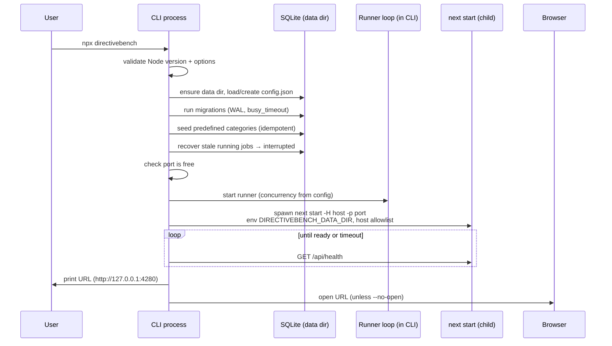

# SPEC-009 — CLI Architecture

## 1. Scope

The `directivebench` npm package (`apps/cli`): commands, options, environment variables, exit codes, process lifecycle and packaging. Installation and first-run experience from the user's point of view is in [SPEC-010](2026-10-14-local-installation.md); distribution rationale in [ADR-0004](../decisions/0004-native-cli-distribution.md).

`apps/cli` is the **only publishable package**. It is built with tsup, which bundles the internal workspace packages (`@directivebench/*`) and the pure-JS libraries (`commander`, `drizzle-orm`, `yaml`, `zod`) into `dist/cli.js`; only `next`, `react` and `react-dom` remain runtime dependencies ([SPEC-004](2026-10-14-technology-stack.md) dependency policy). The prebuilt Next.js app is shipped alongside it.

## 2. Commands

| Command | Status | Behaviour |
| --- | --- | --- |
| `directivebench` | Implemented (bootstrap) | Same as `serve` (opens the browser unless `--no-open`). |
| `directivebench serve` | Implemented (bootstrap) | Full startup sequence (§5): migrate, recover jobs, start runner, start web UI. |
| `directivebench init` | Implemented (bootstrap) | Create/validate the data directory, write default `config.json` if absent, run migrations, seed predefined categories. Does not start servers. Idempotent. |
| `directivebench doctor` | Implemented (bootstrap) | Diagnose the environment (§4). Read-only (never creates or migrates anything); exits non-zero if a required check fails. |
| `directivebench demo` | Implemented (bootstrap) | Headless: init → import bundled example artifact and benchmark (`dist/examples`) → run it with the Mock Agent → print a RED/GREEN summary labelled "Mock agent — not an AI evaluation". |
| `directivebench --help`, `-h` | Implemented (bootstrap) | Usage for the program or a subcommand. |
| `directivebench --version`, `-V` | Implemented (bootstrap) | Prints the package version. |
| `sync` | Future | Synchronize registered repositories ([SPEC-105](2026-10-14-repository-synchronization.md)). |
| `benchmark run`, `benchmark list` | Future | Run/list benchmarks headless ([SPEC-110](2026-10-14-benchmark-execution.md)). |
| `export`, `import` | Future | Portable export/import of registry and results. |
| `backup`, `restore` | Future | Consistent SQLite backup into `<dataDir>/backups/` and restore. |
| `runner` | Future | Standalone runner process; later a remote runner ([SPEC-114](2026-10-14-runner-management.md), [SPEC-011](2026-10-14-self-hosting-architecture.md)). |

Future commands must not be registered as stubs that pretend to work; until implemented they are absent from `--help`.

## 3. Options and environment variables

| Option | Env var | Default | Applies to | Notes |
| --- | --- | --- | --- | --- |
| `--host <host>` | `DIRECTIVEBENCH_HOST` | `127.0.0.1` | serve | Non-loopback values require `--allow-network-access`. |
| `--port <port>` | `DIRECTIVEBENCH_PORT` | `4280` | serve | Integer 1–65535. |
| `--data-dir <path>` | `DIRECTIVEBENCH_DATA_DIR` | OS default ([SPEC-010](2026-10-14-local-installation.md#5-data-directory)) | all | Resolved to an absolute path. |
| `--no-open` | — | open | serve | Do not open a browser. |
| `--allow-network-access` | — | off | serve | Permits non-loopback `--host`; prints an "unauthenticated instance" warning ([SPEC-007](2026-10-14-security-and-privacy.md)). |
| `--dev` | — | off | `serve` subcommand | Runs `next dev` instead of `next start`; only available from a source checkout (usage error otherwise). Used by `pnpm dev`. |
| `--json` | — | off | doctor | Machine-readable output (`{ "checks": [{ name, status, detail, hint? }] }`; `hint` is present for every non-`ok` check). |

Precedence: command-line option > environment variable > `config.json` > built-in default. All values are validated (Zod) before any side effect. `--data-dir` is a global option; serve options may be given with or without the `serve` subcommand.

## 4. `doctor` checks

Node.js version against the supported range; `node:sqlite` availability; data directory resolvable and writable; `config.json` valid; database opens and migrations are up to date (reported, not applied); port availability on the configured host/port; bundled web build present (`dist/web/.next`); agent CLI detection (`claude`, `codex`, `cursor-agent`: on PATH + `--version`, informational only). Each check prints `ok`, `warn` or `fail` with a remediation hint. Output never includes secrets.

## 5. Startup sequence (`serve`)



The CLI process is the supervisor: it owns the runner and the web child. The web process only reads the database and enqueues jobs ([SPEC-008](2026-10-14-api-architecture.md)).

## 6. Process supervision and shutdown

- The web server runs as a child process (`node <next>/dist/bin/next start <dist/web>`). Its stdout and stderr are appended to `<dataDir>/logs/web.log`; stderr is also echoed to the CLI's stderr (stdout only with `--dev`). Runner lifecycle events are appended as redacted JSON lines to `<dataDir>/logs/runner.log` and printed to stderr as `[runner] <message>` ([SPEC-114](2026-10-14-runner-management.md) FR-114-15). On startup `serve` prints `logs: <dataDir>/logs (web.log, runner.log)`.
- If the child exits unexpectedly, the CLI stops the runner, marks running jobs `interrupted`, and exits non-zero. No automatic restart in bootstrap.
- Readiness: poll `GET /api/health` until `200` or 30 s timeout (then exit with an error). The health body is `{"status":"ok","database":"ready"|"not-initialized"}`.
- **Graceful shutdown** on `SIGINT`/`SIGTERM` (and Windows Ctrl+C): stop acquiring jobs → abort running jobs via `AbortSignal` → wait at most 10 s, then mark them `interrupted` → terminate agent subprocesses → send `SIGTERM` to the web child (force kill after 5 s) → close the database → exit. A second signal forces immediate exit.

## 7. Browser opening

Uses the platform opener (`open` on macOS, `xdg-open` on Linux, `start` via `cmd /c` on Windows) without a shell interpolation of the URL. Failure to open is a warning, never an error; the URL is always printed. Skipped with `--no-open`, and skipped automatically when no display is available (e.g. `CI` set, or Linux without `DISPLAY`/`WAYLAND_DISPLAY`).

## 8. Port conflicts

Before spawning the web server the CLI checks the port on the target host. If it is in use, the CLI exits with code 4 and a message suggesting `--port <other>`; it does not silently pick another port (the URL must be predictable). Detecting an already running DirectiveBench instance on that port and opening it instead is a possible future improvement.

## 9. Exit codes

| Code | Meaning |
| --- | --- |
| 0 | Success (including clean shutdown after a signal) |
| 1 | Unexpected/runtime error |
| 2 | Invalid usage or configuration (bad option, invalid `config.json`, non-loopback host without `--allow-network-access`) |
| 3 | Unsupported runtime (Node.js older than 22.16.0). A missing `node:sqlite` is reported by `doctor` as a failing check (exit 6). |
| 4 | Port in use |
| 5 | Data directory or migration failure |
| 6 | `doctor` found at least one failing check / `demo` benchmark did not produce the expected result |

The implementation (`ExitCode` in `apps/cli/src/runtime.ts`) matches this table; changes must update both.

## 10. Packaging layout

```text
directivebench/            # published npm package (apps/cli)
├── package.json           # "bin": {"directivebench": "dist/cli.js"}, engines.node, runtime deps: only next, react, react-dom
├── LICENSE
├── README.md
└── dist/
    ├── cli.js             # tsup bundle: shebang + createRequire banner; includes @directivebench/*, commander, drizzle-orm, yaml, zod
    ├── web/               # prebuilt Next.js app: .next/ (without cache, trace, types, diagnostics, *.nft.json, *.map), public/, next.config.mjs
    ├── migrations/        # SQL migrations + drizzle meta journal
    └── examples/          # bundled example artifacts and benchmarks used by `demo`
```

- **Bundle banner:** `dist/cli.js` starts with the shebang followed by `const require = createRequire(import.meta.url)`, because bundled CommonJS dependencies (e.g. `yaml`) call `require()` inside the ESM bundle.
- **File resolution:** all bundled assets are resolved relative to the CLI file (`path.dirname(fileURLToPath(import.meta.url))` → `dist/`), never relative to `process.cwd()`. The `next` binary is resolved with `createRequire(import.meta.url).resolve('next/package.json')`.
- Development mode (running from source) resolves the same assets from `apps/web`, `packages/database/migrations` and `examples/` through a single resolver function, so both modes share one code path.
- No native compilation: SQLite uses built-in `node:sqlite` ([ADR-0002](../decisions/0002-sqlite-with-node-sqlite.md)).

## 11. Packaging verification

`pnpm verify:pack` (`scripts/verify-pack.mjs`, run after `pnpm build`): `pnpm pack` in `apps/cli` (rewrites the `workspace:` protocol) → check the tarball contents (paths in §10, no source maps, caches or `.env` files) → install the tarball with npm into an empty temp project → run `directivebench --help`, `--version` and `demo` → start `serve --no-open --port <free> --data-dir <temp>` and wait for `GET /api/health` → check that `/results` lists the demo run and the run detail shows its verdict → check that a request with a foreign `Host` header is rejected with 403 → shut down via `SIGTERM` and assert a clean exit. Details in [SPEC-012](2026-10-14-testing-strategy.md).

## 12. Implementation status

- **Implemented (verified by `apps/cli/test/cli.test.ts` and `pnpm verify:pack` on 2026-10-14, Node 24.21, Linux):** commands `directivebench` (= `serve`), `serve [--host --port --no-open --allow-network-access --dev]`, `init`, `doctor [--json]`, `demo`, `--help`, `--version`, global `--data-dir`; option precedence flag > env > config > default, invalid port and non-loopback host without `--allow-network-access` → exit 2 (`cli.test.ts`); Node version check (exit 3 below 22.16.0); startup sequence of §5 with the runner embedded in the CLI process; web child started with `node <next>/dist/bin/next start dist/web`, readiness poll of `/api/health` (30 s), `SIGTERM` to the child with `SIGKILL` after 5 s, second signal forces exit; port in use → exit 4 without picking another port; data-dir/migration failures → exit 5; `doctor` failures and a `demo` verdict other than `improved` → exit 6; browser opener skipped when `CI` is set or on Linux without `DISPLAY`/`WAYLAND_DISPLAY`; web log appended to `<dataDir>/logs/web.log`; packaging layout of §10 (`LICENSE` copied in, `required-server-files` paths rewritten). Nothing has been published to npm.
- **Implemented on 2026-10-15 (verified by `apps/cli/test/cli.test.ts` — 7 tests — `pnpm build && pnpm verify:pack` and the Playwright run):** `doctor` checks data-directory writability (existing directory: not writable → `fail`; missing directory: `warn` when the nearest existing parent is writable, `fail` otherwise) and every non-`ok` check carries a remediation `hint` (printed as `→ hint`, included in `--json`; tests "warns with a hint when the data directory does not exist yet" and "fails when the data directory is not writable"); `serve` writes `<dataDir>/logs/runner.log` and prints the logs location (verified by inspecting `runner.log` after the Playwright run); `dist/cli.js` bundles `@directivebench/*`, `commander`, `drizzle-orm`, `yaml` and `zod` with the `createRequire` banner, and the packed tarball's runtime `dependencies` are only `next`, `react`, `react-dom`; `verify:pack` steps of §11 all passed.
- **Partially implemented:** port-in-use, signal handling and browser-opening behaviour are verified manually / by `verify:pack` (clean `SIGTERM` exit), not by dedicated unit tests. Windows Ctrl+C handling is unverified.
- **Not implemented:** `sync`, `benchmark run|list`, `export`, `import`, `backup`, `restore`, `runner`; automatic restart of the web child; detection of an already running instance.
