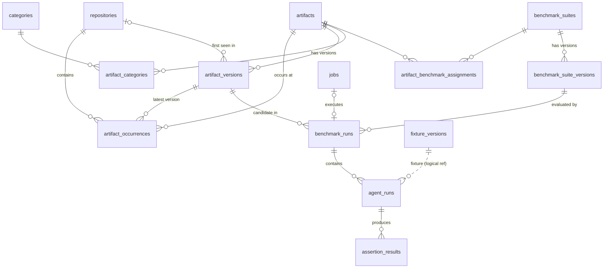

# Database Schema

Physical persistence for the [domain model (SPEC-005)](2026-10-14-domain-model.md). Source of truth: `packages/database/src/schema.ts` (Drizzle) and the generated SQL in `packages/database/migrations/`. Decision: [ADR-0002](../decisions/0002-sqlite-with-node-sqlite.md). Driver details: [SPEC-004 §3.2](2026-10-14-technology-stack.md#32-drizzle-sqlite-proxy).

## 1. Conventions

| Topic | Rule |
|---|---|
| File | `<dataDir>/directivebench.db` (+ `-wal`, `-shm`). |
| Pragmas | `journal_mode = WAL` (read-write connections), `busy_timeout = 5000`, `foreign_keys = ON`. |
| IDs | Prefixed random text `createId(prefix)` → `<prefix>_<16 base64url chars>` (12 random bytes). Exceptions: `fixture_versions.id` = sha256 manifest hash; join tables use composite PKs. |
| Timestamps | ISO-8601 UTC text (`nowIso()`), columns `*_at`. |
| Booleans | `integer` 0/1 (Drizzle `mode: 'boolean'`). |
| JSON | `text` columns with Drizzle `mode: 'json'`; validated with Zod at the repository boundary; never queried with SQLite JSON functions in repository code. |
| Enums | `text` columns with Drizzle `enum` typing (no DB CHECK constraints generated); validated in TypeScript. |
| Access | Only via repository functions in `packages/database/src/repositories/*`. Apps never use the raw `DatabaseSync` handle. |

ID prefixes used by repository code: `cat`, `repo`, `art`, `artv`, `occ`, `suite`, `suitev`, `job`, `run`, `arun`, `ares`.

## 2. Entity-relationship diagram



## 3. Tables (bootstrap)

Notation: **PK** primary key, **FK** foreign key (`→ table`, on-delete action), **U** unique index, **I** non-unique index, `json` = JSON in text. All `created_at`/`updated_at` are NOT NULL unless noted.

### 3.1 `categories`
| Column | Type | Notes |
|---|---|---|
| id | text PK | |
| slug | text NOT NULL | **U** `categories_slug_unique` |
| name | text NOT NULL | |
| description | text | |
| predefined | int bool NOT NULL default 0 | seeded from `PREDEFINED_CATEGORIES` (idempotent) |
| archived_at | text | soft archive |
| created_at, updated_at | text | |

### 3.2 `repositories`
| Column | Type | Notes |
|---|---|---|
| id | text PK | |
| provider | text NOT NULL | `github` \| `gitlab` \| `local-git` \| `local-directory` \| `bundled-examples` |
| name | text NOT NULL | |
| location | text NOT NULL | clone URL or absolute path; **U** (provider, location) |
| instance_url | text | self-managed GitLab base URL |
| default_branch, selected_branch | text | |
| last_commit_sha, last_sync_at | text | |
| sync_status | text NOT NULL default `never` | `never` \| `ok` \| `error` |
| sync_error | text | redacted |
| created_at, updated_at | text | |

### 3.3 `artifacts`
| Column | Type | Notes |
|---|---|---|
| id | text PK | |
| slug | text NOT NULL | **U** `artifacts_slug_unique` |
| name | text NOT NULL | |
| type | text NOT NULL | `skill` \| `instruction` \| `rule` |
| description | text | |
| notes | text | user-managed; never overwritten by sync |
| tags | json `string[]` NOT NULL default `'[]'` | user-managed (normalized table planned, §7) |
| created_at, updated_at | text | |

### 3.4 `artifact_versions` (immutable)
| Column | Type | Notes |
|---|---|---|
| id | text PK | |
| artifact_id | text NOT NULL | FK → artifacts (cascade) |
| version | int NOT NULL | sequential per artifact; **U** (artifact_id, version) |
| content_hash | text NOT NULL | `hashManifest` of files; **U** (artifact_id, content_hash) |
| format | text NOT NULL | `ArtifactFormat` |
| primary_file | text NOT NULL | e.g. `SKILL.md` |
| files | json `StoredArtifactFile[]` NOT NULL | `{path, sha256, size, content}` (text files only in MVP) |
| parsed_metadata | json NOT NULL | frontmatter, activation, references, warnings |
| source_repository_id | text | FK → repositories (set null) |
| source_path, source_commit_sha | text | where first seen |
| created_at | text NOT NULL | no `updated_at` (never updated) |

### 3.5 `artifact_occurrences`
| Column | Type | Notes |
|---|---|---|
| id | text PK | |
| artifact_id | text NOT NULL | FK → artifacts (cascade) |
| repository_id | text NOT NULL | FK → repositories (cascade); **U** (repository_id, path) |
| path | text NOT NULL | repository-relative; skill root dir for skills |
| latest_version_id | text NOT NULL | FK → artifact_versions |
| commit_sha | text | |
| status | text NOT NULL default `active` | `active` \| `removed` |
| last_seen_at | text NOT NULL | |
| created_at, updated_at | text | |

### 3.6 `artifact_categories`
PK (artifact_id, category_id); both FK cascade; `created_at`.

### 3.7 `fixture_versions`
| Column | Type | Notes |
|---|---|---|
| id | text PK | sha256 of the fixture file manifest = directory name under `<dataDir>/fixtures/` |
| source_path | text | original path at import (informational) |
| file_count, total_bytes | int NOT NULL | |
| created_at | text NOT NULL | |

### 3.8 `benchmark_suites`
| Column | Type | Notes |
|---|---|---|
| id | text PK | |
| slug | text NOT NULL | definition `id`; **U** |
| name | text NOT NULL | |
| description | text | |
| created_at, updated_at | text | |

### 3.9 `benchmark_suite_versions` (immutable except approval)
| Column | Type | Notes |
|---|---|---|
| id | text PK | |
| suite_id | text NOT NULL | FK → benchmark_suites (cascade) |
| version | int NOT NULL | **U** (suite_id, version) |
| content_hash | text NOT NULL | canonical JSON of definition + fixture hashes; **U** (suite_id, content_hash) |
| schema_version | int NOT NULL | definition format version (1) |
| definition | json NOT NULL | validated definition as imported |
| fixtures | json NOT NULL | `{ [caseId]: { fixture: sha256, overlay?: sha256 } }` |
| source_path | text | |
| execution_approved_at | text | NULL = commands may not run |
| execution_approval_source | text | `bundled-example` \| `user` |
| created_at | text NOT NULL | |

### 3.10 `artifact_benchmark_assignments`
PK (artifact_id, suite_id); both FK cascade; `created_at`. User metadata — preserved across sync.

### 3.11 `jobs`
| Column | Type | Notes |
|---|---|---|
| id | text PK | |
| type | text NOT NULL | `benchmark-run` (future: `repository-sync`) |
| status | text NOT NULL | `pending` \| `running` \| `completed` \| `failed` \| `cancelled` \| `interrupted`; **I** (status, created_at) |
| payload | json NOT NULL | e.g. `{suiteVersionId, artifactVersionId, agent, repetitions}` |
| runner_id | text | acquiring runner instance |
| attempts | int NOT NULL default 0 | incremented on acquire; no automatic retry |
| error | text | redacted |
| cancel_requested_at | text | set by web; observed by runner |
| created_at | text NOT NULL | |
| started_at, heartbeat_at, finished_at | text | heartbeat every 5 s; stale > 30 s → `interrupted` at runner start |

Acquire (single statement, portable to PostgreSQL):

```sql
UPDATE jobs SET status = 'running', runner_id = ?, started_at = ?, heartbeat_at = ?, attempts = attempts + 1
WHERE id = (SELECT id FROM jobs WHERE status = 'pending' ORDER BY created_at LIMIT 1)
  AND status = 'pending'
RETURNING *;
```

### 3.12 `benchmark_runs`
| Column | Type | Notes |
|---|---|---|
| id | text PK | |
| job_id | text | FK → jobs (set null) |
| suite_version_id | text NOT NULL | FK → benchmark_suite_versions (no cascade) |
| artifact_version_id | text NOT NULL | FK → artifact_versions (no cascade); **I** |
| agent_adapter_id | text NOT NULL | e.g. `mock` |
| agent_version | text | detected adapter/CLI version |
| model | json `{provider, model}` \| null | |
| environment | json NOT NULL | `{ kind }`; the full `EnvironmentMetadata` (sandboxed, platform, arch, node version, adapter version, model, limits) is stored in `summary.environment` |
| status | text NOT NULL | `running` \| `completed` \| `error` \| `cancelled` \| `interrupted` |
| verdict | text | verdict ([SPEC-111](2026-10-14-benchmark-scoring.md)); null while running; the display status is `summary.displayStatus` |
| comparability_key | text | |
| summary | json | `ScoringSummary` (aggregates per case/variant, delta, verdict, confidence) + `environment` + `displayStatus` |
| warnings | json `string[]` NOT NULL default `'[]'` | uncontrolled differences |
| error | text | |
| started_at | text NOT NULL | **I** |
| finished_at | text | |

Planned index: (comparability_key, started_at) once comparison views query by key.

### 3.13 `agent_runs`
| Column | Type | Notes |
|---|---|---|
| id | text PK | |
| benchmark_run_id | text NOT NULL | FK → benchmark_runs (cascade); **I** |
| case_id | text NOT NULL | case id inside the suite definition |
| variant | text NOT NULL | `baseline` \| `candidate` |
| repetition | int NOT NULL | 1-based |
| fixture_version_id | text NOT NULL | sha256 (logical ref; no FK) |
| execution_status | text NOT NULL | `completed` \| `agent-error` \| `timeout` \| `cancelled` \| `infrastructure-error` |
| score | real | null when not completed |
| passed | int bool | |
| duration_ms | int NOT NULL | |
| changed_files | json NOT NULL | `[{path, change: added\|modified\|deleted}]` |
| trace | json NOT NULL | redacted, size-bounded events |
| usage | json | token usage when reported |
| error | text | redacted |
| created_at | text NOT NULL | |

### 3.14 `assertion_results`
| Column | Type | Notes |
|---|---|---|
| id | text PK | |
| agent_run_id | text NOT NULL | FK → agent_runs (cascade); **I** |
| assertion_id | text NOT NULL | id from definition |
| type | text NOT NULL | assertion type |
| passed | int bool NOT NULL | |
| score, weight | real NOT NULL | |
| required, deterministic | int bool NOT NULL | |
| message | text NOT NULL | |
| details | json | truncated + redacted |

## 4. Deletion semantics

- Results are protected: `benchmark_runs` FKs to suite/artifact versions have no `ON DELETE` action, so deleting a referenced version — or an artifact/suite whose cascade would reach such a version — fails with a foreign-key error. Repository code must check first and return a domain error (prefer archiving over deletion).
- Deleting a repository removes its occurrences (cascade) but never versions (`source_repository_id` set null).
- Workspaces and fixture directories on disk are managed by the engine/runner; orphaned `fixtures/<sha256>/` cleanup is a planned maintenance command.

## 5. Migration policy

1. Schema changes are made in `schema.ts`, then `pnpm db:generate` (`drizzle-kit generate`) writes SQL + snapshot into `packages/database/migrations/`. Generated SQL is reviewed and committed; hand edits are allowed only for data backfills and must keep the snapshot consistent.
2. **Forward-only.** No down migrations. Never edit or delete a migration that has been released.
3. The CLI applies pending migrations at startup (`serve`, `demo`, `init`) via `migrateDatabase()`, all pending statements in one `BEGIN IMMEDIATE` transaction. Migrations ship inside the published package.
4. If the DB has migrations newer than the running CLI knows (downgrade), the CLI SHALL refuse to start with a clear message (not implemented yet).
5. **Planned:** before applying migrations to a non-empty DB, write a backup to `<dataDir>/backups/directivebench-<timestamp>-pre-<migration>.db` using `VACUUM INTO`; keep the last N backups.
6. Prefer additive changes (new nullable columns, new tables). SQLite table rebuilds generated by drizzle-kit require explicit review because they copy data.

## 6. PostgreSQL portability rules

Goal: a future self-hosted PostgreSQL backend reuses the same repository interfaces ([SPEC-011](2026-10-14-self-hosting-architecture.md), [ADR-0009](../decisions/0009-self-hosted-readiness.md)).

- Repository code uses Drizzle query builder; raw SQL only for statements valid in both dialects (`UPDATE … RETURNING`, `INSERT … ON CONFLICT DO NOTHING/UPDATE`).
- No SQLite-only features in repository code: no `INSERT OR REPLACE`, `rowid`, `AUTOINCREMENT`, `strftime`/`datetime()`, JSON1 functions, `GLOB`, implicit type affinity tricks, `PRAGMA` (pragmas only in the client).
- Timestamps as ISO-8601 UTC text generated in application code (sortable lexicographically); JSON as text validated with Zod. A PostgreSQL schema may use `timestamptz`/`jsonb`, mapped in the repository layer.
- Text IDs generated in application code; no DB-generated keys.
- Case-insensitive search implemented explicitly (`lower(col) LIKE lower(?)`), not via SQLite `LIKE` defaults.
- Transactions via `withTransaction()` abstraction; no reliance on SQLite single-writer semantics for correctness (use conditional updates).

## 7. Planned tables

| Table | Purpose | Key columns |
|---|---|---|
| `provider_connections` | Configured model providers and git hosts | id, kind (`model` \| `git`), provider_type, name, base_url, auth_mode, secret_ref_id FK, ca_bundle_path, created_at, updated_at |
| `secret_refs` | Secret references (never values), shape `SecretRef` of [SPEC-115](2026-10-14-settings-and-configuration.md) FR-115-30 | id, source (`keychain` \| `env`), name (keychain entry under service `directivebench`, or env var name), label, created_at, last_used_at |
| `sync_runs` | History of repository synchronizations | id, repository_id FK, job_id FK, status, commit_sha, started_at, finished_at, added/updated/removed counts, error |
| `tags`, `artifact_tags` | Normalized tags replacing `artifacts.tags` JSON | tags: id, name **U**; artifact_tags: PK (artifact_id, tag_id) |

Each lands with its feature spec ([SPEC-105](2026-10-14-repository-synchronization.md), [SPEC-106](2026-10-14-category-management.md), [SPEC-115](2026-10-14-settings-and-configuration.md)) and [SPEC-007](2026-10-14-security-and-privacy.md) for secrets.

## Implementation status

- **Implemented (verified by `packages/database/test/{client,artifacts,benchmarks,jobs,runs,catalog}.test.ts` and `packages/runner/test/runner.test.ts` on 2026-10-14 and 2026-10-15):** all 14 tables of §3 with listed keys and indexes (`schema.ts`, `migrations/0000_init.sql`; migrations idempotent); `node:sqlite` client with WAL, `busy_timeout = 5000`, `foreign_keys = ON`; forward-only `migrateDatabase()` applying all pending migrations in one `BEGIN IMMEDIATE` transaction; `withTransaction()` (IMMEDIATE, serialised per connection); repository functions for artifacts, catalog (categories seeding, repositories, dashboard stats), benchmarks, jobs (atomic `UPDATE … RETURNING` acquisition in FIFO order, cancellation, stale recovery, and `interruptJobs` — shared by stale recovery and the capped graceful shutdown, it marks jobs and their running benchmark runs `interrupted`, verified by `runner.test.ts` on 2026-10-15) and runs; `drizzle-kit generate` script; ID prefixes above.
- **Partially:** deletion guards in §4 rely on FK constraints only (no explicit repository checks or domain errors; no delete operations are exposed yet).
- **Not implemented:** pre-migration backups, downgrade detection, `(comparability_key, started_at)` index, orphan fixture cleanup, all planned tables in §7, PostgreSQL backend.
