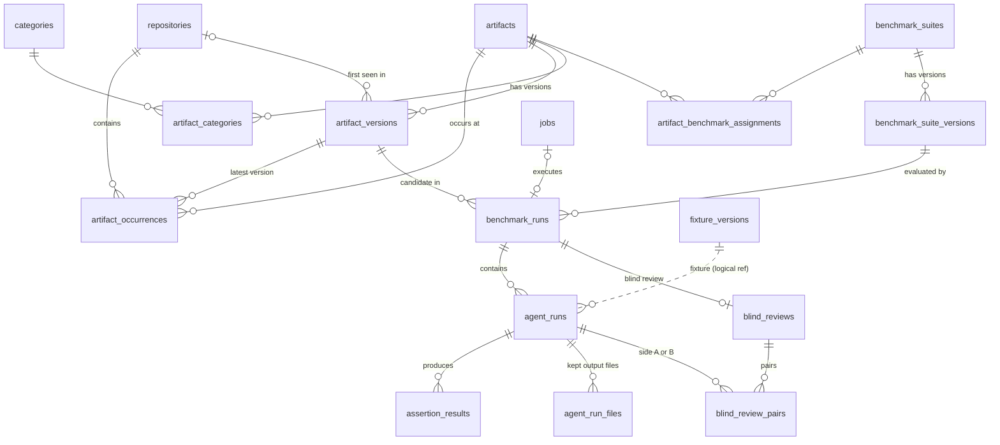

# Database Schema

Physical persistence for the [domain model (SPEC-005)](2026-10-14-domain-model.md). Source of truth: `packages/database/src/schema.ts` (Drizzle) and the generated SQL in `packages/database/migrations/`. Decision: [ADR-0002](../decisions/0002-sqlite-with-node-sqlite.md). Driver details: [SPEC-004 §3.2](2026-10-14-technology-stack.md#32-drizzle-sqlite-proxy).

## 1. Conventions

| Topic | Rule |
|---|---|
| File | `<dataDir>/directivebench.db` (+ `-wal`, `-shm`). |
| Pragmas | `journal_mode = WAL` (read-write connections), `busy_timeout = 5000`, `foreign_keys = ON`. |
| IDs | Prefixed random text `createId(prefix)` → `<prefix>_<16 base64url chars>` (12 random bytes). Exceptions: `fixture_versions.id` = sha256 manifest hash; join tables use composite PKs. |
| Timestamps | ISO-8601 UTC text (`nowIso()`), columns `*_at`. |
| Booleans | `integer` 0/1 (Drizzle `mode: 'boolean'`). |
| JSON | `text` columns with Drizzle `mode: 'json'`; validated with Zod at the repository boundary; never queried with SQLite JSON functions in repository code. |
| Enums | `text` columns with Drizzle `enum` typing (no DB CHECK constraints generated); validated in TypeScript. |
| Text | No stored text holds U+0000 (issue 265): `node:sqlite` on Node 22 returns a TEXT value only up to its first NUL ([SPEC-004 §3.1](2026-10-14-technology-stack.md#31-node-version-and-nodesqlite)) and PostgreSQL refuses NUL in text. The client refuses any string parameter holding U+0000 before the statement runs (`NulInTextError`, naming the parameter by position, never its value). Error and message columns (`jobs.error`, `benchmark_runs.error`, `agent_runs.error`, `agent_runs.output_files_reason`, `assertion_results.message`, `repositories.sync_error`) are written through `storedMessage`, which replaces U+0000 with U+FFFD; so is `benchmark_runs.agent_version`, the agent CLI's own text (issue 282: `createBenchmarkRun` stores the first `--version` line as printed, with U+0000 as U+FFFD, for every caller; the comparability key keeps hashing the line as detected). JSON columns are unaffected: `JSON.stringify` escapes NUL as `\u0000`. Migration `0010_text_without_nul` (data-only) rewrites U+0000 as U+FFFD in the free-text columns an earlier version may have stored it in: the six above plus `categories.name`/`name_key`/`description`, `repositories.name`, `artifacts.name`/`description`/`notes`, `benchmark_suites.name`/`description`, `benchmark_runs.agent_version` and `blind_review_pairs.note`; ids, enums, timestamps, hashes, slugs and paths are never taken from such text. U+FFFD is not injective, so every active category with NUL in its `name_key` keeps its id, slug and assignments and gets ` (<id>)` after its name and ` (<lowercased id>)` after its key (two such keys never meet, because ids hold no ` (`); one whose new key equals a clean active key is archived. Input is checked before it reaches the client (issue 273): the web forms refuse U+0000 with a field message (artifact notes, blind review notes; tags and category names and descriptions refuse every control character) or with the form's general refusal (hidden ids), the Repositories page ignores a job id holding it, and a benchmark definition names every string holding it ([SPEC-108](2026-10-14-benchmark-definition-format.md) FR-108-17). A path segment holding `%00` is answered with Not Found by Next.js before a page reads it. |
| Access | Only via repository functions in `packages/database/src/repositories/*`. Apps never use the raw `DatabaseSync` handle. |

ID prefixes used by repository code: `cat`, `repo`, `art`, `artv`, `occ`, `suite`, `suitev`, `job`, `run`, `arun`, `ares`.

## 2. Entity-relationship diagram



## 3. Tables (bootstrap)

Notation: **PK** primary key, **FK** foreign key (`→ table`, on-delete action), **U** unique index, **I** non-unique index, `json` = JSON in text. All `created_at`/`updated_at` are NOT NULL unless noted.

### 3.1 `categories`
| Column | Type | Notes |
|---|---|---|
| id | text PK | |
| slug | text NOT NULL | **U** `categories_slug_unique` |
| name | text NOT NULL | stored normalised (`normalizeCategoryName`) |
| name_key | text NOT NULL (SQL `DEFAULT ''` for `ALTER TABLE ADD` only; no Drizzle default) | `categoryNameKey(name)`; **U** `categories_active_name_key_unique` partial, `WHERE archived_at IS NULL`: names are unique case-insensitively among active categories ([SPEC-124](implemented/2026-11-04-category-lifecycle-and-assignment.md) §8.1, migration `0005_category_name_key`) |
| description | text | |
| predefined | int bool NOT NULL default 0 | seeded from `PREDEFINED_CATEGORIES` (idempotent; a slug or name-key clash is skipped) |
| archived_at | text | soft archive |
| created_at, updated_at | text | |

### 3.2 `repositories`
| Column | Type | Notes |
|---|---|---|
| id | text PK | |
| provider | text NOT NULL | `github` \| `gitlab` \| `local-git` \| `local-directory` \| `bundled-examples` |
| name | text NOT NULL | |
| location | text NOT NULL | clone URL or absolute path; **U** (provider, location) |
| instance_url | text | self-managed GitLab base URL |
| default_branch, selected_branch | text | `selected_branch`: the branch the user chose for a hosted repository (issue 58); null follows `default_branch`, and a choice equal to the default is stored as null |
| last_commit_sha, last_sync_at | text | |
| scanned_branch | text | the branch the last successful hosted scan read, written with `last_commit_sha` (null for local scans, before the first hosted scan and for rows scanned before migration `0008`) (issue 58) |
| sync_status | text NOT NULL default `never` | `never` \| `ok` \| `error` |
| sync_error | text | redacted |
| created_at, updated_at | text | |

### 3.3 `artifacts`
| Column | Type | Notes |
|---|---|---|
| id | text PK | |
| slug | text NOT NULL | **U** `artifacts_slug_unique` |
| name | text NOT NULL | |
| type | text NOT NULL | `skill` \| `instruction` \| `rule` |
| format | text | source field: the format of the version the chosen active occurrence holds, like `type` (SPEC-103 FR-103-16, SPEC-126 FR-126-07); the possible-duplicate key with `name` (FR-126-11). Null only for an artifact without a version. Migration `0009`, backfilled (issue 246) |
| description | text | |
| notes | text | user-managed; never overwritten by sync |
| tags | json `string[]` NOT NULL default `'[]'` | user-managed (normalized table planned, §7) |
| created_at, updated_at | text | |

Index `artifacts_type_name_idx` on `(type, name)` (migration `0006`; the type filter and the bundled-example lookup by name and type). Index `artifacts_format_name_idx` on `(format, name)` (migration `0009`, issue 246: the possible-duplicate groups and lookup, SPEC-126 NFR-126-02).

### 3.4 `artifact_versions` (immutable)
| Column | Type | Notes |
|---|---|---|
| id | text PK | |
| artifact_id | text NOT NULL | FK → artifacts (cascade) |
| version | int NOT NULL | sequential per artifact; **U** (artifact_id, version) |
| content_hash | text NOT NULL | `hashManifest` of files; **U** (artifact_id, content_hash) |
| format | text NOT NULL | `ArtifactFormat` |
| primary_file | text NOT NULL | e.g. `SKILL.md` |
| files | json `StoredArtifactFile[]` NOT NULL | `{path, sha256, size, content}` (text files only in MVP) |
| parsed_metadata | json NOT NULL | frontmatter, activation, references, warnings |
| source_repository_id | text | FK → repositories (set null) |
| source_path, source_commit_sha | text | where first seen |
| parent_version_id | text | FK → artifact_versions (set null); the version the writing occurrence held before this version was inserted, null for a new occurrence and for rows stored before migration `0006`; set on insert only ([SPEC-126](implemented/2026-11-12-cross-repository-artifact-identity.md) FR-126-19) |
| created_at | text NOT NULL | no `updated_at` (never updated) |

Index `artifact_versions_content_hash_idx` on `(content_hash)` (migration `0006`) serves the rule-3 lookup by hash across artifacts (the unique index leads with `artifact_id`; SPEC-126 NFR-126-02).

### 3.5 `artifact_occurrences`
| Column | Type | Notes |
|---|---|---|
| id | text PK | |
| artifact_id | text NOT NULL | FK → artifacts (cascade) |
| repository_id | text NOT NULL | FK → repositories (cascade); **U** (repository_id, path) |
| path | text NOT NULL | repository-relative; skill root dir for skills |
| latest_version_id | text NOT NULL | FK → artifact_versions |
| commit_sha | text | |
| status | text NOT NULL default `active` | `active` \| `removed`; `removed` (shown as "missing") is set only by a complete scan that did not find the path, and a scan that finds it again sets `active` (SPEC-125 FR-125-04, FR-125-05); removing the repository deletes the row (cascade, SPEC-125 FR-125-14) |
| last_seen_at | text NOT NULL | |
| created_at, updated_at | text | |

Index `artifact_occurrences_artifact_idx` on `(artifact_id)` (migration `0006`): rule 3's local-only check and the source-field refresh read occurrences by artifact inside the scan transaction (SPEC-126 FR-126-02, FR-126-07).

### 3.6 `artifact_categories`
PK (artifact_id, category_id); both FK cascade; `created_at`.

### 3.7 `fixture_versions`
| Column | Type | Notes |
|---|---|---|
| id | text PK | sha256 of the fixture file manifest = directory name under `<dataDir>/fixtures/` |
| source_path | text | original path at import (informational) |
| file_count, total_bytes | int NOT NULL | |
| created_at | text NOT NULL | |

### 3.8 `benchmark_suites`
| Column | Type | Notes |
|---|---|---|
| id | text PK | |
| slug | text NOT NULL | definition `id`; **U** |
| name | text NOT NULL | |
| description | text | |
| created_at, updated_at | text | |

### 3.9 `benchmark_suite_versions` (immutable except approval)
| Column | Type | Notes |
|---|---|---|
| id | text PK | |
| suite_id | text NOT NULL | FK → benchmark_suites (cascade) |
| version | int NOT NULL | **U** (suite_id, version) |
| content_hash | text NOT NULL | canonical JSON of definition + fixture hashes; **U** (suite_id, content_hash) |
| schema_version | int NOT NULL | definition format version (1) |
| definition | json NOT NULL | validated definition as imported |
| fixtures | json NOT NULL | `{ [caseId]: { fixture: sha256, overlay?: sha256 } }` |
| source_path | text | |
| execution_approved_at | text | NULL = commands may not run |
| execution_approval_source | text | `bundled-example` \| `user` |
| created_at | text NOT NULL | |

### 3.10 `artifact_benchmark_assignments`
PK (artifact_id, suite_id); both FK cascade; `created_at`. User metadata — preserved across sync.

### 3.11 `jobs`
| Column | Type | Notes |
|---|---|---|
| id | text PK | |
| type | text NOT NULL | `benchmark-run` \| `repository-registration` ([SPEC-104](2026-10-14-repository-management.md) §9) \| `repository-scan` (local repositories, [SPEC-102](2026-10-14-artifact-discovery.md) Phasing) \| `repository-branch` (issue 58, short lane) (future: `repository-sync`) |
| status | text NOT NULL | `pending` \| `running` \| `completed` \| `failed` \| `cancelled` \| `interrupted`; **I** (status, created_at) |
| payload | json NOT NULL | input, validated per type: `{suiteVersionId, artifactVersionId}` (`benchmark-run`), `{path, confirmedLocation?}` or `{url, branch?}` (`repository-registration`), `{repositoryId}` (`repository-scan`), `{repositoryId, branch: string \| null}` (`repository-branch`) |
| result | json | outcome written by the runner when the job type has one; `repository-registration`: `{ok: true, repositoryId, created}` \| `{ok: false, code, message}` \| `{ok: false, code: 'confirmation-required', location, home, overlaps}`; `repository-scan`: `{ok: true, scannedFiles, discovered, createdArtifacts, createdVersions, removedOccurrences, reactivatedOccurrences, emptyScanKeptOccurrences, linkedOccurrences, ambiguousLinks, movedOccurrences, ambiguousMoves, warningCount, errorCount, errors, skippedUserLevelFolders, skippedUserLevelFolderCount?, commitSha, scanConfigHash?, unchanged?, branch?, durationMs}` \| `{ok: false, code, message}` (`repositoryScanResultSchema` in `packages/database/src/repositories/jobs.ts`; `errors` lists at most 100 of `errorCount`, `skippedUserLevelFolders` at most 50 of `skippedUserLevelFolderCount` (issue #45); a hosted scan stores `commitSha`, `skippedUserLevelFolderCount: 0` and, when the runner knows its version, `scanConfigHash` (SHA-256 of the effective scan configuration), `branch` (the branch read, issue 58; absent for local scans and older results), and a hosted rescan that skipped an unchanged remote also stores `unchanged: true` (issue 63, [SPEC-105](2026-10-14-repository-synchronization.md) FR-105-10); fields added after the first release read as 0, `[]` or null when absent, except `skippedUserLevelFolderCount`, whose readers fall back to the list length, and `scanConfigHash` and `unchanged`, which stay absent (a result without `scanConfigHash` is never a baseline for skipping a fetch)); `repository-branch`: `{ok: true, branch, defaultBranch}` \| `{ok: false, code, message}`; null otherwise (migration `0001`) |
| runner_id | text | acquiring runner instance |
| attempts | int NOT NULL default 0 | incremented on acquire; no automatic retry |
| error | text | redacted |
| cancel_requested_at | text | set by web; observed by runner |
| created_at | text NOT NULL | |
| started_at, heartbeat_at, finished_at | text | heartbeat every 5 s; stale > 30 s → `interrupted` at runner start |

Acquire (single statement, portable to PostgreSQL):

```sql
UPDATE jobs SET status = 'running', runner_id = ?, started_at = ?, heartbeat_at = ?, attempts = attempts + 1
WHERE id = (SELECT id FROM jobs WHERE status = 'pending' ORDER BY created_at LIMIT 1)
  AND status = 'pending'
RETURNING *;
```

### 3.12 `benchmark_runs`
| Column | Type | Notes |
|---|---|---|
| id | text PK | |
| job_id | text | FK → jobs (set null) |
| suite_version_id | text NOT NULL | FK → benchmark_suite_versions (no cascade) |
| artifact_version_id | text NOT NULL | FK → artifact_versions (no cascade); **I** |
| agent_adapter_id | text NOT NULL | e.g. `mock` |
| agent_version | text | detected adapter/CLI version (for an agent CLI, the first line of its `--version` output, at most 200 characters); U+0000 stored as U+FFFD (§1 Text) |
| model | json `{provider, model}` \| null | |
| environment | json NOT NULL | `{ kind }`; the full `EnvironmentMetadata` (sandboxed, platform, arch, node version, adapter version, model, limits) is stored in `summary.environment` |
| status | text NOT NULL | `running` \| `completed` \| `error` \| `cancelled` \| `interrupted` |
| verdict | text | verdict ([SPEC-111](2026-10-14-benchmark-scoring.md)); null while running; the display status is `summary.displayStatus` |
| comparability_key | text | |
| summary | json | `ScoringSummary` (aggregates per case/variant, delta, verdict, confidence) + `environment` + `displayStatus` |
| warnings | json `string[]` NOT NULL default `'[]'` | uncontrolled differences |
| error | text | |
| started_at | text NOT NULL | **I** |
| finished_at | text | |

Planned index: (comparability_key, started_at) once comparison views query by key.

### 3.13 `agent_runs`
| Column | Type | Notes |
|---|---|---|
| id | text PK | |
| benchmark_run_id | text NOT NULL | FK → benchmark_runs (cascade); **I** |
| case_id | text NOT NULL | case id inside the suite definition |
| variant | text NOT NULL | `baseline` \| `candidate` |
| repetition | int NOT NULL | 1-based |
| fixture_version_id | text NOT NULL | sha256 (logical ref; no FK) |
| execution_status | text NOT NULL | `completed` \| `agent-error` \| `timeout` \| `cancelled` \| `infrastructure-error` |
| score | real | null when not completed |
| passed | int bool | |
| duration_ms | int NOT NULL | |
| changed_files | json NOT NULL | `[{path, change: added\|modified\|deleted}]` |
| trace | json NOT NULL | redacted, size-bounded events |
| usage | json | token usage when reported |
| error | text | redacted |
| created_at | text NOT NULL | |
| output_files_kept | int bool NOT NULL default 0 | output files captured (SPEC-123 FR-123-11); 1 also when no file changed; 0 for rows before migration `0003` |
| output_files_reason | text | redacted reason when not kept; null when kept and for older rows |

### 3.14 `assertion_results`
| Column | Type | Notes |
|---|---|---|
| id | text PK | |
| agent_run_id | text NOT NULL | FK → agent_runs (cascade); **I** |
| assertion_id | text NOT NULL | id from definition |
| type | text NOT NULL | assertion type |
| passed | int bool NOT NULL | |
| score, weight | real NOT NULL | |
| required, deterministic | int bool NOT NULL | |
| message | text NOT NULL | |
| details | json | truncated + redacted |

### 3.15 `agent_run_files` (SPEC-123 §8.1, migration `0003`)
| Column | Type | Notes |
|---|---|---|
| id | text PK | `afile_…` |
| agent_run_id | text NOT NULL | FK → agent_runs (cascade); **U** (agent_run_id, path), which also serves lookups by agent run |
| path | text NOT NULL | workspace-relative POSIX path; untrusted display text |
| change | text NOT NULL | `added` \| `modified` \| `deleted` |
| size_bytes | int | original size; null for `deleted` |
| sha256 | text | of the original bytes; null for `deleted` |
| kept | text NOT NULL | `full` \| `truncated` \| `none` |
| reason | text | `file-limit` \| `run-limit` \| `binary` \| `deleted` \| `artifact-path`; null when `full` |
| content | text | redacted UTF-8 text, at most 1 MiB; null when `kept = none` |
| stored_bytes | int NOT NULL default 0 | UTF-8 bytes of `content` |
| redactions | int NOT NULL default 0 | secret ranges replaced in `content` |

### 3.16 `blind_reviews` (SPEC-123 §8.1, migration `0004`)
| Column | Type | Notes |
|---|---|---|
| id | text PK | `brev_…` |
| benchmark_run_id | text NOT NULL | FK → benchmark_runs (cascade); **U** (one review per run) |
| created_at | text NOT NULL | |
| revealed_at | text | set once, by a conditional update |

### 3.17 `blind_review_pairs` (SPEC-123 §8.1, migration `0004`)
| Column | Type | Notes |
|---|---|---|
| id | text PK | `bpair_…` |
| review_id | text NOT NULL | FK → blind_reviews (cascade); **U** (review_id, position) |
| position | int NOT NULL | 1-based, shuffled with `crypto.randomInt` |
| case_id | text NOT NULL | |
| a_agent_run_id, b_agent_run_id | text NOT NULL | FK → agent_runs (cascade); CHECK they differ; sides drawn with `crypto.randomInt` |
| verdict | text | `a` \| `b` \| `tie` (CHECK); immutable once set |
| note | text | the reviewer's text, at most 2,000 characters |
| decided_at | text | |

## 4. Deletion semantics

- Results are protected: `benchmark_runs` FKs to suite/artifact versions have no `ON DELETE` action, so deleting a referenced version — or an artifact/suite whose cascade would reach such a version — fails with a foreign-key error. Repository code must check first and return a domain error (prefer archiving over deletion).
- Deleting a repository removes its occurrences (cascade) but never versions (`source_repository_id` set null).
- Workspaces and fixture directories on disk are managed by the engine/runner; orphaned `fixtures/<sha256>/` cleanup is a planned maintenance command.

## 5. Migration policy

1. Schema changes are made in `schema.ts`, then `pnpm db:generate` (`drizzle-kit generate`) writes SQL + snapshot into `packages/database/migrations/`. Generated SQL is reviewed and committed; hand edits are allowed only for data backfills and must keep the snapshot consistent.
2. **Forward-only.** No down migrations. Never edit or delete a migration that has been released.
3. The CLI applies pending migrations at startup (`serve`, `demo`, `init`) via `migrateDatabase()`, all pending statements in one `BEGIN IMMEDIATE` transaction. Migrations ship inside the published package.
4. If the DB has migrations newer than the running CLI knows (downgrade), the CLI SHALL refuse to start with a clear message (not implemented yet).
5. **Planned:** before applying migrations to a non-empty DB, write a backup to `<dataDir>/backups/directivebench-<timestamp>-pre-<migration>.db` using `VACUUM INTO`; keep the last N backups.
6. Prefer additive changes (new nullable columns, new tables). SQLite table rebuilds generated by drizzle-kit require explicit review because they copy data.

## 6. PostgreSQL portability rules

Goal: a future self-hosted PostgreSQL backend reuses the same repository interfaces ([SPEC-011](2026-10-14-self-hosting-architecture.md), [ADR-0009](../decisions/0009-self-hosted-readiness.md)).

- Repository code uses Drizzle query builder; raw SQL only for statements valid in both dialects (`UPDATE … RETURNING`, `INSERT … ON CONFLICT DO NOTHING/UPDATE`).
- No SQLite-only features in repository code: no `INSERT OR REPLACE`, `rowid`, `AUTOINCREMENT`, `strftime`/`datetime()`, JSON1 functions, `GLOB`, implicit type affinity tricks, `PRAGMA` (pragmas only in the client).
- Timestamps as ISO-8601 UTC text generated in application code (sortable lexicographically); JSON as text validated with Zod. A PostgreSQL schema may use `timestamptz`/`jsonb`, mapped in the repository layer.
- Text IDs generated in application code; no DB-generated keys.
- Case-insensitive search implemented explicitly (`lower(col) LIKE lower(?)`), not via SQLite `LIKE` defaults.
- Transactions via `withTransaction()` abstraction; no reliance on SQLite single-writer semantics for correctness (use conditional updates).

## 7. Planned tables

| Table | Purpose | Key columns |
|---|---|---|
| `provider_connections` | Configured model providers and git hosts | id, kind (`model` \| `git`), provider_type, name, base_url, auth_mode, secret_ref_id FK, ca_bundle_path, created_at, updated_at |
| `secret_refs` | Secret references (never values), shape `SecretRef` of [SPEC-115](2026-10-14-settings-and-configuration.md) FR-115-30 | id, source (`keychain` \| `env`), name (keychain entry under service `directivebench`, or env var name), label, created_at, last_used_at |
| `sync_runs` | History of repository synchronizations | id, repository_id FK, job_id FK, status, commit_sha, started_at, finished_at, added/updated/removed counts, error |
| `tags`, `artifact_tags` | Normalized tags replacing `artifacts.tags` JSON | tags: id, name **U**; artifact_tags: PK (artifact_id, tag_id) |

Each lands with its feature spec ([SPEC-105](2026-10-14-repository-synchronization.md), [SPEC-106](2026-10-14-category-management.md), [SPEC-115](2026-10-14-settings-and-configuration.md)) and [SPEC-007](2026-10-14-security-and-privacy.md) for secrets.

## Implementation status

- **Implemented (verified by `packages/database/test/{client,artifacts,benchmarks,jobs,runs,catalog}.test.ts` and `packages/runner/test/runner.test.ts` on 2026-10-14 and 2026-10-15):** all 14 tables of §3 with listed keys and indexes (`schema.ts`, `migrations/0000_init.sql`; migrations idempotent); `node:sqlite` client with WAL, `busy_timeout = 5000`, `foreign_keys = ON`; forward-only `migrateDatabase()` applying all pending migrations in one `BEGIN IMMEDIATE` transaction; `withTransaction()` (IMMEDIATE, serialised per connection); repository functions for artifacts, catalog (categories seeding, repositories, dashboard stats), benchmarks, jobs (atomic `UPDATE … RETURNING` acquisition in FIFO order, cancellation, stale recovery, and `interruptJobs` — shared by stale recovery and the capped graceful shutdown, it marks jobs and their running benchmark runs `interrupted`, verified by `runner.test.ts` on 2026-10-15) and runs; `drizzle-kit generate` script; ID prefixes above.
- **Implemented (verified by `packages/database/test/{client,jobs,catalog}.test.ts` on 2026-10-19):** `jobs.result` (migration `0001_add_job_result`; a test applies it to a database migrated to `0000` with an existing job, checks the row survives with `result = null`, and rehearses the rollback `ALTER TABLE jobs DROP COLUMN result` back to the `0000` table shape); job type `repository-registration` with `enqueueRepositoryRegistrationJob` and `getRepositoryRegistration` (payload and result validated on read); `registerLocalRepository` (single conditional insert, returns the existing row); `listRepositories` with an active-occurrence artifact count; `listJobs` returns `benchmark-run` jobs only.
- **Implemented (issue 246, verified by `packages/database/test/{client,identity,source-changes}.test.ts` on 2026-11-17):** `artifacts.format` and `artifacts_format_name_idx` (migration `0009_artifact_format_source_field`; a test applies it to a `0008` database, checks the backfill for every format with and without an active occurrence and for an artifact without a version, keeps `updated_at`, rolls it back by dropping the index and the column, and applies it again; also run on Node 22.23 with SQLite 3.51).
- **Implemented (issue 58, PR #248, verified by `packages/database/test/{client,repository-branch}.test.ts` on 2026-11-16):** `repositories.scanned_branch` (migration `0008_repository_scanned_branch`; a test applies it to a `0007` database with a hosted row, checks the row keeps its values with `scanned_branch = null`, rolls it back with `ALTER TABLE repositories DROP COLUMN scanned_branch` and applies it again); job type `repository-branch` (no DDL: `jobs.type` is unconstrained text) with `enqueueRepositoryBranchJob`, `getRepositoryBranchChange` and `setRepositoryBranch`; registration payload `branch`; scan result `branch` and error code `branch-changed`.
- **Implemented without a migration (issue #16, verified by `packages/database/test/{jobs,artifacts,catalog,client}.test.ts` on 2026-10-19):** job type `repository-scan` (`jobs.type` is unconstrained text, so no DDL changes); `enqueueRepositoryScanJob`, `getRepositoryScan`, `applyRepositoryScan`, `markRepositoryScanFailed`, `getRepository`; `registerLocalRepository` checks FR-104-18 and inserts in one `withTransaction`; `acquireNextJob` optionally limited to job types; `finishJob` guarded against overwriting a terminal status; statements outside a running `withTransaction` on the same connection wait for it.
- **Implemented (SPEC-123 Phase 5, verified by `packages/database/test/{client,blind-reviews}.test.ts` on 2026-10-30):** `blind_reviews` and `blind_review_pairs` (§3.16, §3.17, migration `0004_blind_reviews`; a test applies it to a database migrated to `0003`, checks the unique indexes, both CHECKs, the foreign keys and the cascades, and rehearses the rollback to the `0003` shape) and the blind-review repository functions of SPEC-123 §8.3.
- **Implemented (SPEC-123 Phase 1, verified by `packages/database/test/{client,runs}.test.ts` and `packages/runner/test/runner.test.ts` on 2026-10-29):** `agent_runs.output_files_kept`/`output_files_reason` and `agent_run_files` (§3.15, migration `0003_agent_run_output_files`; a test applies it to a database migrated to `0002` with an existing agent run, which reads as not kept with no reason, and rehearses the rollback back to the `0002` shape); `insertAgentRun` stores the files in the agent run's transaction; `listAgentRunFiles` (metadata only) and `getAgentRunFile` (scoped to the benchmark run); cascade removal with the benchmark run.
- **Implemented (SPEC-124 Phase 1, verified by `packages/database/test/{client,catalog,category-lifecycle,category-assignment,artifacts}.test.ts` on 2026-11-05):** `categories.name_key` and the partial unique index `categories_active_name_key_unique` (§3.1, migration `0005_category_name_key`; a test applies it to a database migrated to `0004` with predefined rows, one archived, and an assignment, checks the `lower(trim(name))` backfill leaves no `''`, that the index refuses a second active row and an unarchive into a clash but not an archived duplicate, and rehearses the rollback to the `0004` shape); seeding writes `name_key`; the category lifecycle and assignment functions of SPEC-124 §8.2 except the bulk ones.
- **Implemented (SPEC-126 Phase 1, verified by `packages/database/test/{client,identity}.test.ts` on 2026-11-13):** migration `0006_artifact_identity`: the nullable `artifact_versions.parent_version_id` (FK, `ON DELETE SET NULL`, hand-edited because drizzle-kit drops the action of a column added with `ALTER TABLE`) and the indexes `artifact_versions_content_hash_idx`, `artifacts_type_name_idx` and `artifact_occurrences_artifact_idx` (§3.3 to §3.5; a test applies it to a database migrated to `0005`, checks existing versions read a null parent, the set-null action and the indexes, and rehearses the rollback). The last index was added during implementation, beyond SPEC-126 NFR-126-02, because rule 3's local-only check and the source-field refresh read occurrences by artifact inside the scan transaction.
- **Implemented (issue 265, verified by `packages/database/test/{nul-text,identity}.test.ts` and `packages/runner/test/repository-scan.test.ts` on Node 22.16.0 and 24.21.0 on 2026-11-19):** the §1 text rule: `NulInTextError` from the client for a string parameter holding U+0000 (nothing stored), `storedMessage` on the six error and message columns, rule 3 linking treats a `SKILL.md` name holding U+0000 as no name, and migration `0010_text_without_nul` (a `client.test.ts` case seeds every listed column of a `0009` database with NUL, checks the U+FFFD bytes by `hex()`, untouched clean rows and `updated_at`, and re-applies it with no change; another case keeps active name keys unique when two dirty keys converge, when one meets a clean key and when a clean key already holds the suffixed key).
- **Partially:** deletion guards in §4 rely on FK constraints only (no explicit repository checks or domain errors; no delete operations are exposed yet).
- **Not implemented:** pre-migration backups, downgrade detection, `(comparability_key, started_at)` index, orphan fixture cleanup, all planned tables in §7, PostgreSQL backend.
- **Implemented (issue 273, verified on 2026-11-19 by `apps/web/test/actions.test.ts` "U+0000 in form input (issue 273)" and the blind review case, `apps/web/test/repositories.test.ts` "jobIdParam", `packages/benchmark-engine/test/definition.test.ts` "U+0000 in definitions", `apps/web/e2e/artifact-metadata.spec.ts` and a run of the built CLI):** no web form field, Repositories URL job id or benchmark definition string reaches `NulInTextError`; each gets the validation message of §1 "Text".
- **Implemented (issue 282, verified on 2026-11-19 by `packages/database/test/runs.test.ts` "stores an agent version holding U+0000 with U+FFFD", `apps/cli/test/benchmark-run.test.ts` "stores a --version line holding U+0000" with a fake `claude` and a run of the built CLI):** `createBenchmarkRun` writes `benchmark_runs.agent_version` through `storedMessage`, so an agent CLI whose `--version` line holds U+0000 no longer fails the run with `NulInTextError`; the run completes and stores the line with U+FFFD.
