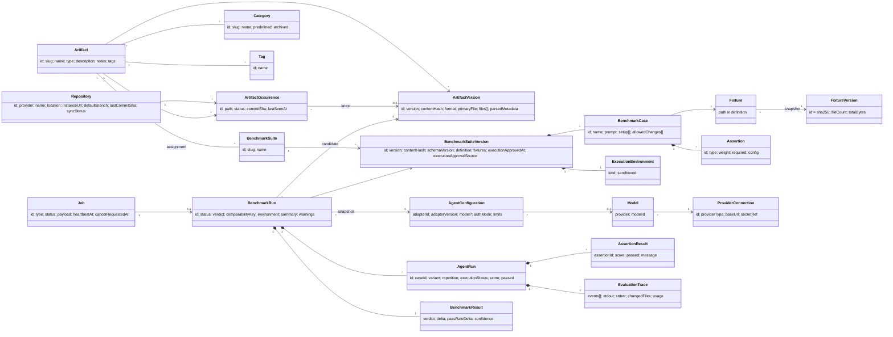
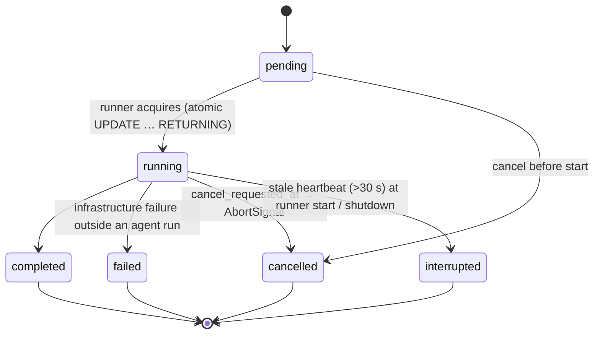

# Domain Model

Conceptual entities and invariants. Physical tables and columns: [SPEC-006](2026-10-14-database-schema.md). Terminology: [glossary in SPEC-001](2026-10-14-project-overview.md#7-glossary). TypeScript types and Zod schemas live in `packages/core` (registry, config, models) and `packages/benchmark-engine` (definition format, results).

The model has two halves that never mix: **definition** (what exists / what to test) and **execution** (what happened). Execution entities reference definition entities by immutable version only.

## 1. Entity diagram

## 2. Registry entities

| Entity | Description | Key rules |
|---|---|---|
| **Repository** | A source of artifacts. `provider` ∈ {`github`, `gitlab` (incl. self-managed via `instanceUrl`), `local-git`, `local-directory`, `bundled-examples`}; `location` = clone URL or absolute path. | Unique (provider, location). Credentials only via secret references (planned), never inline. Registration/sync beyond bundled examples is planned ([SPEC-104](2026-10-14-repository-management.md)). |
| **Artifact** | Logical identity of a skill, instruction or rule. `type` ∈ {skill, instruction, rule}; unique `slug`; user-managed `notes` and `tags`. The source `format` (from `ARTIFACT_FORMATS` in `packages/core`) belongs to each version. | Identity is independent of path; multiple occurrences may map to one artifact. Identity matching rules: [SPEC-101](2026-10-14-artifact-registry.md). |
| **ArtifactOccurrence** | Artifact at a repository + path (for skills: the skill root directory). Carries latest observed version, commit SHA, `status` ∈ {`active`, `removed`}, last seen time. | Unique (repository, path). A removed file sets `status=removed`; the row and its history remain. Additional statuses (e.g. parse error) may be added by [SPEC-105](2026-10-14-repository-synchronization.md). |
| **ArtifactVersion** | Immutable content snapshot: sequential `version` per artifact, `contentHash` = manifest hash of all files (`hashManifest`), `format`, `primaryFile`, file manifest (path, sha256, size, content), parsed metadata (frontmatter, activation, warnings), source repository/path/commit where first seen. | Unique (artifact, contentHash). Never updated or deleted. Same content seen again reuses the existing version. Diff and drift: [SPEC-103](2026-10-14-artifact-versioning.md). |
| **Category** | User-facing grouping; 17 predefined categories seeded at startup (`PREDEFINED_CATEGORIES`), user categories later. | Predefined categories can be renamed/archived but not hard-deleted while referenced ([SPEC-106](2026-10-14-category-management.md)). |
| **Tag** | Free-form label. Bootstrap stores tags as a JSON string array on the artifact; a normalized `tags` table is planned ([SPEC-006](2026-10-14-database-schema.md#7-planned-tables)). | User metadata; never touched by sync. |

## 3. Benchmark definition entities

| Entity | Description | Key rules |
|---|---|---|
| **BenchmarkSuite** | Logical identity of a suite (definition `id` slug). | Unique slug. |
| **BenchmarkSuiteVersion** | Immutable snapshot of a full validated definition (v1 format, [SPEC-108](2026-10-14-benchmark-definition-format.md)) with sequential `version`, `contentHash` (canonical JSON incl. fixture hashes), `schemaVersion`, per-case fixture/overlay hashes, `executionApprovedAt` and `executionApprovalSource` ∈ {`bundled-example`, `user`}. | Unique (suite, contentHash). Approval is the only mutable attribute and only transitions from unapproved to approved via an explicit, recorded action. |
| **BenchmarkCase** | One task inside a suite version: prompt, fixture reference, verification overlay, setup commands, allowed changes, assertions, optional mock playbook. | Stored inside the suite version's definition JSON; addressed by `(suiteVersionId, caseId)`. |
| **Fixture / FixtureVersion** | A fixture is the path in the definition; a FixtureVersion is the content-addressed snapshot `fixtures/<sha256>/` (also used for verification overlays). | Immutable; id = sha256 of manifest; symlinks and escaping paths rejected at import. |
| **ExecutionEnvironment** | `kind` ∈ {`local-process`, `docker`} with `sandboxed` flag (local-process = false). | Part of the comparability key. `docker` not implemented. |
| **Assertion** | Typed verification: `command`, `file-exists`, `file-contains`, `changed-files` (planned: json-schema, static-analysis, custom script, llm-judge). `weight ≥ 0`, `required` flag. | Deterministic assertions score 0 or 1. Nondeterministic ones must record evaluator provenance. |

## 4. Agent and model entities

| Entity | Description | Key rules |
|---|---|---|
| **AgentConfiguration** | Value object captured per run: `adapterId`, detected `adapterVersion`, optional `model {provider, model}` (`ModelSelection`), `authMode` (`none`, `agent-cli-login`, `api-key`; only `none` exists in bootstrap), limits (`timeoutSeconds`, `maxOutputBytes`, future `maxSteps`, `maxTokens`). | Snapshot stored on the BenchmarkRun (`agent_adapter_id`, `agent_version`, `model`, limits inside `environment` JSON); never a live reference to mutable settings. No separate table in bootstrap. Adapter vs provider separation: [ADR-0006](../decisions/0006-agent-adapters-vs-model-providers.md). |
| **ProviderConnection** | Configured model provider endpoint: `providerType` (anthropic, openai, deepseek, zai, moonshot, openai-compatible, anthropic-compatible), base URL, secret reference (keychain). | Planned. Secret value never stored in DB ([SPEC-007](2026-10-14-security-and-privacy.md)). |
| **Model** | `(provider, modelId)` pair, optionally discovered from a ProviderConnection. | Compatibility between an adapter and a model is validated by the adapter, never assumed. |

## 5. Execution entities

| Entity | Description | Key rules |
|---|---|---|
| **Job** | Unit of queued work (`type`: `benchmark-run`; future `repository-sync`) with JSON `payload`. Status ∈ {pending, running, completed, failed, cancelled, interrupted}; `runnerId`; heartbeat; cancellation flag. | State machine in §6. No automatic retry; re-run creates a new job. |
| **BenchmarkRun** | One RED/GREEN evaluation of one ArtifactVersion against one BenchmarkSuiteVersion with one AgentConfiguration; `status` ∈ {running, completed, error, cancelled, interrupted}; environment metadata; comparability key; display `verdict`; summary; warnings. | References exact versions. Results of runs with different comparability keys are never aggregated. |
| **AgentRun** | One agent execution: `(caseId, variant ∈ {baseline, candidate}, repetition)`; execution status ∈ {completed, agent-error, timeout, cancelled, infrastructure-error}; score; passed; duration; `fixtureVersionId`. | Non-completed runs excluded from quality metrics, counted in errorRate. |
| **AssertionResult** | Result of one assertion in one AgentRun: type, score ∈ [0,1], passed, weight, required, deterministic, message, details (truncated, redacted). | Immutable once written. |
| **BenchmarkResult / Score** | Derived aggregates per case and variant (meanScore, stdDev, min, max, passRate, errorRate, validRuns), suite aggregate, delta, passRateDelta, verdict, candidate outcome, confidence. Stored as the BenchmarkRun summary. | Computation: [SPEC-111](2026-10-14-benchmark-scoring.md). Recomputable from AgentRuns/AssertionResults. |
| **EvaluationTrace** | Ordered events for an AgentRun: setup command outputs, agent output, tool calls (when the adapter reports them), changed files, token usage, warnings. Stored in `agent_runs.trace`, `changed_files`, `usage` (no separate table). | Redacted before persistence; size-bounded. |

## 6. Job state machine

## 7. Invariants

1. **Immutability.** ArtifactVersion, BenchmarkSuiteVersion and FixtureVersion are never updated (except the explicit approval transition on a suite version) or deleted while referenced. New content ⇒ new version.
2. **Exact references.** Every BenchmarkRun references exactly one ArtifactVersion, one BenchmarkSuiteVersion, a snapshot AgentConfiguration, and the fixture hashes used; every AgentRun records variant, repetition and environment metadata (adapter version, Node version, platform, environment kind, `sandboxed`).
3. **Definition ≠ execution.** Definition entities hold no results; execution entities hold no editable definition data. Deleting or editing a definition never alters past results.
4. **Comparability.** `comparabilityKey = hash(suite version contentHash, fixture hashes, adapterId + adapterVersion, model config, environment kind, limits)`. Aggregation, ranking and version comparison operate only within one key. No global cross-suite ranking.
5. **RED/GREEN symmetry.** Baseline and candidate share fixture hash, prompt, adapter + version, model config and limits; only the installed artifact differs. Uncontrolled differences are recorded as warnings ([SPEC-112](2026-10-14-red-green-evaluation.md)).
6. **User metadata preserved across sync.** Categories, tags, benchmark assignments and user notes attach to the logical Artifact, not to an occurrence or version, and are never removed by synchronization.
7. **Execution approval.** Benchmark commands execute only for suite versions with non-null `executionApprovedAt`.
8. **No secrets in the domain.** Entities hold secret references only; traces and results are redacted.
9. **Provenance for nondeterminism.** Any nondeterministic evaluator result records evaluator model, rubric and prompt version.

## Implementation status

- **Implemented in bootstrap (verified in code 2026-10-14):** `ArtifactType`, `ArtifactFormat`, artifact path classification/parsing, `ArtifactFile`/`ArtifactBundle`, `ModelSelection`, `PREDEFINED_CATEGORIES`, manifest hashing and canonical JSON (`packages/core/src`).
- **Implemented in schema (verified `packages/database/src/schema.ts` 2026-10-14):** persistence shapes for Repository, Artifact (incl. JSON tags, notes), ArtifactOccurrence, ArtifactVersion, Category, artifact↔category and artifact↔suite assignments, FixtureVersion, BenchmarkSuite(Version), Job, BenchmarkRun, AgentRun, AssertionResult.
- **Implemented per brief, being written concurrently (verify):** job state machine in the runner; RED/GREEN with the Mock Agent; scoring and comparability key computation.
- **Not implemented:** Repository sync semantics, normalized Tag entity, ProviderConnection, Model discovery, `authMode` other than `none`, LLM-judge provenance, docker ExecutionEnvironment.
