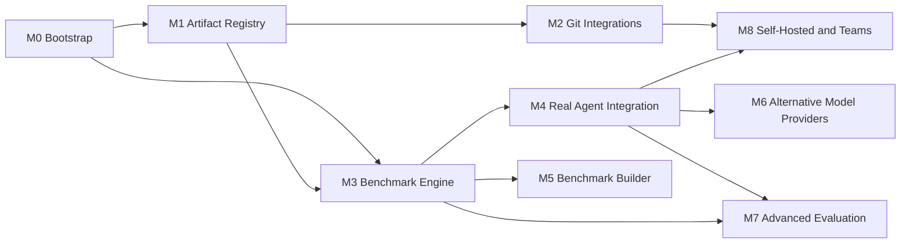

# SPEC-013 — Implementation Roadmap

## 1. Overview

Milestones are ordered by dependency, not by calendar. Each milestone ends with the [Definition of Done](#2-common-definition-of-done) plus its own criteria. Priorities: **P0** required for a useful local product, **P1** core value, **P2** extension.

| Milestone | Priority | Status |
| --- | --- | --- |
| M0 Bootstrap | P0 | In progress — all deliverables done (CI ran green on PR #1); UI cancellation and crash-restart not yet verified end to end (§3 M0, §5) |
| M1 Artifact Registry | P0 | In progress — local registration (#15) and the scan of registered local repositories (#16) |
| M2 Git Integrations | P1 | Not started |
| M3 Benchmark Engine | P0 | Not started beyond the bootstrap subset in M0 |
| M4 Real Agent Integration | P1 | Not started (detection only in M0) |
| M5 Benchmark Builder | P1 | Not started |
| M6 Alternative Model Providers | P2 | Not started |
| M7 Advanced Evaluation | P2 | Not started |
| M8 Self-Hosted and Teams | P2 | Not started |

## 2. Common Definition of Done

Applies to every milestone:

- Code merged on `main`; `pnpm lint`, `typecheck`, `test`, `build`, `verify:pack` and `test:e2e` pass in CI ([SPEC-012](2026-10-14-testing-strategy.md)).
- No paid API calls or network access in default tests.
- Affected specs updated: acceptance criteria verified, **Implementation status** sections precise, `updated` bumped; new architectural choices recorded as ADRs.
- UI shows no non-functional controls; unimplemented areas are labelled "Planned — not implemented".
- No secrets in plaintext in the database, config or logs.

## 3. Milestones

### M0 — Bootstrap

**Status:** in progress (deliverable status below, as of 2026-10-15).
**Priority:** P0. **Dependencies:** none.
**Deliverables:** pnpm + Turborepo monorepo ([ADR-0003](../decisions/0003-monorepo-architecture.md)); packages `core`, `database`, `agent-adapters`, `benchmark-engine`, `runner`; apps `cli`, `web`; SQLite schema + migrations; CLI `serve`/`init`/`doctor`/`demo` ([SPEC-009](2026-10-14-cli-architecture.md)); runner with heartbeat, cancellation and crash recovery; Mock Agent; benchmark format v1 with `command`, `file-exists`, `file-contains`, `changed-files` assertions; RED/GREEN + scoring; web UI sections per [SPEC-116](2026-10-14-dashboard-and-navigation.md); agent CLI detection; examples; specs and ADRs; Playwright smoke test; CI workflow.

| Deliverable | Status (2026-10-15) | Evidence |
| --- | --- | --- |
| pnpm 12 + Turborepo 2.11 monorepo | Done | `pnpm lint && pnpm typecheck && pnpm test`, `pnpm build` |
| Packages `core`, `database`, `agent-adapters`, `benchmark-engine`, `runner`; apps `cli`, `web` | Done | Package test suites (core 95, database 59, agent-adapters 34, benchmark-engine 109, runner 31, cli 74, web 66 — 468 tests, all passing on 2026-10-15) |
| SQLite schema + migrations | Done | `packages/database/test/client.test.ts` |
| CLI `serve`/`init`/`doctor`/`demo` (+ `--help`, `--version`, exit codes) | Done | `apps/cli/test/cli.test.ts`, `pnpm verify:pack` |
| Runner with heartbeat, cancellation, crash recovery | Done | `packages/runner/test/runner.test.ts`, `packages/database/test/jobs.test.ts` |
| Mock Agent | Done | `packages/agent-adapters/test/mock.test.ts` |
| Benchmark format v1 with four assertion types | Done | `benchmark-engine` definition tests (all repository examples validate) |
| RED/GREEN + scoring | Done | `engine.test.ts`, `scoring.test.ts`; demo verdict `improved` |
| Web UI sections per [SPEC-116](2026-10-14-dashboard-and-navigation.md) | Done | `pnpm test:e2e` (dashboard, artifacts, run detail with verdict reasons, Run → completed, server-side approval re-check, planned page, theme toggle), `verify:pack` (`/results`) |
| Agent CLI detection (`claude-code`, `codex`, `cursor`) | Done (detection only) | `mock.test.ts` "detectCliAgent", `doctor` |
| Examples (`mock-input-validation` executable; `nextjs-component-quality`, `wordpress-ajax-security` specification-only) | Done | `engine.test.ts` "validates every example definition" |
| Specs and ADRs | Done (all `draft`) | `.ai/specs/`, `.ai/decisions/` |
| npm packaging + `pnpm verify:pack` | Done | `verify:pack` passed on 2026-10-14 and 2026-10-15 (runtime dependencies only `next`, `react`, `react-dom`); nothing published (name `directivebench` unclaimed) |
| Playwright smoke test | Done | `pnpm test:e2e` (`apps/web/e2e/home.spec.ts` and `apps/web/e2e/management.spec.ts`, 17/17 passing against the built CLI on 2026-10-15) |
| CI workflow | Done | `.github/workflows/ci.yml` (Node 24, `ubuntu-latest`: install, `pnpm audit --prod`, format, lint, typecheck, test, build, `verify:pack`, `test:e2e`) ran green on PR #1 on 2026-10-14; the audit step was added on 2026-10-15 and has not run in CI yet |

**Acceptance criteria:**
- `npx <packed tarball> demo` on a clean machine with Node 24 imports the bundled example and prints a RED/GREEN summary with verdict `improved`, labelled as mock, exit code 0.
- `directivebench` starts the UI on `127.0.0.1:4280`; `GET /api/health` returns 200; a foreign `Host` header is rejected.
- "Run benchmark" in the UI enqueues a job that reaches `completed`; cancelling a running job yields `cancelled`; killing the CLI mid-run leaves the job `interrupted` after restart.
- `pnpm verify:pack` passes.
**Risks:** Next.js standalone packaging inside an npm tarball; `node:sqlite` API stability across Node 22/24; Windows process termination semantics.

### M1 — Artifact Registry

**Priority:** P0. **Dependencies:** M0.
**Deliverables:** local repository registration ([SPEC-104](2026-10-14-repository-management.md)); artifact discovery scan of registered local directories ([SPEC-102](2026-10-14-artifact-discovery.md)); artifact registry browsing and filtering ([SPEC-101](2026-10-14-artifact-registry.md)); versioning on content change ([SPEC-103](2026-10-14-artifact-versioning.md)); category CRUD and assignment ([SPEC-106](2026-10-14-category-management.md)); registering a **public GitHub repository by URL** without credentials, fetching only candidate artifact paths ([SPEC-201](2026-10-14-integration-github.md), [SPEC-105](2026-10-14-repository-synchronization.md) FR-105-05; moved from M2 by product-brief decision D06).
**Value checkpoint:** after registration, scan, browsing and preview ship, the maintainer uses the Registry on their own repositories for one to two weeks and records whether they open it when working on skills; category CRUD starts after that record exists (product-brief decision D07).
**Acceptance criteria:**
- Registering a local directory containing `.agents/skills/*/SKILL.md`, `AGENTS.md`, `.cursor/rules/*.mdc` and `.github/copilot-instructions.md` discovers each as an artifact with the correct type/format and an occurrence path.
- Re-scanning an unchanged repository creates 0 new versions; editing one file creates exactly 1 new version of that artifact.
- Identical content in two repositories is one artifact version with two occurrences.
- Removed files mark the occurrence as missing; history is retained.
- A public GitHub repository can be added by URL and scanned without credentials; occurrences record the commit SHA (moved from M2, D06).
- An end-to-end test registers a fixture repository, scans it, finds the expected artifacts in the list and opens a raw preview matching the source file.
- Scanning a repository with 1,000 files completes in < 5 s on a typical laptop (target).
**Risks:** ambiguous artifact classification; symlinks and very large repos; Windows path normalization.

### M2 — Git Integrations

**Priority:** P1. **Dependencies:** M1.
**Deliverables:** local git awareness (commit SHA, branch, dirty state); read-only sync from private GitHub repositories (public ones are registered in M1, D06) ([SPEC-201](2026-10-14-integration-github.md)), GitLab.com and self-managed GitLab ([SPEC-202](2026-10-14-integration-gitlab.md)) into `<dataDir>/cache/`; `directivebench sync` ([SPEC-105](2026-10-14-repository-synchronization.md)); OS-keychain secret storage ([ADR-0008](../decisions/0008-secret-storage-and-authentication.md)).
**Acceptance criteria:**
- A private repository syncs with a token stored in the OS keychain; the token never appears in the database, config, logs or error messages (verified by test).
- Sync is incremental: an unchanged remote performs no rescan.
- Contract tests with recorded fixtures cover auth failure, rate limiting and not-found.
**Risks:** token scope confusion; keychain availability on headless Linux; API rate limits.

### M3 — Benchmark Engine

**Priority:** P0. **Dependencies:** M0, M1.
**Deliverables:** completion of [SPEC-107](2026-10-14-benchmark-engine.md), [SPEC-110](2026-10-14-benchmark-execution.md), [SPEC-111](2026-10-14-benchmark-scoring.md), [SPEC-112](2026-10-14-red-green-evaluation.md): assigning benchmarks to registry artifacts, execution approval UX for imported suites, comparability key enforcement in results, results history per artifact ([SPEC-113](2026-10-14-results-and-reporting.md)), `benchmark run|list` CLI, Docker environment (`environment.kind: docker`).
**Acceptance criteria:**
- A user-imported suite cannot execute commands until approved in the UI; approval is recorded with its source.
- Results with different comparability keys are never aggregated (verified by test).
- `directivebench benchmark run <suite> --artifact <id>` runs headless and exits non-zero on `regressed`/`failed`.
- The `wordpress-ajax-security` example runs in Docker when Docker is available and reports a clear error otherwise.
**Risks:** Docker portability (Windows/macOS); flaky verification commands; long-running cases.

### M4 — Real Agent Integration

**Priority:** P1. **Dependencies:** M3.
**Deliverables:** execution adapters for Claude Code ([SPEC-203](2026-10-14-integration-claude-code.md)), OpenAI Codex ([SPEC-204](2026-10-14-integration-openai-codex.md)) and Cursor Agent ([SPEC-205](2026-10-14-integration-cursor.md)) using the user's locally installed CLIs and existing logins; trace capture; environment warnings for uncontrolled differences (e.g. ambient user-level skills).
**Acceptance criteria:**
- Each adapter passes the shared conformance suite against recorded fixtures.
- With the CLI installed and logged in, an opt-in live test runs one case RED/GREEN and records adapter version, model (if reported) and trace.
- Timeouts and cancellation terminate the agent process tree within 5 s.
- Results from real agents are never mixed with mock results.
**Risks:** CLI flags and output formats change without notice; subscription terms of use; agents reading ambient user configuration; cost.

### M5 — Benchmark Builder

**Priority:** P1. **Dependencies:** M3.
**Deliverables:** UI to create and edit suites, cases, fixtures and assertions ([SPEC-109](2026-10-14-benchmark-builder.md)); schema-validated YAML round-trip; dry-run validation.
**Acceptance criteria:**
- A suite created in the builder exports YAML that validates against format v1 and re-imports to an identical definition hash.
- Saving creates a new immutable suite version; editing never mutates an existing version.
- Invalid input shows field-level errors from the Zod schema.
**Risks:** UX complexity for fixtures; fixture size limits.

### M6 — Alternative Model Providers

**Priority:** P2. **Dependencies:** M4.
**Deliverables:** `packages/model-providers` with Anthropic API ([SPEC-206](2026-10-14-integration-anthropic-api.md)), OpenAI API ([SPEC-207](2026-10-14-integration-openai-api.md)), DeepSeek ([SPEC-208](2026-10-14-integration-deepseek.md)), Z.AI GLM ([SPEC-209](2026-10-14-integration-zai-glm.md)), Moonshot Kimi ([SPEC-210](2026-10-14-integration-kimi.md)) and custom OpenAI/Anthropic-compatible endpoints ([SPEC-211](2026-10-14-integration-custom-model-providers.md)); a minimal custom coding harness that pairs a provider with workspace tools ([ADR-0006](../decisions/0006-agent-adapters-vs-model-providers.md)).
**Acceptance criteria:**
- Each provider passes recorded-fixture contract tests for success, auth error, rate limit and timeout.
- API keys are stored only in the OS keychain and redacted from all output.
- The same suite can be run against two providers and results are shown side by side only when comparable apart from the model.
**Risks:** provider API drift; compatibility claims of "compatible" endpoints; cost control.

### M7 — Advanced Evaluation

**Priority:** P2. **Dependencies:** M3, M4.
**Deliverables:** assertion types `json-schema`, `static-analysis`, custom script, and `llm-judge` (records judge model, rubric and prompt version); optional Promptfoo integration ([SPEC-212](2026-10-14-integration-promptfoo-optional.md)); statistical reporting improvements.
**Acceptance criteria:**
- LLM-judge results are labelled nondeterministic and carry judge model, rubric and prompt version; changing any of them changes the comparability key.
- Each new assertion type has unit tests and an example suite.
**Risks:** judge bias and variance; cost; over-trusting nondeterministic scores.

### M8 — Self-Hosted and Teams

**Priority:** P2. **Dependencies:** M2, M4.
**Deliverables:** per [SPEC-011](2026-10-14-self-hosting-architecture.md): PostgreSQL, authentication, workspaces, roles, audit logs, `/api/v1`, standalone and remote runners with lease protocol, local export → server import.
**Acceptance criteria:**
- A remote runner behind NAT with no inbound ports executes a job leased from the server and uploads redacted results.
- A `viewer` cannot enqueue jobs; a `member` cannot approve suite execution (verified by tests).
- A local data directory exported and imported into a workspace preserves IDs, content hashes and run history.
**Risks:** security surface of a multi-user server; dual-dialect database maintenance.

## 4. Recommended next task

**Milestone 1, first slice: local repository registration + discovery.**

1. Add a `registerLocalRepository(path)` repository function and Server Action: validate the path is an existing directory, store it in `repositories` with provider `local-directory` (or `local-git` inside a git work tree), reject duplicates.
2. Implement a discovery scanner in `packages/core` (pure: file list in → classified artifact candidates out) using the existing artifact path classification and parsers; ignore `node_modules`, `.git` and symlinks escaping the root.
3. Persist results: create artifacts, immutable `artifact_versions` (content hash dedup) and `artifact_occurrences`; mark missing occurrences on rescan.
4. Replace the "Planned" Repositories page with a list + "Add local repository" form + "Rescan" action.
5. Tests: scanner unit tests on a temp fixture tree; database integration test for idempotent rescans; one Playwright step adding a repository.

This slice is local-only (no network, no secrets), builds directly on M0 code, and makes the registry useful with real user content.

## 5. Implementation status

- **M0:** in progress. Verified on 2026-10-14 (Node 24.21, Linux): the packed tarball, installed with npm into an empty project, runs `demo` (verdict `improved`, labelled as mock, exit 0) and `serve`; `GET /api/health` returns 200 with `database: ready`; a foreign `Host` header is rejected with 403; `/results` lists the run; `SIGTERM` exits cleanly; `pnpm verify:pack` passes. "Run" from the benchmark page enqueues a job that the runner completes (`pnpm test:e2e`). Runner-level cancellation, shutdown → `interrupted` and stale-job recovery are verified by `runner.test.ts`. The CI workflow ran green on PR #1 on 2026-10-14. Verified on 2026-10-15: 468 unit/integration tests, `pnpm build && pnpm verify:pack`, `pnpm test:e2e` 17/17. Cancelling from the UI is verified in two halves: the Executions page records the cancel request for a running job (`management.spec.ts`), and the runner turns a request into `cancelled` (`runner-lifecycle.test.ts`). Not yet verified end to end: one browser test covering both halves against a real running job, killing the CLI mid-run and restarting. M0 is not marked complete until these are verified.
- **M1:** in progress. Local repository registration (#15) and the scan of registered local repositories (#16) are implemented: AC1 (every format discovered with type, format and occurrence path) is verified by `packages/runner/test/repository-scan.test.ts` and the Playwright scan test; AC5 measured on 2026-10-19 with the built CLI on a Linux laptop: 1,000 files in 56 ms including the database write. The other acceptance criteria (rescan versioning #19, cross-repository identity #20, removed files #21, public GitHub #18, end-to-end preview #17) are not verified yet.
- **M2–M8:** not implemented. Bootstrap contains only preparatory pieces (agent CLI detection, format v1, mock-only execution, local-process environment).
