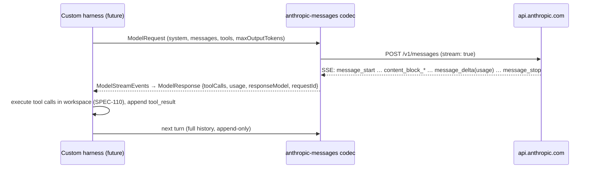

# SPEC-206 — Anthropic API (Claude Messages API)

> All "Confirmed" statements were checked against the cited official documentation on 2026-10-14.
> Source keys ([A1] …) are listed in §14. The shared connection model, URL policy, retry policy and
> error codes are defined in [SPEC-211](2026-10-14-integration-custom-model-providers.md) and are not repeated here.

## 1. Purpose

This spec covers the `anthropic` provider type: direct access to Claude models through the Claude API
(`https://api.anthropic.com`). It is used by the future custom coding harness
([SPEC-110 §19](2026-10-14-benchmark-execution.md#19-future-extensions)) to benchmark Claude models
under DirectiveBench's controlled tool set, and by a future `llm-judge` assertion.

This is **not** the Claude Code integration. Running the Claude Code CLI, with a subscription login or
an API key, is an agent harness specified in [SPEC-203](2026-10-14-integration-claude-code.md)
([ADR-0006](../decisions/0006-agent-adapters-vs-model-providers.md)). The two can share one stored
API key reference, but they are configured, executed and compared separately.

## 2. Official integration options

| Option | Status for DirectiveBench | Evidence |
|---|---|---|
| Messages API `POST /v1/messages` (REST, JSON, optional SSE streaming) | **Used** (protocol `anthropic-messages`) | Confirmed ([A1], 2026-10-14) |
| Models API `GET /v1/models` | **Used** for validation and model discovery | Confirmed ([A1], [A2], 2026-10-14) |
| Token Counting API `POST /v1/messages/count_tokens` | Optional (pre-flight context checks). Not in v1. | Confirmed ([A1], 2026-10-14) |
| Message Batches, Files, Skills, Managed Agents (Agents/Sessions/Environments) APIs | Not used. The harness needs an interactive loop, and Managed Agents would replace DirectiveBench's own harness and isolation. | Confirmed to exist ([A1], 2026-10-14) |
| Official TypeScript SDK | Optional. If used, its retries must be disabled so that SPEC-211 counts retries once ([A3]: the SDK retries twice by default and `maxRetries` configures it). | Confirmed ([A3], 2026-10-14) |
| OpenAI SDK compatibility layer (`https://api.anthropic.com/v1/` + Chat Completions) | **Not used.** Anthropic says it is "primarily intended to test and compare model capabilities, and is not considered a long-term or production-ready solution". It silently ignores fields such as `strict` and `response_format`. | Confirmed ([A4], 2026-10-14) |
| Cloud platforms (Amazon Bedrock, Google Cloud, Claude Platform on AWS, Microsoft Foundry) | Out of scope for v1. They use the platforms' own IAM and have different feature availability. | Confirmed to exist ([A1], 2026-10-14) |

## 3. Authentication methods

| Method | Header | Status |
|---|---|---|
| API key from the Claude Console | `x-api-key: <key>` ("legacy fallback … still supported") or `Authorization: Bearer <key>` | Confirmed ([A1], 2026-10-14) |
| Workspace selection | `anthropic-workspace-id: wrkspc_…`. Required with a multi-workspace API key, optional otherwise. | Confirmed ([A1], 2026-10-14) |
| Short-lived token via Workload Identity Federation (`POST /v1/oauth/token`) | Not supported in v1 (a server-side identity feature). | Confirmed to exist ([A1], 2026-10-14) |
| claude.ai subscription login | **Not a provider auth method.** Only available through the Claude Code CLI ([SPEC-203](2026-10-14-integration-claude-code.md)). | — |

Every request also sends `anthropic-version` (for example `2023-06-01`) and
`content-type: application/json`. Both are required: Confirmed ([A1], 2026-10-14). The vendor
profile pins `anthropic-version: 2023-06-01`. Changing it is a profile version change, and therefore
changes the comparability key.

DirectiveBench defaults to `auth.mechanism = 'x-api-key'`, because it is what the Models API example
uses ([A2]). The key is stored per [ADR-0008](../decisions/0008-secret-storage-and-authentication.md).
The key-prefix pattern `sk-ant-` for redaction is an Assumption — requires validation. Redaction of
the known secret value does not depend on the pattern.

## 4. Capability requirements

| Capability | Anthropic | Evidence |
|---|---|---|
| Tool calling | Yes (client tools via `tools`, `tool_use` / `tool_result` blocks) | Confirmed ([A5], 2026-10-14) |
| Forced tool choice | **Model-dependent.** Some current models return 400 for `tool_choice` `any`/`tool`. Only `auto`/`none` are accepted there. | Confirmed ([A6], 2026-10-14) |
| Streaming | Yes (SSE). Errors can arrive mid-stream after HTTP 200. | Confirmed ([A6], 2026-10-14) |
| Structured outputs / strict tool schemas | Per model: `capabilities.structured_outputs.supported` | Confirmed ([A2], 2026-10-14) |
| Thinking / effort | Per model: `capabilities.thinking.types.{adaptive,enabled,disabled}`, `capabilities.effort.*`. Some models reject `thinking.type: disabled`. | Confirmed ([A2], [A6], 2026-10-14) |
| Context window / max output | `max_input_tokens`, `max_tokens` per model in the Models API | Confirmed ([A2], 2026-10-14) |
| Usage | `input_tokens`, `output_tokens`, `cache_creation_input_tokens`, `cache_read_input_tokens`. Total input = cache read + cache creation + input. | Confirmed ([A7], 2026-10-14) |
| Model lifecycle | `lifecycle` (`active`/`deprecated`/`retired`), `deprecated_at`, `retires_at` | Confirmed ([A2], 2026-10-14) |

Anthropic is the one vendor whose list-models response carries machine-readable capability data.
The profile sets `ModelCapabilities.source = 'provider-api'` from it ([SPEC-211 §4](2026-10-14-integration-custom-model-providers.md#4-capability-requirements)).
`toolCalling` and `streaming` are not fields in the Models API. They are set to `yes` from the
Messages API docs (`source: 'vendor-docs'`).

## 5. Architecture

A vendor profile `anthropic` in the future `packages/model-providers`, using the
`anthropic-messages` codec ([SPEC-211 §5](2026-10-14-integration-custom-model-providers.md#5-architecture)).

Codec rules specific to Anthropic:

- **History is append-only.** Thinking blocks returned by the model are sent back unchanged. Some
  models reject modified thinking blocks with 400 ([A6]). The harness never edits earlier turns.
- **Assistant prefill is not used.** Some models reject a prefilled final assistant message ([A6]).
- `tool_choice` defaults to `auto`. Forced choice is only sent when
  `ModelCapabilities.forcedToolChoice = 'yes'`. Because the Models API does not expose this, it stays
  `unknown` and is never sent in v1.
- Requests run with `stream: true` by default. Anthropic advises streaming or batches for long
  requests, especially over 10 minutes, and the SDKs refuse non-streaming requests that are expected
  to exceed 10 minutes ([A6]).

## 6. Relevant API or CLI interfaces

| Interface | Use | Evidence |
|---|---|---|
| `POST https://api.anthropic.com/v1/messages` | Generation | Confirmed ([A1]) |
| `GET /v1/models?limit=…&after_id=…` (cursor fields `has_more`, `first_id`, `last_id`; `limit` 1–1000, default 20; `lifecycle` filter, default active + deprecated) | Validation and discovery | Confirmed ([A2]) |
| Response header `request-id` (also `request_id` in error bodies) | Stored in the trace for support | Confirmed ([A6]) |
| Response headers `anthropic-organization-id`, `anthropic-workspace-id` | Shown on validation (which workspace the key resolved to) | Confirmed ([A1]) |
| Rate-limit headers `retry-after`, `anthropic-ratelimit-{requests,tokens,input-tokens,output-tokens}-{limit,remaining,reset}` (reset in RFC 3339) | `RateLimitSnapshot` | Confirmed ([A7]) |
| Request size limit: 32 MB for Messages (413 `request_too_large`) | Pre-flight check of serialised request size | Confirmed ([A1], [A6]) |

Model ids are **not** hardcoded in DirectiveBench. They are discovered from `GET /v1/models` or typed
by the user.

## 7. Configuration

| Field | Default |
|---|---|
| `providerType` | `anthropic` |
| `protocol` | `anthropic-messages` (only option) |
| `baseUrl` | `https://api.anthropic.com` (editable only via a custom `anthropic-compatible` connection) |
| `auth` | `x-api-key`, `secretRef` (keychain or env, e.g. `ANTHROPIC_API_KEY`) |
| `headers` | `anthropic-version: 2023-06-01`; optional `anthropic-workspace-id` |
| `validation.method` | `list-models` |

## 8. Security concerns

All controls in [SPEC-211 §8](2026-10-14-integration-custom-model-providers.md#8-security-concerns) apply. Anthropic-specific notes:

- The key is never placed in the harness workspace or tool environment. The Claude Code adapter
  receives it only through its own subprocess environment, under SPEC-203 rules.
- The Console allows key types and expiration ([A1]). Expired keys surface as 401
  `authentication_error` ([A6]) and map to `auth-invalid`.
- Prompts, artifact content and file content read by the model are sent to Anthropic. The UI states
  this before the first run.

## 9. Error handling

| HTTP / type | Mapping ([SPEC-211 §9](2026-10-14-integration-custom-model-providers.md#9-error-handling)) | Evidence |
|---|---|---|
| 400 `invalid_request_error` (includes a user-set spend limit being reached) | `invalid-request`. A message starting "You have reached your specified … API usage limits" maps to `billing`. | Confirmed ([A6], [A7]) |
| 401 `authentication_error` | `auth-invalid` | Confirmed ([A6]) |
| 402 `billing_error` | `billing` | Confirmed ([A6]) |
| 403 `permission_error` | `auth-invalid` (with a hint about workspace access) | Confirmed ([A6]) |
| 404 `not_found_error` | `model-not-found` when the model is unknown | Confirmed ([A6]) |
| 413 `request_too_large` | `invalid-request` | Confirmed ([A6]) |
| 429 `rate_limit_error` with `retry-after` | `rate-limited`, honour `retry-after` | Confirmed ([A7]) |
| 429 `rate_limit_error` without `retry-after`, `error.details.error_code = enforced_spend_limit_reached` | `billing`, **no retry** ("Retrying … fails until access resumes") | Confirmed ([A7]) |
| 500 `api_error`, 504 `timeout_error` | `server-error` (retry with backoff) | Confirmed ([A6]) |
| 529 `overloaded_error` | `overloaded` | Confirmed ([A6]) |
| SSE error event after 200 | `stream-error` with the inner type | Confirmed ([A6]) |

The error body shape is `{"type":"error","error":{"type","message"},"request_id"}`. Error `type`
values "may expand", so unknown types fall back to the HTTP status mapping: Confirmed ([A6]).

## 10. Compatibility restrictions

- Model behaviour and accepted parameters differ per model: thinking modes, forced tool choice,
  prefill, sampling parameters ([A4], [A6]). Capabilities are read per model, not per provider.
- Rate limits are per organisation and usage tier, measured in RPM/ITPM/OTPM, using a token bucket.
  For most models, cached input tokens do not count toward ITPM ([A7]). Benchmarks with high
  repetition counts can hit limits. The runner's bounded concurrency (default 1) is the main
  mitigation.
- The API is available only in supported regions ([A1]). Unsupported regions surface as auth or
  permission errors.
- The same Claude model reached via Claude Code ([SPEC-203](2026-10-14-integration-claude-code.md)) versus via the harness
  is a **different harness**. Results are never compared or aggregated across the two (comparability
  key, [SPEC-111](2026-10-14-benchmark-scoring.md)).
- Anthropic-compatible third-party endpoints (DeepSeek, Z.AI, Kimi, Ollama) are separate provider
  types. They do not inherit Anthropic's capability metadata ([SPEC-211 §10](2026-10-14-integration-custom-model-providers.md#10-compatibility-restrictions)).

## 11. Test strategy

- Recorded fixtures (secrets scrubbed) for `GET /v1/models` (pagination with `has_more`), a
  non-streaming message, a streaming tool-use turn with `message_delta` usage, a mid-stream error
  event, and every error row in §9, including the spend-cap 429 without `retry-after`.
- A codec unit test verifies that thinking blocks are passed back byte-identical, and that no prefill
  or forced `tool_choice` is emitted when capability is `unknown`.
- Header test: `anthropic-version` is always sent, and the key appears only in `x-api-key`. No
  persisted trace, log or error contains it.
- Opt-in live test (`DIRECTIVEBENCH_LIVE_TESTS=1` and `ANTHROPIC_API_KEY`): list models, then one
  minimal message with a tiny `max_tokens`. Structural assertions only. Never in default CI.

## 12. Acceptance criteria

- [ ] AC-1: Saving an `anthropic` connection validates via `GET /v1/models` without consuming
  tokens. It shows the resolved workspace id when the response header is present.
- [ ] AC-2: Discovered models carry `max_input_tokens`, `max_tokens`, structured-output and thinking
  capabilities with `source: 'provider-api'`. Retired models are not offered for new benchmarks.
- [ ] AC-3: The spend-cap 429 is classified `billing` and not retried. An ordinary 429 with
  `retry-after` is retried no earlier than that delay.
- [ ] AC-4: The harness streams by default and records `request-id`, usage (all four token fields)
  and the response `model` for each turn.
- [ ] AC-5: The API key never appears in persisted traces, logs, reports or error messages.

## 13. Current implementation status

- **Implemented in bootstrap:** nothing.
- **Partially implemented:** none.
- **Not implemented:** the vendor profile, codec, validation, model discovery, secret storage, the
  harness, and the Model Providers UI (placeholder page only).

## 14. Sources

[A1]: https://platform.claude.com/docs/en/api/overview
[A2]: https://platform.claude.com/docs/en/api/models-list
[A3]: https://platform.claude.com/docs/en/api/errors#sdk-error-types
[A4]: https://platform.claude.com/docs/en/api/openai-sdk
[A5]: https://platform.claude.com/docs/en/agents-and-tools/tool-use/overview
[A6]: https://platform.claude.com/docs/en/api/errors
[A7]: https://platform.claude.com/docs/en/api/rate-limits

- [A1] API overview — https://platform.claude.com/docs/en/api/overview
- [A2] List Models — https://platform.claude.com/docs/en/api/models-list
- [A3] SDK retries (errors page) — https://platform.claude.com/docs/en/api/errors
- [A4] OpenAI SDK compatibility — https://platform.claude.com/docs/en/api/openai-sdk
- [A5] Tool use overview — https://platform.claude.com/docs/en/agents-and-tools/tool-use/overview (existence referenced from [A6]; page content not separately reviewed)
- [A6] Errors — https://platform.claude.com/docs/en/api/errors
- [A7] Rate limits — https://platform.claude.com/docs/en/api/rate-limits
