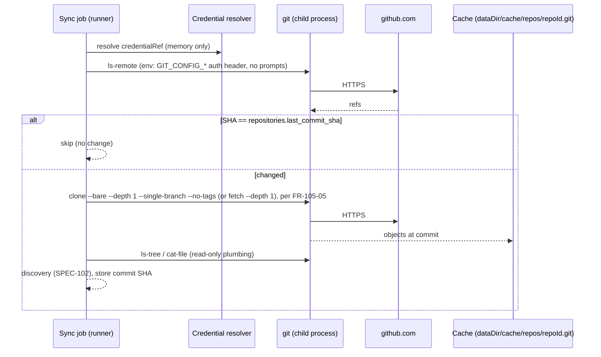

# SPEC-201 — GitHub

> All "Confirmed" statements were checked against the cited official documentation on 2026-10-14.
> Source keys ([G1] …) are listed in §14. Repository registration and sync behaviour are owned by
> [SPEC-104](2026-10-14-repository-management.md) and [SPEC-105](2026-10-14-repository-synchronization.md).
> This spec defines how DirectiveBench talks to GitHub.

## 1. Purpose

DirectiveBench reads artifacts (skills, rules, instruction files; see
[SPEC-102](2026-10-14-artifact-discovery.md)) from GitHub repositories (`repositories.provider =
'github'`). The integration must:

- validate access and detect the default branch and branch list;
- resolve a branch to a commit SHA, and skip sync when it has not changed;
- materialise the tree at that commit read-only, so discovery can scan it;
- work for public repositories without credentials, and for private ones with a minimally scoped
  token.

DirectiveBench **never writes** to GitHub: no push, no PRs, no issues
([SPEC-104 FR-104-11](2026-10-14-repository-management.md)). Scope in v1 is `github.com` only.
GitHub Enterprise Server is future work (§10).

## 2. Official integration options

| Option | Role in DirectiveBench | Evidence |
|---|---|---|
| **Git over HTTPS** (`git ls-remote`, shallow `git clone`/`fetch` into the data-dir cache) | **Primary transport** for validation and sync, as required by SPEC-104 (FR-104-07, FR-104-10, FR-104-12) | Tokens over HTTPS: Confirmed ([G1], 2026-10-14) |
| Git over SSH (`git@github.com:…`) | Accepted only with the `git-default` credential source. DirectiveBench uses the user's own SSH agent and never reads keys. | URL forms per SPEC-104 FR-104-02 |
| **REST API** (`https://api.github.com`) | Optional enrichment: visibility, archived flag, paginated branch list, token-permission diagnostics, cheap change detection | Confirmed ([G2]–[G6], 2026-10-14) |
| GitHub App (installation access tokens) | **Future**, mainly for the self-hosted server ([ADR-0009](../decisions/0009-self-hosted-readiness.md)). Read-only permissions only. | Confirmed ([G7], [G8], 2026-10-14) |
| GitHub CLI / Git Credential Manager | Not invoked by DirectiveBench. With `git-default`, `git` may use whatever helper the user configured. | GitHub recommends considering them before creating a token ([G1]) |
| GraphQL API | Not used | — |

Why git and not the REST API alone: one transport covers GitHub, GitLab, self-managed GitLab and local
repositories alike. A shallow clone yields the full tree at an exact commit without per-file API calls.
It also avoids the Trees API truncation limits and the Contents API size limits (§6).

## 3. Authentication methods

| Credential (`credentialRef`, [SPEC-104 FR-104-08](2026-10-14-repository-management.md)) | Use | Evidence |
|---|---|---|
| None (public repository) | Git clone of a public repository needs no credential (Assumption — requires validation in the live test). REST: 60 requests/hour per originating IP. | REST limit Confirmed ([G2]) |
| **Fine-grained personal access token** (recommended), as `keychain` or `env` | Select **only the required repositories**. Permissions **Contents: read** and **Metadata: read**. Set an expiration. | See below |
| Personal access token (classic), `repo` scope | Discouraged: a classic token "can access every repository you can access". Accepted with a warning. | Confirmed ([G1]) |
| `git-default` | `git` uses the user's own credential helper or SSH agent. DirectiveBench reads nothing. REST enrichment is unavailable (unauthenticated limits apply). | SPEC-104 |
| GitHub App installation token (future) | Expires after 1 hour. Can be narrowed to specific repositories (up to 500) and a permission subset. Git username `x-access-token`. | Confirmed ([G7]) |

Fine-grained PAT facts (Confirmed, [G1], [G3], 2026-10-14):

- They are recommended over classic tokens. They always have read-only access to public
  repositories.
- When an organisation requires approval, the token is `pending` and can only read public resources
  until an administrator approves it.
- Expiration: `expires_in` accepts 1–366 days or `none`, unless organisation or enterprise policy
  limits it. Tokens unused for a year are removed. A user can create at most 50 fine-grained tokens.
- Required permissions per endpoint: `GET /repos/{owner}/{repo}` needs **Metadata (read)**. Branches,
  commits, trees, contents and tarball need **Contents (read)** ([G3]).
- Whether selecting Contents automatically adds Metadata in the token UI is not stated in the
  reviewed pages. Assumption — requires validation. The UI instructions list both permissions
  explicitly.

Git over HTTPS with a token: the token is the password. A username is required but "isn't used for
authentication". Tokens only work over HTTPS: Confirmed ([G1]). DirectiveBench uses
`x-access-token` as the username for all token kinds. This is documented for app tokens ([G7]).
Acceptance for PATs follows from "username … isn't used" ([G1]).

Token prefixes (for redaction and for the classic-token warning): `github_pat_` (fine-grained),
`ghp_` (classic), `ghs_` (installation; new tokens may use a longer `ghs_APPID_JWT` format),
`gho_`, `ghu_`, `ghr_`: Confirmed ([G9], 2026-10-14).

## 4. Capability requirements

| Need | Git transport | REST API (optional) |
|---|---|---|
| Validate reachability and auth | `git ls-remote --symref <url> HEAD` | `GET /repos/{owner}/{repo}` |
| Default branch | `ls-remote --symref` | `default_branch` field (Assumption: field name, from the standard repository object) |
| List branches | `git ls-remote --heads` | `GET /repos/{owner}/{repo}/branches` (`per_page` ≤ 100) |
| Branch → commit SHA (change detection) | `ls-remote` | `GET /repos/{owner}/{repo}/branches/{branch}` or `GET /repos/{owner}/{repo}/commits/{ref}` |
| Tree + file contents at commit | Shallow clone, then `ls-tree` / `cat-file` | Trees API (truncation limits) + Contents API (size limits). Not used for sync. |
| Commit metadata for provenance | `git log -1` in the cache | `GET /repos/{owner}/{repo}/commits/{ref}` |

## 5. Architecture

Provider logic lives in the future `packages/git-providers` and implements `GitSourceProvider` from
[SPEC-104 §8](2026-10-14-repository-management.md#8-domain-entities-and-contracts). Sync runs as a
runner job ([SPEC-105](2026-10-14-repository-synchronization.md)).

### 5.1 Git transport rules (shared with [SPEC-202](2026-10-14-integration-gitlab.md))

These apply to every `git` invocation by DirectiveBench. Items not already in
[SPEC-104 FR-104-12](2026-10-14-repository-management.md) are marked "design". Whether each one
works as intended is an Assumption until it passes the transport tests in §11.

1. **argv only, no shell**. A timeout applies, the process tree is killed on cancel, and output is
   bounded and redacted ([SPEC-007 §4](2026-10-14-security-and-privacy.md#4-command-execution-rules-normative)).
2. **No prompts**: `GIT_TERMINAL_PROMPT=0`. `credential.interactive=false` is documented in git
   config ([G10]).
3. **Credential injection without argv or files** (design): the secret is passed through
   `GIT_CONFIG_COUNT` / `GIT_CONFIG_KEY_n` / `GIT_CONFIG_VALUE_n` (documented to add runtime
   config from the environment, [G11]). It is set as a URL-scoped header,
   `http.https://github.com/.extraHeader = Authorization: Basic base64("x-access-token:" + token)`.
   `http.<url>.*` scoping and `http.extraHeader` are documented ([G10]). That GitHub accepts a
   pre-emptive Basic header is an Assumption — requires validation. The fallback is a one-shot
   `GIT_ASKPASS` helper that reads the token from its own environment, as allowed by SPEC-104
   FR-104-09. The token value is registered with `redactSecrets` before git starts.
4. **Config isolation** (design): `GIT_CONFIG_NOSYSTEM=1` and `GIT_CONFIG_GLOBAL` pointing to an
   empty file. User hooks, filters, credential helpers and URL rewrites (`insteadOf`) therefore cannot
   run or redirect traffic. Exception: credential source `git-default` keeps the user's global config,
   since its purpose is to use the user's helpers. This is shown in the UI.
   Ignoring system and global config does not stop git from discovering a repository that encloses
   its working directory and loading that repository's `.git/config` (for example a data directory
   inside a git work tree). git therefore never discovers a repository: a call on the cache names it
   with `GIT_DIR`, and every other call (`version`, `ls-remote`, `clone`) runs in the empty `HOME`
   with `GIT_CEILING_DIRECTORIES` set to its parent. The only repository config git reads is the
   cache's own, written by DirectiveBench's `clone`.
5. **No redirects**: `http.followRedirects=false` (default is `initial`, [G10]). A redirect fails
   validation with a message that tells the user to register the final URL.
6. **Schemes**: `protocol.allow=never`, `protocol.https.allow=always`. Also `protocol.ssh.allow=always`
   only for SSH URLs with `git-default`. Documented policy keys ([G10]).
7. **No repository-controlled code**: `core.hooksPath` set to an empty directory,
   `core.fsmonitor=false`, `GIT_LFS_SKIP_SMUDGE=1`, no submodule recursion (SPEC-104 FR-104-12).
8. **Shallow, bounded fetch**: a bare, shallow, single-branch clone without tags at
   `<dataDir>/cache/repos/<repositoryId>.git`. No working tree is ever checked out
   ([SPEC-105 FR-105-05](2026-10-14-repository-synchronization.md)). Partial clone
   (`--filter=…`) is an open question (SPEC-105 OQ-105-04). Server support for it on github.com and
   GitLab is an Assumption — requires validation.

## 6. Relevant API or CLI interfaces

REST conventions: base `https://api.github.com`; headers `Accept: application/vnd.github+json`,
`Authorization: Bearer <token>`, `X-GitHub-Api-Version: 2026-03-10`. Supported versions are
`2026-03-10` and `2022-11-28` (end of support 2028-03-10). Requests **without** the header use
`2022-11-28`. DirectiveBench pins the version explicitly: Confirmed ([G4], [G5], 2026-10-14).

| Endpoint | Purpose | Fine-grained permission ([G3]) | Notes |
|---|---|---|---|
| `GET /repos/{owner}/{repo}` | Validate, visibility, archived, default branch | Metadata: read | — |
| `GET /repos/{owner}/{repo}/branches?per_page=100&page=n` | Branch list | Contents: read | `per_page` max 100 ([G6]) |
| `GET /repos/{owner}/{repo}/branches/{branch}` | Branch head | Contents: read | 301 when the branch was renamed ([G6]) → reported, not followed |
| `GET /repos/{owner}/{repo}/commits?sha=<branch>&per_page=1` | Latest commit on branch | Contents: read | `per_page` max 100 ([G12]) |
| `GET /repos/{owner}/{repo}/commits/{ref}` | Commit metadata | Contents: read | `ref` = SHA, `heads/BRANCH` or `tags/TAG` ([G12]) |
| `GET /repos/{owner}/{repo}/git/trees/{sha}?recursive=1` | Not used for sync | Contents: read | Recursive limit 100,000 entries / 7 MB, `truncated` flag ([G13]) |
| `GET /repos/{owner}/{repo}/contents/{path}` | Not used for sync | Contents: read | Full support ≤ 1 MB, raw media type up to 100 MB, directory listing capped at 1,000 entries ([G14]) |
| `GET /repos/{owner}/{repo}/tarball/{ref}` | **Not used** | Contents: read | Returns a 302 redirect to a download URL on another host, which conflicts with the no-redirect rule ([G14]) |

## 7. Configuration

Repository fields come from [SPEC-104](2026-10-14-repository-management.md). GitHub-specific
settings:

| Setting | Default | Notes |
|---|---|---|
| `location` | `https://github.com/<owner>/<repo>` (normalised) | Embedded credentials rejected (FR-104-05) |
| `credentialRef` | `git-default` | `keychain` or `env` for a PAT, e.g. `{ source: 'env', name: 'GITHUB_TOKEN' }` |
| `restEnrichment` | `true` when a token is configured, otherwise `false` | Avoids burning the 60/h anonymous budget |
| `apiVersion` | `2026-03-10` | Profile constant. Changing it is a code change. |

The token-creation guide in the UI links to GitHub's fine-grained token page. It lists: resource owner,
"Only select repositories", Contents read-only, Metadata read-only, and an expiration date.

## 8. Security concerns

- **Secrets** ([ADR-0008](../decisions/0008-secret-storage-and-authentication.md)): tokens are
  stored in the OS keychain (planned) or referenced by env var name. They are never in SQLite,
  `config.json`, the cached clone's `.git/config`, remote URLs, argv, logs or sync errors. Git stderr
  is redacted before persistence.
- **Least privilege**: fine-grained, repository-selected, read-only token with an expiration. A
  classic token triggers a warning. A token whose permissions exceed the need cannot be detected
  reliably from the client, so the UI states the recommended scope rather than claiming to verify it.
- **Untrusted content**: repository files are parsed only, never executed. Git config isolation, the
  hooks path, LFS skip and no submodules (§5.1) stop repository-controlled code from running during
  sync (threat T1 in [SPEC-007](2026-10-14-security-and-privacy.md)).
- **SSRF**: hosts are fixed (`github.com`, `api.github.com`), redirects are refused, and the scheme
  is HTTPS only.
- **TLS**: never disabled. Corporate TLS-intercepting proxies are supported only by adding their CA
  (shared rules in [SPEC-202 §8](2026-10-14-integration-gitlab.md#8-security-concerns)).
- **Rate-limit abuse**: requests stay sequential per repository. GitHub warns that continuing to
  send requests while rate limited may get an integration banned ([G2]).

## 9. Error handling

Maps to `RepositoryErrorCode` ([SPEC-104 §8](2026-10-14-repository-management.md#8-domain-entities-and-contracts)).

| Condition | Detection | Code / behaviour |
|---|---|---|
| Bad or expired token | REST 401. Git "Authentication failed". | `auth-failed` |
| Private repository without access | REST 404, git "Repository not found". Whether GitHub returns 404 rather than 403 for inaccessible private repositories is an Assumption — requires validation. | `auth-required` when no credential is configured, else `auth-failed`, with a hint about org approval for fine-grained tokens ([G1]) |
| Primary rate limit | 403 or 429 with `x-ratelimit-remaining: 0`. Wait until `x-ratelimit-reset` (UTC epoch seconds). | Job pauses until reset if within the sync timeout, else `unreachable` with a reset time |
| Secondary rate limit | 403/429 with `retry-after`, or none. Wait `retry-after`, else ≥ 60 s, then exponential backoff, then fail after N attempts. | Same as above. Confirmed policy ([G2]) |
| Branch missing / renamed (301) | `ls-remote` has no ref; REST 404/301 | `branch-not-found` |
| Redirect from git or REST | 3xx | `invalid-url` with "register the final URL" hint |
| Network / DNS / timeout | Process timeout, fetch error | `unreachable` / `timeout` |
| TLS failure | git/Node certificate error | `unreachable` with a TLS hint (never retried with verification off) |
| `git` missing | spawn ENOENT | `git-not-installed` |

Rate-limit headers `x-ratelimit-limit`, `-remaining`, `-used`, `-reset`, `-resource` are recorded.
Their values can vary between responses, so logic must not depend on exact remaining counts:
Confirmed ([G2]). Limits: unauthenticated 60/h per IP; PAT 5,000/h; installation tokens ≥ 5,000/h;
secondary limits include 100 concurrent requests and 900 points per minute per REST endpoint, with
GET costing 1 point ([G2]).

## 10. Compatibility restrictions

- `github.com` only in v1. **GitHub Enterprise Server** uses REST base `http(s)://HOSTNAME/api/v3`:
  Confirmed ([G15]). Supporting it needs a `github` instance URL plus the self-managed network rules
  of [SPEC-202](2026-10-14-integration-gitlab.md). Future.
- Organisation policies (fine-grained token approval, maximum lifetime) can block access
  independently of the token's own settings ([G1]).
- Git LFS content and submodules are not fetched. An artifact stored in LFS appears as a pointer
  file, and discovery reports a warning (Assumption — requires validation of the detection
  heuristic in SPEC-102).
- Minimum `git` version is per SPEC-104 NFR-104-03 (Assumption ≥ 2.30). `GIT_CONFIG_COUNT`
  requires a git version that supports it (introduction version not verified). `doctor` checks it.
- GitHub App (future): installation tokens last 1 hour, so long syncs must refresh them. App private
  keys are server-side secrets and belong to the self-hosted design
  ([SPEC-011](2026-10-14-self-hosting-architecture.md)).

## 11. Test strategy

- **No GitHub calls in default CI.** REST behaviour is tested against a local mock HTTP server with
  recorded fixtures (secrets scrubbed): repository, branches pagination, commit, 401, 404, primary
  rate limit (`x-ratelimit-remaining: 0`), secondary rate limit with and without `retry-after`, and
  301/302 redirects (must not be followed).
- **Git transport tests** against a local bare repository served by a throwaway HTTP server (for
  example `git http-backend`) on loopback, with test-only allowance for loopback. They cover:
  Basic-header injection; no token in argv (inspect the spawned argv), in `.git/config`, or in
  persisted logs; `followRedirects=false`; scheme policy; hooks and LFS smudge not executed; shallow
  and filter fallback; timeout kill.
- **Redaction tests**: every token prefix in §3 is redacted from git stderr and error messages.
- **Opt-in live tests** (`DIRECTIVEBENCH_LIVE_TESTS=1`): `ls-remote` and a shallow clone of a small
  public repository without a token. With `GITHUB_TOKEN` (a fine-grained, read-only, single-repo
  token): validate a private test repository. Never in default CI.

## 12. Acceptance criteria

- [ ] AC-1: A public `github.com` repository can be validated and synced with no credential. The
  default branch and branch list are detected.
- [ ] AC-2: A private repository syncs with a fine-grained token that has only Contents: read and
  Metadata: read on that repository.
- [ ] AC-3: The token never appears in argv, `.git/config` of the cache, SQLite, `config.json`, logs,
  traces or error messages.
- [ ] AC-4: An unchanged branch SHA skips clone/fetch. A changed SHA produces a shallow fetch, and the
  new commit SHA is recorded.
- [ ] AC-5: Redirects (git or REST) are not followed. Rate-limit responses pause or fail with the
  reset time shown, and the job does not loop on retries.
- [ ] AC-6: Repository hooks, LFS smudge filters and submodules are never executed or fetched during
  sync.

## 13. Current implementation status

- **Implemented — public repositories without credentials (issue #18; verified on 2026-10-20 by the
  `packages/runner` hosted tests against local bare repositories, no network, and a manual run against
  github.com):** registration by `https://github.com/<owner>/<repo>[.git]` with the default branch
  from `ls-remote` (SPEC-104 Phase 3) and the scan's partial fetch of candidate blobs (SPEC-105 §20).
  Transport rules of §5.1 in force: 1 (argv, timeouts, process-group kill, bounded and redacted
  error output), 2 (`GIT_TERMINAL_PROMPT=0`, `credential.interactive=false`), 4 (system and global
  config ignored, `HOME` an empty DirectiveBench directory, no repository discovery — `GIT_DIR` for
  cache steps, `GIT_CEILING_DIRECTORIES` for the others, tested with a data directory inside a git
  work tree whose config rewrites URLs, adds headers and disables TLS verification; there is no
  `git-default` exception yet, since no credentials are used), 5 (`http.followRedirects=false`; a 3xx is `invalid-url` "register
  its new URL"), 6 (`protocol.allow=never`, `protocol.https.allow=always`), 7 (`core.hooksPath=/dev/null`
  — not an empty directory — `core.fsmonitor=false`, `GIT_LFS_SKIP_SMUDGE=1`, no submodules), 8 (bare,
  shallow, single-branch, blob-less partial clone without tags or templates). Observed: without
  credentials github.com answers a missing or private repository with git's "unable to get password
  from user" (with `credential.interactive=false`) or "could not read Username … terminal prompts
  disabled"; both map to `auth-required` "not found or not public". github.com serves blob-by-ID
  fetches into the shallow partial clone (ADR-0012 assumption confirmed). AC-6 holds for public
  repositories; AC-1 lacks the branch list.
- **Partially implemented:** `redactSecrets` in `@directivebench/core` covers GitHub token shapes
  (`gh[pousr]_…`, `github_pat_…`; `packages/core/src/redact.ts`, verified by the `core` redaction
  test) ([SPEC-007 §3.1](2026-10-14-security-and-privacy.md)). It is not wired to any git
  integration.
- **Not implemented:** `packages/git-providers` (hosted git lives in `packages/runner` for now),
  credential injection (§5.1 rule 3), branch listing, REST enrichment, credential storage, GitHub
  App, GHES, the opt-in live tests of §11 (the transport tests use `file://`, not a loopback HTTP
  server).

## 14. Sources

[G1]: https://docs.github.com/en/authentication/keeping-your-account-and-data-secure/managing-your-personal-access-tokens
[G2]: https://docs.github.com/en/rest/using-the-rest-api/rate-limits-for-the-rest-api
[G3]: https://docs.github.com/en/rest/authentication/permissions-required-for-fine-grained-personal-access-tokens
[G4]: https://docs.github.com/en/rest/about-the-rest-api/api-versions
[G5]: https://docs.github.com/en/rest/git/trees
[G6]: https://docs.github.com/en/rest/branches/branches
[G7]: https://docs.github.com/en/apps/creating-github-apps/authenticating-with-a-github-app/authenticating-as-a-github-app-installation
[G8]: https://docs.github.com/en/apps/creating-github-apps/about-creating-github-apps/deciding-when-to-build-a-github-app
[G9]: https://docs.github.com/en/authentication/keeping-your-account-and-data-secure/about-authentication-to-github
[G10]: https://git-scm.com/docs/git-config
[G11]: https://git-scm.com/docs/git-config#ENVIRONMENT
[G12]: https://docs.github.com/en/rest/commits/commits
[G13]: https://docs.github.com/en/rest/git/trees#get-a-tree
[G14]: https://docs.github.com/en/rest/repos/contents
[G15]: https://docs.github.com/en/enterprise-server@latest/rest/quickstart

- [G1] Managing personal access tokens — https://docs.github.com/en/authentication/keeping-your-account-and-data-secure/managing-your-personal-access-tokens
- [G2] REST API rate limits — https://docs.github.com/en/rest/using-the-rest-api/rate-limits-for-the-rest-api
- [G3] Permissions required for fine-grained PATs — https://docs.github.com/en/rest/authentication/permissions-required-for-fine-grained-personal-access-tokens
- [G4] API versions — https://docs.github.com/en/rest/about-the-rest-api/api-versions
- [G5] Git trees (header conventions) — https://docs.github.com/en/rest/git/trees
- [G6] Branches — https://docs.github.com/en/rest/branches/branches
- [G7] Authenticating as a GitHub App installation — https://docs.github.com/en/apps/creating-github-apps/authenticating-with-a-github-app/authenticating-as-a-github-app-installation
- [G8] Deciding when to build a GitHub App — https://docs.github.com/en/apps/creating-github-apps/about-creating-github-apps/deciding-when-to-build-a-github-app
- [G9] About authentication to GitHub (token prefixes) — https://docs.github.com/en/authentication/keeping-your-account-and-data-secure/about-authentication-to-github
- [G10] git-config — https://git-scm.com/docs/git-config
- [G11] git-config environment (`GIT_CONFIG_COUNT`) — https://git-scm.com/docs/git-config#ENVIRONMENT (also verified in local `git` 2.53 man page)
- [G12] Commits — https://docs.github.com/en/rest/commits/commits
- [G13] Get a tree — https://docs.github.com/en/rest/git/trees#get-a-tree
- [G14] Repository contents and archives — https://docs.github.com/en/rest/repos/contents
- [G15] GitHub Enterprise Server REST quickstart — https://docs.github.com/en/enterprise-server@latest/rest/quickstart
