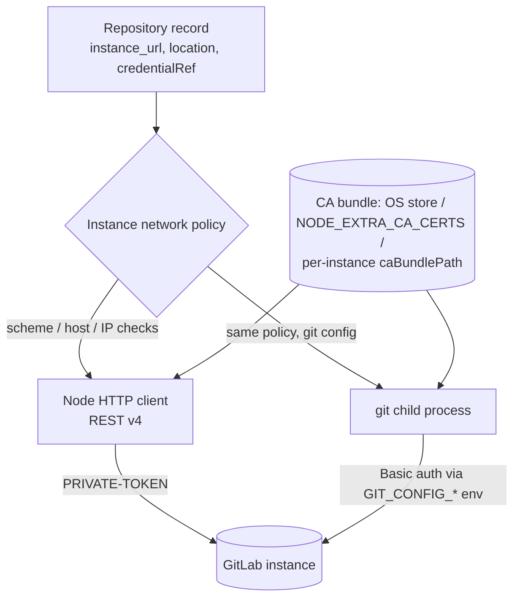

# SPEC-202 — GitLab (GitLab.com and self-managed)

> All "Confirmed" statements were checked against the cited official documentation on 2026-10-14.
> Source keys ([L1] …) are listed in §14. Registration and sync behaviour are owned by
> [SPEC-104](2026-10-14-repository-management.md) and [SPEC-105](2026-10-14-repository-synchronization.md).
> The git transport rules are shared with GitHub ([SPEC-201 §5.1](2026-10-14-integration-github.md#51-git-transport-rules-shared-with-spec-202)).

## 1. Purpose

DirectiveBench reads artifacts from GitLab projects (`repositories.provider = 'gitlab'`) on:

- **GitLab.com**;
- **self-managed instances at arbitrary domains**, for example `https://gitlab.company.example`,
  possibly under a path prefix ([SPEC-104 FR-104-02](2026-10-14-repository-management.md));
- instances reachable **only on a LAN or VPN**, often with a **private CA**.

The integration validates access, detects branches, resolves the commit SHA and materialises the tree
read-only for discovery ([SPEC-102](2026-10-14-artifact-discovery.md)). It never writes to GitLab.
Self-managed support makes this the main SSRF and TLS surface of DirectiveBench. Those rules are
normative here and are reused by any other user-configured host.

## 2. Official integration options

| Option | Role | Evidence |
|---|---|---|
| **Git over HTTPS** (`ls-remote`, shallow clone/fetch into the cache) | **Primary transport** (as in SPEC-104) | Token auth over HTTPS: Confirmed ([L1], [L2], 2026-10-14) |
| Git over SSH | Only with the `git-default` credential kind (the user's SSH agent) | Deploy tokens do not support SSH ([L4]) |
| **REST API v4** (`<instance>/api/v4`) | Optional enrichment and diagnostics: instance version, project metadata, branch list, token-scope diagnostics, cheap change detection | Confirmed ([L5], 2026-10-14) |
| GraphQL API | Not used | — |

## 3. Authentication methods

GitLab separates **Git permissions** from **API permissions**. Confirmed scope descriptions
([L3], 2026-10-14):

| Scope | GitLab description | Grants |
|---|---|---|
| `read_repository` | "Grants read access (pull) to repositories for the token's scope." Uses "Git-over-HTTP or the repository files API". | **Git clone/fetch** and the repository files API |
| `read_api` | "Grants read access to the API for the token's scope." | REST reads: project, branches, tree, commits |
| `api` | "Grants complete read and write access to the API for the token's scope." | **Too broad. Rejected with a warning.** |
| `write_repository` | Read and write (pull and push) | **Not needed. Warning.** |

Minimum for DirectiveBench: `read_repository` (sync), plus `read_api` if REST enrichment is wanted.
Neither scope alone covers both. With only `read_repository`, enrichment is disabled and sync still
works.

| Token type | Availability | Notes | Evidence |
|---|---|---|---|
| Personal access token (PAT) | All tiers | Tied to a user. Default and maximum expiry 365 days; administrators can change the maximum on 17.6+. Git username: any non-empty string. | Confirmed ([L1]) |
| **Project access token** (recommended for one project) | GitLab.com: Premium/Ultimate. Self-managed and Dedicated: any license. | Bound to one project. Creates a bot member with a selected role. Created by Maintainer/Owner. Git username: any non-blank value. | Confirmed ([L2]) |
| Group access token | GitLab.com: Premium/Ultimate (not in trials). Self-managed: any license. | Covers the group's subgroups and projects. Created by group Owner. | Confirmed ([L6]) |
| Deploy token (`read_repository`) | Free, Premium, Ultimate on all offerings | **Git only**: "can't be used with the GitLab public REST API". Requires its own username (default `gitlab+deploy-token-{n}`). No expiry by default. | Confirmed ([L4]) |
| Fine-grained PAT | Beta in 18.10, GA in 19.2, all tiers and offerings | Future option. Mapping to repository read permissions not yet verified. | Confirmed status ([L7]). Permissions: Assumption — requires validation. |
| `git-default` | — | `git` uses the user's own helper or SSH agent | SPEC-104 |

- The token **role** required to read a private project's repository (for example Reporter vs Guest)
  is not stated in the reviewed pages. Assumption — requires validation. The UI advises the lowest
  role that passes validation.
- Personal, project, group and impersonation tokens share the prefix `glpat-`. Deploy tokens use
  `gldt-`. Administrators can configure a custom PAT prefix: Confirmed ([L8], 2026-10-14). Redaction
  therefore always uses the **known secret value**, not only patterns.
- Instance administrators can disable access tokens instance-wide, and on GitLab.com group Owners can
  disable PATs for enterprise users ([L1]). Validation reports this as `auth-failed` with a hint.

**REST auth header**: `PRIVATE-TOKEN: <token>` (recommended by GitLab) or `Authorization: Bearer
<token>` for personal, project and group tokens: Confirmed ([L9]). DirectiveBench uses
`PRIVATE-TOKEN` and never the `private_token` query parameter, so secrets stay out of URLs and proxy
logs. **Git auth**: Basic `<username>:<token>`. For PAT, project and group tokens, GitLab accepts any non-blank
username and does not validate it, so DirectiveBench sends a fixed placeholder. Deploy tokens use
their own username ([L1], [L2], [L4]).
The username for each credential is stored as non-secret `credentialRef` metadata (planned field
`username`).

## 4. Capability requirements

| Need | Git (needs `read_repository`) | REST v4 (needs `read_api`, or anonymous for public projects) |
|---|---|---|
| Validate | `git ls-remote --symref` | `GET /projects/:id` (anonymous OK for public projects [L10]) |
| Instance identification | — | `GET /version` → `version`, `revision`, `enterprise` ([L11]) |
| Default branch | `ls-remote --symref` | `default_branch` ([L10]) |
| Branches | `ls-remote --heads` | `GET /projects/:id/repository/branches` (`search` or `regex`; anonymous for public) ([L12]) |
| Branch → SHA | `ls-remote` | `GET /projects/:id/repository/branches/:branch` |
| Tree / files | Shallow clone + `ls-tree`/`cat-file` | `GET /projects/:id/repository/tree?recursive=true&pagination=keyset` (not used for sync) ([L13]) |
| Commit metadata | `git log -1` | `GET /projects/:id/repository/commits/:sha` ([L14]) |
| Token diagnostics | — | 403 `insufficient_scope` with `WWW-Authenticate` listing the scopes that would authorise the request ([L9]) → shown as "token lacks scope X" |

## 5. Architecture

Same structure as GitHub ([SPEC-201 §5](2026-10-14-integration-github.md#5-architecture)): a `GitSourceProvider` in the
future `packages/git-providers`. All network access to the instance, from Node (REST) and from `git`
(transport), goes through one **instance network policy**.

### 5.1 Instance and project addressing

- `instance_url` = scheme + host (+ optional port and path prefix), with no trailing slash
  (SPEC-104). API base = `instance_url + '/api/v4'`: Confirmed format ([L5]).
- Project id in API paths = **URL-encoded full path** (`group%2Fsubgroup%2Fproject`). Branch names and
  file paths are encoded the same way. Wrong encoding yields 404: Confirmed ([L5]).
- Clone URL = `instance_url + '/' + full_path + '.git'`. If REST is available, it is checked against
  `http_url_to_repo` ([L10]). On mismatch (for example a different external URL), DirectiveBench
  reports it and never silently follows.

## 6. Relevant API or CLI interfaces

| Endpoint (relative to `<instance>/api/v4`) | Use | Anonymous for public | Evidence |
|---|---|---|---|
| `GET /version` (also `/metadata`) | Show instance version, detect EE | Not stated; auth sent if available | Confirmed ([L11]) |
| `GET /projects/:id` | Validate, `default_branch`, `visibility`, `archived`, `empty_repo`, `http_url_to_repo`, `permissions` | Yes | Confirmed ([L10]) |
| `GET /projects/:id/repository/branches[/:branch]` | Branches, head SHA | Yes | Confirmed ([L12]) |
| `GET /projects/:id/repository/commits?ref_name=…&per_page=1` | Latest commit | Assumption — requires validation | Confirmed params ([L14]) |
| `GET /projects/:id/repository/tree` (`path`, `ref`, `recursive`, keyset `page_token`) | Not used for sync | Yes | Confirmed ([L13]) |
| `GET /projects/:id/repository/archive[.format]` | **Not used** (GitLab.com: 5 requests/minute) | Yes | Confirmed ([L13]) |

Pagination: `page` and `per_page` (default 20, max 100), `Link` headers and `x-next-page`. Keyset
pagination is used where supported. Above 10,000 records, the total headers are omitted: Confirmed
([L5]). DirectiveBench follows `Link` URLs only when their origin equals the instance origin.

## 7. Configuration

| Setting | Default | Notes |
|---|---|---|
| `instance_url` | `https://gitlab.com` | Editable for self-managed (SPEC-104 FR-104-02) |
| `credentialRef` | `git-default` | `keychain` or `env`, plus non-secret `username` (deploy tokens) and `tokenKind` (`pat` / `project` / `group` / `deploy`) for hints |
| `network.allowPrivateNetwork` | `false` | Must be set explicitly for LAN/VPN instances (§8) |
| `network.allowInsecureHttp` | `false` | Explicit opt-in with a warning |
| `network.caBundlePath` | none | PEM file. Added to the default trust store, never replacing it. |
| `restEnrichment` | `true` if a token with `read_api` is configured | Disabled for deploy tokens |

Network settings are stored **per instance** (keyed by origin), so all projects on one instance share
them. Changing them requires re-validation. Storage location (DB vs `config.json`):
[SPEC-115](2026-10-14-settings-and-configuration.md).

## 8. Security concerns

### 8.1 Credentials

Credentials follow [ADR-0008](../decisions/0008-secret-storage-and-authentication.md): keychain
(planned) or env reference, never plaintext by default. They are never in argv, URLs, the cache's
`.git/config`, logs, traces or errors. The secret value is registered with `redactSecrets` before any
process starts. Least privilege: a project access token or deploy token with `read_repository` (plus
`read_api` only if enrichment is wanted). Tokens with `api` or `write_repository` get a warning.

### 8.2 SSRF and private networks

The instance URL is user-configured, and private network access is **legitimate**, so it must be
**explicit** rather than blocked or silently allowed (threat T5 in
[SPEC-007](2026-10-14-security-and-privacy.md)):

1. **Schemes**: `https` only. `http` requires `allowInsecureHttp`. The UI warns that the token is
   sent unencrypted. Git also gets `protocol.allow=never`, `protocol.https.allow=always` (and `http`
   only when allowed) ([SPEC-201 §5.1](2026-10-14-integration-github.md#51-git-transport-rules-shared-with-spec-202)).
2. **IP classification after DNS resolution**: link-local and metadata (`169.254.0.0/16`,
   `fe80::/10`, `fd00:ec2::254`) are **always denied**. Loopback, RFC 1918, CGNAT and IPv6 ULA
   require `allowPrivateNetwork: true`. Validation shows which IP and class was hit.
3. **DNS-rebinding resistance**: Node requests connect to the IP that was checked. For `git`, the
   checked address is pinned with `http.curloptResolve=HOST:PORT:ADDRESS` (documented git config
   [L15]; behaviour under proxies is an Assumption — requires validation).
4. **Redirects**: Node uses `redirect: 'manual'`, and git uses `http.followRedirects=false`
   ([L15]). Any 3xx to a different origin is an error, and the credential is never re-sent. Same-origin
   redirects are also reported rather than followed, so the user can register the canonical URL.
5. **Bounded responses**: size and time limits on REST responses. Git runs with a process timeout.
6. **Proxies**: git honours `http_proxy`/`https_proxy` ([L15]). Node only does so when
   `NODE_USE_ENV_PROXY=1` / `--use-env-proxy` (Node ≥ 24.0 / 24.5) ([L16]). With a proxy, IP pinning
   is not possible. The UI states that host checks are then best effort.

### 8.3 TLS and custom CAs

- Verification is **never disabled**. No `http.sslVerify=false`, no `NODE_TLS_REJECT_UNAUTHORIZED=0`,
  and no "ignore certificate" option ([SPEC-007 §7](2026-10-14-security-and-privacy.md#7-tls)).
- CA sources, in order:
  1. the OS trust store, if the user starts Node with `--use-system-ca` / `NODE_USE_SYSTEM_CA=1`;
  2. `NODE_EXTRA_CA_CERTS` (PEM, read only at process start);
  3. a per-instance `caBundlePath`.
- For Node, the per-instance bundle is **appended** to `tls.rootCertificates`. Passing `ca` alone
  would drop the well-known and extra CAs ([L16]). For git, it is passed as
  `http.<instance_url>/.sslCAInfo=<path>` (or `GIT_SSL_CAINFO`) ([L15]). `sslCAInfo` replaces git's
  default bundle for that URL only, so the user's file must contain the full chain for that host
  (Assumption — requires validation with OpenSSL and Schannel backends).
- `doctor` reports `NODE_EXTRA_CA_CERTS`, the system-CA flag and any `NODE_TLS_REJECT_UNAUTHORIZED`
  in the environment.

### 8.4 Untrusted content

Same as GitHub: parse only, plus the hooks, LFS, submodule and config isolation rules
([SPEC-201 §5.1](2026-10-14-integration-github.md#51-git-transport-rules-shared-with-spec-202)).

## 9. Error handling

| Condition | Detection | `RepositoryErrorCode` / behaviour |
|---|---|---|
| Missing or invalid token | REST 401 `{"message":"401 Unauthorized"}`. Git auth failure. | `auth-failed` (`auth-required` if no credential) ([L9]) |
| Token lacks scope | REST 403 `insufficient_scope` + `WWW-Authenticate` | `auth-failed`, naming the missing scope ([L9]) |
| Deploy token used for REST | 401/403 on API | Enrichment disabled, sync continues (deploy tokens are git-only [L4]) |
| Project not found / no access / bad encoding | 404 | `auth-failed` or `invalid-url`, with an encoding check in the hint ([L5]) |
| **Repeated failed git auth** | GitLab.com bans an IP for 15 minutes (403) after 300 failed Git auth requests in one minute ([L17]) | Auth failures are **never retried** automatically |
| Rate limited | 429 with `Retry-After`, `RateLimit-Limit`, `RateLimit-Remaining`, `RateLimit-ResetTime` (Projects/Groups/Users API responses may lack these headers) | Wait `Retry-After` if within the sync timeout, else fail with the reset time ([L17]) |
| Instance overloaded (Gitaly concurrency) | Git: "GitLab is currently unable to handle this request due to load" | `unreachable`, retry later ([L18]) |
| Private address without opt-in | Resolver check | `invalid-url` with "enable private network access for this instance" |
| TLS: unknown CA or hostname mismatch | Node or git certificate error | `unreachable` with a CA-bundle hint (never retried insecurely) |
| Redirect | 3xx | `invalid-url` with the target origin shown |
| VPN down / DNS failure / timeout | ENOTFOUND, ECONNREFUSED, timeout | `unreachable` / `timeout`. For a private-network instance, the hint mentions VPN. |

GitLab.com limits (Confirmed, [L17], 2026-10-14): authenticated API 2,000 requests/minute per user;
unauthenticated API 500/minute per IP; Git over HTTP 10,000/minute authenticated and 15,000/minute
unauthenticated. Plan-based limits are proposed but not yet in effect. Self-managed limits are set
by the administrator and are unknown to DirectiveBench. The client relies on 429 handling only.

## 10. Compatibility restrictions

- **Project and group access tokens are not available on GitLab.com Free** ([L2], [L6]). There, use a
  PAT (narrow scopes) or a deploy token (git-only).
- Self-managed versions differ. Fine-grained PATs require 19.2 (GA) and the PAT lifetime setting
  requires 17.6. `GET /version` is shown so users can reason about features. DirectiveBench does not
  gate features on version in v1. The minimum supported self-managed version is an Assumption —
  requires validation (REST v4 endpoints used here are long-standing).
- Offset pagination has a maximum offset that self-managed administrators can change ([L5]). Large
  listings use keyset pagination where available.
- LFS objects and submodules are not fetched (SPEC-104 FR-104-12).
- **GitLab Duo custom rules** in `.gitlab/duo/chat-rules.md` are read by GitLab Duo Chat, agents and
  flows from the repository, with a user-level counterpart in the home directory (Confirmed, [L19],
  2026-10-14). This informs the `gitlab-duo-chat-rules` artifact format in
  [SPEC-102](2026-10-14-artifact-discovery.md). Its activation semantics there remain owned by
  SPEC-102.

## 11. Test strategy

- **No GitLab calls in default CI.** A local mock HTTP server replays recorded v4 fixtures (secrets
  scrubbed): `/version`, `/projects/:id` (public and private), branches with `Link` pagination,
  keyset tree, 401, 403 `insufficient_scope` with `WWW-Authenticate`, 404 caused by bad encoding, 429
  with `Retry-After`, and cross-origin and same-origin 3xx (not followed, credential not re-sent).
- **Network policy unit tests**: IPv4/IPv6 classification, metadata always denied, private ranges
  require opt-in, `curloptResolve` pin value, `http` refused without opt-in, `Link` header origin
  check.
- **TLS tests**: a loopback HTTPS server and git `http-backend` with a CA generated at test time.
  Each must fail without the bundle, pass with `caBundlePath`, and public CAs must still be trusted
  in the Node client (check that `tls.rootCertificates` was retained).
- **Credential tests**: deploy-token username handling; no token in argv, `.git/config`, logs or
  errors; `PRIVATE-TOKEN` used, never a query parameter.
- **Opt-in live tests** (`DIRECTIVEBENCH_LIVE_TESTS=1`): a public GitLab.com project without a
  token. With `GITLAB_TOKEN` and optionally `GITLAB_INSTANCE_URL` / `GITLAB_CA_BUNDLE`: a private
  project on GitLab.com or on a self-managed test instance. Never in default CI.

## 12. Acceptance criteria

- [ ] AC-1: A public GitLab.com project validates and syncs without credentials. Nested-group paths
  are encoded correctly.
- [ ] AC-2: A self-managed instance at a custom domain with a private CA validates after
  `caBundlePath` is set. Before that it fails with a TLS hint, and verification is never disabled.
- [ ] AC-3: An instance resolving to a private IP is refused until `allowPrivateNetwork` is enabled
  for that instance. A link-local or metadata IP is always refused.
- [ ] AC-4: With only `read_repository`, sync works and enrichment is disabled with an explanation.
  With `read_api` added, branch lists and the instance version are shown.
- [ ] AC-5: A deploy token clones using its own username and is never sent to the REST API.
- [ ] AC-6: Redirects to another origin are refused, and the token is not sent to that origin.
- [ ] AC-7: Auth failures are not retried. 429 honours `Retry-After` or fails with the reset time.
- [ ] AC-8: No token appears in argv, cache `.git/config`, SQLite, `config.json`, logs, traces or
  errors.

## 13. Current implementation status

- **Implemented in bootstrap:** nothing for GitLab. The `repositories` table has an `instance_url`
  column (SPEC-104 §8), but registration, validation and sync are not implemented.
- **Partially implemented:** `redactSecrets` reportedly covers GitLab token patterns
  ([SPEC-007 §3.1](2026-10-14-security-and-privacy.md)). It is not wired to any GitLab
  integration. Verify against code.
- **Not implemented:** `packages/git-providers`, the instance network policy, CA handling, REST
  enrichment, credential storage, fine-grained PAT support.

## 14. Sources

[L1]: https://docs.gitlab.com/user/profile/personal_access_tokens/
[L2]: https://docs.gitlab.com/user/project/settings/project_access_tokens/
[L3]: https://docs.gitlab.com/security/tokens/access_token_scopes/
[L4]: https://docs.gitlab.com/user/project/deploy_tokens/
[L5]: https://docs.gitlab.com/api/rest/
[L6]: https://docs.gitlab.com/user/group/settings/group_access_tokens/
[L7]: https://docs.gitlab.com/auth/tokens/fine_grained_access_tokens/
[L8]: https://docs.gitlab.com/security/tokens/
[L9]: https://docs.gitlab.com/api/rest/authentication/
[L10]: https://docs.gitlab.com/api/projects/
[L11]: https://docs.gitlab.com/api/version/
[L12]: https://docs.gitlab.com/api/branches/
[L13]: https://docs.gitlab.com/api/repositories/
[L14]: https://docs.gitlab.com/api/commits/
[L15]: https://git-scm.com/docs/git-config
[L16]: https://nodejs.org/api/cli.html
[L17]: https://docs.gitlab.com/user/gitlab_com/rate_limits/
[L18]: https://docs.gitlab.com/user/gitlab_com/
[L19]: https://docs.gitlab.com/user/duo_agent_platform/customize/custom_rules/

- [L1] Personal access tokens — https://docs.gitlab.com/user/profile/personal_access_tokens/
- [L2] Project access tokens — https://docs.gitlab.com/user/project/settings/project_access_tokens/
- [L3] Access token scopes — https://docs.gitlab.com/security/tokens/access_token_scopes/
- [L4] Deploy tokens — https://docs.gitlab.com/user/project/deploy_tokens/
- [L5] REST API (base URL, encoding, pagination) — https://docs.gitlab.com/api/rest/
- [L6] Group access tokens — https://docs.gitlab.com/user/group/settings/group_access_tokens/
- [L7] Fine-grained personal access tokens — https://docs.gitlab.com/auth/tokens/fine_grained_access_tokens/
- [L8] Token overview (prefixes) — https://docs.gitlab.com/security/tokens/
- [L9] REST API authentication — https://docs.gitlab.com/api/rest/authentication/
- [L10] Projects API — https://docs.gitlab.com/api/projects/
- [L11] Version API — https://docs.gitlab.com/api/version/
- [L12] Branches API — https://docs.gitlab.com/api/branches/
- [L13] Repositories API (tree, archive) — https://docs.gitlab.com/api/repositories/
- [L14] Commits API — https://docs.gitlab.com/api/commits/
- [L15] git-config (`http.followRedirects`, `http.sslCAInfo`, `http.curloptResolve`, `http.proxy`, `protocol.allow`) — https://git-scm.com/docs/git-config
- [L16] Node.js CLI (`NODE_EXTRA_CA_CERTS`, `--use-system-ca`, `NODE_USE_SYSTEM_CA`, `NODE_USE_ENV_PROXY`) — https://nodejs.org/api/cli.html
- [L17] GitLab.com rate limits — https://docs.gitlab.com/user/gitlab_com/rate_limits/
- [L18] GitLab.com settings (Gitaly concurrency) — https://docs.gitlab.com/user/gitlab_com/
- [L19] GitLab Duo custom rules — https://docs.gitlab.com/user/duo_agent_platform/customize/custom_rules/ (reviewed via search summary only)
