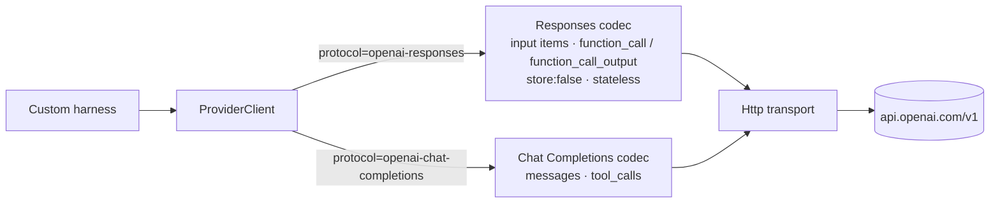

# SPEC-207 — OpenAI API (Responses and Chat Completions)

> All "Confirmed" statements were checked against the cited official documentation on 2026-10-14.
> Source keys ([O1] …) are listed in §14. The shared connection model, URL policy, retry policy and
> error codes are in [SPEC-211](2026-10-14-integration-custom-model-providers.md).

## 1. Purpose

This spec covers the `openai` provider type: direct access to OpenAI models through
`https://api.openai.com/v1`. Its users are the future custom coding harness
([SPEC-110 §19](2026-10-14-benchmark-execution.md#19-future-extensions)) and a future `llm-judge`.

It is **not** the Codex integration. Running the Codex CLI is an agent harness
([SPEC-204](2026-10-14-integration-openai-codex.md), [ADR-0006](../decisions/0006-agent-adapters-vs-model-providers.md)).

The OpenAI wire formats are also the basis of the `openai-chat-completions` and `openai-responses`
codecs used by DeepSeek, Z.AI, Kimi and custom endpoints. The **OpenAI-specific** behaviour described
here (storage defaults, hosted tools, strict mode, error types) must not be assumed for those vendors.

## 2. Official integration options

| Option | Status for DirectiveBench | Evidence |
|---|---|---|
| Responses API `POST /v1/responses` | **Default protocol** (`openai-responses`). OpenAI states it is "recommended for all new projects". | Confirmed ([O1], 2026-10-14) |
| Chat Completions `POST /v1/chat/completions` | Supported (`openai-chat-completions`). "Chat Completions remains supported". | Confirmed ([O1], 2026-10-14) |
| Models `GET /v1/models` | Validation and discovery | Confirmed ([O2], 2026-10-14) |
| Assistants API | **Not used.** Officially sunset on 2026-08-26 and no longer available. | Confirmed ([O1], 2026-10-14) |
| Hosted built-in tools of Responses (web search, file search, code interpreter, computer use, remote MCP, …) | **Not used.** The harness exposes only its own function tools, so that workspace isolation and traces stay under DirectiveBench control. | Existence confirmed ([O1], 2026-10-14) |
| Official SDKs | Optional. If used, SDK retries must be disabled or counted. OpenAI advises this when retries are managed by the caller. | Confirmed ([O3], 2026-10-14) |

## 3. Authentication methods

| Method | Header | Status |
|---|---|---|
| API key | `Authorization: Bearer <key>` | Confirmed ([O4], 2026-10-14) |
| Short-lived token via workload identity federation | `Authorization: Bearer <token>` | Exists: Confirmed ([O4], 2026-10-14). Not supported in v1. |
| Organization / project selection | `OpenAI-Organization`, `OpenAI-Project` headers (usage is attributed to them) | Confirmed ([O4], 2026-10-14) |
| ChatGPT subscription login | **Not a provider auth method.** Relevant only to the Codex CLI ([SPEC-204](2026-10-14-integration-openai-codex.md)). | — |

The key is stored per [ADR-0008](../decisions/0008-secret-storage-and-authentication.md).
`OpenAI-Organization` and `OpenAI-Project` are non-secret connection headers. Prefix patterns for
OpenAI keys used by redaction are an Assumption — requires validation. Redaction of the known value
does not depend on them.

## 4. Capability requirements

| Capability | OpenAI | Evidence |
|---|---|---|
| Function calling (Responses) | `function_call` output items with `call_id`, `name`, JSON `arguments`. The caller returns `function_call_output` with the same `call_id`. For reasoning models, reasoning items are passed back with the tool outputs. | Confirmed ([O5], 2026-10-14) |
| Strict tool schemas | Responses tries strict mode unless `strict: false`. Strict mode requires `additionalProperties: false` and all properties `required`. Chat Completions is non-strict by default. | Confirmed ([O1], [O5], 2026-10-14) |
| Parallel tool calls | Several calls per turn by default. `parallel_tool_calls: false` limits it to zero or one. | Confirmed ([O5], 2026-10-14) |
| Structured output | Responses: `text.format` `{type: "json_schema", strict: true, schema}`. Chat Completions: `response_format` (only some model snapshots). | Confirmed ([O6], 2026-10-14) |
| Streaming | Supported (SSE). Event schema details: Assumption — requires validation when the codec is built. | Partially confirmed |
| Context window / max output / capabilities | **Not** exposed by `GET /v1/models`. Its fields are `id`, `object`, `created`, `owned_by`, `shutdown_date`. | Confirmed ([O2], 2026-10-14) |
| Usage | Reported per response. Exact Responses field names (input/output/cached/reasoning tokens): Assumption — requires validation from the API reference. | Assumption |

Because the Models API has no capability data, OpenAI model capabilities come from a curated
`vendor-docs` table (with URLs and dates) or from the user. They are `unknown` otherwise
([SPEC-211 §4](2026-10-14-integration-custom-model-providers.md#4-capability-requirements)). `shutdown_date` is surfaced
as a deprecation warning.

## 5. Architecture

Vendor profile `openai` with two codecs ([SPEC-211 §5](2026-10-14-integration-custom-model-providers.md#5-architecture)).
A connection selects exactly one protocol, because results from the two APIs are not comparable
(different tool-calling defaults and state handling).

Responses codec rules:

- **Stateless use.** Every request sends the full input history. `previous_response_id` and
  `conversation` are not used, so runs do not depend on server-side state and work the same against
  stateless compatible vendors.
- **`store: false`** on every request. Responses are stored by default unless `store: false` is set:
  Confirmed ([O1], 2026-10-14). Reasoning items needed across turns are passed back as returned. The
  `include` option for encrypted reasoning content with `store: false` is an Assumption — requires
  validation.
- Only `type: "function"` tools are sent. Hosted tools are never enabled.
- `strict` is set explicitly per tool (`true` when the schema satisfies the strict-mode rules),
  rather than relying on the default.

## 6. Relevant API or CLI interfaces

| Interface | Use | Evidence |
|---|---|---|
| `POST https://api.openai.com/v1/responses` | Generation (default) | Confirmed ([O7], [O1]) |
| `POST https://api.openai.com/v1/chat/completions` | Generation (alternative) | Confirmed ([O1]) |
| `GET https://api.openai.com/v1/models` | Validation and discovery | Confirmed ([O2]) |
| Response headers `x-request-id`, `openai-processing-ms`, `openai-version` (`2020-10-01`), `openai-organization` | `x-request-id` is stored in the trace | Confirmed ([O4]) |
| Rate-limit headers `x-ratelimit-{limit,remaining,reset}-{requests,tokens}`, `x-ratelimit-*-project-tokens`, `Retry-After` | `RateLimitSnapshot` | Confirmed ([O3], [O4]) |

Versioning: the REST API is `v1`. OpenAI avoids breaking changes within major versions, but "model
behavior can change between snapshots" and recommends pinned model versions: Confirmed ([O4],
2026-10-14). DirectiveBench therefore prefers dated snapshot ids in benchmark definitions and shows a
warning when an alias is used. Which ids are aliases is not machine-readable from `GET /v1/models`
(Assumption — the user must decide).

## 7. Configuration

| Field | Default |
|---|---|
| `providerType` | `openai` |
| `protocol` | `openai-responses` (alternative: `openai-chat-completions`) |
| `baseUrl` | `https://api.openai.com/v1` |
| `auth` | `bearer`, `secretRef` (keychain, or env such as `OPENAI_API_KEY`) |
| `headers` | Optional `OpenAI-Organization`, `OpenAI-Project` |
| `validation.method` | `list-models` |

## 8. Security concerns

All controls in [SPEC-211 §8](2026-10-14-integration-custom-model-providers.md#8-security-concerns) apply. OpenAI-specific notes:

- **Server-side storage**: `store: false` is mandatory in the profile (see §5), so benchmark prompts
  and fixture content are not retained as stored responses. This does not change OpenAI's general
  data-retention policies, which DirectiveBench cannot control. The UI links to the provider's terms.
- OpenAI says API keys must stay server-side and never appear in client-side code ([O4]). In
  DirectiveBench, keys are resolved only in the Node process that calls the API (runner or web
  server action), and never sent to the browser.
- Hosted tools stay disabled, so the model cannot browse or execute code outside the controlled
  workspace.

## 9. Error handling

| Status / type | Mapping ([SPEC-211 §9](2026-10-14-integration-custom-model-providers.md#9-error-handling)) | Evidence |
|---|---|---|
| 401 "Invalid Authentication" / "Incorrect API key provided" | `auth-invalid` | Confirmed ([O8]) |
| 403 "Country, region, or territory not supported" | `auth-invalid`, with a region hint | Confirmed ([O8]) |
| 429 rate limit reached | `rate-limited`. `Retry-After` is the minimum wait; otherwise exponential backoff with jitter. | Confirmed ([O3], [O8]) |
| 429 `insufficient_quota` (`error.code` such as `credit_balance_exhausted`, `organization_spend_limit_exceeded`, `project_spend_limit_exceeded`, `organization_usage_limit_exceeded`) | `billing`, **no retry** ("Retrying billing, spend, or quota errors won't restore API access") | Confirmed ([O8]) |
| 429 `slow_down` | `rate-limited`, with reduced concurrency for the rest of the run | Confirmed ([O8]) |
| 500 | `server-error` | Confirmed ([O8]) |
| 503 `server_is_overloaded` | `overloaded` | Confirmed ([O8]) |

Failed requests still count toward per-minute limits, so retries are capped in attempts and total
time ([O3]).

## 10. Compatibility restrictions

- Rate limits are set per organisation and project (not per user), vary by model, and some model
  families share a limit. Dimensions are RPM, RPD, TPM, TPD (plus IPM and audio for other
  modalities). Usage tiers rise with credit purchases: Confirmed ([O3], 2026-10-14).
- Responses and Chat Completions differ in tool-call shape, strict-mode defaults and storage
  defaults ([O1]). They are separate protocols in the comparability key.
- Chat Completions `response_format` json_schema works only on some model snapshots ([O6]).
- Behaviour of OpenAI-compatible third-party endpoints does **not** follow from this spec. For
  example, Anthropic's compatibility layer ignores `strict` and `response_format`, and DeepSeek's
  Responses endpoint is stateless and ignores built-in tools
  ([SPEC-211 §10](2026-10-14-integration-custom-model-providers.md#10-compatibility-restrictions)).

## 11. Test strategy

- Recorded fixtures for: `GET /v1/models`; a Responses turn with `function_call` →
  `function_call_output` round trip and parallel calls; a streaming response; a Chat Completions tool
  call; and each §9 error, including the three 429 variants (rate limit, `insufficient_quota`,
  `slow_down`).
- Codec unit tests: `store: false` is always present, no `previous_response_id` is sent, no hosted
  tool types are sent, and strict schemas are built correctly (`additionalProperties: false`, all
  properties required, optional fields as nullable).
- Opt-in live test (`DIRECTIVEBENCH_LIVE_TESTS=1` and `OPENAI_API_KEY`): list models, then one
  minimal Responses request with a tiny `max_output_tokens`. Structural assertions only. Never in
  default CI.

## 12. Acceptance criteria

- [ ] AC-1: An `openai` connection validates with `GET /v1/models` and lists model ids. Capability
  fields not covered by the curated table show `unknown`.
- [ ] AC-2: Every Responses request sent by DirectiveBench contains `store: false` and only function
  tools.
- [ ] AC-3: `insufficient_quota` is classified `billing` and not retried. A rate-limit 429 honours
  `Retry-After`.
- [ ] AC-4: Runs record protocol (`openai-responses` vs `openai-chat-completions`), requested and
  reported model, and `x-request-id`. Runs with different protocols are never aggregated.
- [ ] AC-5: The API key never appears in persisted traces, logs, reports, error messages or browser
  responses.

## 13. Current implementation status

- **Implemented in bootstrap:** nothing.
- **Partially implemented:** none.
- **Not implemented:** the vendor profile, both codecs, validation, model discovery, secret storage,
  the harness, and the Model Providers UI (placeholder page only).

## 14. Sources

[O1]: https://developers.openai.com/api/docs/guides/migrate-to-responses
[O2]: https://developers.openai.com/api/reference/resources/models/methods/list
[O3]: https://developers.openai.com/api/docs/guides/rate-limits
[O4]: https://developers.openai.com/api/reference/overview
[O5]: https://developers.openai.com/api/docs/guides/function-calling
[O6]: https://developers.openai.com/api/docs/guides/structured-outputs
[O7]: https://developers.openai.com/api/reference/resources/responses/methods/create
[O8]: https://developers.openai.com/api/docs/guides/error-codes

- [O1] Migrate to the Responses API — https://developers.openai.com/api/docs/guides/migrate-to-responses
- [O2] List models — https://developers.openai.com/api/reference/resources/models/methods/list
- [O3] Rate limits — https://developers.openai.com/api/docs/guides/rate-limits
- [O4] API reference overview — https://developers.openai.com/api/reference/overview
- [O5] Function calling — https://developers.openai.com/api/docs/guides/function-calling
- [O6] Structured outputs — https://developers.openai.com/api/docs/guides/structured-outputs
- [O7] Create a response — https://developers.openai.com/api/reference/resources/responses/methods/create (endpoint path only reviewed; full parameter list not reviewed)
- [O8] Error codes — https://developers.openai.com/api/docs/guides/error-codes
