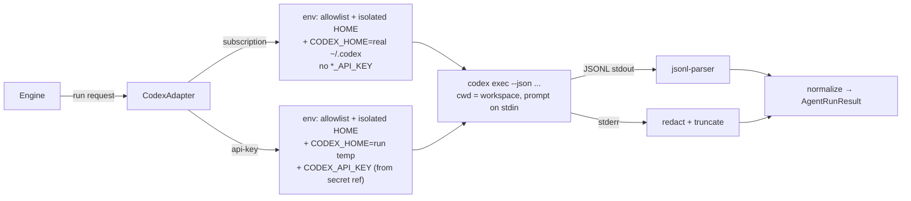

# SPEC-204 — OpenAI Codex CLI agent adapter

## 1. Purpose

Let DirectiveBench run benchmark cases with the **OpenAI Codex CLI** (binary `codex`) as an agent harness. The adapter measures how an installed artifact (Agent Skill, `AGENTS.md`) changes Codex's behaviour in RED/GREEN runs ([SPEC-112](2026-10-14-red-green-evaluation.md)).

The adapter implements `AgentAdapter` (`packages/agent-adapters/src/contract.ts`; [SPEC-110 §8](2026-10-14-benchmark-execution.md), [ADR-0006](../decisions/0006-agent-adapters-vs-model-providers.md)) with adapter id `codex` (as in the bootstrap detection descriptor). Calling the OpenAI API directly is a model-provider concern ([SPEC-207](2026-10-14-integration-openai-api.md)). Contract extensions shared by all real CLI adapters are listed in [SPEC-203 §4.2](2026-10-14-integration-claude-code.md#42-contract-mapping-and-required-extensions) and are not repeated here.

Out of scope: interactive TUI, Codex cloud tasks (`codex cloud`), `codex review`, app-server/remote-control, `codex apply`.

### Evidence labels

**Confirmed (source, date)** = official docs or a read-only local `--help`/`--version`. **Assumption — requires validation** = not verified.

The canonical `developers.openai.com/codex/...` URLs below returned HTTP 308 redirects to `learn.chatgpt.com/docs/...` on 2026-10-14. Content was read at the redirect target.

| Key | Source (all checked 2026-10-14) |
| --- | --- |
| O1 | https://developers.openai.com/codex/noninteractive (→ https://learn.chatgpt.com/docs/non-interactive-mode) |
| O2 | https://developers.openai.com/codex/auth (→ https://learn.chatgpt.com/docs/auth) |
| O3 | https://developers.openai.com/codex/skills (→ https://learn.chatgpt.com/docs/build-skills) |
| O4 | https://developers.openai.com/codex/guides/agents-md (→ https://learn.chatgpt.com/docs/agent-configuration/agents-md) |
| O5 | https://learn.chatgpt.com/docs/sandboxing |
| O6 | https://developers.openai.com/codex/config-reference (→ https://learn.chatgpt.com/docs/config-file/config-reference) |
| O7 | https://developers.openai.com/codex/sdk (→ https://learn.chatgpt.com/docs/codex-sdk) and https://github.com/openai/codex/tree/main/sdk/typescript |
| L2 | Local `codex --version` → `codex-cli 0.162.1`; `codex --help`, `codex exec --help`, `codex login --help`, `codex login status --help`, `codex sandbox --help` (Linux, 2026-10-14) |

## 2. Official integration options

| Option | Description | Status | Use |
| --- | --- | --- | --- |
| **`codex exec`** (alias `e`) | Non-interactive run. Progress goes to stderr and the final agent message to stdout. `--json` turns stdout into JSONL events. | Confirmed (O1, L2) | **Primary.** |
| **Codex SDK (TypeScript)** `@openai/codex-sdk` | "Wraps the `codex` CLI … spawns the CLI and exchanges JSONL events over stdin/stdout". API: `new Codex()`, `startThread({ workingDirectory, skipGitRepoCheck })`, `thread.run()`, `thread.runStreamed()`, `outputSchema`, `resumeThread()`; client options `env`, `config`, `configOverrides`, `baseUrl`. | Confirmed (O7) | Not used initially. It adds a dependency, and cancellation support is not documented (Assumption — requires validation). Revisit if the JSONL contract proves unstable. |
| Codex SDK (Python) | Controls the local Codex app-server over JSON-RPC. | Confirmed (O7) | Not used (Node project). |
| `codex app-server`, `exec-server` | Experimental. | Confirmed as experimental (L2) | Not used. |

## 3. Authentication methods

### 3.1 What Codex supports

Confirmed (O1, O2, L2, 2026-10-14):

- **ChatGPT sign-in** (`codex login`; `--device-auth` for headless, which must be enabled in ChatGPT settings). It uses ChatGPT plan/workspace permissions.
- **API key**: `printenv OPENAI_API_KEY | codex login --with-api-key` (stored login). For `codex exec`, the docs show `CODEX_API_KEY` set **inline for a single invocation**, and warn against setting `OPENAI_API_KEY`/`CODEX_API_KEY` as a job-level variable in workflows that run repository-controlled code.
- **Access token**: `codex login --with-access-token` (reads `CODEX_ACCESS_TOKEN` from stdin).
- Storage: `$CODEX_HOME/auth.json` (default `~/.codex`; the docs call it "a plaintext file") or the OS credential store, selected by `cli_auth_credentials_store = file | keyring | auto | ephemeral`.
- Admin restrictions: `forced_login_method`, `forced_chatgpt_workspace_id`.
- `codex exec` reuses the saved CLI auth by default. The docs also describe ChatGPT-managed auth on trusted runners, and advise against it for public or open-source repositories.

### 3.2 Local Subscription Mode (ChatGPT sign-in)

- DirectiveBench spawns the user's logged-in `codex` and never reads, copies or uploads `auth.json`, keyring entries or tokens. The docs themselves describe copying `auth.json` to another machine as a fallback. **DirectiveBench must never do this or suggest it.** No cookie extraction.
- Environment: `HOME` stays **isolated** (run temp dir, per FR-110-42). `CODEX_HOME` is set to the user's real Codex home (default `~/.codex`) as a declared adapter env addition, so the CLI finds its own login. `--ignore-user-config` is passed: it skips `$CODEX_HOME/config.toml` while "auth still uses `CODEX_HOME`" (Confirmed, L2). This keeps user-level skills (`$HOME/.agents/skills`) and user config out of the run.
- Remaining ambient inputs: global `AGENTS.md`/`AGENTS.override.md` in `CODEX_HOME` (O4). Whether `--ignore-user-config` skips them: **Assumption — requires validation**. The adapter only checks whether those two files exist (`stat`, never reads `auth.json`). If they exist, it records warning `ambient-global-agents-md`.
- If the user's login uses the OS keyring, the keyring may need session variables (e.g. a D-Bus address on Linux) that the allowlist strips: **Assumption — requires validation**. Readiness is always checked with the exact env the run will use. If the check fails there but not in the user's shell, the UI explains the conflict instead of silently widening the env.
- `OPENAI_API_KEY`, `CODEX_API_KEY` and `CODEX_ACCESS_TOKEN` are removed from the agent env, so the run cannot silently switch to API billing.
- Readiness: `codex login status` (Confirmed that the command exists, L2). Output format and whether it contacts the network: **Assumption — requires validation**. Raw output is never persisted.
- Terms: whether automated benchmarking under a ChatGPT plan is permitted beyond the documented "trusted runner" use: **Assumption — requires validation (terms review)**. The UI shows that runs consume the user's plan limits.
- Subscription credentials are never uploaded to a shared server ([ADR-0009](../decisions/0009-self-hosted-readiness.md)).

### 3.3 API Key Mode

- Secret resolved from a secret reference ([ADR-0008](../decisions/0008-secret-storage-and-authentication.md)) and injected **only** into the `codex exec` process as `CODEX_API_KEY` (Confirmed for exec, O1). `HOME` **and** `CODEX_HOME` point to the run temp dir, so no user config, global `AGENTS.md`, user skills or saved login are visible.
- `codex login --with-api-key` is **not** used, because it would persist the key in `auth.json`.
- Whether `-c cli_auth_credentials_store="ephemeral"` is needed so that nothing is written to the temp `CODEX_HOME`: **Assumption — requires validation**.
- **Custom/compatible providers**: `model_providers.<id>` with `base_url`, `env_key`, `wire_api` (only `responses` is supported). These can only be set in the **user-level** config, not in project `.codex/config.toml` (Confirmed, O6). With an isolated `CODEX_HOME`, DirectiveBench would generate a minimal temp `config.toml` (or pass `-c` overrides, but whether `-c` may set `model_providers`: **Assumption — requires validation**). Because only the Responses wire API is supported, whether third-party endpoints (DeepSeek, GLM, Kimi; [SPEC-211](2026-10-14-integration-custom-model-providers.md)) work: **Assumption — requires validation**. Not in the first implementation.
- `--oss` with `--local-provider lmstudio|ollama` exists (Confirmed, L2). Not in the first implementation.

## 4. Capability requirements

| Capability | Mechanism | Evidence |
| --- | --- | --- |
| **Detection** | `codex` on `PATH`. Installs may be standalone (e.g. under `~/.codex/packages/standalone/…` on the test machine) or npm `@openai/codex` (O7). Detection must not assume npm. | Confirmed (L2, O7) |
| **Version** | `codex --version` / `-V` → `codex-cli 0.162.1`; parse `^codex-cli\s+(\S+)`. | Confirmed (L2) |
| **Auth readiness** | `codex login status` (subscription); secret ref resolves (API key). | Command: Confirmed (L2). Output: Assumption |
| **Execution modes** | `codex exec [OPTIONS] [PROMPT]`. The prompt is read from stdin when omitted or `-`. | Confirmed (L2) |
| **Model selection** | `-m, --model <MODEL>`. The model must be available to the account (O6). The model actually used: field in JSONL events is **Assumption — requires validation**. If it is not reported, record the requested model with warning `model-not-reported`. | Flag: Confirmed (L2, O6) |
| **Tool permissions / sandbox** | `-s, --sandbox read-only\|workspace-write\|danger-full-access`. The `exec` default is read-only. Approval policy via `-c approval_policy="never"` (values `on-request`, `never`, granular; `untrusted` unsupported, `on-failure` deprecated; `never` recommended for non-interactive runs). `exec --help` shows no `-a` flag. | Confirmed (O1, O5, O6, L2) |
| **Working directory** | Spawn with `cwd` = workspace, plus `-C <workspace>` (explicit working root) and `--skip-git-repo-check` (workspaces are not git repos). No `--add-dir`, no `--worktree`. | Confirmed (L2, O1) |
| **Instructions/skills injection** | Workspace files per §4.1. Discovery is native. | Confirmed (O3, O4) |
| **Cancellation** | SIGINT → grace 5 s → SIGTERM → 5 s → SIGKILL to the process group. How Codex handles each signal and whether sandboxed children are cleaned up: **Assumption — requires validation**. | Assumption |
| **Timeouts** | Enforced by DirectiveBench. No documented per-run turn/time limit flag. | — |
| **Structured output** | `--json` → JSONL: `thread.started` (`thread_id`), `turn.started`, `turn.completed` (`usage`), `turn.failed`, `item.started`/`item.updated`/`item.completed` (`item.*`), `error`. Item `type` values confirmed: `command_execution` (`command`, `status`), `agent_message`. Item categories documented: reasoning, file changes, MCP tool calls, web searches, plan updates; their exact type names (`reasoning`, `file_change`, `mcp_tool_call`, `web_search`, `todo_list`) and fields (`exit_code`, `aggregated_output`, `changes`): **Assumption — requires validation**. `-o, --output-last-message <FILE>` writes the final message to a file. | Confirmed (O1, L2) |
| **Traces** | Map item events to `tool-call`/`tool-result`/`message` trace events (SPEC-203 §4.2). Command output is truncated and redacted. | Depends on above |
| **File modification tracking** | Authoritative: the DirectiveBench manifest diff. Supplementary: file-change items. | SPEC-110 |
| **Error normalization** | Exit code, `turn.failed`, `error` events, stderr. See §9. | Event names: Confirmed (O1). Payload fields: Assumption |
| **Usage reporting** | `turn.completed.usage`: `input_tokens`, `cached_input_tokens`, `output_tokens`, `reasoning_output_tokens`. Summed over turns. **No cost** is reported, so `costUsd` stays unset. | Confirmed (O1) |
| **Session hygiene** | `--ephemeral` (no session rollout files on disk). | Confirmed (O1, L2) |

Declared `AgentCapabilities` once implemented: `execution: true`, `headless: true`, `modelSelection: true`, `artifactInstallation: true`, `structuredOutput: true`, `usageReporting: true` (tokens only), `deterministic: false`.

### 4.1 Artifact install convention (candidate only)

| Format | Installed at | Evidence |
| --- | --- | --- |
| `skill-md` | `.agents/skills/<slug>/SKILL.md` (+ supporting files). This is the same path as the Mock Agent. | Confirmed: repo skills are scanned at `$CWD/.agents/skills` (O3, 2026-10-14). `SKILL.md` requires `name` and `description` (O3) |
| `agents-md` | `./AGENTS.md`. Append if the fixture already has one (same rule as the Mock Agent and SPEC-203). | Confirmed: project scope reads `AGENTS.override.md`, then `AGENTS.md`, at most one file per directory, from the project root (git root) down to cwd. If there is no project root, only cwd (O4) |
| other formats (`claude-md`, `cursor-rule`, …) | Not installable → run rejected before execution. | DirectiveBench rule |

Rules and warnings:

- If the fixture contains `AGENTS.override.md`, it shadows `AGENTS.md` in that directory (O4). The adapter records warning `agents-override-present`, because an installed `AGENTS.md` would be ignored there.
- Combined project docs are capped by `project_doc_max_bytes` (default 32 KiB per O4). If fixture + artifact instructions exceed the cap, record warning `agents-md-truncated`.
- Admin skills (`/etc/codex/skills`) and system skills bundled with Codex are always visible (O3). If `/etc/codex/skills` exists, record warning `admin-skills-present`. Bundled system skills are an inherent part of the measured Codex version.

## 5. Architecture

Code location (future): `packages/agent-adapters/src/codex/` (`argv.ts`, `env.ts`, `install.ts`, `jsonl-parser.ts`, `normalize.ts`), same structure as [SPEC-203 §5](2026-10-14-integration-claude-code.md#5-architecture).



Recorded metadata: adapter version, auth mode, isolation profile, sandbox mode, approval policy, requested and reported model, flags hash. All of these are part of the comparability key ([ADR-0006](../decisions/0006-agent-adapters-vs-model-providers.md)).

## 6. Relevant API or CLI interfaces

Canonical invocation:

```text
codex exec
  --json
  --sandbox workspace-write
  -c approval_policy="never"
  -c sandbox_workspace_write.network_access=false
  -C <workspace> --skip-git-repo-check
  --ephemeral --ignore-rules --color never
  [--ignore-user-config]                  # Local Subscription Mode
  [-m <model>]
  -                                       # prompt from stdin
```

| Interface | Notes | Evidence |
| --- | --- | --- |
| `--sandbox workspace-write` | Edits inside the workspace and runs routine local commands. Linux uses `bwrap` (first on `PATH`, else a bundled helper that needs unprivileged user namespaces). macOS uses Seatbelt. Windows has a native sandbox. | Confirmed (O5, L2) |
| `sandbox_workspace_write.network_access` | Boolean. Set explicitly to `false` (the default is not documented). `writable_roots` is not used. | Key: Confirmed (O6). Default: Assumption |
| `--dangerously-bypass-approvals-and-sandbox`, `danger-full-access`, `--dangerously-bypass-hook-trust`, `--approve-for-me` | **Forbidden.** The adapter rejects them. | Flags: Confirmed (L2) |
| `--ignore-rules` | Skips user and project execpolicy `.rules` files, so a fixture cannot pre-approve commands. | Confirmed (O1, L2) |
| `--ignore-user-config` | Skips `$CODEX_HOME/config.toml`. Auth still uses `CODEX_HOME`. | Confirmed (L2) |
| `--strict-config` | Errors on unknown config keys. Used only with a DirectiveBench-generated config. | Confirmed (L2) |
| `-c key=value` | TOML-parsed override of `~/.codex/config.toml` keys. | Confirmed (L2) |
| `shell_environment_policy.inherit = all\|core\|none`, `.filters` | Controls the env of commands the agent spawns. Set `-c shell_environment_policy.inherit="core"` so `CODEX_API_KEY` is not passed to agent shell commands. Whether `core` already excludes it, and the exact `filters` syntax: **Assumption — requires validation**. | Keys: Confirmed (O6) |
| `--output-schema <FILE>` | JSON Schema for the final message. Not used. | Confirmed (O1, L2) |
| `codex exec resume` | Not used (each run is fresh). | Confirmed (O1) |
| Project `.codex/config.toml` | Can exist in a fixture. It cannot set `model_provider(s)` (O6). Which other keys it may set (sandbox, approval): **Assumption — requires validation**. Fixture import flags it, and CLI flags given by the adapter are expected to win (Assumption). | Partially confirmed |
| MCP | An enabled MCP server with `required = true` that fails to start makes the run exit with an error (O1). With an isolated `CODEX_HOME` no user MCP servers exist. | Confirmed (O1) |

## 7. Configuration

| Setting | Values | Default |
| --- | --- | --- |
| `binaryPath` | override | auto (`PATH`) |
| `authMode` | `subscription` \| `api-key` | must be chosen explicitly |
| `secretRef` | reference for `CODEX_API_KEY` | — |
| `codexHome` | Path of the user's Codex home for subscription mode | `$CODEX_HOME` of the DirectiveBench process, else `~/.codex` |
| `sandboxMode` | `workspace-write` (default), `read-only` (for "analysis only" suites) | `workspace-write` |
| `networkAccess` | `false` \| `true` (only for execution-approved suites that need it) | `false` |
| `minimumVersion` | semver | unset (tested 0.162.1). Minimum to be determined: **Assumption — requires validation** |

Benchmark `execution.model` `{provider: "openai", model}` → `-m`. Other providers are rejected until §3.3 custom providers are validated.

## 8. Security concerns

See [SPEC-007](2026-10-14-security-and-privacy.md), [ADR-0007](../decisions/0007-local-runner-execution-and-isolation.md).

- **Agent sandbox ≠ DirectiveBench sandbox.** `workspace-write` is a real OS-level sandbox for commands Codex runs (O5). The DirectiveBench environment is still `local-process` and recorded as `sandboxed: false`. Additionally record `agentSandbox: "workspace-write"`. If the sandbox cannot be created (e.g. missing user namespaces), the run must fail (`agent-sandbox-unavailable`) and must **never** fall back to `danger-full-access`.
- **Ambient instructions.** Isolated `HOME` excludes `$HOME/.agents/skills`. Global `AGENTS.md` in `CODEX_HOME` is only possible in subscription mode (warning). `/etc/codex/skills` and bundled system skills cannot be excluded (warning / documented).
- **HOME isolation vs auth.** Codex keeps auth under `CODEX_HOME`, separate from `HOME`. Subscription mode can therefore keep `HOME` isolated and expose only `CODEX_HOME`. This is less leakage than [SPEC-203](2026-10-14-integration-claude-code.md), but the user's whole Codex home (sessions, logs) is still reachable by the agent process.
- **Repository-controlled code.** Fixture `.codex/config.toml`, `.rules` (ignored via `--ignore-rules`) and hooks (trust required; the bypass flag is forbidden) are flagged at fixture import and require suite execution approval.
- **Secrets.** `CODEX_API_KEY` only in the exec process env (as OpenAI recommends: per invocation, not job-level). It is never in argv, never written to `auth.json`, and redacted from stdout/stderr/trace. Agent shell env is restricted via `shell_environment_policy`.
- **Network.** Codex itself needs its API endpoint. Command network inside the sandbox is disabled by default (`network_access=false`). Web search is not enabled (`--search` is never passed).
- **Data leaving the machine.** Prompt, files read and artifact content go to OpenAI under the account's data settings (O2). The UI states this.

## 9. Error handling

| Condition | Detection | Status | Code |
| --- | --- | --- | --- |
| Binary missing / version unparsable | detection | rejected before enqueue | `binary-not-found` / `version-unsupported` |
| Not logged in / wrong login method | `login status`; non-zero exit; stderr | `agent-error` | `auth-missing` |
| Forced-login mismatch ("Codex logs the user out and exits", O2) | exit + stderr | `agent-error` | `auth-policy-mismatch` |
| Not a git repo | should not occur (`--skip-git-repo-check`); stderr match | `agent-error` | `cli-usage-error` |
| Unknown flag / config key (version drift) | non-zero exit before any event | `agent-error` | `cli-usage-error` |
| Required MCP server failed | exit + stderr (O1) | `agent-error` | `mcp-startup-failed` |
| Sandbox unavailable | stderr pattern: **Assumption — requires validation** | `agent-error` | `agent-sandbox-unavailable` |
| `turn.failed` / `error` event | JSONL | `agent-error` | `agent-failed`. Rate limit, quota, auth and model errors are sub-classified from the message once payloads are recorded (Assumption) |
| No terminal event / malformed JSONL | parser | `agent-error` | `output-parse-error` |
| Timeout / cancel | DirectiveBench | `timeout` / `cancelled` | — |
| Spawn failure | spawn error | `infrastructure-error` | `spawn-failed` |

A run is `completed` when the process exits 0 and the stream contains `turn.completed`. Commands that the sandbox or policy rejected are recorded as trace events, not errors.

## 10. Compatibility restrictions

- Tested with `codex-cli 0.162.1` on Linux (L2). macOS (Seatbelt) is expected to work (O5). Windows native sandbox exists (O5), but the DirectiveBench Windows process-tree kill is an Assumption — requires validation.
- Linux sandbox requires `bwrap` or unprivileged user namespaces (O5). Hardened hosts and containers may lack them.
- Plans: ChatGPT sign-in uses plan/workspace permissions and limits. API key uses standard API pricing (O2). `forced_login_method` set by an admin may block one mode.
- `approval_policy = "untrusted"` is no longer supported. `on-failure` is deprecated (O5, O6). `--full-auto` was removed (O1). Do not use any of them.
- The CLI evolves fast (flags removed in recent versions). The adapter pins a tested version range, and the drift check (§11) is mandatory before bumping it.

## 11. Test strategy

Per [SPEC-012](2026-10-14-testing-strategy.md). No paid or authenticated calls in CI.

- **Unit:** argv builder snapshots (assert `--json`, `--sandbox workspace-write`, `approval_policy="never"`, `--skip-git-repo-check`, `--ephemeral`, `--ignore-rules`; forbidden flags absent; no secret in argv). Env builder per mode (API key: temp `CODEX_HOME`, `CODEX_API_KEY` present. Subscription: real `CODEX_HOME`, no `*_API_KEY`/`CODEX_ACCESS_TOKEN`). Version parser for `codex-cli 0.162.1`.
- **Contract tests with recorded fixtures:** redacted JSONL captured from manual live runs per CLI version in `packages/agent-adapters/test/fixtures/codex/<version>/`: success with file changes, command execution, `turn.failed`, `error` event, truncated stream. The first recorded fixtures resolve the Assumptions in §4 (item type names and fields).
- **Fake CLI:** a Node script named `codex` on a test `PATH` emulating `--version`, `login status` and `exec --json` streams, plus hang modes for timeout and cancellation.
- **Opt-in live tests:** `DIRECTIVEBENCH_LIVE_TESTS=codex`, run manually only, with a tiny fixture. They refresh fixtures after redaction review.
- **Drift check:** parse `codex exec --help` (read-only) and assert that every flag the adapter uses exists and no forbidden flag is in the argv builder.

## 12. Acceptance criteria

- [ ] AC-1: Detection reports path and parsed version (`0.162.1` from `codex-cli 0.162.1`), or `installed: false`.
- [ ] AC-2: Readiness uses `codex login status` under the run env, never reads `auth.json`, and never persists raw output.
- [ ] AC-3: API Key Mode: the agent process has isolated `HOME` and `CODEX_HOME` and receives `CODEX_API_KEY` only via env. Tests prove the key is absent from argv, DB, logs, traces and the temp `CODEX_HOME` after the run.
- [ ] AC-4: Subscription mode: `HOME` isolated, `CODEX_HOME` = the user's Codex home, `--ignore-user-config` passed, no API key variables. Warnings are recorded for a global `AGENTS.md` and for `/etc/codex/skills`.
- [ ] AC-5: The candidate `skill-md` is installed at `.agents/skills/<slug>/` and `agents-md` at `AGENTS.md`. Incompatible formats are rejected before execution.
- [ ] AC-6: Argv always contains `--sandbox workspace-write` (or `read-only`) and `approval_policy="never"`. Dangerous flags are rejected at configuration validation.
- [ ] AC-7: Recorded JSONL fixtures are parsed into trace events and summed token usage. `costUsd` stays unset.
- [ ] AC-8: Timeout and cancellation kill the process group within 10 s (fake CLI test).
- [ ] AC-9: Error fixtures map to the codes in §9. A missing terminal event yields `output-parse-error`.

## 13. Current implementation status

- **Implemented in bootstrap** (code in `packages/agent-adapters/src/detection.ts`; the missing-executable path is verified by `mock.test.ts` "detectCliAgent"; detection of an installed `codex` is not covered by a test): detection descriptor `id: 'codex'`, executable `codex`, `--version`, first output line stored, `auth: 'unknown'`, no credential files read.
- **Partially implemented:** version parsing (the raw line is stored; semver extraction is not).
- **Not implemented:** readiness check, artifact installation, execution, JSONL parsing, usage, error normalization, secret handling (blocked on [ADR-0008](../decisions/0008-secret-storage-and-authentication.md)), custom providers / `--oss`, Codex SDK option, terms review (§3.2).
