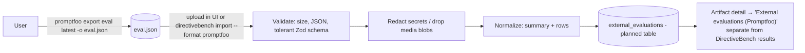

# SPEC-212 — Promptfoo bridge (optional)

## 1. Purpose

[Promptfoo](https://github.com/promptfoo/promptfoo) is an open-source CLI and library for evaluating and red-teaming LLM applications. Many teams already keep prompt and agent evaluations in it. This spec defines an **optional, non-core bridge** with two goals:

1. Users can **bring existing Promptfoo results** into DirectiveBench as clearly separated *external evidence* attached to artifacts.
2. Later, users can **export** DirectiveBench data in a form Promptfoo can read.

The bridge is not an agent adapter and not a benchmark engine. DirectiveBench keeps its own engine, scoring and RED/GREEN semantics ([ADR-0005](../decisions/0005-custom-benchmark-engine.md), [SPEC-107](2026-10-14-benchmark-engine.md), [SPEC-111](2026-10-14-benchmark-scoring.md)). Nothing in DirectiveBench requires Promptfoo to be installed.

Non-goals: using Promptfoo as the execution engine; Promptfoo Cloud, sharing or account features; red-teaming; bundling the `promptfoo` npm package.

### Evidence labels

**Confirmed (source, date)** = official docs/repository. **Assumption — requires validation** = not verified.

| Key | Source (all checked 2026-10-14) |
| --- | --- |
| P1 | https://github.com/promptfoo/promptfoo (README and repository license) |
| P2 | https://www.promptfoo.dev/docs/usage/command-line/ |
| P3 | https://www.promptfoo.dev/docs/configuration/telemetry/ |
| P4 | https://www.promptfoo.dev/docs/providers/claude-agent-sdk/ |
| P5 | https://www.promptfoo.dev/docs/providers/openai-codex-sdk/ |
| P6 | https://www.promptfoo.dev/docs/providers/custom-script/ |
| P7 | https://www.promptfoo.dev/docs/configuration/outputs/ |

Facts used throughout:

- License **MIT**. The README states: "Promptfoo is now part of OpenAI. Promptfoo remains open source and MIT licensed." Published on npm as `promptfoo`. Confirmed (P1).
- Secondary sources date the OpenAI acquisition announcement to March 2026. Exact date and future governance: **Assumption — requires validation** (not taken from a primary source). Vendor-neutrality risk: see §10.
- Not checked: whether the Promptfoo CLI is installed on the development machine. No local Promptfoo command was run.

## 2. Official integration options

| Option | Description | Evidence | Use |
| --- | --- | --- | --- |
| `promptfoo export eval <evalId\|latest> -o <file>` | Exports one eval record as JSON. `--include-media` embeds media bytes. | Confirmed (P2) | **Input for the import mode (M1).** The user runs it. |
| `promptfoo eval -o <file>` | Writes results as `csv`, `txt`, `json`, `jsonl`, `yaml`/`yml`, `html`, `xml`, `junit.xml`. Also `--no-write`, `--no-cache`, `--share`/`--no-share`. | Confirmed (P2) | Alternative input (`json`/`jsonl`). |
| `promptfoo import <file>` | Accepts a Promptfoo eval JSON export (or OpenAI Evals `eval_items_*.jsonl`). `--new-id`, `--force`. | Confirmed (P2) | Target of the future export mode (M2). |
| `promptfoo view`, `promptfoo share` | Local web viewer; shareable URL. | Confirmed (P2) | `view`: user's choice. `share`: **never** invoked by DirectiveBench. |
| Agent providers `anthropic:claude-agent-sdk` (alias `anthropic:claude-code`), `openai:codex-sdk` (alias `openai:codex`) | Promptfoo can drive the Claude Agent SDK and the Codex SDK with a `working_dir`, permission/sandbox options and their own auth. | Confirmed (P4, P5) | Context only. Relevant to M3 (deferred). |
| `exec:` custom provider | Runs a script with `(prompt, optionsJson, contextJson)`; stdout is the output. | Confirmed (P6) | Deferred M3; offline fixture generation (§11). |
| JSON results schema | Top-level `version` (example `3`), `timestamp`, `results` with `prompts`, `providers`, `outputs`, `stats`. Per-row fields are not fully documented. The JSONL example shows `success`, `score`, `response`, `gradingResult`, `testIdx`, `promptIdx`. | Partially confirmed (P7). The full schema and the export-file schema: **Assumption — requires validation** | Parsed tolerantly (§6). |

### Bridge modes

| Mode | Direction | Priority |
| --- | --- | --- |
| **M1 Import** | Promptfoo eval JSON → DirectiveBench "external evaluation" record attached to zero or more artifacts. Read-only display. | First (if built at all) |
| **M2 Export results** | DirectiveBench benchmark run → Promptfoo-importable JSON, so users can browse it in `promptfoo view`. | Deferred. Blocked on the undocumented import schema |
| **M3 Export suite** | DirectiveBench benchmark definition → `promptfooconfig.yaml` using P4/P5 providers. | Not planned. Lossy: fixture snapshots, hidden verification overlays, setup commands, `changed-files` assertions and RED/GREEN pairing have no direct Promptfoo equivalent. A proposal (a draft spec created from [the proposal template](../templates/proposal.template.md)) is required before any work |

## 3. Authentication methods

- **M1/M2 need no credentials.** DirectiveBench only reads or writes files.
- DirectiveBench **never** passes its stored secrets (API keys from [ADR-0008](../decisions/0008-secret-storage-and-authentication.md)) to Promptfoo. It never logs in to Promptfoo Cloud and never calls `promptfoo share`.
- Promptfoo's own providers authenticate on their own: e.g. `ANTHROPIC_API_KEY`, or `apiKeyRequired: false` to rely on a local Claude Code session (P4); ChatGPT login via the Codex CLI or `OPENAI_API_KEY`/`CODEX_API_KEY` (P5). That is between the user and Promptfoo. DirectiveBench does not orchestrate it, and it does not extend DirectiveBench's Local Subscription Mode rules ([SPEC-203 §3](2026-10-14-integration-claude-code.md#3-authentication-methods), [SPEC-204 §3](2026-10-14-integration-openai-codex.md#3-authentication-methods)).
- Imported files may contain credentials or personal data in prompts and outputs. They are redacted on import (§8). Subscription credentials are never uploaded to any shared server. A future self-hosted server only stores the redacted, normalized import.

## 4. Capability requirements

Promptfoo is not an `AgentAdapter`. The table maps the standard capability list to the bridge so implementers know what does and does not apply.

| Capability | Bridge behaviour | Evidence |
| --- | --- | --- |
| Detection / version | M1 needs no binary. Optional diagnostics: `promptfoo` on `PATH` and its version (`--version` flag: **Assumption — requires validation**). Never `npx promptfoo` (it would download code). | P1 (npm package) |
| Auth readiness | N/A (§3). | — |
| Execution modes | None in M1/M2. DirectiveBench never runs `promptfoo eval`. A future helper may run `promptfoo export eval <id> -o <tmp>` on explicit user request, with `PROMPTFOO_DISABLE_TELEMETRY=1` and `PROMPTFOO_DISABLE_UPDATE=1`. | Export command: P2. Env vars: P3 |
| Model selection | N/A. Provider/model ids from the import are recorded as **opaque labels** (e.g. `anthropic:claude-agent-sdk`). They are not mapped to DirectiveBench providers ([ADR-0006](../decisions/0006-agent-adapters-vs-model-providers.md)). | P4, P5 |
| Tool permissions / working dir | N/A. The bridge executes nothing. | — |
| Instructions/skills injection | N/A. The user links an import to artifacts manually. Optionally, a link is suggested by matching artifact slugs found in the import's description or tags (heuristic; never automatic). | — |
| Cancellation / timeouts | Import is a bounded file parse (size limit, §8). The optional export helper: 60 s timeout and process kill. | — |
| Structured output | Input formats accepted: Promptfoo eval JSON export and `eval -o *.json`. `jsonl`: later. | P2, P7 |
| Traces | Not available as DirectiveBench `TraceEvent`s. Per-row prompt, output and grading are shown as text (escaped). | — |
| File modification tracking | N/A. | — |
| Error normalization | Import errors in §9. | — |
| Usage reporting | If token usage or cost fields are present they are displayed "as reported by Promptfoo". Field names: **Assumption — requires validation** (P7 mentions only "Input/output token counts"). | P7 |

## 5. Architecture

Code location (future, optional): a module `packages/core/src/external/promptfoo.ts` (pure parser and normalizer, Zod, no dependency on the `promptfoo` package), plus a server action / CLI command `directivebench import --format promptfoo <file>` (the `import` command is planned, [SPEC-009](2026-10-14-cli-architecture.md)). No new package unless M2/M3 materialize.

Data model (planned migration, [SPEC-006](2026-10-14-database-schema.md)): table `external_evaluations` (`id` `xev_…`, `source` = `promptfoo`, `source_version` (format `version` + Promptfoo version if present), `source_eval_id`, `file_sha256` (unique per source to make re-import idempotent), `imported_at`, `summary` JSON {rows, passed, failed, errors, providers[], prompts count}, `rows` JSON (normalized, redacted, size-capped)). Link table `external_evaluation_artifacts`. External evaluations **never** get a comparability key, never feed verdicts, scores, deltas or display statuses ([SPEC-111](2026-10-14-benchmark-scoring.md), [SPEC-113](2026-10-14-results-and-reporting.md)), and are labelled "External — not produced or verified by DirectiveBench".

## 6. Relevant API or CLI interfaces

| Interface | Usage | Evidence |
| --- | --- | --- |
| `promptfoo export eval <evalId> [-o file] [--include-media]` | Documented producer of the import file. P2 warns: "Inspect an export before sharing it." | Confirmed (P2) |
| `promptfoo eval -c <config> -o results.json --no-share` | Alternative producer. | Confirmed (P2) |
| `PROMPTFOO_DISABLE_TELEMETRY=1`, `PROMPTFOO_DISABLE_UPDATE=1` | Set whenever DirectiveBench spawns Promptfoo. | Confirmed (P3) |
| `PROMPTFOO_SELF_HOSTED` | Self-hosted mode; also disables telemetry. Not used. | Confirmed (P2) |
| Results JSON | Tolerant parse: require an object with `results` (object or array). Read `results.results[]` or `results.outputs[]` rows if present, plus `stats`, `prompts`, `providers`. Keep unknown fields out of the normalized model. | Shape partially confirmed (P7). Exact keys: Assumption |

## 7. Configuration

| Setting | Values | Default |
| --- | --- | --- |
| `integrations.promptfoo.enabled` | boolean. Hides import UI when false. | `false` (opt-in) |
| `integrations.promptfoo.maxImportBytes` | number | 50 MB |
| `integrations.promptfoo.keepRows` | `summary-only` \| `rows` | `rows` (capped at 5 000 rows; prompt/output text truncated to 16 KiB each) |

No secrets are configured for this integration.

## 8. Security concerns

See [SPEC-007](2026-10-14-security-and-privacy.md).

- **Untrusted input.** Imported files are data, never instructions or code. Never evaluate embedded configs, `exec:` commands, JavaScript/Python assertion code, or file references. Never fetch URLs found in the file (`shareableUrl`, media links). Render all text escaped (no HTML from `html` exports).
- **Resource limits.** Size cap before parsing (streamed hash and size check), row cap, string truncation. Base64 media from `--include-media` is dropped and replaced by `{type, bytes, sha256}`.
- **Secrets and PII.** Run `@directivebench/core` redaction over every stored string. Promptfoo redacts sensitive config fields in outputs (P7), but this is not relied on. Raw files are not retained after import unless the user opts in.
- **Telemetry and network.** DirectiveBench never triggers Promptfoo telemetry, update checks, or sharing (env vars in §6, never `share`). M1 makes no network calls.
- **Execution.** If M3 is ever built, any generated config that runs agents or `exec:` scripts falls under the execution-approval gate ([SPEC-110 FR-110-46](2026-10-14-benchmark-execution.md)) and is never run automatically.

## 9. Error handling

| Condition | Result |
| --- | --- |
| File exceeds `maxImportBytes` | Rejected: "File too large for import (limit N MB)" |
| Not JSON / truncated | Rejected with the parse position |
| JSON but not a recognizable Promptfoo eval (no `results`) | Rejected: "Not a Promptfoo eval export" |
| Unknown `version` value | Imported with warning "Unrecognized Promptfoo format version X — some fields may be missing" if the minimal shape parses, else rejected |
| Same `file_sha256` already imported | No-op. Returns the existing record (idempotent) |
| Row-level anomalies (missing score, non-boolean success) | Row kept with `status: unknown`, counted in a warning |
| Optional export helper: binary missing / non-zero exit / timeout | Clear message; the user can still export manually |

## 10. Compatibility restrictions

- Format versions: tested against fixtures from one pinned Promptfoo version (to be chosen when implemented). Output `version: 3` is shown in P7. Other versions: Assumption — requires validation.
- License: MIT (P1). This is compatible with DirectiveBench's MIT license ([ADR-0010](../decisions/0010-mit-license.md)). The bridge copies no Promptfoo code. If test fixtures generated by Promptfoo are committed, they contain only synthetic data.
- Vendor neutrality: Promptfoo is now part of OpenAI (P1). The bridge stays optional and format-based, so a future license or governance change does not affect DirectiveBench core. Re-check the license before each bridge change.
- Node/runtime: no constraint for M1 (pure parsing). Promptfoo's own agent providers have their own requirements (e.g. Node `>=22.22.0` for the Codex SDK provider, P5), which do not apply to DirectiveBench.

## 11. Test strategy

Per [SPEC-012](2026-10-14-testing-strategy.md). No paid calls anywhere.

- **Fixtures:** generate export files manually with a pinned Promptfoo version and a config whose only provider is `exec:` running a local deterministic script (P6). No API keys and no cost. Commit the redacted exports under `packages/core/test/fixtures/promptfoo/<promptfooVersion>/` with the generating config.
- **Unit/contract:** parser accepts the fixtures, normalizes summary counts, truncates long strings, drops media, and redacts a planted fake key. It rejects non-Promptfoo JSON, oversized files and malformed JSON. Re-import of the same file is idempotent.
- **UI (Playwright):** the import flow shows "External — not produced or verified by DirectiveBench". External evaluations do not change artifact verdict, score or delta.
- **Manual:** opt-in check that an M2 export (when built) is accepted by `promptfoo import`. Not in CI.

## 12. Acceptance criteria

- [ ] AC-1: With the integration disabled (default), no Promptfoo UI or command is exposed and no Promptfoo process is ever spawned.
- [ ] AC-2: Importing a fixture produced by `promptfoo export eval` creates one external evaluation with correct pass/fail/error counts and provider labels.
- [ ] AC-3: Imported data never contributes to scores, deltas, verdicts, rankings or comparability keys, and is visually labelled as external.
- [ ] AC-4: A planted secret in a prompt/output is redacted before storage. Media blobs are not stored. No network request is made during import.
- [ ] AC-5: Oversized, malformed, and non-Promptfoo files are rejected with the messages in §9. Re-importing the same file is a no-op.
- [ ] AC-6: Any spawned Promptfoo process has `PROMPTFOO_DISABLE_TELEMETRY=1` and `PROMPTFOO_DISABLE_UPDATE=1`, and `share` is never invoked.

## 13. Current implementation status

- **Implemented:** nothing.
- **Partially implemented:** nothing. Secret redaction utilities exist in `@directivebench/core` for general use but are not wired to any Promptfoo import.
- **Not implemented:** M1 import (parser, `external_evaluations` table, UI, `import --format promptfoo`), M2 export, M3 suite export (not planned; requires a proposal), optional export helper, fixtures.
