# Product Requirements

This document lists **what** DirectiveBench must do, grouped by requirement ID. Detailed behaviour lives in the feature specs (category `feature`); this document references them instead of re-specifying. Product identity, principles and glossary: [SPEC-001](2026-10-14-project-overview.md).

Priority keys: **MVP** = required for the first public release; **Later** = planned after MVP. Requirement status is tracked only in the final section.

## 1. Personas

| Persona | Context | Needs |
|---|---|---|
| **P1 — Skill author (solo developer)** | Writes `SKILL.md` files, `AGENTS.md`, Cursor rules for personal use with one or two coding agents. | Know whether an instruction actually changes agent behaviour; iterate quickly; zero setup; no data leaving the machine. |
| **P2 — Multi-repo maintainer** | Same skills copied into many repositories (GitHub, GitLab, self-managed GitLab, local). | Inventory, drift detection between copies, single place to categorize. |
| **P3 — Team lead / platform engineer** | Curates a shared set of team artifacts; reviews changes to them. | Regression evidence before rolling out a changed artifact; comparable results across agents/models; later a shared server. |
| **P4 — Benchmark author** | Writes benchmark suites for a technology (e.g. WordPress security, Next.js components). | A documented, validated definition format; deterministic verification; reusable fixtures. |
| **P5 — Contributor** | Adds an agent adapter, model provider, assertion type or parser. | Clear extension contracts and tests ([SPEC-003](2026-10-14-system-architecture.md#6-extension-points)). |

## 2. Primary use cases

| ID | Use case | Personas | Priority |
|---|---|---|---|
| UC-1 | Start the tool with `npx directivebench`, see the dashboard in the browser, run the bundled demo. | P1–P4 | MVP |
| UC-2 | Register local/remote repositories and discover artifacts in them. | P1–P3 | MVP (local git, public GitHub by URL) / Later (private GitHub, GitLab) |
| UC-3 | Browse artifacts, their occurrences, versions and diffs; categorize them. | P1–P3 | MVP |
| UC-4 | Import a benchmark suite (YAML/JSON) and assign it to an artifact. | P1, P3, P4 | MVP |
| UC-5 | Run RED/GREEN evaluation of an artifact version with a chosen agent and model; inspect per-assertion results and traces. | P1, P3 | MVP (mock + one real agent) |
| UC-6 | Compare two artifact versions on the same suite and detect regressions. | P1, P3 | MVP |
| UC-7 | Compare an artifact across agents/models where results are comparable. | P3 | Later |
| UC-8 | Author a benchmark in the UI (Benchmark Builder). | P4 | Later |
| UC-9 | Share catalogue and results with a team via a self-hosted server. | P3 | Later |

## 3. Functional requirements

### 3.1 Registry — `PR-REG-*`

| ID | Requirement | Priority | Spec |
|---|---|---|---|
| PR-REG-01 | Register repositories of kinds: local git, GitHub, GitLab.com, self-managed GitLab. | MVP (local, public GitHub), Later (private GitHub, GitLab) | [SPEC-104](2026-10-14-repository-management.md) |
| PR-REG-02 | Discover skills, instructions and rules by path conventions and parse their metadata (SKILL.md frontmatter, Cursor `.mdc`, Copilot instructions, generic markdown). | MVP | [SPEC-102](2026-10-14-artifact-discovery.md) |
| PR-REG-03 | Maintain a logical artifact identity separate from occurrences (repository + path). | MVP | [SPEC-101](2026-10-14-artifact-registry.md) |
| PR-REG-04 | Create an immutable version for every distinct content hash; never mutate versions; show diffs between versions. | MVP | [SPEC-103](2026-10-14-artifact-versioning.md) |
| PR-REG-05 | Detect drift: same artifact with different versions across occurrences. | MVP | [SPEC-103](2026-10-14-artifact-versioning.md) |
| PR-REG-06 | Synchronize repositories on demand; record commit SHA; mark removed occurrences without deleting history; preserve user metadata. | MVP (local), Later (remote, scheduled) | [SPEC-105](2026-10-14-repository-synchronization.md) |
| PR-REG-07 | Predefined categories seeded at startup; user category CRUD; tags. | MVP (seed + read), Later (CRUD, tags) | [SPEC-106](2026-10-14-category-management.md) |
| PR-REG-08 | Import artifacts from bundled examples. | MVP | [SPEC-101](2026-10-14-artifact-registry.md) |

### 3.2 Benchmarks — `PR-BEN-*`

| ID | Requirement | Priority | Spec |
|---|---|---|---|
| PR-BEN-01 | Benchmark definition format v1 (YAML or JSON), validated with a published schema. | MVP | [SPEC-108](2026-10-14-benchmark-definition-format.md) |
| PR-BEN-02 | Import a suite into an immutable suite version; snapshot fixtures by content hash; reject symlinks and escaping paths. | MVP | [SPEC-107](2026-10-14-benchmark-engine.md) |
| PR-BEN-03 | RED/GREEN evaluation per case × repetition in fresh, independent workspaces with identical conditions; record environment metadata and uncontrolled differences. | MVP | [SPEC-112](2026-10-14-red-green-evaluation.md) |
| PR-BEN-04 | Deterministic assertions: `command`, `file-exists`, `file-contains`, `changed-files`. | MVP | [SPEC-108](2026-10-14-benchmark-definition-format.md) |
| PR-BEN-05 | Additional assertions: json-schema, static-analysis, custom script, llm-judge (with recorded judge provenance). | Later | [SPEC-108](2026-10-14-benchmark-definition-format.md) |
| PR-BEN-06 | Scoring: weighted scores, pass rules, aggregates, deltas, verdicts, confidence, comparability key. | MVP | [SPEC-111](2026-10-14-benchmark-scoring.md) |
| PR-BEN-07 | Persistent job queue with cancellation, heartbeat, crash recovery, bounded concurrency. | MVP | [SPEC-114](2026-10-14-runner-management.md) |
| PR-BEN-08 | Agent adapters: deterministic Mock Agent; detection of Claude Code, Codex, Cursor Agent; real execution through at least one of them. | MVP (mock + detection), MVP-stretch (one real) | [SPEC-110](2026-10-14-benchmark-execution.md), [SPEC-203](2026-10-14-integration-claude-code.md), [SPEC-204](2026-10-14-integration-openai-codex.md), [SPEC-205](2026-10-14-integration-cursor.md) |
| PR-BEN-09 | Model providers (Anthropic, OpenAI, DeepSeek, Z.AI GLM, Kimi, custom compatible endpoints) for a future custom harness and LLM judge. | Later | [SPEC-206](2026-10-14-integration-anthropic-api.md)…[SPEC-211](2026-10-14-integration-custom-model-providers.md) |
| PR-BEN-10 | Docker execution environment. | Later | [SPEC-110](2026-10-14-benchmark-execution.md), [SPEC-007](2026-10-14-security-and-privacy.md) |
| PR-BEN-11 | Benchmark Builder UI. | Later | [SPEC-109](2026-10-14-benchmark-builder.md) |
| PR-BEN-12 | Optional Promptfoo interoperability. | Later | [SPEC-212](2026-10-14-integration-promptfoo-optional.md) |

### 3.3 Web UI — `PR-UI-*`

| ID | Requirement | Priority | Spec |
|---|---|---|---|
| PR-UI-01 | Dashboard with real counts and recent runs. | MVP | [SPEC-116](2026-10-14-dashboard-and-navigation.md) |
| PR-UI-02 | Artifacts list + detail (content, parsed metadata, versions, categories, assigned benchmarks, evaluation history). | MVP | [SPEC-101](2026-10-14-artifact-registry.md) |
| PR-UI-03 | Benchmarks list + detail with "Run benchmark" enqueuing a real job. | MVP | [SPEC-107](2026-10-14-benchmark-engine.md) |
| PR-UI-04 | Executions list with cancel; run detail with RED vs GREEN comparison, per-assertion results, traces, environment. | MVP | [SPEC-113](2026-10-14-results-and-reporting.md) |
| PR-UI-05 | Agent Connections page with real CLI detection results. | MVP | [SPEC-110](2026-10-14-benchmark-execution.md) |
| PR-UI-06 | Settings page (data dir, runner concurrency, keep workspaces, provider connections). | Later | [SPEC-115](2026-10-14-settings-and-configuration.md) |
| PR-UI-07 | Unimplemented sections render an explicit "Planned — not implemented" page linking to the spec; no decorative non-functional controls. | MVP | [SPEC-116](2026-10-14-dashboard-and-navigation.md) |
| PR-UI-08 | Mock-agent results visibly labelled "Mock agent — not an AI evaluation"; `local-process` labelled "Not sandboxed". | MVP | [SPEC-113](2026-10-14-results-and-reporting.md) |
| PR-UI-09 | Dark and light theme. | MVP | [SPEC-116](2026-10-14-dashboard-and-navigation.md) |

### 3.4 CLI — `PR-CLI-*`

| ID | Requirement | Priority | Spec |
|---|---|---|---|
| PR-CLI-01 | `directivebench` (default = `serve` + open browser), `serve`, `init`, `doctor`, `demo`, `--help`, `--version`. | MVP | [SPEC-009](2026-10-14-cli-architecture.md) |
| PR-CLI-02 | Options `--host --port --data-dir --no-open --allow-network-access`; env `DIRECTIVEBENCH_DATA_DIR`, `DIRECTIVEBENCH_HOST`, `DIRECTIVEBENCH_PORT`. | MVP | [SPEC-009](2026-10-14-cli-architecture.md) |
| PR-CLI-03 | Migrations applied automatically at startup; graceful shutdown marks running jobs interrupted. | MVP | [SPEC-010](2026-10-14-local-installation.md) |
| PR-CLI-04 | `sync`, `benchmark run|list`, `export`, `import`, `backup`, `restore`. | Later | [SPEC-009](2026-10-14-cli-architecture.md) |
| PR-CLI-05 | Standalone / remote `runner` command. | Later | [SPEC-114](2026-10-14-runner-management.md) |

### 3.5 Security — `PR-SEC-*`

Controls are specified in [SPEC-007](2026-10-14-security-and-privacy.md).

| ID | Requirement | Priority |
|---|---|---|
| PR-SEC-01 | Bind to `127.0.0.1` by default; non-loopback host only with `--allow-network-access`. | MVP |
| PR-SEC-02 | Reject requests whose Host header is not allowlisted; server actions enforce same-origin. | MVP |
| PR-SEC-03 | Benchmark commands only for execution-approved suite versions; argv-only; env allowlist; timeouts; output truncation and redaction. | MVP |
| PR-SEC-04 | Reject symlinks and path traversal in fixtures, overlays and artifact files. | MVP |
| PR-SEC-05 | No plaintext secrets in DB, logs, traces or reports; OS keychain for stored credentials. | MVP (no secrets stored), Later (keychain) |
| PR-SEC-06 | No telemetry; no network access except user-initiated git/provider calls. | MVP |
| PR-SEC-07 | TLS verification always on; custom CA support for self-managed hosts. | Later (with remote git/providers) |
| PR-SEC-08 | Docker sandbox with network disabled, read-only mounts and resource limits. | Later |
| PR-SEC-09 | SSRF protection for user-configured git/provider hosts. | Later (with remote git/providers) |

## 4. Non-functional requirements

| ID | Area | Requirement |
|---|---|---|
| NFR-01 | Installation | Runs via `npx directivebench` with no native compilation (built-in `node:sqlite`), no Docker, no account. Engines `node >=22.16.0` (required by the `node:sqlite` APIs used; see [SPEC-004](2026-10-14-technology-stack.md#31-node-version-and-nodesqlite)). |
| NFR-02 | Startup | Cold start to UI available in < 10 s on a typical laptop after package download (target; not yet measured). |
| NFR-03 | Platforms | Linux, macOS, Windows paths supported by data-dir resolution; verified so far only on Linux with Node 24.21; the CI workflow targets Linux on Node 24 only (other platforms: Assumption — requires validation). |
| NFR-04 | Reliability | Job state survives process crash; stale running jobs become `interrupted`; no silent retries. |
| NFR-05 | Data integrity | Immutable versions and fixture snapshots; forward-only migrations; atomic config writes. |
| NFR-06 | Reproducibility | Every result stores the exact versions and environment metadata required to reproduce and compare ([SPEC-005](2026-10-14-domain-model.md)). |
| NFR-07 | Accessibility | Keyboard navigable UI, semantic HTML, sufficient contrast in both themes. |
| NFR-08 | Portability | Repository layer avoids SQLite-only SQL to keep PostgreSQL practical ([SPEC-006](2026-10-14-database-schema.md)). |
| NFR-09 | Observability | Local logs in `<dataDir>/logs/`; `doctor` reports runtime, data dir, DB and agent detection. |
| NFR-10 | Maintainability | Strict TypeScript, lint, unit + integration + e2e tests ([SPEC-012](2026-10-14-testing-strategy.md)); package dependency directions enforced ([SPEC-003](2026-10-14-system-architecture.md)). |

## 5. MVP scope vs later

```mermaid
flowchart LR
  subgraph Bootstrap["Bootstrap (current)"]
    B1[CLI serve/init/doctor/demo]
    B2[SQLite + migrations]
    B3[Mock Agent RED/GREEN]
    B4[Deterministic assertions + scoring]
    B5[Job runner]
    B6[Web UI core sections]
    B7[Agent CLI detection]
  end
  subgraph MVP["MVP (first release)"]
    M1[Local git + public GitHub repositories + discovery + sync]
    M2[Category CRUD]
    M3[One real agent adapter]
    M4[Execution approval UX]
    M5[Version diff + drift]
  end
  subgraph Later
    L1[Private GitHub / GitLab]
    L2[Model providers + keychain]
    L3[Docker sandbox]
    L4[Benchmark Builder, LLM judge]
    L5[Export/import, backup/restore]
    L6[Self-hosted server + remote runners]
  end
  Bootstrap --> MVP --> Later
```

Sequencing and milestones: [SPEC-013](2026-10-14-implementation-roadmap.md).

## 6. Success metrics

Measured locally by the user or by the project via public signals; **no telemetry is collected** to compute them.

| Metric | Target |
|---|---|
| Time from `npx directivebench` to a completed demo RED/GREEN run | < 2 minutes on first run |
| Bundled executable example produces a non-`unchanged` verdict with the Mock Agent | 100 % deterministic in CI |
| Results that are aggregated across differing comparability keys | 0 (enforced by tests) |
| Benchmark runs ending in `infrastructure-error` on supported platforms | < 1 % in CI |
| Non-functional UI controls shipped | 0 |
| Community: external contributions of adapters, assertion types or suites | Tracked via GitHub; no numeric target for MVP |

## Implementation status

- **Implemented (verified by package tests and `pnpm verify:pack` on 2026-10-14, re-verified with `pnpm test:e2e` on 2026-10-15):** PR-CLI-01, PR-CLI-02, PR-CLI-03 (migrations at startup; graceful shutdown → `interrupted`, capped at 10 s, `runner.test.ts`); PR-BEN-02, PR-BEN-04, PR-BEN-06; PR-BEN-07 (persistent queue, cancellation, heartbeat, crash recovery; concurrency from config, default 1); PR-SEC-01, PR-SEC-03 (approval also re-checked by the web app before enqueueing), PR-SEC-04, PR-SEC-06 (no telemetry: `NEXT_TELEMETRY_DISABLED=1`, no outbound calls); PR-REG-08 (bundled examples only); NFR-09 (`web.log` and redacted `runner.log` in `<dataDir>/logs/`; `doctor` checks runtime, data-dir writability, DB and agent detection with remediation hints).
- **Partially:** PR-BEN-01 (YAML and JSON v1 validated with Zod; no published JSON Schema); PR-BEN-03 (RED/GREEN with the Mock Agent; uncontrolled-difference warnings limited to mock/non-sandboxed/repetitions); PR-BEN-08 (Mock Agent + detection only; no real agent execution); PR-SEC-02 (Host allowlist verified; server-action origin check relies on the Next.js default, untested); PR-UI-01–05, PR-UI-07–09 (pages exist in `apps/web`; dashboard, artifacts, run detail, Run → completed, server-side approval re-check, planned page and theme toggle verified by `pnpm test:e2e`; the read-only Settings page is labelled "Planned — not implemented: settings editor"; executions cancel, agents and categories pages not covered by a test); PR-REG-07 (seeded predefined categories, read-only list); PR-REG-03/04 (artifact identity and immutable versions exist for imported examples; no discovery, no diffs); PR-SEC-05 (no secrets are stored at all; keychain not implemented).
- **Not implemented:** PR-REG-01, 02, 05, 06; PR-BEN-05, 09–12; PR-UI-06; PR-CLI-04, 05; PR-SEC-07–09. NFR-02 and NFR-03 (non-Linux) are unmeasured.
