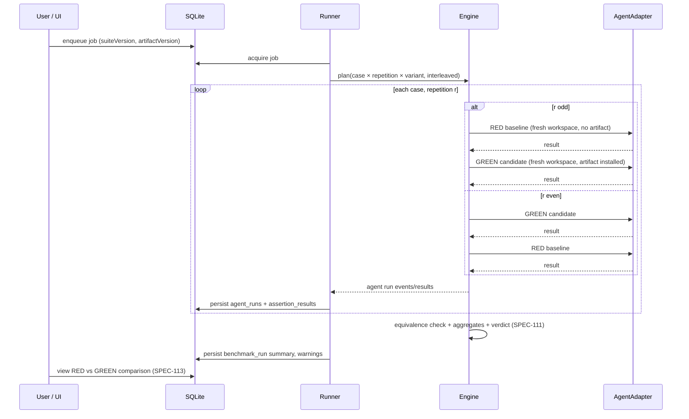

# SPEC-112 — RED/GREEN Evaluation

## 1. Summary

RED/GREEN evaluation answers one question: **does installing this exact artifact version change what an agent produces on this benchmark?** For every case and repetition, DirectiveBench runs a **RED baseline** (no artifact) and a **GREEN candidate** (the artifact version installed via the adapter's install convention) under conditions that are identical except for the artifact. Results are compared with the formulas of [SPEC-111](2026-10-14-benchmark-scoring.md). This spec defines equivalence requirements, ordering, the metrics compared, and how uncontrolled differences are recorded.

## 2. Motivation and problem statement

Absolute benchmark scores say little about an instruction file: a capable agent may already pass without it, and a weak fixture may fail with it. The causal effect of the artifact is only visible against a baseline produced under the same conditions. Any other difference between the two variants (fixture, model, prompt, permissions, time-of-day drift, leaked state) contaminates the comparison, so equivalence must be enforced where possible and recorded where not.

## 3. Goals

- Treatment/control design with the artifact as the only intended difference.
- Enforced equivalence of inputs and independent workspaces with no state leakage.
- Interleaved ordering to reduce drift.
- Honest reporting: the baseline may pass and the candidate may fail; nothing is adjusted.
- Recording of every known uncontrolled difference as a warning.

## 4. Non-goals

- Comparing two different artifacts against each other (future: A/B mode, §19).
- Comparing agents or models against each other (that is a different comparability key, [SPEC-111](2026-10-14-benchmark-scoring.md)).
- Guaranteeing causality for nondeterministic agents from a single run.

## 5. User stories

- As a skill author, I want to know whether my skill actually helps the agent, not just whether the agent passes.
- As a user, I want to see when the baseline already passes, meaning my skill is not needed for this case.
- As a user, I want to be told that my user-level skills may have influenced both variants of a real-agent run.
- As a user, I want interleaved execution so a provider slowdown halfway through does not affect only one variant.

## 6. Functional requirements

| ID | Requirement |
|---|---|
| FR-112-01 | A benchmark run SHALL reference one suite version and one artifact version (candidate). |
| FR-112-02 | For each case and each repetition `r ∈ 1..repetitions`, the run SHALL execute exactly one baseline and one candidate agent run. |
| FR-112-03 | Baseline SHALL have no artifact installed. Candidate SHALL have exactly the referenced artifact version installed via `AgentAdapter.installArtifact` (e.g. Mock Agent → `.agents/skills/<slug>/`). |
| FR-112-04 | Both variants SHALL use the same fixture snapshot hash (same commit for repository-sourced fixtures), verification overlay hash, prompt, adapter id and version, model config, tool permissions, environment kind and limits (`timeoutSeconds`, `maxOutputBytes`). |
| FR-112-05 | Each agent run SHALL use an independent fresh workspace ([SPEC-110](2026-10-14-benchmark-execution.md) FR-110-01); no files, processes, caches or HOME directories are shared between agent runs. |
| FR-112-06 | Adapter-level state (sessions, conversation ids, caches the adapter controls) SHALL be reset per agent run; adapters SHALL declare which state they cannot reset. |
| FR-112-07 | Environment metadata SHALL be recorded per agent run: adapter id/version, node version, platform/arch, environment kind, `sandboxed` flag, model config, start/end time. |
| FR-112-08 | After execution, the engine SHALL verify that recorded metadata of baseline and candidate match on all equivalence fields; a mismatch SHALL make the comparison `not-comparable`. The equivalence fields of FR-112-04 are also what the benchmark run's comparability key hashes (definition `cases`, `scoring`, `execution`, fixture hashes, adapter id and version — [SPEC-111](2026-10-14-benchmark-scoring.md) FR-111-43). |
| FR-112-09 | Known uncontrolled differences SHALL be recorded as warnings on the benchmark run, at minimum: ambient user-level skills/instructions that cannot be excluded for real agents; provider-side model updates behind an alias; non-pinned model versions; network access on `local-process`. |
| FR-112-10 | Execution order SHALL interleave variants: for repetition r, run baseline and candidate back to back, alternating which goes first (r odd → baseline first; r even → candidate first). Cases are processed in definition order. |
| FR-112-11 | With concurrency > 1 (future, within a run), pairs SHALL be scheduled together so both variants of a repetition run concurrently or adjacently. |
| FR-112-12 | Results SHALL be stored and shown as produced. The system SHALL NOT retry only failed variants, discard outliers, re-order results, or re-run a variant to "fix" an outcome. A user re-run creates a new benchmark run. |
| FR-112-13 | Compared metrics SHALL include: pass rate, mean weighted score, delta and passRateDelta, failure (error) rate, per-case regression (candidate worse than baseline on a case), duration (mean, min, max), tokens and cost **only when the adapter reports them**, and stability (stdDev). |
| FR-112-14 | A single repetition with a nondeterministic adapter SHALL be labelled "not conclusive" ([SPEC-111](2026-10-14-benchmark-scoring.md) FR-111-42). |
| FR-112-15 | Mock Agent results SHALL be labelled "Mock agent — not an AI evaluation"; they demonstrate the pipeline, not AI behaviour. |

## 7. Non-functional requirements

- Determinism: with the Mock Agent, repeated benchmark runs on the same inputs produce identical scores.
- Overhead: equivalence verification adds negligible time (< 100 ms per run).
- Transparency: every warning and equivalence field is visible in the run detail and exports.

## 8. Domain entities and contracts

```ts
interface BenchmarkRunPlan {
  benchmarkRunId: string;
  suiteVersionId: string;
  artifactVersionId: string;
  repetitions: number;
  order: { caseId: string; repetition: number; variant: "baseline" | "candidate" }[];
}

interface EquivalenceFields {
  fixtureHash: string; overlayHash?: string; prompt: string;
  adapterId: string; adapterVersion: string;
  model: { provider: string; model: string; parameters?: Record<string, unknown> } | null;
  toolPermissions: string[];          // adapter-declared, e.g. ["read", "write", "exec"]
  environmentKind: "local-process" | "docker";
  limits: { timeoutSeconds: number; maxOutputBytes: number };
}

interface UncontrolledDifference {
  code: "ambient-user-config" | "unpinned-model" | "network-access" | "adapter-state" | string;
  message: string;
  affects: "both" | "baseline" | "candidate";
}

interface PairComparison {           // per case
  caseId: string;
  baseline: VariantCaseAggregate;    // SPEC-111
  candidate: VariantCaseAggregate;
  delta: number | null;
  durationMs: { baseline: number | null; candidate: number | null };
  tokens?: { baseline?: number; candidate?: number };
  costUsd?: { baseline?: number; candidate?: number };
}
```

## 9. Data flow



## 10. API and interface design

Engine:

- `planRun(definition, artifactVersion, repetitions): BenchmarkRunPlan`
- `runBenchmark(plan, deps: { adapter, fixtures, signal, emit }): Promise<BenchmarkRunResult>`
- `checkEquivalence(runs: AgentRunResult[]): { comparable: boolean; mismatches: string[] }`

Runner persists `benchmark_runs` (with `agent_adapter_id`, `agent_version`, `model`, `environment`, `comparability_key`, `verdict`, `summary`, `warnings`) and child `agent_runs` with `case_id`, `variant`, `repetition`, `fixture_version_id` columns ([SPEC-006](2026-10-14-database-schema.md)).

## 11. UI/UX considerations

- Side-by-side RED | GREEN columns with consistent colour semantics (RED = baseline, GREEN = candidate; colour is never the only signal — labels "Baseline (no artifact)" / "Candidate (artifact vN)").
- "Baseline already passes" callout when baseline passRate = 1.
- Warnings panel listing uncontrolled differences.
- Show execution order (timeline) for transparency.

## 12. Security considerations

- The candidate installs artifact content into the workspace; artifact content is untrusted text that an agent may follow. On `local-process` this can lead to command execution by real agents — see [SPEC-110](2026-10-14-benchmark-execution.md) §12 and [SPEC-007](2026-10-14-security-and-privacy.md).
- Isolation between variants also prevents a malicious candidate from influencing the baseline through shared files.

## 13. Error handling

- One variant fails to execute (agent-error/timeout/infrastructure-error) → recorded; the other variant of the pair still runs; scoring handles it through `errorRate`.
- Equivalence mismatch detected → verdict `not-comparable`, mismatched fields listed.
- Artifact installation fails → candidate run `infrastructure-error`; baseline unaffected.
- Cancellation mid-pair → remaining runs not started; benchmark run `cancelled`.

## 14. Edge cases

- Artifact already present in the fixture (e.g. fixture contains `.agents/skills/<slug>/`) → engine warns: baseline is not artifact-free; comparison flagged `not-comparable` unless the suite explicitly declares it.
- Adapter version changes mid-run (CLI auto-update) → detected by FR-112-08 → `not-comparable`.
- Model alias resolves to different snapshots across runs → warning `unpinned-model`.
- Baseline passes, candidate fails → reported as `regressed` (if delta ≤ −minDelta) — never suppressed.
- Repetitions = 1 → allowed; confidence `low`.

## 15. Testing strategy

- Engine tests with the Mock Agent: baseline and candidate differ exactly as the playbook implies (`when.contextIncludes`).
- Ordering test: plan for 4 repetitions alternates first variant.
- Isolation test: a file written by the candidate is absent in the next baseline workspace.
- Equivalence test: inject differing adapter version → `not-comparable`.
- Integrity test: no code path re-runs only one variant.

## 16. Acceptance criteria

- [ ] For `repetitions = 3` and 2 cases, exactly 12 agent runs are executed (2 × 3 × 2).
- [ ] Plan order alternates baseline-first and candidate-first by repetition.
- [ ] Baseline workspace never contains the artifact; candidate contains exactly the referenced version's files.
- [ ] Equivalence fields are identical across variants and recorded (benchmark run `environment`, `agent_adapter_id`, `agent_version`, `model`; per agent run `fixture_version_id` and trace).
- [ ] A mismatch in any equivalence field yields `not-comparable`.
- [ ] Warnings for ambient user configuration are attached when a real (non-mock) adapter is used.
- [ ] Tokens/cost appear only when reported by the adapter; never estimated silently.
- [ ] Mock results carry the "Mock agent — not an AI evaluation" label.

## 17. Dependencies

[SPEC-110](2026-10-14-benchmark-execution.md), [SPEC-111](2026-10-14-benchmark-scoring.md), [SPEC-114](2026-10-14-runner-management.md), [SPEC-103](2026-10-14-artifact-versioning.md), adapter specs [SPEC-203](2026-10-14-integration-claude-code.md), [SPEC-204](2026-10-14-integration-openai-codex.md), [SPEC-205](2026-10-14-integration-cursor.md), [ADR 0005](../decisions/0005-custom-benchmark-engine.md), [ADR 0006](../decisions/0006-agent-adapters-vs-model-providers.md).

## 18. Open questions

- Can real agent CLIs be started with user-level skills/instructions disabled while remaining authenticated? (Assumption — requires validation per CLI.)
- Should pairs be randomized (seeded) instead of strictly alternated?
- Should a baseline that already contains instructions from the fixture (`AGENTS.md`) be considered part of the fixture (yes, currently) or flagged?

## 19. Future extensions

- A/B mode: candidate vs. a different artifact version instead of no artifact.
- Multi-artifact candidates (artifact sets) with ablation.
- Statistical tests for nondeterministic agents.
- Remote runners executing pairs on the same host to keep environment equivalence.

## 20. Implementation status

- **Implemented (verified by `packages/benchmark-engine/test/engine.test.ts` "runBenchmark (mock agent, RED/GREEN)" and `packages/runner/test/runner.test.ts`):** RED/GREEN orchestration in `runBenchmark` (`packages/benchmark-engine/src/orchestrator.ts`) with the Mock Agent: one baseline and one candidate per case × repetition; alternating order (baseline first on odd repetitions, candidate first on even); artifact installed for the candidate only; fresh workspace and `HOME` per agent run; environment metadata and comparability key recorded per benchmark run; comparison via SPEC-111 (baseline 0.5 → candidate 1.0, verdict `improved`); warnings for the mock agent ("not an AI evaluation"), the non-sandboxed `local-process` environment and fewer than 3 repetitions with a nondeterministic adapter.
- **Partially implemented:**
  - FR-112-07: environment metadata is recorded once per benchmark run (`benchmark_runs.summary.environment`; the `environment` column holds only `{ kind }`), not per agent run.
  - FR-112-08: the equivalence check only compares the adapter version detected before and after the run; there is no `checkEquivalence` with a mismatch list. The API is `runBenchmark(input)`; `planRun`/`checkEquivalence` (§10) do not exist.
  - FR-112-09: only the warnings above exist; ambient-configuration and unpinned-model warnings for real agents are not implemented.
- **Not implemented:** real agent RED/GREEN runs, tokens/cost metrics (the Mock Agent reports none), detection of an artifact already present in the fixture, concurrent pair scheduling, A/B mode.
