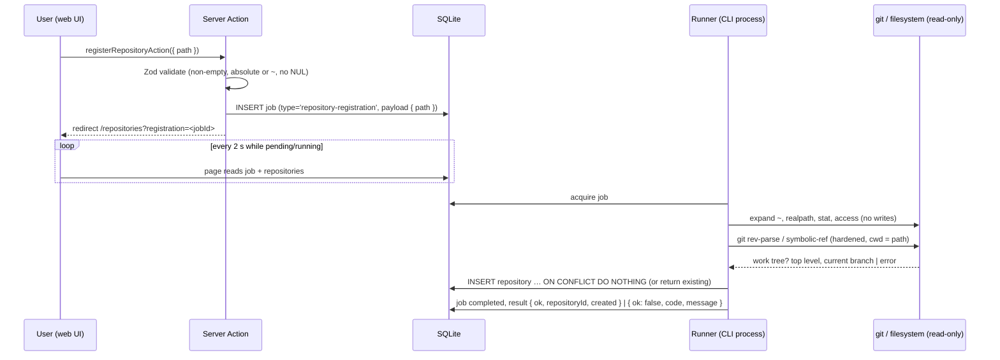
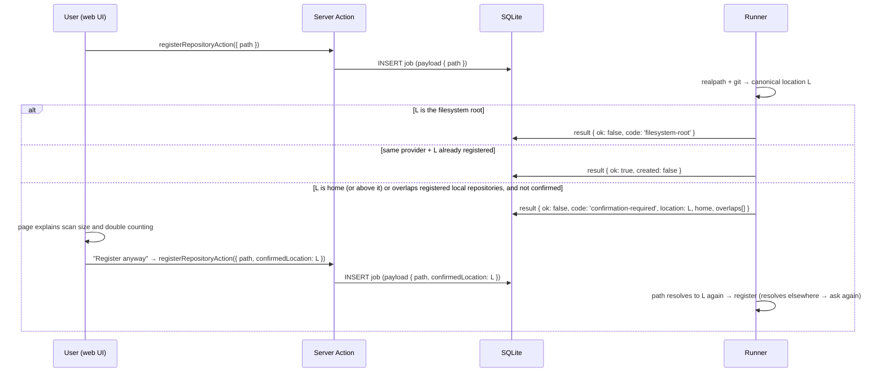

# SPEC-104 — Repository Management

## 1. Summary

Repository management lets users register the sources DirectiveBench scans for artifacts: GitHub repositories, GitLab repositories (gitlab.com and self-managed instances), local git repositories and plain local directories. A repository record holds the provider, location, branch selection, an optional **credential reference** (never a secret) and per-repository discovery settings. Registration validates the connection without modifying anything: DirectiveBench treats every repository as **read-only**. Synchronisation itself is specified in [SPEC-105](2026-10-14-repository-synchronization.md).

## 2. Motivation and problem statement

Artifacts live in many repositories, some private, some on self-managed GitLab, some only on the local disk. Users need one place to declare those sources, choose which branch represents "the truth", and know whether DirectiveBench can reach them — without handing over credentials in plaintext or risking that the tool modifies their code.

## 3. Goals

- Register, edit, validate, disable and remove repositories of four kinds.
- Branch selection with automatic default-branch detection.
- Authentication by reference only: existing git credentials of the user, OS keychain entry, or environment variable ([ADR-0008](../decisions/0008-secret-storage-and-authentication.md)).
- Clear connection status and actionable validation errors.
- Strict read-only guarantee towards all repositories.

## 4. Non-goals

- Creating repositories, pushing, opening PRs/MRs (future, [SPEC-105](2026-10-14-repository-synchronization.md) §19).
- Organisation-wide discovery ("import all repos of my GitHub org") — future.
- Providers other than GitHub, GitLab, generic local git and local directories (Bitbucket, Gitea, Azure DevOps — future).
- Storing secrets in the database or `config.json`.

## 5. User stories

- US-104-01: As a developer, I want to add `https://github.com/acme/agent-skills` and have DirectiveBench detect its default branch.
- US-104-02: As an enterprise user, I want to add a project from `https://gitlab.acme.internal` using a token stored in my OS keychain.
- US-104-03: As a skill author, I want to add `~/code/my-skills` (a local git repository) without any network access.
- US-104-04: As a user, I want to add a plain folder of rules that is not under version control.
- US-104-05: As a user, I want to see immediately if a repository is unreachable or my credential is missing, with a hint how to fix it.
- US-104-06: As a security-conscious user, I want certainty that DirectiveBench never writes to my repositories.

## 6. Functional requirements

| ID | Requirement |
|----|-------------|
| FR-104-01 | Supported providers (values of `repositories.provider`): `github`, `gitlab`, `local-git`, `local-directory`. The value `bundled-examples` is internal (created by `demo`/example import) and SHALL NOT be user-creatable or editable. |
| FR-104-02 | Registration by URL: HTTPS URLs (`https://github.com/<owner>/<repo>[.git]`, `https://<gitlab-host>/<group>/<subgroup…>/<project>[.git]`) and SSH URLs (`git@host:path.git`, `ssh://git@host/path.git`). Provider is inferred from the host (`github.com` → `github`, `gitlab.com` → `gitlab`); for other hosts the user selects `gitlab` (self-managed) and the `instance_url` is derived as `https://<host>` (editable, may include a path prefix). |
| FR-104-03 | Registration by path: an absolute path (`~` and `~/…` expanded to the user's home directory; `~user` and relative paths are rejected). The path is canonicalised with `realpath` (symlinks, trailing slashes and `..` resolved physically, after following symlinks) and must be an existing, readable directory. If it is inside a git work tree (`git rev-parse --is-inside-work-tree` prints `true`), the provider defaults to `local-git` and the location is normalised to the top-level directory (derived from `--show-cdup` and required to be the nearest directory at or above the path that holds a `.git` entry, so a repository's `core.worktree` cannot move it, e.g. to `/`); if git's discovery reports "not a git repository (or any parent …)", `local-directory` (a broken `.git` file is `git-failed`, not a plain directory). A path inside a git directory (`.git`, a bare repository) is rejected (`git-directory`), and any other git failure fails closed (`git-failed`). The user may register a git work tree as `local-directory` explicitly (to scan the working tree including uncommitted changes) — planned, not part of the first slice. |
| FR-104-04 | `location` SHALL be normalised (hosted: URL without credentials, without trailing `/` and `.git`; local: resolved absolute path) and unique per provider (`repositories_provider_location_unique`). Duplicate registration returns the existing repository. |
| FR-104-05 | URLs containing embedded credentials (`https://user:token@…`) SHALL be rejected with an explanation; nothing from them is stored or logged. |
| FR-104-06 | `name` defaults to `<owner>/<repo>` (hosted) or the directory basename (local); user-editable. |
| FR-104-07 | **Branch selection**: for git providers, the default branch SHALL be detected on validation (`git ls-remote --symref <url> HEAD` for hosted; current symbolic `HEAD` of the repository for `local-git`) and stored in `default_branch`. `selected_branch` is optional; when null, sync uses `default_branch`. The UI offers the list of remote branches (`git ls-remote --heads`). Not applicable to `local-directory`. |
| FR-104-08 | **Credential reference** (planned column `credential_ref`, JSON) SHALL be one of: `{ source: 'git-default' }` (default — let `git` use the user's existing SSH agent / credential helper, DirectiveBench never reads them) or a `SecretRef` as defined in [SPEC-115 FR-115-30](2026-10-14-settings-and-configuration.md): `{ source: 'keychain', name: string }` (OS credential store entry, service `directivebench`) or `{ source: 'env', name: string }` (name of an environment variable). Inline secrets SHALL NOT be accepted by any API. |
| FR-104-09 | Secrets resolved from `keychain`/`env` SHALL be passed to `git` only through the child process environment (e.g. `GIT_CONFIG_*` http extra header or a one-shot `GIT_ASKPASS` helper reading from env), never via argv or URL, and SHALL be registered for redaction ([ADR-0008](../decisions/0008-secret-storage-and-authentication.md)). Exact mechanism — Assumption — requires validation per provider ([SPEC-201](2026-10-14-integration-github.md), [SPEC-202](2026-10-14-integration-gitlab.md)). |
| FR-104-10 | **Connection validation** SHALL run on create, on credential/branch change and on demand ("Test connection"). Checks: hosted — `git ls-remote` succeeds within 30 s and the selected branch exists; `local-git` — path exists, is a git work tree, selected branch exists, `git` binary available; `local-directory` — path exists, is a directory, is readable. Result: `ok` or a typed error (§13). |
| FR-104-11 | Validation and all other repository operations SHALL be read-only: no `git push`, `commit`, `checkout`, `reset`, `stash`, `config` writes, no index/worktree modification of local repositories, no file writes inside local directories. Hosted repositories are cloned only into the DirectiveBench cache ([SPEC-105](2026-10-14-repository-synchronization.md)). |
| FR-104-12 | Git invocations SHALL disable features that execute repository-controlled code or prompt interactively: `GIT_TERMINAL_PROMPT=0`, `-c core.fsmonitor=false`, `-c core.hooksPath=/dev/null` (or platform equivalent), `-c protocol.ext.allow=never`, no LFS smudge (`GIT_LFS_SKIP_SMUDGE=1`), no optional locks (`GIT_OPTIONAL_LOCKS=0`, so no index refresh is written), no submodule recursion, and an environment allowlist (no inherited `GIT_*` variable such as `GIT_DIR` or `GIT_CONFIG_PARAMETERS`). Local paths are passed as the working directory, never as an argument. Because the executable name would otherwise be resolved against that working directory (relative `PATH` entries on POSIX, the current directory first on Windows), git is located beforehand on the absolute `PATH` entries and spawned by absolute path, and relative entries are removed from the child's `PATH`. `HOME`/`XDG_CONFIG_HOME` are forwarded so the user's global git config (`safe.directory`) applies; the `-c` values above override it. Only read-only plumbing commands (`version`, `ls-remote`, `rev-parse`, `ls-tree`, `cat-file`, `clone --bare --depth 1 --filter=blob:none --template=`/`fetch` into cache) are used. Hosted fetches additionally use the hardened invocation of [SPEC-105](2026-10-14-repository-synchronization.md) §9.1 (HTTPS only, no credential helper, environment allowlist, no lazy fetch). |
| FR-104-13 | **Discovery settings** per repository (planned column `discovery`, JSON): `exclude` globs (added to defaults `.git/**`, `node_modules/**`), optional `include` roots (limit scanning to sub-paths, e.g. `skills/`). Used by [SPEC-102](2026-10-14-artifact-discovery.md). |
| FR-104-14 | **Edit**: name, selected branch, credential reference, discovery settings, instance URL. Changing provider or location is not allowed (create a new repository instead). |
| FR-104-15 | **Disable** (planned column `disabled_at`): excluded from "sync all", data kept. **Remove**: deletes the repository row; its occurrences are deleted by cascade but artifacts, versions (provenance `source_repository_id` set to null), categories, notes and evaluation results remain. Removal requires confirmation showing the number of affected artifacts; artifacts left without any occurrence are shown as "orphaned" (lifecycle `removed`). Cached clones are deleted. |
| FR-104-16 | Repository list SHALL show: name, provider, location (hosted host/path or local path), branch (selected or default), last sync time, sync status (`never` / `ok` / `error`), artifact count (active occurrences), credential source (never the secret). |
| FR-104-17 | Repository status fields `last_commit_sha`, `last_sync_at`, `sync_status`, `sync_error` are written only by synchronisation ([SPEC-105](2026-10-14-repository-synchronization.md)). |
| FR-104-18 | **Broad and overlapping local paths** (decided by the maintainer 2026-10-19; implemented with the scan, #16): registering the filesystem root `/` (or a drive root on Windows) SHALL be rejected. Registering the user's home directory, or a path that contains or is contained in an already registered local repository, SHALL require an explicit confirmation that states why (scan size, the same files counted as occurrences in both repositories). Nested repositories and submodules stay possible after confirmation. Confirming the home directory does **not** opt in to user-level folders: a scan always skips them ([SPEC-102](2026-10-14-artifact-discovery.md) §3, D05 — maintainer, 2026-10-19), and the confirmation says so. The checks apply to the canonical location the runner computes (for `local-git` the work tree's top level); an ancestor of the home directory is treated like the home directory; the same location under the other local provider is not an overlap (OQ-104-05); internal `bundled-examples` and hosted repositories are not considered. The confirmation is bound to the canonical location: the job payload carries `confirmedLocation`, and the runner registers without asking only when the path still resolves to exactly that location. |

## 7. Non-functional requirements

- NFR-104-01: Validation completes or times out within 30 s (hosted) / 2 s (local).
- NFR-104-02: Works offline for `local-git` and `local-directory`.
- NFR-104-03: Requires the `git` CLI (≥ 2.30 for `local-git`, ≥ 2.44 for hosted providers because the partial fetch of [SPEC-105](2026-10-14-repository-synchronization.md) §9.1 needs `GIT_NO_LAZY_FETCH` — Assumption — requires validation of both minimum versions) for git providers; `directivebench doctor` reports its presence ([SPEC-009](2026-10-14-cli-architecture.md)).
- NFR-104-04: Repository persistence goes through `@directivebench/database` repository functions ([ADR-0009](../decisions/0009-self-hosted-readiness.md)).

## 8. Domain entities and contracts

Bootstrap table `repositories` (`packages/database/src/schema.ts`): `id, provider, name, location, instance_url, default_branch, selected_branch, last_commit_sha, last_sync_at, sync_status ('never'|'ok'|'error'), sync_error, created_at, updated_at`. Planned columns: `credential_ref`, `discovery`, `disabled_at`.

```ts
type RepositoryProvider = 'github' | 'gitlab' | 'local-git' | 'local-directory' | 'bundled-examples';

type SecretRef = { source: 'keychain' | 'env'; name: string }; // SPEC-115 FR-115-30

type CredentialRef =
  | { source: 'git-default' }                  // user's own git config / SSH agent / credential helper
  | SecretRef;                                 // keychain: OS credential store, service 'directivebench'; env: e.g. 'GITLAB_TOKEN'

interface RepositoryInput {                     // Zod-validated Server Action input
  source: { url: string } | { path: string };
  provider?: 'github' | 'gitlab' | 'local-git' | 'local-directory'; // override inference
  name?: string;
  instanceUrl?: string;                         // self-managed GitLab
  selectedBranch?: string | null;
  credentialRef?: CredentialRef;                // default { source: 'git-default' }
  discovery?: { exclude?: string[]; include?: string[] };
}

type ValidationResult =
  | { ok: true; defaultBranch: string | null; branches?: string[]; headCommit?: string }
  | { ok: false; code: RepositoryErrorCode; message: string; hint?: string };

type RepositoryErrorCode =
  | 'invalid-url' | 'credentials-in-url' | 'unsupported-provider'
  | 'invalid-path' | 'path-not-found' | 'not-a-directory' | 'not-a-git-repository' | 'permission-denied'
  | 'git-directory' | 'git-failed' | 'filesystem-root' | 'confirmation-required'
  | 'git-not-installed' | 'git-too-old' | 'unreachable' | 'auth-required' | 'auth-failed'
  | 'branch-not-found' | 'timeout' | 'credential-missing' | 'cache-limit-exceeded';
```

A future `packages/git-providers` package (not created in bootstrap) will hold provider-specific logic behind:

```ts
interface GitSourceProvider {
  id: 'github' | 'gitlab' | 'local-git' | 'local-directory';
  parseLocation(input: string): { location: string; instanceUrl?: string; name: string } | null;
  validate(repo: RepositoryRecord, ctx: { env: Record<string, string>; signal: AbortSignal }): Promise<ValidationResult>;
  listBranches?(repo: RepositoryRecord, ctx: …): Promise<string[]>;
  openTree(repo: RepositoryRecord, ref: string, ctx: …): Promise<{ commitSha: string | null; tree: FileTree }>; // SPEC-102 FileTree
}
```

## 9. Data flow

The web process never runs processes ([SPEC-003 §2.1](2026-10-14-system-architecture.md#21-allowed-dependency-directions), [SPEC-014 §3.3](2026-10-15-engineering-standards.md#3-architecture-rules)), so registration is a short job executed by the runner in the CLI process; web and runner coordinate only through the `jobs` table ([SPEC-114](2026-10-14-runner-management.md)).



**URL registration (public GitHub, issue #18) — proposed answer to OQ-104-01: the same runner job.** The registration field accepts a path or a URL. For a URL the Server Action parses it with the shared `parseRepositoryUrl` (`core`) and enqueues `{ url: <normalised location> }` — never the typed text, so a job payload cannot hold credentials (FR-104-05; the payload schema accepts only a location that is its own normal form). A URL with credentials is rejected in the action before anything is stored, and the redirect back carries only the reason (`?urlError=credentials-in-url`), not the input; any rejected input — URL or path, including a malformed URL that is not recognised as one and fails path validation (`https:/github.com/a/b?access_token=…`) — that contains `@`, `?`, `#` or their percent-encodings is sent back without itself, only with a reason code (`?urlError=`, fixed message; `not-echoed` for input that is neither a valid path nor a recognised URL), and the page does not pre-fill such a `?path=` into the field. A valid local path is registered as entered, these characters included — except one that starts like a protocol-relative URL (`//host/…`, `\\host\…`) and contains them, which is refused as `invalid-url` rather than stored. The runner checks git ≥ 2.44 (NFR-104-03), runs `git ls-remote --symref -- <url> HEAD` with the hardened hosted invocation of [SPEC-105](2026-10-14-repository-synchronization.md) §9.1 (no credential helper, prompt or askpass; nothing is downloaded) and stores provider `github` with the detected default branch through `registerHostedRepository` (one `INSERT … ON CONFLICT DO UPDATE … RETURNING`: registering the URL again returns the existing repository with only its default branch refreshed, the way out for a repository that was empty or whose default branch was renamed). A repository that needs credentials or does not exist is `auth-required` ("not found or not public") and stores nothing.

**Broad and overlapping locations (FR-104-18).** Only the runner knows the canonical location, so the check runs there, in the same transaction as the insert, and the web only carries the user's answer back:



An overlap registered between the question and the answer is not asked about again (the confirmation is bound to the location, not to the list of overlaps); a stale or invalid `confirmedLocation` never skips the check, it only fails to match.

**Scan.** A registered local repository is scanned by a `repository-scan` runner job ([SPEC-105](2026-10-14-repository-synchronization.md) FR-105-02, [SPEC-102](2026-10-14-artifact-discovery.md) Phasing): the web enqueues `{ repositoryId }` (at most one pending or running scan per repository), the runner re-checks that the stored location still resolves to itself, walks it and records `last_sync_at`/`sync_status`/`sync_error` (FR-104-17).

## 10. API and interface design

Server Actions (Zod-validated, `{ ok, data | error }` per [SPEC-008](2026-10-14-api-architecture.md)). The first slice implements path registration as `registerRepositoryAction(FormData { path })`: it enqueues a `repository-registration` job and redirects to `/repositories?registration=<jobId>` (invalid input redirects back with `path` and `error`); the runner records the outcome in `jobs.result` (§9). The table below is the target shape:

| Action | Input | Result |
|--------|-------|--------|
| `addRepository` | `RepositoryInput` | `{ repository, validation }` |
| `updateRepository` | `{ id, name?, selectedBranch?, credentialRef?, discovery?, instanceUrl? }` | `{ repository, validation? }` |
| `validateRepository` | `{ id }` | `ValidationResult` |
| `listRepositoryBranches` | `{ id }` | `string[]` |
| `setRepositoryDisabled` | `{ id, disabled }` | `{ repository }` |
| `removeRepository` | `{ id, confirm: true }` | `{ removedOccurrences, orphanedArtifacts }` |

Planned `/api/v1/repositories` resource with the same operations. Planned CLI: `directivebench repo add <url|path> [--branch] [--credential-env VAR]`, `repo list`, `repo remove` ([SPEC-009](2026-10-14-cli-architecture.md)).

## 11. UI/UX considerations

- Scan (issue #16): each local repository row has **Scan** and a **Last scan** cell (time of the last successful scan, or "Failed: <message>"); the scan status line refreshes every 2 s while the job runs, offers **Cancel scan**, then summarises files, artifacts, new artifacts and versions and lists the discovery errors (path, code, message; first 100). A note says the scan reads the working tree, skips `.git`, `node_modules` and user-level agent folders, never follows symlinks and never runs anything; a scan that skipped user-level folders says so in one informational line. A Scan click that cannot enqueue (repository removed meanwhile, unknown, not local, invalid id) returns to the page with a page-level error. A registration flagged by FR-104-18 shows the reasons with **Register anyway** and **Cancel**.
- First slice (issue #15): `/repositories` shows a path field with "Register", the registration status while the runner checks the path ("Checking …", refreshed every 2 s; "Waiting for the runner" while pending), a field-level error when the path is rejected, a confirmation naming the new or already registered repository, and the table (name, provider, location, branch, artifact count). Scanning is marked "Planned — not implemented".
- Planned list `/repositories`: table per FR-104-16, "Add repository" button, "Sync" and "Sync all" (SPEC-105), status badge with error tooltip.
- Add dialog: single input accepting URL or path with live inference ("Detected: GitLab self-managed at https://gitlab.acme.internal"), branch picker after validation, credential selector (Use my git credentials / OS keychain entry / Environment variable) with explanatory text that DirectiveBench never stores the secret in its database.
- Detail `/repositories/[id]`: settings, discovery settings, "Test connection", sync history ([SPEC-105](2026-10-14-repository-synchronization.md)), artifacts found.
- Prominent "Read-only: DirectiveBench never writes to this repository" note.

## 12. Security considerations

See [SPEC-007](2026-10-14-security-and-privacy.md) and [ADR-0008](../decisions/0008-secret-storage-and-authentication.md).
- No plaintext secrets in SQLite, `config.json`, logs, error messages or URLs (FR-104-05, FR-104-08).
- Secrets passed to git via env only; output redacted with `@directivebench/core` redaction.
- Hardened git invocation (FR-104-12): no hooks, no fsmonitor, no ext protocol, no LFS smudge, no submodules, no interactive prompts.
- `argv`-based process spawning (no shell); URLs and branch names validated (branch names must not start with `-` to prevent option injection; `--` separator used).
- Local paths: resolved and checked; symlinked repository roots are resolved once at registration and displayed.
- `file://` and local-path URLs given as "URL" are treated as local providers, not passed to `git clone` as remote URLs.

## 13. Error handling

| Code | User message (example) | Hint |
|------|------------------------|------|
| `credentials-in-url` | "The URL contains credentials (a user name, password or token)." | Public GitHub (#18): "Remove them and enter https://github.com/<owner>/<repo>: DirectiveBench reads public GitHub repositories without credentials and never stores them." Later, with credentials: "use a keychain entry or environment variable." |
| `invalid-url` / `unsupported-provider` | "This URL does not name a repository." / "Only public repositories on github.com can be registered by URL so far." (SSH, `http://`, other hosts) | "Enter a GitHub repository URL such as https://github.com/<owner>/<repo>." A redirect (renamed repository) is `invalid-url`: "Register its new URL." |
| `auth-required` without a credential (public GitHub, #18) | "The repository was not found or is not public. DirectiveBench reads public GitHub repositories without credentials; private repositories are not supported yet." | — |
| `git-too-old` | "GitHub repositories need git 2.44 or newer (it can disable implicit downloads)." | Hosted repositories only: older git would download silently on a read of a missing object. |
| `git-not-installed` | "git was not found on PATH." | "Install git and re-run `directivebench doctor`." |
| `auth-required` / `auth-failed` | "The repository requires authentication / credentials were rejected." | "Configure a credential reference or log in with your git credential helper." |
| `credential-missing` | "Environment variable GITLAB_TOKEN is not set." | — |
| `unreachable` / `timeout` | "Could not reach gitlab.acme.internal within 30 s." | "Check VPN/proxy." |
| `branch-not-found` | "Branch 'release' does not exist." | Branch picker shown. |
| `not-a-git-repository` | "Path is not inside a git work tree." | "Register as local directory instead." |
| `invalid-path` | "Enter an absolute path, for example /home/you/project or ~/project." | — |
| `path-not-found` / `not-a-directory` | "No directory exists at this path." / "This path is a file, not a directory." | — |
| `permission-denied` | "DirectiveBench cannot read this directory." | "Check the directory permissions." |
| `git-directory` | "This path is inside a Git directory (.git) or a bare repository, not a work tree." | "Register the work tree instead." |
| `git-failed` | "git could not inspect this path: <first line of git's message>." | — |
| `filesystem-root` | "The filesystem root cannot be registered: a scan would read the whole disk." | "Register a project directory instead." |
| `confirmation-required` | "Register <location> anyway?" with one reason per cause (home directory: scan size, and that user-level agent folders such as `~/.claude` are always skipped; each overlapping repository: its artifacts counted twice) | "Register anyway" / "Cancel" |

Validation failure on create still allows saving (status `never`, error shown) so users can fix credentials later; sync is blocked until validation succeeds.

## 14. Edge cases

- GitLab nested groups (`group/sub/sub2/project`) and self-managed instances under a path prefix (`https://host/gitlab/…`).
- Repository renamed/moved upstream (HTTP redirect) → validation succeeds; location update suggested.
- Default branch changed upstream → detected on next validation/sync; `selected_branch = null` follows it.
- Empty repository (no commits) → validation ok with warning, sync finds nothing.
- Local git repository with detached HEAD → default branch `null`; user must select a branch or use commit-less `local-directory` mode.
- Local path on removable/network drive disappears → `path-not-found` on sync; data retained.
- Same remote registered via HTTPS and SSH → two locations; UI warns "possibly duplicate" (same host + path).
- Windows paths (`C:\…`) normalised; case-insensitive filesystems considered when checking duplicates.

## 15. Testing strategy

Per [SPEC-012](2026-10-14-testing-strategy.md):
- Unit: URL/path parsing and provider inference table (GitHub HTTPS/SSH, gitlab.com, self-managed with prefix, credentials-in-URL rejection, `file://`), location normalisation, credential ref schema.
- Integration: temporary local git repositories (`git init` in tmp) for `local-git` validation, branch listing, detached HEAD; local bare repository served via `file://` path to emulate a remote for `ls-remote` without network.
- Security: a fixture repository with a malicious `core.fsmonitor` / hook that would create a marker file → never executed during validation.
- No tests against real GitHub/GitLab in CI.

## 16. Acceptance criteria

- [x] Adding a GitHub HTTPS URL stores provider `github`, normalised location, detected default branch (public repositories, #18).
- [ ] Adding a self-managed GitLab URL stores provider `gitlab` and `instance_url`.
- [x] Adding a local git path stores `local-git` with the top-level directory; a plain folder stores `local-directory`.
- [x] A URL with embedded credentials is rejected and does not appear in any log (#18: not in the job table, the repository table, the redirect URL, the page or the runner and web logs).
- [ ] No API accepts a secret value; only `CredentialRef` objects.
- [ ] Validation errors are returned with the codes in §8 and human hints.
- [x] The malicious-hook fixture never executes during validation (local path registration; hosted validation does not exist yet).
- [ ] Removing a repository keeps artifacts, versions and evaluation results.

## 17. Dependencies

[SPEC-105](2026-10-14-repository-synchronization.md), [SPEC-102](2026-10-14-artifact-discovery.md), [SPEC-201](2026-10-14-integration-github.md), [SPEC-202](2026-10-14-integration-gitlab.md), [SPEC-115](2026-10-14-settings-and-configuration.md), [ADR-0008](../decisions/0008-secret-storage-and-authentication.md) (keychain library pending), `git` CLI, future `packages/git-providers`.

## 18. Open questions

- OQ-104-01: Should validation of hosted repositories run in the web process or as a short job in the runner (consistency with "web never executes")? **Resolved for local paths (2026-10-19):** a runner job (§9), because the web process never runs processes (SPEC-003 §2.1). **Hosted validation — ⚠️ Decision needed (proposal implemented in #18, 2026-10-20):** the same `repository-registration` runner job, in the short-job lane (OQ-104-06); the web only parses the URL and enqueues its normalised location. Alternative: `ls-remote` from the web process — rejected because the web never runs processes (SPEC-003 §2.1, SPEC-014 §3.3) and would need git hardening there too. Reversible: the payload is `{ url }` and the runner function is self-contained.
- OQ-104-02: Should `local-git` optionally scan the working tree (uncommitted changes) instead of the selected branch's commit? **Decided by the maintainer (2026-10-19, issue #16):** the M1 scan reads the working tree for both local providers and records no commit; reading the committed tree from the object store arrives with local git awareness in M2 ([SPEC-013](2026-10-14-implementation-roadmap.md)). The branch stored at registration is informative only and is not attributed to scan results.
- OQ-104-03: Use provider REST APIs (GitHub/GitLab) for metadata (description, visibility, default branch) in addition to git? Requires token scopes analysis.
- OQ-104-04: Credential mechanism for HTTPS tokens with git (extra header vs askpass) — requires validation.
- OQ-104-05: Should one directory be registrable both as `local-git` and as `local-directory`? **Deferred (maintainer, 2026-10-19):** keep uniqueness per provider (FR-104-04) for now, because the explicit `local-directory` registration of a work tree (FR-104-03, OQ-104-02) depends on it. Today the provider is detected automatically, so a second row appears only after `git init` in (or removal of `.git` from) a registered directory, and both rows get their own occurrences once scanned. Decide together with OQ-104-02, before rescans and cross-repository identity (#19, #20); the proposed direction is a notice ("already registered as a plain folder") rather than a block.
- OQ-104-06: Should short jobs (registration, re-validation) get their own runner slot? **Decided by the maintainer (2026-10-19, issue #16):** yes. The runner keeps `runner.concurrency` slots for long jobs and one extra slot for short jobs (`repository-registration`), each lane FIFO ([SPEC-114](2026-10-14-runner-management.md) FR-114-11). A scan is a long job: its duration grows with the tree (a confirmed home-directory scan can take minutes), so it shares the slots of benchmark runs. Reversible: removing the lane restores the shared FIFO queue.

## 19. Future extensions

- Bulk import from a GitHub organisation / GitLab group.
- Additional providers (Bitbucket, Gitea/Forgejo, Azure DevOps).
- Write-capable mode for publishing artifact changes as PR/MR (explicit opt-in, separate permission).
- Webhooks ([SPEC-105](2026-10-14-repository-synchronization.md)).
- Shared repository registry in self-hosted mode with per-user credentials ([SPEC-011](2026-10-14-self-hosting-architecture.md)).

## Phasing

Implementation follows the backlog stories in `.ai/specs/backlog.md` (epic E01).

### Phase 1 — Local path registration and repository list (E01-S01, issue #15)

Scope: FR-104-01 (user-creatable `local-git`/`local-directory` only), FR-104-03 (without the explicit `local-directory` override), FR-104-04 (local paths), FR-104-06 (local default name), FR-104-07 (current branch of `local-git` stored as `default_branch`), FR-104-10 (local checks at registration), FR-104-11, FR-104-12, FR-104-16 (without last sync and credential columns, which have no data yet). Out of scope: hosted URLs (#18), credentials, edit/disable/remove, re-validation and branch picker, the scan (#16).

1. Shared path field schema and `~` expansion (`core`).
2. `repository-registration` job type with strict payload, nullable `jobs.result` (migration), atomic insert-or-return-existing repository, repository list with branch and active artifact count (`database`).
3. Path canonicalisation and hardened read-only git inspection; `LocalRunner` executes the job (`runner`).
4. `registerRepositoryAction`, registration status and the Repositories page (`web`), Playwright coverage.

### Phase 2 — Scan of a registered local repository, broad paths, runner lane (E01-S02, issue #16)

Scope: FR-104-18; FR-104-16 last scan time and status; FR-104-17 (scan writes the status fields); OQ-104-06 decided; the scan itself is specified in [SPEC-102](2026-10-14-artifact-discovery.md) Phasing.

1. Path helpers (`isFilesystemRoot`, `pathRelation`, `repositoryLocationSchema`) in `core`.
2. `registerLocalRepository` checks home and overlapping locations and inserts in one transaction; registration payload `confirmedLocation`; results `filesystem-root` and `confirmation-required` (`database`).
3. Runner rejects the filesystem root, passes the canonical home directory and the confirmation; short-job lane (`runner`).
4. Confirmation panel, Scan button, scan status and Last scan column (`web`), Playwright coverage.

### Phase 3 — Public GitHub repository by URL (E01-S04, issue #18)

Scope: FR-104-01 (`github`), FR-104-02 (public `https://github.com/<owner>/<repo>[.git]` only), FR-104-04 (hosted locations), FR-104-05, FR-104-06 (`<owner>/<repo>`), FR-104-07 (hosted default branch), FR-104-10 (`ls-remote` at registration), FR-104-12 (hosted invocation); the scan is SPEC-105 FR-105-05/06 and §9.1. Out of scope: private repositories, credentials, GitLab, SSH, branch picker, scheduled sync, rescan change detection (#19).

1. `parseRepositoryUrl`, `hostedRepositoryLocationSchema`, `looksLikeRepositoryUrl` (`core`); tree-based discovery `selectCandidateFiles` / `discoverArtifactsInTree` sharing the walker's rules (`core`).
2. Registration payload `{ url }`, `registerHostedRepository`, scan results with `commitSha`, hosted error codes (`database`).
3. Hardened hosted git and the partial fetch of candidate blobs; registration and scan of `github` repositories (`runner`).
4. The registration field accepts a path or a URL; URL errors; Scan for GitHub repositories (`web`), Playwright coverage without network.

### Later phases

The remaining FRs follow their backlog stories.

## 20. Implementation status

- **Implemented (verified by `packages/runner/test/runner.test.ts` and `pnpm verify:pack`):** `repositories` table (provider enum incl. internal `bundled-examples`, location, instance URL, default/selected branch, sync status columns); `upsertRepository` creates the internal `bundled-examples` repository used by example import (`importBundledExample`).
- **Implemented — Phase 1, local path registration (issue #15; verified on 2026-10-19 by `packages/core/test/repository-path.test.ts`, `packages/database/test/{jobs,catalog,client}.test.ts`, `packages/runner/test/{repository-registration,repository-registration-fs-errors,runner-registration}.test.ts`, `apps/web/test/{actions,repositories}.test.ts`, the Playwright tests in `apps/web/e2e/repositories.spec.ts`, and a manual run of the built CLI against a temporary data directory):**
  - Registration flows web → `repository-registration` job → runner (§9): `registerRepositoryAction` validates the path with the shared `repositoryPathInputSchema` (non-empty, ≤ 4096 characters, no NUL, absolute or `~`/`~/…`) and only enqueues; the runner records `{ ok, repositoryId, created }` or `{ ok: false, code, message }` in `jobs.result` (migration `0001_add_job_result`).
  - FR-104-01/FR-104-03: `~` expansion, `realpath` canonicalisation (trailing slashes, `//`, `..` resolved physically after symlinks, symlinks), existing readable directory check; work tree → `local-git` at the top level (from `--show-cdup`, cross-checked against the nearest `.git` entry — a `core.worktree` pointing at an ancestor is `git-failed`); git's discovery message "not a git repository (or any …" → `local-directory`; a broken `.git` file → `git-failed`; a path inside `.git` → `git-directory`; other git failures → `git-failed`; git not on the absolute `PATH` entries → `git-not-installed`; 2 s timeout per git call (0.5 s kill grace) → `timeout`.
  - FR-104-04 for local paths: `registerLocalRepository` is a single `INSERT … ON CONFLICT DO NOTHING RETURNING` plus a read of the existing row, so `~`, trailing-slash and symlink variants and concurrent registrations return the existing repository (unchanged) without a duplicate row.
  - FR-104-06 (local basename, `/` for the root), FR-104-07 for `local-git` (current branch from `symbolic-ref`; detached HEAD → null, shown as "not detected"; a branch name that output redaction rewrote is stored as null).
  - FR-104-11/FR-104-12 for local registration: only `rev-parse --is-inside-work-tree --show-cdup` and `symbolic-ref --quiet --short HEAD` run, with the path as working directory (never in argv), `-c core.fsmonitor=false -c core.hooksPath=/dev/null -c protocol.ext.allow=never`, `GIT_OPTIONAL_LOCKS=0`, `GIT_TERMINAL_PROMPT=0`, `GIT_LFS_SKIP_SMUDGE=1`, `GIT_NO_LAZY_FETCH=1`, `LC_ALL=C` and an allowlisted environment (absolute `PATH` entries only, `HOME`, `USERPROFILE`, `XDG_CONFIG_HOME`, `SystemRoot`); git is spawned by absolute path, so an executable `git` committed in the repository does not run even with `.` or empty `PATH` entries (test). A fixture repository whose fsmonitor and hooks write a marker (armed: plain `git status` runs both the fsmonitor and the `post-index-change` hook) produces no marker and no file change (type, mode, size, mtime, content of every entry including `.git`) during registration; the same flags also stop `status`, `commit` and `checkout` from running them.
  - UI: `/repositories` replaces the placeholder with the path field, the registration status (auto-refresh every 2 s while pending/running), a field-level error (input pre-filled, `aria-invalid`) and the list; scanning and hosted URLs are labelled "Planned — not implemented".
- **Implemented — Phase 2 (issue #16; verified on 2026-10-19 by `packages/core/test/repository-path.test.ts`, `packages/database/test/{catalog,jobs}.test.ts`, `packages/runner/test/{repository-registration,runner-lanes,repository-scan}.test.ts`, `apps/web/test/{actions,repositories}.test.ts`, the Playwright tests in `apps/web/e2e/repositories.spec.ts` and a manual run of the built CLI):**
  - FR-104-18: `/` is rejected with `filesystem-root` and stores nothing; the home directory (and its ancestors) and a location that contains or lies inside a registered local repository return `confirmation-required` with the reasons, and are registered only by a job whose `confirmedLocation` equals the canonical location (a confirmation for another location does not count); the check and the insert run in one transaction; the same location under the other provider is not an overlap (OQ-104-05 unchanged).
  - OQ-104-06: registrations run in their own runner slot and complete while a scan holds the only long slot (`runner-lanes.test.ts`).
  - The home-directory confirmation says that user-level agent folders are always skipped (D05), and a confirmed home scan skips them (`repository-scan.test.ts`, Playwright "the home directory needs a confirmation that says user-level folders are skipped (D05)").
  - A Scan click for a repository that was removed meanwhile, is unknown, is not local or sends an invalid id returns to the page with a page-level error instead of an error page (`apps/web/test/actions.test.ts`, Playwright "scanning a repository removed meanwhile returns to the page with an error").
  - FR-104-16/17: the list shows the last successful scan time or the scan error; scans write `last_sync_at`, `sync_status`, `sync_error` (and `last_commit_sha = null`, working tree).
- **Partially implemented:** NFR-104-01 — each git call times out after 2 s (plus a 0.5 s kill grace) and registration runs two calls; registrations no longer wait behind benchmarks or scans (own slot), but a second registration waits for the first, and a pending or running registration cannot be cancelled from the UI. FR-104-16 — the list shows name, provider, location, branch, artifact count (active occurrences) and the last scan; credential source is not shown yet. Repositories registered at `/` or the home directory before #16 stay registered; scanning `/` is refused (`filesystem-root`), a home directory registered before #16 is scanned without a new confirmation. FR-104-10 — local checks run at registration only; no on-demand "Test connection" or re-validation, and an existing repository's branch is not refreshed on re-registration. §8 error codes — the local-path subset above.
- **Implemented — Phase 3, public GitHub repository by URL (issue #18; verified on 2026-10-20 by `packages/core/test/{hosted-repository,discovery-tree}.test.ts`, `packages/database/test/{jobs,catalog}.test.ts`, `packages/runner/test/{git-process,hosted-git,hosted-repository,hosted-repository-limits}.test.ts` against local bare repositories over `file://` (no network), `apps/web/test/{actions,repositories}.test.ts`, the Playwright tests "GitHub repositories by URL" in `apps/web/e2e/repositories.spec.ts`, and a manual run of the built CLI against github.com):**
  - FR-104-02/04/06: `https://github.com/<owner>/<repo>`, with an optional `.git` and trailing `/`, any letter case; stored as `https://github.com/<owner>/<repo>` in lower case (GitHub names are case-insensitive), name `<owner>/<repo>` as typed. SSH, `http://`, `file://`, other hosts, ports, queries, fragments and deeper paths (`/tree/main`) are rejected with a hint.
  - FR-104-05: credentials (any `user@` in the authority, also when the URL does not parse) are rejected in the Server Action; nothing is enqueued, the redirect carries only `urlError=credentials-in-url`, and the payload schema refuses any non-normalised location, so the runner cannot receive one either. Any rejected input with `@`, `?`, `#` (or `%40`/`%3F`/`%23`) is returned without itself whichever branch rejects it (`returnToForm`, Codex review round 2 of PR #51), and the page never pre-fills such a value; a valid path that starts with `//` or `\\` and contains them is refused as `invalid-url` instead of being stored.
  - FR-104-07/10 (hosted): the runner (git ≥ 2.44 checked, else `git-too-old`) runs only `git ls-remote --symref -- <url> HEAD` (30 s timeout) with the hardened invocation of SPEC-105 §9.1 and stores the default branch (null for an empty repository or a branch name outside the safe subset; registering the URL again refreshes it on the existing row — review of PR #51); a missing or private repository is `auth-required` "not found or not public", with no prompt, and stores nothing; network failures and HTTP 403 (rate limits) are `unreachable`, a redirect `invalid-url`. A hosted registration takes the single short-lane slot for up to about 35 s (5 s `git version` + 30 s `ls-remote`), so a local registration can wait behind it (NFR-104-01).
  - FR-104-12 (hosted): see SPEC-105 §20. OQ-104-01: hosted validation runs as the same runner job (proposal, ⚠️ decision needed).
- **Not implemented:** GitLab URLs and SSH URLs (FR-104-02), private repositories and credentials (FR-104-08/09), explicit `local-directory` registration of a work tree, credential references (`credential_ref` column, `CredentialRef`/`SecretRef` shape), discovery settings, edit/disable/remove (including deleting a hosted cache, FR-104-15), branch listing and picker, case-insensitive duplicate detection of local paths and Windows path normalisation (§14), `/repositories/[id]`, `packages/git-providers` (hosted git lives in `packages/runner/src/hosted-git.ts` for now; ⚠️ decision needed in PR #18's description), `directivebench doctor` reporting the git version (NFR-104-03).
