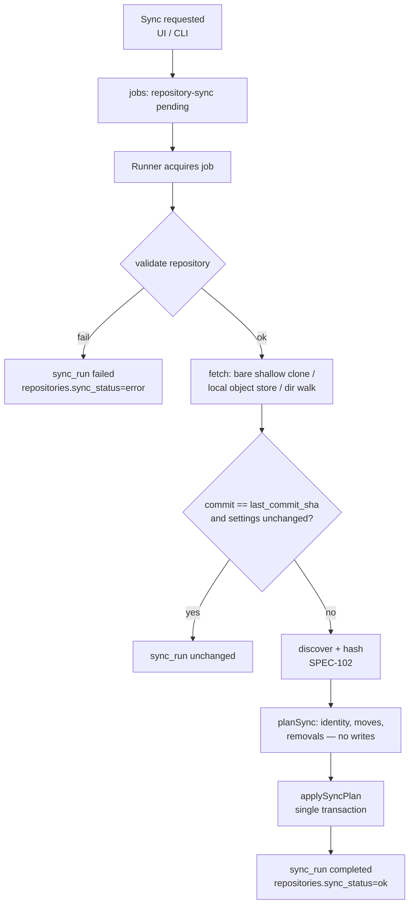

# SPEC-105 — Repository Synchronization

## 1. Summary

Synchronisation brings the artifact registry up to date with a registered repository ([SPEC-104](2026-10-14-repository-management.md)). A sync fetches the selected branch (hosted: shallow bare clone into the data-dir cache; local git: read from the object store; local directory: read from disk), discovers artifacts ([SPEC-102](2026-10-14-artifact-discovery.md)), hashes them, detects changes against the previous state, creates immutable versions ([SPEC-103](2026-10-14-artifact-versioning.md)), updates occurrences, marks deletions and records a **sync run** with statistics, warnings and errors. User-owned metadata (categories, tags, notes, benchmark assignments) is never touched. Repository content is never executed. In the MVP sync is manual.

## 2. Motivation and problem statement

Artifacts change in their source repositories. Without a reliable, auditable sync, the registry drifts from reality, evaluations refer to stale content, and users lose trust. Sync must be deterministic, safe on untrusted repositories, non-destructive towards local organisation work, and transparent about what changed and what failed.

## 3. Goals

- One-click manual sync per repository and "sync all".
- Deterministic plan → apply pipeline; atomic database apply.
- Precise change detection: added, modified, unchanged, moved, removed, reappeared, error.
- Full sync history with statistics and per-item errors.
- Preservation of local metadata across any number of syncs.
- Zero execution of repository content; minimal network and disk use.

## 4. Non-goals

- Two-way sync, publishing changes back (future PR/MR publishing).
- Webhooks and scheduled sync (future).
- Syncing every historical commit (only the selected branch head at sync time).
- Automatic benchmark runs on new versions (future, §19).

## 5. User stories

- US-105-01: As a user, I click "Sync" on a repository and see which artifacts were added, changed, moved or removed.
- US-105-02: As a user, I want categories and notes I assigned to remain after syncs, even if the file was moved.
- US-105-03: As a user, I want a failed sync (network, auth) to leave the registry unchanged and tell me why.
- US-105-04: As a user, I want one broken `SKILL.md` not to prevent the other 40 artifacts from syncing.
- US-105-05: As a user, I want to see the history of syncs with commit SHAs.

## 6. Functional requirements

| ID | Requirement |
|----|-------------|
| FR-105-01 | **Trigger**: manual only in the MVP — "Sync" per repository, "Sync all" (enabled repositories), and the future CLI `directivebench sync [repository]` ([SPEC-009](2026-10-14-cli-architecture.md)). |
| FR-105-02 | A sync SHALL execute as a job in the runner (new job type `repository-sync`, payload `{ repositoryId, ref? }`), not in the web process ([SPEC-008](2026-10-14-api-architecture.md) principle 1, [SPEC-114](2026-10-14-runner-management.md)). Job lifecycle, cancellation and crash recovery follow the job model (pending → running → completed/failed/cancelled/interrupted). |
| FR-105-03 | At most one sync per repository SHALL be pending or running; a second request returns the existing job. |
| FR-105-04 | The repository SHALL be validated first ([SPEC-104](2026-10-14-repository-management.md) FR-104-10); validation failure fails the sync with the validation error code, no registry changes. |
| FR-105-05 | **Fetch** — `github`/`gitlab`: maintain a bare, shallow, single-branch clone at `<dataDir>/cache/repos/<repositoryId>.git` (`git clone --bare --depth 1 --single-branch --branch <ref> --no-tags`, later `git fetch --depth 1 origin <ref>`), with the hardened git options of FR-104-12. `local-git`: no clone; read objects of the user's repository read-only (`git -C <path> rev-parse <ref>^{commit}`, `ls-tree -r -z --long`, `cat-file --batch`). `local-directory`: walk the filesystem. No working tree is ever checked out. |
| FR-105-06 | **Snapshot**: for git sources, the sync reads exactly one commit (resolved SHA recorded); file bytes come from git blobs (bytes as committed; symlinks identified by mode `120000`, submodules by mode `160000` and skipped). For local directories the snapshot is the on-disk state during the walk (not atomic; see §14). |
| FR-105-07 | **Discovery & hashing** via [SPEC-102](2026-10-14-artifact-discovery.md) with the repository's discovery settings; limits and safety rules apply. |
| FR-105-08 | **Plan**: the sync SHALL compute a `SyncPlan` (pure, no DB writes) by comparing discovered artifacts with the repository's current occurrences, applying identity resolution ([SPEC-101](2026-10-14-artifact-registry.md) §8.3) and move detection ([SPEC-103](2026-10-14-artifact-versioning.md) FR-103-09). Each item gets a change kind: `added`, `modified`, `unchanged`, `moved`, `removed`, `reappeared`, `error`. |
| FR-105-09 | **Apply**: the plan SHALL be applied in one database transaction: create artifacts (new IDs, unique slugs), record versions (dedup), insert/update occurrences (`latest_version_id`, `commit_sha`, `last_seen_at`, `status`), mark missing occurrences `removed`, update parser-owned artifact fields (`name`, `description`) from the newest observed version, update the repository (`last_commit_sha`, `last_sync_at`, `sync_status='ok'`, `sync_error=null`), and finalise the sync run. If the transaction fails, nothing is applied and the sync run is `failed`. |
| FR-105-10 | **Fast path**: if the resolved commit SHA equals `last_commit_sha`, discovery settings and the discovery/parser version are unchanged, and the previous sync succeeded, the sync SHALL complete as `unchanged` without discovery. `local-directory` has no fast path. |
| FR-105-11 | **Per-item errors** (discovery errors, limit violations) SHALL NOT fail the sync: the affected occurrence keeps its previous version and stays `active` (or is not created if new), and the error is recorded in the sync run. The sync status is `completed` with `errorCount > 0` and the repository `sync_status` is `ok` with a warning indicator. |
| FR-105-12 | **Deletion handling**: an occurrence whose path is not discovered in a successful snapshot (and is not explained by a move) SHALL be set to `removed`. Nothing is deleted. If the occurrence's path was excluded by changed discovery settings, it is also `removed`, with reason `excluded`. A previously removed occurrence found again becomes `active` (`reappeared`). |
| FR-105-13 | **Metadata preservation**: sync SHALL NEVER modify `artifacts.notes`, `artifacts.tags`, `artifact_categories`, `artifact_benchmark_assignments`, any user override columns (planned), or any evaluation data. These belong to the artifact ID and therefore survive content changes, moves and remove/reappear cycles. `artifacts.slug` is never changed by sync after creation. |
| FR-105-14 | **Sync history**: every sync SHALL create a `sync_runs` row (planned table) with repository, job, trigger, ref, resolved commit SHA, status, timings, statistics, warnings, errors; and per-item results (`sync_run_items`, planned) with path, change kind, artifact ID, old/new version IDs, message. |
| FR-105-15 | **Error reporting**: on failure the repository gets `sync_status='error'` and a redacted `sync_error` message; the previous registry state is unchanged. Messages never include secrets, credential-bearing URLs or absolute paths outside the data dir/repository location. |
| FR-105-16 | **Conflicts**: (a) concurrent syncs of one repository are prevented (FR-105-03); (b) ambiguous moves are resolved as remove + add with a warning; (c) slug collisions get numeric suffixes; (d) a discovered artifact whose content equals versions of *several* existing artifacts links to none automatically (new artifact + "possible duplicate" warning); (e) user edits during a running sync never conflict because sync does not write user-owned fields; (f) history rewrites/force pushes upstream are irrelevant — the new head is simply snapshotted. |
| FR-105-17 | **Cancellation**: cancelling during fetch or discovery aborts child processes and leaves the registry unchanged (`cancelled`); cancellation is not honoured once the apply transaction has started. |
| FR-105-18 | **No execution**: sync SHALL NOT execute, source, import or interpret any file from the repository; no hooks, filters, LFS smudge, submodules or package scripts (see [SPEC-104](2026-10-14-repository-management.md) FR-104-12). |
| FR-105-19 | **Cache management**: cache directories are owned by DirectiveBench, may be deleted at any time (the next sync re-clones), are removed when the repository is removed, and are listed with sizes in Settings (future, [SPEC-115](2026-10-14-settings-and-configuration.md)). |
| FR-105-20 | **Dry run** (planned): compute and display the `SyncPlan` without applying it. |

## 7. Non-functional requirements

- NFR-105-01: Sync of an already-cached repository with 200 artifacts completes in < 10 s excluding network transfer.
- NFR-105-02: Disk use per hosted repository ≈ size of one shallow commit (bare, no working tree).
- NFR-105-03: Apply transaction bounded (batched inserts) so the web process is not blocked for > 1 s (SQLite WAL, `busy_timeout`, [ADR-0002](../decisions/0002-sqlite-with-node-sqlite.md)).
- NFR-105-04: Idempotent: running sync twice on the same commit produces no new versions and an `unchanged` second run.
- NFR-105-05: Deterministic plans for identical inputs (sorted processing).

## 8. Domain entities and contracts

Existing tables touched: `repositories`, `artifacts`, `artifact_versions`, `artifact_occurrences`, `jobs` ([SPEC-006](2026-10-14-database-schema.md), `packages/database/src/schema.ts`). Planned: `jobs.type` value `repository-sync`; tables `sync_runs`, `sync_run_items`.

```ts
type SyncChangeKind = 'added' | 'modified' | 'unchanged' | 'moved' | 'removed' | 'reappeared' | 'error';

interface SyncPlanItem {
  kind: SyncChangeKind;
  path: string;                         // occurrence path (new path for moves)
  previousPath?: string;                // moves
  artifactId: string | null;            // null for new artifacts until apply
  previousVersionId: string | null;
  discovered?: DiscoveredArtifact;      // SPEC-102
  removalReason?: 'missing' | 'excluded';
  message?: string;                     // errors/warnings
}

interface SyncPlan {
  repositoryId: string;
  ref: string | null;                   // branch; null for local-directory
  commitSha: string | null;
  items: SyncPlanItem[];                // sorted by path
  warnings: string[];
}

interface SyncRun {                     // planned table sync_runs
  id: string;                           // 'syn_…'
  repositoryId: string;
  jobId: string | null;
  trigger: 'manual' | 'cli' | 'scheduled' | 'webhook';   // MVP: manual, cli
  ref: string | null;
  commitSha: string | null;
  status: 'running' | 'completed' | 'unchanged' | 'failed' | 'cancelled' | 'interrupted';
  stats: { scannedFiles: number; discovered: number; added: number; modified: number;
           unchanged: number; moved: number; removed: number; reappeared: number; errors: number };
  warnings: string[];
  error: { code: string; message: string } | null;   // redacted
  startedAt: string;
  finishedAt: string | null;
}

interface SyncRunItem {                 // planned table sync_run_items
  id: string; syncRunId: string; path: string; previousPath: string | null;
  kind: SyncChangeKind; artifactId: string | null;
  previousVersionId: string | null; newVersionId: string | null;
  message: string | null;
}

/** Planned engine-style function (pure planning) and runner job handler. */
function planSync(input: { repositoryId: string; snapshot: DiscoveryResult; current: ArtifactOccurrence[];
  versionsByHash: Map<string, { artifactId: string; versionId: string }[]> }): SyncPlan;
function applySyncPlan(db: Database, plan: SyncPlan, syncRunId: string): Promise<SyncRun>;
```

## 9. Data flow



## 10. API and interface design

| Interface | Contract |
|-----------|----------|
| Server Action `syncRepository({ repositoryId })` | Enqueues/returns the `repository-sync` job; `409 conflict`-style error if the repository is disabled or never validated successfully. |
| Server Action `syncAllRepositories()` | Enqueues one job per enabled repository (deduplicated). |
| Read functions | `listSyncRuns(repositoryId)`, `getSyncRun(id)` with items. |
| Runner job handler | `repository-sync` handler in `@directivebench/runner`, using planned `packages/git-providers` (`openTree`) and core discovery. |
| CLI (future) | `directivebench sync [--all] [<repository-id|name>] [--dry-run]`, exit code ≠ 0 on failure. |
| `/api/v1` (planned) | `POST /api/v1/repositories/:id/sync`, `GET /api/v1/repositories/:id/sync-runs`. |

## 11. UI/UX considerations

- Bootstrap: no sync UI (Repositories page is "Planned — not implemented").
- Planned: "Sync" button per repository shows progress (fetching → discovering → applying), then a summary: `+3 added · 2 modified · 1 moved · 1 removed · 1 error`.
- Sync history tab: table of runs (time, commit short SHA, status, counts); run detail lists items grouped by change kind, with links to artifacts/versions and error messages.
- Artifact detail shows "Removed upstream (sync of <date>)" for removed occurrences and the commit the version was observed in.
- A banner during an active sync; the rest of the UI stays usable.

## 12. Security considerations

Repository content is untrusted ([SPEC-007](2026-10-14-security-and-privacy.md), [ADR-0007](../decisions/0007-local-runner-execution-and-isolation.md)).
- No execution (FR-105-18); bare clones avoid checkout filters and working-tree attacks; hardened git config.
- Symlinks, submodules and path escapes are never followed.
- Resource limits from [SPEC-102](2026-10-14-artifact-discovery.md); clone size limit (planned config, default 500 MiB — Assumption — requires validation) aborts with a clear error.
- Credentials resolved per [SPEC-104](2026-10-14-repository-management.md) FR-104-08/09, redacted from all git output.
- Cache directory created with user-only permissions (0700 on POSIX).

## 13. Error handling

| Failure | Result |
|---------|--------|
| Validation / auth / network / timeout | Sync run `failed`, repository `sync_status=error`, registry unchanged. |
| Clone corrupted | Delete cache directory, retry clone once, else fail. |
| Per-artifact discovery error | Item `error`; sync `completed` with errors (FR-105-11). |
| Apply transaction error (e.g. constraint) | Rollback; sync run `failed`; error logged locally with details. |
| Runner crash mid-sync | Job `interrupted` via stale heartbeat; sync run `interrupted`; partial cache is discarded on next run; registry unchanged (apply is transactional). |
| Cancellation | `cancelled` before apply; ignored during apply. |

## 14. Edge cases

- Local directory modified during the walk → snapshot may mix states; detected via mtime/size re-check of primary files after hashing; on mismatch the item is retried once, else `error`.
- Branch deleted upstream → `branch-not-found`, sync fails; existing occurrences untouched (not marked removed).
- Repository becomes empty → all occurrences `removed` (only if the snapshot succeeded; guarded by a confirmation warning if > 50 % of occurrences would be removed — planned).
- Discovery settings narrowed → occurrences outside scope become `removed` with reason `excluded`.
- File changes format at the same path (impossible by path-based detection) — n/a; a renamed extension is remove + add.
- Same artifact in two repositories: each repository's sync updates only its own occurrences.
- Artifact edited and moved in the same commit → remove + add ([SPEC-103](2026-10-14-artifact-versioning.md) FR-103-10).
- Parser upgrade in a new DirectiveBench release changes parsed metadata but not bytes → content hash unchanged → no new version; parsed metadata of existing versions remains as stored (immutable). Re-parsing is a future explicit migration.

## 15. Testing strategy

Per [SPEC-012](2026-10-14-testing-strategy.md):
- Unit: `planSync` table-driven — added/modified/unchanged/moved (dir and single file)/ambiguous move/removed/reappeared/excluded/error.
- Integration: local git fixture repositories created in tmp with scripted commits (add, edit, move, delete, revert) → run sync handler end-to-end against a temp SQLite; assert versions, occurrences, sync runs; idempotency (second run unchanged).
- "Hosted" path tested with a local bare repository via `file://` path (no network).
- Metadata preservation test: assign categories/tags/notes, then move + modify + remove + reappear → metadata intact.
- Security: fixture repository containing hooks, fsmonitor config, LFS pointers, submodules, symlinks pointing outside → no execution, no escapes.
- Crash test: kill the runner between plan and apply → registry unchanged, job `interrupted`.

## 16. Acceptance criteria

- [ ] Syncing a fixture repository creates one artifact per supported file/skill and a `completed` sync run with correct counts.
- [ ] A second sync on the same commit is `unchanged` and creates no versions.
- [ ] Editing a skill creates exactly one new version; moving it keeps the artifact ID; deleting it marks the occurrence `removed`.
- [ ] Categories, tags, notes and benchmark assignments survive all of the above.
- [ ] A broken `SKILL.md` produces an item error while all other artifacts sync.
- [ ] An auth failure leaves the registry unchanged and shows a redacted error.
- [ ] No file of the repository is executed (security fixture).
- [ ] Hosted repositories are stored only as bare shallow clones under `<dataDir>/cache/`.

## 17. Dependencies

[SPEC-104](2026-10-14-repository-management.md), [SPEC-102](2026-10-14-artifact-discovery.md), [SPEC-103](2026-10-14-artifact-versioning.md), [SPEC-101](2026-10-14-artifact-registry.md), [SPEC-114](2026-10-14-runner-management.md) (job processing), [SPEC-201](2026-10-14-integration-github.md)/[SPEC-202](2026-10-14-integration-gitlab.md), [ADR-0007](../decisions/0007-local-runner-execution-and-isolation.md), [ADR-0008](../decisions/0008-secret-storage-and-authentication.md), `git` CLI.

## 18. Open questions

- OQ-105-01: Should sync of `local-git` read the selected branch's commit (proposed) or HEAD of the current checkout?
- OQ-105-02: Safety threshold for mass removals — confirm or auto-apply?
- OQ-105-03: Should per-item results be stored in a table (`sync_run_items`) or as JSON on `sync_runs` (simpler, fine for MVP sizes)?
- OQ-105-04: Partial clone (`--filter=blob:none` + sparse fetch of only candidate paths) to reduce transfer for huge monorepos — worth the complexity?

## 19. Future extensions

- Scheduled sync (interval per repository) and webhooks (GitHub/GitLab push events; requires a reachable endpoint — only in self-hosted mode, [SPEC-011](2026-10-14-self-hosting-architecture.md)).
- Publishing artifact changes as PR/MR (explicit write permission; separate spec).
- Auto-enqueue benchmarks for assigned suites when a new version appears.
- Re-parse migration when parsers change (new derived metadata without new versions).
- Multi-branch tracking (e.g. compare `main` vs `develop` versions).

## 20. Implementation status

- **Implemented (schema only, verified by `packages/database/test/client.test.ts` migrations):** repository status columns (`last_commit_sha`, `last_sync_at`, `sync_status`, `sync_error`) exist; the job queue supports only the `benchmark-run` job type.
- **Partially implemented:** none.
- **Not implemented:** `repository-sync` job type, fetching/cloning, cache, `planSync`/`applySyncPlan`, change detection, deletion handling, `sync_runs`/`sync_run_items` tables, sync UI and CLI `sync` command, dry run.
