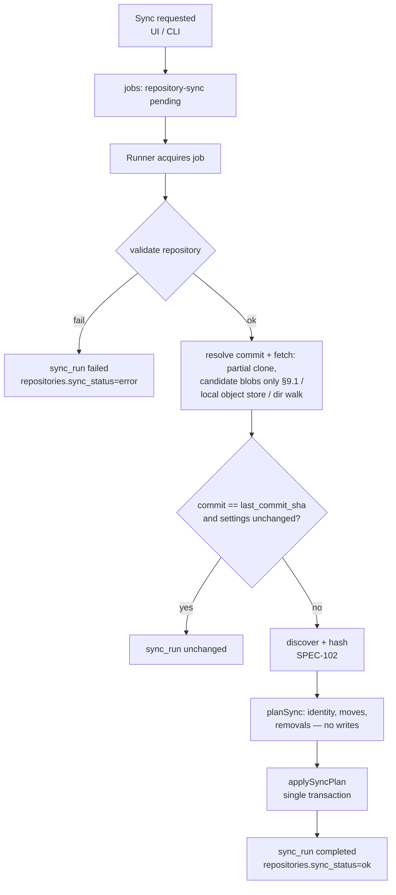

# SPEC-105 — Repository Synchronization

## 1. Summary

Synchronisation brings the artifact registry up to date with a registered repository ([SPEC-104](2026-10-14-repository-management.md)). A sync fetches the selected branch (hosted: a shallow, bare, blob-less partial clone in the data-dir cache into which only the files at candidate artifact paths are downloaded; local git: read from the object store; local directory: read from disk), discovers artifacts ([SPEC-102](2026-10-14-artifact-discovery.md)), hashes them, detects changes against the previous state, creates immutable versions ([SPEC-103](2026-10-14-artifact-versioning.md)), updates occurrences, marks deletions and records a **sync run** with statistics, warnings and errors. User-owned metadata (categories, tags, notes, benchmark assignments) is never touched. Repository content is never executed. In the MVP sync is manual.

## 2. Motivation and problem statement

Artifacts change in their source repositories. Without a reliable, auditable sync, the registry drifts from reality, evaluations refer to stale content, and users lose trust. Sync must be deterministic, safe on untrusted repositories, non-destructive towards local organisation work, and transparent about what changed and what failed.

## 3. Goals

- One-click manual sync per repository and "sync all".
- Deterministic plan → apply pipeline; atomic database apply.
- Precise change detection: added, modified, unchanged, moved, removed, reappeared, error.
- Full sync history with statistics and per-item errors.
- Preservation of local metadata across any number of syncs.
- Zero execution of repository content; minimal network and disk use.

## 4. Non-goals

- Two-way sync, publishing changes back (future PR/MR publishing).
- Webhooks and scheduled sync (future).
- Syncing every historical commit (only the selected branch head at sync time).
- Automatic benchmark runs on new versions (future, §19).

## 5. User stories

- US-105-01: As a user, I click "Sync" on a repository and see which artifacts were added, changed, moved or removed.
- US-105-02: As a user, I want categories and notes I assigned to remain after syncs, even if the file was moved.
- US-105-03: As a user, I want a failed sync (network, auth) to leave the registry unchanged and tell me why.
- US-105-04: As a user, I want one broken `SKILL.md` not to prevent the other 40 artifacts from syncing.
- US-105-05: As a user, I want to see the history of syncs with commit SHAs.

## 6. Functional requirements

| ID | Requirement |
|----|-------------|
| FR-105-01 | **Trigger**: manual only in the MVP — "Sync" per repository, "Sync all" (enabled repositories), and the future CLI `directivebench sync [repository]` ([SPEC-009](2026-10-14-cli-architecture.md)). |
| FR-105-02 | A sync SHALL execute as a job in the runner (new job type `repository-sync`, payload `{ repositoryId, ref? }`), not in the web process ([SPEC-008](2026-10-14-api-architecture.md) principle 1, [SPEC-114](2026-10-14-runner-management.md)). Job lifecycle, cancellation and crash recovery follow the job model (pending → running → completed/failed/cancelled/interrupted). |
| FR-105-03 | At most one sync per repository SHALL be pending or running; a second request returns the existing job. |
| FR-105-04 | The repository SHALL be validated first ([SPEC-104](2026-10-14-repository-management.md) FR-104-10); validation failure fails the sync with the validation error code, no registry changes. |
| FR-105-05 | **Fetch** — `github`/`gitlab`: download only the content of **candidate paths** of one commit. Candidate paths are the files that [SPEC-102](2026-10-14-artifact-discovery.md) would read: paths matching a registered format pattern (FR-102-01, §8.2) and, for each `SKILL.md`, the regular files of its skill directory (FR-102-12), after exclude globs and include roots (FR-102-15, [SPEC-104](2026-10-14-repository-management.md) FR-104-13). The cache is a bare, shallow, single-branch, blob-less partial clone at `<dataDir>/cache/repos/<repositoryId>.git`, filled in the five steps of §9.1: (1) fetch the commit and its trees only (`git clone --bare --filter=blob:none --depth 1 --single-branch --branch <ref> --no-tags`, later `git fetch --depth 1 --filter=blob:none`); (2) list the tree without reading blobs; (3) select candidate blobs; (4) fetch exactly those blobs by object ID in one batched request; (5) read them from the object store with lazy fetching disabled. Blobs of non-candidate paths are never downloaded and no working tree or sparse checkout is ever created. Public GitHub repositories are fetched over HTTPS **without credentials** ([D06](research/decisions/D06-public-github-by-url-in-now.md), [ADR-0012](../decisions/0012-partial-fetch-of-candidate-paths.md)); every git call uses the hardened invocation of §9.1, which extends FR-104-12. `local-git`: no clone; read objects of the user's repository read-only (`git -C <path> rev-parse <ref>^{commit}`, `ls-tree -r -z --long`, `cat-file --batch`). `local-directory`: walk the filesystem. No working tree is ever checked out. |
| FR-105-06 | **Snapshot**: for git sources, the sync reads exactly one commit (resolved SHA recorded); file bytes come from git blobs (bytes as committed; symlinks identified by mode `120000`, submodules by mode `160000` and skipped). For local directories the snapshot is the on-disk state during the walk (not atomic; see §14). |
| FR-105-07 | **Discovery & hashing** via [SPEC-102](2026-10-14-artifact-discovery.md) with the repository's discovery settings; limits and safety rules apply. |
| FR-105-08 | **Plan**: the sync SHALL compute a `SyncPlan` (pure, no DB writes) by comparing discovered artifacts with the repository's current occurrences, applying identity resolution ([SPEC-101](2026-10-14-artifact-registry.md) §8.3) and move detection ([SPEC-103](2026-10-14-artifact-versioning.md) FR-103-09). Each item gets a change kind: `added`, `modified`, `unchanged`, `moved`, `removed`, `reappeared`, `error`. |
| FR-105-09 | **Apply**: the plan SHALL be applied in one database transaction: create artifacts (new IDs, unique slugs), record versions (dedup), insert/update occurrences (`latest_version_id`, `commit_sha`, `last_seen_at`, `status`), mark missing occurrences `removed`, update parser-owned artifact fields (`name`, `description`) from the newest observed version, update the repository (`last_commit_sha`, `last_sync_at`, `sync_status='ok'`, `sync_error=null`), and finalise the sync run. If the transaction fails, nothing is applied and the sync run is `failed`. |
| FR-105-10 | **Fast path**: if the resolved commit SHA equals `last_commit_sha`, discovery settings and the discovery/parser version are unchanged, and the previous sync succeeded, the sync SHALL complete as `unchanged` without discovery. `local-directory` has no fast path. |
| FR-105-11 | **Per-item errors** (discovery errors, limit violations) SHALL NOT fail the sync: the affected occurrence keeps its previous version and stays `active` (or is not created if new), and the error is recorded in the sync run. The sync status is `completed` with `errorCount > 0` and the repository `sync_status` is `ok` with a warning indicator. |
| FR-105-12 | **Deletion handling**: an occurrence whose path is not discovered in a successful snapshot (and is not explained by a move) SHALL be set to `removed`. Nothing is deleted. If the occurrence's path was excluded by changed discovery settings, it is also `removed`, with reason `excluded`. A previously removed occurrence found again becomes `active` (`reappeared`). |
| FR-105-13 | **Metadata preservation**: sync SHALL NEVER modify `artifacts.notes`, `artifacts.tags`, `artifact_categories`, `artifact_benchmark_assignments`, any user override columns (planned), or any evaluation data. These belong to the artifact ID and therefore survive content changes, moves and remove/reappear cycles. `artifacts.slug` is never changed by sync after creation. |
| FR-105-14 | **Sync history**: every sync SHALL create a `sync_runs` row (planned table) with repository, job, trigger, ref, resolved commit SHA, status, timings, statistics, warnings, errors; and per-item results (`sync_run_items`, planned) with path, change kind, artifact ID, old/new version IDs, message. |
| FR-105-15 | **Error reporting**: on failure the repository gets `sync_status='error'` and a redacted `sync_error` message; the previous registry state is unchanged. Messages never include secrets, credential-bearing URLs or absolute paths outside the data dir/repository location. |
| FR-105-16 | **Conflicts**: (a) concurrent syncs of one repository are prevented (FR-105-03); (b) ambiguous moves are resolved as remove + add with a warning; (c) slug collisions get numeric suffixes; (d) a discovered artifact whose content equals versions of *several* existing artifacts links to none automatically (new artifact + "possible duplicate" warning); (e) user edits during a running sync never conflict because sync does not write user-owned fields; (f) history rewrites/force pushes upstream are irrelevant — the new head is simply snapshotted. |
| FR-105-17 | **Cancellation**: cancelling during fetch or discovery aborts child processes and leaves the registry unchanged (`cancelled`); cancellation is not honoured once the apply transaction has started. |
| FR-105-18 | **No execution**: sync SHALL NOT execute, source, import or interpret any file from the repository; no hooks, filters, LFS smudge, submodules or package scripts (see [SPEC-104](2026-10-14-repository-management.md) FR-104-12). |
| FR-105-19 | **Cache management**: cache directories are owned by DirectiveBench, may be deleted at any time (the next sync re-clones), are removed when the repository is removed, and are listed with sizes in Settings (future, [SPEC-115](2026-10-14-settings-and-configuration.md)). |
| FR-105-20 | **Dry run** (planned): compute and display the `SyncPlan` without applying it. |

## 7. Non-functional requirements

- NFR-105-01: Sync of an already-cached repository with 200 artifacts completes in < 10 s excluding network transfer.
- NFR-105-02: Disk use per hosted repository ≈ the commit and tree objects of one commit plus the blobs at candidate paths (bare, no working tree, no blobs of non-candidate paths) — for a typical repository well under the size of one shallow commit. Network transfer per first sync is of the same size; a later sync downloads the new commit's trees and only the candidate blobs not already in the cache (blobs are content-addressed and reused). Unreachable objects of earlier commits are not pruned in place; the cache is re-created when it exceeds the clone size limit (§12).
- NFR-105-03: Apply transaction bounded (batched inserts) so the web process is not blocked for > 1 s (SQLite WAL, `busy_timeout`, [ADR-0002](../decisions/0002-sqlite-with-node-sqlite.md)).
- NFR-105-04: Idempotent: running sync twice on the same commit produces no new versions and an `unchanged` second run.
- NFR-105-05: Deterministic plans for identical inputs (sorted processing).

## 8. Domain entities and contracts

Existing tables touched: `repositories`, `artifacts`, `artifact_versions`, `artifact_occurrences`, `jobs` ([SPEC-006](2026-10-14-database-schema.md), `packages/database/src/schema.ts`). Planned: `jobs.type` value `repository-sync`; tables `sync_runs`, `sync_run_items`.

```ts
type SyncChangeKind = 'added' | 'modified' | 'unchanged' | 'moved' | 'removed' | 'reappeared' | 'error';

interface SyncPlanItem {
  kind: SyncChangeKind;
  path: string;                         // occurrence path (new path for moves)
  previousPath?: string;                // moves
  artifactId: string | null;            // null for new artifacts until apply
  previousVersionId: string | null;
  discovered?: DiscoveredArtifact;      // SPEC-102
  removalReason?: 'missing' | 'excluded';
  message?: string;                     // errors/warnings
}

interface SyncPlan {
  repositoryId: string;
  ref: string | null;                   // branch; null for local-directory
  commitSha: string | null;
  items: SyncPlanItem[];                // sorted by path
  warnings: string[];
}

interface SyncRun {                     // planned table sync_runs
  id: string;                           // 'syn_…'
  repositoryId: string;
  jobId: string | null;
  trigger: 'manual' | 'cli' | 'scheduled' | 'webhook';   // MVP: manual, cli
  ref: string | null;
  commitSha: string | null;
  status: 'running' | 'completed' | 'unchanged' | 'failed' | 'cancelled' | 'interrupted';
  stats: { scannedFiles: number; discovered: number; added: number; modified: number;
           unchanged: number; moved: number; removed: number; reappeared: number; errors: number };
  warnings: string[];
  error: { code: string; message: string } | null;   // redacted
  startedAt: string;
  finishedAt: string | null;
}

interface SyncRunItem {                 // planned table sync_run_items
  id: string; syncRunId: string; path: string; previousPath: string | null;
  kind: SyncChangeKind; artifactId: string | null;
  previousVersionId: string | null; newVersionId: string | null;
  message: string | null;
}

/** Planned engine-style function (pure planning) and runner job handler. */
function planSync(input: { repositoryId: string; snapshot: DiscoveryResult; current: ArtifactOccurrence[];
  versionsByHash: Map<string, { artifactId: string; versionId: string }[]> }): SyncPlan;
function applySyncPlan(db: Database, plan: SyncPlan, syncRunId: string): Promise<SyncRun>;
```

## 9. Data flow



### 9.1 Hosted fetch: candidate paths only

Applies to `github` and `gitlab` repositories. In the current scope only public repositories are fetched, without credentials ([D06](research/decisions/D06-public-github-by-url-in-now.md)); a later credentialed fetch ([SPEC-104](2026-10-14-repository-management.md) FR-104-08/09) uses the same steps. Rationale and rejected alternatives (sparse checkout, GitHub REST API, full shallow clone): [ADR-0012](../decisions/0012-partial-fetch-of-candidate-paths.md).

| Step | Command (argv; hardened prefix below omitted) | Result |
|------|-----------------------------------------------|--------|
| 0. Resolve | `git ls-remote <url> refs/heads/<ref>` | Commit SHA. If it equals `last_commit_sha` and the other FR-105-10 conditions hold, the sync ends `unchanged` with no fetch. |
| 1. Commit and trees | First sync: `git clone --bare --filter=blob:none --depth 1 --single-branch --branch <ref> --no-tags --template= -- <url> <cacheDir>` (`--template=`: no template files, so no sample hooks). Later: `git -C <cacheDir> fetch --depth 1 --filter=blob:none --no-tags origin +refs/heads/<ref>:refs/heads/<ref>`. | Commit and tree objects only; no blobs. The **snapshot commit** is then read from the cache (`git -C <cacheDir> rev-parse --verify refs/heads/<ref>^{commit}`): steps 2–5 read it and the sync records it (FR-105-06). Step 0's SHA is used only for the fast path, because the branch can move between step 0 and step 1. |
| 2. List | `git -C <cacheDir> ls-tree -r -z --full-tree <snapshot>` (no `--long`: sizes of absent blobs are unknown and reading them would fetch them). | `{ mode, type, oid, path }[]` of the whole commit. |
| 3. Select | Pure function over the listing (no git call): normalise paths (FR-102-02); drop `.git/`, `node_modules/`, exclude globs, paths outside include roots (FR-102-15, FR-104-13); keep paths that classify as a format (FR-102-01); for each `SKILL.md` add the regular files under its directory except nested skill subtrees (FR-102-12). Mode `120000` (symlink) and `160000` (submodule) entries are never fetched — discovery handles them from the mode (FR-102-18, FR-105-06). Count limits are enforced here, before any download: more than 10 000 candidate artifacts aborts the sync; a skill with more than 500 files becomes an item error and its files are not fetched (FR-102-16). | Sorted, de-duplicated blob object IDs. |
| 4. Fetch blobs | `git -C <cacheDir> fetch --no-tags --no-write-fetch-head --recurse-submodules=no --filter=blob:none --stdin origin`, object IDs on stdin, with `-c fetch.negotiationAlgorithm=noop`. IDs already in the cache (`cat-file --batch-check` with lazy fetching disabled) are not requested. | Exactly the candidate blobs, in one request. |
| 5. Read | `git -C <cacheDir> cat-file --batch` with lazy fetching disabled; never `--filters` or `--textconv`. A missing object is a sync error, never a trigger for an implicit fetch. | Bytes as committed, for discovery and hashing (FR-105-06, FR-105-07). |

Byte limits (FR-102-16) are checked after step 5, because git does not expose blob sizes before download; the transfer itself is bounded by the clone size limit and the network timeout (§12). If a server ignores `--filter` (git warns and clones in full), the sync stays correct but transfers the whole commit: it records a warning and the clone size limit still applies. `github.com` and `gitlab.com` support partial clone; self-managed GitLab support is an Assumption — requires validation.

**Hardened invocation** — every git call of this section:

- Is spawned with an argv array and no shell; the URL is the normalised, credential-free `https://` location ([SPEC-104](2026-10-14-repository-management.md) FR-104-04/05) passed after `--` where git accepts it; the user's input never becomes an option.
- Carries `-c core.hooksPath=/dev/null -c core.fsmonitor=false -c protocol.allow=never -c protocol.https.allow=always -c credential.helper= -c credential.interactive=false -c submodule.recurse=false -c http.followRedirects=false -c maintenance.auto=false -c gc.auto=0` (FR-104-12 plus: only HTTPS, no credential helper or prompt, no redirects ([SPEC-201](2026-10-14-integration-github.md) §5.1), no background maintenance process). `/dev/null` has its platform equivalent on Windows. Integration tests allow the `file` protocol instead of `https` through the same mechanism; production code never does.
- Runs with an environment built from an allowlist, not inherited: `PATH`, `LANG`/`LC_ALL=C`, `TZ`, `HOME` set to an empty DirectiveBench-owned directory, `GIT_CONFIG_NOSYSTEM=1`, `GIT_CONFIG_GLOBAL=/dev/null` (the user's `url.*.insteadOf`, credential helpers, `http.sslVerify` and `core.sshCommand` never apply), `GIT_TERMINAL_PROMPT=0`, `GCM_INTERACTIVE=never`, `GIT_ASKPASS`/`SSH_ASKPASS` unset, `GIT_LFS_SKIP_SMUDGE=1`, and `GIT_NO_LAZY_FETCH=1` for steps 2 and 5 and the step 4 pre-check (step 3 runs no git command). Proxy variables (`HTTPS_PROXY`, `HTTP_PROXY`, `NO_PROXY`, lower-case variants) are forwarded when set and registered for redaction, since they may embed credentials. This follows the env-allowlist rule of [SPEC-007](2026-10-14-security-and-privacy.md) §3–§4; on Windows its variables `SystemRoot`, `PATHEXT` and `COMSPEC` are added.
- Keeps TLS verification on: `http.sslVerify=false` and `GIT_SSL_NO_VERIFY` are never set or forwarded ([SPEC-007](2026-10-14-security-and-privacy.md) §7).
- Has a named timeout per step and is killed with its process tree on timeout or cancellation (FR-105-17).
- Never executes, checks out or filters repository content: no working tree, no `.gitattributes` filters, no LFS smudge, no hooks, no submodules (FR-105-18).

Without credentials a private or non-existent GitHub repository fails at step 0 with no prompt; the error maps to `auth-required` ([SPEC-104](2026-10-14-repository-management.md) §13), worded as "not found or not public" for the no-credential case, and nothing is stored.

## 10. API and interface design

| Interface | Contract |
|-----------|----------|
| Server Action `syncRepository({ repositoryId })` | Enqueues/returns the `repository-sync` job; `409 conflict`-style error if the repository is disabled or never validated successfully. |
| Server Action `syncAllRepositories()` | Enqueues one job per enabled repository (deduplicated). |
| Read functions | `listSyncRuns(repositoryId)`, `getSyncRun(id)` with items. |
| Runner job handler | `repository-sync` handler in `@directivebench/runner`, using planned `packages/git-providers` (`openTree`) and core discovery. |
| CLI (future) | `directivebench sync [--all] [<repository-id|name>] [--dry-run]`, exit code ≠ 0 on failure. |
| `/api/v1` (planned) | `POST /api/v1/repositories/:id/sync`, `GET /api/v1/repositories/:id/sync-runs`. |

## 11. UI/UX considerations

- Bootstrap: no sync UI (Repositories page is "Planned — not implemented").
- Planned: "Sync" button per repository shows progress (fetching → discovering → applying), then a summary: `+3 added · 2 modified · 1 moved · 1 removed · 1 error`.
- Sync history tab: table of runs (time, commit short SHA, status, counts); run detail lists items grouped by change kind, with links to artifacts/versions and error messages.
- Artifact detail shows "Removed upstream (sync of <date>)" for removed occurrences and the commit the version was observed in.
- A banner during an active sync; the rest of the UI stays usable.

## 12. Security considerations

Repository content is untrusted ([SPEC-007](2026-10-14-security-and-privacy.md), [ADR-0007](../decisions/0007-local-runner-execution-and-isolation.md)).
- No execution (FR-105-18); bare clones avoid checkout filters and working-tree attacks; hardened git invocation with an environment allowlist and TLS verification on (§9.1).
- Only candidate blobs are downloaded (FR-105-05), so untrusted non-artifact content (binaries, build output, large assets) never reaches the disk.
- Symlinks, submodules and path escapes are never followed.
- Resource limits from [SPEC-102](2026-10-14-artifact-discovery.md); clone size limit (planned config, default 500 MiB — Assumption — requires validation) applies to the cache directory during and after each fetch step and aborts with a clear error. While a fetch runs, the runner polls the cache directory size at a named interval (`CACHE_SIZE_POLL_INTERVAL_MS`, default 1 s — Assumption) and kills the git process tree as soon as the size exceeds the limit, because blob sizes are unknown before download (§9.1) and one huge candidate blob would otherwise be transferred in full.
- Public repositories are fetched without credentials: no credential helper, prompt or askpass runs, and a repository that needs authentication fails instead of prompting (§9.1, [D06](research/decisions/D06-public-github-by-url-in-now.md)). Credentialed fetch (later) resolves credentials per [SPEC-104](2026-10-14-repository-management.md) FR-104-08/09, redacted from all git output.
- Cache directory created with user-only permissions (0700 on POSIX).

## 13. Error handling

| Failure | Result |
|---------|--------|
| Validation / auth / network / timeout | Sync run `failed`, repository `sync_status=error`, registry unchanged. |
| Clone corrupted, or a candidate blob still missing after step 4 (§9.1) | Delete cache directory, retry clone once, else fail. |
| Cache exceeds the clone size limit | Abort the fetch, delete the cache directory, fail with a clear error naming the limit. |
| Per-artifact discovery error | Item `error`; sync `completed` with errors (FR-105-11). |
| Apply transaction error (e.g. constraint) | Rollback; sync run `failed`; error logged locally with details. |
| Runner crash mid-sync | Job `interrupted` via stale heartbeat; sync run `interrupted`; partial cache is discarded on next run; registry unchanged (apply is transactional). |
| Cancellation | `cancelled` before apply; ignored during apply. |

## 14. Edge cases

- Local directory modified during the walk → snapshot may mix states; detected via mtime/size re-check of primary files after hashing; on mismatch the item is retried once, else `error`.
- Branch deleted upstream → `branch-not-found`, sync fails; existing occurrences untouched (not marked removed).
- Repository becomes empty → all occurrences `removed` (only if the snapshot succeeded; guarded by a confirmation warning if > 50 % of occurrences would be removed — planned).
- Discovery settings narrowed → occurrences outside scope become `removed` with reason `excluded`.
- File changes format at the same path (impossible by path-based detection) — n/a; a renamed extension is remove + add.
- Same artifact in two repositories: each repository's sync updates only its own occurrences.
- Artifact edited and moved in the same commit → remove + add ([SPEC-103](2026-10-14-artifact-versioning.md) FR-103-10).
- Parser upgrade in a new DirectiveBench release changes parsed metadata but not bytes → content hash unchanged → no new version; parsed metadata of existing versions remains as stored (immutable). Re-parsing is a future explicit migration.

## 15. Testing strategy

Per [SPEC-012](2026-10-14-testing-strategy.md):
- Unit: `planSync` table-driven — added/modified/unchanged/moved (dir and single file)/ambiguous move/removed/reappeared/excluded/error.
- Integration: local git fixture repositories created in tmp with scripted commits (add, edit, move, delete, revert) → run sync handler end-to-end against a temp SQLite; assert versions, occurrences, sync runs; idempotency (second run unchanged).
- "Hosted" path tested with a local bare repository via `file://` path (no network); the fixture repository sets `uploadpack.allowFilter=true` so partial clone works. Assert that after a sync the cache holds the blobs of candidate paths and none of a large non-candidate file (`cat-file --batch-check --batch-all-objects`), and that a second sync after an edit fetches only the changed candidate blob.
- Unit: candidate selection (§9.1 step 3) table-driven over tree listings — formats, skill directories with nested skills, excludes and include roots, symlink and submodule modes, count limits.
- Unit: the hardened argv and environment of each step are exact (no inherited variables, no credential helper, TLS options untouched).
- Integration: the remote branch moves between step 0 and step 1 → the sync reads and records the fetched commit, not the one resolved in step 0.
- Integration: a candidate blob larger than a test-sized clone size limit → the fetch is killed, the cache directory deleted and the sync fails with the limit error.
- Metadata preservation test: assign categories/tags/notes, then move + modify + remove + reappear → metadata intact.
- Security: fixture repository containing hooks, fsmonitor config, LFS pointers, submodules, symlinks pointing outside → no execution, no escapes.
- Crash test: kill the runner between plan and apply → registry unchanged, job `interrupted`.

## 16. Acceptance criteria

- [ ] Syncing a fixture repository creates one artifact per supported file/skill and a `completed` sync run with correct counts.
- [ ] A second sync on the same commit is `unchanged` and creates no versions.
- [ ] Editing a skill creates exactly one new version; moving it keeps the artifact ID; deleting it marks the occurrence `removed`.
- [ ] Categories, tags, notes and benchmark assignments survive all of the above.
- [ ] A broken `SKILL.md` produces an item error while all other artifacts sync.
- [ ] An auth failure leaves the registry unchanged and shows a redacted error.
- [ ] No file of the repository is executed (security fixture).
- [x] Hosted repositories are stored only as bare, shallow, blob-less partial clones under `<dataDir>/cache/` that contain no blobs of non-candidate paths (#18, verified against local bare repositories and github.com).
- [x] A public GitHub repository syncs with no credential, prompt or credential helper involved; a private or non-existent one fails with a "not found or not public" error and nothing is stored (#18; the "sync" is the `repository-scan` job).

## 17. Dependencies

[SPEC-104](2026-10-14-repository-management.md), [SPEC-102](2026-10-14-artifact-discovery.md), [SPEC-103](2026-10-14-artifact-versioning.md), [SPEC-101](2026-10-14-artifact-registry.md), [SPEC-114](2026-10-14-runner-management.md) (job processing), [SPEC-201](2026-10-14-integration-github.md)/[SPEC-202](2026-10-14-integration-gitlab.md), [ADR-0007](../decisions/0007-local-runner-execution-and-isolation.md), [ADR-0008](../decisions/0008-secret-storage-and-authentication.md), [ADR-0012](../decisions/0012-partial-fetch-of-candidate-paths.md), `git` CLI ≥ 2.44 for hosted repositories (`GIT_NO_LAZY_FETCH`; Assumption — requires validation of the minimum version, [SPEC-104](2026-10-14-repository-management.md) NFR-104-03).

## 18. Open questions

- OQ-105-01: Should sync of `local-git` read the selected branch's commit (proposed) or HEAD of the current checkout?
- OQ-105-02: Safety threshold for mass removals — confirm or auto-apply?
- OQ-105-03: Should per-item results be stored in a table (`sync_run_items`) or as JSON on `sync_runs` (simpler, fine for MVP sizes)?
- ~~OQ-105-04: Partial clone (`--filter=blob:none` + sparse fetch of only candidate paths) to reduce transfer for huge monorepos — worth the complexity?~~ **Closed 2026-10-17:** yes. The maintainer accepted fetching only candidate paths together with registering public GitHub repositories by URL ([D06](research/decisions/D06-public-github-by-url-in-now.md)); FR-105-05 and §9.1 specify a blob-less partial clone plus an explicit fetch of candidate blobs, without sparse checkout ([ADR-0012](../decisions/0012-partial-fetch-of-candidate-paths.md)).

## 19. Future extensions

- Scheduled sync (interval per repository) and webhooks (GitHub/GitLab push events; requires a reachable endpoint — only in self-hosted mode, [SPEC-011](2026-10-14-self-hosting-architecture.md)).
- Publishing artifact changes as PR/MR (explicit write permission; separate spec).
- Auto-enqueue benchmarks for assigned suites when a new version appears.
- Re-parse migration when parsers change (new derived metadata without new versions).
- Multi-branch tracking (e.g. compare `main` vs `develop` versions).

## 20. Implementation status

- **Implemented (schema only, verified by `packages/database/test/client.test.ts` migrations):** repository status columns (`last_commit_sha`, `last_sync_at`, `sync_status`, `sync_error`).
- **Partially implemented — scan of local repositories (issue #16; verified on 2026-10-19 by `packages/runner/test/repository-scan.test.ts`, `packages/database/test/{artifacts,jobs}.test.ts` and the Playwright tests):**
  - FR-105-01/02: manual "Scan" per local repository on the Repositories page enqueues a runner job; it is named `repository-scan` (not `repository-sync`) because it covers local repositories only and has no plan/apply change detection yet. FR-105-03: one pending or running scan per repository (check and insert in one transaction; a second request returns the existing job).
  - FR-105-05/06 for local providers — **deviation for `local-git` (decided by the maintainer for M1 on 2026-10-19, commit-based reads in M2; [SPEC-104](2026-10-14-repository-management.md) OQ-104-02):** both local providers walk the files on disk; `local-git` is not read from the object store, so uncommitted, untracked and git-ignored files are included, submodule contents are walked like directories (not skipped by mode), and no commit is resolved or recorded. No git command runs during a scan.
  - FR-105-07, FR-105-11, FR-105-18: discovery per [SPEC-102](2026-10-14-artifact-discovery.md); per-artifact errors are listed in the result and do not fail the scan; nothing is executed. An artifact with an error — including a skill with an unreadable directory or file, or skills behind an unreadable directory — is not written, so its occurrence keeps its latest version, `active` status and last-seen time (verified by `packages/runner/test/repository-scan.test.ts` and `packages/database/test/artifacts.test.ts`, 2026-10-19). Exceeding a per-scan limit of FR-102-16 fails the scan under FR-105-15.
  - FR-105-09 subset: all versions and occurrences of one scan and the repository status (`last_sync_at`, `sync_status = 'ok'`, `sync_error = null`, `last_commit_sha = null`) are written in one transaction; identity is SPEC-101 §8.3 rule 1 (same repository and path) and rule 4 (new artifact, slug suffixed on collision); inside the scan transaction the slugs a base name can collide with are read once per distinct base and suffixes are allocated in memory, so N same-named new artifacts (e.g. a skill with the same frontmatter `name` in every package of a monorepo) cost one slug query, not about N²/2, while `BEGIN IMMEDIATE` is held (final Codex review of PR #44; verified on 2026-10-20 by `packages/database/test/artifacts.test.ts` — 3,000 same-named skills get `review`, `review-2` … `review-3000` with one slug statement, where the old loop issued 4,501,500 — plus slugs taken by earlier scans, gaps, slugs another base took in the same scan, and bases with `%`, `_` or `\`); parser-owned `name`/`description` follow the newest observation. FR-105-15: a scan that cannot run (location missing, moved, replaced by a symlink, unreadable, filesystem root) or fails unexpectedly (an I/O error while checking or walking the location, the apply transaction failing) sets `sync_status = 'error'` with the message and changes no artifact; the job finishes `failed` with the typed outcome kept in `jobs.result`, and the message names an error code or a repository-relative path, never the absolute location; when storing the results fails while one artifact is written, the message names that artifact's occurrence path as the place the write stopped, without blaming it, because the cause can as well be the connection (`SQLITE_FULL`, an I/O error, a closed handle): `The scan failed while storing the results at <path> (<code>).`, redacted, never the error text, which can hold file contents (third Codex review of PR #44; wording corrected after the review at `2d668f3`, verified on 2026-10-20 by `packages/database/test/artifacts.test.ts` — a full database, `max_page_count`, and unserialisable metadata — and `packages/runner/test/repository-scan-errors.test.ts`). FR-105-17: cancellation is honoured until the apply transaction starts, and the transaction itself, before any write, re-checks that the job is still running and that the job's abort signal (user cancellation or runner shutdown) has not fired — the transaction can wait behind another one on the shared connection, and a shutdown leaves no trace in the job row; such a scan writes nothing and the job ends `interrupted` (shutdown) or `cancelled` (verified by `packages/database/test/artifacts.test.ts` and `packages/runner/test/repository-scan.test.ts`, which aborts through `stop()` while the apply transaction waits; second Codex review of PR #44, 2026-10-19).
  - NFR-105-04 for local scans: an unchanged tree creates no versions on rescan. NFR-105-03 — **accepted deviation for M1 (maintainer, 2026-10-19):** a scan is applied in one transaction, not in batches, so its atomicity holds. Measured worst case: 10,000 changed artifacts hold the write lock for about 2.4 s (2026-10-19; below the 5 s `busy_timeout`, so web writes wait but do not fail); 200 artifacts take well under 0.1 s. Follow-up: revisit batched writes if the lock hurts in practice.
  - The outcome is stored in `jobs.result` (`{ ok, scannedFiles, discovered, createdArtifacts, createdVersions, warningCount, errorCount, errors[≤ 100], durationMs }` or `{ ok: false, code, message }`) instead of `sync_runs`.
- **Partially implemented — scan of public GitHub repositories (issue #18; verified on 2026-10-20 by `packages/runner/test/{git-process,hosted-git,hosted-repository,hosted-repository-limits}.test.ts` — local bare repositories with `uploadpack.allowFilter` over `file://`, no network — `packages/core/test/discovery-tree.test.ts`, and a manual run of the built CLI that registered and scanned `https://github.com/anthropics/skills`: 445 files listed, 324 candidate blobs fetched of 445, README and other non-candidates absent from the cache, 20 artifacts with the commit recorded, rescan with no new versions):**
  - FR-105-02: the same `repository-scan` job type runs for `github` repositories (the runner dispatches by provider).
  - FR-105-05, §9.1 steps 1–5: the cache is `<dataDir>/cache/repos/<repositoryId>.git` (directories 0700, git's `HOME` an empty 0700 `<dataDir>/cache/git-home`). Step 1 is `clone --bare --filter=blob:none --depth 1 --single-branch --no-tags --template= --branch <b>` (`--template=` added: no sample hooks or other template files in the cache) or, when the cache exists, `fetch --depth 1 --filter=blob:none --no-tags --no-write-fetch-head --recurse-submodules=no origin +refs/heads/<b>:refs/heads/<b>`; the snapshot is then read from the cache (`rev-parse --verify`). Step 2 `ls-tree -r -z --full-tree` (paths parsed from raw bytes, never from redacted output; non-UTF-8 names and unknown modes fail the scan). Step 3 `selectCandidateFiles` (`core`), built on the same classification as the walker, so discovery reads exactly the selected paths; `.git/`/`node_modules/` at any depth, symlinks and submodules (mode `160000`, skipped) are never fetched, and a tree path with `.`/`..`/empty segments fails the scan before any download. Step 4: `cat-file --batch-check` (lazy fetch disabled), then one `fetch --stdin` of the missing blob IDs with `fetch.negotiationAlgorithm=noop`, then a second check; a blob still missing fails the scan. Step 5: `cat-file --batch` of the blobs within the largest per-file limit (5 MiB), whose total must stay within `maxScanBytes`; larger blobs are reported `too-large` from their size. Discovery runs on the listed tree (`discoverArtifactsInTree`) with the walker's rules, which a test proves by comparing it with a walk of the same tree on disk.
  - FR-105-06/09: every occurrence and new version records the snapshot commit (`commit_sha`, `source_commit_sha`) and the repository `last_commit_sha`; the result names it (`commitSha`).
  - §9.1 hardened invocation: argv only, absolute git, `-c core.hooksPath=/dev/null -c core.fsmonitor=false -c protocol.allow=never -c protocol.https.allow=always -c credential.helper= -c credential.interactive=false -c submodule.recurse=false -c http.followRedirects=false -c maintenance.auto=false -c gc.auto=0`; environment from an allowlist (`PATH` absolute entries, `LANG`/`LC_ALL=C`, `TZ`, `HOME` = the empty cache home, `GIT_CONFIG_NOSYSTEM=1`, `GIT_CONFIG_GLOBAL=/dev/null`, `GIT_TERMINAL_PROMPT=0`, `GCM_INTERACTIVE=never`, `GIT_LFS_SKIP_SMUDGE=1`, `GIT_NO_LAZY_FETCH=1` for local reads, proxy variables forwarded and redacted, `SystemRoot`/`PATHEXT`/`COMSPEC`); a test proves that the user's global config (hooks path, credential helper, filter, `url.insteadOf`), `GIT_CONFIG_PARAMETERS`, `GIT_ASKPASS` and `GIT_SSL_NO_VERIFY` have no effect. Tests reach a local bare repository only through a transport object passed to `LocalRunner` in code (`protocol.file.allow` instead of `https`); production code always uses HTTPS. Standard output of git is kept raw and bounded (never redacted); error output is redacted.
  - Timeouts (named, `HOSTED_GIT_TIMEOUTS`): `version` 5 s, `ls-remote` 30 s, clone/fetch 5 min, reads 60 s; git is killed with its process group (1 s grace). §12 cache limit: `HOSTED_CACHE_LIMIT_BYTES` 500 MiB (constant, not configurable yet), measured every `CACHE_SIZE_POLL_INTERVAL_MS` (1 s) during each download and again after it; above it git is killed, the cache deleted and the scan fails `cache-limit-exceeded`.
  - §13: a failing fetch into an existing cache deletes it and clones afresh once in the same scan; any failed download deletes the cache, so the next scan starts clean. **Deviation:** a candidate blob still missing after step 4 fails the scan without the "delete and retry the clone once" of §13. Step 0 (`ls-remote` before fetching) and the FR-105-10 fast path are not implemented (rescans are #19): every scan fetches the branch head, which costs only the new commit's trees and the candidate blobs not already cached.
  - FR-105-15/17/18: failures set `sync_status = 'error'` with a message free of credentials and absolute paths; cancellation stops git and writes nothing; nothing from the repository is executed, checked out or filtered.
- **Not implemented:** GitLab and credentialed fetches, step 0 and the fast path, retry after a missing blob, a configurable cache limit, deleting the cache when a repository is removed (removal does not exist yet), `planSync`/`applySyncPlan` with move detection and change kinds, deletion handling and `reappeared` (#21), rules 2–3 of identity (#20), FR-105-10 fast path, `sync_runs`/`sync_run_items` tables and sync history, "Sync all", CLI `sync` command, dry run, batching of large applies.
