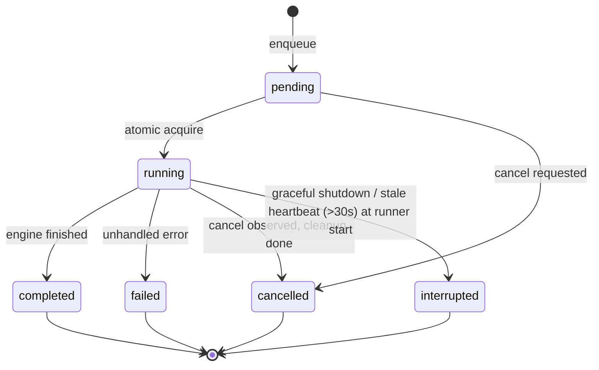

# SPEC-114 — Runner Management

## 1. Summary

Benchmark execution is decoupled from the web UI by a persistent, SQLite-backed job queue. The web app only **enqueues** jobs; the **runner** (`@directivebench/runner`), embedded in the CLI process (`serve`, `demo`), acquires jobs atomically, executes them through `@directivebench/benchmark-engine`, persists results, sends heartbeats, honours cancellation, recovers from crashes, and limits concurrency. Future standalone and remote runners use the same contracts over a lease-based protocol.

## 2. Motivation and problem statement

Benchmarks run for minutes, spawn processes, and must survive browser reloads. Running them inside Next.js request handlers would tie their lifetime to HTTP requests and the web server process, prevent cancellation, and make crash recovery impossible. A local-first tool should not require Redis or another service, so the queue lives in the same SQLite database ([ADR 0002](../decisions/0002-sqlite-with-node-sqlite.md), [ADR 0007](../decisions/0007-local-runner-execution-and-isolation.md)).

## 3. Goals

- Durable job queue in SQLite with explicit, finite statuses.
- Exactly-once acquisition among concurrent runners.
- Liveness via heartbeats; deterministic crash recovery without hidden retries.
- User-initiated cancellation that kills running processes.
- Bounded concurrency configurable by the user.
- Contracts that allow standalone/remote runners later without changing the engine.

## 4. Non-goals

- Distributed scheduling, priorities, or automatic retries in the MVP.
- A standalone `directivebench runner` command or remote runners in the bootstrap.
- Job types other than `benchmark-run` in the bootstrap (sync jobs are future, [SPEC-105](2026-10-14-repository-synchronization.md)).

## 5. User stories

- As a user, I click "Run benchmark", close the tab, reopen later and see the result.
- As a user, I cancel a running job and it stops within seconds.
- As a user whose laptop crashed mid-run, I restart DirectiveBench and see the job as "interrupted" with a "Run again" action — nothing re-runs behind my back.
- As a user with a powerful machine, I set `runner.concurrency` to 2.

## 6. Functional requirements

| ID | Requirement |
|---|---|
| FR-114-01 | Job statuses SHALL be exactly `pending`, `running`, `completed`, `failed`, `cancelled`, `interrupted`. Terminal: `completed`, `failed`, `cancelled`, `interrupted`. |
| FR-114-02 | Enqueue SHALL insert a row with `status = 'pending'`, `type = 'benchmark-run'`, a validated `payload` (`{ suiteVersionId, artifactVersionId }`), `attempts = 0`, `created_at`. The web app SHALL validate that the suite version exists and is execution-approved before enqueueing. |
| FR-114-03 | Acquisition SHALL be atomic: `UPDATE jobs SET status='running', runner_id=?, started_at=?, heartbeat_at=?, attempts=attempts+1 WHERE id = (SELECT id FROM jobs WHERE status='pending' ORDER BY created_at LIMIT 1) AND status='pending' RETURNING *`. Zero returned rows means nothing acquired. |
| FR-114-04 | The runner SHALL poll for pending jobs when it has free capacity (default poll interval 1 s; immediate re-poll after a job finishes). |
| FR-114-05 | While a job runs, the runner SHALL update `heartbeat_at` every **5 s**. |
| FR-114-06 | On runner start, before acquiring, the runner SHALL mark every `running` job whose `heartbeat_at` is older than **30 s** (or null) as `interrupted` with `finished_at` and an explanatory `error`; associated `benchmark_runs` in `running` state SHALL become `interrupted`. |
| FR-114-07 | Interrupted jobs SHALL NOT be retried automatically. The UI offers "Run again", which enqueues a new job. |
| FR-114-08 | Cancellation: the web app sets `cancel_requested_at` (for `pending` or `running` jobs). A `pending` job with a cancel request SHALL be moved directly to `cancelled` (atomic update guarded by `status='pending'`). |
| FR-114-09 | For a `running` job, the runner SHALL observe `cancel_requested_at` (checked at least on every heartbeat), abort the job's `AbortController`, wait for the engine to finish cleanup, and set `status='cancelled'`. |
| FR-114-10 | On normal completion the job SHALL become `completed` (even if the benchmark verdict is `failed`/`regression`); on an unhandled error before or during execution, `failed` with `error` (redacted). Quality outcomes never make a job `failed`. |
| FR-114-11 | The runner SHALL execute at most `runner.concurrency` jobs simultaneously (default 1, range 1–16, [SPEC-115](2026-10-14-settings-and-configuration.md)). |
| FR-114-12 | The runner SHALL run inside the CLI process for `serve` and `demo`; `demo` runs a single job headless and exits. |
| FR-114-13 | Graceful shutdown (SIGINT/SIGTERM): stop acquiring, abort running jobs, wait up to 10 s for cleanup, mark them `interrupted` (not `cancelled` — the user did not cancel them), then stop the web child process and exit. A second signal forces exit. |
| FR-114-14 | Each status transition SHALL be a single guarded UPDATE (`WHERE id=? AND status=<expected>`) so that concurrent actors cannot produce invalid transitions. |
| FR-114-15 | The runner SHALL log job lifecycle events (acquired, heartbeat failures, cancel observed, finished, recovered) as JSON lines to `<dataDir>/logs/runner.log` and to stderr at the configured verbosity; logs pass through secret redaction. |
| FR-114-16 | The runner SHALL persist engine events/results incrementally (agent run by agent run) so partially completed runs remain inspectable. |
| FR-114-17 | Each runner instance SHALL have a `runner_id` (e.g. `local-<hostname>-<pid>-<random>`) written to acquired jobs. |

### State diagram



## 7. Non-functional requirements

- SQLite in WAL mode with `busy_timeout` (5000 ms) shared by web and runner processes.
- Heartbeat writes are tiny single-row updates; they must not block web reads.
- Cancellation latency ≤ heartbeat interval + engine kill grace (≈ 10 s worst case).
- No external services (no Redis, no message broker).

## 8. Domain entities and contracts

`jobs` table ([SPEC-006](2026-10-14-database-schema.md), `packages/database/src/schema.ts`):

| Column | Type | Notes |
|---|---|---|
| `id` | text PK | prefixed random id |
| `type` | text | `benchmark-run` |
| `status` | text | see FR-114-01 |
| `payload` | JSON text | `{ suiteVersionId, artifactVersionId }` |
| `runner_id` | text | set at acquisition |
| `attempts` | integer | incremented at acquisition (diagnostics; no auto retry) |
| `error` | text | redacted |
| `cancel_requested_at` | text | ISO-8601 UTC |
| `created_at`, `started_at`, `heartbeat_at`, `finished_at` | text | ISO-8601 UTC |

Index `(status, created_at)` supports acquisition.

```ts
type JobStatus = "pending" | "running" | "completed" | "failed" | "cancelled" | "interrupted";

interface JobStore {                       // implemented by @directivebench/database repositories
  enqueue(type: "benchmark-run", payload: BenchmarkJobPayload): Promise<Job>;
  acquire(runnerId: string, now: string): Promise<Job | null>;
  heartbeat(jobId: string, runnerId: string, now: string): Promise<{ cancelRequested: boolean }>;
  finish(jobId: string, runnerId: string, status: "completed" | "failed" | "cancelled" | "interrupted", error?: string): Promise<void>;
  requestCancel(jobId: string, now: string): Promise<"cancelled" | "requested" | "not-cancellable">;
  recoverStale(now: string, staleAfterMs: number): Promise<number>;   // returns count interrupted
}

interface RunnerOptions {
  concurrency: number;            // config runner.concurrency
  heartbeatIntervalMs: number;    // 5000
  staleAfterMs: number;           // 30000
  pollIntervalMs: number;         // 1000
  keepWorkspaces: boolean;
  signal: AbortSignal;            // process shutdown
}

interface Runner { start(): Promise<void>; stop(reason: "shutdown"): Promise<void> }
```

## 9. Data flow

```mermaid
sequenceDiagram
  participant W as Web (Next.js)
  participant DB as SQLite (WAL)
  participant R as Runner (CLI process)
  participant E as Engine
  W->>DB: INSERT job (pending)
  loop poll
    R->>DB: UPDATE … WHERE status='pending' RETURNING
  end
  R->>E: runBenchmark(payload, AbortSignal)
  loop every 5 s
    R->>DB: UPDATE heartbeat_at; read cancel_requested_at
  end
  W->>DB: SET cancel_requested_at (user cancel)
  R->>E: abort()
  E-->>R: cleanup done
  R->>DB: status = cancelled | completed | failed
```

## 10. API and interface design

- Web: server actions `enqueueBenchmarkRun({ suiteVersionId, artifactVersionId })`, `cancelJob(jobId)`; Executions page lists jobs ([SPEC-113](2026-10-14-results-and-reporting.md)).
- CLI: runner started by `serve` and `demo` ([SPEC-009](2026-10-14-cli-architecture.md)). Future: `directivebench runner [--concurrency N] [--server URL --token-ref NAME]`.

## 11. UI/UX considerations

- Executions page: status badge, created/started/finished, duration, suite/artifact, "Cancel" for `pending`/`running` only, "Run again" for terminal jobs.
- `interrupted` explained: "The runner stopped while this job was running (shutdown or crash). It was not retried automatically."
- "Cancelling…" intermediate state while `cancel_requested_at` is set but status is still `running`.

## 12. Security considerations

- Jobs only reference immutable, execution-approved suite versions; the runner re-checks approval before execution (defence in depth).
- Payloads contain ids only, never secrets.
- Future remote runners: outbound-only authenticated connection; runner credentials scoped to job acquisition/reporting; per-runner identity; jobs signed or bound to the server's suite version hash ([SPEC-011](2026-10-14-self-hosting-architecture.md), [ADR 0009](../decisions/0009-self-hosted-readiness.md)).

## 13. Error handling

| Situation | Handling |
|---|---|
| `SQLITE_BUSY` beyond busy_timeout | Retry the statement with backoff (max 3); heartbeat failure logged; job continues |
| Heartbeat cannot be written for > 30 s | Runner aborts the job and marks it `interrupted` if possible (prevents duplicate execution after recovery) |
| Payload references missing suite/artifact version | `failed` with clear error |
| Suite version not approved | `failed`: "Suite version not approved for execution" |
| Engine throws | `failed`, benchmark run `error`, redacted message |
| Web enqueues while no runner is running (e.g. web started alone in dev) | Job stays `pending`; UI shows "No active runner" hint when the oldest pending job is older than 10 s and no job heartbeats exist |

## 14. Edge cases

- Two CLI processes on the same data dir: atomic acquire prevents double execution; the second process's recovery step could mark the first's jobs interrupted only if their heartbeat is stale (> 30 s), which a healthy runner never lets happen. A data-dir lock file for `serve` is recommended (open question).
- System clock jumps: heartbeats compare wall-clock ISO timestamps; large backwards jumps could delay staleness detection (documented limitation).
- Cancel requested exactly as the job completes: guarded UPDATE makes the first transition win; the other is a no-op.
- Laptop sleep > 30 s while running: on wake the same runner continues heartbeating; recovery only happens at runner start, so no false interruption.

## 15. Testing strategy

- Repository tests with real SQLite (`node:sqlite`): concurrent acquire from two connections yields exactly one winner.
- Fake-clock tests for heartbeat and stale recovery thresholds (30 s boundary).
- Cancellation tests for pending and running jobs; running job kills its child processes ([SPEC-110](2026-10-14-benchmark-execution.md)).
- Shutdown test: SIGTERM marks running jobs `interrupted`.
- Concurrency test: with `concurrency = 1`, a second pending job waits.

## 16. Acceptance criteria

- [ ] Only the six job statuses exist and transitions follow the state diagram.
- [ ] Two runners acquiring simultaneously never acquire the same job.
- [ ] A running job's `heartbeat_at` advances every ~5 s.
- [ ] After killing the CLI with SIGKILL and restarting, the job becomes `interrupted` and is not re-run.
- [ ] Cancelling a pending job makes it `cancelled` immediately; cancelling a running job makes it `cancelled` within ~10 s with no orphan processes.
- [ ] `runner.concurrency = 1` executes jobs strictly one at a time.
- [ ] A benchmark verdict of `failed` still yields job status `completed`.
- [ ] Runner logs exist in `<dataDir>/logs/` and contain no planted secrets.

## 17. Dependencies

[SPEC-110](2026-10-14-benchmark-execution.md), [SPEC-006](2026-10-14-database-schema.md), [SPEC-009](2026-10-14-cli-architecture.md), [SPEC-115](2026-10-14-settings-and-configuration.md), [SPEC-003](2026-10-14-system-architecture.md), [ADR 0002](../decisions/0002-sqlite-with-node-sqlite.md), [ADR 0007](../decisions/0007-local-runner-execution-and-isolation.md).

## 18. Open questions

- Should `serve` take an exclusive lock on the data directory to prevent two local instances?
- Should `attempts` be surfaced, or removed since automatic retry is out of scope?
- Should job priorities (interactive vs. batch) exist once `benchmark run` CLI batch mode lands?

## 19. Future extensions

- **Standalone runner:** `directivebench runner` process using the same `JobStore` against the local DB.
- **Remote runners (self-hosted):** lease-based protocol over an outbound authenticated connection (HTTPS/WebSocket) to the server. Runner requests a lease (`jobId`, `leaseExpiresAt`), renews it like a heartbeat, streams events/results, and the server reassigns nothing automatically on lease expiry (job → `interrupted`, consistent with local behaviour). Runner advertises capabilities (environments, adapters, platforms). Same `AgentRunInput`/`AgentRunResult` contracts as [SPEC-110](2026-10-14-benchmark-execution.md).
- Job types for repository sync and discovery.
- Optional opt-in automatic retry for `infrastructure-error`-only failures.

## 20. Implementation status

- **Implemented (verified by `packages/database/test/jobs.test.ts`, `packages/database/test/client.test.ts` and `packages/runner/test/runner.test.ts` on 2026-10-14 and 2026-10-15):** `jobs` table (columns as in §8, index `(status, created_at)`); SQLite WAL + `busy_timeout = 5000`; atomic FIFO acquisition with a single `UPDATE … RETURNING` (FR-114-03); polling every 1 s while capacity is free; heartbeat every 5 s that also reads `cancel_requested_at`; stale (> 30 s or null heartbeat) `running` jobs and their running benchmark runs → `interrupted` on runner start; pending cancel → `cancelled` directly, running cancel → `AbortSignal` → `cancelled`; graceful shutdown (`LocalRunner.stop`) aborts running jobs and records them (and their benchmark runs) as `interrupted`, waiting at most `shutdownTimeoutMs` (default 10 000) before marking still-active jobs and their running benchmark runs `interrupted` via `interruptJobs` (FR-114-13, test "caps graceful shutdown and marks jobs that do not stop as interrupted"; `recoverStaleJobs` uses the same repository function); unknown versions and unapproved suites → job `failed`; incremental persistence of agent runs via `onAgentRun`; concurrency from `config.runner.concurrency` (default 1); runner embedded in `serve` and `demo` (`demo` runs headless until idle).
- **FR-114-02 (verified by the Playwright test "enqueueing re-checks execution approval on the server (FR-114-02)"):** the web action (`apps/web/lib/actions.ts`) loads the suite version, validates the stored definition and calls `executionBlockers(definition, approved)` — the same check `assertRunnable` uses — before enqueueing; on blockers it redirects to `/benchmarks/<suiteId>?error=…` and the page shows the error (`role="alert"`, `data-testid="enqueue-error"`). The benchmark page also disables **Run** and lists the blockers. The runner still re-checks when it executes the job.
- **FR-114-15:** `RunnerLogger` takes `(message, fields)`; the runner emits the events `acquired`, `cancel-observed`, `heartbeat-failed`, `finished`, `recovered`, `poll-failed` and `shutdown-timeout`. `serve` appends them as redacted JSON lines `{ ts, level, runnerId, msg, event, jobId, … }` to `<dataDir>/logs/runner.log` (mode 0600, `apps/cli/src/logger.ts`) and prints `[runner] <msg>` to stderr; verified by inspecting `runner.log` after the Playwright run. There is no verbosity setting yet: every event is printed. `demo` runs without the logger.
- **FR-114-17:** runner ids are `local-<hostname>-<pid>-<8 hex>` (test "uses a runner id of the form local-<hostname>-<pid>-<random>").
- **Implemented without an automated test:** concurrency > 1; the forced exit on a second signal (FR-114-13, `apps/cli/src/serve.ts`).
- **Not implemented:** standalone `directivebench runner` command, remote runners and lease protocol, non-benchmark job types, data-dir lock, "Run again" for interrupted jobs.
