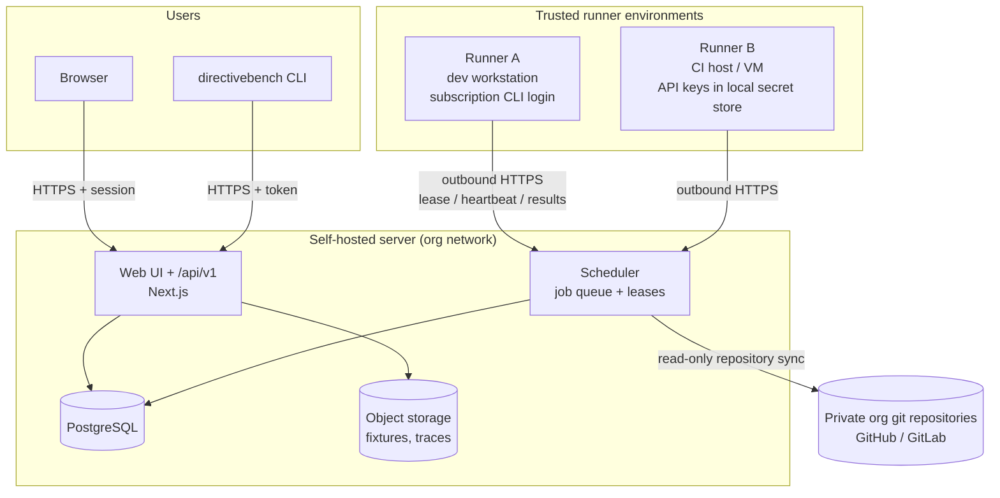

# SPEC-011 — Self-Hosting Architecture

> **Status: NOT IMPLEMENTED.** This spec describes a future shared deployment (roadmap Milestone 8, [SPEC-013](2026-10-14-implementation-roadmap.md)). Nothing here exists in the bootstrap. It exists so that local-mode decisions do not block this path ([ADR-0009](../decisions/0009-self-hosted-readiness.md)).

## 1. Goal

Let a team run one DirectiveBench server that shares an artifact registry, benchmark definitions and results, while benchmark execution happens on **runners inside trusted environments** (developer machines or CI hosts) that hold the agent and model credentials.

## 2. Deployment overview

All arrows to the server are initiated by the client or runner; the server never opens connections to runners.

## 3. Capabilities

| Area | Requirement |
| --- | --- |
| Database | PostgreSQL. The Drizzle schema and repository layer in `@directivebench/database` are the only persistence boundary, so a PostgreSQL dialect can be added without touching UI or engine code ([SPEC-006](2026-10-14-database-schema.md)). |
| Multi-user | Users authenticate to the server (OIDC/SSO preferred; local accounts as fallback). Assumption — requires validation of the target identity providers. |
| Teams / workspaces | Every registry entity (repositories, artifacts, categories, suites, runs) belongs to a workspace. Local mode maps to a single implicit workspace. |
| Permissions / roles | Workspace roles: `owner` (members, settings), `maintainer` (approve suite execution, manage repositories and runners), `member` (run benchmarks, edit artifacts/categories), `viewer` (read-only). Execution approval of a suite version is a `maintainer` action and is audited. |
| Remote runners | Runners connect **outbound over authenticated HTTPS**; no inbound ports are opened on runner hosts. Protocol: lease + heartbeat + long-poll, sketched in [SPEC-008 §7](2026-10-14-api-architecture.md#7-planned-runner-protocol-sketch-only). Runners advertise capabilities (adapters, versions, environment kinds, labels). |
| Central scheduling | The server queues jobs and matches them to runners by required capabilities and labels; leases expire on missed heartbeats → job `interrupted`, same semantics as local ([SPEC-114](2026-10-14-runner-management.md)). |
| Shared registry and definitions | Artifacts, versions, categories and benchmark suites are shared within a workspace; immutable versions and content hashes make them safe to reference from any runner. Fixtures are fetched by sha256 from server storage. |
| Audit logs | Append-only log of security-relevant actions: logins, role changes, runner registration/revocation, suite execution approval, credential-scope changes, job creation/cancellation, exports. |
| Private org repositories | Server syncs repositories using a host integration with least-privilege, read-only access ([SPEC-201](2026-10-14-integration-github.md), [SPEC-202](2026-10-14-integration-gitlab.md)). |

## 4. Credential boundaries

- **Credentials stay in trusted environments.** Agent and model credentials live on the runner host (OS keychain or the host's secret manager) and are used only there ([ADR-0008](../decisions/0008-secret-storage-and-authentication.md)).
- **Subscription credentials are never uploaded.** Logins of subscription-based agent CLIs (e.g. a user's Claude Code or Codex subscription session) are used only by a runner on that user's own machine, never transferred to the server or shared with other users. Whether a given provider's terms permit such use for benchmarking must be checked per integration (Assumption — requires validation).
- The server stores only: runner tokens (hashed), git integration tokens for repository sync (encrypted at rest, server-side secret), and user sessions.
- Results uploaded by runners are redacted by the runner before upload, using the same redaction as local mode ([SPEC-007](2026-10-14-security-and-privacy.md)).

## 5. Migration path from local

1. Keep local mode as the default and fully supported.
2. Introduce the `workspace_id` column and the repository-layer abstraction for PostgreSQL behind the existing repository functions.
3. Ship the `/api/v1` JSON API and the standalone `directivebench runner` command (local first, then remote).
4. Provide `directivebench export` (local) and an import endpoint on the server that preserves IDs, content hashes and immutable versions, so local history can be moved into a workspace.
5. Add authentication, roles and audit logs before any multi-user deployment is documented as supported.

## 6. Out of scope

Hosted SaaS operated by the project; billing; cross-organization sharing; running untrusted users' benchmarks on shared runners without a sandbox (requires the planned Docker environment, [ADR-0007](../decisions/0007-local-runner-execution-and-isolation.md)).

## 7. Implementation status

- **Implemented:** nothing. Local-mode preparations only: repository-function persistence boundary, prefixed random IDs, ISO-8601 UTC timestamps, immutable content-hashed versions, job statuses and heartbeat semantics designed to carry over to leases.
- **Not implemented:** PostgreSQL, multi-user, authentication, workspaces, roles, remote runners, central scheduling, audit logs, server-side repository sync, export/import.
