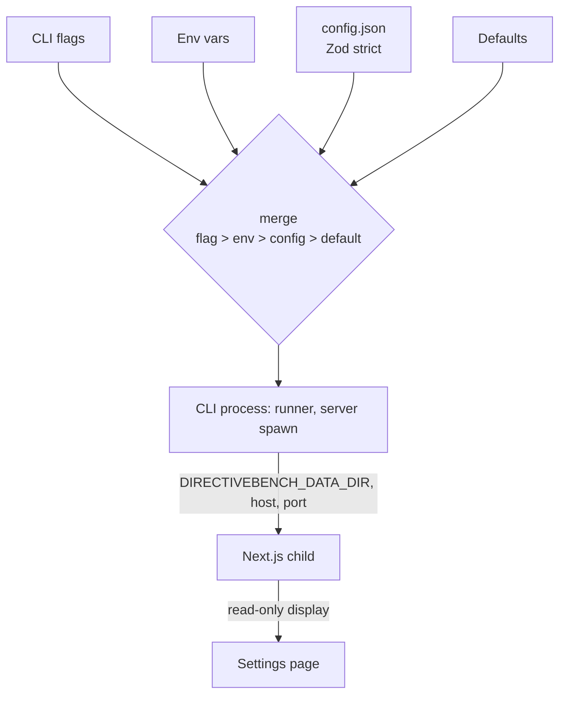

# SPEC-115 — Settings and Configuration

## 1. Summary

DirectiveBench stores all persistent state in a per-user **data directory** containing `config.json`, the SQLite database, fixture snapshots, logs, cache and (future) backups. This spec defines data directory resolution and override, the `config.json` schema and atomic writes, environment variables, value precedence (flag > env > config > default), secret references, future backup/restore and import/export, and the future settings UI (the bootstrap Settings page states that it is not implemented).

## 2. Motivation and problem statement

A tool distributed via `npx` must never store data inside the npm cache or installation directory, must behave predictably across Linux, macOS and Windows, must be scriptable (flags, env vars) and must not leave corrupt configuration after a crash. Users need to point DirectiveBench at a different data directory (testing, multiple profiles, portable setups) and must be able to trust that secrets are never written in plaintext to config or database.

## 3. Goals

- Deterministic, OS-appropriate data directory with explicit override.
- Small, versioned, Zod-validated `config.json` with atomic writes.
- One documented precedence order for every setting.
- Secrets handled by reference only ([ADR 0008](../decisions/0008-secret-storage-and-authentication.md)).
- Clear path to backup/restore and import/export.

## 4. Non-goals

- Settings UI in the bootstrap.
- Per-project configuration files inside user repositories (possible future proposal).
- Storing secrets in `config.json` or SQLite in plaintext — ever.
- Multi-user settings (self-hosted, [SPEC-011](2026-10-14-self-hosting-architecture.md)).

## 5. User stories

- As a user, I run `npx directivebench` and my data lands in the standard per-user location for my OS.
- As a developer, I run `directivebench serve --data-dir ./tmp-data` to test with a throwaway database.
- As a CI user, I set `DIRECTIVEBENCH_DATA_DIR` and `DIRECTIVEBENCH_PORT` without editing files.
- As a user, I edit `config.json` to set `runner.concurrency: 2`, and a typo produces a clear error naming the field.
- As a user (future), I back up my data directory before upgrading and restore it if needed.

## 6. Functional requirements

### Data directory

| ID | Requirement |
|---|---|
| FR-115-01 | The data directory SHALL be resolved with precedence: `--data-dir` flag > `DIRECTIVEBENCH_DATA_DIR` env var > OS default. Relative values are resolved against the current working directory. |
| FR-115-02 | OS defaults: Linux/other `$XDG_DATA_HOME/directivebench` (fallback `~/.local/share/directivebench`); macOS `~/Library/Application Support/directivebench`; Windows `%LOCALAPPDATA%\directivebench` (fallback `~\AppData\Local\directivebench`). |
| FR-115-03 | The data directory SHALL never be inside the npm installation/cache directory. |
| FR-115-04 | Layout: `config.json`, `directivebench.db` (+ `-wal`, `-shm`), `fixtures/<sha256>/`, `logs/`, `cache/` (future git clones), `backups/` (future). Created on `init`/first `serve` if missing. |
| FR-115-05 | The resolved data directory SHALL be passed to the web child process via `DIRECTIVEBENCH_DATA_DIR` so web and runner always use the same directory. |
| FR-115-06 | `directivebench doctor` SHALL print the resolved data directory and its source (flag/env/default). |
| FR-115-07 | Temporary workspaces live outside the data directory: `<os tmpdir>/directivebench/workspaces/…` ([SPEC-110](2026-10-14-benchmark-execution.md)). |

### config.json

| ID | Requirement |
|---|---|
| FR-115-10 | `config.json` SHALL be validated with a strict Zod schema (unknown keys rejected) exported by `@directivebench/core` (`configSchema`). |
| FR-115-11 | A missing `config.json` SHALL yield all defaults; invalid JSON or schema violations SHALL fail startup with a `ConfigError` naming the file and field(s). The file is never silently rewritten. |
| FR-115-12 | Writes SHALL be atomic: validate → write `config.json.<pid>.tmp` with mode `0600` → rename over `config.json`. |
| FR-115-13 | `configVersion` (literal `1`) SHALL version the file; future versions migrate forward on load with a backup of the old file. |
| FR-115-14 | Schema v1 fields (current): |

| Key | Type | Default | Notes |
|---|---|---|---|
| `configVersion` | `1` | `1` | |
| `server.host` | string | `127.0.0.1` | Non-loopback requires `--allow-network-access` at start |
| `server.port` | int 1–65535 | `4280` | |
| `server.openBrowser` | boolean | `true` | `--no-open` overrides |
| `runner.concurrency` | int 1–16 | `1` | [SPEC-114](2026-10-14-runner-management.md) |
| `runner.keepWorkspaces` | boolean | `false` | Keep temp workspaces for debugging |

Candidate future keys (not in schema v1; adding them requires a schema change): `logging.level`, `runner.pollIntervalMs`, `fixtures.maxBytes`, `ui.theme`, `ui.density`, `secrets` (reference definitions).

### Environment variables and precedence

| ID | Requirement |
|---|---|
| FR-115-20 | Supported env vars: `DIRECTIVEBENCH_DATA_DIR`, `DIRECTIVEBENCH_HOST`, `DIRECTIVEBENCH_PORT`. |
| FR-115-21 | Effective value precedence for every setting with multiple sources: **CLI flag > environment variable > `config.json` > built-in default**. |
| FR-115-22 | Binding to a non-loopback host (`isLoopbackHost` false) SHALL require the `--allow-network-access` flag regardless of the host's source; the flag is intentionally not settable in `config.json` or env (MVP has no authentication). |
| FR-115-23 | Invalid env values (e.g. non-numeric port) SHALL fail startup with a message naming the variable. |
| FR-115-24 | The CLI SHALL never forward arbitrary environment variables to benchmark commands; command env follows the allowlist in [SPEC-110](2026-10-14-benchmark-execution.md). |

### Secrets

| ID | Requirement |
|---|---|
| FR-115-30 | Settings that need credentials (model provider API keys, git tokens — future) SHALL store a **secret reference** (e.g. `{ "source": "keychain", "name": "anthropic-default" }` or `{ "source": "env", "name": "ANTHROPIC_API_KEY" }`), never the value ([ADR 0008](../decisions/0008-secret-storage-and-authentication.md)). |
| FR-115-31 | Resolved secret values SHALL be registered with redaction (`redactSecrets` known values) for the process lifetime. |
| FR-115-32 | No secrets exist in the bootstrap; the schema contains no secret fields yet. |

### Backup/restore and import/export (future)

| ID | Requirement |
|---|---|
| FR-115-40 | `directivebench backup [--out PATH]` SHALL create a consistent snapshot (SQLite online backup API or `VACUUM INTO`) plus `config.json` and `fixtures/` into `backups/<timestamp>/` or an archive. |
| FR-115-41 | `directivebench restore PATH` SHALL refuse to run while a `serve` process uses the data dir, validate the backup, back up the current state first, then replace. |
| FR-115-42 | `export`/`import` SHALL move user-level data (artifacts, versions, categories, suites, results) as versioned JSON + fixture files; secrets are excluded and only reference names exported. |

### Settings UI (future)

| ID | Requirement |
|---|---|
| FR-115-50 | The bootstrap Settings page SHALL state "Planned — not implemented", show the resolved data directory path and the effective read-only configuration if available, and link to this spec. It SHALL NOT render editable controls that do nothing. |
| FR-115-51 | The future Settings UI SHALL edit `config.json` via a server action using the same schema and atomic write; values overridden by flags/env SHALL be shown as "overridden by …" and not editable. |
| FR-115-52 | Changes requiring restart (host, port) SHALL be labelled "applies after restart". |

## 7. Non-functional requirements

- Config load < 10 ms; no network.
- Cross-platform path handling (`node:path`), no hard-coded separators.
- `config.json` is human-editable, 2-space indented, trailing newline.

## 8. Domain entities and contracts

```ts
// @directivebench/core (packages/core/src/config.ts)
type DirectiveBenchConfig = {
  configVersion: 1;
  server: { host: string; port: number; openBrowser: boolean };
  runner: { concurrency: number; keepWorkspaces: boolean };
};

function resolveDataDir(o?: { flag?: string; env?: NodeJS.ProcessEnv; platform?: NodeJS.Platform; home?: string }): string;
function dataDirLayout(root: string): { root; database; config; fixtures; logs; cache: string };
function loadConfig(path: string): DirectiveBenchConfig;      // throws ConfigError
function saveConfig(path: string, c: DirectiveBenchConfig): void; // atomic
function isLoopbackHost(host: string): boolean;

// future
type SecretRef = { source: "keychain" | "env"; name: string };
interface EffectiveSetting<T> { value: T; source: "flag" | "env" | "config" | "default" }
```

## 9. Data flow



## 10. API and interface design

CLI ([SPEC-009](2026-10-14-cli-architecture.md)): global `--data-dir`; `serve [--host --port --no-open --allow-network-access --dev]`, `init`, `doctor [--json]`, `demo`. Future: `backup`, `restore`, `export`, `import`, `config get|set` (Open question).

## 11. UI/UX considerations

- Settings page (bootstrap): read-only view of the data directory paths (root, database, fixtures, config) and the effective configuration (`config.json` merged with defaults), plus a "Planned" list; no editable controls.
- Future: grouped sections (Server, Runner, Appearance, Secrets, Data), each value shows its source.
- Appearance preferences (theme, density) are per-browser in the bootstrap ([SPEC-116](2026-10-14-dashboard-and-navigation.md)).

## 12. Security considerations

- `config.json` written with mode `0600`; data directory should be user-only (`0700` on POSIX, recommended on creation).
- No secrets in config/DB; secret references only ([SPEC-007](2026-10-14-security-and-privacy.md)).
- Network exposure requires an explicit flag; DNS-rebinding protection via Host allowlist in `proxy.ts`.
- A tampered `config.json` cannot enable network exposure without the flag.

## 13. Error handling

- Unwritable data directory → startup error with path and OS error code; suggest `--data-dir`.
- Invalid `config.json` → `ConfigError` with prettified Zod issues; process exits non-zero.
- Port in use → error suggesting `--port`.
- Stale `*.tmp` config files from a crash are ignored and may be cleaned by `doctor`.

## 14. Edge cases

- `DIRECTIVEBENCH_DATA_DIR` set to an empty string → treated as unset.
- `XDG_DATA_HOME` relative path → per XDG spec should be ignored; current implementation uses it as given (Open question).
- Data directory on a network filesystem → SQLite WAL may be unreliable; `doctor` warns (Assumption — requires validation).
- Two processes saving config concurrently → last rename wins; no partial file.

## 15. Testing strategy

- Unit: `resolveDataDir` for each platform with injected env/home; precedence merge table tests; `loadConfig` missing/invalid/valid; `saveConfig` atomicity (no partial file on simulated failure) and file mode.
- CLI integration: `--data-dir` and env override end-to-end with `doctor`.
- E2E: Settings page shows placeholder and no interactive controls.

## 16. Acceptance criteria

- [ ] Default data dir matches FR-115-02 on Linux, macOS, Windows (unit-tested with injected platform).
- [ ] `--data-dir` beats `DIRECTIVEBENCH_DATA_DIR`, which beats the default.
- [ ] Missing `config.json` → defaults; unknown key → startup error naming the key.
- [ ] `saveConfig` produces a `0600` file via temp + rename.
- [ ] `--port` beats `DIRECTIVEBENCH_PORT`, which beats `server.port`, which beats `4280`.
- [ ] Non-loopback host without `--allow-network-access` refuses to start.
- [ ] Settings page shows "Planned — not implemented" with a link to this spec and no non-functional controls.

## 17. Dependencies

[SPEC-009](2026-10-14-cli-architecture.md), [SPEC-010](2026-10-14-local-installation.md), [SPEC-007](2026-10-14-security-and-privacy.md), [SPEC-114](2026-10-14-runner-management.md), [ADR 0001](../decisions/0001-local-first-architecture.md), [ADR 0008](../decisions/0008-secret-storage-and-authentication.md).

## 18. Open questions

- Should there be a `config get|set` CLI command?
- Should `XDG_DATA_HOME` be validated as absolute per the XDG Base Directory spec?
- Should UI preferences (theme, density) move into `config.json` or stay per-browser?
- Profile support (multiple named data dirs) vs. relying on `--data-dir`.

## 19. Future extensions

- Settings UI with source attribution.
- OS keychain secret store and secret reference management UI.
- Backup scheduling and retention.
- Self-hosted server configuration (auth, database URL for PostgreSQL) — [SPEC-011](2026-10-14-self-hosting-architecture.md).

## 20. Implementation status

- **Implemented (verified by `packages/core/test/config.test.ts` and `apps/cli/test/cli.test.ts` on 2026-10-14):** `resolveDataDir` (flag > env > OS default, incl. XDG fallback; macOS path unit-tested, Windows `LOCALAPPDATA` path untested), `dataDirLayout`, strict Zod `configSchema` v1 with the keys in FR-115-14 (unknown/invalid keys rejected), `loadConfig` (missing → defaults, invalid → `ConfigError` → CLI exit 2), atomic `saveConfig` with mode `0600`, `isLoopbackHost`; CLI precedence flag > env > config > default for host/port, invalid port → exit 2, non-loopback host without `--allow-network-access` → exit 2; `runner.concurrency`, `runner.keepWorkspaces` and `server.openBrowser` honoured by `serve` (`keepWorkspaces` also by `demo`); data dir passed to the web child via `DIRECTIVEBENCH_DATA_DIR` (`pnpm verify:pack`).
- **Partially implemented:** read-only Settings page (data dir paths and effective config; FR-115-50 without the "Planned — not implemented" wording on the whole page) — not covered by a verified automated test; `doctor` reports config validity.
- **Not implemented:** editable Settings UI, secret references (`SecretRef` shape defined in FR-115-30 and §8, used by SPEC-104 and the integration specs), backup/restore, import/export, config migrations beyond v1, `backups/` usage.
