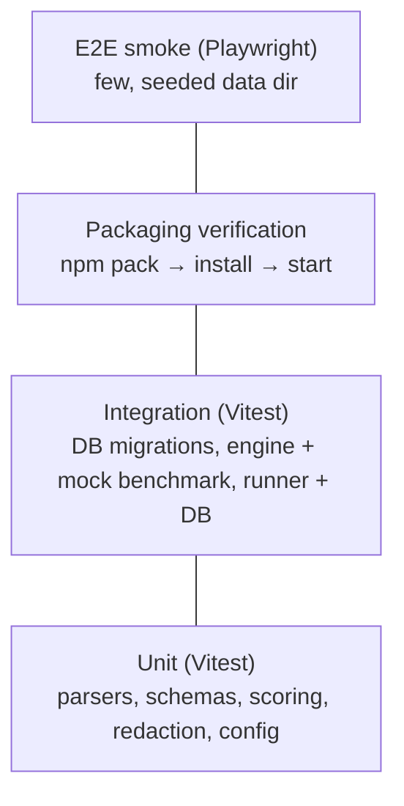

# SPEC-012 — Testing Strategy

## 1. Principles

1. **No paid API calls and no network** in default test runs, locally or in CI.
2. **Deterministic by default.** The Mock Agent (`mock`, [ADR-0006](../decisions/0006-agent-adapters-vs-model-providers.md)) is the only agent used in automated end-to-end tests. Time, random IDs and temp paths are injectable where assertions depend on them.
3. **Real execution where it is cheap.** Engine tests run real assertions (`node --test` inside fixture workspaces), not mocks of them.
4. **Isolated state.** Every test that touches disk uses a fresh temp directory (data dir, workspaces) and cleans it up; tests never read the user's real data directory.
5. **Acceptance criteria drive tests.** Spec acceptance criteria map to tests where practical; a spec is `implemented` only when those checks pass ([spec index](README.md#status-definitions)).

## 2. Test pyramid

| Level | Tool | Scope | Speed target |
| --- | --- | --- | --- |
| Unit | Vitest | Pure functions per package | Whole suite < 30 s |
| Integration | Vitest | Package boundaries with real SQLite and real subprocesses | < 2 min |
| Packaging | Node script | The published tarball works from a clean install | < 5 min |
| E2E smoke | Playwright | Critical UI paths against a running server | < 3 min |

## 3. Per-package coverage

| Package | Unit | Integration |
| --- | --- | --- |
| `core` | Artifact path classification, frontmatter/format parsers (SKILL.md, `.mdc`, Copilot instructions, generic markdown), config schema and atomic save, data-dir resolution per OS, hashing, secret redaction | — |
| `database` | Repository function contracts, ID generation | **Migration tests:** apply all migrations to a temp SQLite file; assert schema, constraints (unique `(artifact_id, content_hash)`), WAL mode; re-running is a no-op; seed idempotency |
| `agent-adapters` | Mock playbook selection (`contextIncludes` case-insensitive), instruction-context loading, detection descriptor parsing of `--version` output | Detection with a fake binary on a temp `PATH` |
| `benchmark-engine` | Definition schema v1 (valid/invalid), assertion evaluators, scoring and verdict precedence ([SPEC-111](2026-10-14-benchmark-scoring.md)), comparability key, path-escape and symlink rejection in fixture snapshotting | **Mock benchmark end-to-end:** load `examples/benchmarks/mock-input-validation`, snapshot fixtures, run RED and GREEN with the Mock Agent, execute real verification (`node --test`), assert baseline fails, candidate passes, verdict `improved`, and result labelled as mock |
| `runner` | Concurrency limiter, state transitions | Against temp SQLite: atomic acquire (two runners, one job), heartbeat updates, stale `running` → `interrupted` on start, cancellation via `cancel_requested_at` → `cancelled`, job persisted results |
| `web` | Server Action input validation, Host allowlist logic in `proxy.ts` | — (covered by E2E) |
| `cli` | Option/env/config precedence, exit-code mapping | `init` and `demo` against a temp data dir |

Scoring and verdict logic additionally get table-driven tests covering every precedence branch (error, not-comparable, unstable, regressed, improved, unchanged).

## 4. End-to-end smoke (Playwright)

- Setup: create a temp data dir, run `directivebench demo --data-dir <tmp>` to seed it, start `serve --no-open --port <free> --data-dir <tmp>`.
- Checks: dashboard shows non-zero counts; artifact detail renders content and versions; benchmark detail shows cases; "Run benchmark" enqueues a job that reaches `completed`; run detail shows RED vs GREEN and the "Mock agent — not an AI evaluation" label; planned pages say "Planned — not implemented"; a request with a foreign `Host` header is rejected.
- One browser (Chromium) in CI; others optional locally.

## 5. Packaging verification

`pnpm verify:pack` ([SPEC-009 §11](2026-10-14-cli-architecture.md#11-packaging-verification)):

1. `pnpm build`.
2. `npm pack` in `apps/cli`; assert the tarball contains `dist/cli.js`, `dist/web/.next`, `dist/web/public`, `dist/web/next.config.mjs`, `dist/migrations`, `dist/examples`, and no `.env`, test files or workspace `src/`.
3. Install the tarball into a new temp directory with `npm install <tarball>` (no workspace links).
4. Run `directivebench --help` and `--version` (version equals `package.json`).
5. Start `serve --no-open` with a temp data dir and free port, wait for `GET /api/health` → `200`, send `SIGTERM`, assert exit code `0` and no orphan child process.
6. Optionally run `demo` and assert exit code `0`.

## 6. Contract tests for future adapters and providers

Real agent adapters ([SPEC-203](2026-10-14-integration-claude-code.md)–[SPEC-205](2026-10-14-integration-cursor.md)) and model providers ([SPEC-206](2026-10-14-integration-anthropic-api.md)–[SPEC-211](2026-10-14-integration-custom-model-providers.md)) must ship:

- **Contract tests** run against **recorded fixtures** (captured CLI stdout/stderr/exit codes or HTTP request/response pairs, secrets scrubbed) that verify parsing, error mapping, timeouts and cancellation.
- A shared adapter conformance suite that every `AgentAdapter` (including `mock`) passes: capability declaration, install convention, abort handling, output truncation and redaction.
- Fixtures record the tool/API version they were captured with; refreshing them is a deliberate, reviewed change.

## 7. Opt-in live tests

- Gated by an explicit environment variable (e.g. `DIRECTIVEBENCH_LIVE_TESTS=1`) **and** the provider's own credentials being present; otherwise skipped with a visible reason.
- Never run in default CI. May run in a manually triggered workflow with repository secrets and a cost cap.
- Assert only structural properties (completes, produces parseable output), never specific model wording.

## 8. CI (GitHub Actions)

Triggered on pull requests and pushes to `main`. Matrix: Node 24 on `ubuntu-latest` (required); Node 22.x minimum supported version and `macos-latest`/`windows-latest` (target, added once stable).

1. Checkout; set up Node; `corepack enable`; `pnpm install --frozen-lockfile`.
2. `pnpm format:check` and `pnpm lint`.
3. `pnpm typecheck`.
4. `pnpm test` (unit + integration via Turborepo).
5. `pnpm build`.
6. `pnpm verify:pack`.
7. Install Playwright Chromium; `pnpm test:e2e`; upload traces on failure.

No secrets are configured for the default workflow.

## 9. Implementation status

- **Implemented in bootstrap (to be verified, see [SPEC-013](2026-10-14-implementation-roadmap.md) Milestone 0):** Vitest setup per package with initial unit tests (e.g. `packages/core/test/`); scripts `test`, `test:e2e`, `verify:pack` declared in the root `package.json`.
- **Partially implemented:** the coverage listed in §3–§5 is the target; which of these tests exist and pass must be confirmed in the Milestone 0 final verification.
- **Not implemented:** adapter conformance suite, recorded-fixture contract tests, live test gating, multi-OS CI matrix.
