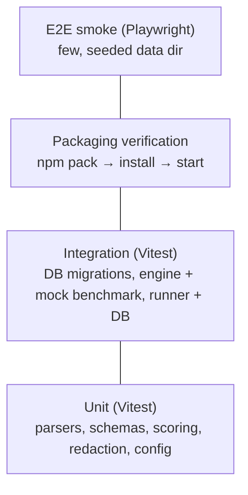

# SPEC-012 — Testing Strategy

## 1. Principles

1. **No paid API calls and no network** in default test runs, locally or in CI.
2. **Deterministic by default.** The Mock Agent (`mock`, [ADR-0006](../decisions/0006-agent-adapters-vs-model-providers.md)) is the only agent used in automated end-to-end tests. Time, random IDs and temp paths are injectable where assertions depend on them.
3. **Real execution where it is cheap.** Engine tests run real assertions (`node --test` inside fixture workspaces), not mocks of them.
4. **Isolated state.** Every test that touches disk uses a fresh temp directory (data dir, workspaces) and cleans it up; tests never read the user's real data directory.
5. **Acceptance criteria drive tests.** Spec acceptance criteria map to tests where practical; a spec is `implemented` only when those checks pass ([spec index](README.md#lifecycle-and-statuses)).

## 2. Test pyramid

| Level | Tool | Scope | Speed target |
| --- | --- | --- | --- |
| Unit | Vitest | Pure functions per package | Whole suite < 30 s |
| Integration | Vitest | Package boundaries with real SQLite and real subprocesses | < 2 min |
| Packaging | Node script | The published tarball works from a clean install | < 5 min |
| E2E smoke | Playwright | Critical UI paths against a running server | < 3 min |

## 3. Per-package coverage

**Coverage requirement:** unit and package tests keep **100% line, branch, function and statement
coverage** of all logic — `packages/*/src`, `apps/cli/src`, `apps/web/lib` and `apps/web/proxy.ts`.
Vitest's v8 coverage with `thresholds: { 100: true }` is configured once in `vitest.shared.ts`
and used by every package's `vitest.config.ts`, so `pnpm test` fails below 100%. React pages and
components (`apps/web/app`, `apps/web/components`) are covered by Playwright (§4) instead.
`/* v8 ignore */` is allowed only for code that cannot run on the CI platform and must state a
reason (`AGENTS.md` §2 rule 7).

| Package | Unit | Integration |
| --- | --- | --- |
| `core` | Artifact path classification, frontmatter/format parsers (SKILL.md, `.mdc`, Copilot instructions, generic markdown), config schema and atomic save, data-dir resolution per OS, hashing, secret redaction | — |
| `database` | Repository function contracts, ID generation | **Migration tests:** apply all migrations to a temp SQLite file; assert schema, constraints (unique `(artifact_id, content_hash)`), WAL mode; re-running is a no-op; seed idempotency |
| `agent-adapters` | Mock playbook selection (`contextIncludes` case-insensitive), instruction-context loading, detection descriptor parsing of `--version` output | Detection with a fake binary on a temp `PATH` |
| `benchmark-engine` | Definition schema v1 (valid/invalid), assertion evaluators, scoring and verdict precedence ([SPEC-111](2026-10-14-benchmark-scoring.md)), comparability key, path-escape and symlink rejection in fixture snapshotting | **Mock benchmark end-to-end:** load `examples/benchmarks/mock-input-validation`, snapshot fixtures, run RED and GREEN with the Mock Agent, execute real verification (`node --test`), assert baseline fails, candidate passes, verdict `improved`, and result labelled as mock |
| `runner` | Concurrency limiter, state transitions | Against temp SQLite: atomic acquire (two runners, one job), heartbeat updates, stale `running` → `interrupted` on start, cancellation via `cancel_requested_at` → `cancelled`, job persisted results |
| `web` | Server Action input validation, Host allowlist logic in `proxy.ts` | — (covered by E2E) |
| `cli` | Option/env/config precedence, exit-code mapping | `init` and `demo` against a temp data dir |

Scoring and verdict logic additionally get table-driven tests covering every precedence branch (error, not-comparable, unstable, regressed, improved, unchanged).

## 4. Browser integration tests (Playwright)

- Setup: create a temp data dir, run `directivebench demo --data-dir <tmp>` to seed it, start `serve --no-open --port <free> --data-dir <tmp>` (the built CLI, as an end user would). Tests run in one worker because they share that instance.
- `apps/web/e2e/home.spec.ts` — the home page: dashboard counts equal database counts, recent runs with the mock label, navigation order and `aria-current`, every nav target and planned page, not-found page, theme toggle.
- `apps/web/e2e/management.spec.ts` — the management paths: artifacts list/filters → detail; results list → detail (RED vs GREEN, verdict reasons, "Mock agent — not an AI evaluation"); benchmarks → Run → Executions → `completed` → run detail; server-side approval re-check (FR-114-02); cancelling a pending and a running job; categories; agents; settings.
- Jobs that must stay pending or running for cancellation tests are seeded directly in the temp database (a temporary trigger keeps the runner from claiming the pending one); the runner's own handling of a cancel request is covered by the runner tests.
- The foreign-`Host` rejection is checked by `verify:pack` (§5).
- One browser (Chromium) in CI; others optional locally. Agent-driven exploratory checks (e.g. with `agent-browser`) are local QA, not CI gates.

## 5. Packaging verification

`pnpm verify:pack` ([SPEC-009 §11](2026-10-14-cli-architecture.md#11-packaging-verification)):

1. `pnpm build` (run beforehand; the script expects the build output).
2. `pnpm pack` in `apps/cli` (rewrites `workspace:` dependencies); assert the tarball contains `package.json`, `LICENSE`, `README.md`, `dist/cli.js`, `dist/web/.next/BUILD_ID`, `dist/web/next.config.mjs`, `dist/migrations/meta/_journal.json` and the bundled mock example, and no `.env` files, Next.js build cache or source maps; the manifest is MIT-licensed and has no `workspace:` dependencies.
3. Install the tarball with npm into an empty temp project (no workspace links).
4. Run `directivebench --help` and `--version` (version equals `package.json`).
5. Run `demo` with a temp data dir; assert verdict `improved` and the mock label.
6. Start `serve --no-open` with that data dir and a free port, wait for `GET /api/health` → `{"database":"ready"}`, assert `/results` lists the demo run and its detail page shows verdict `improved`, and that a foreign `Host` header is rejected with 403.
7. Send `SIGTERM` and assert exit code `0`.
8. Remove the temporary directory on every exit, also after a failure (it holds an npm install of
   about 350 MB, and the temporary directory can be RAM; AGENTS.md §3). `pnpm verify:pack --keep`
   keeps it for debugging.

## 6. Contract tests for future adapters and providers

Real agent adapters ([SPEC-203](2026-10-14-integration-claude-code.md)–[SPEC-205](2026-10-14-integration-cursor.md)) and model providers ([SPEC-206](2026-10-14-integration-anthropic-api.md)–[SPEC-211](2026-10-14-integration-custom-model-providers.md)) must ship:

- **Contract tests** run against **recorded fixtures** (captured CLI stdout/stderr/exit codes or HTTP request/response pairs, secrets scrubbed) that verify parsing, error mapping, timeouts and cancellation.
- A shared adapter conformance suite that every `AgentAdapter` (including `mock`) passes: capability declaration, install convention, abort handling, output truncation and redaction.
- Fixtures record the tool/API version they were captured with; refreshing them is a deliberate, reviewed change.

## 7. Opt-in live tests

- Gated by an explicit environment variable (e.g. `DIRECTIVEBENCH_LIVE_TESTS=1`) **and** the provider's own credentials being present; otherwise skipped with a visible reason.
- Never run in default CI. May run in a manually triggered workflow with repository secrets and a cost cap.
- Assert only structural properties (completes, produces parseable output), never specific model wording.

## 8. CI (GitHub Actions)

Workflow `.github/workflows/ci.yml`, triggered on every pull request and on pushes to `main`. Platforms: Node 24 on `ubuntu-latest` for every job, and the unit tests also on `macos-latest` (issue #120; not a required check for now: the maintainer decided on 2026-10-29 to watch it first). `windows-latest` (best effort, NFR-118-04) and the Node 22.x minimum supported version are targets: Windows failed 154 tests in its first full run and is tracked in issue #160. Shared setup (Node, pnpm, `pnpm install --frozen-lockfile`) is the composite action `.github/actions/setup`. Jobs run in parallel; all four are meant to be required status checks for merging (configured in the repository's branch protection settings, not in the workflow):

| Job | Steps |
| --- | --- |
| `lint` | `pnpm audit --prod`, `pnpm format:check`, `pnpm lint`, `pnpm typecheck` |
| `unit` | `pnpm test` with the 100% coverage threshold (§3); coverage reports uploaded as an artifact |
| `unit-macos` | `pnpm test --continue` on `macos-latest` with the same 100% threshold; `--continue` reports every package's failures |
| `build` | `pnpm build`, `pnpm verify:pack` (§5) |
| `e2e` | `pnpm build`, install Playwright Chromium, `pnpm test:e2e` against a temporary instance with a SQLite data dir (§4); traces uploaded on failure |

No secrets are configured for the default workflow.

## 9. Implementation status

- **Implemented (verified on 2026-10-15, Node 24.21, Linux — 468 tests, all passing, 100% line/branch/function/statement coverage in every package):** Vitest suites per package with the §3 coverage threshold (`vitest.shared.ts`) — `core` 95, `database` 59 (one test file per repository plus `client.test.ts`; databases from `test/support/test-database.ts`), `agent-adapters` 34 (incl. detection with fake executables on a temp `PATH`), `benchmark-engine` 109 (incl. env allowlist, process-group kill, output truncation, symlink/FIFO/traversal rejection, every assertion type, orchestrator error and cancellation paths), `runner` 31 (incl. concurrency > 1, two runners on one database claiming every job exactly once, heartbeat failure, stop during start), `cli` 74 (incl. `serve` supervision with injected spawn/fetch/process, `init`, `demo`, `doctor`), `web` 66 (server actions against a real temp database, `proxy.ts` Host allowlist, `lib/` helpers); `pnpm build && pnpm verify:pack` (§5, all steps passed).
- **Implemented (verified by `pnpm test:e2e`, 17/17 passing against the built CLI on 2026-10-15, three consecutive runs):** the browser integration tests of §4.
- **Implemented — CI (§8):** four parallel jobs (`lint`, `unit`, `build`, `e2e`) with the shared setup action. The previous single-job workflow ran green on PR #1 on 2026-10-14; the four-job workflow is verified locally job by job (commands above) and has not run on GitHub yet. Making the jobs required checks is a repository setting.
- **Implemented — macOS unit job (issue #120, verified by the `Unit tests (100% coverage, macOS)` job on PR #159):** the full suite with the 100% threshold on `macos-latest`. Not a required check for now (maintainer decision, 2026-10-29); making it one is a branch-protection setting. It made five tests portable: `setsid` replaced by Perl's `POSIX::setsid()`, kill-escalation tests timed out only after the fake is ready, a non-UTF-8 file name committed through the git index, the linear-time check of `resultsByVersion` moved to `expectLinearTime`, and a guard against `kill(0)`.
- **Not implemented:** PostgreSQL backend tests with testcontainers (planned with the optional PostgreSQL backend), adapter conformance suite, recorded-fixture contract tests, live test gating, the Windows unit gate (issue #160), Node 22 CI matrix.
