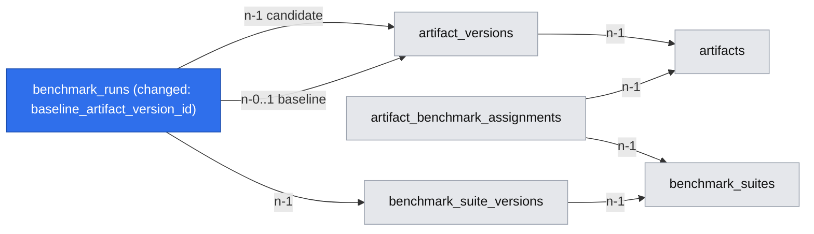
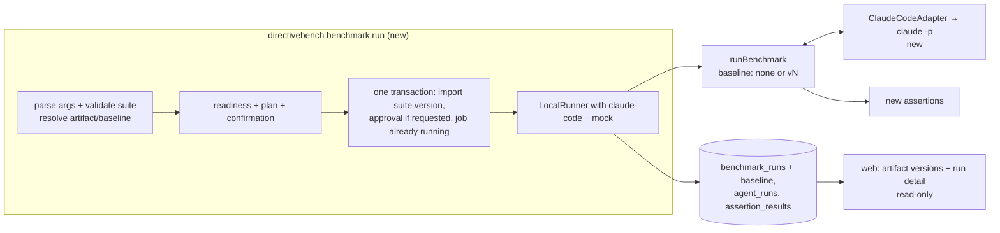

# SPEC-118 — Benchmark own skills with Claude Code against registry artifacts (S1)

## 1. Summary

A skill author who keeps revising a skill can, after this slice, run one fixed benchmark suite
of their own against a **scanned registry artifact version** with **Claude Code** (their
installed `claude` CLI, headless) and compare it either with **no artifact** or with **another
version of the same artifact** (A/B). The suite lives as a folder on disk (YAML + fixture files),
is scaffolded by `directivebench benchmark init --artifact <id>`, run by
`directivebench benchmark run <suite> --artifact <id>`, graded by deterministic assertions
(including three new document-oriented ones), and its results are kept per artifact version and
shown read-only in the web UI. This is future behaviour; today only the mock agent executes.

This spec defines the slice and its new contracts. It does not repeat the specs it builds on;
§17 lists the sections of those specs that this slice changes, and those sections were updated in
the same change.

## 2. Motivation and problem statement

- The maintainer revises skills and instructions for internal tools and client projects. Each
  revision is tried on a different prompt or task, so results are not comparable and "did this
  change help?" has no reliable answer; version-against-version checks are not done at all
  ([brief](briefs/2026-10-22-benchmark-own-skills-s1.md), product brief Problems).
- After using 0.1.1-rc.0 on 2026-10-22 the maintainer said the preview is useful but the
  product's main job is benchmarking skills and building one's own benchmarks; there is no other
  use today. This answers the D07 value checkpoint early and is the basis of decision
  [D08](research/decisions/D08-comparison-before-the-rest-of-the-registry.md).
- Today the engine runs only the deterministic mock agent (`createExecutableAdapters()` contains
  only `mock`), suites are imported YAML bound to bundled example artifacts, there is no
  `benchmark` CLI command, and scanned registry artifacts cannot be benchmarked
  ([SPEC-203 §13](2026-10-14-integration-claude-code.md#13-current-implementation-status),
  [SPEC-009 §2](2026-10-14-cli-architecture.md)).

The work is **generic**: users build their own scenarios (fixtures, prompt), requirements and
grading. A project-estimation skill whose output is a Markdown file with prose and tables is the
reference scenario used to check that the design is sufficient — not a target to special-case.

## 3. Goals

- G1: Run a user's suite against any scanned artifact version with Claude Code, from the CLI,
  under the RED/GREEN protocol of [SPEC-112](2026-10-14-red-green-evaluation.md).
- G2: Baseline = no artifact (existing semantics) **or** another version of the same artifact
  (A/B), chosen per run.
- G3: Scaffold a suite folder bound to an artifact, which the user edits and versions in git.
- G4: Grade documents deterministically: required Markdown headings, required phrases or regular
  expressions, and a number in a Markdown table cell within a range — in addition to the existing
  `command`, `file-exists`, `file-contains` and `changed-files` assertions.
- G5: Keep results per artifact version with the baseline, auth mode and isolation profile
  visible, and never compare runs whose conditions differ.
- G6: Be honest about cost, ambient configuration and the lack of a sandbox before and after
  every run.

## 4. Non-goals

- Builder UI, editing scenarios in the UI, and running from the UI (S2, [SPEC-109](2026-10-14-benchmark-builder.md)).
- LLM-judge / rubric grading; sets and chains of skills (S3; D02).
- Codex and Cursor adapters, the Claude Agent SDK option, gateways, cloud providers and model
  providers ([SPEC-204](2026-10-14-integration-openai-codex.md), [SPEC-205](2026-10-14-integration-cursor.md), [SPEC-206](2026-10-14-integration-anthropic-api.md)…).
- `environment.kind: docker`; live MCP/Figma inputs in fixtures (fixtures are files only).
- Assertions on the agent's final chat answer (S1 grades files the agent writes).
- Categories (#22) and the rest of E02 (#20, #21) — they wait per D08.
- Solving D03/Q05 (how "verdicts hold in real projects" is measured); S1 only makes the data
  that such a measurement needs.

## 5. User stories

- US-118-01: As a skill author, I run `directivebench benchmark init --artifact estimate-project`
  and get a suite folder with a valid `benchmark.yaml` and a `fixtures/` folder I fill with a real
  brief and transcript.
- US-118-02: As a skill author, I run my suite against the latest version of my skill with no
  baseline artifact, and see whether the skill helps at all.
- US-118-03: As a skill author, I run the same suite with `--baseline v3` and see whether v4 is
  better than v3 on the same inputs and checks.
- US-118-04: As a skill author, I require that the output document has the headings "Assumptions",
  "Estimate" and "Risks", mentions QA and project management, and that the "Backend API" row's
  "Hours" column is between 16 and 40.
- US-118-05: As a skill author, I open my artifact in the web UI and see, per version, which runs
  exist, what each was compared with, and whether the results are comparable.
- US-118-06: As a user on a subscription, I am told before the run how many Claude Code sessions
  will start, that they count against my plan, that my user-level instructions may influence the
  result and that nothing is sandboxed.

## 6. Functional requirements

Evidence keys C1–C12 and L1 refer to the source table of
[SPEC-203 §1](2026-10-14-integration-claude-code.md#evidence-labels).

### 6.1 Claude Code execution adapter

| ID | Requirement |
| --- | --- |
| FR-118-01 | `packages/agent-adapters` SHALL provide an executable `claude-code` adapter implementing [SPEC-203](2026-10-14-integration-claude-code.md) §2–§9 for the scope of this slice: CLI print mode with `stream-json`, the argv of §6, prompt on stdin, the `edit-only` permission profile by default (`edit-and-shell` only for execution-approved suites) in the per-artifact-type form of SPEC-203 §7 (for `skill-md` the profile includes the `Skill` tool, allowed only for the installed skill; FR-118-08), install convention §4.1, cancellation and timeout escalation, stream parsing, usage reporting and the error codes of §9. |
| FR-118-02 | The adapter SHALL support both auth modes of SPEC-203 §3: **Local Subscription Mode (default)** and **API Key Mode**. In S1, API Key Mode reads the key only from the `ANTHROPIC_API_KEY` variable of the CLI process environment (secret reference `{ source: 'env', name: 'ANTHROPIC_API_KEY' }`); OS-keychain references wait for [ADR-0008](../decisions/0008-secret-storage-and-authentication.md). Gateway and cloud-provider modes are not offered. |
| FR-118-03 | In Local Subscription Mode the adapter SHALL record warning `ambient-user-config` on every run and isolation profile `user-profile`; in API Key Mode it SHALL isolate `HOME` and `CLAUDE_CONFIG_DIR` to the run directory and record isolation profile `isolated` (SPEC-203 §8). |
| FR-118-04 | Every agent run SHALL report adapter metadata `{ adapterVersion, authMode, isolationProfile, permissionProfile, requestedModel, executionModel, reportedModels[], flagsHash }` (SPEC-203 §4.2). `executionModel` is the session model the CLI resolved, read from the `model` field of the `system/init` event (Confirmed, SPEC-203 §4); `reportedModels` are all keys of `result.modelUsage`. Every assistant message of the main conversation SHALL also carry `executionModel` (its `message.model`; field: Assumption — requires validation by the live check); a message on another model is an execution-model mismatch. A `modelUsage` key that no main-conversation assistant message carries is **auxiliary** (internal CLI work such as a small model for titles). Task work on another model cannot come from the artifact or fixture, because S1 refuses non-inherited `model` and `context: fork` overrides in artifacts (FR-118-26) and any Claude Code configuration in fixtures (FR-118-06) and the profiles contain no `Agent` tool. `flagsHash` is the sha256 of the argv **normalised**: without the prompt and with run-local paths (workspace, isolated `HOME`, temp directories) and the installed skill name of FR-118-08 replaced by fixed placeholders, so two workspaces of one run hash equally. The engine records the metadata in `EnvironmentMetadata` and checks that `adapterVersion`, `authMode`, `isolationProfile`, `permissionProfile`, `requestedModel`, `executionModel` and `flagsHash` are identical for **every** agent run of both variants (SPEC-112 FR-112-08); any difference, including an alias or `model: null` resolving to another `executionModel`, makes the run `not-comparable` (issue `execution-model-mismatch`, listing the models per variant), never `improved` or `regressed`. Differences only in auxiliary models are not a comparability failure: they are recorded per agent run, shown, and produce warning `auxiliary-models`. `execution.model: null` or an alias additionally produces warning `unpinned-model`. |
| FR-118-05 | `createExecutableAdapters()` SHALL include `claude-code` only in the runner that `benchmark run` starts (§6.4). The `serve` runner stays mock-only in S1, and the web app SHALL NOT enqueue a run whose suite uses an agent other than `mock` (§11). |
| FR-118-06 | **No Claude Code configuration in fixtures.** In S1 a fixture or verification overlay SHALL NOT contain any Claude Code configuration surface, at any depth: a path segment `.claude` or `.claude-plugin`, or a file named `.mcp.json`, `CLAUDE.local.md`, `.worktreeinclude` or `.claude.json`. This covers project settings and local settings (whose `permissions.allow`, `additionalDirectories`, `env`, hooks and plugins merge with the CLI's), skills, legacy commands, subagents, rules, output styles, workflows, hooks and MCP servers (C3, C11, C12). Such a suite is **refused** before any `claude` process starts, independently of `--approve-commands` (exit 2, code `fixture-contains-claude-config`, listing each path; fail closed, also for unreadable entries). Allowed: plain project files, including `CLAUDE.md` and `AGENTS.md` at any depth, which are text instructions with no executable surface; imports that could load host files are handled by FR-118-27 for every file, not only these. The only Claude Code configuration in a workspace is what DirectiveBench writes: the installed artifact (SPEC-203 §4.1) and the settings it passes on the command line (§6). Because approved `setup` commands could create configuration after the import check, the adapter SHALL re-check the workspace right before spawning `claude` (after setup and installation; for this configuration check only, the installed artifact's own paths are excepted, because FR-118-26 inspected them) and end the agent run `infrastructure-error` `workspace-contains-claude-config`, stopping further agent runs as in FR-118-15. The adapter SHALL also check the auth source reported in the `system/init` event (field name: Assumption — requires validation, SPEC-203 §3) against the chosen mode and record `auth-mismatch` (agent run `agent-error`) when they differ. |
| FR-118-07 | **Workspace confinement of file tools.** Neither profile SHALL contain a bare `Read`, `Edit`, `Write`, `Glob` or `Grep` allow rule, because a bare tool rule approves every use of the tool wherever the path is (C11). Edits are allowed only by `Edit(/**)` — in CLI rules a single leading `/` anchors at the primary working directory, i.e. the workspace, and `Write` is checked against `Edit` path rules (C11) — and reads need no rule, because reads inside the working directory need no approval. The argv sets `permissions.blockReadsOutsideWorkingDirectories: true` through `--settings` so the file tools refuse paths outside the workspace in every mode, and no `--add-dir` is passed. Under `dontAsk` an outside edit or read is therefore denied and recorded as `permission-denied`. The opt-in live check (AC-22) SHALL prove with the production argv that a read of a planted file outside the workspace and an edit or write of a path outside it (e.g. `~/.claude/CLAUDE.md` replaced by a temp-directory target) are both denied and the target is unchanged. Shell commands (`edit-and-shell`) and scripts they start are not confined on `local-process` (C11: Read/Edit rules do not cover arbitrary subprocesses); that residual is labelled "Not sandboxed". |
| FR-118-08 | **Skill access.** For a `skill-md` artifact both permission profiles SHALL add the `Skill` tool to `--tools` and allow only the installed skill: `--allowedTools` gains `Skill(<name>)` and `Skill(<name> *)`, where `<name>` is the skill name Claude Code resolves (the frontmatter `name`, else the install directory `<slug>`; SPEC-203 §4.1). Under `dontAsk` every other skill, including user-level skills in subscription mode, is denied and recorded as `permission-denied` (C3: `Skill(name)` rules; C10: `Skill` requires permission). Instruction types (`claude-md`, `agents-md`, `claude-rule`) are loaded by Claude Code without the `Skill` tool, so their profiles do not include it. Both variants of one run use the same argv: in an A/B run the two versions SHALL resolve to the same `<name>` (else refused before any job, `baseline-skill-name-differs`); in a `none` run the allow rule names a skill that is not installed. |
| FR-118-09 | **Skill invocation record.** For `skill-md` artifacts the adapter SHALL record per agent run `skillActivation: { loaded, invoked, invocations, otherSkills[] }` from the stream: `loaded` is true when the `system/init` `tools` list contains `Skill` and, where the init event lists skills (field: Assumption — requires validation), the list contains `<name>`; `invoked` is true when an assistant `tool_use` block named `Skill` targets `<name>` (input field: Assumption — requires validation) and its `tool_result` is not an error or denial, or when the prompt begins with `/<name>` **and** the stream shows that Claude Code expanded the skill (a `user` message carrying the rendered skill content before the first assistant turn, or for a forked skill messages whose `parent_tool_use_id` starts with `forked-command-`, C1; the inline signal is an Assumption — requires validation by AC-22) — the slash prefix alone never counts; `otherSkills` lists other skill names attempted (all denied by FR-118-08). Rules: (a) a candidate run, or a baseline run of an A/B run, with `loaded = false` is `infrastructure-error` code `artifact-not-loaded` and stops further agent runs as in FR-118-15, because the cause is systematic; (b) a run that loaded but never invoked the skill is scored normally — whether the description makes Claude use the skill is part of what is measured — and carries warning `artifact-not-invoked`; (c) a baseline run of a `none` run that invokes `<name>` (an ambient copy of the skill) makes the benchmark run `not-comparable` (issue `baseline-invoked-tested-skill`). Every surface shows the invocation rate per variant next to the verdict ("Skill invoked in 2/3 candidate runs"); when it is 0 for the candidate, the summary says the result measures a skill that was never used. For instruction types `skillActivation` is absent (loading is not visible in the trace; residual, §12). |


### 6.2 Baseline selection (A/B)

| ID | Requirement |
| --- | --- |
| FR-118-10 | A benchmark run SHALL have a **baseline kind**: `none` (no artifact, the existing RED/GREEN semantics) or `artifact-version` (a named version of the **same** artifact as the candidate). |
| FR-118-11 | With `artifact-version`, the baseline variant SHALL install the baseline version with exactly the same adapter install convention, paths and procedure as the candidate; everything else in SPEC-112 FR-112-04/05 is unchanged (same fixture, prompt, adapter, model, flags, limits, fresh workspace per agent run, interleaved order). |
| FR-118-12 | The baseline version SHALL differ from the candidate version (different `artifact_versions.id` **and** content hash); same artifact, same format. Violations are rejected before any job is created. A suite with a case whose prompt begins with `/` (explicit skill invocation) SHALL be refused with `--baseline none` at plan time (exit 2, before any job or session; code `slash-prompt-needs-ab-baseline`), with the message "An explicit /<name> invocation has no meaningful no-skill control; use an A/B baseline: --baseline v<n>". |
| FR-118-13 | The baseline SHALL be stored on the benchmark run (`benchmark_runs.baseline_artifact_version_id`, null = `none`, §8). It is **not** part of the comparability key (§8.3): the key describes the conditions, the baseline describes what the candidate was compared with. |
| FR-118-14 | Delta, verdict and display status keep their SPEC-111 meaning with "baseline" read as "the chosen baseline": `improved` in an A/B run means the candidate version scored better than the baseline version. Every surface SHALL name the baseline ("Baseline: no artifact" / "Baseline: v3"). |
| FR-118-15 | When an agent run ends with `auth-missing`, `auth-expired`, `auth-invalid`, `billing`, `rate-limited`, `auth-mismatch`, `artifact-not-loaded` (FR-118-09), `workspace-contains-claude-config` (FR-118-06), `workspace-imports-outside` or `workspace-scan-limit` (FR-118-27), the run SHALL NOT start further agent runs: remaining runs are not executed, the benchmark run ends with status `error` and the reason, so a broken login or exhausted quota is not spent on runs that cannot succeed. Other agent-run failures (timeout, `agent-failed`, parse errors) are recorded and the run continues (SPEC-112 §13). |

### 6.3 Suites bound to registry artifacts

| ID | Requirement |
| --- | --- |
| FR-118-20 | `directivebench benchmark init --artifact <ref>` SHALL create the folder `./<name>-benchmark/` in the current directory containing `benchmark.yaml` and `fixtures/example/README.md`, where `<name>` is the artifact slug normalised to the suite-id pattern of FR-108-06 (lowercase, `[a-z0-9-]`, at most 70 characters; an empty result becomes `artifact`). The target path SHALL be confined to the current directory; it refuses a path that exists and is not an empty directory. It writes nothing to the database. |
| FR-118-21 | The scaffolded `benchmark.yaml` SHALL validate against the format as written: `id` = `<artifact-slug>-benchmark`, `artifactTypes: [<artifact type>]`, `execution.agent: claude-code`, `execution.model: null`, `repetitions: 3`, one case `example` with a placeholder prompt, `fixture.path: fixtures/example`, and one `markdown-sections` assertion on `output.md` as an editable example; comments explain each field and list the other assertion types. |
| FR-118-22 | `<ref>` SHALL resolve, in order, to an artifact id or an artifact slug ([SPEC-101](2026-10-14-artifact-registry.md)); for `benchmark run`, `--version <n>` selects a version number (default: latest; `init` binds to the artifact, not a version). An unknown or ambiguous reference fails with exit code 2 and the closest matches. |
| FR-118-23 | `benchmark run <suite>` SHALL accept a path to a definition file or to a folder containing `benchmark.yaml`, and import it with the existing `prepareSuiteImport` + `importSuiteVersion` path (content-addressed, idempotent: unchanged content reuses the existing suite version). |
| FR-118-24 | After any benchmark run that reaches status `completed` (whatever its verdict) the CLI SHALL record the assignment artifact ↔ suite (`artifact_benchmark_assignments`, existing table) so the artifact page lists the suite. |
| FR-118-25 | The artifact type SHALL be in the suite's `artifactTypes` and its format SHALL be installable by the adapter (SPEC-203 §4.1); otherwise the run is refused before any job is created, with the reason. |
| FR-118-26 | **Artifact bundle inspection.** Before readiness and the plan (FR-118-39), the CLI SHALL inspect the stored files of **both** the candidate and the baseline artifact version and refuse the run (exit 2, code `artifact-executes-code`, listing each finding) when a version contains an executable customization: SKILL.md frontmatter `hooks` (registered on invocation even in an untrusted `-p` run, C8); a shell-injection placeholder `` !`…` `` in SKILL.md (run before the content reaches the model, C3), detected by a line scan that fails closed on any `` !` `` sequence; a non-empty frontmatter `allowed-tools` of any value (applied even in an untrusted `-p` run, C3) — a tool inside the profile can still widen it: bare `Skill` or `Skill(other-name)` would let ambient skills run (FR-118-08), bare `Edit` would approve edits outside the workspace (FR-118-07), so S1 does not validate grants and refuses them all; a bundled file Claude Code could load as configuration (`.claude-plugin/`, `plugin.json`, `hooks.json`, `hooks/`, `.mcp.json`, `settings.json`, `settings.local.json`); or a `.claude/` directory at any depth inside the bundle (its skills, commands or agents would load once Claude reads a file there, C3); an `@` import of a host file in any bundled file is refused through FR-118-27. It SHALL also refuse (code `artifact-overrides-model`) a SKILL.md whose `model` is anything other than absent or `inherit`, or that sets `context: fork` (the forked subagent's model is not the execution model), because the task would then run on a model the equivalence check of FR-118-04 does not see. S1 refuses rather than offers approval, because suite approval (FR-118-33) is bound to the suite version, not to artifact versions; approval bound to artifact-version content hashes is future work (§19). Unparsable frontmatter is a finding (fail closed, SPEC-014). As defence in depth the argv always carries `--settings '{"disableSkillShellExecution":true}'` (C3; effect on project skills: Assumption — requires validation by the live check). Both refusals are S1 restrictions; benchmarking such skills needs approval bound to artifact hashes and a per-turn model record (§19). |
| FR-118-27 | **No path out of the workspace through imports or links.** Claude Code expands `@path` imports in memory files at launch, recursively up to four hops, with relative, absolute and `~` paths, and an imported file can have any name (C4); so an inside file importing another inside file that imports a host file discloses that host file. Instead of walking the import graph, S1 scans **every** file: the scanner reads each file in the workspace byte-wise in one linear pass and treats every `@` followed by a path character as an import token (path up to whitespace, backslash-escaped spaces included; code spans and fences are **not** excluded, which only adds tokens), resolves the token as Claude Code would — relative to the containing file, `~` to the agent process's `HOME` (the real one in subscription mode, the run-local one in api-key mode), absolute as is — canonicalises it (`realpath`, so symlinks and `..` are resolved) and refuses the run when the target lies outside the workspace root **and exists** (or its existence cannot be determined, e.g. `EACCES`: fail closed). Because every file is checked and every edge of the import graph starts in some file of the workspace, no edge can lead outside, whatever the depth; a non-existent outside target cannot disclose anything, which keeps code such as `import x from '@/lib'` from refusing ordinary fixtures. The same pass refuses any symlink whose canonical target lies outside the workspace or cannot be resolved, and any regular file with more than one hard link (fixtures and overlays already reject both at snapshot time, SPEC-110 FR-110-03; the pass covers what `setup` commands create). The scan runs (a) at plan time over the fixture and overlay snapshots and both artifact versions placed at their install paths (exit 2), and (b) authoritatively in every agent run right before `claude` is spawned, after setup and installation, over the whole workspace **with no exemption for artifact files** (agent run `infrastructure-error`, stopping further agent runs as in FR-118-15). Code `workspace-imports-outside`, listing file, token and target. Named limits: `WORKSPACE_SCAN_MAX_FILES` (20 000) and `WORKSPACE_SCAN_MAX_BYTES` (256 MiB), above the fixture limits (5 000 files, 100 MiB, SPEC-108) to leave room for `setup` output; exceeding either refuses with `workspace-scan-limit` (fail closed). The overlay is applied after the agent run (SPEC-110 FR-110-11), so it is checked only at plan time. |

### 6.4 `benchmark run`

| ID | Requirement |
| --- | --- |
| FR-118-30 | `directivebench benchmark run <suite> --artifact <ref> [--version <n>] [--baseline none\|v<n>] [--auth subscription\|api-key] [--max-budget-usd <n>] [--approve-commands] [--yes] [--json]`. Defaults: latest version, `--baseline none`, `--auth subscription`. `--max-budget-usd` is accepted only with `--auth api-key` (exit 2 otherwise), because the CLI enforces it only in print mode with an API key (SPEC-203 §4). Subscription mode has no cost cap; the plan (FR-118-31) is the guard. |
| FR-118-31 | Before starting, the CLI SHALL print the plan: suite (name, version, content hash prefix), candidate and baseline, agent and detected version, auth mode, isolation profile, model (or "CLI default — unpinned"), number of agent runs (`cases × repetitions × 2`), for a skill whether it sets `disable-model-invocation` (FR-118-09), and these notices: runs count against the user's Claude plan (subscription) or API spend (api-key); prompt, fixture files and the artifact are sent to Anthropic; **Not sandboxed**; in subscription mode "may include user-level instructions". |
| FR-118-32 | On an interactive terminal the CLI SHALL ask for confirmation; `--yes` skips it; without a TTY and without `--yes` it SHALL refuse with exit code 2. |
| FR-118-33 | A suite version that runs commands (`definitionRunsCommands`) SHALL run only when execution-approved. Fixture configuration is never approvable in S1 (FR-118-06). `--approve-commands` SHALL print every `setup` and `command` argv of the suite version; approval with source `user` (SPEC-110 FR-110-46) is recorded only after the confirmation of FR-118-32, in the same transaction that creates the job. Without the flag such a suite is refused with exit code 2 and a message naming the flag. Approval is per suite version, so changing the suite requires approving again. |
| FR-118-34 | The CLI SHALL create the benchmark job **already acquired by its own runner** (one statement inserting `status = 'running'` with its `runner_id`), heartbeat it and execute it in-process, so a concurrently running `serve` runner can never pick it up (SPEC-114). A CLI killed mid-run leaves the job to the existing stale-heartbeat recovery (`interrupted`). |
| FR-118-35 | Readiness SHALL be checked before the job is created: `claude` found and version ≥ the minimum (SPEC-203 §7); in subscription mode `claude auth status` reports logged in (parsing only the fields needed, never persisting the output); in api-key mode `ANTHROPIC_API_KEY` is non-empty. Failures exit with code 2 and the SPEC-203 §9 error code. |
| FR-118-36 | SIGINT during the run SHALL cancel the job through its `AbortSignal` (SPEC-203 cancellation escalation), record `cancelled` and exit with code 130. |
| FR-118-37 | At the end the CLI SHALL print the same summary as `demo` (baseline, candidate, delta, verdict, confidence, display status, run id) plus, for a skill, the invocation rate per variant (FR-118-09), the execution model, warnings and tokens/cost (cost "n/a (subscription)" in subscription mode, "estimated" in api-key mode, SPEC-203 §4). `--json` prints one JSON object instead. |
| FR-118-38 | Exit code: 0 when the display status is `passed`; 6 for `failed`, `regression`, `unstable`, `error` and `not-comparable` (roadmap M3: non-zero on regressed/failed); 130 on cancel; 2 for usage and readiness errors. |
| FR-118-39 | Order of a `benchmark run`: validate the definition and snapshot fixtures in memory/temporary store → resolve artifact and baseline, inspect both versions and scan imports (FR-118-08/26/27) → readiness (FR-118-35) → plan and confirmation (FR-118-31/32) → one transaction that imports the suite version (if new), records approval (if requested) and creates the acquired job (FR-118-34). Every refusal before that transaction leaves the database unchanged. |

### 6.5 Document-oriented assertions

All three are deterministic, never execute commands, never throw (failures become failed
assertions with a message; an evaluation that cannot finish becomes an assertion error,
FR-118-46), read at most 2 MiB per file (as `file-contains`) and pass or fail (score 0 or 1);
weights and `required` work as for every assertion (SPEC-111).

| ID | Requirement |
| --- | --- |
| FR-118-40 | **Target file.** Each new assertion has `file`: a workspace-relative POSIX path, or a glob (`*`, `**`, `?`, `[…]`). A glob matches only files the agent added or modified (`changedFiles`), and exactly one file must match; zero or several matches fail with the list of matches. Paths are confined to the workspace (`resolveInside`). |
| FR-118-41 | **`markdown-sections`** `{ file, headings: (string \| { pattern, flags? })[], ordered?: false }` passes iff every listed heading occurs as an ATX or setext heading of any level. A string matches the heading text case-insensitively after trimming and collapsing whitespace; a `{ pattern }` is a regular expression as in `file-contains`. With `ordered: true` the headings must occur in the listed order. Headings inside fenced code blocks do not count. Details: found and missing headings. |
| FR-118-42 | **`required-phrases`** `{ file, phrases: (string \| { pattern, flags? })[], caseSensitive?: false }` passes iff every phrase occurs in the file text (alternatives are written as one pattern). A string is a literal (no regular expression); whitespace runs match any whitespace run. Details: found and missing phrases. |
| FR-118-43 | **`markdown-table-value`** `{ file, row: { pattern, flags? }, column, min?, max?, decimalSeparator?: '.' \| ',' }` scans the GFM tables of the file in order, takes the first body row whose first cell matches `row.pattern` in a table that has a header cell equal to `column` (case-insensitive, trimmed), parses the first number of that cell and passes iff `min ≤ value ≤ max` (at least one bound required; bounds inclusive). No matching row or column, or no number in the cell, fails with that reason. Details: table index, row text, cell text, parsed value. Selecting other row columns or checking every matching row is future work (§19). |
| FR-118-44 | **Number parsing** for FR-118-43: the first token matching an optional sign, digits with optional grouping and an optional decimal part. `decimalSeparator: '.'` (default) treats `,`, spaces, no-break and thin spaces as grouping; `','` treats `.` and those spaces as grouping. A range such as `8–12` yields its first number (8); users who need the upper bound match a separate column or row. |
| FR-118-45 | The three types SHALL be added to the format v1 union additively (no `schemaVersion` change): existing definitions validate and hash exactly as before ([SPEC-108](2026-10-14-benchmark-definition-format.md)). Regular expressions follow FR-108-10 (flags `i`, `m`, `s`, `u`; invalid patterns are validation errors at their path). |
| FR-118-46 | **Bounded pattern evaluation.** A syntax check (FR-108-10) does not bound matching time, and a user pattern such as `(a+)+$` backtracks exponentially (≈ 4.5 s at 26 characters on Node 24, doubling per character). Every match of a **user-supplied** regular expression — in the three new types and in the existing `file-contains` — SHALL run in a `node:worker_threads` worker, never on the runner's event loop. The worker receives the patterns and the texts to match (file text, or heading and first-cell texts extracted by the line scans) and returns the match results; one worker serves one assertion evaluation. The engine waits for it with a named deadline `ASSERTION_REGEX_TIMEOUT_MS` (2 000 ms per assertion evaluation, all its patterns together) and terminates it (`worker.terminate()`) on the deadline or on the run's `AbortSignal`. A terminated or crashed evaluation SHALL yield an **assertion error** — neither pass nor fail — with the message "Pattern evaluation exceeded 2000 ms; simplify the regular expression" (or the crash reason) and `details.patterns`; the agent run becomes `infrastructure-error` code `assertion-error`, as for missing assertion results (SPEC-111 §13), so it is excluded from quality and counts toward the error rate. Literal strings (headings, phrases, the `column` header) are matched without a user regex, by linear scans on the runner thread. No new dependency (no RE2): the worker is in the platform and keeps JavaScript regex semantics. |


### 6.6 Results per artifact version (web, read-only)

| ID | Requirement |
| --- | --- |
| FR-118-50 | The artifact detail page SHALL list the artifact's versions, newest first, and per version its completed benchmark runs: suite name and version, baseline ("no artifact" / "vN"), agent and version, auth mode and isolation profile, model, display status, delta, confidence, date, link to the run. |
| FR-118-51 | Runs SHALL be grouped by comparability key; groups are labelled "not comparable with each other" and no number is compared across groups (SPEC-111 FR-111-45). Within a group, version regressions are highlighted per SPEC-111 FR-111-50…52. |
| FR-118-52 | The run detail page SHALL show the baseline in its header and column labels ("Baseline (no artifact)" / "Baseline (v3)" vs "Candidate (v4)"), the auth mode, isolation profile, permission profile, execution model and other reported models, for a skill the invocation per agent run and rate per variant (FR-118-09), warnings including `ambient-user-config` with the text "may include user-level instructions", tokens and cost as reported (never invented), the new assertions' details, and the Claude Code trace (tool calls, permission denials, retries) as escaped text. |
| FR-118-53 | For a suite whose agent is not `mock`, the UI SHALL NOT offer "Run"; it shows the CLI command to run instead (running from the UI is S2). |

## 7. Non-functional requirements

- NFR-118-01: No paid or authenticated call in CI or in `pnpm test`; the adapter is tested with
  recorded, redacted stream fixtures and a fake `claude` executable (SPEC-203 §11).
- NFR-118-02: The new assertions evaluate a 2 MiB Markdown file in < 200 ms (including worker
  start-up, for patterns without catastrophic backtracking); heading, table and literal matching
  are line-based linear scans without backtracking regular expressions over the whole file
  (lessons 2026-10-21 on delimited spans and superlinear parses). User-supplied patterns cannot be
  made linear, so they are bounded instead: they never run on the runner's event loop and stop
  after `ASSERTION_REGEX_TIMEOUT_MS` (FR-118-46); heartbeat and cancellation stay responsive
  while one runs.
- NFR-118-03: Engine overhead per agent run stays < 2 s (NFR-107-01); the CLI adds < 1 s before
  the first agent starts, excluding `claude auth status`.
- NFR-118-04: Linux and macOS. Windows is best effort (process-tree kill: SPEC-203 §10).
- NFR-118-05: 100% unit coverage for all new logic (AGENTS.md §2.7); Playwright for the new UI
  paths, driven by stored fixture runs, not by a live agent.

## 8. Domain entities and contracts

### 8.1 Data model

One additive, nullable column; no other schema change. Existing rows read as baseline `none`.

| Table | Change |
| --- | --- |
| `benchmark_runs` | `baseline_artifact_version_id text NULL REFERENCES artifact_versions(id)`; index with `artifact_version_id`. |
| `jobs.payload` (`benchmark-run`) | Optional `baselineArtifactVersionId`, `auth: { mode: 'subscription' \| 'api-key' }`, `maxBudgetUsd?`. The payload never contains a secret value. |
| `benchmark_suite_versions` | Unchanged; `execution_approval_source = 'user'` is now written by `--approve-commands`. |
| `artifact_benchmark_assignments` | Unchanged; now written by `benchmark run` (FR-118-24). |
| `agent_runs.trace` (json) | Gains a first `agent-metadata` event with the per-run metadata of FR-118-04 (execution model, reported models) and `skillActivation` (FR-118-09); no column change. |
| `assertion_results` | Unchanged columns; an assertion error (FR-118-46) is stored with `passed = 0`, `score = 0` and `details.error = { code, message }`, and its agent run is `infrastructure-error`, so the score never enters quality. |



The baseline version must belong to the same artifact as the candidate (FR-118-12); that is
checked when the job is created and again by the runner, not by a database constraint.

### 8.2 Engine contract changes ([SPEC-107](2026-10-14-benchmark-engine.md) §8.1)

```ts
interface RunBenchmarkInput {
  // existing fields unchanged
  artifact: ArtifactBundle;               // candidate
  baselineArtifact?: ArtifactBundle;      // absent = baseline kind 'none' (FR-118-10/11)
}

// Adapter metadata (SPEC-203 §4.2), recorded in EnvironmentMetadata.agentProfile
interface AgentProfile {
  authMode: 'subscription' | 'api-key';
  isolationProfile: 'isolated' | 'user-profile';
  permissionProfile: 'edit-only' | 'edit-and-shell';
  flagsHash: string;                      // sha256 of the normalised argv (FR-118-04)
  executionModel: string;                 // system/init model, identical for all agent runs (FR-118-04)
  hostId?: string;                        // only for 'user-profile', §8.3
}

// Per agent run, skill-md only (FR-118-09); stored in the agent-metadata trace event (§8.1)
interface SkillActivation {
  loaded: boolean;
  invoked: boolean;
  invocations: number;                    // successful Skill calls for <name>, + 1 for an expanded /<name> prompt
  otherSkills: string[];                  // other skill names attempted (denied)
}
```

`assertRunnable` additionally rejects a `baselineArtifact` of another artifact, of the same
content hash, or of another format than the candidate.

`AssertionResult` ([SPEC-107](2026-10-14-benchmark-engine.md) §8.3) gains
`error?: { code: 'pattern-timeout' | 'pattern-worker-failed'; message: string }` (FR-118-46);
an evaluator still never throws.

### 8.3 Comparability key ([SPEC-111](2026-10-14-benchmark-scoring.md) FR-111-43)

The hashed object gains `agentProfile` **only when the adapter reports one**; the mock adapter
reports none, so every existing key stays byte-identical. In `user-profile` isolation the profile
carries `hostId`, a random identifier created once in the data directory's `config.json`, so runs
that may include one machine's user-level configuration never share a key with another machine's
runs (export/import is future work). The profile also carries `executionModel` (FR-118-04),
so runs on different resolved models never share a history group, even when both requested
`model: null` or the same alias. Because it is observed, the key of a real-agent run is computed
when the run is summarised; when the agent runs disagree the run is `not-comparable` and the key
hashes the sorted set of observed models, so it never joins a clean group. Auxiliary
`reportedModels` are not hashed. The baseline is not part of the key (FR-118-13).

### 8.4 Assertion definitions ([SPEC-108](2026-10-14-benchmark-definition-format.md) §8.1)

```ts
type TextMatcher = string | { pattern: string; flags?: string };       // flags ⊆ 'imsu'

| { type: 'markdown-sections'; file: string; headings: TextMatcher[];    // min 1
    ordered: boolean /*false*/ } & Common
| { type: 'required-phrases'; file: string; phrases: TextMatcher[];      // min 1
    caseSensitive: boolean /*false*/ } & Common
| { type: 'markdown-table-value'; file: string;
    row: { pattern: string; flags?: string }; column: string;
    min?: number; max?: number /* at least one */; decimalSeparator: '.' | ',' /*'.'*/ } & Common
```

Reference-scenario example (illustrative only; nothing in the product knows about estimates):

```yaml
assertions:
  - id: structure
    type: markdown-sections
    file: "**/*.md"
    headings: [Assumptions, Estimate, Risks]
    ordered: true
  - id: mentions-qa-and-pm
    type: required-phrases
    file: "**/*.md"
    phrases: [QA, { pattern: "project manag|PM\\b", flags: i }]
  - id: backend-hours-realistic
    type: markdown-table-value
    file: "**/*.md"
    row: { pattern: "Backend API", flags: i }
    column: Hours
    min: 16
    max: 40
    weight: 3
```

## 9. Data flow



Takeaway: the CLI is the only process that executes a real agent in S1; the web app only reads
what that run persisted.

## 10. API and interface design

- **CLI** (`apps/cli`, [SPEC-009](2026-10-14-cli-architecture.md)): `benchmark init` and
  `benchmark run` as in FR-118-20…38. They are registered only when implemented (SPEC-009 §2:
  no stubs). `benchmark list` stays future.
- **Database** (`packages/database`): `createAcquiredBenchmarkJob(db, payload, runnerId, now)`
  (one `INSERT … RETURNING`), `resolveArtifactRef(db, ref, version?)`,
  `approveSuiteVersion(db, suiteVersionId, 'user', now)` (one conditional `UPDATE`),
  `listArtifactRuns(db, artifactId)` grouped by version and comparability key, and the new column
  in `createBenchmarkRun` / `getBenchmarkRunDetail`. Zod schemas for the extended job payload.
- **Runner** (`packages/runner`): `LocalRunner.runAcquiredJob(jobId)` executes one job the
  caller already owns, with heartbeat and cancellation as for polled jobs; the benchmark handler
  loads the baseline bundle and validates FR-118-12 again.
- **Engine** (`packages/benchmark-engine`): §8.2, §8.4; the assertion plugin registry of
  SPEC-107 §8.3 is introduced with the first new type (SPEC-107 "refactor when adding the first
  planned type").
- **Adapters** (`packages/agent-adapters`): `ClaudeCodeAdapter` per SPEC-203 §5 file layout;
  contract extensions of SPEC-203 §4.2 that S1 needs (`auth`, `errorCode`, `warnings`,
  `metadata`, the new trace events, `costIsEstimate`).

## 11. UI/UX considerations

S1 UI is read-only; there is no new page, only changes to existing ones.

- **Artifact detail** (`/artifacts/[id]`): a "Benchmark results by version" section replaces the
  flat history: one block per artifact version (newest first) with a table per comparability
  group (FR-118-50/51). Empty state: "No benchmark runs yet. Create a suite with
  `directivebench benchmark init --artifact <slug>`." The command is shown as copyable text.
- **Run detail** (`/results/[id]`): baseline named in the header and columns; an "Agent profile"
  row (auth mode, isolation, permission profile, model requested / execution / other reported);
  for a skill, an "Invoked" column per agent run and "Skill invoked in n/N runs" per variant next
  to the verdict (FR-118-09); warnings panel
  shows `ambient-user-config` as "May include user-level instructions (Local Subscription Mode)";
  tokens and cost as reported, cost labelled "estimated" or "n/a (subscription)"; badges "Not
  sandboxed" and, for real agents, "Real agent — results vary between runs" next to confidence.
- **Benchmark page** (`/benchmarks/[id]`): for a non-mock suite the Run button is replaced by
  "Run from the CLI" with the command (FR-118-53); an "AI evaluation" result is never shown with
  the mock label and a mock result never without it.
- Status, labels and accessibility follow [SPEC-113](2026-10-14-results-and-reporting.md) §11.

Prototype: none. Mockups were not produced for this spec (the configured browser provider and
the shared test environment were not available to the authoring run); the changes reuse the
existing tables and badges.

## 12. Security considerations

Baseline: [SPEC-203 §8](2026-10-14-integration-claude-code.md#8-security-concerns),
[SPEC-007](2026-10-14-security-and-privacy.md), [ADR-0007](../decisions/0007-local-runner-execution-and-isolation.md).
Additions and residual risks of this slice:

- **Ambient configuration leakage (subscription, default).** With the real `HOME`, Claude Code
  loads `~/.claude/CLAUDE.md`, user rules, user skills (including claude.ai-synced ones) and
  managed policy files into **both** variants. Mitigations: `--setting-sources project,local`,
  warning `ambient-user-config` on every run, `user-profile` in the comparability key with a
  per-installation `hostId`, and the UI label. Residual: a user skill that overlaps the candidate
  can mask or inflate its effect; results are only as clean as the user's `~/.claude`. API Key
  Mode is the clean mode. This does not contradict D05 (D05 governs scanning user-level folders
  into the registry; nothing here reads them).
- **Terms.** Whether driving the user's own logged-in CLI for automated benchmarking is within
  the subscription terms is the open review in SPEC-203 §3.2. DirectiveBench never reads,
  copies or stores CLI credentials, offers no claude.ai login and does not embed the Agent SDK.
  The review must be recorded in SPEC-203 before a release that enables subscription mode by
  default (§18).
- **Cost.** Every run costs `cases × repetitions × 2` agent sessions (and up to
  `maxBudgetUsd` per session in api-key mode). FR-118-31/32 make the number visible and require
  confirmation; there is no automatic retry (SPEC-112 FR-112-12).
- **Command approval from the CLI.** `--approve-commands` is a new approval channel next to the
  planned UI approval; it prints every argv before recording approval and binds it to the
  content-hashed suite version (FR-118-33).
- **Not sandboxed.** The agent runs with the user's OS permissions; Bash is off unless the suite
  is approved and asks for `edit-and-shell`. Fixtures cannot carry Claude Code configuration at
  all (FR-118-06): rounds 2–4 of the Codex review kept finding new keys and locations that widen
  the profile (local `permissions.allow`, `additionalDirectories`, commands, nested skills), so S1
  refuses the whole class instead of enumerating dangerous keys. With `edit-and-shell` the agent may also run
  scripts bundled with the artifact; the approval of that profile covers any agent shell command.
- **File-tool confinement.** Bare file-tool allow rules would approve reads and writes anywhere
  (C11), so the profiles allow only `Edit(/**)`, rely on reads in the workspace needing no
  approval, and set `blockReadsOutsideWorkingDirectories`; host files outside the workspace
  neither change nor reach the model through the file tools (FR-118-07). Residual: Bash and its
  subprocesses in `edit-and-shell`, and the ambient user configuration Claude Code itself loads in
  subscription mode.
- **Code embedded in artifact versions.** A skill can execute code without the Bash tool:
  frontmatter `hooks` run on invocation, `` !`…` `` placeholders run before the model sees the
  skill, and `allowed-tools` grants itself tools (any grant, even of a tool in the profile, can widen it), all even in an untrusted `-p` run (C3, C8).
  Suite approval does not cover the artifact, so S1 inspects both artifact versions and refuses
  such a run before any job exists (FR-118-26); the inspection fails closed, and
  `disableSkillShellExecution` is set as a second line. Residual: a form of executable
  customization Claude Code adds later is not detected until the inspection list is updated; the
  version drift check (SPEC-203 §11) is the trigger to review it.
- **Skill access and activation.** The `Skill` tool is allowed only for the installed skill
  (FR-118-08), which also denies ambient user-level skills in subscription mode. Whether the
  tested skill was used is recorded per run (FR-118-09); a candidate that never invoked its skill
  is reported as such, not silently scored as the skill's effect. Residual: loading of instruction
  types (`CLAUDE.md`, `AGENTS.md`, rules) is not visible in the trace; the opt-in live check
  (§15) proves it for the production flags.
- **Secrets.** The API key exists only in the agent child's environment; never in argv, job
  payload, database, logs, traces or CLI output; the exact value is added to redaction.
- **Untrusted output.** Agent output, traces and assertion details are rendered as escaped text;
  the new parsers never evaluate Markdown or HTML.

## 13. Error handling

| Condition | User sees | Persisted |
| --- | --- | --- |
| Unknown suite path, invalid YAML, failing validation | All issues with dotted paths; exit 2 | Nothing |
| Unknown/ambiguous artifact or version, bad `--baseline`, baseline = candidate | Reason and closest matches; exit 2 | Nothing |
| Artifact type/format not supported by suite or adapter | Reason; exit 2 | Nothing |
| `claude` missing / too old / not logged in / no API key | SPEC-203 §9 code and a fix hint; exit 2 | Nothing |
| Suite runs commands, no approval | Message naming `--approve-commands`; exit 2 | Nothing |
| Candidate or baseline version contains hooks, shell injection, any `allowed-tools` or configuration files | `artifact-executes-code` with each finding; exit 2 | Nothing |
| Artifact skill overrides the model (`model` ≠ `inherit`, `context: fork`) | `artifact-overrides-model`; exit 2 | Nothing |
| Fixture or overlay contains Claude Code configuration | `fixture-contains-claude-config` with each path; exit 2 (also with `--approve-commands`) | Nothing |
| Any file (fixture, overlay, artifact, `setup` output) imports an existing host path, or a symlink/hard link leads outside | `workspace-imports-outside` with file, token and target; exit 2 at plan time, else no further agent runs and run `error` | Nothing / `agent_runs` `infrastructure-error` |
| Workspace larger than `WORKSPACE_SCAN_MAX_FILES`/`WORKSPACE_SCAN_MAX_BYTES` before spawn | `workspace-scan-limit`; run `error` | `agent_runs` `infrastructure-error` |
| An approved `setup` command created Claude Code configuration in the workspace | `workspace-contains-claude-config`; no further agent runs; run `error` | `agent_runs` `infrastructure-error` |
| A case prompt begins with `/` and `--baseline none` | `slash-prompt-needs-ab-baseline`, naming `--baseline v<n>`; exit 2 | Nothing |
| A/B versions resolve to different skill names | `baseline-skill-name-differs`; exit 2 | Nothing |
| Installed skill not loaded by Claude Code | `artifact-not-loaded`; no further agent runs; run `error` | `agent_runs` `infrastructure-error` |
| Skill loaded but never invoked | Warning `artifact-not-invoked`; invocation rate in summary | Warning on the agent run |
| Agent runs resolved different execution models | Verdict `not-comparable` with the models per variant | `execution-model-mismatch` reason |
| Regular-expression evaluation exceeds `ASSERTION_REGEX_TIMEOUT_MS` | Assertion error with the message of FR-118-46 | Agent run `infrastructure-error` `assertion-error`; `assertion_results.details` |
| No TTY and no `--yes` | Message naming `--yes`; exit 2 | Nothing |
| Agent run fails (auth expired, rate limit, budget, parse error, timeout) | Per-run status and code in summary; run continues with other agent runs | `agent_runs` with status and code |
| Ctrl-C | "Cancelled"; exit 130 | Job and benchmark run `cancelled` |
| CLI killed | — | Job `interrupted` by the next runner start (SPEC-114 FR-114-06) |
| Assertion target missing / several glob matches / unparsable number | Failed assertion with reason | `assertion_results.details` |

## 14. Edge cases

- The artifact has only one version: `--baseline vN` fails with "this artifact has one version";
  `--baseline none` works.
- The baseline version's files are identical to the candidate's under another id: rejected
  (FR-118-12, same content hash).
- The artifact was rescanned between `init` and `run`: `run` uses the latest version unless
  `--version` is given; the plan names the version.
- The scan did not store some files of a skill (e.g. binary supporting files): the install
  writes what the version holds; the author sees the stored files on the artifact page.
- The fixture already contains a `CLAUDE.md` or `AGENTS.md`: an instruction-type artifact is
  appended to it (SPEC-203 §4.1); a fixture `.claude/` directory cannot exist (FR-118-06).
- The agent writes no output file: the new assertions fail with "no file matched"; the run is
  still `completed`.
- The agent writes two Markdown files and the assertion uses a glob: fail with both names; the
  author narrows the glob or names the file in the prompt.
- `claude` auto-updates during a run: SPEC-112 FR-112-08 → `not-comparable`.
- `execution.model: null`: CLI default model; warning `unpinned-model` (FR-118-04); execution
  model shown. If the default changes between agent runs (e.g. the user changes `/model` in
  another session, or the alias moves to a new snapshot), the run is `not-comparable`; between
  runs in history, it lands in another comparability group.
- The skill sets `model:` other than `inherit`, or `context: fork`:
  refused before any process starts (FR-118-26), because in a `-p` run the override lasts for
  the rest of the turn, i.e. the whole run (C3), and the task would leave the execution model.
- A fixture holds `.claude/settings.local.json`, `docs/.claude/skills/x/SKILL.md` or
  `.claude/commands/x.md`: refused before anything starts, with or without
  `--approve-commands` (FR-118-06). A suite that needs project configuration cannot run in S1.
- The skill sets `disable-model-invocation: true`: Claude cannot invoke it; unless the prompt
  starts with `/<name>` (which requires an A/B baseline, FR-118-12), every run carries `artifact-not-invoked` and the plan says so. A `/<name>` prompt counts as an invocation only when the stream shows the expansion (FR-118-09).
- The user has a copy of the tested skill in `~/.claude/skills/` (subscription mode): a `none`
  baseline that invokes it is `not-comparable` (FR-118-09 c); which copy wins when both exist is
  an Assumption — requires validation (live check).
- Two `benchmark run` processes at once: allowed (each owns its job), but they share the plan's rate limits; the plan notice says so and a `rate-limited` result stops the affected run (FR-118-15).
- Suite edited after a run: re-import creates a new suite version; earlier runs keep theirs and
  land in another comparability group.

## 15. Testing strategy

Per [SPEC-012](2026-10-14-testing-strategy.md); no live agent in CI.

- **Unit:** each new assertion (headings: ATX/setext, ordered, code fences;
  phrases: literal vs pattern, whitespace, case; table: row/column selection, first match,
  both separators, grouping spaces, ranges, missing pieces, glob 0/1/2 matches,
  2 MiB cap, a linear-time check with a size ratio); schema additions (defaults, invalid regex
  paths, existing examples hash unchanged); comparability key unchanged for mock, changed by
  `agentProfile` and `hostId`; A/B validation in `assertRunnable`; argv/env builders, version
  parser and stream parser per SPEC-203 §11; job creation as `running` in one statement;
  `resolveArtifactRef`; CLI argument parsing, plan text, confirmation, exit-code mapping;
  per-type profiles (`Skill` and `Skill(<name>)` only for `skill-md`, placeholder in the flags
  hash); bundle inspection (each executable customization in candidate and in baseline, `` !` ``
  in prose fails closed, unparsable frontmatter); `skillActivation` from recorded streams
  (invoked, denied, other skill, `/<name>` prompt with and without expansion evidence, not loaded); comparability with equal and
  different `executionModel`, an assistant message on another model → mismatch, auxiliary models only → warning; fixture refusal of every FR-118-06 path at any depth; the import/link scan of FR-118-27 (token forms, `~` per auth mode, canonicalisation, existence, symlinks, hard links, limits, linear time); artifact model and fork refusal; argv contains no bare file-tool allow rule.
- **Pattern evaluation:** adversarial patterns (`(a+)+$` on 32 `a` + `!`, `(a|a)*b`,
  `(.*a){20}` on a long line) in each new type and in `file-contains` yield an assertion error
  within `ASSERTION_REGEX_TIMEOUT_MS` plus a wide margin and the agent run `infrastructure-error`
  `assertion-error`; while one runs, a timer on the runner thread keeps firing (heartbeat
  responsiveness) and aborting the run's signal terminates the worker at once; benign patterns
  return the same results as on the main thread (lesson 2026-10-21 on timing tests under load).
- **Integration:** `runBenchmark` with `baselineArtifact` and the mock agent (baseline workspace
  holds exactly the baseline version, candidate exactly the candidate); `benchmark run` against a
  temp data dir with a fake `claude` on `PATH` emitting recorded NDJSON, for subscription and
  api-key modes (env assertions: no `ANTHROPIC_*` in subscription; isolated `HOME` in api-key;
  key absent from argv, DB, logs and stdout); a concurrent `LocalRunner` polling the same DB never
  acquires the CLI's job; SIGINT → `cancelled` and process group gone within 10 s; an artifact
  version with frontmatter `hooks` is refused and the fake `claude` is never started (it records
  every invocation; the hook's marker file never appears).
- **E2E (Playwright):** seeded runs (two versions, A/B and `none`, two comparability groups) →
  artifact page groups and labels; run detail shows baseline label, agent profile, warnings and
  "not reported" tokens where absent; benchmark page shows "Run from the CLI" for a non-mock suite.
- **Manual, opt-in (`DIRECTIVEBENCH_LIVE_TESTS=claude-code`):** one tiny suite, both auth modes,
  with the **exact production argv** of SPEC-203 §6/§7: a planted skill with a unique description
  and a marker instruction is listed in `system/init`, invoked through `Skill`, and its marker
  appears in the output file; a second skill installed by the test harness in the workspace and one in the user configuration directory are both denied (`permission-denied`, not invoked); a `CLAUDE.md` marker is
  followed (instruction types); `disableSkillShellExecution` neutralises a `` !` `` placeholder in
  a project skill; a read of a planted file outside the workspace and an edit/write outside it are denied and leave the target unchanged (FR-118-07). Records the init and `Skill` field names and the slash-expansion signal that FR-118-09 marks as assumptions
  and refreshes the recorded fixtures after redaction review. Required before Phase 4 ships.

## 16. Acceptance criteria

- [ ] AC-1: `benchmark init --artifact <slug>` creates a folder whose `benchmark.yaml` validates unchanged, and refuses a non-empty target.
- [ ] AC-2: `benchmark run <folder> --artifact <slug> --yes` with a fake `claude` completes a RED/GREEN run of `cases × repetitions × 2` agent runs, persists it bound to the artifact's latest version and records the assignment.
- [ ] AC-3: With `--baseline v<n>` the baseline workspace contains exactly version n and the candidate exactly the chosen version; `benchmark_runs.baseline_artifact_version_id` is set; same-content, other-artifact and other-format baselines are rejected before a job exists.
- [ ] AC-4: In subscription mode no `ANTHROPIC_*`, `CLAUDE_CODE_OAUTH_TOKEN` or `CLAUDE_CODE_USE_*` variable reaches the agent and every run carries `ambient-user-config`; in api-key mode `HOME`/`CLAUDE_CONFIG_DIR` are run-local and the key appears in no argv, row, log, trace or CLI output (planted-key test).
- [ ] AC-5: The comparability key of the bundled mock example is byte-identical before and after this change; two runs differing only in auth mode, isolation profile, permission profile or `hostId` get different keys; baseline choice does not change the key.
- [x] AC-6: The three new assertions behave as FR-118-40…44 on fixture documents, including the reference-scenario example of §8.4, and evaluate a 2 MiB document in < 200 ms.
- [ ] AC-7: A suite with `command` assertions is refused without `--approve-commands`; with it, every argv is printed and approval source `user` is recorded on that suite version only.
- [ ] AC-8: Without a TTY and without `--yes` the run is refused (exit 2); the plan lists the agent-run count and the cost, data-leaving and Not-sandboxed notices.
- [ ] AC-9: A `serve` runner polling the same data directory never acquires a job created by `benchmark run`.
- [ ] AC-10: Ctrl-C yields `cancelled` (exit 130) and no `claude` process remains after 10 s (fake CLI ignoring SIGINT).
- [ ] AC-11: Exit codes follow FR-118-38 for passed, failed, regression, unstable, error and not-comparable fixtures, 130 on cancel and 2 on usage errors.
- [ ] AC-12: The artifact page lists runs per version and comparability group with baseline, auth mode and isolation; the run detail names the baseline and shows the agent profile and the ambient-configuration warning; a non-mock suite has no Run button (Playwright).
- [ ] AC-13: `pnpm test` keeps 100% coverage; no test needs a credential or network.
- [ ] AC-14: An unknown or ambiguous artifact reference and an artifact format the adapter cannot install exit with code 2 before any database change; a slug with characters outside the suite-id pattern yields a confined folder name (FR-118-20/22/25).
- [ ] AC-15: Running the same unchanged suite folder twice reuses one suite version; every refusal before the final transaction (readiness, declined confirmation, missing approval) leaves the database unchanged, including no approval record (FR-118-23/39).
- [ ] AC-16: A fixture or overlay containing any of the FR-118-06 paths at any depth (e.g. `.claude/settings.json`, `.mcp.json`, `sub/.claude/rules/x.md`) is refused with `fixture-contains-claude-config` before any database change, with or without `--approve-commands`; a fixture with only `CLAUDE.md`/`AGENTS.md` and plain files runs; the argv has no bare `Read`/`Edit`/`Write`/`Glob`/`Grep` allow rule and sets `blockReadsOutsideWorkingDirectories`; an attempted read or edit outside the workspace is denied and recorded (FR-118-06/07; live: AC-22).
- [ ] AC-17: With a fake `claude` returning `rate_limit` (or an expired login) on the first agent run, no further agent run starts and the benchmark run ends `error` (FR-118-15); `--max-budget-usd` without `--auth api-key` exits 2.
- [ ] AC-18: The flags hash of two agent runs in different workspaces is equal; agent runs whose `system/init` models differ (baseline vs candidate, or between repetitions) yield `not-comparable` with `execution-model-mismatch`, never `improved`/`regressed`; runs that differ only in auxiliary `modelUsage` models stay comparable with warning `auxiliary-models`; two otherwise identical runs on different execution models get different comparability keys (FR-118-04, §8.3).
- [ ] AC-19: The web server action refuses to enqueue a suite whose agent is not `mock` even when called directly (FR-118-05), and version regressions within a comparability group are highlighted on the artifact page (FR-118-51).
- [ ] AC-20: The summary and the `--json` object contain baseline, candidate, delta, verdict, confidence, display status, run id, warnings and tokens/cost as reported (FR-118-37).
- [ ] AC-21: For a `skill-md` artifact the argv contains `Skill` in `--tools` and only `Skill(<name>)`/`Skill(<name> *)` in `--allowedTools`; instruction types get no `Skill`; from recorded streams each agent run records `skillActivation`; a run without the skill loaded ends `artifact-not-loaded` and stops the run; a loaded but uninvoked candidate run is scored with `artifact-not-invoked` and the summary shows the invocation rate; a `none` baseline invoking `<name>` yields `not-comparable` (FR-118-08/09).
- [ ] AC-22: The opt-in live check of §15 passes with the exact production argv in both auth modes, including denied outside-workspace reads and writes (FR-118-07) and a second installed skill that stays denied (FR-118-08), and its results (including the field names marked as assumptions) are recorded in SPEC-203 before Phase 4 ships.
- [ ] AC-23: A candidate **or** baseline version with frontmatter `hooks`, a `` !` `` placeholder, any non-empty `allowed-tools` — including bare `Skill`, `Skill(other-name)` and bare `Edit`, all inside the profile's tool list — or a bundled configuration file is refused with `artifact-executes-code` before any database change, and no `claude` process starts (FR-118-26).
- [x] AC-24: An adversarial pattern in any regex-capable assertion ends as an assertion error within `ASSERTION_REGEX_TIMEOUT_MS` (+ margin), the agent run is `infrastructure-error` `assertion-error`, the runner thread stays responsive meanwhile, and cancellation terminates the worker (FR-118-46, NFR-118-02).
- [ ] AC-25: A candidate or baseline skill with `model` other than `inherit` or with `context: fork` is refused with `artifact-overrides-model`, before any process starts; an assistant message whose model differs from `executionModel` yields `not-comparable` (`execution-model-mismatch`) in both variants and across repetitions (FR-118-04/06/26).
- [ ] AC-26: A fixture with `.claude/settings.local.json` containing `{"permissions":{"allow":["Skill"]}}`, and separately one with `.claude/commands/x.md` or `sub/.claude/skills/x/SKILL.md` and a prompt `/x`, is refused with `fixture-contains-claude-config` even with `--approve-commands`, and the fake `claude` never starts; an approved `setup` command that writes `.claude/settings.local.json` ends the first agent run `infrastructure-error` `workspace-contains-claude-config` before `claude` starts and stops the run; an artifact bundle containing a nested `.claude/` directory is refused with `artifact-executes-code` (FR-118-06/26).
- [ ] AC-27: Adversarial import and link cases are refused with `workspace-imports-outside` and `claude` never starts: (a) fixture `CLAUDE.md` → `@docs/context.md`, which contains `@/etc/hostname` (or `@~/planted-host-file`); (b) a `CLAUDE.md` or other Markdown file bundled inside a skill artifact (candidate or baseline) importing a planted host file; (c) a `setup` command that creates a symlink to a host file (or directory) and a `CLAUDE.md` importing it; (d) an import inside a fenced code block. A token naming a non-existent outside path (`@/components/x`) and imports between workspace files pass; a workspace above `WORKSPACE_SCAN_MAX_FILES`/`WORKSPACE_SCAN_MAX_BYTES` is refused with `workspace-scan-limit`; the scan is linear in workspace size (FR-118-27).
- [ ] AC-28: With no ambient skill: a suite whose prompt begins with `/<name>` is refused with `--baseline none` (`slash-prompt-needs-ab-baseline`, exit 2, no job, no `claude` process) and runs with `--baseline v<n>`; from recorded streams, a `/<name>` prompt without expansion evidence records `invoked = false`, and with evidence `invoked = true`, in both A/B variants, without any `not-comparable` (FR-118-09/12).

## 17. Dependencies

- Specs changed in the same change set (sections): [SPEC-203](2026-10-14-integration-claude-code.md)
  §1 evidence, §4, §4.1, §4.2, §6, §7, §8, §11, §12, §13 (baseline install, default auth mode and
  env-only key, per-type profiles with `Skill`, executable skill customizations, execution model,
  S1 scope);
  [SPEC-107](2026-10-14-benchmark-engine.md) FR-107-06, §8.1, §8.3, §8.4;
  [SPEC-108](2026-10-14-benchmark-definition-format.md) FR-108-10, §8.1, §19;
  [SPEC-110](2026-10-14-benchmark-execution.md) FR-110-05;
  [SPEC-111](2026-10-14-benchmark-scoring.md) FR-111-43, FR-111-44;
  [SPEC-112](2026-10-14-red-green-evaluation.md) §4, FR-112-01/03/04/08/09, §14, §19;
  [SPEC-113](2026-10-14-results-and-reporting.md) FR-113-10, FR-113-21;
  [SPEC-114](2026-10-14-runner-management.md) FR-114-02;
  [SPEC-009](2026-10-14-cli-architecture.md) §2; [SPEC-013](2026-10-14-implementation-roadmap.md) M3, M4, §4.
- [SPEC-115](2026-10-14-settings-and-configuration.md) gains a generated `installationId` in
  `config.json` (the `hostId` of §8.3); SPEC-115 is updated in the Phase 2 PR that adds it.
- Decisions: product brief D08 (supersedes D01), D02 (chains → S3), D03/Q05 (not solved here),
  D05 (not affected, §12). ADRs: [ADR-0005](../decisions/0005-custom-benchmark-engine.md),
  [ADR-0006](../decisions/0006-agent-adapters-vs-model-providers.md),
  [ADR-0007](../decisions/0007-local-runner-execution-and-isolation.md),
  [ADR-0008](../decisions/0008-secret-storage-and-authentication.md) (keychain deferred, env only).
- Packages: no new runtime dependency (Markdown heading/table scanning is a small line-based
  parser in `benchmark-engine`).

## 18. Open questions

Owner-level questions this slice does not answer (not blocking implementation):

- OQ-118-01 (maintainer): terms review of SPEC-203 §3.2 — must be recorded before a release that
  ships subscription mode as the default.
- OQ-118-02 (maintainer): what executes the reference skill inside the maintainer's internal tool;
  a Claude Code result may not transfer to that harness (risk to D03).
- OQ-118-03 (maintainer): cost sizing — repetitions × versions × fixtures against the plan's
  limits; no budget cap exists for subscription mode.
- OQ-118-04 (maintainer): D03 metric and stop condition (product brief Q05).
- Suggested cheap check in parallel (brief): two real briefs, `claude -p` three times each on
  v(n-1) and v(n), scored by a throwaway script, compared with the maintainer's own judgement.

## Resolved assumptions (autonomous defaults)

The brief's Resolved-unknowns table settles the agent, both auth modes with subscription as the
default, both baseline kinds, the S1 surfaces, suites on disk, deterministic grading, repetitions
for variance and file-only fixtures. These defaults cover what it leaves open; each can be
changed before merge.

| # | Question | Default | Why | Confirm? |
| --- | --- | --- | --- | --- |
| Q1 | Split adapter, CLI, assertions and UI into separate specs? | One spec, five independently shippable phases (§21) | The brief defines S1 as one slice; the phases ship separately | reversible |
| Q2 | What is `<suite>` in `benchmark run`? | A path to a definition file or suite folder, imported idempotently on each run | Reuses the existing import; suites stay versioned on disk | reversible |
| Q3 | How is the baseline chosen? | `--baseline none\|v<n>`, default `none`; same artifact, different content | Smallest flag surface; keeps today's semantics as default | reversible |
| Q4 | Where is the baseline stored, and is it in the comparability key? | Nullable column `benchmark_runs.baseline_artifact_version_id`; not in the key | History must show it; candidate scores stay comparable across baselines (FR-111-50) | reversible (additive) |
| Q5 | How does a CLI user approve a suite that runs commands? | `--approve-commands` prints every argv and records source `user` per suite version | The brief keeps `command` in S1 grading, and approval UX in the UI is not built; roadmap M3 says approval happens "in the UI" | confirmed by the maintainer (2026-10-22) |
| Q6 | How does API Key Mode get the key without the keychain? | `ANTHROPIC_API_KEY` from the CLI environment only | ADR-0008 keychain storage is not accepted or built | reversible |
| Q7 | Can `serve` pick up a CLI-created job? | No: the CLI creates the job already acquired by its own runner | Avoids running a real agent in a process with another environment | reversible |
| Q8 | How are cost and consent handled? | Plan + notices before every run; TTY confirmation or `--yes`; refuse otherwise | Brief: UI and CLI must say runs count against the plan | reversible |
| Q9 | Which comparability dimensions are added? | `agentProfile` (auth, isolation, permissions, flags hash, observed execution model; `hostId` for user-profile), only when reported, so mock keys stay identical; differing execution models → `not-comparable` (Codex review round 1) | Brief: mode and isolation are part of the key; "never compared across machines"; SPEC-112 same-model invariant | reversible |
| Q10 | How does an assertion find an output file whose name varies? | `file` accepts a glob over agent-changed files; exactly one match | Real agents choose names; avoids special-casing one skill | reversible |
| Q11 | How are numbers in table cells parsed? | First number; `decimalSeparator` `.` (default) or `,`; ranges use the first number | Covers common Polish/English notations without a locale engine | reversible |
| Q12 | Exit codes of `benchmark run`? | 0 only for `passed`; 6 otherwise; 2 usage; 130 cancel | Roadmap M3: non-zero on regressed/failed; reuses `ExitCode` | reversible |
| Q13 | Can the web UI start real-agent runs? | No; it shows the CLI command (S2 brings Run) | Brief: UI is read-only in S1 | reversible |
| Q14 | How is skill activation handled? | `Skill` allowed only for the installed skill; per-run `skillActivation`; not loaded → `infrastructure-error` and stop; loaded but not invoked → scored with a warning and an invocation rate (Codex review round 1) | Triggering is part of a skill's quality, so non-invocation is a result, not an invalid run; a missing load is a setup failure | reversible |
| Q15 | Approve or refuse executable code inside artifact versions? | Refuse in S1 (`artifact-executes-code`) for candidate and baseline (Codex review round 1) | Suite approval is per suite version; binding approval to artifact hashes needs a new approval record — future work | reversible |
| Q16 | How are user regular expressions bounded? | Worker thread per assertion evaluation, `ASSERTION_REGEX_TIMEOUT_MS` = 2 000 ms, terminate → assertion error (Codex review round 1) | No dependency; keeps JS regex semantics; RE2 would change semantics and add a native module | reversible |
| Q17 | Allow a skill's own `model` override or `context: fork`? | Refuse in S1 for artifact versions (fixture part superseded by Q19); confine file tools with `Edit(/**)` and `blockReadsOutsideWorkingDirectories` (Codex review round 2) | Keeps every task turn on the one execution model the equivalence check sees; bare file-tool rules are unscoped | reversible |
| Q18 | Which `allowed-tools` grants may an artifact skill carry? | None in S1: any non-empty value is refused (`artifact-executes-code`) (Codex review round 3; fixture part superseded by Q19) | Grants of tools inside the profile (`Skill`, `Skill(other)`, `Edit`) still widen it; validating scope is future work | reversible |
| Q19 | May fixtures carry Claude Code configuration (settings, `.mcp.json`, skills, commands, agents, rules, plugins)? | No, at any depth, not even with approval; `CLAUDE.md`/`AGENTS.md` allowed (Codex review round 4; import rule superseded by Q20; supersedes the fixture approval path of the first draft and the fixture parts of Q17/Q18) | Each review round found another key or location that widens the profile; refusing the class is simpler and fails closed | reversible |
| Q20 | How are host files kept out of memory imports? | Scan every workspace file for `@` tokens, refuse existing outside targets, symlinks and hard links leading out, at plan time and before every spawn, no exemption for artifact files (Codex review round 5; supersedes Q19's "no external `@` imports in `CLAUDE.md`/`AGENTS.md`") | Imports are recursive and can pass through any file; checking every file covers every edge without walking the graph | reversible |
| Q21 | How is an explicit `/<name>` prompt handled? | Counts as invoked only with expansion evidence in the stream; refused with `--baseline none`, A/B only (Codex review round 6) | Both variants get the prompt, so a `none` baseline has no meaningful control and would be marked contaminated after spending sessions | reversible |

## 19. Future extensions

- S2: builder UI and "Run" from the UI ([SPEC-109](2026-10-14-benchmark-builder.md)), which also
  needs the UI approval flow.
- S3: `llm-judge` rubric grading (SPEC-107 §8.3), sets and chains of skills (D02).
- Codex and Cursor adapters; Agent SDK; keychain secret references; Docker.
- Assertions on the agent's final answer; per-cell partial credit; heading levels, "any of"
  phrases, other row-key columns and all-rows checks for the document assertions; `benchmark list`;
  JSON/Markdown export ([SPEC-113](2026-10-14-results-and-reporting.md) §6).
- Three-way runs (none, v(n-1), v(n)) in one benchmark run.
- Vetted fixture configuration (an allow-list of settings keys and inspected skills/commands, with
  approval), so suites can test skills inside an existing Claude Code project setup.
- Execution approval bound to artifact-version content hashes, so skills with hooks or shell
  injection can be benchmarked; validation of scoped `allowed-tools` grants (accept only grants
  no wider than the profile, e.g. `Edit(/**)`, `Skill(<name>)`); and a per-turn model record so skills with a `model` override or
  `context: fork` can be compared (S1 refuses them, FR-118-26).

## 20. Implementation status

- **Implemented (Phase 1, 2026-10-22, issue #94):** §6.5 FR-118-40…46 in
  `packages/benchmark-engine`: the assertion plugin registry with the four existing types
  (existing definitions and the three original examples hash unchanged), `file` target resolution
  (path, or glob over added/modified files with exactly one match; `resolveInside`), bounded
  pattern evaluation in a `node:worker_threads` worker with `ASSERTION_REGEX_TIMEOUT_MS` = 2 000 ms
  for `file-contains` and the new types (terminated on the deadline or the run's `AbortSignal`; an
  unfinished evaluation is an assertion error with `details.error` and `details.patterns`, and the
  agent run becomes `infrastructure-error` with error `assertion-error: …`), `markdown-sections`,
  `required-phrases`, `markdown-table-value` with number parsing, and the specification-only
  example `examples/benchmarks/document-assertions/` (§8.4). Verified by
  `test/document-assertions.test.ts`, `markdown.test.ts`, `pattern-worker.test.ts`,
  `definition.test.ts` and `orchestrator.test.ts` (AC-6, AC-24). Agent-written table text in
  messages and details is secret-redacted and cut to `MAX_EXCERPT_CHARS` (200) per FR-107-16.
  NFR-118-02: a 2 MiB document took 65–110 ms per assertion including worker start-up on the
  development machine; the CI test bounds it at 1 s (plus size-ratio linearity tests) so a loaded
  runner cannot flake it.
- **Partially implemented:** none. Existing pieces it builds on: Claude Code detection
  (SPEC-203 §13), RED/GREEN orchestration with the mock agent, suite import, the
  `artifact_benchmark_assignments` table and the artifact detail history (flat list, SPEC-113 §20).
- **Not implemented:** everything else in §6 (§6.1–§6.4, §6.6; Phases 2–5).

## 21. Phasing and implementation plan

Each phase leaves the application working and is shippable on its own PR.

**Phase 1 — Document assertions** (engine only; useful with the mock agent).
1. Introduce the assertion plugin registry (SPEC-107 §8.3) with the four existing types; no
   behaviour change (existing tests unchanged, example hashes unchanged).
2. `file` target resolution (path or glob over changed files) with tests.
3. Bounded pattern evaluation (FR-118-46) as a shared worker helper, moving `file-contains` onto
   it; adversarial-pattern, heartbeat and cancellation tests.
4. `markdown-sections`, then `required-phrases`, then `markdown-table-value` (+ number parsing),
   each with schema, evaluator, unit tests and a linear-time test.
5. Extend the mock example set with a specification-only document suite that validates.

**Phase 2 — A/B baseline, run storage and guards** (engine, database, runner, web action; mock agent).
1. `RunBenchmarkInput.baselineArtifact` + `assertRunnable` checks; integration test with the mock.
2. Migration adding `baseline_artifact_version_id`; job payload schema; runner loads and
   re-validates the baseline; `agentProfile` in `EnvironmentMetadata` and the comparability key
   (mock key unchanged test); `installationId` in `config.json` with the SPEC-115 update.
3. `createAcquiredBenchmarkJob` + `LocalRunner.runAcquiredJob`; concurrent-runner test.
4. Web server action and benchmark page refuse non-mock suites (FR-118-05/53) — before any
   adapter exists, so a `claude-code` suite can never be enqueued from the UI.

Phases 2 and 3 have no new user-visible behaviour on their own beyond the guard; they are
shippable because each leaves the mock path unchanged and fully tested.

**Phase 3 — Claude Code adapter** (agent-adapters).
1. Pure builders: argv per artifact type (normalised flags hash, `Skill` rules), env per auth
   mode, version parser, install convention, fixture configuration refusal (FR-118-06), the import and link scan (FR-118-27) and artifact
   bundle inspection (FR-118-26); unit tests.
2. Stream parser and error normalisation against recorded fixtures, including execution model
   and `skillActivation`; stop-on-auth/quota/not-loaded codes (FR-118-09/15) and the
   execution-model comparability check (FR-118-04) in the engine.
3. Process control with the fake `claude` (stdin prompt, timeout, cancellation, process group,
   out-of-workspace edit denied).
4. Readiness (`auth status`, API key presence); detection reports `ready`/`missing`.

**Phase 4 — CLI** (cli, database queries).
1. `resolveArtifactRef`; `benchmark init` with scaffold and slug-confinement tests.
2. `benchmark run`: validation, readiness, plan, confirmation, approval, final transaction,
   in-process run, summary, `--json`, exit codes, SIGINT; integration tests with the fake `claude`.
3. Opt-in live check in both auth modes.

**Phase 5 — Read-only UI** (database queries, web).
1. `listArtifactRuns`; artifact page by version and comparability group with regression
   highlighting; run detail baseline and agent profile; Playwright tests on seeded runs.
2. Update SPEC-203/SPEC-118 implementation status only for what was verified.
