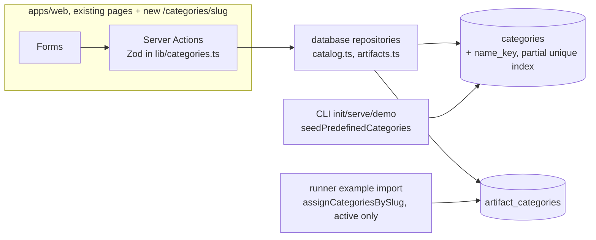

# SPEC-124 — Create, rename and archive categories and assign them to artifacts (E03-S01)

## 1. Summary

**Proposed, not implemented.** Today DirectiveBench seeds 17 predefined categories, shows them
on a read-only Categories page and filters the Artifacts list by one category; nobody can create,
rename, archive or assign a category from the app ([SPEC-106 §20](2026-10-14-category-management.md)).
This spec makes categories a user-owned taxonomy: a skill author creates their own categories,
renames and archives them (predefined ones included), assigns them to one artifact on its page
or to every artifact in a filtered list at once, and filters by them. It is the story slice of
SPEC-106 that issue #22 (E03-S01) asks for: create, rename, archive/unarchive, assign and bulk
assign. Merge, slug change and aliases stay out (FR-106-05, FR-106-09).

## 2. Motivation and problem statement

- With skills from several repositories in one registry, the maintainer needs to group them in
  their own terms (`[INTERVIEW]`, brief → Target group; epic #12). The seeded list is a fixed
  guess (Security, React, Python…); a user who works on, say, estimation or client-onboarding
  skills cannot express that today.
- Categories are how the catalogue answers "how do my skills in group X perform?": the Artifacts
  list already shows the latest benchmark score per row, so a category filter gives a per-group
  view of benchmark results without new reporting (SPEC-101 US-101-02).
- Product direction: D08 (2026-10-22) parked categories until the comparison slice S1 shipped.
  S1 (epic #93) is closed with all stories done, the issue's dependencies #17 and #30 are closed,
  and the issue carries the note "this resumes after S1". The maintainer approved starting it on
  2026-11-04. Categories group the artifacts that get benchmarked; they do not change how a
  benchmark runs or is graded.
- A review note on PR #50 (issue #22 comment) asks to cap the category slug length when creation
  arrives and align the Artifacts filter's Zod limit (256 today) with it.

## 3. Goals

- G1: Create a category from a name (and optional description); its slug is derived once and
  never changes.
- G2: Rename a category and edit its description; slug and assignments stay.
- G3: Archive and unarchive a category; archived ones leave pickers and default filters but keep
  their assignments, shown muted and labelled.
- G4: Assign and remove a category on one artifact; assign or remove a category for every
  artifact a filtered Artifacts list shows, in one transaction.
- G5: Names are unique case-insensitively among active categories, enforced by the database, so
  concurrent submits cannot create duplicates.
- G6: Generic: nothing in the design depends on the predefined list or on any one user's
  taxonomy; names in any script work (A5).

## 4. Non-goals

- Merging categories, changing a slug, slug aliases (FR-106-05, FR-106-09; a new table).
- Hard delete (OQ-106-02 stays open; see A9).
- Hierarchical categories, colours, icons; AI or heuristic auto-categorisation (OQ-106-03).
- Filtering by several categories at once (FR-106-10 OR/AND) and an "Uncategorized" filter.
- Benchmark suite categories: resolving `categories:` slugs of suite definitions, import
  warnings, a suite count per category or a category filter on the benchmarks list (FR-106-07,
  FR-106-11 suite count). See A20.
- A CLI or HTTP API for categories (A21).
- New design-system primitives (Dialog, Checkbox, Combobox, Toast); see UD-1.

## 5. User stories

- US-124-01: As a skill author, I create a category "Estimation" and see it on the Categories
  page and in the Artifacts filter.
- US-124-02: As a skill author, I rename the predefined "DevOps" to "CI and Ops"; links such as
  `/artifacts?category=devops` keep working.
- US-124-03: As a skill author, I archive "Python" because I do not write Python skills; it
  disappears from pickers, and the two artifacts that had it still show it, marked archived.
- US-124-04: As a skill author, I open a skill and assign it "Estimation" and "Documentation".
- US-124-05: As a skill author, I filter the Artifacts list to one repository and assign
  "Client A" to all 14 listed artifacts at once, then remove it again if I chose wrong.

## 5a. Resolved assumptions (autonomous defaults)

Written by `om-spec-writing --autonomous`. UI decisions are listed separately in §11.1.

**Maintainer decision (2026-11-04):** Mateusz accepted every default A1 to A22 and UD-1 to UD-9
as written, with two changes: **A5** (names with no Latin letter or digit get a generated slug
instead of being refused) and **UD-5** (Archive and both bulk actions confirm with the count).
A9 (no hard delete) stays. The rows below show the decided answer. The maintainer approved the
spec on 2026-11-04, including the smallest-free rule for generated slugs (A5); implementation has
not started.

| # | Question | Default chosen | Alternative | Why this default |
| --- | --- | --- | --- | --- |
| A1 | New story spec or only edit SPEC-106? | New SPEC-124 refines SPEC-106 for this story; SPEC-106 stays the umbrella and gets its FR-106-03 and §20 updated in the implementation PRs (§17) | Edit SPEC-106 in place, no new spec | SPEC-106 also covers merge, aliases and suites; one story spec keeps acceptance criteria verifiable |
| A2 | Split into two specs (category lifecycle vs assignment)? | One spec, four phased PRs (§21) | Two specs: lifecycle, then assignment | The issue is one story with one set of criteria; the phases ship independently |
| A3 | How is case-insensitive name uniqueness enforced? | New column `name_key` plus a partial unique index on active rows (migration `0005`) | A check inside `withTransaction` only, no schema change | `withTransaction` (`BEGIN IMMEDIATE`) already serialises writers, so the in-transaction check is the main guard; the index is the backstop that also holds for any future write path that skips the check. The column is additive and backfilled |
| A4 | Can the user choose the slug on create? | No: slug = derived from the name (the issue's AC) | Optional "Slug" field (FR-106-03 allows it) | Smallest surface; a field can be added later without migration |
| A5 | A name with no Latin letter or digit (for example "日本語", "!!!") | **Changed by the maintainer:** accepted, with a generated slug `category-N`. N is the smallest positive number whose `category-N` no category holds (archived included), chosen inside `createCategory`'s `withTransaction`; the slug unique index is the backstop. A slug never leaves its row (no delete A9, no slug change), so a free number was never used and a generated slug is never reused. Smallest-free instead of max-plus-one (Codex round 2): a derived slug such as `category-999…9` cannot push generated slugs past 64 characters, since N is at most one more than the number of categories | Refuse with a field error (the original default); transliterate | Non-Latin category names must work (G6); `slugify`'s shared fallback `item` is never used for categories |
| A6 | Slug length | At most 64 characters: the derived slug is cut at 64 and trailing hyphens dropped; the Artifacts filter's `category` limit drops from 256 to 64 (issue #22 comment) | Refuse names whose slug exceeds 64 | A 64-character name can expand past 64 under NFKD (for example ligatures); cutting is predictable |
| A7 | The derived slug is taken by another category | Refused. Active owner: "choose another name"; archived owner: "unarchive it instead" | Append `-2`, `-3` | Slugs are permanent identifiers; silent suffixes are hard to undo once linked |
| A8 | What archive does to assignments | Assignments stay; archived categories are hidden from pickers, the filter dropdown and bulk actions, still filter by URL, still show on artifacts as muted "Name (archived)", and can still be removed from an artifact; the example import keeps skipping them (existing behaviour) | Remove assignments on archive | FR-106-08; archive must be reversible without loss |
| A9 | Hard delete | Not offered | Delete unused, non-predefined categories | Never-delete keeps every slug resolvable; OQ-106-02 stays open |
| A10 | Archived names | An archived category's name is free for a new active category, but the slug rule (A7) still applies, so the same name is refused while the archived one holds its slug | Names unique including archived | FR-106-03 scopes name uniqueness to active rows |
| A11 | Description editing | Name and description are edited together on the category page; description optional, at most 500 characters, single line | Rename only | FR-106-04; the same form costs nothing extra |
| A12 | Predefined categories | Fully renamable and archivable; seeding never reverts or unarchives them (existing FR-106-02); the "Origin" column stays | Lock predefined names | Users own their taxonomy (generic design lesson) |
| A13 | Seeding versus a user category with the same name | A future predefined category whose name equals an active category's name is skipped (`ON CONFLICT DO NOTHING` covers the new index) | Rename or suffix the seeded one | Seeding must never fail startup or overwrite user data |
| A14 | Bulk scope | "All artifacts the current filters list", recomputed on the server from the posted filters, with a fingerprint of the artifact ids the page showed; a different set is refused as "the list changed" | Per-row checkboxes (needs a Checkbox primitive, UD-1) | No new component; a filter is how a user selects a group today; fails closed |
| A15 | Bulk remove | Included, symmetric to bulk assign | Bulk assign only | It is the undo of a mistaken bulk assign (reversibility) |
| A16 | Bulk size cap | Named limit `MAX_BULK_CATEGORY_ARTIFACTS = 10_000` (SPEC-106 NFR-106-01 sizing); more is refused with "narrow the filters" | No cap | Repository rule: no unbounded writes or unnamed limits |
| A17 | Multi-category filter and "Uncategorized" | Out of scope; the single `category` filter stays | Repeated `category` params (FR-106-10) | Not in the issue's criteria |
| A18 | Name normalisation | control characters in the raw input refused first; then Unicode NFC, trim, runs of whitespace collapsed to one space; key = normalised name with JavaScript `toLowerCase()` (full Unicode, no accent folding) | Also fold accents or NFKC | Matches how tags and search fold today (`apps/web/lib/artifact-metadata.ts`, `listArtifacts`) |
| A19 | Length unit for 64 / 500 | UTF-16 code units, as Zod's `.max` counts (same as tags and notes) | Code points | Consistency with existing limits |
| A20 | Benchmark suites and categories | Out of scope. Suite definitions keep their `categories:` slugs verbatim; nothing resolves or counts them yet | Add suite counts and import warnings now (FR-106-07) | Not in the issue; S2 (builder) is the natural home |
| A21 | CLI surface | None in this story | `directivebench category list/create/archive` | The issue names only the web UI; categories are local metadata the web app owns |
| A22 | ADR | None: no new dependency or architectural pattern; the partial index is an ordinary schema change recorded in this spec and SPEC-006 | ADR for `name_key` | AGENTS.md asks ADRs for significant design decisions only |

## 6. Functional requirements

### 6.1 Names and slugs (`@directivebench/core`)

| ID | Requirement |
| --- | --- |
| FR-124-01 | `normalizeCategoryName(raw)` MUST return the name in Unicode NFC, trimmed, with every run of whitespace replaced by one space. `categoryNameKey(name)` MUST return `normalizeCategoryName(name).toLowerCase()`. |
| FR-124-02 | `categorySlug(name)` MUST return `slugify(name)` cut to `CATEGORY_SLUG_MAX_LENGTH` (64) with trailing hyphens removed, or `null` when the name contains no character that `slugify` keeps (no `a-z0-9` after NFKD and accent stripping). It never returns the `slugify` fallback `item` unless the name itself slugifies to `item`. A `null` result means the repository generates the slug (A5, FR-124-04); `categorySlug` itself stays pure. |
| FR-124-03 | Limits are named constants in core: `CATEGORY_NAME_MAX_LENGTH = 64`, `CATEGORY_DESCRIPTION_MAX_LENGTH = 500`, `CATEGORY_SLUG_MAX_LENGTH = 64`. The web filter's `MAX_SLUG_PARAM_LENGTH` MUST use `CATEGORY_SLUG_MAX_LENGTH`. |

### 6.2 Lifecycle (database and web)

| ID | Requirement |
| --- | --- |
| FR-124-04 | **Create.** A name of 1 to 64 characters after normalisation, with no control characters, plus an optional description (empty means none), creates an active, non-predefined category. Its slug is `categorySlug(name)`; when that is `null` (no Latin letter or digit), `createCategory` generates `category-N` inside the same `withTransaction`, with N the smallest positive number whose `category-N` no category holds (archived rows included); the slug unique index is the backstop (§8.2). It MUST appear on the Categories page, in the Artifacts category filter and in the artifact pickers. |
| FR-124-05 | **Duplicate name.** A name whose key equals an active category's key MUST be refused with a field error naming that category, and nothing is stored. Case and whitespace variants ("testing ", "TESTING") count as duplicates. |
| FR-124-06 | **Slug taken.** A name whose slug belongs to any other category (active or archived) MUST be refused with a field error naming that category; when it is archived the message says to unarchive it. Nothing is stored. |
| FR-124-07 | **Rename and describe.** Name and description of any category, predefined included and archived included, are editable. The slug, `predefined` flag and assignments MUST NOT change. Renaming to a case variant of the same name is allowed. Renaming to another active category's key is refused (FR-124-05 message); renaming an archived category to an active category's key is allowed (it only clashes on unarchive). Saving unchanged values reports "nothing changed". |
| FR-124-08 | **Archive.** Asks first with an inline Risky-action confirmation that names the category and its artifact count (UD-5, §11); Cancel writes nothing. Confirming sets `archived_at`; idempotent ("already archived"). Assignments stay. The category leaves the Categories page's active table (it moves to the archived section), the Artifacts filter dropdown, the artifact picker and the bulk form. |
| FR-124-09 | **Unarchive.** Clears `archived_at`; idempotent. Refused when an active category already has the same key: "An active category is already named X. Rename one of them first." |
| FR-124-10 | **Seeding** keeps FR-106-02 and also fills `name_key`; a predefined category whose name or slug clashes with an existing row is skipped, never an error. |

### 6.3 Assignment

| ID | Requirement |
| --- | --- |
| FR-124-11 | **Assign one.** Assigning an active category to an artifact is idempotent ("already assigned"). Assigning an archived category MUST be refused ("X is archived. Unarchive it on its page before assigning it."). The write is one conditional statement (`INSERT … SELECT … WHERE archived_at IS NULL … ON CONFLICT DO NOTHING`); follow-up reads only explain a no-op insert (already assigned, archived, unknown category or artifact). |
| FR-124-12 | **Remove one.** Removing a category from an artifact is idempotent ("X was already removed.", §11.3 D24) and allowed for archived categories. No confirmation: assignments carry no history. |
| FR-124-13 | **Bulk.** On the Artifacts list, a form assigns or removes one active category for every artifact the current filters list (the filtered list is the selection, A14; no per-row checkboxes). Each action first shows an inline Risky-action confirmation stating the category and the count the page showed ("Assign Client A to 1,240 artifacts?"); only the confirming button submits, and Cancel writes nothing (UD-5). The form posts the server-parsed filters (`q`, `type`, `category`, `repository`; every key of the parsed filter) and `listFingerprint`, a SHA-256 of the sorted listed artifact ids (core hashing), computed from the same database snapshot as the rows and the count the page renders (today the ids of the one `listArtifacts` result the table shows; never a separate, later read), so the fingerprint cannot describe artifacts the user did not see; it does not post the count, which the fingerprint covers (messages use the server's count). The list page ignores invalid URL parameters, so when it ignored one it hides the bulk row and says why (§11.4 D28) instead of offering an action on a wider list; the server refuses any invalid or forged filter field it receives. In one `withTransaction` it runs `listArtifactIds(db, filter)`, which shares its conditions with `listArtifacts`, and refuses, in this order: a fingerprint that differs ("The list changed since the page loaded (now N artifacts). Check it and try again."), an unknown or archived category (in both modes, so bulk remove of an archived category is refused; single remove on the artifact page stays allowed, FR-124-12), more than `MAX_BULK_CATEGORY_ARTIFACTS`; then it inserts (`ON CONFLICT DO NOTHING`) or deletes, and reports how many changed and how many already were in the target state. Any refusal writes nothing. |
| FR-124-14 | **Display.** Wherever assignments show (Artifacts list column, artifact page), archived categories show as a `muted` Badge reading "Name (archived)", after the active ones. |
| FR-124-15 | **Filter.** The Artifacts category dropdown lists active categories. When the URL names an archived category, the dropdown also lists it as "Name (archived)", selected, so the form shows the real filter; filtering by an archived slug works (FR-106-08). |
| FR-124-16 | All mutations are Server Actions in `apps/web/lib/actions.ts` that parse `FormData` with Zod schemas from `apps/web/lib/categories.ts`, call `@directivebench/database` repository functions only, and revalidate `/categories` (layout) and `/artifacts` (layout, once, which covers every `/artifacts/[id]` page, also after a bulk change of thousands of artifacts) (FR-106-12, SPEC-014). |

## 7. Non-functional requirements

- NFR-124-01: Bulk assign of 10,000 artifacts completes in under 1 s on the test machine
  (SPEC-106 NFR-106-02 sizing); measured once in a database test, not enforced as a timing
  assertion.
- NFR-124-02: Every new page and form works by keyboard alone, keeps focus on a field after
  each submit (Form pattern, "Lists edited in place" rule 5), and has no horizontal page scroll
  at 320px.
- NFR-124-03: All new text meets 4.5:1 contrast in both themes, including the muted "(archived)"
  badge, the status lines and field errors (AGENTS.md §7).
- NFR-124-04: Local-first: no network calls; works offline.

## 8. Domain entities and contracts

### 8.1 Data model and migration

`categories` (SPEC-006) gains one column and one index; `artifact_categories` is unchanged.

```sql
-- packages/database/migrations/0005_category_name_key.sql (generated by drizzle-kit, checked by hand)
ALTER TABLE `categories` ADD `name_key` text DEFAULT '' NOT NULL;
--> statement-breakpoint
UPDATE `categories` SET `name_key` = lower(trim(`name`));
--> statement-breakpoint
CREATE UNIQUE INDEX `categories_active_name_key_unique`
  ON `categories` (`name_key`) WHERE `archived_at` IS NULL;
```

- The backfill uses SQLite `lower()`, which folds ASCII only. That is correct for every database
  this migration meets: until this story no code path creates or renames a category, so every
  row is a predefined, ASCII name from `PREDEFINED_CATEGORIES`. A migration test asserts the
  backfill on a database built at migration `0004`.
- From this story on `name_key` is written only by repository functions, from
  `categoryNameKey()` (JavaScript, full Unicode).
- Drizzle: `nameKey: text('name_key').notNull()` with **no** `.default()`, so every typed insert
  must set it (a compile error otherwise); the SQL `DEFAULT ''` exists only so `ALTER TABLE ADD`
  works on a non-empty table, and the migration is hand-edited for it. A migration test asserts no
  row keeps `''`. Plus
  `uniqueIndex('categories_active_name_key_unique').on(t.nameKey).where(sql\`archived_at is null\`)`.
- The existing `categories_slug_unique` (all rows) stays: slugs are unique including archived.
- Partial unique indexes exist in PostgreSQL too, so the optional backend (SPEC-117, draft) can
  mirror this.
- Rollback: the column and index are additive and an older build reads around them. Hazard: an
  older build that inserts a category leaves `name_key = ''`, and a second such row would clash
  on the index. Older builds insert only predefined categories, all 17 of which already exist,
  so in practice they insert nothing; a downgrade after this story is not supported beyond that.

### 8.2 Repository functions (`@directivebench/database`, `repositories/catalog.ts` and `artifacts.ts`)

Outcomes are discriminated unions; expected conflicts are never thrown.

```ts
type CategoryRef = { id: string; slug: string; name: string; archived: boolean };

createCategory(handle, { name, description }):
  | { status: 'created'; category: CategoryRef }
  | { status: 'name-taken'; existing: CategoryRef }
  | { status: 'slug-taken'; existing: CategoryRef };

updateCategory(handle, { id, name, description }):
  | { status: 'updated'; category: CategoryRef; previousName: string }  // tells a rename from a description change (Phase 2)
  | { status: 'unchanged'; category: CategoryRef }
  | { status: 'name-taken'; existing: CategoryRef }
  | { status: 'not-found' };

setCategoryArchived(handle, { id, state: 'archived' | 'active' }):   // no boolean flag (SPEC-014)
  | { status: 'archived' | 'unarchived' | 'already-archived' | 'already-active'; category: CategoryRef }
  | { status: 'name-taken'; existing: CategoryRef }   // unarchive only
  | { status: 'not-found' };

getCategoryBySlug(db, slug): (CategoryRef & { description: string | null; predefined: boolean;
  artifactCount: number }) | null;

listCategories(db)                 // existing, unchanged shape (name_key is not exposed)
listActiveCategoryNames(db)        // Phase 3: { id, name } of active categories by name, no counts
assignArtifactCategory(handle, artifactId, categoryId):
  | { status: 'assigned' | 'already-assigned' | 'category-archived'; category: CategoryRef }
  | { status: 'category-not-found' | 'artifact-not-found' };
unassignArtifactCategory(db, artifactId, categoryId):
  | { status: 'removed' | 'not-assigned'; category: CategoryRef }
  | { status: 'category-not-found' | 'artifact-not-found' };
// The category is read after the write, so a rename elsewhere shows the current name
// (maintainer decision 2026-11-05, Phase 3). The assigned categories that
// getArtifactDetail returns (ArtifactCategory) also carry the category `id`.
// assignArtifactCategory takes the handle and runs the insert and the reads that explain a
// no-op in one withTransaction, so no archive or unarchive lands between them (Codex review,
// PR 198).

setCategoryForListedArtifacts(handle, { categoryId, mode: 'assign' | 'remove',
  filter: ArtifactListFilter, listFingerprint: string,
  limit = MAX_BULK_CATEGORY_ARTIFACTS }):        // injectable for tests (§15)
  | { status: 'done'; changed: number; unchanged: number; category: CategoryRef }
  | { status: 'list-changed'; actualCount: number }   // fingerprint differs
  | { status: 'category-archived'; category: CategoryRef }   // the message names it
  | { status: 'category-not-found' }
  | { status: 'too-many'; actualCount: number; limit: number };
// Refusals are checked in this order: fingerprint, then category (unknown, then archived, in
// both modes), then limit. Any refusal writes nothing (maintainer decision 2026-11-10, §11.4
// D33). The category in `done` is read after the write, as in Phase 3.
```

- `createCategory`, `updateCategory`, `setCategoryArchived` and `setCategoryForListedArtifacts`
  run in `withTransaction`: look up the clash, then write. The partial and slug unique indexes
  are the backstop: when `withTransaction` rejects with `SQLITE_CONSTRAINT_UNIQUE` (it has rolled
  back), the function runs a fresh read of the clashing row and returns the matching
  `name-taken` / `slug-taken` outcome; the raw error never reaches the UI.
- `listArtifactIds(db, filter)` (new, Phase 4) returns the ids for the same conditions as
  `listArtifacts`, so the bulk write does not load versions, runs and occurrences while it
  holds the write lock. It shares the SQL condition builder with `listArtifacts` and selects
  `id`, `name` and `description`, because `q` is matched in JavaScript (`matchesText`,
  full-Unicode `toLowerCase`); it filters `q` with the same helper and returns ids only. A test
  asserts it equals `listArtifacts(…).map(id)` for every filter, incl. a non-ASCII `q`.
- `setCategoryForListedArtifacts` writes inside its one `withTransaction` (`BEGIN IMMEDIATE`, so
  a scan's apply transaction in the runner process cannot interleave): assign as
  `INSERT … SELECT … WHERE archived_at IS NULL … ON CONFLICT DO NOTHING RETURNING`, remove as
  `DELETE … WHERE category_id = ? AND artifact_id IN (…) RETURNING`, with `IN` lists batched
  under SQLite's variable limit; `changed` is the returned rows, `unchanged` the listed count
  minus `changed`. No artifact ids come from the browser, so there is no id limit and no
  per-id "not found" count: an artifact that vanished changes the fingerprint.
- Bounded memory under the write lock (Codex review of the Phase 4 decisions): the bulk path
  keeps at most `limit + 1` ids. The page never offers bulk on a list above the limit (§11.4
  D28), so a recomputed list above it cannot match the posted fingerprint and is refused as
  `list-changed` as soon as the `limit + 1`th match is found; its `actualCount` is counted after
  the transaction has ended (outside the write lock, like the fresh read after a unique
  violation), so the message still states the current count. This bounds the ids kept, not
  the rows read: with `q`, the scan still reads every artifact the SQL conditions leave (as one
  render of the list page does) before it can stop, and holds the write lock while it does. That
  cost is accepted with the approved one-transaction recompute (§11.4 D33) and sized by
  NFR-124-01; the Phase 4 database test times it once on 10,000 artifacts. The refusal order
  (fingerprint, category, limit) stays as decided.
- `getArtifactDetail` and `listArtifacts` return `archived: boolean` on each category, active
  ones first, then by name.
- Generated slugs (A5): inside its `withTransaction`, `createCategory` reads the slugs that
  start with `category-` (all rows, archived included) into a set and tries `category-1`,
  `category-2`, … until one is not in the set (exact string match, so `category-07` does not
  hold `category-7`). With K such slugs the loop ends by N = K + 1, so the generated slug is at
  most `category-` plus the digits of K + 1, far below 64 characters, whatever a user named a
  category (for example "Category " and 55 nines derives a 64-character `category-999…9`, which
  does not affect the next generated slug). The result must pass the same slug schema as the
  `[slug]` route and the `category` filter before insertion. Because `BEGIN IMMEDIATE`
  serialises writers and a slug never leaves its row (A9, no slug change), the number is free
  and never reused; a `SQLITE_CONSTRAINT_UNIQUE` on the slug index is still mapped to a fresh
  read and a `slug-taken` outcome, never a raw error. Renames never change a slug, generated or
  derived.
- `assignCategoriesBySlug` (example import) keeps its contract (active slugs only), but each
  assignment becomes one conditional statement,
  `INSERT INTO artifact_categories (artifact_id, category_id, created_at) SELECT ?, id, ? FROM categories WHERE slug = ? AND archived_at IS NULL ON CONFLICT DO NOTHING`,
  so an archive committed between the importer's lookup and its write cannot leave an assignment
  to an archived category (SPEC-014 check-then-act, FR-106-06). Today it selects active
  categories, then inserts in separate statements outside any transaction
  (`packages/runner/src/import.ts`), and the runner and the web app are separate processes on
  one SQLite file.
- `MAX_BULK_CATEGORY_ARTIFACTS` is exported from the package.

### 8.3 Web validation (`apps/web/lib/categories.ts`)

- `categoryNameSchema`: string → no `\p{Cc}` in the raw input → `normalizeCategoryName` → 1..64.
  The control-character check runs on the raw input, before normalisation, because
  `normalizeCategoryName` turns line breaks and tabs (which are `\p{Cc}`) into spaces and the
  §13 "line breaks or other control characters" error could otherwise never fire for them
  (maintainer decision, 2026-11-05). A name without a Latin letter or digit is valid (A5).
  Messages in §13.
- `categoryDescriptionSchema`: string → trim → ≤ 500, no `\p{Cc}` → empty becomes `null`.
- `createCategorySchema`, `updateCategorySchema` (`id` + both), `archiveCategorySchema`
  (`id`, `state` from a hidden `intent` of `archive` / `unarchive`),
  `artifactCategorySchema` (`artifactId`, `categoryId`),
  `bulkCategorySchema` (`categoryId` non-empty, `mode` of `assign` / `remove` (a hidden field;
  kept as `mode`, not the app's `intent`), `listFingerprint` as 64 hex characters, and the list
  filters parsed by `parseArtifactListParams` from `formData.get(name)` for every list key; the
  form is refused with `INCOMPLETE_FORM_MESSAGE` when its `invalid` list is not empty). No count
  field: the form does not post the count (FR-124-13).
- Form state is `CategoryFormState`: the kinds of `MetadataFormState`
  (`idle | success | fieldError | error`) plus, on `fieldError`, `field: 'name' | 'description'`
  and `values: { name, description }`, so after an error both fields keep the entered text and
  the right field gets `aria-invalid` (D14, maintainer decision 2026-11-05;
  [lesson](../lessons/2026-10-28-action-forms-reset-to-the-new-default-value.md)).
  `MetadataFormState` keeps one value and no field name, which is not enough for two fields.

## 9. Data flow



Takeaway: only the web app's Server Actions write user category changes; the CLI keeps seeding,
the runner keeps assigning example categories by slug, and sync never touches categories.

## 10. API and interface design

Server Actions (all `(previous: MetadataFormState, formData: FormData) => Promise<MetadataFormState>`):
`createCategoryAction`, `updateCategoryAction`, `setCategoryArchivedAction`,
`assignArtifactCategoryAction`, `unassignArtifactCategoryAction`,
`setCategoryForListedArtifactsAction`. No route handlers, no CLI commands.

Routes: `/categories` (changed), `/categories/[slug]` (new), `/artifacts` (changed),
`/artifacts/[id]` (changed). `[slug]` is validated with the filter's slug schema; an invalid or
unknown slug renders the app's not-found page.

## 11. UI/UX considerations

Built only from existing components and patterns (`apps/web/design-system.md`): Card, Input,
NativeSelect, Button, Badge, Table, PageHeader, EmptyState, the Form pattern and "Lists edited in
place". Copy below is final wording proposed for approval; it contains no en or em dash.

**`/categories` (changed).** PageHeader description: "Group artifacts in your own categories.
Merging categories and changing a slug are planned." A "New category" card first: Name (Input,
`maxLength` 64), Description (Input, optional, `maxLength` 500), Create (`default` button);
field errors under the field, one status line. Then the "Active categories" table (Name links to
`/categories/<slug>`, Slug, Description, Origin, Artifacts count linking to
`/artifacts?category=<slug>`). Then an "Archived categories" card with the same columns, shown
only when at least one is archived. Empty active table: EmptyState "No active categories" with
"Create one above, or unarchive one below." After Create, focus returns to Name and the new row
is in the table.

**`/categories/[slug]` (new).** PageHeader title is the name, with a `muted` "archived" Badge
when archived. Card "Details": Name, Description, Save, and the line "The slug stays
<code>devops</code>, so links and benchmark definitions keep working." Card "Status": for an active
category "Archived categories leave pickers and filters. Their assignments stay." and an
`outline` "Archive" button; for an archived one "Archived. It stays on N artifacts." and
"Unarchive". Card "Artifacts": "N artifacts" linking to the filtered Artifacts list, or, with no
artifact, "No artifact has this category yet. Assign it on an artifact's page or to a filtered
list on Artifacts." for an active category and "No artifact has this category." for an archived
one, which cannot be assigned anywhere (§11.4 D38). "Archive" does not archive yet: it opens the Risky-action inline panel (unchanged
pattern: `role="alert"`, `warning` fill, under the Status card's text) with the question
"Archive Python?", the reason "It leaves pickers, filters and the bulk form. It stays on 1,240
artifacts, shown as archived." (for zero artifacts: "No artifact has it.") and a `destructive`
`sm` "Archive Python" button plus a Cancel link. Opening the panel moves focus to its question;
Cancel closes it, writes nothing and returns focus to "Archive". "Unarchive" needs no
confirmation.

**`/artifacts/[id]` (changed).** Categories move from the Metadata card into a "Categories"
card using "Lists edited in place": each assigned category as a `secondary` Badge (archived:
`muted`, "Name (archived)") with an `outline` `sm` "Remove" named "Remove category Name"; under
the list a NativeSelect of active, unassigned categories and an "Assign" button. When none are
left: "Every active category is assigned. Create more on the Categories page." (link). Empty
list: "No categories yet."

**`/artifacts` (changed).** Category chips follow FR-124-14; the filter follows FR-124-15. Under
the filter form, when the list is not empty, no URL value was ignored, the list has at most
10,000 artifacts and an active category exists (otherwise a sentence says why, §11.4 D28), a
bulk form:
"Category for the 14 listed artifacts" (NativeSelect), then `outline` buttons "Assign to all
listed" and "Remove from all listed". Neither button writes: each opens the Risky-action inline
panel under the form with "Assign Client A to 1,240 artifacts?" or "Remove Client A from 1,240
artifacts?" (the count the page showed, which the fingerprint then guards), the reason "This
changes every artifact that matches the current filters, not only the rows on screen." (plus
"No filter is set, so this is every artifact in the registry." when no filter is set, §11.4
D32) and a `destructive`
`sm` confirming button "Assign to 1,240 artifacts" / "Remove from 1,240 artifacts" plus a Cancel
link. Changing the category in the select closes an open panel. Focus moves to the question when
the panel opens and back to the button that opened it on Cancel. Result line: "Assigned Client A
to 11 artifacts. 3 already had it." / "Removed Client A from 11 artifacts. 3 did not have it."

**Confirmation is a maintainer override (UD-5).** Archive and bulk actions on many items confirm
with the count even though they are reversible and keep history, which the Risky-action page's
"When not to use" and `apps/web/design-system.md` ("A reversible removal that keeps history: No
confirmation") would otherwise rule out. The pattern itself is used unchanged, `destructive`
confirming button included. Phase 2 adds one line to each of those two documents saying so.
Single assign, single remove and Unarchive keep no confirmation.

States for every form: pending (controls disabled, status line "Saving…" or "Assigning…"),
success (status line), field error (`aria-invalid`, `aria-describedby`, `role="alert"`),
general error ("The form was incomplete. Reload the page and try again."), not initialised
(`NotInitialized`). Keyboard: native form controls only, visible focus, focus kept per the Form
pattern. 320px: forms wrap (`flex-wrap`), tables scroll inside their card, no page scroll.
Both themes: tokens only; contrast measured in `text-contrast.spec.ts` / `ui-contrast.spec.ts`.

Prototype: `.ai/specs/assets/category-lifecycle-and-assignment/` (static mockups and current
screenshots, illustrative only; colours and fonts are approximate, the implementation uses the
design system).

| Today | Proposed |
| --- | --- |
|  |  |
|  |  |
|  |  |

### 11.1 UI decisions for the maintainer to approve

| # | Decision | Default in this spec | Alternative |
| --- | --- | --- | --- |
| UD-1 | New primitives | None. Bulk selection by filter, edit on a page, pickers as NativeSelect, results in status lines | Add Checkbox (row selection), Combobox (searchable picker), Dialog (edit in place); each needs approval, stories and a Storybook page ("What is missing" lists them for issue 22) |
| UD-2 | Where a category is edited | Its own page `/categories/[slug]` | Inline row form on `/categories` (expanding row) or a Dialog |
| UD-3 | Where archived categories show | A separate "Archived categories" card on `/categories` | A `?status=archived` filter or one table with a status column |
| UD-4 | Bulk assign UI | "Assign to all listed" / "Remove from all listed" for the filtered list, guarded by the shown count | Checkbox per row plus a selection bar (UD-1) |
| UD-5 | Confirmation before archive or bulk actions | **Changed by the maintainer:** the inline Risky-action panel, unchanged, with the object and count ("Remove Client A from 1,240 artifacts?") for Archive, "Assign to all listed" and "Remove from all listed"; Unarchive, single assign and single remove need none | No confirmation; the result line says what was kept or changed (the original default) |
| UD-6 | How an archived assignment looks | `muted` Badge with the text "Name (archived)", after active ones | Hide archived assignments; or a separate "archived" Badge next to the name |
| UD-7 | Picker for assigning on the artifact page | NativeSelect of active, unassigned categories | Combobox with search (better past about 100 categories) |
| UD-8 | Category list on the artifact page | Its own "Categories" card (like Tags, Assigned benchmarks) | Keep inside the Metadata card |
| UD-9 | Copy | The strings in §11 and §13 | Maintainer's wording |

### 11.2 Phase 2 UI decisions (maintainer decision, 2026-11-05)

Refinements of §11 for Phase 2, prepared with mockups and contrast figures and approved by the
maintainer on 2026-11-05. None needs a new component, variant or token.

| # | Point | Decision |
| --- | --- | --- |
| D1 | New category form | One wrapping row: Name, "Description (optional)", Create (`h-control`, same height as the inputs) |
| D2 | Row actions in the Active table | None; the name links to `/categories/<slug>`; CardDescription "Open a category to rename or archive it." |
| D3 | Empty Description cell | Empty cell (no dash placeholder) |
| D4 | Artifacts count cell | A link only when the count is above 0, `aria-label` "3 artifacts with CI and Ops" |
| D5 | Archived categories card | Same columns as the Active table, no row actions, no per-row badge; Unarchive lives on the category page |
| D6 | Empty Active table | `EmptyState` replaces the Active card (no card in a card); "Create one above." when nothing is archived, "Create one above, or unarchive one below." otherwise |
| D7 | `/categories/[slug]` card order | Details, Artifacts, Status (risky action last) |
| D8 | "archived" marker | `muted` Badge as the first item of the PageHeader `description` line ("[archived] Slug python. Predefined."); PageHeader is unchanged |
| D9 | Details form | Same one-row layout as D1, button "Save" |
| D10 | Unarchive button | `outline`, like Archive; Save stays the page's only `default` button |
| D11 | Archive panel | Client state: Archive toggles the panel (`aria-expanded`, `aria-controls`); Cancel is `Button variant="link" size="sm" type="button"`, same height as the confirm button; `risky-action.mdx` gets one sentence on this |
| D12 | Archived option in the category filter | Listed last, after the active categories |
| D13 | Messages | Under the form row (field error, general error, `role="status"` line) as in `metadata-forms.tsx`, with a local `Messages` copy in the categories forms file |
| D14 | Form state | `CategoryFormState` (§8.3) |
| D15 | New copy | The strings below; every "N artifacts" uses the singular for 1 and the shared `toLocaleString('en-US')` formatter |

New strings (D15), in addition to §11 and §13: "The link (slug) comes from the name and never
changes." (New category description); labels "Name", "Description (optional)"; buttons "Create",
"Save"; card titles "Active categories", "Archived categories", "Details", "Status",
"Artifacts"; Archived card description "Hidden from pickers and filters. Their assignments
stay."; page title "Category"; header description "Slug python. Predefined." / "Slug client-a.
User-defined."; "3 artifacts have this category." / "1 artifact has this category."; panel
reason for one artifact "It leaves pickers, filters and the bulk form. It stays on 1 artifact,
shown as archived."; status "Archived. It stays on 1 artifact." / "Archived. No artifact has
it."; pending "Creating…", "Saving…", "Archiving…", "Unarchiving…"; results "Created
Estimation.", "Renamed to CI and Ops. Its slug stays devops, so links keep working.", "Saved.",
"Nothing changed.", "Archived Python. It stays on 2 artifacts." (1: "on 1 artifact"; 0:
"Archived Python."), "Python is already archived.", "Unarchived Python. It is back in pickers
and filters.", "Python is already active.". None contains U+2013 or U+2014.

Focus: Create success returns focus to the cleared Name field; a field error focuses that field
with its value kept; Archive moves focus to the panel question (`tabIndex=-1`); Cancel returns
it to Archive; a confirmed archive focuses Unarchive and a successful unarchive focuses Archive.
Focus moves only when it is still inside the card or on `body`.

Implementer notes: at 320px the confirm button "Archive <name>" with a 64-character name can
overflow, so the panel's action form gets `flex-wrap` and the panel `min-w-0`, covered by a
narrow-screen Playwright case; add `/categories/<slug>` and the open Archive panel to
`text-contrast.spec.ts`; leave the other dash placeholders on `/artifacts` to issue #123.

### 11.3 Phase 3 UI decisions (maintainer decision, 2026-11-05)

Refinements of §11 and §11.2 for the Categories card on `/artifacts/[id]`, approved by the
maintainer on 2026-11-05. None needs a new component, variant or token; contrast pairs are the
existing ones (lowest: archived chip, 5.50 light, 5.83 dark).

| # | Point | Decision |
| --- | --- | --- |
| D16 | Card position | Right column, directly after Metadata and before Tags; Metadata keeps only Compatibility |
| D17 | Chips and Remove | Same layout as Tags: a wrapping list (`aria-label` "Categories"), each item a Badge plus an `outline` `sm` "Remove" whose accessible name is "Remove category " plus the chip text ("Remove category Python (archived)") |
| D18 | Link from a chip | None; the Badge stays non-clickable |
| D19 | Card description | "Groups for filtering the Artifacts list. A rescan keeps them." |
| D20 | Picker | Like the Suites picker: label "Category", first option preselected, no placeholder, `default` "Assign" button (`h-control`, same height as the select) |
| D21 | Every active category assigned | The decided sentence replaces the picker; "Categories page" is a link to `/categories` styled as the Phase 2 links |
| D22 | No active category at all | "There are no active categories. Create or unarchive one on the Categories page." replaces the picker |
| D23 | Removing an archived assignment | Same Remove button, no confirmation; result "Removed Python. To assign it again, unarchive it on its page first." |
| D24 | Copy | "Assigned X.", "X is already assigned.", "Removed X.", "X was already removed."; pending "Assigning…" or "Removing…" by the pressed button; already-assigned and already-removed are statuses, not errors |
| D25 | Focus | After assign or remove, the select; when the picker disappears after an assign, the new chip's Remove; when it is absent after a remove, the Remove that took the removed chip's place, else the last chip's Remove, else the "Categories page" link |
| D26 | Stale page | Every submit revalidates `/artifacts/<id>` and the `/categories` and `/artifacts` layouts (FR-124-16), whatever the outcome; names in messages are the current names |

Implementer notes: the chip labels and the D21/D22 choice are computed on the server and passed
to the client card as props (a `'use client'` file must not import values from
`@directivebench/core`, lesson 2026-11-05).

### 11.4 Phase 4 UI decisions (maintainer decision, 2026-11-10)

Refinements of §11, §11.2 and §11.3 for bulk assign and bulk remove on `/artifacts`, approved by
the maintainer on 2026-11-10 together with the open questions of the decision pass (folded into
FR-124-13, §8, §13 to §16, §19 and §21). None needs a new component, variant or token; A14, A15,
A16, UD-1, UD-5 and the §11 copy stay as decided. The bulk action on the filtered list satisfies
issue #22's "several selected artifacts", so the Phase 4 PR closes issue #22.

| # | Point | Decision |
| --- | --- | --- |
| D27 | How rows are selected | The filtered list is the selection (A14): no per-row checkboxes. "Listed" means the applied filters (the URL), not filter controls edited but not yet submitted. Count and fingerprint cover every matching artifact, never one page, also once issue 53 paginates (§19) |
| D28 | When the bulk row shows | Checked on the server page in this order: list empty: nothing (the EmptyState explains); a URL value was ignored: "Fix or clear the filters in the URL before changing categories for the whole list."; more than 10,000 listed: "This list has 12,400 artifacts. To change a category for all of them, narrow the filters to at most 10,000." (the server keeps its own check); no active category: the D22 sentence with the "Categories page" link; otherwise the bulk row. Sentences are `text-ui text-muted-foreground`, in the bulk row's place |
| D29 | Where the bulk row lives | Inside the list Card, after the filter form and the filter notice, above the table: a `div` with `border-t pt-4 mb-4` holding a separate POST form (`flex flex-wrap items-end gap-inline`), after the GET `role="search"` form in DOM and tab order |
| D30 | Picking the category | NativeSelect `name="categoryId"` of active categories by name (`listActiveCategoryNames`), first option preselected, no placeholder; archived categories are never listed, also when the URL filters by one; after any submit the select keeps the submitted category while it is still active (the form state carries `categoryId`) |
| D31 | Assign and remove | One select, two `type="button"` `outline` buttons of size `default` (`h-control`, the select's height), each with `aria-expanded` and `aria-controls`; neither writes; no `default` button in the row. One panel: the other button switches it to that mode, the same button again closes it |
| D32 | Confirmation panel | Always, any count including 1 (UD-5). Classes as the Archive panel (`min-w-0 space-y-stack rounded-surface border border-warning/40 bg-warning/10 p-3 text-ui`, `role="alert"`); question `font-medium wrap-anywhere`, `tabIndex=-1`; reasons in a list; confirm `destructive` `sm` `type="submit"` without the category name; Cancel `link` `sm` `type="button"`. Reason "This changes every artifact that matches the current filters, not only the rows on screen."; when no filter is set also "No filter is set, so this is every artifact in the registry." Hidden fields: the `categoryId` captured when the panel opened, `mode`, the filter fields, `listFingerprint`. Changing the select closes the panel |
| D33 | Server contract | One `withTransaction`, all or nothing, no client-sent ids; refusals in the order fingerprint, category, limit (§8.2, FR-124-13) |
| D34 | Result and error copy | The strings below; counts with the shared `formatCount`, "artifact" singular for 1, names read after the write. Success lines `text-muted-foreground` `role="status"`, errors `text-destructive-foreground` `role="alert"`, under the form row (D13) |
| D35 | Focus and keyboard | Opening the panel focuses its question; the other button while open focuses the new question; Cancel or the same button again returns focus to the opening button; changing the select keeps focus on it; any result focuses the opening button, or the filter form's Search field when the bulk row is gone; pending disables the select and every button and moves nothing. Focus moves only when it is still inside the bulk area or on `body`. No Escape handling (the Archive panel has none) |
| D36 | Stale page, concurrent changes | Every outcome refreshes `/categories` and `/artifacts` (D26); any result closes the panel; the chosen category stays selected. A changed list, an archived or renamed category, a list grown past 10,000 and two tabs confirming at once are handled by the D33 order and `BEGIN IMMEDIATE`, never a mixed write |
| D37 | Empty and error states | The client bulk component always renders (after the filter notice) with a server-computed state `ready \| invalid-url \| too-many \| none-active \| empty` and shows the row only for `ready`, so the result line of the last submit survives a list that became empty. It is not keyed by count or fingerprint |
| D38 | Phase 2 copy that announces bulk | Shipped strings stay ("It leaves pickers, filters and the bulk form. …", "Unarchived Python. It is back in pickers and filters.", the Status card lines), except the Artifacts card of an archived category with no artifacts on `/categories/[slug]`, which reads "No artifact has this category." (fixed in Phase 4 with an e2e case) |
| D39 | Design-system docs | Phase 4 adds to the Filtered list pattern (`filtered-list.mdx`) the rule "An action on every listed item sits under the filters, in the same Card, separated by a border; it names the count ('for the 14 listed artifacts') and asks first (Risky-action pattern)." with a static `BulkAction` story (row, and the panel open) in `filtered-list.stories.tsx`, checked by `pnpm test:storybook` in both themes; the Checkbox row on "What is missing" (`what-is-missing.mdx`) becomes "Selecting table rows (bulk category changes act on the filtered list, SPEC-124 A14), approval" and the example on "How to choose" (`how-to-choose.mdx`) becomes "Select table rows". The bulk form file keeps a local `Messages` copy; extracting it is a follow-up |

New strings (D28, D32, D34), in addition to §11 and §13: label "Category for the 1 listed
artifact"; question "Assign Client A to 1 artifact?" / "Remove Client A from 1 artifact?";
confirm "Assign to 1 artifact" / "Remove from 1 artifact"; "Cancel"; pending "Assigning…" /
"Removing…" by the confirmed mode; results "Assigned Client A to 14 artifacts.", "Assigned
Client A to 11 artifacts. 3 already had it." (1: "1 already had it."), "All 14 listed artifacts
already had Client A." (1: "The listed artifact already had Client A."), "Removed Client A from
14 artifacts.", "Removed Client A from 11 artifacts. 3 did not have it." (1: "1 did not have
it."), "None of the 14 listed artifacts had Client A." (1: "The listed artifact did not have
Client A."); list changed with "now 1 artifact" and "now no artifacts"; archived refusal for
remove "Client A is archived. Unarchive it on its page before removing it from a list."; the
category page line "No artifact has this category.". The assign refusal, `CATEGORY_GONE_MESSAGE`
and `INCOMPLETE_FORM_MESSAGE` are the §13 strings. None contains U+2013 or U+2014.

Contrast (computed from the tokens in both themes; no pair beyond Phase 2 and 3): muted text on
card 6.00 / 6.91; foreground on the select and the outline buttons at rest 19.79 / 15.33, on
hover or `aria-expanded` 18.15 / 14.03; foreground on the warning panel 17.92 / 14.27;
destructive-foreground on the confirm button at rest 6.38 / 5.73 and on hover 5.34 / 4.83 (the
lowest pair); Cancel (primary-text) on the panel 7.90 / 9.70; errors on card 8.37 / 9.33; the
"Categories page" link on card 8.72 / 11.67; UI boundaries: control border on card 4.73 / 3.79,
focus ring on card 10.39 / 6.91 and on the panel 9.41 / 5.75, select chevron 6.00 / 6.91
(light / dark, all pass). The `border-t` separator is decorative.

Implementer notes: the bulk form posts every key of the parsed filter (a unit test asserts the
hidden fields cover every key of `listParamSchemas`), so a filter added later is posted
automatically and a forgotten one fails closed on the fingerprint; tests address the bulk select
and the filter select by `name`, since both labels contain "Category" (lesson 2026-10-20); the
D28 state and the labels are computed on the server and passed as props (lesson 2026-11-05).

## 12. Security considerations

- Names and descriptions are untrusted text: rendered only as React text, never as HTML or
  Markdown; control characters refused; lengths bounded (SPEC-007).
- Every id from a form is re-checked in the repository; a forged `categoryId` or `artifactId`
  yields `not-found`, never a write to another row. The bulk action scopes its write by the
  posted category and the server-recomputed list, never by client-sent artifact ids
  ([lesson](../lessons/2026-10-30-scope-child-writes-by-the-posted-parent.md)).
- The `[slug]` route parameter and the `category` filter are regex-checked and length-capped
  before any query; all queries are parameterised (Drizzle).
- Fail closed: a changed list, an invalid or forged filter field or an over-limit bulk refuses
  and writes nothing. A URL value the list page ignored hides the bulk row (§11.4 D28), so an
  ignored filter can never widen the list a bulk action acts on.
- Server Actions keep Next.js's same-origin check; DirectiveBench binds to localhost by default
  (SPEC-007). No secrets are involved.

## 13. Error handling

| Case | User sees | Stored |
| --- | --- | --- |
| Empty name | "Enter a name." | nothing |
| Name over 64 | "A name can be at most 64 characters. Shorten it." | nothing |
| Control character | "A name cannot contain line breaks or other control characters." | nothing |
| Description over 500 | "A description can be at most 500 characters. Shorten it." | nothing |
| Duplicate active name | "A category named Testing already exists. Choose another name." | nothing |
| Slug of an active category | "The name gives the link testing, which Testing already uses. Choose another name." | nothing |
| Slug of an archived category | "The archived category Python already uses the link python. Unarchive it on its page instead." | nothing |
| Unarchive clash | "An active category is already named Python. Rename one of them first." | nothing |
| Assign archived | "Python is archived. Unarchive it on its page before assigning it." (also bulk assign) | nothing |
| Bulk remove of an archived category | "Python is archived. Unarchive it on its page before removing it from a list." | nothing |
| Bulk list changed | "The list changed since the page loaded (now 13 artifacts). Check it and try again." (1: "now 1 artifact"; 0: "now no artifacts") | nothing |
| Bulk over limit | "This list has 12,400 artifacts. Narrow the filters to at most 10,000." (the page shows the §11.4 D28 sentence instead of the row; this is the server's own check) | nothing |
| Bulk with an ignored URL value | No bulk row; "Fix or clear the filters in the URL before changing categories for the whole list." (§11.4 D28) | nothing |
| Forged or missing hidden field, invalid posted filter | "The form was incomplete. Reload the page and try again." | nothing |
| Category or artifact gone | "This category no longer exists. Reload the page." / existing `ARTIFACT_GONE_MESSAGE` | nothing |
| Database not initialised | `NotInitialized` | nothing |

Counts in all copy (confirmation panels, result lines, errors, the bulk form label) are
formatted with one formatter, `count.toLocaleString('en-US')` ("1,240", "10,000"), so the
output does not depend on the server's locale.

## 14. Edge cases

- Two tabs create "Testing" at once: one wins, the other gets the duplicate-name error (index).
- "C#" and "C" both slugify to `c`: the second is refused as slug-taken (A7).
- Renaming "Security" to "security" changes only the display case; allowed.
- Archived "Python" renamed to "Testing" while "Testing" is active: allowed; unarchiving it is
  refused until one is renamed.
- A bookmark `/artifacts?category=python` after archive still filters; the dropdown shows
  "Python (archived)".
- A filter that matches nothing: no bulk form (nothing to act on).
- A URL value the list page ignored (`/artifacts?category=pyhton` lists every artifact with the
  "Ignored invalid value in the URL" notice): no bulk row, the §11.4 D28 sentence instead.
- No filter set: bulk is allowed on the whole registry; the panel adds "No filter is set, so this
  is every artifact in the registry.".
- The URL filters by an archived category: the bulk select lists active categories only, so the
  archived one can be neither bulk assigned nor bulk removed (refused on the server too); single
  remove on the artifact page stays allowed (FR-124-12).
- Filter controls edited but not applied with Filter: the bulk form acts on the applied (URL)
  filters, which the label's count and the panel's question state.
- Bulk assign with the category filter set to the same category: every row is unchanged; the
  result line says so. Bulk remove of the filtered category empties the list on reload; the
  result line still reports the count and stays visible (§11.4 D37); focus goes to Search.
- The chosen category is archived or renamed in another tab before confirming: archived is
  refused and the refresh drops it from the select; renamed succeeds and the message uses the new
  name. Another tab already applied the same change: `done` with nothing changed.
- Two tabs confirm at once: `BEGIN IMMEDIATE` serialises them; the second sees the first's
  writes (nothing changed, or the list changed), never a mixed write.
- A scan adds or removes artifacts between render and submit, even when the count stays the
  same: "the list changed" (fingerprint, FR-124-13).
- An artifact removed from every repository keeps its categories (sync never touches them).
- Name "Café" and "Cafe": different keys, same slug `cafe`: the second is refused as
  slug-taken.
- "日本語" and "!!!" are accepted with generated slugs, for example `category-1` and
  `category-2` (A5); two different non-Latin names never clash on the slug, only on the name key.
- A Latin name "Category 7" derives `category-7`. If a generated `category-7` exists, it is
  refused as slug-taken (A7). If not, it takes that slug, and the generator skips 7 from then on
  (it only uses numbers no category holds, derived or generated).
- "Category " followed by 55 nines derives a valid 64-character slug; the next non-Latin name
  still gets a short generated slug (smallest free number), which passes the slug schema.
- "日本語 2" contains a digit, so its slug is derived (`2`), not generated; a later "2" is
  refused as slug-taken.
- Archive or bulk confirmation open, then Cancel: nothing is written and no status line appears.

## 15. Testing strategy

Per SPEC-012 and AGENTS.md §2.7: 100% unit coverage of `packages/core/src`,
`packages/database/src` and `apps/web/lib`; Playwright for every new page and UI path; mock agent
only, no paid calls. Database tests use one writable connection per test thread
([lesson](../lessons/2026-11-04-one-writable-connection-per-test-thread.md)).

- Core: `normalizeCategoryName`, `categoryNameKey`, `categorySlug` (NFC, whitespace, cut at 64
  with trailing hyphen, `null` for "日本語" and "!!!", the literal name "Item").
- Database, generated slugs (A5): first non-Latin name gets `category-1`, the next `category-2`;
  a number held by an archived row or a derived slug ("Category 7") is skipped; `category-07`
  does not block `category-7`; after "Category " plus 55 nines, two more non-Latin names get
  short slugs that pass the slug schema and open their `[slug]` page; a forced
  `SQLITE_CONSTRAINT_UNIQUE` on the slug maps to `slug-taken`.
- Database, example import (`assignCategoriesBySlug`): a regression test archives the category
  after the lookup and before the insert (deterministic interleaving through the conditional
  statement) and asserts no assignment to the archived category is written.
- Database: migration `0005` backfill on a `0004` database; create (slug, key, appears in
  `listCategories`); duplicate key incl. non-ASCII case pair ("Ärger"/"ärger"); slug-taken active
  and archived; rename keeps slug, predefined flag and assignments; case-only rename; rename into
  an active key refused; archived rename into an active key allowed, then unarchive refused;
  archive/unarchive idempotent; assign idempotent; assign archived refused; remove archived
  allowed; bulk assign and remove (changed/unchanged counts, list-changed incl. the same count
  with a different id, too-many with a lowered limit injected through the `limit` parameter,
  archived and not-found in both modes, the refusal order, atomic on failure through an injected
  trigger error mid-write, an archive committed before the transaction refused, 10,000 artifacts
  timed once for NFR-124-01); `listArtifactIds` equals `listArtifacts(…).map(id)` for each filter
  and combinations incl. a non-ASCII `q`; the partial index
  rejects a raw duplicate insert; seeding skips a name clash; `listArtifacts` / `getArtifactDetail`
  return `archived` and order active first.
- Web lib: every schema branch and message; action → message mapping for every outcome incl. the
  §11.4 singular and zero forms; forged ids, forged filters, a forged fingerprint and a forged
  `mode` leave the database unchanged; the §11.4 D28 state function; the bulk form's hidden fields
  cover every key of `listParamSchemas`; the page's count and fingerprint are derived from the
  same list result as the rendered rows; refresh on every outcome; the count formatter ("1,240").
- Playwright (`apps/web/e2e/categories.spec.ts`): create, then see it in the table and the
  Artifacts filter; duplicate name shows the field error and adds no row; rename keeps
  `/artifacts?category=<slug>` working; archive asks first with the count, Cancel keeps it
  active and returns focus to "Archive", confirming hides it from the filter and the picker and
  shows "(archived)" on the artifact; unarchive without a panel; assign and remove on the
  artifact page with focus checks; bulk assign and remove on a filtered list, each through the
  confirmation with the count, Cancel writing nothing, focus into the panel and back; the §11.4
  Phase 4 cases (list changed after a scan in a second page, then a successful retry; category
  archived in a second page; bulk remove of the filtered category empties the list and keeps the
  result line; the D28 sentences for an ignored URL value and no active category, no row on an
  empty result; switching Assign and Remove while the panel is open; the select keeps the
  submitted category; the archived category page without artifacts reads "No artifact has this
  category."); keyboard-only run of create, assign and bulk; 320px without horizontal scroll,
  incl. the bulk panel with a 64-character name; both themes added to the contrast specs, incl.
  the bulk row, the open panel in both modes, a result line, the list-changed error and a D28
  sentence.
- Storybook: no new components, so no component stories; Phase 4 adds the static `BulkAction`
  story to the Filtered list pattern (§11.4 D39), checked in both themes with axe. If UD-1 adds
  primitives, each gets stories in both themes with axe.

## 16. Acceptance criteria

- [ ] AC-1: Given a name of 1 to 64 characters, when a category is created, then it gets the slug
  `categorySlug(name)`, or a generated `category-N` slug when the name has no Latin letter or
  digit (A5), and appears on the Categories page and in the Artifacts filter (issue AC 1).
- [ ] AC-2: Given an existing category, when it is renamed, then its slug and assignments do not
  change and `/artifacts?category=<slug>` still filters to the same artifacts (issue AC 2).
- [ ] AC-3: Given an artifact, when a category is assigned twice, then it is assigned once; and
  bulk assign on a filtered list assigns it to every listed artifact (issue AC 3).
- [ ] AC-4: Given a category, when Archive is confirmed in the inline panel that states its
  artifact count (Cancel writes nothing), then it disappears from the picker, the filter
  dropdown and the bulk form but stays on existing assignments shown as "Name (archived)"
  (issue AC 4).
- [ ] AC-5: Given a name that duplicates an active category case-insensitively, when it is
  created, then a field-level error is shown and nothing is stored (issue AC 5).
- [ ] AC-6: Unarchive restores the category to pickers and filters, and is refused while an
  active category has the same name.
- [ ] AC-7: A name whose slug another category holds is refused with a field error; for an
  archived holder the message says to unarchive it.
- [ ] AC-8: Bulk assign and bulk remove act only after an inline confirmation that states the
  category and the listed count (Cancel writes nothing); bulk remove removes the category from
  every listed artifact; a list that changed since the page loaded is refused and nothing is
  written; a URL value the list page ignored hides the bulk actions; an archived category is
  refused in both modes.
- [ ] AC-9: Migration `0005` backfills `name_key` and the partial unique index rejects a second
  active row with the same key.
- [ ] AC-10: The new and changed pages work by keyboard alone, have no horizontal page scroll at
  320px and meet the contrast targets in both themes (Playwright).
- [ ] AC-11: `pnpm lint && pnpm typecheck && pnpm test` pass with 100% coverage; `pnpm test:e2e`
  passes.

## 17. Dependencies

- Issues: #17 and #30 (closed), epic #12; D08 (S1 shipped, epic #93 closed), D07 answered.
- Specs changed by the implementation PRs: SPEC-106 (FR-106-03 narrowed to A4 to A7 and
  A18; §20 status), SPEC-006 (`name_key`, partial index), SPEC-101 FR-101-10 (archived chips) and
  §20 (bulk on the list, Phase 4). SPEC-106 FR-106-06 and §11, SPEC-101 §20 and SPEC-122's
  Checkbox row were reworded to the filtered-list model with the §11.4 decisions (2026-11-10).
- Packages: `@directivebench/core`, `@directivebench/database`, `apps/web`. No new dependency.

## 18. Open questions

None. The maintainer decided every default in §5a and §11.1 on 2026-11-04 (A5 and UD-5
changed, the rest accepted as written); only the spec's approval remains.

## 19. Future extensions

Merge and aliases (FR-106-09), slug change (FR-106-05), multi-category and "Uncategorized"
filters, suite categories and benchmark-list filter (FR-106-07), Combobox picker past about 100
categories, a `directivebench category` CLI, transliterated slugs for non-Latin names (A5),
per-row selection for a hand-picked subset (needs a Checkbox primitive, UD-1; it would be a
second action posting ids, not a change to the filtered-list action).

Constraint for issue 53 (pagination, sorting, more filters): the bulk count and
`listFingerprint` must stay over every artifact that matches the filters, never one page. Once
the list paginates, the page computes them from `listArtifactIds(filter)` (or a count plus
fingerprint query), not from the rendered rows, and reads that query and the rendered page in
one read transaction (one SQLite snapshot), so a scan committed between the two reads cannot
put unseen artifacts into the fingerprint (Codex review of the Phase 4 decisions); a filter that issue 53 adds becomes a key of the
parsed filter and is posted by the bulk form automatically (§11.4 implementer notes).

## 20. Implementation status

- **Implemented (Phase 1, database and core only; verified by
  `packages/core/test/catalog.test.ts` and
  `packages/database/test/{client,catalog,category-lifecycle,category-assignment,artifacts}.test.ts`
  on 2026-11-05):** FR-124-01 to FR-124-03 (`normalizeCategoryName`, `categoryNameKey`,
  `categorySlug`, the three limits); FR-124-10 (seeding writes `name_key` and skips a name
  clash); migration `0005` with its backfill, partial unique index and rollback (§8.1, the
  database half of AC-9); the repository functions `createCategory` (generated `category-N`
  slugs, A5), `updateCategory`, `setCategoryArchived`, `getCategoryBySlug`,
  `assignArtifactCategory`, `unassignArtifactCategory`, `archived` on assigned categories with
  active ones first, and `assignCategoriesBySlug` as one conditional insert per slug with the
  archive-race regression test (§8.2). Each clash check is backed by the unique indexes; a forced
  violation maps to `name-taken` / `slug-taken`.
- **Implemented (Phase 2, categories page and category page; verified on 2026-11-05 by
  `apps/web/test/categories.test.ts`, `apps/web/test/actions.test.ts` "category actions (SPEC-124
  §10)", `apps/web/e2e/categories.spec.ts`, `apps/web/e2e/management.spec.ts`,
  `apps/web/e2e/text-contrast.spec.ts` in both themes and a run of the built app with demo
  data):** FR-124-04 to FR-124-09 end to end (create with a derived or generated slug, duplicate
  name and slug-taken refusals with field errors, rename and describe with the slug kept,
  "nothing changed", Archive after the inline Risky-action confirmation with the artifact count
  and Cancel writing nothing, Unarchive without confirmation and its clash refusal); FR-124-14
  (archived chips on `/artifacts` and the artifact page); FR-124-15 (archived option listed last
  and selected); FR-124-16 for the three lifecycle actions; §8.3 (`categoryNameSchema` checks
  control characters on the raw input, `CategoryFormState`); `MAX_SLUG_PARAM_LENGTH` from
  `CATEGORY_SLUG_MAX_LENGTH`; the §11 and §11.2 UI (D1 to D15, focus map, 320px with a
  64-character name); the UD-5 lines in `risky-action.mdx` and `design-system.md`.
  `updateCategory`'s `updated` outcome gained `previousName` (§8.2) so the result line can tell
  "Renamed to …" from "Saved.". The archived half of AC-4 (filter dropdown, chips), AC-1, AC-2
  (rename keeps `/artifacts?category=<slug>`), AC-5, AC-6 and AC-7 are verified; AC-4's picker and
  bulk form do not exist yet.
- **Implemented (Phase 3, assignment on the artifact page; verified on 2026-11-10 by
  `packages/database/test/category-assignment.test.ts`, `apps/web/test/categories.test.ts`
  (`assignCategoryState`, `unassignCategoryState`, `categoriesCardModel`),
  `apps/web/test/actions.test.ts` "category actions (SPEC-124 §10)",
  `apps/web/e2e/categories.spec.ts` (the Categories card tests), `apps/web/e2e/text-contrast.spec.ts`
  in both themes):** FR-124-11 and FR-124-12 end to end
  (`assignArtifactCategoryAction`, `unassignArtifactCategoryAction`; already assigned and
  already removed are statuses, an archived category is refused, an archived assignment is
  removable without confirmation); FR-124-16 for both actions (every submit revalidates the
  artifact page and both layouts, D26); the §8.2 contract change (the outcomes name the category
  read after the write; `ArtifactCategory.id`); the Categories card of §11 and §11.3 (D16 to
  D26: position after Metadata, chips with Remove named "Remove category <chip text>", no chip
  links, the picker of active unassigned categories with the first option preselected, the D21
  and D22 sentences with the Categories page link, the D24 copy and pending lines, the D25 focus
  map, keyboard only, 320px with a 64-character name, contrast of chips, status line and error in
  both themes). Verified acceptance criteria: AC-3's single-artifact half (assigned once), AC-4's
  picker half (an archived category leaves the picker, and a stale page that assigns it is
  refused), AC-10 for the artifact page.
- **Implemented (Phase 4, bulk assign and bulk remove on the filtered Artifacts list; verified on
  2026-11-10 by `packages/core/test/hash.test.ts` (`idListFingerprint`),
  `packages/database/test/category-bulk.test.ts`, `apps/web/test/categories.test.ts` (bulk form),
  `apps/web/test/artifacts.test.ts` (`parseArtifactListForm`, `artifactListFields`),
  `apps/web/test/actions.test.ts` "bulk category action", `apps/web/e2e/categories.spec.ts` "bulk
  category changes on the filtered Artifacts list" (both themes) and the archived category page
  case, and the static `BulkAction` story in `pnpm test:storybook`):** FR-124-13 end to end
  (`listArtifactIds` sharing the list conditions with `listArtifacts` and reading ids in keyset
  batches; `setCategoryForListedArtifacts` in one `withTransaction` with the refusal order
  fingerprint, category, limit and nothing written on any refusal or error;
  `MAX_BULK_CATEGORY_ARTIFACTS`; `setCategoryForListedArtifactsAction` re-parsing every posted
  filter and refusing invalid, repeated or forged fields; no posted count or ids); FR-124-16 for
  the bulk action (every outcome refreshes both layouts); §8.3 `bulkCategorySchema`; the §11 and
  §11.4 UI (D27 to D37: the row under the filters in the list Card, the D28 sentences, the select
  of active categories keeping the submitted one, the two outline buttons and the one Risky-action
  panel with the count, the reasons and the no-filter reason, the D34 copy, the D35 focus map,
  the result line surviving an emptied list); D38 ("No artifact has this category." for an
  archived category without artifacts); D39 (the Filtered list rule and `BulkAction` story, the
  Checkbox rows). NFR-124-01: bulk assign of 10,000 artifacts took 57 ms and bulk remove with `q`
  145 ms in the database test on the development machine (measured once, not enforced). Verified
  acceptance criteria: AC-8; the bulk halves of AC-3 and AC-4 (an archived category leaves the
  bulk select and is refused when a stale page posts it); AC-10 for `/artifacts`.
- **Interpretations recorded in the Phase 4 PR:** `setCategoryForListedArtifacts` keeps at most
  `limit + 1` ids and looks one match further without keeping it, so a list of exactly
  `limit + 1` whose fingerprint matches is `too-many` (the §15 lowered-limit test) and a longer
  list is `list-changed` with its count read after the transaction; an empty recomputed list is
  `list-changed` ("now no artifacts"), since the page never offers the action on an empty list.
  The bulk form's state is `BulkCategoryFormState` (the `MetadataFormState` kinds plus
  `categoryId`, D30) rather than `MetadataFormState` (§10).

## 21. Phasing and implementation plan

Each phase is one PR that leaves the app working and passes the full gate.

### Phase 1: Names, migration and repository functions (no UI)

1. Core: `normalizeCategoryName`, `categoryNameKey`, `categorySlug`, the three limits; tests.
2. Schema `nameKey` + partial index; `drizzle-kit generate` → `0005_category_name_key.sql` with
   the backfill; migration test from a `0004` database.
3. Seeding writes `name_key`; clash test.
4. `createCategory`, `updateCategory`, `setCategoryArchived`, `getCategoryBySlug`; tests.
5. `assignArtifactCategory`, `unassignArtifactCategory`, `archived` on list and detail
   categories; tests.
6. `assignCategoriesBySlug` as one conditional `INSERT … SELECT … WHERE archived_at IS NULL`
   per slug (§8.2); regression test that archives between lookup and write.
7. Update SPEC-006 and SPEC-106 FR-106-03.

### Phase 2: Categories page and category page

1. `lib/categories.ts` schemas and messages; tests.
2. `createCategoryAction`, `updateCategoryAction`, `setCategoryArchivedAction`; tests.
3. `/categories`: New category card, active table, archived card; `/categories/[slug]` with the
   Archive confirmation panel (UD-5).
4. Archived display and filter ship with archiving, so no phase shows an archived category as
   active or a filter the dropdown hides: archived chips (FR-124-14) on `/artifacts` and on the
   artifact page where categories show today; the archived option selected in the filter
   (FR-124-15); `MAX_SLUG_PARAM_LENGTH` from core.
5. One line each in `apps/web/stories/patterns/risky-action.mdx` ("When not to use") and
   `apps/web/design-system.md` (the "reversible removal" row): archive and bulk actions on many
   items confirm with the count even though reversible (UD-5 maintainer override).
6. Playwright: create, duplicate, rename, archive through the confirmation (count shown, Cancel
   writes nothing, focus into the panel and back), unarchive, archived chips, filter by an
   archived slug shows it selected, keyboard, 320px, contrast.

### Phase 3: Assignment on the artifact page

1. `assignArtifactCategoryAction`, `unassignArtifactCategoryAction`; tests.
2. Categories card on `/artifacts/[id]` (archived chips as in Phase 2).
3. Playwright: assign, remove, archived assignment removable, focus.

### Phase 4: Bulk assign and remove on the Artifacts list

1. `listArtifactIds` (shared conditions with `listArtifacts`, `q` matched in JavaScript) and
   `setCategoryForListedArtifacts` (injectable `limit`, `category` on `category-archived`, the
   refusal order) in the database package; tests incl. fingerprint mismatch, too-many and
   atomicity (§15).
2. `setCategoryForListedArtifactsAction` with filter re-parse and fingerprint guard, no posted
   count; tests incl. forged filters, fingerprint and `mode`, every outcome's message.
3. Bulk form on `/artifacts` per §11.4 (D28 states, D29 place, D30 select keeping the submitted
   category, D31 buttons, D32 panel with the reworded reason and the no-filter reason, D34 copy,
   D35 focus, D36 refresh, D37 always-mounted component).
4. The archived category page without artifacts reads "No artifact has this category." (D38).
5. Design-system docs (D39): the Filtered list rule and `BulkAction` story; the Checkbox rows
   on `what-is-missing.mdx` and `how-to-choose.mdx`.
6. Playwright: bulk assign and bulk remove through the confirmation (count "1,240"-style
   formatting, Cancel writes nothing, keyboard only, focus into the panel and back to the
   opening button), list-changed refusal (after the page loads, the test
   adds a file to the registered fixture repository and triggers a scan through the existing
   Scan form in a second page, then submits the first page's bulk form), and the other §15
   Phase 4 cases; contrast in both themes.
7. Update SPEC-106 §20, SPEC-101 §20 and this spec's §20; the PR closes issue #22 (§11.4); move
   this spec to `implemented/` only when AC-1 to AC-11 are verified.
