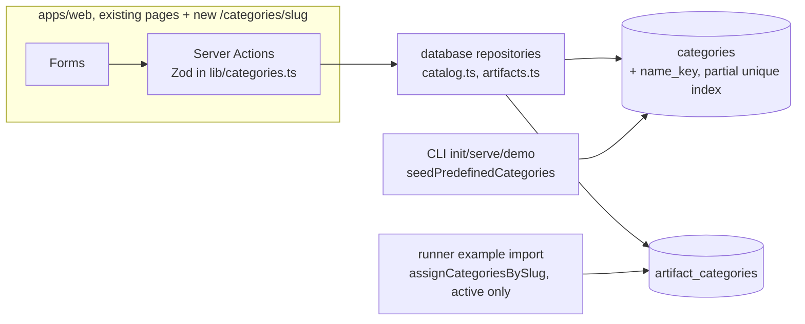
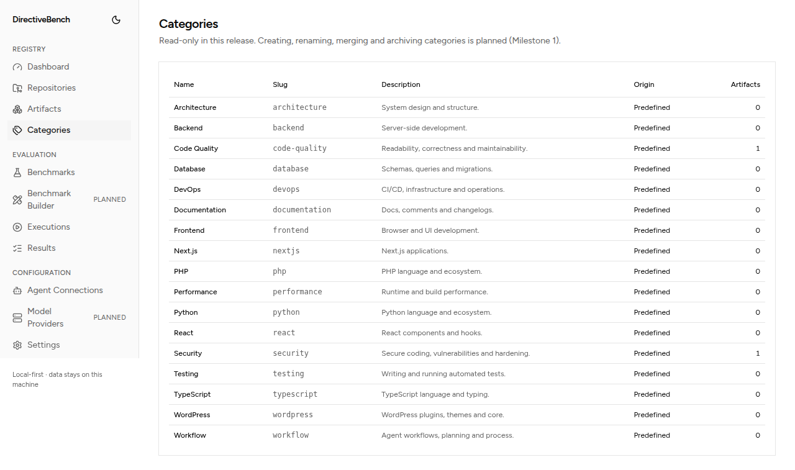
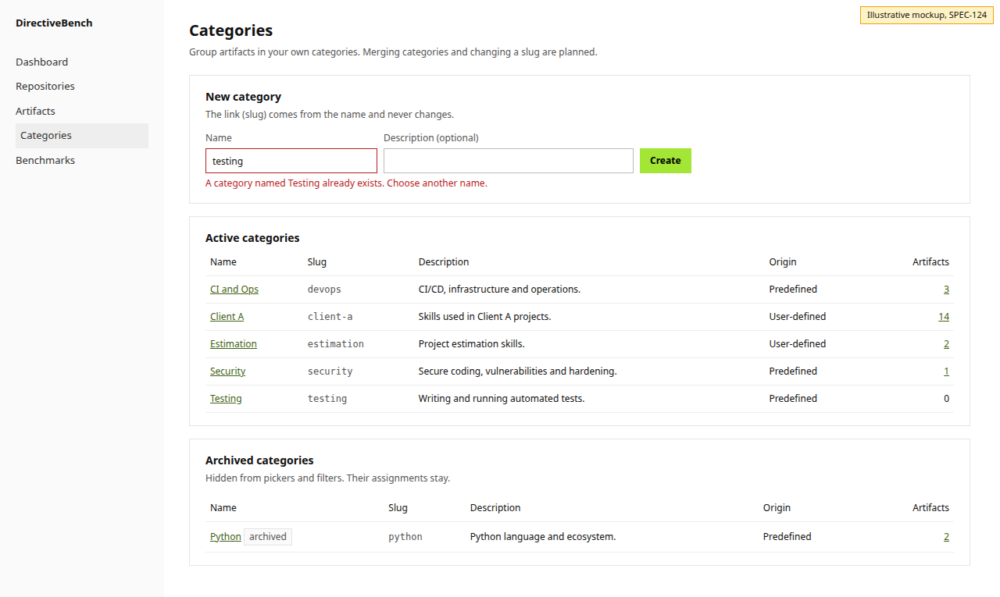
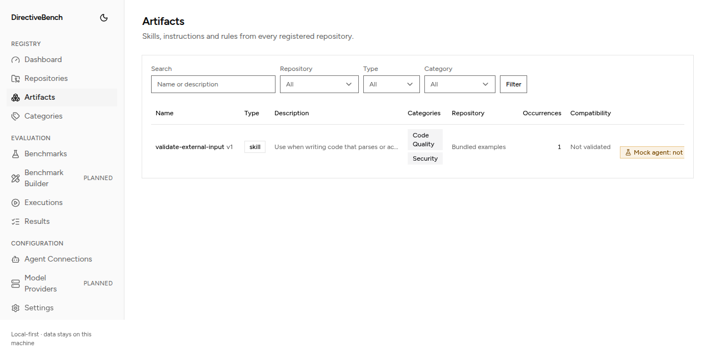
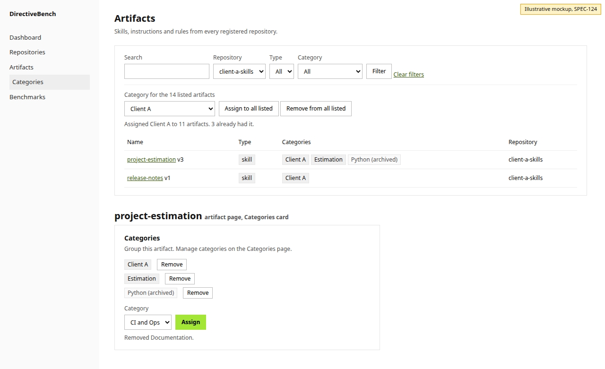
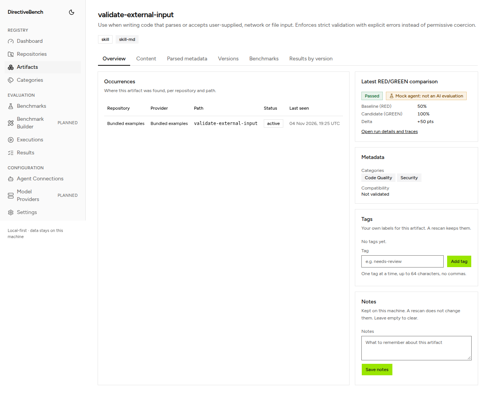
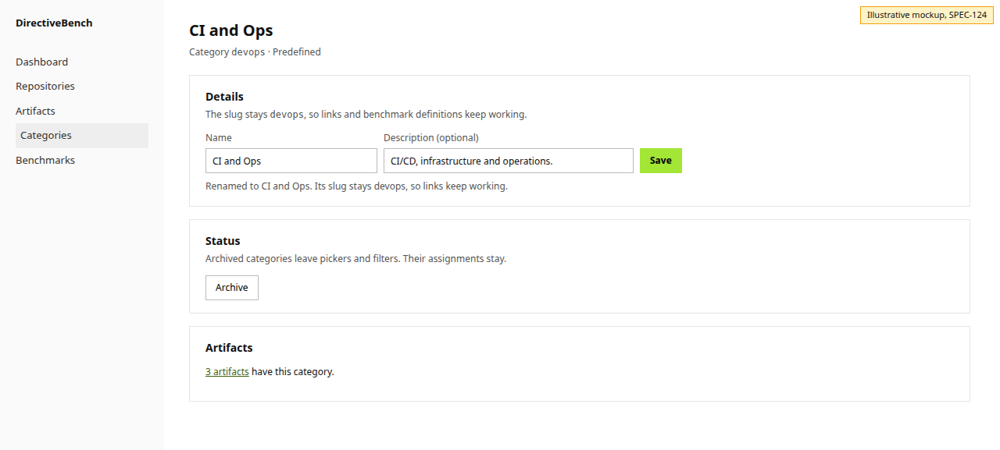

# SPEC-124 — Create, rename and archive categories and assign them to artifacts (E03-S01)

## 1. Summary

**Proposed, not implemented.** Today DirectiveBench seeds 17 predefined categories, shows them
on a read-only Categories page and filters the Artifacts list by one category; nobody can create,
rename, archive or assign a category from the app ([SPEC-106 §20](2026-10-14-category-management.md)).
This spec makes categories a user-owned taxonomy: a skill author creates their own categories,
renames and archives them (predefined ones included), assigns them to one artifact on its page
or to every artifact in a filtered list at once, and filters by them. It is the story slice of
SPEC-106 that issue #22 (E03-S01) asks for: create, rename, archive/unarchive, assign and bulk
assign. Merge, slug change and aliases stay out (FR-106-05, FR-106-09).

## 2. Motivation and problem statement

- With skills from several repositories in one registry, the maintainer needs to group them in
  their own terms (`[INTERVIEW]`, brief → Target group; epic #12). The seeded list is a fixed
  guess (Security, React, Python…); a user who works on, say, estimation or client-onboarding
  skills cannot express that today.
- Categories are how the catalogue answers "how do my skills in group X perform?": the Artifacts
  list already shows the latest benchmark score per row, so a category filter gives a per-group
  view of benchmark results without new reporting (SPEC-101 US-101-02).
- Product direction: D08 (2026-10-22) parked categories until the comparison slice S1 shipped.
  S1 (epic #93) is closed with all stories done, the issue's dependencies #17 and #30 are closed,
  and the issue carries the note "this resumes after S1". The maintainer approved starting it on
  2026-11-04. Categories group the artifacts that get benchmarked; they do not change how a
  benchmark runs or is graded.
- A review note on PR #50 (issue #22 comment) asks to cap the category slug length when creation
  arrives and align the Artifacts filter's Zod limit (256 today) with it.

## 3. Goals

- G1: Create a category from a name (and optional description); its slug is derived once and
  never changes.
- G2: Rename a category and edit its description; slug and assignments stay.
- G3: Archive and unarchive a category; archived ones leave pickers and default filters but keep
  their assignments, shown muted and labelled.
- G4: Assign and remove a category on one artifact; assign or remove a category for every
  artifact a filtered Artifacts list shows, in one transaction.
- G5: Names are unique case-insensitively among active categories, enforced by the database, so
  concurrent submits cannot create duplicates.
- G6: Generic: nothing in the design depends on the predefined list or on any one user's
  taxonomy (narrowed by A5 for names without a Latin letter or digit, pending the maintainer's
  decision).

## 4. Non-goals

- Merging categories, changing a slug, slug aliases (FR-106-05, FR-106-09; a new table).
- Hard delete (OQ-106-02 stays open; see A9).
- Hierarchical categories, colours, icons; AI or heuristic auto-categorisation (OQ-106-03).
- Filtering by several categories at once (FR-106-10 OR/AND) and an "Uncategorized" filter.
- Benchmark suite categories: resolving `categories:` slugs of suite definitions, import
  warnings, a suite count per category or a category filter on the benchmarks list (FR-106-07,
  FR-106-11 suite count). See A20.
- A CLI or HTTP API for categories (A21).
- New design-system primitives (Dialog, Checkbox, Combobox, Toast); see UD-1.

## 5. User stories

- US-124-01: As a skill author, I create a category "Estimation" and see it on the Categories
  page and in the Artifacts filter.
- US-124-02: As a skill author, I rename the predefined "DevOps" to "CI and Ops"; links such as
  `/artifacts?category=devops` keep working.
- US-124-03: As a skill author, I archive "Python" because I do not write Python skills; it
  disappears from pickers, and the two artifacts that had it still show it, marked archived.
- US-124-04: As a skill author, I open a skill and assign it "Estimation" and "Documentation".
- US-124-05: As a skill author, I filter the Artifacts list to one repository and assign
  "Client A" to all 14 listed artifacts at once, then remove it again if I chose wrong.

## 5a. Resolved assumptions (autonomous defaults)

Written by `om-spec-writing --autonomous`. Each is the most reversible answer; the maintainer
can override any of them before approval. None needs a decision before the spec can be read as
a whole design. UI decisions are listed separately in §11.1.

| # | Question | Default chosen | Alternative | Why this default |
| --- | --- | --- | --- | --- |
| A1 | New story spec or only edit SPEC-106? | New SPEC-124 refines SPEC-106 for this story; SPEC-106 stays the umbrella and gets its FR-106-03 and §20 updated in the implementation PRs (§17) | Edit SPEC-106 in place, no new spec | SPEC-106 also covers merge, aliases and suites; one story spec keeps acceptance criteria verifiable |
| A2 | Split into two specs (category lifecycle vs assignment)? | One spec, four phased PRs (§21) | Two specs: lifecycle, then assignment | The issue is one story with one set of criteria; the phases ship independently |
| A3 | How is case-insensitive name uniqueness enforced? | New column `name_key` plus a partial unique index on active rows (migration `0005`) | A check inside `withTransaction` only, no schema change | `withTransaction` (`BEGIN IMMEDIATE`) already serialises writers, so the in-transaction check is the main guard; the index is the backstop that also holds for any future write path that skips the check. The column is additive and backfilled |
| A4 | Can the user choose the slug on create? | No: slug = derived from the name (the issue's AC) | Optional "Slug" field (FR-106-03 allows it) | Smallest surface; a field can be added later without migration |
| A5 | A name with no Latin letter or digit (for example "日本語", "!!!") | Refused with a field error; `slugify` would give the shared fallback `item` | Generate a slug such as `category-3`, or transliterate | Refusing stores nothing that would need migrating; generating slugs can be added later. This knowingly narrows G6 for users with non-Latin category names, so it is listed in the PR's decisions |
| A6 | Slug length | At most 64 characters: the derived slug is cut at 64 and trailing hyphens dropped; the Artifacts filter's `category` limit drops from 256 to 64 (issue #22 comment) | Refuse names whose slug exceeds 64 | A 64-character name can expand past 64 under NFKD (for example ligatures); cutting is predictable |
| A7 | The derived slug is taken by another category | Refused. Active owner: "choose another name"; archived owner: "unarchive it instead" | Append `-2`, `-3` | Slugs are permanent identifiers; silent suffixes are hard to undo once linked |
| A8 | What archive does to assignments | Assignments stay; archived categories are hidden from pickers, the filter dropdown and bulk actions, still filter by URL, still show on artifacts as muted "Name (archived)", and can still be removed from an artifact; the example import keeps skipping them (existing behaviour) | Remove assignments on archive | FR-106-08; archive must be reversible without loss |
| A9 | Hard delete | Not offered | Delete unused, non-predefined categories | Never-delete keeps every slug resolvable; OQ-106-02 stays open |
| A10 | Archived names | An archived category's name is free for a new active category, but the slug rule (A7) still applies, so the same name is refused while the archived one holds its slug | Names unique including archived | FR-106-03 scopes name uniqueness to active rows |
| A11 | Description editing | Name and description are edited together on the category page; description optional, at most 500 characters, single line | Rename only | FR-106-04; the same form costs nothing extra |
| A12 | Predefined categories | Fully renamable and archivable; seeding never reverts or unarchives them (existing FR-106-02); the "Origin" column stays | Lock predefined names | Users own their taxonomy (generic design lesson) |
| A13 | Seeding versus a user category with the same name | A future predefined category whose name equals an active category's name is skipped (`ON CONFLICT DO NOTHING` covers the new index) | Rename or suffix the seeded one | Seeding must never fail startup or overwrite user data |
| A14 | Bulk scope | "All artifacts the current filters list", recomputed on the server from the posted filters, with a fingerprint of the artifact ids the page showed; a different set is refused as "the list changed" | Per-row checkboxes (needs a Checkbox primitive, UD-1) | No new component; a filter is how a user selects a group today; fails closed |
| A15 | Bulk remove | Included, symmetric to bulk assign | Bulk assign only | It is the undo of a mistaken bulk assign (reversibility) |
| A16 | Bulk size cap | Named limit `MAX_BULK_CATEGORY_ARTIFACTS = 10_000` (SPEC-106 NFR-106-01 sizing); more is refused with "narrow the filters" | No cap | Repository rule: no unbounded writes or unnamed limits |
| A17 | Multi-category filter and "Uncategorized" | Out of scope; the single `category` filter stays | Repeated `category` params (FR-106-10) | Not in the issue's criteria |
| A18 | Name normalisation | Unicode NFC, trim, runs of whitespace collapsed to one space; control characters refused; key = normalised name with JavaScript `toLowerCase()` (full Unicode, no accent folding) | Also fold accents or NFKC | Matches how tags and search fold today (`apps/web/lib/artifact-metadata.ts`, `listArtifacts`) |
| A19 | Length unit for 64 / 500 | UTF-16 code units, as Zod's `.max` counts (same as tags and notes) | Code points | Consistency with existing limits |
| A20 | Benchmark suites and categories | Out of scope. Suite definitions keep their `categories:` slugs verbatim; nothing resolves or counts them yet | Add suite counts and import warnings now (FR-106-07) | Not in the issue; S2 (builder) is the natural home |
| A21 | CLI surface | None in this story | `directivebench category list/create/archive` | The issue names only the web UI; categories are local metadata the web app owns |
| A22 | ADR | None: no new dependency or architectural pattern; the partial index is an ordinary schema change recorded in this spec and SPEC-006 | ADR for `name_key` | AGENTS.md asks ADRs for significant design decisions only |

## 6. Functional requirements

### 6.1 Names and slugs (`@directivebench/core`)

| ID | Requirement |
| --- | --- |
| FR-124-01 | `normalizeCategoryName(raw)` MUST return the name in Unicode NFC, trimmed, with every run of whitespace replaced by one space. `categoryNameKey(name)` MUST return `normalizeCategoryName(name).toLowerCase()`. |
| FR-124-02 | `categorySlug(name)` MUST return `slugify(name)` cut to `CATEGORY_SLUG_MAX_LENGTH` (64) with trailing hyphens removed, or `null` when the name contains no character that `slugify` keeps (no `a-z0-9` after NFKD and accent stripping). It never returns the `slugify` fallback `item` unless the name itself slugifies to `item`. |
| FR-124-03 | Limits are named constants in core: `CATEGORY_NAME_MAX_LENGTH = 64`, `CATEGORY_DESCRIPTION_MAX_LENGTH = 500`, `CATEGORY_SLUG_MAX_LENGTH = 64`. The web filter's `MAX_SLUG_PARAM_LENGTH` MUST use `CATEGORY_SLUG_MAX_LENGTH`. |

### 6.2 Lifecycle (database and web)

| ID | Requirement |
| --- | --- |
| FR-124-04 | **Create.** A name of 1 to 64 characters after normalisation, with no control characters and a non-null `categorySlug`, plus an optional description (empty means none), creates an active, non-predefined category with that slug. It MUST appear on the Categories page, in the Artifacts category filter and in the artifact pickers. |
| FR-124-05 | **Duplicate name.** A name whose key equals an active category's key MUST be refused with a field error naming that category, and nothing is stored. Case and whitespace variants ("testing ", "TESTING") count as duplicates. |
| FR-124-06 | **Slug taken.** A name whose slug belongs to any other category (active or archived) MUST be refused with a field error naming that category; when it is archived the message says to unarchive it. Nothing is stored. |
| FR-124-07 | **Rename and describe.** Name and description of any category, predefined included and archived included, are editable. The slug, `predefined` flag and assignments MUST NOT change. Renaming to a case variant of the same name is allowed. Renaming to another active category's key is refused (FR-124-05 message); renaming an archived category to an active category's key is allowed (it only clashes on unarchive). Saving unchanged values reports "nothing changed". |
| FR-124-08 | **Archive.** Sets `archived_at`; idempotent ("already archived"). Assignments stay. The category leaves the Categories page's active table (it moves to the archived section), the Artifacts filter dropdown, the artifact picker and the bulk form. |
| FR-124-09 | **Unarchive.** Clears `archived_at`; idempotent. Refused when an active category already has the same key: "An active category is already named X. Rename one of them first." |
| FR-124-10 | **Seeding** keeps FR-106-02 and also fills `name_key`; a predefined category whose name or slug clashes with an existing row is skipped, never an error. |

### 6.3 Assignment

| ID | Requirement |
| --- | --- |
| FR-124-11 | **Assign one.** Assigning an active category to an artifact is idempotent ("already assigned"). Assigning an archived category MUST be refused ("X is archived. Unarchive it on its page before assigning it."). The write is one conditional statement (`INSERT … SELECT … WHERE archived_at IS NULL … ON CONFLICT DO NOTHING`); follow-up reads only explain a no-op insert (already assigned, archived, unknown category or artifact). |
| FR-124-12 | **Remove one.** Removing a category from an artifact is idempotent ("was not assigned") and allowed for archived categories. No confirmation: assignments carry no history. |
| FR-124-13 | **Bulk.** On the Artifacts list, a form assigns or removes one active category for every artifact the current filters list. The form posts the filters (`q`, `type`, `category`, `repository`), the count the page showed and `listFingerprint`, a SHA-256 of the sorted listed artifact ids (core hashing). The server refuses any invalid filter (the list page ignores invalid parameters; the bulk form does not). In one `withTransaction` it runs `listArtifactIds(db, filter)`, an ids-only query that shares its conditions with `listArtifacts`, refuses when the fingerprint differs ("The list changed since the page loaded (now N artifacts). Check it and try again."), refuses an archived or unknown category, refuses more than `MAX_BULK_CATEGORY_ARTIFACTS`, then inserts (`ON CONFLICT DO NOTHING`) or deletes, and reports how many changed and how many already were in the target state. |
| FR-124-14 | **Display.** Wherever assignments show (Artifacts list column, artifact page), archived categories show as a `muted` Badge reading "Name (archived)", after the active ones. |
| FR-124-15 | **Filter.** The Artifacts category dropdown lists active categories. When the URL names an archived category, the dropdown also lists it as "Name (archived)", selected, so the form shows the real filter; filtering by an archived slug works (FR-106-08). |
| FR-124-16 | All mutations are Server Actions in `apps/web/lib/actions.ts` that parse `FormData` with Zod schemas from `apps/web/lib/categories.ts`, call `@directivebench/database` repository functions only, and revalidate `/categories` (layout) and `/artifacts` (layout, once, which covers every `/artifacts/[id]` page, also after a bulk change of thousands of artifacts) (FR-106-12, SPEC-014). |

## 7. Non-functional requirements

- NFR-124-01: Bulk assign of 10,000 artifacts completes in under 1 s on the test machine
  (SPEC-106 NFR-106-02 sizing); measured once in a database test, not enforced as a timing
  assertion.
- NFR-124-02: Every new page and form works by keyboard alone, keeps focus on a field after
  each submit (Form pattern, "Lists edited in place" rule 5), and has no horizontal page scroll
  at 320px.
- NFR-124-03: All new text meets 4.5:1 contrast in both themes, including the muted "(archived)"
  badge, the status lines and field errors (AGENTS.md §7).
- NFR-124-04: Local-first: no network calls; works offline.

## 8. Domain entities and contracts

### 8.1 Data model and migration

`categories` (SPEC-006) gains one column and one index; `artifact_categories` is unchanged.

```sql
-- packages/database/migrations/0005_category_name_key.sql (generated by drizzle-kit, checked by hand)
ALTER TABLE `categories` ADD `name_key` text DEFAULT '' NOT NULL;
--> statement-breakpoint
UPDATE `categories` SET `name_key` = lower(trim(`name`));
--> statement-breakpoint
CREATE UNIQUE INDEX `categories_active_name_key_unique`
  ON `categories` (`name_key`) WHERE `archived_at` IS NULL;
```

- The backfill uses SQLite `lower()`, which folds ASCII only. That is correct for every database
  this migration meets: until this story no code path creates or renames a category, so every
  row is a predefined, ASCII name from `PREDEFINED_CATEGORIES`. A migration test asserts the
  backfill on a database built at migration `0004`.
- From this story on `name_key` is written only by repository functions, from
  `categoryNameKey()` (JavaScript, full Unicode).
- Drizzle: `nameKey: text('name_key').notNull()` with **no** `.default()`, so every typed insert
  must set it (a compile error otherwise); the SQL `DEFAULT ''` exists only so `ALTER TABLE ADD`
  works on a non-empty table, and the migration is hand-edited for it. A migration test asserts no
  row keeps `''`. Plus
  `uniqueIndex('categories_active_name_key_unique').on(t.nameKey).where(sql\`archived_at is null\`)`.
- The existing `categories_slug_unique` (all rows) stays: slugs are unique including archived.
- Partial unique indexes exist in PostgreSQL too, so the optional backend (SPEC-117, draft) can
  mirror this.
- Rollback: the column and index are additive and an older build reads around them. Hazard: an
  older build that inserts a category leaves `name_key = ''`, and a second such row would clash
  on the index. Older builds insert only predefined categories, all 17 of which already exist,
  so in practice they insert nothing; a downgrade after this story is not supported beyond that.

### 8.2 Repository functions (`@directivebench/database`, `repositories/catalog.ts` and `artifacts.ts`)

Outcomes are discriminated unions; expected conflicts are never thrown.

```ts
type CategoryRef = { id: string; slug: string; name: string; archived: boolean };

createCategory(handle, { name, description }):
  | { status: 'created'; category: CategoryRef }
  | { status: 'name-taken'; existing: CategoryRef }
  | { status: 'slug-taken'; existing: CategoryRef };

updateCategory(handle, { id, name, description }):
  | { status: 'updated' | 'unchanged'; category: CategoryRef }
  | { status: 'name-taken'; existing: CategoryRef }
  | { status: 'not-found' };

setCategoryArchived(handle, { id, state: 'archived' | 'active' }):   // no boolean flag (SPEC-014)
  | { status: 'archived' | 'unarchived' | 'already-archived' | 'already-active'; category: CategoryRef }
  | { status: 'name-taken'; existing: CategoryRef }   // unarchive only
  | { status: 'not-found' };

getCategoryBySlug(db, slug): (CategoryRef & { description: string | null; predefined: boolean;
  artifactCount: number }) | null;

listCategories(db)                 // existing, unchanged shape (name_key is not exposed)
assignArtifactCategory(db, artifactId, categoryId):
  'assigned' | 'already-assigned' | 'category-archived' | 'category-not-found' | 'artifact-not-found';
unassignArtifactCategory(db, artifactId, categoryId):
  'removed' | 'not-assigned' | 'category-not-found' | 'artifact-not-found';

setCategoryForListedArtifacts(handle, { categoryId, mode: 'assign' | 'remove',
  filter: ArtifactListFilter, listFingerprint: string }):
  | { status: 'done'; changed: number; unchanged: number; category: CategoryRef }
  | { status: 'list-changed'; actualCount: number }   // fingerprint differs
  | { status: 'too-many'; actualCount: number; limit: number }
  | { status: 'category-archived' | 'category-not-found' };
```

- `createCategory`, `updateCategory`, `setCategoryArchived` and `setCategoryForListedArtifacts`
  run in `withTransaction`: look up the clash, then write. The partial and slug unique indexes
  are the backstop: when `withTransaction` rejects with `SQLITE_CONSTRAINT_UNIQUE` (it has rolled
  back), the function runs a fresh read of the clashing row and returns the matching
  `name-taken` / `slug-taken` outcome; the raw error never reaches the UI.
- `listArtifactIds(db, filter)` (new, Phase 4) returns ids only for the same conditions as
  `listArtifacts`, which reuses the shared condition builder, so the bulk write does not load
  versions, runs and occurrences while it holds the write lock.
- `getArtifactDetail` and `listArtifacts` return `archived: boolean` on each category, active
  ones first, then by name.
- `assignCategoriesBySlug` (example import) keeps its behaviour (active slugs only).
- `MAX_BULK_CATEGORY_ARTIFACTS` is exported from the package.

### 8.3 Web validation (`apps/web/lib/categories.ts`)

- `categoryNameSchema`: string → `normalizeCategoryName` → 1..64, no `\p{Cc}`, `categorySlug`
  not null. Messages in §13.
- `categoryDescriptionSchema`: string → trim → ≤ 500, no `\p{Cc}` → empty becomes `null`.
- `createCategorySchema`, `updateCategorySchema` (`id` + both), `archiveCategorySchema`
  (`id`, `state` from a hidden `intent` of `archive` / `unarchive`),
  `artifactCategorySchema` (`artifactId`, `categoryId`),
  `bulkCategorySchema` (`categoryId`, `mode`, `listFingerprint` as 64 hex characters, and the
  list filters parsed by `parseArtifactListParams`; the form is refused when its `invalid` list
  is not empty).
- Form state reuses `MetadataFormState` (`idle | success | fieldError | error`) and keeps the
  entered value after an error ([lesson](../lessons/2026-10-28-action-forms-reset-to-the-new-default-value.md)).

## 9. Data flow



Takeaway: only the web app's Server Actions write user category changes; the CLI keeps seeding,
the runner keeps assigning example categories by slug, and sync never touches categories.

## 10. API and interface design

Server Actions (all `(previous: MetadataFormState, formData: FormData) => Promise<MetadataFormState>`):
`createCategoryAction`, `updateCategoryAction`, `setCategoryArchivedAction`,
`assignArtifactCategoryAction`, `unassignArtifactCategoryAction`,
`setCategoryForListedArtifactsAction`. No route handlers, no CLI commands.

Routes: `/categories` (changed), `/categories/[slug]` (new), `/artifacts` (changed),
`/artifacts/[id]` (changed). `[slug]` is validated with the filter's slug schema; an invalid or
unknown slug renders the app's not-found page.

## 11. UI/UX considerations

Built only from existing components and patterns (`apps/web/design-system.md`): Card, Input,
NativeSelect, Button, Badge, Table, PageHeader, EmptyState, the Form pattern and "Lists edited in
place". Copy below is final wording proposed for approval; it contains no en or em dash.

**`/categories` (changed).** PageHeader description: "Group artifacts in your own categories.
Merging categories and changing a slug are planned." A "New category" card first: Name (Input,
`maxLength` 64), Description (Input, optional, `maxLength` 500), Create (`default` button);
field errors under the field, one status line. Then the "Active categories" table (Name links to
`/categories/<slug>`, Slug, Description, Origin, Artifacts count linking to
`/artifacts?category=<slug>`). Then an "Archived categories" card with the same columns, shown
only when at least one is archived. Empty active table: EmptyState "No active categories" with
"Create one above, or unarchive one below." After Create, focus returns to Name and the new row
is in the table.

**`/categories/[slug]` (new).** PageHeader title is the name, with a `muted` "archived" Badge
when archived. Card "Details": Name, Description, Save, and the line "The slug stays
<code>devops</code>, so links and benchmark definitions keep working." Card "Status": for an active
category "Archived categories leave pickers and filters. Their assignments stay." and an
`outline` "Archive" button; for an archived one "Archived. It stays on N artifacts." and
"Unarchive". Card "Artifacts": "N artifacts" linking to the filtered Artifacts list, or "No
artifact has this category yet. Assign it on an artifact's page or to a filtered list on
Artifacts." No confirmation for archive (reversible, history kept: Risky-action page, "When not
to use").

**`/artifacts/[id]` (changed).** Categories move from the Metadata card into a "Categories"
card using "Lists edited in place": each assigned category as a `secondary` Badge (archived:
`muted`, "Name (archived)") with an `outline` `sm` "Remove" named "Remove category Name"; under
the list a NativeSelect of active, unassigned categories and an "Assign" button. When none are
left: "Every active category is assigned. Create more on the Categories page." (link). Empty
list: "No categories yet."

**`/artifacts` (changed).** Category chips follow FR-124-14; the filter follows FR-124-15. Under
the filter form, when the list is not empty and an active category exists, a bulk form:
"Category for the 14 listed artifacts" (NativeSelect), then `outline` buttons "Assign to all
listed" and "Remove from all listed". Result line: "Assigned Client A to 11 artifacts. 3 already
had it." / "Removed Client A from 11 artifacts. 3 did not have it."

States for every form: pending (controls disabled, status line "Saving…" or "Assigning…"),
success (status line), field error (`aria-invalid`, `aria-describedby`, `role="alert"`),
general error ("The form was incomplete. Reload the page and try again."), not initialised
(`NotInitialized`). Keyboard: native form controls only, visible focus, focus kept per the Form
pattern. 320px: forms wrap (`flex-wrap`), tables scroll inside their card, no page scroll.
Both themes: tokens only; contrast measured in `text-contrast.spec.ts` / `ui-contrast.spec.ts`.

Prototype: `.ai/specs/assets/category-lifecycle-and-assignment/` (static mockups and current
screenshots, illustrative only; colours and fonts are approximate, the implementation uses the
design system).

| Today | Proposed |
| --- | --- |
|  |  |
|  |  |
|  |  |

### 11.1 UI decisions for the maintainer to approve

| # | Decision | Default in this spec | Alternative |
| --- | --- | --- | --- |
| UD-1 | New primitives | None. Bulk selection by filter, edit on a page, pickers as NativeSelect, results in status lines | Add Checkbox (row selection), Combobox (searchable picker), Dialog (edit in place); each needs approval, stories and a Storybook page ("What is missing" lists them for issue 22) |
| UD-2 | Where a category is edited | Its own page `/categories/[slug]` | Inline row form on `/categories` (expanding row) or a Dialog |
| UD-3 | Where archived categories show | A separate "Archived categories" card on `/categories` | A `?status=archived` filter or one table with a status column |
| UD-4 | Bulk assign UI | "Assign to all listed" / "Remove from all listed" for the filtered list, guarded by the shown count | Checkbox per row plus a selection bar (UD-1) |
| UD-5 | Confirmation before archive or bulk actions | None; the result line says what was kept or changed, and bulk remove undoes bulk assign | Inline Risky-action panel ("Assign Client A to 14 artifacts?") |
| UD-6 | How an archived assignment looks | `muted` Badge with the text "Name (archived)", after active ones | Hide archived assignments; or a separate "archived" Badge next to the name |
| UD-7 | Picker for assigning on the artifact page | NativeSelect of active, unassigned categories | Combobox with search (better past about 100 categories) |
| UD-8 | Category list on the artifact page | Its own "Categories" card (like Tags, Assigned benchmarks) | Keep inside the Metadata card |
| UD-9 | Copy | The strings in §11 and §13 | Maintainer's wording |

## 12. Security considerations

- Names and descriptions are untrusted text: rendered only as React text, never as HTML or
  Markdown; control characters refused; lengths bounded (SPEC-007).
- Every id from a form is re-checked in the repository; a forged `categoryId` or `artifactId`
  yields `not-found`, never a write to another row. The bulk action scopes its write by the
  posted category and the server-recomputed list, never by client-sent artifact ids
  ([lesson](../lessons/2026-10-30-scope-child-writes-by-the-posted-parent.md)).
- The `[slug]` route parameter and the `category` filter are regex-checked and length-capped
  before any query; all queries are parameterised (Drizzle).
- Fail closed: a changed list, an invalid filter or an over-limit bulk refuses and writes
  nothing.
- Server Actions keep Next.js's same-origin check; DirectiveBench binds to localhost by default
  (SPEC-007). No secrets are involved.

## 13. Error handling

| Case | User sees | Stored |
| --- | --- | --- |
| Empty name | "Enter a name." | nothing |
| Name over 64 | "A name can be at most 64 characters. Shorten it." | nothing |
| Control character | "A name cannot contain line breaks or other control characters." | nothing |
| No Latin letter or digit | "Use at least one Latin letter or digit in the name. It becomes the category's link." | nothing |
| Description over 500 | "A description can be at most 500 characters. Shorten it." | nothing |
| Duplicate active name | "A category named Testing already exists. Choose another name." | nothing |
| Slug of an active category | "The name gives the link testing, which Testing already uses. Choose another name." | nothing |
| Slug of an archived category | "The archived category Python already uses the link python. Unarchive it on its page instead." | nothing |
| Unarchive clash | "An active category is already named Python. Rename one of them first." | nothing |
| Assign archived | "Python is archived. Unarchive it on its page before assigning it." | nothing |
| Bulk list changed | "The list changed since the page loaded (now 13 artifacts). Check it and try again." | nothing |
| Bulk over limit | "This list has 12,400 artifacts. Narrow the filters to at most 10,000." | nothing |
| Forged or missing hidden field | "The form was incomplete. Reload the page and try again." | nothing |
| Category or artifact gone | "This category no longer exists. Reload the page." / existing `ARTIFACT_GONE_MESSAGE` | nothing |
| Database not initialised | `NotInitialized` | nothing |

## 14. Edge cases

- Two tabs create "Testing" at once: one wins, the other gets the duplicate-name error (index).
- "C#" and "C" both slugify to `c`: the second is refused as slug-taken (A7).
- Renaming "Security" to "security" changes only the display case; allowed.
- Archived "Python" renamed to "Testing" while "Testing" is active: allowed; unarchiving it is
  refused until one is renamed.
- A bookmark `/artifacts?category=python` after archive still filters; the dropdown shows
  "Python (archived)".
- A filter that matches nothing: no bulk form (nothing to act on).
- Bulk assign with the category filter set to the same category: every row is unchanged; the
  result line says so. Bulk remove of the filtered category empties the list on reload; the
  result line still reports the count.
- A scan adds or removes artifacts between render and submit, even when the count stays the
  same: "the list changed" (fingerprint, FR-124-13).
- An artifact removed from every repository keeps its categories (sync never touches them).
- Name "Café" and "Cafe": different keys, same slug `cafe`: the second is refused as
  slug-taken.

## 15. Testing strategy

Per SPEC-012 and AGENTS.md §2.7: 100% unit coverage of `packages/core/src`,
`packages/database/src` and `apps/web/lib`; Playwright for every new page and UI path; mock agent
only, no paid calls. Database tests use one writable connection per test thread
([lesson](../lessons/2026-11-04-one-writable-connection-per-test-thread.md)).

- Core: `normalizeCategoryName`, `categoryNameKey`, `categorySlug` (NFC, whitespace, cut at 64
  with trailing hyphen, `null` for "日本語" and "!!!", the literal name "Item").
- Database: migration `0005` backfill on a `0004` database; create (slug, key, appears in
  `listCategories`); duplicate key incl. non-ASCII case pair ("Ärger"/"ärger"); slug-taken active
  and archived; rename keeps slug, predefined flag and assignments; case-only rename; rename into
  an active key refused; archived rename into an active key allowed, then unarchive refused;
  archive/unarchive idempotent; assign idempotent; assign archived refused; remove archived
  allowed; bulk assign and remove (changed/unchanged counts, list-changed, too-many with a lowered
  limit injected through the parameter, archived, not-found, atomic on failure); the partial index
  rejects a raw duplicate insert; seeding skips a name clash; `listArtifacts` / `getArtifactDetail`
  return `archived` and order active first.
- Web lib: every schema branch and message; action → message mapping for every outcome; forged
  ids and forged filters leave the database unchanged.
- Playwright (`apps/web/e2e/categories.spec.ts`): create, then see it in the table and the
  Artifacts filter; duplicate name shows the field error and adds no row; rename keeps
  `/artifacts?category=<slug>` working; archive hides it from the filter and the picker and shows
  "(archived)" on the artifact; unarchive; assign and remove on the artifact page with focus
  checks; bulk assign and remove on a filtered list; keyboard-only run of create and assign; 320px
  without horizontal scroll; both themes added to the contrast specs.
- Storybook: no new components, so no new stories; if UD-1 adds primitives, each gets stories in
  both themes with axe.

## 16. Acceptance criteria

- [ ] AC-1: Given a name of 1 to 64 characters, when a category is created, then it gets the slug
  `categorySlug(name)` and appears on the Categories page and in the Artifacts filter (issue AC 1).
- [ ] AC-2: Given an existing category, when it is renamed, then its slug and assignments do not
  change and `/artifacts?category=<slug>` still filters to the same artifacts (issue AC 2).
- [ ] AC-3: Given an artifact, when a category is assigned twice, then it is assigned once; and
  bulk assign on a filtered list assigns it to every listed artifact (issue AC 3).
- [ ] AC-4: Given a category, when it is archived, then it disappears from the picker, the filter
  dropdown and the bulk form but stays on existing assignments shown as "Name (archived)"
  (issue AC 4).
- [ ] AC-5: Given a name that duplicates an active category case-insensitively, when it is
  created, then a field-level error is shown and nothing is stored (issue AC 5).
- [ ] AC-6: Unarchive restores the category to pickers and filters, and is refused while an
  active category has the same name.
- [ ] AC-7: A name whose slug another category holds is refused with a field error; for an
  archived holder the message says to unarchive it.
- [ ] AC-8: Bulk remove removes the category from every listed artifact; a list that changed
  since the page loaded is refused and nothing is written.
- [ ] AC-9: Migration `0005` backfills `name_key` and the partial unique index rejects a second
  active row with the same key.
- [ ] AC-10: The new and changed pages work by keyboard alone, have no horizontal page scroll at
  320px and meet the contrast targets in both themes (Playwright).
- [ ] AC-11: `pnpm lint && pnpm typecheck && pnpm test` pass with 100% coverage; `pnpm test:e2e`
  passes.

## 17. Dependencies

- Issues: #17 and #30 (closed), epic #12; D08 (S1 shipped, epic #93 closed), D07 answered.
- Specs changed by the implementation PRs: SPEC-106 (FR-106-03 narrowed to A4 to A7 and
  A18; §20 status), SPEC-006 (`name_key`, partial index), SPEC-101 FR-101-10 (archived chips).
- Packages: `@directivebench/core`, `@directivebench/database`, `apps/web`. No new dependency.

## 18. Open questions

None blocking. Every autonomous default is in §5a and every UI decision in §11.1 for the
maintainer to confirm or override.

## 19. Future extensions

Merge and aliases (FR-106-09), slug change (FR-106-05), multi-category and "Uncategorized"
filters, suite categories and benchmark-list filter (FR-106-07), Combobox picker past about 100
categories, a `directivebench category` CLI, generated slugs for non-Latin names (A5).

## 20. Implementation status

- **Implemented:** nothing from this spec. Existing behaviour it builds on is listed in SPEC-106
  §20 (seeding, read-only page, single-category filter, example import by slug).
- **Partially implemented:** none.
- **Not implemented:** everything in §6.

## 21. Phasing and implementation plan

Each phase is one PR that leaves the app working and passes the full gate.

### Phase 1: Names, migration and repository functions (no UI)

1. Core: `normalizeCategoryName`, `categoryNameKey`, `categorySlug`, the three limits; tests.
2. Schema `nameKey` + partial index; `drizzle-kit generate` → `0005_category_name_key.sql` with
   the backfill; migration test from a `0004` database.
3. Seeding writes `name_key`; clash test.
4. `createCategory`, `updateCategory`, `setCategoryArchived`, `getCategoryBySlug`; tests.
5. `assignArtifactCategory`, `unassignArtifactCategory`, `archived` on list and detail
   categories; tests.
6. Update SPEC-006 and SPEC-106 FR-106-03.

### Phase 2: Categories page and category page

1. `lib/categories.ts` schemas and messages; tests.
2. `createCategoryAction`, `updateCategoryAction`, `setCategoryArchivedAction`; tests.
3. `/categories`: New category card, active table, archived card; `/categories/[slug]`.
4. Playwright: create, duplicate, rename, archive, unarchive, keyboard, 320px, contrast.

### Phase 3: Assignment on the artifact page, archived display and filter

1. `assignArtifactCategoryAction`, `unassignArtifactCategoryAction`; tests.
2. Categories card on `/artifacts/[id]`; archived chips on `/artifacts`; archived option in the
   filter; `MAX_SLUG_PARAM_LENGTH` from core.
3. Playwright: assign, remove, archived display, focus, filter by archived slug.

### Phase 4: Bulk assign and remove on the Artifacts list

1. `listArtifactIds` (shared conditions with `listArtifacts`) and
   `setCategoryForListedArtifacts` in the database package; tests incl. fingerprint mismatch,
   too-many and atomicity.
2. `setCategoryForListedArtifactsAction` with filter re-parse and fingerprint guard; tests incl.
   forged filters.
3. Bulk form on `/artifacts`.
4. Playwright: bulk assign, bulk remove, list-changed refusal (after the page loads, the test
   adds a file to the registered fixture repository and triggers a scan through the existing
   Scan form in a second page, then submits the first page's bulk form).
5. Update SPEC-106 §20 and this spec's §20; move this spec to `implemented/` only when AC-1 to
   AC-11 are verified.
