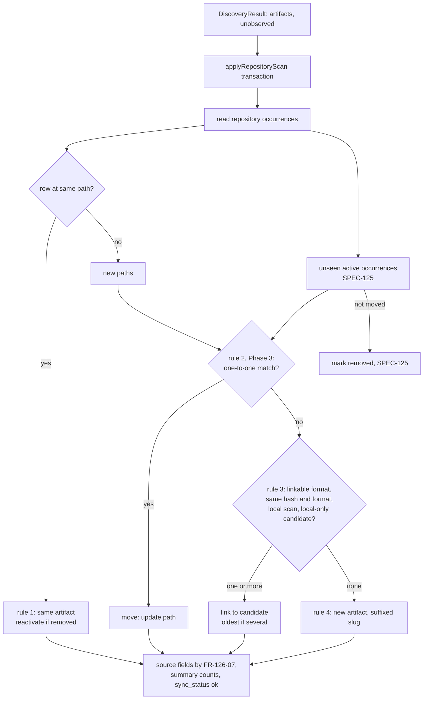

# SPEC-126 — The same skill in two repositories is one artifact with two occurrences; moves keep identity (E02-S02)

## 1. Summary

**Phases 1 (exact copies, lineage) and 2 (possible-duplicate hints) implemented (§20); Phase 3 proposed.** Before this spec a scan identified an artifact only by its location (SPEC-101
§8.3 rule 1: same repository and path) and otherwise creates a new artifact (rule 4). A skill
copied unchanged into a second repository therefore becomes a second artifact (`review`,
`review-2`) with its own versions, categories and history, and a skill directory moved inside one
repository becomes one missing occurrence plus a new artifact (SPEC-125 A12).

This spec is the story slice of SPEC-101 §8.3 rules 2 and 3, SPEC-103 FR-103-09 and SPEC-105
FR-105-16 that issue #20 (E02-S02) asks for:

1. **Exact copies link (rule 3).** A new occurrence (a path its repository has no occurrence row
   for) whose content hash and format equal a version of an existing artifact is linked to that
   artifact: one artifact, one version, two occurrences. Only skills with a frontmatter `name`
   and rules named after their file link (their name is part of the hashed content, A2, A3);
   repository-level files (`AGENTS.md`, `CLAUDE.md`, Copilot instructions, GitLab Duo chat rules)
   never do. Only local repositories link; a copy in a registered public GitHub repository never
   does, because a link lets every copy's edits advance the shared artifact's latest version
   (A16). Every new version records the version it replaced
   (`parent_version_id`), so diverging copies are compared along their own line (A19).
2. **Moves keep identity (rule 2).** Within one scan of one repository, a new path whose content
   matches exactly one occurrence that disappeared in the same scan (and vice versa) moves that
   occurrence: same occurrence row, same artifact, new path.
3. **Same name, different content stays apart.** Such artifacts keep their own identity and
   suffixed slugs, and the UI marks them as "possible duplicates" on the list and the artifact
   page.
4. **No slug matching for repository content** (already true since issue #16, pinned by tests).

Existing duplicates are not merged (A6); they get the possible-duplicate hint. No new component is
planned; one migration adds two nullable columns and two indexes. Every UI decision in §11 is **to be approved with
Storybook before code**.

## 2. Motivation and problem statement

- Issue #20 (backlog E02-S02, epic #11): "Skills are copied between repositories. Exact copies
  should be one artifact with several occurrences, and same-name skills with different content
  must not be merged, because false merges corrupt evaluation history (SPEC-101 §8.3)." The four
  acceptance criteria are AC-1 to AC-4 in §16. SPEC-013 M1 AC3: "Identical content in two
  repositories is one artifact version with two occurrences."
- The maintainer copies their own skills into client project repositories (brief, Target group;
  D04). Today every copy is a separate artifact, so benchmark results, categories, tags and notes
  gathered on one copy are invisible on the others, and the list shows the same skill N times
  with suffixed slugs and no hint that they are related (US-101-03).
- SPEC-125 (just implemented) made deletions visible. Its A12 left moves as "one missing
  occurrence plus one new artifact", which loses a skill's history every time a directory is
  renamed or moved (`.claude/skills/x` to `.agents/skills/x`).
- Since SPEC-125 Phase 2 the removal panel already counts "artifacts left missing from every
  repository". With one artifact in two repositories, its "No artifact became missing" outcome
  becomes reachable for the first time (§14).
- Product direction: D08 parked E02 until S1 shipped; S1 has shipped and #21 is done; #20 is the
  last story of E02. Issue #20 lists SPEC-104 OQ-104-05 (one directory registered under two local
  providers) as to be decided before this story: A14.

Prior art (from the tools' public documentation, not re-checked in this run):

- **git** detects exact renames first by identical blob, then by similarity, and breaks ties
  with path heuristics. This spec keeps the exact step only and refuses ties (A11): a guessed
  move would silently re-label evaluation history.
- **Backstage's software catalog** identifies an entity by kind, namespace and name; when a second
  location declares an existing entity, it reports a conflict instead of merging. Name-only
  identity is the slug rule the maintainer rejected (lesson 2026-10-19); this spec requires the
  content hash as well and flags same-name, different-content artifacts instead of refusing them.
- **Content-addressed stores** (pnpm's store, git objects) dedupe by hash and keep locations as
  references, which is the artifact/occurrence split of SPEC-101; they have no user metadata to
  protect, so they can merge freely, while DirectiveBench must not merge histories (A6).
- Skill installers that copy skills into projects key them by name and keep no history, so they
  give no guidance on divergence; A8 follows SPEC-101 US-101-03.

## 3. Goals

- G1: An exact copy of a skill or named rule (A3) in another repository, or at another path of the same
  repository, is found as the same artifact with one more occurrence and no new version.
- G2: A skill, rule or instruction moved or renamed inside one repository between two scans keeps its artifact
  and occurrence (rule 2); only an unambiguous one-to-one match is applied.
- G3: Same-named artifacts of the same type with different content are never merged and are
  visibly marked as possible duplicates.
- G4: Identity is independent of scan order and of the slug: scanning A then B gives the same
  artifacts as B then A (up to which copy was first seen), when every copy's content was already
  recorded or is new everywhere. Version **numbers** of edits made in two copies between scans
  follow scan order; lineage (A19) and comparisons do not. One case stays order-dependent by
  design (A21): an edited skill copied before its source repository is rescanned.
- G6: A diverged copy is compared with its own earlier versions, never with a parallel edit of
  another copy (A19).
- G5: Linking and moving never touch user-owned metadata, versions or benchmark runs (FR-105-13,
  FR-103-01).

## 4. Non-goals

- Merging artifacts that are already duplicated before this spec ships (A6), and the manual
  **link** / **unlink** action (SPEC-101 §19, FR-103-10). Proposed follow-up issue (§19).
- Detecting a move combined with a content change, or similar (not identical) content
  (FR-103-10; similarity matching, SPEC-101 §19).
- Moves across repositories as moves: a file deleted in A and added in B is a missing occurrence
  in A plus a linked occurrence in B (rule 3), not one moved row.
- Linking instructions across locations (A3), and bundled examples to scanned content (A5).
- A "possible duplicates" filter on the list, and the planned `SyncPlan` / `sync_runs` history
  (FR-105-08, FR-105-14).
- A version pinned as "current" (OQ-101-02 stays: the highest version number is the latest).

## 5. User stories

- US-126-01: As a skill author, I copy `skills/review` from my project into a client repository,
  scan both, and see one `review` artifact with two occurrences, its versions, categories and
  benchmark results in one place.
- US-126-02: As a skill author, I edit the copy in the client repository; the artifact gets the
  next version and its occurrence table shows that the client copy has diverged from the other one.
- US-126-03: As a skill author, I rename `.claude/skills/review` to `.agents/skills/review` and
  rescan; the artifact, its history and its occurrence are kept, with the new path.
- US-126-04: As a skill author, two different skills both named `review` exist in two client
  repositories; they stay two artifacts, and both are marked as possible duplicates with a link to
  each other.

## 5a. Resolved assumptions (autonomous defaults)

Written by `om-spec-writing --autonomous` for issue #20. Each row is a decision for the
maintainer; the default is the recommendation. UI decisions are in §11.1. The maintainer approved
the spec on 2026-11-12 with every row of §5a (A1 to A21) and §11.1 (including UD-6) as written;
implementation has not started.

| # | Question | Default chosen | Alternative | Why this default |
| --- | --- | --- | --- | --- |
| A1 | One spec or several (moves, copies and duplicate hints are separately deployable)? | One spec, three phased PRs (§21): Phase 1 exact copies and version lineage, Phase 2 possible-duplicate hints, Phase 3 moves | Three specs (Phase 3, moves, is the most separable: it has its own acceptance criterion and touches `core`) | The issue is one story with one set of criteria; the three share the identity contract, the scan summary and the occurrence table. If the maintainer prefers, Phase 3 becomes its own spec without changing Phases 1 and 2 |
| A2 | What makes a copy "exact" (rule 3)? | Equal manifest `content_hash` (SPEC-103 FR-103-04) and equal format, for a **linkable format** (A3) whose name is determined by the hashed content: `skill-md` with a frontmatter `name` (the name is in the bytes of `SKILL.md`), `cursor-rule`, `claude-rule` and `copilot-path-instructions` (the name is the file basename, which is the manifest path). Skipped files are not compared, as they are not part of versions (A20). The artifact's current `name` is not compared | Hash plus `artifacts.name`; or name only | `artifacts.name` changes with later versions, so comparing it would make linking depend on scan order (a copy of v1 links before a rename in v2 and not after); with linkable formats, equal bytes already imply an equal name. A skill named only by its directory (no frontmatter `name`) is not linked, because two such skills with identical files but different directories are different skills. Name-only matching is the slug-style merge the maintainer rejected on 2026-10-19 |
| A3 | Which formats does rule 3 cover? | The linkable formats of A2: skills with a frontmatter `name` and the three rule formats named after their file. Never instructions (`agents-md`, `claude-md`, `copilot-instructions`) or `gitlab-duo-chat-rules` (a fixed, repository-level file, type `rule`), which are identified by location only | All formats, as SPEC-101 §8.3 and SPEC-013 M1 AC3 are written | Repository-level files describe one repository; identical ones are usually boilerplate (`@AGENTS.md`, an empty template) and after a link every repository's later edits would interleave in one artifact's history: a false merge, which cannot be undone without the future unlink action. Skills and named rules are the units people copy. SPEC-013 M1 AC3 and SPEC-101 §8.3 get "skills and named rules" in the implementation PR |
| A4 | Which existing artifacts are candidates? | Artifacts with at least one occurrence, active or missing (SPEC-125), and only in local repositories (A16). An artifact with no occurrence left (all its repositories were removed) is not a candidate | Also artifacts with no occurrence left; or only artifacts with an active occurrence | A missing skill found again elsewhere is the same skill, and linking restores its history. An artifact with no occurrence has no repository left to check A16 against, and SPEC-125 promised that registering a removed repository again creates new artifacts; that stays true for those. The promise needs one qualifier for artifacts still recorded in another repository (§11.1 UD-6) |
| A5 | Bundled examples (`bundled-examples` provider) | Never a rule-3 candidate and never linked by rule 3; the example import keeps its own identity rule (slug or name and type within the provider) | Treat them like any artifact | Linking a scanned copy of the demo skill to the demo artifact would show mock-agent demo runs on the user's skill and let the next `demo` import write into it (lesson 2026-10-19 "suffixed slugs") |
| A6 | Artifacts already duplicated before this ships | Not merged. A rescan keeps them separate (rule 1 wins); they get the possible-duplicate hint, which says when their latest content is identical | A one-time migration merging exact duplicates | A merge moves versions to another artifact and renumbers them, which breaks the immutability of `artifact_versions` (FR-103-01), changes `vN` labels users and run reports already show, and unions categories, notes and suite assignments; it is the manual link action's job, with a confirmation (follow-up) |
| A7 | Several candidate artifacts (only possible with pre-existing duplicates) | Link to the oldest candidate (`created_at`, then `id`), which keeps one stable target; the result line counts these links separately | Link to none and create another artifact (SPEC-105 FR-105-16 d as written) | With legacy duplicates `review` and `review-2`, "link to none" would create `review-3` on every new copy, so duplicates would grow with every repository. Every candidate already has the same type, format, name and an identical version, so the choice cannot merge unrelated content. FR-105-16 (d) is updated |
| A8 | After a link, an edit in one copy | Stays the same artifact (rule 1): the edited copy adds the next version of the shared artifact; the other occurrence keeps its version. The occurrence table shows each occurrence's version (UD-3) | Split the edited copy into a new artifact | SPEC-101 US-101-03 ("one copy has diverged") is exactly this; splitting on every edit would undo G1 for any skill that is ever customised |
| A9 | Which copy names the artifact (`name`, `description`)? | Derived from state, not from the last write: at the end of every scan, for each artifact the scan wrote, linked, moved or marked missing, the active occurrence holding the highest version names it; the name and description are parsed from that version's primary file at that occurrence's path with core's `parseArtifactFile` (the same parser discovery uses). With no active occurrence left they stay as they were (FR-126-07) | Last write wins (today); or only the copy this scan wrote | Last write wins makes the name flip with every scan once two copies differ, and "only what this scan wrote" depends on which repository was scanned last, also after a deletion (Codex round 2). A function of the active occurrences settles after every scan and every removal. The name follows the latest version shown in the header, so it inherits the one scan-order dependence version numbers already have (G4): when two copies are both edited between scans, the copy scanned last gets the higher number and names the artifact (Codex round 5, accepted; choosing by oldest occurrence instead would make the name and the latest version disagree); versions store no name, but name and description are a pure function of the version's primary file and the path, so they can be recomputed. With one occurrence this is today's behaviour, a revert included |
| A10 | Which version is "latest" for the list, the header and "Run benchmark"? | Unchanged: the highest version number (SPEC-101 §8.2, OQ-101-02) | The version of a chosen occurrence | No contract change in this story; UD-3 makes divergence visible |
| A11 | Rule 2 matching (moves) | Per scan of one repository: a **new** path (no occurrence row) and an **unseen** active occurrence (SPEC-125 `unseenOccurrencePaths`) of the same format match when, for a directory skill, the content hash is equal, or, for a single file, the primary file's `sha256` is equal (FR-103-09). Only a one-to-one match moves; any other match is ambiguous and nothing moves | Pick a best match on ties (git's rename heuristics) | FR-103-09 as written; a wrong move silently re-labels history, an unapplied one only leaves a missing row |
| A12 | An ambiguous move | Not applied (counted in the result line). The new path then goes through rule 3, so a directory skill whose candidates all belong to one artifact still links to it | New artifacts with a warning (FR-103-09 as written) | Rule 3 already guarantees an exact copy is never a false merge; FR-103-09's last sentence is updated to "rules 3 and 4 decide" |
| A13 | Do moves and links change the version or provenance? | A link reuses the version (no new version, FR-103-07); a move of a directory skill reuses its version; a single-file rename adds the next version because the manifest path (basename) changes (SPEC-103 §14). Provenance stays the first observation (FR-103-15) | Record every observation (OQ-103-03) | No contract change |
| A14 | OQ-104-05: one directory registered as `local-git` and as `local-directory` | Keep both rows (no block). Each row's skills and rules link to the same artifacts through rule 3, so the artifact shows two occurrences with the same path in two repositories of the same location. Registration does not warn today (FR-104-18 treats the same location under the other provider as no overlap). A notice "also registered as a plain folder" stays a follow-up | Block the second registration, or a notice in this story | The maintainer deferred OQ-104-05 to "a notice rather than a block"; rule 3 makes the double row harmless for identity (one artifact, not two), which removes the urgency. Out of this story's scope |
| A15 | Possible duplicates: definition | Two or more artifacts whose latest versions have the same linkable format (A3; the format alone decides, frontmatter `name` not required, §11.4 G14) and whose names are exactly equal, whatever their occurrences and providers (bundled examples included: a user's modified copy of the demo skill is worth flagging) | Case-insensitive or slug-base matching; all formats | Exact match is deterministic and indexable; a slug-base match is the rejected slug rule (lesson 2026-10-19); repository-level files (A3) would flag every repository's `AGENTS.md` |
| A16 | Which repositories may link (write authority)? | Only **local** repositories (`local-git`, `local-directory`): a local copy links only to artifacts whose occurrences are all in local repositories. Hosted repositories (`github`, later `gitlab`) never link, neither to local ones nor to each other; their same-named copies show as possible duplicates with "Same latest content" | Link across every scannable provider; or links between hosted repositories of the same provider | After a link, an edit in any copy adds the next version of the shared artifact, which becomes its latest version: the default of "Run benchmark" and `benchmark run --artifact <slug>`, handed to a real agent CLI. A registered public repository is someone else's, so linking it to anything would let its owner advance another repository's default version (Codex review). Local repositories are working copies the user put on disk and registered; they are the D04 premise (skills read from the user's project repositories) and already run as benchmark subjects. A local clone of a third-party repository is the user's trust decision, as it is today. Widening later only affects new occurrences, so this is the reversible default. A user-approved link between hosted copies is the future manual link action |
| A17 | Words | UI: "linked" is not shown; the scan result line says "matched an existing artifact"; "possible duplicate" as in SPEC-101 | "merged" | Nothing is merged; the occurrence is added to an existing artifact |
| A18 | ADR | None: no new dependency or pattern; the identity rules live in SPEC-101 §8.3 and this spec | ADR for rule 3 | AGENTS.md asks ADRs for significant design decisions only; this implements an existing spec rule |
| A19 | Version lineage once copies diverge | Every new version records `parent_version_id`: the version its occurrence held before this write (null for a new occurrence and for versions stored before the migration, whose parent is the previous number of the same artifact). "Results by version" compares a version with its nearest tested ancestor along that chain instead of the previous number (SPEC-111 FR-111-50, SPEC-118 FR-118-50/51) | Keep comparing with the previous number; or no lineage and a "diverged" warning only | After a link, edits in two copies become one numbered sequence (A8): copy A's v2 and copy B's v3 are parallel edits, and comparing them would report a "regression" between copies that never followed each other. The parent can only be recorded when the version is inserted (immutable rows, FR-103-01), so it must ship with the first link in Phase 1 |
| A20 | Skipped files (binary or too large supporting files, which DirectiveBench neither stores, hashes, installs nor benchmarks) | Not part of identity, as they are not part of versions: rules 2 and 3 compare stored content only. A copy or move that differs only in skipped files links or moves; the skipped list of each observation stays visible where it is today (the version's parsed metadata) | Refuse a link or move when either side had skipped files, which needs a per-occurrence record of the latest observation (an earlier draft of this spec; Codex rounds 1 to 3 kept finding gaps in it: first-observation metadata, upgrade nulls, order within a scan) | SPEC-103 already decides that a skipped file does not change an artifact: a binary-only change creates no new version (FR-102-17, FR-103-04). Every benchmark run installs only the stored files, so no result ever depended on a skipped file, and moving or linking history between copies with equal stored content transfers exactly the evidence that applies to them. A guard here would make identity stricter than versioning and leave permanent false splits after an upgrade. Revisited when binary files are stored (OQ-103-04) |
| A21 | Edit-then-copy before a rescan: X is recorded in A at content h1; A is edited to h2 and copied into B; B is scanned before A | Accepted limitation: B's h2 matches no recorded version, so it becomes a new artifact Y; the later scan of A records h2 as X's next version, and X and Y stay separate (rule 1). Both are flagged as possible duplicates with "Same latest content" (Phase 2), and the future manual link action joins them. Scanning A first links B to X | Reconcile after the fact: when a rule-1 write produces a hash that a young artifact holds, merge that artifact into this one | Reconciling is a merge of two existing artifacts (versions move and renumber, user metadata unions), which A6 rules out for automatic writes; the split is visible and cheap to repair, while a wrong automatic merge is not. The user avoids it by rescanning the source repository first, which nothing in the product enforces |

## 6. Functional requirements

### 6.1 Exact copies (rule 3, Phase 1)

| ID | Requirement |
| --- | --- |
| FR-126-01 | **Order.** For every artifact a repository scan discovered, `applyRepositoryScan` resolves identity in this order: rule 1 (an occurrence row at the same repository and path, `active` or `removed`: same artifact, unchanged, SPEC-125 FR-125-05); rule 2 (Phase 3, §6.3); rule 3; rule 4 (a new artifact with the first free slug). |
| FR-126-02 | **Rule 3.** A discovered artifact of a linkable format (A2, A3) at a new path is linked to an existing artifact `X` when `X` is not a bundled example (FR-126-05), the scanned repository is local and `X` has at least one occurrence (any status) and all of them are in local repositories (A4, A16), and `X` has a version whose `content_hash` and `format` equal the discovered ones. The occurrence is inserted for `X`, pointing at that version; no version is created (FR-103-07). The artifact's `name` is not compared (A2). |
| FR-126-03 | **Several candidates.** When more than one artifact qualifies, the oldest by `created_at`, then `id`, is chosen (A7) and the scan counts it in `ambiguousLinks`. |
| FR-126-04 | **Within one scan.** Artifacts created or linked earlier in the same apply transaction are candidates for later ones: two identical new paths in one scan become one artifact with two occurrences, as do identical paths in two scans of different repositories (the second apply transaction sees the first, `BEGIN IMMEDIATE`). |
| FR-126-05 | **Bundled examples.** An artifact with an occurrence in a `bundled-examples` repository is never a rule-3 candidate; `importArtifactVersion` never applies rule 3 (A5). |
| FR-126-06 | **Repository-level files.** Formats outside the linkable set (instructions, `gitlab-duo-chat-rules`, skills without a frontmatter `name`) skip rule 3 (A2, A3); rules 1, 2 (§6.3) and 4 apply to them as to any artifact. |
| FR-126-07 | **Source fields.** At the end of the apply transaction, after the writes and SPEC-125's marking, for every artifact this scan wrote, linked, moved or marked an occurrence of: take its `active` occurrences, pick the one holding the highest version number (ties: oldest occurrence `created_at`, then `id`), parse that version's primary file with `parseArtifactFile` (core) at the path discovery would use: `<occurrence path>/SKILL.md` for a skill (`SKILL.md` for the root skill, path `''`), the occurrence path for a single file, and set `artifacts.name` and `description` when they differ. An artifact with no active occurrence keeps them. Reads are grouped and batched by `IDENTITY_LOOKUP_BATCH_SIZE` (NFR-126-01). The result depends only on the active occurrences and their version numbers (A9), so it is the same after any sequence of scans that leaves the same occurrences at the same version numbers. `slug` never changes (FR-105-13). |
| FR-126-08 | **User data.** Linking, like every scan write, never changes notes, tags, categories, suite assignments, versions or runs (FR-105-13, FR-103-01). The linked occurrence shares the artifact's user metadata. A missing artifact (SPEC-125 A8) that gains an active linked occurrence is no longer missing. |
| FR-126-09 | **Summary.** `RepositoryScanSummary` and the job result (`repositoryScanResultSchema`, `ok` branch, `.strict()`) gain `linkedOccurrences` (rule 3 links, ambiguous ones included) and `ambiguousLinks`, counts with `.default(0)` so stored results still parse. `createdArtifacts` no longer counts linked occurrences. |
| FR-126-10 | **Scan result line.** `describeScan` adds "N matched an existing artifact" inside the parentheses after "N new" when `linkedOccurrences > 0`, and, when `ambiguousLinks > 0`, the sentence "N matched several existing artifacts and was (were) added to the oldest one." (§11.1 UD-1, §11.3 F1, F2). |

### 6.1a Version lineage (Phase 1)

| ID | Requirement |
| --- | --- |
| FR-126-19 | **Parent.** `artifact_versions.parent_version_id` (nullable, references `artifact_versions.id`, `ON DELETE SET NULL`) is set when a version is inserted, never updated (FR-103-01): the `latest_version_id` the writing occurrence held before this write when that version belongs to the same artifact, else null (a new occurrence, a new artifact). Rows inserted before migration 0006 keep null. |
| FR-126-20 | **Effective parent.** `effectiveParent(version)` = `parent_version_id` when set; otherwise, for `version > 1`, the version numbered `version - 1` of the same artifact (all versions before this spec form one line, since nothing was linked); otherwise none. |
| FR-126-21 | **Comparisons.** "Results by version" (SPEC-118 FR-118-50/51, SPEC-111 FR-111-50/51, `apps/web/lib/artifact-runs.ts`) compares a version with its nearest ancestor along `effectiveParent` that has a comparable run in the same group, instead of the previous tested version number, and names it: the version heading shows "edited from vN" when the effective parent is not the version numbered one lower (§11.3 F10, F11). The chain is **creation ancestry**: what the content was edited from when the version first appeared. Later transitions that reuse an existing version (a revert, or a copy adopting another copy's content, FR-103-07) add no edge, so a comparison can skip a version a copy held in between but never compares two parallel edits. For an artifact with one line the result is unchanged. A/B runs with an explicit baseline version (SPEC-118 FR-118-13) are unchanged: the user chose the pair. |

### 6.1b Consistency of source fields and order (Phase 1)

| ID | Requirement |
| --- | --- |
| FR-126-22 | Withdrawn during review (a per-occurrence skipped-file count); see A20. The id is not reused. |
| FR-126-23 | **Source fields after a repository removal.** `removeRepository` (SPEC-125 FR-125-14) applies the FR-126-07 derivation, in its transaction, to every artifact that had an occurrence in the removed repository, so the name and description never depend on whether the surviving copy was rescanned before or after the removal. This is the one change to SPEC-125's "artifacts are not touched": user-owned fields still are not. |
| FR-126-24 | **Deterministic order within a scan.** `applyRepositoryScan` resolves identity in a fixed order independent of discovery order: first every discovered path with an occurrence row (rule 1), then the moves (rule 2), then the new paths in ascending path order (rules 3 and 4, code-unit order). The rule-3 map is built from the database state at the start of the transaction plus this scan's own creations and links. |

### 6.2 Possible duplicates (Phase 2)

| ID | Requirement |
| --- | --- |
| FR-126-11 | **Definition.** An artifact is a possible duplicate when its latest version has a linkable format (A3: `skill-md`, `cursor-rule`, `claude-rule` or `copilot-path-instructions`; the format alone decides, so a skill without a frontmatter `name` is flagged too, as §14 says, §11.4 G14) and at least one other artifact whose latest version has the same format has exactly the same name (A15). Computed on read from `artifact_versions.format` and `artifacts.name`, nothing stored and no content parsed. |
| FR-126-12 | **List.** `ArtifactListItem` gains `possibleDuplicates: number` (the count of the others). The Name cell shows an `outline` "Possible duplicate" Badge on its own line under the name when it is greater than 0, with no `title` (UD-4, §11.4 G1, G2). Counts, filters, the SPEC-124 bulk action and its fingerprint are unchanged. |
| FR-126-13 | **Artifact page.** `getArtifactDetail` gains `possibleDuplicates`: each other artifact's id, slug, name, active occurrence count, the repositories holding an **active** occurrence (id and name, ordered by name, as FR-101-10; §11.4 G8) and whether its latest version's `content_hash` equals this artifact's latest (`sameLatestContent`), ordered by `created_at`, `id`, at most `MAX_LISTED_DUPLICATES = 20` plus the total. The Overview shows them in a "Possible duplicates" card and the page header shows the "Possible duplicate" Badge on every tab (UD-5, §11.4 G3 to G13). |

### 6.3 Moves (rule 2, Phase 3)

| ID | Requirement |
| --- | --- |
| FR-126-14 | **Candidates.** Inside the apply transaction, before any write, the scan computes the **new** discovered paths (no occurrence row of this repository at that path) and the **unseen** active occurrences (`unseenOccurrencePaths`, SPEC-125 FR-125-03/04: not discovered and not covered by an unobserved path). With no artifact discovered (SPEC-125 A7) nothing moves. |
| FR-126-15 | **Match.** A new path and an unseen occurrence match when their formats are equal and: for format `skill-md`, the discovered content hash equals the occurrence's latest version's `content_hash`; for every single-file format, the discovered primary file's recomputed `sha256` equals the `sha256` of the occurrence's latest version's primary file (FR-103-09). A pure function `matchMoves` in `@directivebench/core` pairs them; a pair is applied only when each side has exactly one match (A11). Every **new** path that matched at least one unseen occurrence but did not move is counted once in `ambiguousMoves` (§11.5 H2); the unseen occurrences are already counted as "no longer found". |
| FR-126-16 | **Apply.** A move updates the unseen occurrence in place: `path` to the new path, `latest_version_id` (reused for a skill, the next version for a renamed single file, A13), `commit_sha`, `status = 'active'`, `last_seen_at`, `updated_at`. Same occurrence id and artifact; not counted as removed or created. The source fields follow FR-126-07. |
| FR-126-17 | **Unmatched.** An unseen occurrence that did not move is marked `removed` (SPEC-125); a new path that did not move goes on to rule 3, then rule 4 (A12). |
| FR-126-18 | **Summary and line.** The summary and job result gain `movedOccurrences` and `ambiguousMoves` (`.default(0)`); `describeScan` adds "N moved" inside the parentheses after "N new" when `movedOccurrences > 0`, and, when `ambiguousMoves > 0`, the sentence "N possible move was (moves were) not applied because several files matched." right after the counts sentence and before the F2 sentence; the line keeps the `done` kind (UD-1, §11.5 H1 to H3). |

## 7. Non-functional requirements

- NFR-126-01: Rule-3 lookups and the FR-126-07 read are batched, never one query per discovered
  artifact inside the write transaction (lesson 2026-10-20 "never probe one query per
  candidate"): one read of the candidate versions for all new paths' hashes in batches of at most
  `IDENTITY_LOOKUP_BATCH_SIZE = 500`, with whether each candidate artifact has an occurrence outside
  local repositories (bundled ones included), into an in-memory map keyed by `(content_hash, format)` that the transaction's own
  creations update (FR-126-04).
- NFR-126-02: Migration `0006` adds `artifact_versions_content_hash_idx` on
  `artifact_versions(content_hash)` (the unique index leads with `artifact_id` and cannot serve a
  hash lookup) and `artifacts_type_name_idx` on `artifacts(type, name)` (the possible-duplicate lookup by name; the type keeps the index usable for type-filtered lists), and the nullable column `artifact_versions.parent_version_id` (FR-126-19).
  Added during the Phase 1 implementation: `artifact_occurrences_artifact_idx` on
  `artifact_occurrences(artifact_id)`. No index led from an artifact to its occurrences, and both
  the rule-3 check "every occurrence of the candidate is local" and the FR-126-07 read look
  occurrences up by artifact inside the scan transaction; without it each batch scans every
  occurrence row (the SPEC-125 removal counts were rewritten for the same reason).
  Plain DDL, portable to the planned PostgreSQL backend (SPEC-117). Up and down tested
  (lesson 2026-10-22 "pin each migration's up/down test").
- NFR-126-03: Move matching reads the latest version of unseen occurrences only (their `files`
  for the primary `sha256`), so a rescan without deletions reads no extra file content; matching
  is O(n log n) in new plus unseen paths (maps keyed by hash).
- NFR-126-04: The identity step's cost grows linearly with the scan: a database test asserts the
  statement count (one candidate read per 500 new paths, two FR-126-07 reads per 500 written
  artifacts: the active occurrences with their version numbers, then only the chosen versions'
  files, so no other version's content is loaded) and linear growth with `expectLinearTime`
  (implemented as 3,200 linked skills against 100, the shared `LINEAR_SIZE_STEP` of 32); no
  wall-clock bound.
- NFR-126-05: Every changed page works by keyboard alone, has no page scroll at 320px, keeps the
  issue #122 full-HD list width, and meets contrast in both themes (AGENTS.md §7).
- NFR-126-06: Local-first, no network call, no new dependency.

## 8. Domain entities and contracts

### 8.1 Data model

Migration `0006_artifact_identity.sql`: the indexes of NFR-126-02, the nullable column
`artifact_versions.parent_version_id` (FR-126-19, references `artifact_versions.id`, `ON DELETE
SET NULL`), set only on insert. No new table.
Existing columns carry the feature: `artifact_occurrences.artifact_id` (a link inserts an
occurrence for an existing artifact; a move updates `path`), `artifact_versions.content_hash`,
`format`, `files` (primary file `sha256`), `artifacts.name`, `type`, `created_at`.

### 8.2 Core (`@directivebench/core`, Phase 3)

```ts
export interface MoveCandidate { key: string; format: string; matchHash: string }
/**
 * Pairs new paths with unseen occurrences that have the same format and match hash
 * (content hash for skill-md, primary file sha256 otherwise). Only one-to-one pairs are moves.
 * Pure; O(n log n).
 */
export function matchMoves(input: {
  added: readonly MoveCandidate[];   // key = new path
  unseen: readonly MoveCandidate[];  // key = occurrence id
}): { moves: { path: string; occurrenceId: string }[]; ambiguous: number };
```

### 8.3 Database (`@directivebench/database`)

```ts
export interface RepositoryScanSummary {
  // … existing counts …
  linkedOccurrences: number;  // FR-126-09 (Phase 1)
  ambiguousLinks: number;     // FR-126-03 (Phase 1)
  movedOccurrences: number;   // FR-126-18 (Phase 3)
  ambiguousMoves: number;     // FR-126-18 (Phase 3)
}

export interface ArtifactListItem { /* … */ possibleDuplicates: number }   // Phase 2

export interface PossibleDuplicate {                                       // Phase 2
  id: string; slug: string; name: string;
  activeOccurrences: number;
  repositories: { id: string; name: string }[];
  sameLatestContent: boolean;
}
// artifact_versions gains parentVersionId: string | null (FR-126-19), written on insert only.
// getArtifactDetail(...) gains:
//   possibleDuplicates: { items: PossibleDuplicate[]; total: number }
//   occurrences[i].version: number   (the occurrence's latest_version_id's number, Phase 1, UD-3)
```

`writeArtifactVersion` gets the identity decision from the caller instead of finding it itself
for repository scans: `applyRepositoryScan` resolves rules 1 to 4 for the whole scan (one read of
the repository's occurrences, the batched rule-3 read, Phase 3's move pairs) and passes
`{ artifactId } | { create: slugBase }` and, for a move, the occurrence id to update. The
`slug` identity of `importArtifactVersion` stays as it is.

### 8.4 Runner and web

- Runner: none beyond copying the new counts into the job result.
- Web (`apps/web/lib`): `describeScan` clauses; occurrence version label; possible-duplicate
  card model. No new Server Action.

## 9. Data flow



Existing: rule 1, rule 4, the marking. New: rule 2, rule 3, FR-126-07 and the counts. All in the
one apply transaction, so identity, versions, marking and the `ok` status commit together.

## 10. API and interface design

- No HTTP API, no CLI change. `benchmark run --artifact <slug|id>` keeps resolving by slug or id
  (SPEC-118); slugs never change, so existing references stay valid.
- Job result: four new counts with `.default(0)` (FR-126-09, FR-126-18).
- No new Server Action and no URL parameter.

## 11. UI/UX considerations

Built from existing components (`apps/web/design-system.md`): Badge (`muted`, `outline`), Card,
Table, Link. **Every point in §11.1 is to be approved with Storybook before code**: the
implementation PR of each phase first adds or updates the stories (both themes, axe), the
maintainer approves them, then the page code follows (the SPEC-125 §11.2 / §11.3 model).

### 11.1 UI decisions for the maintainer to approve (Storybook first)

| # | Point | Proposed default |
| --- | --- | --- |
| UD-1 | Scan result line on `/repositories` | Phase 1 (refined by §11.3 F1, F2): "3 matched an existing artifact" inside the parentheses after "N new" ("9 artifacts found (6 new, 3 matched an existing artifact, 6 new versions)"), and, when links chose between several artifacts, "1 matched several existing artifacts and was added to the oldest one." after the counts sentence. Phase 3 (refined by §11.5 H1 to H3): "1 moved" inside the parentheses right after "N new" and before "N matched an existing artifact" ("9 artifacts found (0 new, 1 moved, 0 new versions)"), and "1 possible move was not applied because several files matched." after the counts sentence, before the F2 sentence. Plain text in the existing line; no new kind |
| UD-2 | Artifacts list for a linked artifact | No change: the Repository cell already shows the first repository plus "+N" and Occurrences counts active occurrences across repositories, which is AC-1 visible |
| UD-3 | Occurrences table on the artifact page (Phase 1) | New column "Version" after Path: "v3"; when it is not the artifact's latest version, a `muted` Badge "older version" next to it, so a diverged copy is visible (US-126-02). The column is a link to `?tab=content&version=3` |
| UD-4 | List Name cell (Phase 2) | Refined by §11.4 G1, G2: under the name, on its own line, an `outline` Badge "Possible duplicate" (`whitespace-nowrap`), no `title` and no icon; keeps the issue #122 widths (the badge wraps under the name, never widens the column) |
| UD-5 | Artifact page (Phase 2) | Refined by §11.4 G3 to G13: a "Possible duplicate" Badge in the page header; Overview, directly under Occurrences: Card "Possible duplicates", description "Other artifacts with the same name and format. Each one keeps its own versions and results." Table (`aria-label="Possible duplicates"`): Artifact (link, slug in `font-mono`), Repositories (active ones, or a muted "Missing" Badge), Content ("Same latest content" / "Different content"). When more than 20: "5 more are not listed." and a link "Search Artifacts for "review"" to `/artifacts?q=review&type=skill` (G10). The G11 note under the table when a listed row has the same latest content. No card and no header Badge without duplicates |
| UD-6 | SPEC-125 removal panel reason (Phase 1) | For a local repository (refined by §11.3 F8), replace "Registering it again later creates new artifacts instead of reusing these ones." with "Registering it again later creates new artifacts. A skill or rule whose exact content is still recorded in another local repository is matched to its existing artifact instead." (A4). For a GitHub repository the SPEC-125 sentence stays, because hosted copies never link (A16) |
| UD-7 | Words | "possible duplicate" (Phase 2 capitalises it as a Badge: "Possible duplicate", card "Possible duplicates", §11.4 G15), "Same latest content", "Different content", "matched an existing artifact", "moved", "older version"; no "linked" or "merged" in UI copy (A17, F15); no en or em dash in any of it |

### 11.2 Accessibility

Badges carry text, not colour alone; the Version link has an accessible name ("v3 of <name>",
§11.3 F5: the visible text "v3" starts the name, WCAG 2.5.3); the duplicates table is a normal table with an accessible name; keyboard
order unchanged except the new links; the duplicates table is named by `aria-label="Possible duplicates"` with no `<caption>` (§11.4 G6, as the Occurrences table, F6), so its name is not announced twice; contrast of `outline` and `muted` Badges is already
verified (SPEC-125) but is re-checked on the new cells in both themes (`text-contrast.spec.ts`).

### 11.3 Phase 1 UI decisions (approved 2026-11-13)

Refinements of §11 and §11.1 (UD-1, UD-3, UD-6, UD-7) and §11.2 for Phase 1, prepared with
throwaway Storybook stories and screenshots and approved by the maintainer on 2026-11-13 with
every recommended default (comment on issue #20), including the points that differ from the
text first written: F1 (placement of the UD-1 clause), F2 (the ambiguous-links sentence, a gap
in FR-126-10), F3 (not in the spec), F5 (the accessible name in §11.2), F8 (UD-6 for local
repositories only), F10 (the results description instead of FR-126-21's example phrase). The
spec text above is corrected to match. None needs a new component, variant or token. Contrast
(WCAG 2.x, rendered pixels in the built Storybook): the lowest new pair is the "older version"
Badge, `muted-foreground` on `muted`, 5.51 light and 5.86 dark.

| # | Point | Decision |
| --- | --- | --- |
| F1 | UD-1 "matched" clause | Inside the existing parentheses, after "N new", only when `linkedOccurrences > 0`: "9 artifacts found (6 new, 3 matched an existing artifact, 6 new versions)". Counted with `formatCount`, no plural form, same `done` kind; the SPEC-125 clauses keep their place after the counts sentence |
| F2 | `ambiguousLinks` (A7, FR-126-03) | When above 0, one sentence right after the counts sentence and before the SPEC-125 clauses: "1 matched several existing artifacts and was added to the oldest one." / "2 matched several existing artifacts and were added to the oldest one." |
| F3 | Scan explanation on `/repositories` | Append "A skill or rule identical to one already found in another local repository is added to that artifact instead of becoming a new one." |
| F4 | UD-3 Version cell | Column "Version" after Path; a `Link` "v3" with `underline` to `?tab=content&version=3`, then, when the occurrence's version is not the artifact's latest, `<Badge variant="muted" className="whitespace-nowrap">older version</Badge>`. The label comes from `occurrenceVersionLabel` in `lib/artifacts.ts`. Shown for missing rows too; the latest version gets no Badge |
| F5 | Version link accessible name (§11.2) | `aria-label="v3 of <name>"` instead of "Version 3 of <name>" (WCAG 2.5.3 Label in Name); the Badge after it is read as text |
| F6 | Occurrences card | Description "Where this artifact was found, per repository and path, and the version each one holds."; the table gets `aria-label="Occurrences"`; the SPEC-125 "No occurrences left" sentence is unchanged |
| F7 | 320px | No layout change: the table scrolls inside its container, no page scroll |
| F8 | UD-6 removal reason | Local repository: "Registering it again later creates new artifacts. A skill or rule whose exact content is still recorded in another local repository is matched to its existing artifact instead." GitHub (GitLab later): the SPEC-125 text "Registering it again later creates new artifacts instead of reusing these ones." Chosen in `removalReasons` by provider; left out with 0 occurrences (SPEC-125 D15) |
| F9 | FR-126-23 in the removal panel | No new reason |
| F10 | "Benchmark results by version" description (FR-126-21) | Second sentence: "A version regression compares the latest run of a version with the latest run of the nearest tested version before it in its edit history, in the same group." The comparison Badges keep their text ("vs v1") |
| F11 | Lineage next to the version | In the version heading after "v3", a muted "edited from v1" only when the effective parent (FR-126-20) exists and is not the version numbered one lower; computed in `lib/artifact-runs.ts` (`editedFrom`) |
| F12 | Em dash in the same heading | "Version regression (mock agent — not an AI evaluation)" becomes "Version regression (mock agent, not an AI evaluation)" |
| F13 | Comparison-limit notice | "…older versions show no comparison." becomes "…a version whose compared version is older shows no comparison." |
| F14 | SPEC-125 Missing note | Unchanged |
| F15 | UD-7 words | Phase 1 shows "matched an existing artifact", "matched several existing artifacts and was added to the oldest one", "matched to its existing artifact", "is added to that artifact", "older version", "edited from v1"; never "linked" or "merged"; no en or em dash |
| F16 | Design-system docs and stories (§21 step 1) | No new component, variant or token. `detail-view.stories.tsx` gets `SharedAcrossRepositories` and `detail-view.mdx` one rule ("An item found in several places shows each place's version; a place that holds an older one gets a muted 'older version' Badge"); `risky-action.stories.tsx` gets `FromTableRowLocal` (F8); `red-green-result.stories.tsx` gets `DivergedVersions` (F10, F11); all in both themes by `pnpm test:storybook` |
| F17 | Playwright contrast coverage | `identity.spec.ts` registers two fixture repositories with one identical skill, edits one copy and rescans, asserts "older version", the link name "v1 of <name>" and its `href`, the "matched" scan line, and runs the contrast scan on the artifact page in both themes; the F8 sentence through `missing-occurrences.spec.ts`; "edited from" through a seeded diverged version pair with mock runs, restored afterwards; fixtures and jobs removed in `afterAll` |
| F18 | Spec status | Resolved: the maintainer set `approved` |

### 11.4 Phase 2 UI decisions (approved 2026-11-13)

Refinements of §11.1 (UD-4, UD-5, UD-7), §11.2 and FR-126-11 to FR-126-13 for Phase 2, prepared
with throwaway Storybook stories and screenshots and approved by the maintainer on 2026-11-13
with every recommended default (comment on issue #20), including the points that differ from
the text first written: G2 (no `title` on the list Badge), G3 (a header Badge, not in the spec),
G5 (the card description), G6 (an `aria-label` instead of a caption), G8 (repositories of active
occurrences only, a gap in FR-126-13), G10 (the overflow line and link), G11 (the note) and G14
(the format alone decides, a contradiction between FR-126-11 and §14). The spec text above is
corrected to match. None needs a new component, variant or token. Contrast (WCAG 2.x, rendered
pixels in the built Storybook): the lowest new pair is the "Missing" Badge in the card,
`muted-foreground` on `muted`, 5.51 light and 5.86 dark; every other new text is 6.01 / 6.94
(`muted-foreground` on `card`) or higher.

| # | Point | Decision |
| --- | --- | --- |
| G1 | UD-4 list Badge | After the name link and its "v3", on its own line: `<div className="mt-1"><Badge variant="outline" className="whitespace-nowrap">Possible duplicate</Badge></div>`, only when `possibleDuplicates > 0`; no icon. The cell keeps `min-w-40 font-medium wrap-anywhere`; the Badge (119 x 22px, one line box) never sets the column floor, so the issue #122 widths hold |
| G2 | UD-4 `title` | No `title` and no visually hidden text: the visible "Possible duplicate" is the whole message; the count and the list are on the artifact page (design system: no information only in a tooltip) |
| G3 | Artifact page header | `<Badge variant="outline">Possible duplicate</Badge>` in the `PageHeader` actions after type, format and "Missing", when `possibleDuplicates.total > 0`, so every tab shows the hint (AC-2) |
| G4 | Card placement | Overview, directly under Occurrences in the left column (`flex min-w-0 flex-col gap-grid lg:col-span-2` holding both cards); below `lg`: Occurrences, Possible duplicates, then the right-column cards |
| G5 | Card title and description | Title "Possible duplicates"; description "Other artifacts with the same name and format. Each one keeps its own versions and results." |
| G6 | Table name | `<Table aria-label="Possible duplicates">`, no `<caption>`; columns Artifact, Repositories, Content |
| G7 | Artifact cell | Link text = the slug, `font-mono text-ui underline`, cell `whitespace-nowrap`, `href` = the artifact page; the accessible name is the slug, unique per row |
| G8 | Repositories cell | The names of the repositories with an active occurrence, all of them, joined with ", ", `text-ui wrap-anywhere`; with no active occurrence a `muted` Badge "Missing". No occurrence-count column. FR-126-13's `repositories` are active ones only |
| G9 | Content cell | Plain `text-ui` text "Same latest content" / "Different content" |
| G10 | More than `MAX_LISTED_DUPLICATES` (20) | Under the table, `text-ui text-muted-foreground`: "5 more are not listed." / "1 more is not listed.", then an `underline` link "Search Artifacts for "review"" to `/artifacts?q=review&type=skill`; `q` is the name cut to at most `MAX_SEARCH_LENGTH` (200) UTF-16 units at a code point boundary, `type` the artifact's type |
| G11 | Note | Inside the card, under the table and the G10 line, `text-ui text-muted-foreground`, only when a **listed** row has `sameLatestContent`: "Same latest content does not make them one artifact. An identical copy is matched only when it is first found at a path in a local repository, and never for a copy in a GitHub repository, the bundled example or a skill without a name in its frontmatter. Copies recorded before DirectiveBench started matching identical copies also stay separate." |
| G12 | Empty state | No duplicates: no card and no header Badge |
| G13 | Missing duplicates | Counted and listed (A15); their Repositories cell shows the "Missing" Badge (G8); a missing artifact shows its own card too |
| G14 | FR-126-11 vs §14 | The format alone decides (`skill-md`, `cursor-rule`, `claude-rule`, `copilot-path-instructions`), whatever the frontmatter; computed from `artifact_versions.format`, no content parse |
| G15 | UD-7 words | "Possible duplicate" (list, header), "Possible duplicates" (card), "Same latest content", "Different content", "matched" (note); never "linked" or "merged"; no en or em dash |
| G16 | Stories and design-system docs | No new component, variant or token. `filtered-list.stories.tsx` gets `PossibleDuplicates` (G1); `detail-view.stories.tsx` gets `PossibleDuplicates` (G3 to G11: two rows, mixed content, one missing) and `PossibleDuplicatesOverflow` (more than 20 rows); `detail-view.mdx` gets one rule: "An item that shares its name with other items lists them in a card under its occurrences, with where each one is and whether its content is the same; the card is not shown when there are none (SPEC-126)." All in both themes by `pnpm test:storybook` |
| G17 | Playwright coverage | `identity.spec.ts` adds a same-named, different skill (both rows badged, both cards linking each other by slug, "Different content", no note) and a seeded GitHub or legacy pair for "Same latest content" and the note; `artifacts-full-hd.spec.ts` seeds a duplicate pair (one a long snake_case rule name): one line box, no container or document scroll at 1920, the Name header width equal to the run without the pair; no document scroll at 320px on both pages; `text-contrast.spec.ts` covers both pages with duplicates in both themes; seeds removed in `afterAll` |
| G18 | Noticed, not changed | Out of Phase 2: the `/artifacts` Table's missing `aria-label` (PR #158 follow-up) and the list's "—" placeholders (issue #123) |

### 11.5 Phase 3 UI decisions (approved 2026-11-13)

Refinements of §11.1 (UD-1, UD-7), FR-126-15 and FR-126-18 for Phase 3, prepared with throwaway
Storybook stories and screenshots and approved by the maintainer on 2026-11-13 with every
recommended default (comment on issue #20), including the points that differ from the text first
written: H1 (placement of "N moved", left open by UD-1), H2 (what `ambiguousMoves` counts, a gap in
FR-126-15), H3 (the `done` kind, against SPEC-103 FR-103-09's "sync warning"), H4 and H6 (not in
the spec). The spec text above is corrected to match. None needs a new component, variant, token
or story. Contrast (WCAG 2.x, rendered pixels in the built Storybook): every changed text is
`text-success-foreground` on `card` (7.02 light, 7.66 dark) or `muted-foreground` on `card` (6.01
/ 6.94), the same tokens Phases 1 and 2 measured.

| # | Point | Decision |
| --- | --- | --- |
| H1 | UD-1 "N moved" | Inside the parentheses, right after "N new" and before "N matched an existing artifact" (rule order), only when `movedOccurrences > 0`: "9 artifacts found (0 new, 1 moved, 0 new versions)"; a renamed rule reads "(0 new, 1 moved, 1 new version)" (A13). Counted with `formatCount`, no plural form, same `done` kind |
| H2 | `ambiguousMoves` (FR-126-15) | The number of **new paths** that matched at least one unseen occurrence (same format and match hash) and were not moved; `matchMoves` returns it as `ambiguous`. Two identical skills moved at once: 2; x moved to y and copied to z: 2; x and y deleted, one identical z added: 1 |
| H3 | Ambiguous-move sentence | "1 possible move was not applied because several files matched." / "2 possible moves were not applied because several files matched.", only when `ambiguousMoves > 0`, right after the counts sentence and before the F2 sentence, then the SPEC-125 clauses. The kind stays `done` (green): no separate sync warning (SPEC-103 FR-103-09 is aligned) |
| H4 | Scan explanation on `/repositories` | After "A file that a later scan does not find is marked missing; its history is kept." and before F3's sentence: "A skill, rule or instruction moved or renamed inside the repository between two scans keeps its artifact and history when its content is unchanged and nothing else added or removed in that scan has the same content. A renamed rule file gets a new version, because a rule is named after its file." |
| H5 | Artifact page after a move | Nothing new: the Occurrences row keeps its id and shows the new path, `active`, a fresh "Last seen" and the same version (directory skill) or the next one (renamed single file, A13). No "moved from" note |
| H6 | Version history description | "Versions are immutable; a new version is created only when the content or a file name changes. The content hash is the SHA-256 over the sorted file manifest." |
| H7 | SPEC-125 Missing note | Unchanged (a missing occurrence never moves) |
| H8 | G11 note, removal panel, possible-duplicates card | Unchanged |
| H9 | Name and slug after a move | No UI change: a moved nameless skill or a renamed rule gets its new name from FR-126-07; the slug stays (FR-105-13), so "Run with the CLI" keeps the old slug |
| H10 | UD-7 words | Phase 3 shows "moved", "possible move(s) ... not applied because several files matched", "moved or renamed", "a file name"; never "linked" or "merged"; no en or em dash |
| H11 | Stories | No permanent story: the scan line is copy inside the existing `role="status"` paragraph (`Patterns/Job progress`), H4 and H6 are text in existing `CardDescription`s; the throwaway pass was the Storybook approval (as F1 to F3) |
| H12 | Playwright (AC-3) | `identity.spec.ts`: between two scans of one fixture repository, rename a `.cursor/rules/*.mdc` file and move a skill directory without a frontmatter `name`; assert "(0 new, 2 moved, 1 new version)", the same artifact URL, one Occurrences row with the new path and no missing row; then move two identical nameless skills at once and assert "2 possible moves were not applied because several files matched." and "2 no longer found (marked missing)"; the contrast scan on `/repositories` with the move line in both themes; the H6 text asserted once; fixtures restored in `afterAll` |

## 12. Security considerations

- No new input: names, hashes and paths come from discovery and reach queries only as
  parameters; IN lists are batched (NFR-126-01).
- Write authority (A16): only local repositories link. A registered public GitHub repository can
  never add an occurrence to another repository's artifact. Without this, editing its copy
  would add the next version of that artifact, which becomes the default of "Run benchmark" and
  `benchmark run --artifact <slug>` and is handed to a real agent CLI. Between local
  repositories, an occurrence is added only for identical manifest content (SHA-256 over paths and
  file hashes) of the same format. Skipped files are not part of that content, exactly as they are
  not part of versions or of what a benchmark installs (A20). Existing versions never change.
- The UI shows where every version came from (Versions tab First seen) and which version each
  occurrence holds (UD-3); "Run benchmark" keeps naming the version it runs.
- Bundled examples stay isolated (A5), so demo mock runs never attach to user content.
- Nothing is logged or shown that was not shown before; artifact content is not echoed.

## 13. Error handling

- Rule 3 and rule 2 run inside the existing apply transaction: any failure rolls back
  everything, including SPEC-125's marking, and the scan fails with the existing
  `ArtifactStoreError` message naming the path where it stopped.
- A unique violation on `(repository_id, path)` cannot come from a move (the target path has no
  row by definition, checked in the same transaction); if it happens, the transaction fails as any
  store failure does.
- The cancellation, removed-repository and job checks of `applyRepositoryScan` run before the new
  reads, unchanged.
- Possible duplicates (Phase 2) are read-only and computed on read: a failed read fails the page
  as any other read does; there is no Phase 2 error message. A name longer than
  `MAX_SEARCH_LENGTH` is cut at a code point boundary in the G10 search link, never sent whole,
  so the list never reports "Ignored invalid value in the URL: q" for that link (§11.4 G10).

## 14. Edge cases

- **Same content, same name, two paths in one repository** (`.claude/skills/x`, `.agents/skills/x`):
  one artifact, two occurrences, one version (SPEC-101 §14, SPEC-103 §14).
- **Copy of an older version**: repository B holds the content of v1 of artifact X (latest v3):
  linked to X at v1; the occurrence table shows "v1 older version"; name and description stay
  those of v3 (A9).
- **Skill without frontmatter `name`** (named after its directory) copied unchanged: never
  linked (A2), even under the same directory name; two artifacts, flagged as possible duplicates
  when the directory names are equal. Moving it inside one repository is a move (rule 2).
- **Renamed artifact, old copy found later**: X's v2 changed the frontmatter `name`; a copy of
  v1 found after that still links to X at v1, because the name is part of v1's bytes and the
  artifact's current name is not compared (A2).
- **Renamed single-file rule** (`a.mdc` to `b.mdc`, same bytes): a move (rule 2), the next version
  (manifest basename changed), name follows (`b`). In another repository the same rename is a
  missing `a` plus a new `b` (no rule 3: the hash differs).
- **Two copies moved at once** (identical skills at `x` and `y` both moved): ambiguous, no move;
  both old occurrences go missing; both new paths link to the artifact through rule 3 when all
  candidates are one artifact.
- **Moved into a path that had a missing occurrence**: rule 1 reactivates that row; the old one
  goes missing (no move, the target is not new).
- **Artifact in two repositories, one copy deleted**: that occurrence goes missing, the artifact
  stays active (no Missing badge); SPEC-125's removal of the other repository then reports "No
  artifact became missing." (first reachable now; a Playwright check is added).
- **Repository removed, then registered again**: artifacts left with no occurrence are not
  candidates, so its files become new artifacts as SPEC-125 promised; an unchanged skill or named
  rule that is still recorded in another local repository links back to that
  artifact (A4, UD-6).
- **The same skill in a local repository and in a registered public GitHub repository**: two
  artifacts (A16), both flagged as possible duplicates with "Same latest content".
- **Legacy duplicates `review` and `review-2` (identical), then a third repository**: links to
  `review` (oldest, A7), `ambiguousLinks = 1`; all three show as possible duplicates of each
  other.
- **Bundled demo skill copied into a repository**: never linked (A5); flagged as a possible
  duplicate of the demo artifact when the name and type match (A15).
- **Same directory under `local-git` and `local-directory`** (OQ-104-05): its skills and rules
  link, so each artifact shows two occurrences with the same path (A14); its instructions stay two
  artifacts per location.
- **Edit in one copy, then the other copy is edited to the same new content**: the second write
  finds the version by hash within the artifact (FR-103-07), no new version.
- **Name edit in one copy only** (frontmatter `name` changed): rule 1 keeps it in the artifact;
  the artifact's name follows the copy with the highest version (A9).
- **Diverged copies and results by version**: A holds v2 (an edit of v1), B then edits v1 into
  v3: v3's parent is v1 (FR-126-19), so v3's runs are compared with v1's, never with A's v2
  (FR-126-21).
- **Copies converge, then diverge again**: after the case above, B adopts A's v2 content (v2 is
  reused, no new version, no new edge) and edits it into v4: v4's parent is v2, the version B held
  when v4 was created, so v4 is compared with v2 or, untested, with v1; B's earlier v3 is skipped.
  That is creation ancestry (FR-126-21): v4 was edited from v2's content, not v3's. Recording every
  transition per occurrence would need a history table (OQ-103-03) and is out of scope.
- **Revert to an untested version, then an edit**: A goes v1 to v2 to v1 (reused) and edits into
  v3: v3's parent is v1.
- **A run of a version of the other copy as baseline** (SPEC-118 A/B with `--baseline v<n>`):
  allowed, the user chose the pair; both are versions of the same artifact.
- **Edit then copy before a rescan** (A21): X in A at h1; A edited to h2 and copied into B.
  Scanning A then B: one artifact, B linked at X's v2. Scanning B then A: B becomes Y (h2 is not
  recorded yet), A adds X's v2; X and Y are possible duplicates with the same latest content.
- **Scan order**: A then B links B to A's artifact; B then A links A to B's. Same artifacts, same
  counts; only `created_at` and provenance differ (G4). Two copies edited between scans get
  their version numbers in scan order, but each version's parent is its own copy's previous one.

## 15. Testing strategy

Per SPEC-012 and the 100% coverage rule; mock agent only, no network.

- Core (Phase 3): `matchMoves` table-driven: one-to-one, two added for one unseen, two unseen for
  one added, different formats, empty inputs, 10,000 pairs (linear growth).
- Database (`packages/database/test/identity.test.ts`): rule 3 across repositories and within one
  repository; within one scan; both scan orders (G4); several candidates (oldest,
  `ambiguousLinks`); different format; every non-linkable format and a skill without a
  frontmatter `name` never linked; a copy differing only in a skipped binary file links and moves, as a binary-only change makes no version (A20); a `github` copy never
  linked to a local artifact, to another `github` artifact, nor a local copy to an artifact with a
  `github` occurrence (A16); bundled example never a candidate and the demo import never
  linking (both orders, lesson 2026-10-19); a missing candidate linked and an artifact without
  occurrences not (A4); an old copy linking after a rename (A2); FR-126-07 with two diverged
  copies in both scan orders, with a single-occurrence revert, with the highest copy deleted
  in the same scan and in a separate scan (both orders end with the same name), two copies
  renamed independently between scans (the copy scanned last names the artifact, both orders
  asserted, A9), a skill without
  frontmatter `name` named after the chosen occurrence's directory, and an artifact with no
  active occurrence left keeping its name; removing a repository refreshes the names of its
  artifacts (FR-126-23), before and after a rescan of the surviving copy giving the same name;
  identity independent of the discovery order within one scan (shuffled input);
  edit-then-copy in both repository scan orders (A21: linked one way, two flagged artifacts the
  other); `parent_version_id` on insert (new occurrence, rule-1 edit, link then edit,
  move) and never updated; user metadata, versions and runs untouched; rollback
  through a SQLite trigger (lesson 2026-11-05); batched lookup with one statement per 500 hashes
  (count the statements, lesson 2026-11-05 "assert the seam fired"); migration 0006 up and down;
  the job result with and without the new counts; Phase 2 duplicate counts and detail rows; Phase
  3 moves (skill directory, single-file rename, ambiguous, unobserved paths never moved, the A7 empty scan, move into a missing row's path).
- Runner (`packages/runner/test`): `local-git`, `local-directory` and `github` (local bare remote)
  scans of two repositories sharing a skill; a moved skill directory and a renamed rule between
  two scans; counts in the job result.
- Web unit (`apps/web/test`): `describeScan` clauses, occurrence version label, duplicate card
  model, the UD-6 sentence; `artifact-runs` comparisons along `effectiveParent` (one line
  unchanged, two diverged lines, convergence then a new edit, a revert then an edit, a legacy
  null parent, a parent without runs skipped to the nearest tested ancestor).
- Playwright (`apps/web/e2e/identity.spec.ts`, cleaning up the shared database as found, lesson
  2026-11-10): two fixture repositories with one identical skill, one same-named different skill
  and one instruction: list shows one artifact with "+1" and 2 occurrences (AC-1), the other pair
  with "Possible duplicate" badges and the card linking each other (AC-2); between two scans a
  renamed `.cursor/rules/*.mdc` file and a moved skill directory without a frontmatter `name`
  (neither can be explained by rule 3) keep their artifact URL and show one occurrence row with
  the new path and no missing row (AC-3); removing one repository says "No
  artifact became missing."; keyboard, 320px, both themes, contrast; Storybook stories for UD-3 to
  UD-5 (`pnpm test:storybook`).

## 16. Acceptance criteria

- [ ] AC-1: Given identical skill content in two repositories, when both are scanned (either
  order), then it is one artifact version with two occurrences (SPEC-013 M1 AC3 for skills with
  a frontmatter `name` and rules named after their file, in local repositories; SPEC-101 §8.3
  rule 3).
- [ ] AC-2: Given two skills with the same name but different content in different repositories,
  when they are scanned, then they are not merged, their slugs differ by a suffix, and the list
  and both artifact pages mark them as possible duplicates.
- [ ] AC-3: Given a skill moved within one repository between two scans, when it is scanned, then
  it stays the same artifact and the same occurrence row with the updated path (rule 2), shown
  by a case rule 3 cannot explain (a renamed rule file, a skill without a frontmatter `name`);
  an ambiguous move is not applied.
- [ ] AC-4: Given repository content, slug matching never decides identity (regression tests in
  both orders with the bundled example).
- [ ] AC-5: Linking and moving keep categories, tags, notes, suite assignments, versions and runs;
  a linked occurrence shows its version and whether it is older than the latest.
- [ ] AC-6: Repository-level files, skills without a frontmatter `name` and bundled examples are
  never linked; copies in hosted repositories are never linked.
- [ ] AC-9: After two copies of one artifact diverge, "Results by version" compares each version
  only with its creation ancestors (FR-126-21), also after the copies converge and diverge again
  and after a revert to an untested version (§14); an artifact with one line shows the same
  comparisons as before.
- [ ] AC-10: The same scan input gives the same identities in any discovery order; the
  edit-then-copy case behaves as A21 states in both repository scan orders; and the
  artifact's name and description are a function of its active occurrences after every scan and
  every repository removal (FR-126-07, FR-126-23, FR-126-24).
- [ ] AC-7: The SPEC-125 removal panel and result line stay true (UD-6; "No artifact became
  missing." reachable and tested).
- [ ] AC-8: Every UI point of §11.1 was approved in Storybook before its page code; Playwright,
  Storybook, keyboard, 320px and contrast in both themes pass; the full gate passes.

## 17. Dependencies

- Issues: #20 (this), epic #11, #19 and #21 (closed), #53 (lifecycle filter), OQ-104-05.
- Specs changed by the implementation PRs: SPEC-101 §8.3 (rule 3: linkable formats, local repositories only,
  A7 several candidates), §14, FR-101-10 note, §20; SPEC-103 FR-103-02 (`parent_version_id`),
  FR-103-09 in full (ambiguous moves: rules 3 and 4 decide; "no new version" holds for directory
  skills only, a single-file rename adds the next version as §14 already says), §16, §20; SPEC-105
  FR-105-09 (A9 source-field rule), FR-105-16 (b) (ambiguous moves) and (d) (A7), §20; SPEC-111
  FR-111-50 and SPEC-118 FR-118-50/51 (compare along the lineage, FR-126-21); SPEC-104 OQ-104-05
  (A14); SPEC-125 FR-125-14 (source fields refreshed on removal, FR-126-23), FR-125-15 / §11.3 D15 reason text (UD-6), A17; SPEC-013 M1 AC3 (linkable
  formats, local repositories); SPEC-006 (migration 0006).
- Packages: `core` (Phase 3), `database`, `runner`, `apps/web`. No new dependency.

## 18. Open questions

None: the maintainer approved every recommended default in §5a and §11.1 on 2026-11-12. The
most consequential ones were A3 (repository-level files excluded), A16 (only local repositories
link; hosted copies never do), A19 (version lineage, a new column, changing how "Results by
version" compares), A6 (no merge of existing duplicates), A7 (oldest candidate instead of none)
and A21 (an edit copied before its source is rescanned splits).

## 19. Future extensions

- Manual link and unlink of occurrences between artifacts, with a confirmation and a version
  renumbering plan (the way to merge pre-existing duplicates, A6).
- Similarity-based duplicate detection and moves with content changes (FR-103-10).
- A "Possible duplicates" filter on the list (with issue #53's lifecycle filter).
- A notice for one directory registered under both local providers (OQ-104-05, A14).
- Per-version observation history (OQ-103-03).

## 20. Implementation status

**Phase 1 implemented (issue #20, branch `feat/spec-126-phase-1-exact-copies`, run log
`.ai/runs/2026-11-13-spec-126-phase-1.md`); Phase 2 below; Phase 3 not implemented.** Verified on
2026-11-13 by the full gate (format, lint, typecheck, unit tests with 100% coverage, build,
`verify:pack`, Playwright, Storybook) and a run of the built app:

- Rule 3 (FR-126-01 to FR-126-06, FR-126-24): `applyRepositoryScan` resolves rule 1 first, then
  the new paths in code-unit order through rule 3 or rule 4; linkable formats only (skills with a
  frontmatter `name` read from the stored `SKILL.md`, `cursor-rule`, `claude-rule`,
  `copilot-path-instructions`); local repositories only, candidates with an occurrence and none
  outside local repositories (bundled examples and GitHub excluded); the oldest of several
  candidates, counted in `ambiguousLinks`; identical new paths of one scan share one artifact
  (`packages/database/test/identity.test.ts` "rule 3", runner tests for `local-directory`,
  `local-git` and `github`, `apps/web/e2e/identity.spec.ts`).
- Counts and line (FR-126-09, FR-126-10, F1, F2): `linkedOccurrences`, `ambiguousLinks` in the
  summary and the job result (`.default(0)`), `describeScan` clauses (`apps/web/test/repositories.test.ts`,
  e2e).
- Lineage (FR-126-19 to FR-126-21, F10, F11, F13): migration 0006 with up/down test,
  `parent_version_id` written on insert only, comparisons along `effectiveParents`, "edited from
  vN" (`identity.test.ts` "version lineage", `apps/web/test/artifact-runs.test.ts`, e2e with
  seeded mock runs).
- Source fields (FR-126-07, FR-126-23, A9): refreshed from the active occurrences at the end of a
  scan and in `removeRepository` (`identity.test.ts`, both scan orders, removal before and after a
  rescan, e2e).
- UD-3 / F4 to F6 Version column and older version Badge, UD-6 / F8 removal reason, F3 scan
  explanation, F12 heading text, F16 stories (`detail-view`, `risky-action`, `red-green-result`).
- NFR-126-01, NFR-126-04: one candidate read and two source-field reads per
  `IDENTITY_LOOKUP_BATCH_SIZE` (statement count test), linear growth with `expectLinearTime`
  (3,200 linked skills against 100).

Acceptance criteria verified for Phase 1: AC-1, AC-5, AC-6, AC-7, AC-9, AC-10, and AC-8 for the
Phase 1 UI points.

**Phase 2 implemented (issue #20, branch `feat/spec-126-phase-2-possible-duplicates`, run log
`.ai/runs/2026-11-13-spec-126-phase-2.md`).** Verified on 2026-11-13 by the full gate and a run
of the built app:

- FR-126-11, FR-126-12 (§11.4 G1, G2, G14): `ArtifactListItem.possibleDuplicates` from one
  grouped statement on `artifacts_type_name_idx` (type, exact name, latest format among
  `POSSIBLE_DUPLICATE_FORMATS`; the format alone decides); the Name cell's `outline` Badge on its
  own line, no `title` (`identity.test.ts` "possible duplicates", incl. the query plan and a
  linear-time test with 10,016 artifacts; `apps/web/e2e/identity.spec.ts`,
  `artifacts-full-hd.spec.ts`: one line box and an unchanged Name column at 1920).
- FR-126-13 (§11.4 G3 to G13): `getArtifactDetail().possibleDuplicates` (at most
  `MAX_LISTED_DUPLICATES`, oldest first, total, active repositories, `sameLatestContent`); the
  header Badge on every tab, the Overview card under Occurrences with the slug link, the
  repositories or "Missing", the content, the overflow line with a search link cut at a code
  point boundary, and the G11 note (`apps/web/test/artifacts.test.ts` `possibleDuplicatesCard`,
  `searchPrefix`; e2e incl. 320px, keyboard and contrast in both themes, `text-contrast.spec.ts`).
- G16 stories (`filtered-list`, `detail-view`), in both themes by `pnpm test:storybook`.

Acceptance criteria verified for Phase 2: AC-2, and AC-8 for the Phase 2 UI points. Not
implemented: moves (Phase 3: FR-126-14 to FR-126-18, AC-3). AC-4 has the bundled-example tests of
Phase 1; its full check closes with Phase 3.

## 21. Phasing and implementation plan

Each phase is one PR that leaves the app working and passes the full gate. Phase 1 must not ship
in an npm release without the UD-6 text change (it is in Phase 1). The PR of Phase 3 closes #20.

### Phase 1: exact copies link (rule 3) and version lineage

1. Storybook: UD-3 (Occurrences table with the Version column), UD-6 (removal reason) and the
   "Results by version" block with two diverged lines (FR-126-21) stories;
   maintainer approval before step 5.
2. Database: migration 0006 (both indexes, `parent_version_id`) with up/down test; the parent
   written on every version insert; FR-126-23 in `removeRepository`; FR-126-24 ordering; the identity resolution in
   `applyRepositoryScan` (rules 1, 3, 4, batched lookup, in-transaction map), FR-126-07, the counts
   and the result schema; `occurrences[i].version` in `getArtifactDetail`; tests (§15).
3. Runner: copy the counts; runner tests for the three providers.
4. Web lib: `describeScan` clause (UD-1), the UD-6 sentence, `artifact-runs` comparisons along
   `effectiveParent` (FR-126-20/21, with the version list's parent ids from the database); unit
   tests.
5. Web pages: the Version column and badge (UD-3); Playwright for AC-1, AC-5, AC-6, AC-7, AC-9.
6. Spec updates of §17 for rule 3; this spec's §20.

### Phase 2: possible duplicates

1. Storybook: UD-4 and UD-5 stories; approval.
2. Database: `possibleDuplicates` count on the list (one grouped subquery on the new index) and
   the detail list; tests including 10,000 artifacts (linear).
3. Web: Name cell badge, the card; Playwright for AC-2 incl. issue #122 full-HD width and 320px.
4. SPEC-101 FR-101-10 note and §20.

### Phase 3: moves (rule 2)

No Storybook step: the Phase 3 UI points (§11.5) change copy only in existing components, and the
throwaway stories of the decision pass were the approval (H11).

1. Core: `matchMoves` and tests.
2. Database: the move step before rule 3 (FR-126-14 to FR-126-17), counts; tests.
3. Runner tests (directory move, single-file rename, ambiguous) for the three providers.
4. Web: UD-1 move clauses; Playwright for AC-3.
5. SPEC-103 FR-103-09, §16, §20; SPEC-105 §20; move this spec to `implemented/` only when AC-1 to
   AC-10 are verified. The PR closes #20.
