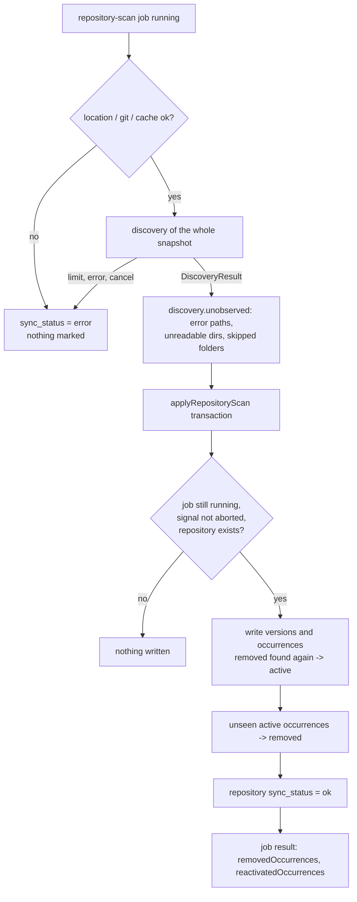

# SPEC-125 — Removed files are marked missing and their history is kept; repositories can be removed (E02-S03)

## 1. Summary

**Proposed, not implemented.** Today a rescan only adds and updates: when a skill, instruction
or rule file is deleted from a registered repository, its occurrence stays `active` forever, the
Artifacts list keeps counting it as found, and nothing tells the user it is gone
(`applyRepositoryScan`, `packages/database/src/repositories/artifacts.ts`: "Occurrences that were
not found again are left as they are (removed files are issue #21)"). There is also no way to
remove a registered repository.

This spec is the story slice of SPEC-103 (FR-103-11), SPEC-105 (FR-105-12) and SPEC-104
(FR-104-15, remove only) that issue #21 (E02-S03) asks for:

1. A scan that **completed and observed the whole repository** marks every occurrence it did not
   find as `removed` (shown as "missing"). A scan whose apply transaction did not commit (failed,
   cancelled, limit-aborted, or interrupted before the commit) marks nothing, and neither do the
   parts of a successful scan it could not read.
2. A missing occurrence whose path is found again is reactivated, with the same artifact.
3. A missing artifact keeps its versions, categories, tags, notes, benchmark assignments and
   results, and its pages say clearly that it is missing.
4. A repository can be removed after an inline confirmation that states what is deleted and what
   is kept; its occurrences are deleted, its artifacts and their history stay.

Move detection (FR-103-09), repository disable, deleting a hosted repository's cache (issue #59)
and a "Show removed" filter (issue #53) stay out (§4, §5a).

## 2. Motivation and problem statement

- Issue #21 (backlog E02-S03, epic #11 "Keep the catalogue current as repositories change"): "When
  a skill is deleted from a repository, the catalogue must say so without losing its versions and
  evaluation history." The four acceptance criteria are copied into §16 (AC-1 to AC-4).
- The maintainer updates their own skills in client project repositories (product brief, Target
  group; D04). Skills get deleted and renamed there. Today the registry silently keeps reporting
  them as present, so the Repositories page's artifact count, the Artifacts list's occurrence
  count and the "Source" column overstate what is in the repositories.
- Benchmark results belong to immutable versions (SPEC-103). Deleting a skill upstream must not
  lose the evidence the maintainer gathered about it (D03: verdicts are checked later in real
  projects).
- The schema already models this (`artifact_occurrences.status` is `active | removed`,
  `packages/database/src/schema.ts`), and some reads already filter on `active` (the list's
  Repositories column and occurrence count, the repository filter, the Repositories page count).
  Nothing ever writes `removed`.
- A registered repository cannot be removed, so a wrong or obsolete registration stays forever
  (SPEC-104 §20: edit, disable and remove are not implemented).
- Product direction: D08 (2026-10-22) parked the rest of E02 until S1 shipped; S1 (epic #93) is
  closed, the issue's dependency #19 is closed, and the maintainer picked #21 as the next feature
  on 2026-11-12.

## 3. Goals

- G1: A deleted file is visible as missing after the next successful scan of its repository,
  for every scannable provider (`local-git`, `local-directory`, `github`).
- G2: Never mark an occurrence missing because of a scan that did not look at it: a scan whose
  apply transaction did not commit (failed, cancelled, limit-aborted, interrupted before the
  commit), a per-artifact discovery error, an unreadable directory (also one inside a skill) or a
  skipped user-level folder (fail closed).
- G3: Missing is reversible: the same path found again reactivates the occurrence and keeps the
  artifact's identity, metadata and history.
- G4: Nothing is deleted by a scan; a missing artifact's history stays visible.
- G5: A repository can be removed; its occurrences go, its artifacts and their history stay, and
  the confirmation says so with counts.

## 4. Non-goals

- Move and rename detection (FR-103-09, FR-103-10): a moved skill appears as one missing
  occurrence plus one new artifact (A12).
- Repository disable (FR-104-15 "Disable", `disabled_at`) and editing (FR-104-14): there is no
  "Sync all" for disable to act on yet.
- Deleting a hosted repository's cache on removal and cleaning orphaned caches (issue #59, A14).
- A lifecycle filter or "Show removed" toggle on the Artifacts list (FR-101-11, issue #53, UD-1).
- Hard delete of artifacts or versions (issue scope; FR-101-17, FR-103-12).
- The planned `sync_runs` / `sync_run_items` history and `SyncPlan` (FR-105-08, FR-105-14), and
  the `excluded` removal reason (FR-105-12): discovery settings (FR-104-13) do not exist yet.
- A CLI `repo remove` (SPEC-009, A20).
- Re-linking a missing artifact to a new one by hand (FR-103-10 "future registry action").

## 5. User stories

- US-125-01: As a skill author, I delete `skills/old-review/` from my project, rescan, and see
  that artifact marked missing, with its v1 to v3 and their benchmark results still on its page.
- US-125-02: As a skill author, I restore the deleted skill (`git checkout`), rescan, and the same
  artifact is active again with its categories and notes.
- US-125-03: As a skill author, a scan of my repository fails half way (network, timeout, limit)
  or is cancelled; nothing in the registry changes to missing.
- US-125-04: As a skill author, I remove a repository I registered by mistake; the page tells me
  first how many occurrences are deleted and how many artifacts end up missing from every
  repository, and that their history stays.

## 5a. Resolved assumptions (autonomous defaults)

Written by `om-spec-writing --autonomous` for issue #21. None is marked
`⚠ NEEDS HUMAN CONFIRMATION`: each default is reversible and keeps or adds history, never removes
it. UI decisions are listed separately in §11.1. The maintainer confirms or changes each row
before approving the spec.

| # | Question | Default chosen | Alternative | Why this default |
| --- | --- | --- | --- | --- |
| A1 | New story spec or edit SPEC-103/104/105 in place? | New SPEC-125 for this story; the umbrella specs keep their requirements and get their §20 updated in the implementation PRs (§17) | Edit the three specs in place | Same model as SPEC-124: one story, verifiable acceptance criteria across three umbrella specs |
| A2 | Split into two specs (missing marking vs repository removal)? | One spec, two phased PRs (§21): Phase 1 marks and shows missing artifacts, Phase 2 removes repositories | Two specs | Removal is a separate capability that can ship as one PR, but it depends on Phase 1's missing display ("artifacts left missing"), and the issue is one story with one set of criteria. Marking and display stay one phase: marking without display would leave unexplained empty cells |
| A3 | Which scans may mark occurrences missing? | Only a `repository-scan` job whose discovery returned a result for the whole snapshot and whose apply transaction commits; every failure, cancellation and per-scan limit returns before the apply (§6.1, §9). A job shown as `interrupted` (or `failed` while its result was being recorded) may have committed its apply before the runner stopped; then its marking is as valid as its versions, since both commit together | Also partially successful scans for the parts they read | The issue's AC 4; partial knowledge is exactly what must not delete state |
| A4 | Paths a successful scan could not observe (per-artifact discovery errors, every unreadable directory including one inside a skill, skipped user-level folders) | Occurrences at, inside or containing such a path stay `active` and keep their version (FR-105-11, FR-101-05). Core computes the list, where the walk's data is (FR-125-03) | Mark them missing with a reason | Fail closed: "could not read" is not "deleted" |
| A5 | Reactivation | The occurrence at the same repository and path is reactivated whatever its content; equal content reuses the matching version, other content adds the next version (location identity, issue #16 and #19 rules) | Reactivate only for identical content (literal FR-103-11), else a new artifact | Scans already identify an artifact by repository and path; a skill edited while it was deleted is still the same skill |
| A6 | Schema change for "missing since" or a removal reason? | None. `status = 'removed'` and the existing `last_seen_at` ("last found on") are enough; `updated_at` is set when the status changes | Add `removed_at` and `removal_reason` columns (migration `0006`) | No migration; "last found" is what DirectiveBench knows; the reason column only pays off with discovery settings (FR-105-12 `excluded`) |
| A7 | Guard against marking everything missing when a successful scan finds nothing (an empty or unmounted directory)? | No guard. The scan's result line says how many occurrences went missing; the next successful scan that finds them reactivates them | Refuse to mark when the scan finds 0 artifacts but the repository had active occurrences | Deleting every skill is a legitimate change; marking is reversible and loses nothing; a heuristic would hide real deletions |
| A8 | What makes an artifact "missing"? | It has no `active` occurrence (all its occurrences are `removed`, or it has none left because their repositories were removed) | Only "has ≥ 1 occurrence and all removed" (SPEC-101 §8) | One rule covers both missing files and removed repositories (SPEC-104 calls the latter "orphaned") |
| A9 | Artifacts list | Missing artifacts stay listed and are labelled (UD-1); no lifecycle filter in this story | Hide them by default with a "Show removed" filter (SPEC-101 §11, issue #53) | Smallest change; keeps every list, count and the SPEC-124 bulk fingerprint consistent; the filter belongs to #53 with the rest of FR-101-11 |
| A10 | The repository filter on the Artifacts list | Unchanged: it lists artifacts with an active occurrence in that repository, so a missing artifact leaves its repository's filtered list | Also list artifacts whose only occurrence there is missing | It is the existing rule (`listConditions`), and "in this repository" means found there now |
| A11 | Benchmarks on a missing artifact | Unchanged: its stored versions can still be benchmarked and compared; no warning | Refuse runs of missing artifacts | Versions are immutable stored content; refusing would block re-checking old evidence (D03) |
| A12 | Move detection (FR-103-09) | Out of scope: a move is one missing occurrence plus one new artifact; the old artifact's history stays on it | Detect moves by content hash in this story | Not in the issue's criteria; it needs the SyncPlan matching rules and a decision on ambiguous moves; a follow-up issue is proposed (§19) |
| A13 | Repository removal scope | Remove only: one repository function deletes the row in one transaction (occurrences cascade, versions' `source_repository_id` set to null); a Server Action calls it after a Risky-action confirmation | Remove plus disable (`disabled_at`) | The issue's AC 3; disable needs "Sync all", which does not exist |
| A14 | Delete the hosted cache on removal (issue #59)? | Out of scope; the confirmation says the downloaded copy stays on disk and links nothing it cannot do; #59 stays open and gets this spec as context | Add a runner job `repository-removal` that deletes the row and the cache | The web app must not run git or touch the runner's cache while a scan may use it; #59 also covers orphan cleanup at start, which is runner work |
| A15 | The internal `bundled-examples` repository | Not removable (no Remove button; the repository function refuses it) | Removable like any other | `directivebench demo` re-imports it and matches examples by slug; removing it would duplicate the examples |
| A16 | Removal while a scan of that repository is pending or running | Allowed. The scan ends with the existing "The repository was removed during the scan." and writes nothing | Refuse until the scan ends | Already safe: `applyRepositoryScan` re-reads the repository inside its transaction |
| A17 | Registering the same location again after removal | Creates a new repository and new artifacts; the old artifacts stay missing with their history; the confirmation says so | Re-link old artifacts by location on re-registration | Location identity is per repository id; re-linking is the future manual action (FR-103-10) |
| A18 | Does the removal confirmation guard its counts (like SPEC-124's fingerprint)? | No. The counts are information; the action removes one named repository; the result line reports the counts the transaction actually deleted | A fingerprint of the occurrence ids | The target is one object, not a filtered set; a scan between page load and confirm changes numbers, not the decision |
| A19 | Words | The UI says "missing" for occurrences and artifacts; code and database keep `removed` | Say "removed" everywhere (as SPEC-103 §11 "Removed upstream") | "Missing" says what DirectiveBench knows (not found in the last scan) and does not suggest that DirectiveBench deleted anything; the issue title uses it |
| A20 | CLI | None in this story | `directivebench repo remove` | The issue names the web UI only |
| A21 | ADR | None: no new dependency or pattern, no schema change | ADR for the "complete scan" rule | AGENTS.md asks ADRs for significant design decisions only; the rule is recorded here and in SPEC-105 |
| A22 | Example import (`importArtifactVersion`) | Never marks anything missing | Mark bundled examples not in the current release missing | It imports a fixed list, not a scan of a location |

## 6. Functional requirements

### 6.1 Marking missing (scans)

| ID | Requirement |
| --- | --- |
| FR-125-01 | **Only a complete scan marks.** Occurrences are marked `removed` only inside `applyRepositoryScan`, in the same transaction that writes the scan's versions and records `sync_status = 'ok'`; a scan whose apply did not commit marks nothing. It is called only after discovery returned a `DiscoveryResult` for the whole snapshot (local: the walk of the registered location; hosted: the listing of one commit). Every failure path that exists today returns before it and therefore marks nothing: location checks (`path-not-found`, `not-a-directory`, `permission-denied`, `location-changed`, `filesystem-root`), an unreadable root, a discovery exception, the per-scan limits `maxCandidatesPerScan` and `maxScanBytes` (`DiscoveryLimitError`), the hosted limits (cache limit, `TREE_LISTING_MAX_BYTES`, `HOSTED_READ_TOTAL_BYTES`, the text budget in step 5, every git timeout), any git or cache failure, a cancellation or shutdown (`ScanCancelledError`, `JobNoLongerRunningError`, checked inside the transaction), and a store failure (the transaction rolls back, the marking with it). |
| FR-125-02 | **Future limits fail closed.** A limit added later that skips part of a snapshot instead of aborting MUST report what it skipped as unobserved (FR-125-03) or abort the scan. A test (§15) pins that every `DiscoveryLimitError` and every hosted limit failure leaves all occurrences `active`. |
| FR-125-03 | **Unobserved paths.** Discovery itself reports `unobserved` in its `DiscoveryResult` (§8.2), because only the walk knows what it could not read: the `path` of **every** discovery error; **every** directory the walk could not list or that changed during the scan, including those that `planCandidates` folds into a skill's `read-failed` error today (that error is recorded at the skill's `SKILL.md`, so without the directory a nested skill or rule file below it would look deleted); and every skipped user-level folder (D05), with `.` for the whole location. The runner passes it unchanged; it never rebuilds it from the job result, whose `errors` and `skippedUserLevelFolders` are cut to `MAX_REPORTED_SCAN_ERRORS` and `MAX_SKIPPED_USER_LEVEL_FOLDERS`. An active occurrence is **kept** when its path equals an unobserved path, lies inside one, or contains one, compared by whole `/` segments (`a` contains `a/b/SKILL.md` but not `ab/SKILL.md`); `''` (the repository-root skill's occurrence path) and `.` contain every path, on either side. So a skill whose `SKILL.md` failed (`too-large`, `binary-primary`, `symlink`, `too-many-files`, `read-failed`), a single-file artifact that failed, and everything below an unreadable directory keep their previous version and stay `active` (FR-105-11). Keeping a containing occurrence is deliberately conservative (§14). |
| FR-125-04 | **Marking.** Every other `active` occurrence of the scanned repository whose path the scan did not discover gets `status = 'removed'` and `updated_at = now`; `latest_version_id`, `commit_sha` and `last_seen_at` stay as they were (the last version found and when). Occurrences of other repositories are never touched. Nothing is deleted (FR-105-12). The comparison is exact on the stored path (UTF-16 code units, as paths are stored). |
| FR-125-05 | **Reactivation.** A discovered path whose occurrence is `removed` makes it `active` again through the existing writer (`writeArtifactVersion`, location identity): same occurrence id, same artifact; the matching version is reused, or the next version is added when the content differs (A5). `last_seen_at`, `commit_sha` and `updated_at` are set as for any found occurrence. |
| FR-125-06 | **Summary.** `applyRepositoryScan` returns `removedOccurrences` (marked by this scan) and `reactivatedOccurrences` (found again by this scan). The job result (`repositoryScanResultSchema`) gains both as counts with `.default(0)`, so results stored before them still parse. |
| FR-125-07 | **No other writer marks.** The example import, registration and every web action never set `removed` (A22). Sync never changes user-owned data on a missing or reactivated artifact (FR-105-13): categories, tags, notes and benchmark assignments stay. |

### 6.2 Showing missing artifacts

| ID | Requirement |
| --- | --- |
| FR-125-08 | **Missing artifact.** An artifact is missing when it has no `active` occurrence (A8). `ArtifactListItem` and `getArtifactDetail` expose `missing: boolean` and, for a missing artifact, `lastFoundAt`: the latest `last_seen_at` of its occurrences, or null when none is left (its repositories were removed). |
| FR-125-09 | **Artifact page.** A missing artifact's page shows a `muted` Badge "Missing" in the PageHeader and, under the header, a note (§11) saying when it was last found, that its versions, categories, notes and benchmark results are kept, and that it becomes active again when a scan finds it at the same path. Every tab works as before: versions, content, evaluation history, comparisons, categories, tags, notes and suites stay visible and editable (AC-2). |
| FR-125-10 | **Occurrences table.** The Status column reads "active" (`outline` Badge, as today) or "missing" (`muted` Badge) instead of the raw `removed`; "Last seen" keeps the date. |
| FR-125-11 | **Artifacts list.** A missing artifact stays in the list (A9) and its Repositories cell, empty today for it, shows a `muted` Badge "Missing" (UD-1). The occurrence count (active occurrences) reads 0. Counts, filters, the SPEC-124 bulk action and its fingerprint are unchanged. |
| FR-125-12 | **Scan result.** The Repositories page's scan result line (`describeScan`) adds "N no longer found (marked missing)" when `removedOccurrences > 0` and "N found again" when `reactivatedOccurrences > 0` (§11). |

### 6.3 Removing a repository

| ID | Requirement |
| --- | --- |
| FR-125-13 | **Impact.** `getRepositoryRemovalImpact(db, id)` returns, for a removable repository: its name, provider and location, `occurrences` (all its occurrence rows), `activeOccurrences`, and `artifactsLeftMissing`: artifacts with an active occurrence in this repository and no active occurrence in any other. Null for an unknown id or the `bundled-examples` repository (A15). |
| FR-125-14 | **Remove.** `removeRepository(handle, id)` runs in one `withTransaction`: it reads the same counts, then deletes the repository row with one conditional statement (`DELETE … WHERE id = ? AND provider <> 'bundled-examples'`), which cascades to its occurrences and sets `artifact_versions.source_repository_id` to null (existing foreign keys). Artifacts, versions, categories, tags, notes, benchmark assignments and runs are not touched (FR-104-15). Outcomes: `{ status: 'removed', occurrences, artifactsLeftMissing }`, `{ status: 'not-found' }` (unknown or removed meanwhile), `{ status: 'not-removable' }` (`bundled-examples`). Any error rolls everything back. |
| FR-125-15 | **Confirmation.** Every removable repository row on `/repositories` has an `outline` `sm` "Remove" button named "Remove <name>". It writes nothing: it opens the Risky-action panel for that repository (§11, UD-5) with the question, the counts from FR-125-13, what is kept, that files in the location are not touched, that a hosted download stays in the cache (A14), and that registering it again creates new artifacts (A17). Only the `destructive` "Remove repository" button submits; Cancel writes nothing. |
| FR-125-16 | **Action.** `removeRepositoryAction` parses `FormData` with a Zod schema (`repositoryId`), calls `removeRepository` only, revalidates the `/repositories` page and the `/artifacts` and `/categories` layouts and `/`, and returns to `/repositories` with the outcome (§10). It never touches the file system and never runs a process (SPEC-003 §2.1, SPEC-014). |
| FR-125-17 | **After removal.** The removed repository's artifacts that had no other active occurrence are missing (FR-125-08) with `lastFoundAt = null` and their own note text (§11); the Versions tab's First seen column already reads "Unknown repository" for versions whose source repository is gone (issue #65). |

## 7. Non-functional requirements

- NFR-125-01: Marking costs O((n + u) log u) for n occurrences and u unobserved paths, times the
  path depth: discovered and unobserved paths go into sets, each occurrence checks its own
  ancestors (whole `/` segments) in the unobserved set and its descendants by one binary-search
  range lookup for `<path>/` in the sorted unobserved list; no pairwise comparison (lesson
  2026-10-22 "O(1) per token start"). Updates are batched
  by id (at most `REMOVED_OCCURRENCE_BATCH_SIZE = 500` per statement, under SQLite's parameter
  limit).
- NFR-125-02: A rescan of 10,000 active occurrences that marks all of them missing adds less than
  1 s to the apply transaction on the development machine (NFR-105-03 sizing); measured once in a
  database test, not asserted as a timing.
- NFR-125-03: Every changed page works by keyboard alone, has no horizontal page scroll at 320px
  and meets the contrast targets in both themes, including the muted "Missing" Badge, the note and
  the Risky-action panel (AGENTS.md §7).
- NFR-125-04: Local-first: no network call, no new dependency.

## 8. Domain entities and contracts

### 8.1 Data model

No migration. Existing columns carry the feature:

| Column | Use |
| --- | --- |
| `artifact_occurrences.status` | `active` or `removed` (shown as "missing") |
| `artifact_occurrences.last_seen_at` | when the path was last found; unchanged when it goes missing |
| `artifact_occurrences.updated_at` | when the status last changed |
| `artifact_occurrences.repository_id` | `ON DELETE CASCADE`: removing a repository deletes its occurrences |
| `artifact_versions.source_repository_id` | `ON DELETE SET NULL`: versions survive repository removal |

`PRAGMA foreign_keys = ON` is set by the client (`packages/database/src/client.ts`), so the
cascade and set-null run inside the removal transaction. SPEC-006 needs no change beyond a note
on the status meaning.

### 8.2 Core (`@directivebench/core`)

```ts
export interface DiscoveryResult {
  // … existing fields …
  /**
   * Repository-relative paths this discovery could not observe (FR-125-03): every error's path,
   * every unreadable or changed directory (also those folded into a skill's error), every
   * skipped directory ('.' for the whole root). Sorted, without duplicates. Filled by
   * `discoverArtifacts` and `discoverArtifactsInTree` (no unreadable or skipped directories there).
   */
  unobserved: string[];
}

/**
 * The active occurrence paths a complete scan did not find and may mark missing: not discovered,
 * and not equal to, inside or containing an unobserved path ('' and '.' contain every path).
 * Pure; linear in the inputs up to path depth (NFR-125-01).
 */
export function unseenOccurrencePaths(input: {
  active: readonly string[];
  discovered: readonly string[];
  unobserved: readonly string[];
}): string[];
```

`unseenOccurrencePaths` lives next to `pathRelation` in `repository-path.ts`, so the database
package holds no path logic of its own.

### 8.3 Database (`@directivebench/database`)

```ts
export interface RepositoryScanApplication {
  repositoryId: string;
  jobId: string;
  artifacts: readonly ScannedArtifactInput[];
  commitSha: string | null;
  signal: AbortSignal;
  /** Required, no default: a caller that forgets it does not compile (FR-125-03). */
  unobserved: readonly string[];
}

export interface RepositoryScanSummary {
  createdArtifacts: number;
  createdVersions: number;
  removedOccurrences: number;      // FR-125-06
  reactivatedOccurrences: number;  // FR-125-06
}

// applyRepositoryScan: after the existing per-artifact writes and before the repository status
// update, in the same transaction:
//   1. read the repository's active occurrence paths (ids and paths only);
//   2. unseenOccurrencePaths({ active, discovered: artifacts' paths, unobserved });
//   3. UPDATE artifact_occurrences SET status = 'removed', updated_at = now
//      WHERE repository_id = ? AND status = 'active' AND id IN (…batch…).
// writeArtifactVersion reports whether it changed an existing occurrence from 'removed' to
// 'active' (read with the occurrence it already selects), which feeds reactivatedOccurrences.

export interface RepositoryRemovalImpact {
  id: string;
  name: string;
  provider: RepositoryProvider;
  location: string;
  occurrences: number;
  activeOccurrences: number;
  artifactsLeftMissing: number;
}
export async function getRepositoryRemovalImpact(
  db: Database,
  repositoryId: string,
): Promise<RepositoryRemovalImpact | null>;

export type RemoveRepositoryOutcome =
  | { status: 'removed'; occurrences: number; artifactsLeftMissing: number }
  | { status: 'not-found' }
  | { status: 'not-removable' };
export async function removeRepository(
  handle: DatabaseHandle,
  repositoryId: string,
): Promise<RemoveRepositoryOutcome>;
```

`ArtifactListItem` gains `missing: boolean`; the object `getArtifactDetail` returns gains
`missing: boolean` and `lastFoundAt: string | null` (FR-125-08). Both are computed from rows the
functions already read (`occurrences`), so no extra query is needed.

`repositoryScanResultSchema` (`repositories/jobs.ts`) gains
`removedOccurrences: count.default(0)` and `reactivatedOccurrences: count.default(0)` in the `ok`
branch (the object stays `.strict()`).

### 8.4 Runner (`@directivebench/runner`)

`scanLocalRepository` and `scanHostedRepository` pass
`unobserved: discovery.unobserved` from the **full** `DiscoveryResult` to
`storeScanResults`, and copy `removedOccurrences` and `reactivatedOccurrences` into the job result.
No other runner change: every failure path already returns before `storeScanResults`
(FR-125-01).

### 8.5 Web (`apps/web/lib`)

- `repositories.ts`: `describeScan` adds the FR-125-12 clauses; `canRemove(repository)` (not
  `bundled-examples`); a new `parseRemovalParams(searchParams)` for `remove` (a repository id)
  and the removal outcome parameters (§10), invalid values ignored. The page reads its other
  `searchParams` inline as today.
- `artifacts.ts` (or a small `artifact-lifecycle.ts`): `missingNote({ lastFoundAt })` returns
  the note text of §11 for both cases.
- `actions.ts`: `removeRepositoryAction` (FR-125-16).

## 9. Data flow



Existing: everything except U, M and the two counts. The marking commits only together with the
writes and the `ok` status, so a scan cannot record success without its marking, or mark without
recording success.

Repository removal: `/repositories` row "Remove" → `/repositories?remove=<id>` renders the panel
with `getRepositoryRemovalImpact` → "Remove repository" posts `removeRepositoryAction` →
`removeRepository` (one transaction) → redirect to `/repositories` with the outcome.

## 10. API and interface design

- No HTTP API and no CLI change (A20).
- `removeRepositoryAction(formData)`: `{ repositoryId }` parsed with
  `z.object({ repositoryId: z.string().min(1) })`, the schema the Scan action uses.
  Outcomes redirect to `/repositories` with:
  - `removed`: `?removedOccurrences=<n>&missingArtifacts=<m>` (non-negative integers, parsed with
    Zod; the result line names no repository, which no longer exists, so a crafted URL can only
    show other numbers);
  - `not-found`: `?removeError=not-found`;
  - `not-removable` or invalid input: `?removeError=invalid`;
  - an error thrown by the transaction: `?removeError=failed`.
- The panel is server-rendered from `?remove=<id>`: an unknown or not removable id renders no
  panel and a `role="status"` line "That repository is no longer registered." or nothing for
  `bundled-examples` (its row has no Remove button, so only a crafted URL reaches it).
- The Remove button is a `GET` form (`<form>` with a hidden `remove` field and a Button), the same
  mechanism as the list filters, so it works without JavaScript and needs no client component.

## 11. UI/UX considerations

Built only from existing components and patterns (`apps/web/design-system.md`): Badge (`muted`,
`outline`), Button (`outline`, `destructive`, `link`), Card, Table, PageHeader, the Risky-action
pattern unchanged, `role="note"` and `role="status"` lines as used on the artifact page and the
Repositories page. No new component, variant or token. Copy below is proposed for approval and
contains no en or em dash.

**`/artifacts/[id]` (changed).** For a missing artifact:

- PageHeader: a `muted` Badge "Missing" after the type and version badges.
- Directly under the PageHeader, before the tabs, one `role="note"` paragraph (`text-body`):
  - with an occurrence left: "Missing: no registered repository contained this artifact in its
    last scan. Last found on <formatDate(lastFoundAt)>. Its versions, categories, notes and
    benchmark results are kept, and it becomes active again when a scan finds it at the same
    path."
  - with none left: "Missing: the repositories it was found in were removed. Its versions,
    categories, notes and benchmark results are kept."
- Occurrences card: Status "missing" as a `muted` Badge (FR-125-10); "Last seen" unchanged.

**`/artifacts` (changed).** In the Repositories cell of a missing artifact, a `muted` Badge
"Missing" (UD-1). Nothing else changes.

**`/repositories` (changed).**

- Scan result line, examples: "Scanned client-a: 214 files in 1.2 s, 9 artifacts found (0 new,
  1 new version), 0 errors. 2 no longer found (marked missing), 1 found again." The two clauses
  appear only when their count is above 0.
- Each removable row: after Scan, an `outline` `sm` "Remove" Button named "Remove <name>" in a
  `GET` form. The actions cell wraps (`flex-wrap`) at narrow widths.
- With `?remove=<id>`, the Registered repositories Card shows, above the table, the Risky-action
  panel (unchanged pattern: `role="alert"`, `warning` fill and border, reasons as a list). The
  pattern puts the panel under the form that asked; here the asking control is a table row, and a
  panel inside a row would squeeze it, so it sits at the top of the same Card, first in reading
  order:
  - Question: "Remove client-a?"
  - Reasons (each a sentence; counts formatted with `toLocaleString('en-US')` as in SPEC-124):
    - "Its 14 occurrences are deleted from DirectiveBench." (1: "Its 1 occurrence is …"; 0:
      "It has no occurrences.")
    - "9 artifacts are then missing from every repository. Their versions, categories, notes and
      benchmark results are kept." (0: "Every artifact found here is also found in another
      repository, or is already missing.")
    - Local: "Nothing in /home/dev/client-a is changed." Hosted: "The copy downloaded from GitHub
      stays in DirectiveBench's cache. Deleting it is planned." (A14)
    - "Registering it again later creates new artifacts; these ones stay missing." (A17)
  - `destructive` `sm` Button "Remove repository" (posts the action) and a Cancel link to
    `/repositories` styled like the Register-anyway Cancel (`text-ui underline`), since it
    navigates.
  - The GET form's action is `/repositories#remove-panel` and the panel carries
    `id="remove-panel"` and `tabIndex={-1}`, so the browser scrolls to it and starts keyboard
    navigation there after the page loads, without client code (the Playwright test checks in
    Chromium that the next Tab reaches "Remove repository"; where a browser ignores the fragment,
    the panel is still the first content of the Card). Cancel returns to the plain page.
- After removal, a `role="status"` line above the table: "Repository removed: 14 occurrences
  deleted, 9 artifacts now missing from every repository. Their history is kept." `not-found`:
  `role="alert"` "That repository is no longer registered. Nothing was removed."

- The PageHeader's planned Badge changes to "Planned, not implemented: private repositories,
  GitLab, removing a repository" in Phase 1 and to "Planned, not implemented: private
  repositories, GitLab" in Phase 2 (the new strings have no em dash). The Card description
  (`scan-explanation`) gains the sentence "A file that a later scan does not find is marked
  missing; its history is kept."

States: success, not found, invalid, failed. No pending state: like Scan and "Register anyway",
the form posts without a client component.
Keyboard: native buttons and links only; visible focus. 320px: the panel's reasons wrap, the
table scrolls inside its card, no page scroll. Both themes: tokens only; contrast covered by
`text-contrast.spec.ts` / `ui-contrast.spec.ts` (muted Badge, note, panel, status lines).

Prototype: `.ai/specs/assets/missing-occurrences-and-repository-removal/` when present
(illustrative static mockups and current-app screenshots; the implementation uses the design
system).

### 11.1 UI decisions for the maintainer to approve

| # | Decision | Default in this spec | Alternative |
| --- | --- | --- | --- |
| UD-1 | How a missing artifact shows in the Artifacts list | Listed, with a `muted` "Missing" Badge in its (otherwise empty) Repositories cell | (a) Hidden by default with a Status filter "Active / Missing / All" (SPEC-101 §11 "Show removed"; with issue #53); (b) the Badge next to the name |
| UD-2 | How the artifact page says it is missing | `muted` Badge in the PageHeader plus one `role="note"` paragraph under it | A `warning` panel (looks like an error; nothing is wrong to fix) |
| UD-3 | Occurrence status label | "active" / "missing" | Keep the raw "removed" |
| UD-4 | Scan result clauses | "N no longer found (marked missing)", "N found again", only when above 0 | Always show both counts |
| UD-5 | Where Remove asks first | `GET` form → `/repositories?remove=<id>` renders the Risky-action panel above the table (server-rendered like "Register anyway", one impact query, works without JavaScript) | A client panel opening in place in an extra table row (SPEC-124 D11 rule 6); needs the counts of every row on page load or a fetch |
| UD-6 | Confirmation needed at all? | Yes: removing a repository cannot be undone (registering again creates new artifacts), so the Risky-action pattern applies without the SPEC-124 UD-5 exception | No confirmation, result line only |
| UD-7 | Copy | The strings in §11 and §13 | Maintainer's wording |

## 12. Security considerations

- Fail closed (SPEC-014): uncertainty about a path keeps it `active` (FR-125-01 to FR-125-03).
  The unobserved list is built from the full discovery result, never from the truncated job
  result.
- Removal deletes rows only through `@directivebench/database`; the web app touches no file and
  runs no process (SPEC-003 §2.1). The repository id comes from the Zod-parsed form; the delete is
  one conditional statement that also refuses `bundled-examples`, so a forged id cannot remove the
  internal repository.
- The panel shows the stored location, which the user registered and the table already shows; no
  credential exists for repositories yet (D06).
- No secrets or file contents reach messages: the new result clauses are counts.
- The removal result is carried in the redirect URL (§10). A crafted link can show "Repository
  removed" with made-up numbers, and a reload repeats the line; both only mislead the person who
  opens that link on their own local instance, and no write depends on them. Accepted for this
  story.
- Server Actions keep the existing origin checks (`apps/web/proxy.ts`).

## 13. Error handling

| Situation | Behaviour |
| --- | --- |
| Scan fails, is cancelled or interrupted, or hits a limit | As today; nothing marked (FR-125-01). The result line is the existing one. |
| A discovery error or unreadable directory in a successful scan | The affected occurrences stay `active` (FR-125-03); errors are listed as today. |
| The marking statement fails (I/O, `SQLITE_FULL`) | The whole apply transaction rolls back; the scan fails with the existing "The scan failed: the results could not be stored (<code>)." |
| Repository removed during a scan | Existing: "The repository was removed during the scan.", nothing written. |
| Remove confirmed for a repository removed meanwhile | `role="alert"` "That repository is no longer registered. Nothing was removed." |
| Remove posted with an invalid or internal id | `role="alert"` "The form was incomplete. Reload the page and try again." (existing general message) |
| Removal transaction fails | Rolled back; the action redirects with `?removeError=failed` and the page shows `role="alert"` "The repository could not be removed. Nothing was changed." (no console output in the web app, SPEC-014; the error text, which can hold query parameters, is not shown) |
| `?remove=<id>` for an unknown id | No panel; `role="status"` "That repository is no longer registered." |

## 14. Edge cases

- **Skill directory deleted, nested skill kept** (`a/SKILL.md` gone, `a/b/SKILL.md` present):
  `a` is missing, `a/b` stays active.
- **Skill whose nested skill failed** (`a/` deleted except `a/b/SKILL.md`, which is too large):
  `a` stays active because it contains an unobserved path (FR-125-03). Conservative on purpose;
  the next scan without that error marks it.
- **Root skill** (`SKILL.md` at the root, occurrence path `''`): any discovery error keeps it
  active; otherwise it goes missing like any other.
- **File becomes a symlink**: a `symlink` discovery error at its path keeps it active (it is
  still there, DirectiveBench does not follow it). A skill directory replaced by a symlink is not
  a candidate any more and goes missing.
- **Unmounted or emptied local directory** that still resolves to itself: a successful scan with
  zero artifacts marks everything missing (A7); the next scan after remounting reactivates all of
  them with their history. The result line says how many went missing.
- **Registered location is the user-level folder itself** (`skippedDirectories = ['.']`): nothing
  is read and nothing is marked.
- **`CLAUDE_CONFIG_DIR` changed** so a folder with old occurrences is now skipped: those
  occurrences stay active (skipped = unobserved), and the existing info line names the folder.
- **Unreadable directory inside a skill** (`a/SKILL.md` readable, `a/b` not, `a/b/c/SKILL.md`
  found before): discovery reports `a/b` as unobserved (FR-125-03), so `a` and `a/b/c` stay
  active. The same holds for a root `SKILL.md` with an unreadable `.cursor/`.
- **Branch switch, `git stash` or a checkout in a `local-git` working tree**: the scan reads the
  working tree, so files absent from it go missing and come back after switching back. The note
  says "in its last scan", not "deleted".
- **A later DirectiveBench release classifies paths differently** (`classifyArtifactPath`): paths
  it no longer treats as artifacts go missing at the next scan; the release notes must say so.
- **Two scans of one repository** cannot run at once: `enqueueRepositoryScanJob` returns the
  pending or running scan inside its transaction (`repositories/jobs.ts`). A future "Sync all"
  must keep that, or a stale snapshot committing second would undo markings.
- **Overview counts** (`/` "Artifacts") include missing artifacts, unlabelled; intended for this
  story (they are still in the registry).
- **Hosted branch changes** (issue #58, future): the scan reads another commit, so paths absent
  from that branch go missing; switching back reactivates them.
- **Same path, different kind** (a rule file replaced by a skill directory of the same name):
  the occurrence's path is the same string only for single files; a skill's occurrence path is
  its directory, so they are different occurrences: one missing, one new.
- **Delete then reappear with other content**: reactivated, next version added (A5); the old
  versions and their results stay.
- **Artifact in two repositories, one removed**: still active (it has an active occurrence
  elsewhere); the removed repository's occurrence row is gone; `artifactsLeftMissing` does not
  count it.
- **Repository with only missing occurrences removed**: `artifactsLeftMissing` is 0 (they were
  already missing); their note switches to the "repositories were removed" text once no
  occurrence is left.
- **Removing while the page with `?scan=<jobId>` is open**: the scan status line keeps working
  from the job row.
- **Category counts** (`/categories`) include missing artifacts, which keep their categories; the
  linked filtered list shows them too, labelled (A9).
- **Concurrent scan and removal**: the removal transaction and the apply transaction are
  serialised by `BEGIN IMMEDIATE`; whichever commits second sees the other's result (A16).

## 15. Testing strategy

Per SPEC-012 and the 100% coverage rule; no network, mock agent only.

- **Core** (`packages/core/test`): `DiscoveryResult.unobserved` for an error path, an unreadable
  directory outside every skill, an unreadable directory inside a skill (the folded case), a
  root `SKILL.md` with an unreadable subdirectory, skipped folders and `.`, duplicates and
  sorting, for both `discoverArtifacts` and `discoverArtifactsInTree`; `unseenOccurrencePaths`
  for equal, inside, containing, `''` and `.` on either side, sibling prefixes that are not
  ancestors (`a` vs `ab/SKILL.md`), Unicode paths, and a 10,000-occurrence input (correctness
  only; no timing assertion, no test-only option).
- **Database** (`packages/database/test`):
  - `applyRepositoryScan` marks unseen active occurrences of the scanned repository only, leaves
    `last_seen_at`, `latest_version_id`, `commit_sha` unchanged, sets `updated_at`, counts
    `removedOccurrences`; keeps occurrences protected by `unobserved`; reactivates a removed
    occurrence with equal and with changed content and counts `reactivatedOccurrences`; keeps
    categories, tags, notes, assignments and runs (AC-2); writes nothing when the job was
    cancelled, the signal aborted or the repository removed (existing tests extended with a
    removed-candidate occurrence); rolls back the marking when a later statement fails (SQLite
    trigger injection, lesson 2026-11-05).
  - `removeRepository`: counts, cascade, versions' source set to null, artifacts and their
    metadata and runs kept, `not-found` and `not-removable`, rollback on an injected failure,
    and a second call after removal.
  - `listArtifacts` / `getArtifactDetail`: `missing` and `lastFoundAt` for active, missing and
    occurrence-less artifacts.
  - NFR-125-02 measured once.
- **Runner** (`packages/runner/test`): for `local-directory`, `local-git` and `github` (local bare
  remote): delete a skill and rescan → missing (AC-1); restore → active again (AC-5). Failure
  paths mark nothing (AC-4): path removed, location changed, `maxCandidatesPerScan` and
  `maxScanBytes` lowered through the existing limit options, an unreadable subdirectory (outside
  and inside a skill, with a nested skill below it) and a `too-large` skill in an otherwise
  successful scan, a `local-git` branch switch (missing, then active after switching back), cancellation before and inside the apply,
  and for hosted the cache limit, the tree listing limit, `readTotalBytes` and a git timeout. A
  test with more than `MAX_REPORTED_SCAN_ERRORS` errors proves that the 101st error's occurrence
  stays active.
- **Web unit** (`apps/web/test`): `describeScan` clauses; `missingNote`; `canRemove`; params
  parsing of `remove`, `removedOccurrences`, `missingArtifacts`, `removeError`;
  `removeRepositoryAction` outcomes and revalidation; results stored without the new counts
  parse with 0.
- **Playwright** (`apps/web/e2e`): register a fixture repository, scan, delete a skill file,
  rescan → result line, Missing badge in the list, note and badge on the artifact page with its
  versions and evaluation history visible; restore and rescan → active. Remove: panel with the
  counts, Cancel writes nothing, confirm → status line, artifacts missing with the "removed"
  note; `bundled-examples` has no Remove. Keyboard only, 320px, both themes in the contrast
  specs. The spec leaves the shared database as it found it (lesson 2026-11-10).
- **Storybook**: no new component; the Risky-action stories are unchanged. If UD-2 or UD-5 change
  to a new variant, it gets stories in both themes with axe.

## 16. Acceptance criteria

- [ ] AC-1: Given a skill deleted from a repository, when the repository is rescanned
  successfully, then its occurrence is marked missing (`removed`), for `local-directory`,
  `local-git` and `github` (issue AC 1, SPEC-013 M1 AC4).
- [ ] AC-2: Given that missing occurrence, then the artifact's versions, categories, tags, notes,
  benchmark assignments and evaluation history remain visible on its page, which says it is
  missing and when it was last found (issue AC 2).
- [ ] AC-3: Given a removed repository, then its occurrences are deleted, but artifacts and
  versions (with `source_repository_id` null), categories, notes and results are kept; removal
  happens only after the inline confirmation that states the counts, and Cancel writes nothing
  (issue AC 3, FR-104-15).
- [ ] AC-4: Given a repository whose scan failed, was cancelled, or stopped at a per-scan limit
  before its apply transaction committed, then none of its occurrences is marked missing; and in
  a successful scan, occurrences covered by a discovery error, an unreadable directory (also one
  inside a skill) or a skipped user-level folder stay active (issue AC 4).
- [ ] AC-5: Given a missing occurrence whose path is found again by a successful scan, then it is
  active again with the same artifact, reusing the matching version or adding the next one.
- [ ] AC-6: The scan result line states how many occurrences went missing and how many were found
  again.
- [ ] AC-7: The `bundled-examples` repository cannot be removed, and the example import never marks
  anything missing.
- [ ] AC-8: The changed pages work by keyboard alone, have no horizontal page scroll at 320px and
  meet the contrast targets in both themes (Playwright).
- [ ] AC-9: `pnpm lint && pnpm typecheck && pnpm test` pass with 100% coverage; `pnpm build`,
  `pnpm verify:pack`, `pnpm test:e2e` and `pnpm test:storybook` pass.

## 17. Dependencies

- Issues: #19 (closed, rescans), #16 and #18 (scans), epic #11; D08 (S1 shipped); related open
  issues #53 (Show removed filter), #59 (hosted cache deletion), #58 (branch choice), #20
  (cross-repository identity).
- Specs changed by the implementation PRs: SPEC-103 §20 (removed-occurrence handling), SPEC-105
  FR-105-12 and §20 (the "complete scan" rule and unobserved paths), SPEC-104 FR-104-15 ("Cached
  clones are deleted" moves to issue #59; disable stays planned), its §10 contract line
  (`removeRepository({ id, confirm: true }) → { removedOccurrences, orphanedArtifacts }` becomes
  §8.3's `removeRepository(handle, id)` outcome union) and §20, SPEC-102 (`DiscoveryResult.unobserved`), SPEC-101 FR-101-03 and §11 (missing
  rule A8, list label UD-1), SPEC-006 (status meaning).
- Packages: `@directivebench/core`, `@directivebench/database`, `@directivebench/runner`,
  `apps/web`. No new dependency, no migration.

## 18. Open questions

None blocking. Every question is answered by a default in §5a and §11.1 for the maintainer to
confirm or change before approving the spec.

## 19. Future extensions

- Move and rename detection (FR-103-09) on top of this marking: an unseen occurrence and a new
  discovery with equal content become one moved occurrence. Proposed follow-up issue.
- A lifecycle filter on the Artifacts list (issue #53).
- Deleting a hosted repository's cache on removal and cleaning orphans at start (issue #59).
- Repository disable and edit (FR-104-14, FR-104-15), `directivebench repo remove`.
- Manual re-linking of a missing artifact to a new one (FR-103-10).
- `sync_runs` / `sync_run_items` history and the `excluded` reason once discovery settings
  exist (FR-105-12, FR-105-14).

## 20. Implementation status

- **Not implemented.** Nothing in this spec is built. Today: nothing sets
  `artifact_occurrences.status = 'removed'`; reactivation of a removed occurrence by path already
  happens in `writeArtifactVersion` (it sets `status: 'active'`) but cannot be reached; there is
  no repository removal.

## 21. Phasing and implementation plan

Each phase is one PR that leaves the app working and passes the full gate.

### Phase 1: Mark missing, reactivate and show it

1. Core: `DiscoveryResult.unobserved` in `discoverArtifacts` and `discoverArtifactsInTree`
   (including directories folded into a skill's error); `unseenOccurrencePaths`; tests (§15 core).
2. Database: `RepositoryScanApplication.unobserved` (required), the marking step and
   `removedOccurrences` in `applyRepositoryScan`; `reactivatedOccurrences` from
   `writeArtifactVersion`; `repositoryScanResultSchema` gains both counts with `.default(0)`;
   `missing` on `ArtifactListItem`, `missing` and `lastFoundAt` on the detail; tests incl.
   rollback, an old result that parses, and the 10,000-occurrence measurement.
3. Runner: both scans pass `discovery.unobserved` and copy the counts; the §15 runner tests for
   every provider and failure path, incl. the 101st error and the folded unreadable directory.
4. Web: `describeScan` clauses (FR-125-12); `missingNote`; the PageHeader Badge and note on
   `/artifacts/[id]`; the occurrence status label; the list's Repositories cell Badge; the
   Repositories page's planned Badge and scan explanation (§11); unit tests.
5. Playwright: delete, rescan, result line, list Badge, artifact page with versions, categories,
   notes and a mock run visible (AC-2), restore, rescan, active again; keyboard, 320px, contrast
   in both themes.
6. Update SPEC-103 §20, SPEC-105 FR-105-12 and §20, SPEC-102 (`unobserved`), SPEC-101 FR-101-03
   and §20; this spec's §20.

### Phase 2: Remove a repository

1. Database: `getRepositoryRemovalImpact`, `removeRepository`; tests (§15).
2. Web: `canRemove`, `parseRemovalParams`, `removeRepositoryAction`; unit tests.
3. Web: Remove button, the Risky-action panel and the result and error lines on `/repositories`
   (§11, UD-5); the planned Badge loses "removing a repository".
4. Playwright: panel, Cancel, confirm, artifacts left missing with the "removed" note,
   `bundled-examples` without Remove, keyboard, 320px, contrast; clean up the shared database.
5. Update SPEC-104 FR-104-15, §10 and §20 (remove done; disable and #59 not), SPEC-006; move this
   spec to `implemented/` only when AC-1 to AC-9 are verified. The PR closes issue #21.
