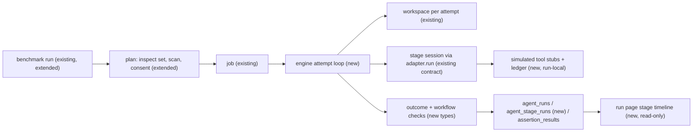

# SPEC-127 — Repository workflow benchmarks and skill chains (S3, D02)

## 1. Summary

A skill author whose agent work is a **workflow** (several skills and instructions handing work
to one another across stages, with a human approval in between and effects on outside services)
can, after this feature, benchmark that workflow as a whole: a pinned repository snapshot, a set
of registry artifact versions installed together, user-defined stages with handoffs and scripted
approval decisions, simulated outside services, and checks on both the **final outcome** and the
**way it was reached**. Two variants that differ in exactly one artifact version are compared
under the RED/GREEN protocol of [SPEC-112](2026-10-14-red-green-evaluation.md), as in S1.

This is a **design for future behaviour**. Nothing here is implemented; today DirectiveBench runs
one agent session per case, installs exactly one artifact, refuses agent configuration in
fixtures ([SPEC-118](2026-10-22-benchmark-own-skills-s1.md) FR-118-06) and has no notion of a
stage, a handoff, an approval inside a run or a simulated outside service. S1 does **not**
support full workflows, and this spec does not change S1.

The design is generic (AGENTS.md §7). An issue-to-spec-to-PR pipeline (D02's example) is one
workflow users can build with it; §8.7 checks the design against a neutral reference scenario,
and nothing in the format names a tracker, a skill family or a document type.

## 2. Motivation and problem statement

- The maintainer decided that benchmarking covers single skills **and chains of skills** that
  hand work to each other ([D02](research/decisions/D02-single-skills-and-chains.md)); the
  product brief places chains in Later/S3 and says they need their own spec. On 2026-10-23 the
  maintainer asked whether DirectiveBench can evaluate the entire workflow of a repository rather
  than one isolated artifact (issue #124).
- What exists cannot express a workflow:
  - **One artifact per run.** S1 installs the candidate (or the baseline) alone; a chain needs
    several skills and instruction files present at once, and a fair comparison needs all but one
    of them held fixed.
  - **Independent cases.** Each case starts from a fresh copy of its fixture; nothing a case
    produces reaches the next one. A workflow's stage 2 starts from what stage 1 left.
  - **No approval inside the run.** `--approve-commands` approves a suite version's commands
    before the run (FR-118-33); it does not model a person approving or rejecting a plan halfway
    through, nor what the agent does after a rejection.
  - **No outside services.** Real workflows open tickets, comment and request reviews. A
    benchmark must never do that for real (issue #124 non-goal), and S1 offers either no shell or
    an unconfined shell (`edit-and-shell`) that can reach real services with the user's
    credentials.
  - **Outcome-only grading.** S1 grades files the agent left. Whether the right skill handled a
    step, whether a prohibited step happened, the order of steps and the behaviour after a denial
    are invisible to file assertions.
- Evidence limits: one account (the maintainer's); no user has run a chain benchmark; whether
  chain verdicts predict real-project outcomes is A03/Q05 and is not addressed here.

## 3. Goals

- G1: Define a **workflow case**: a pinned repository snapshot, an **instruction set** (several
  artifact versions installed together), ordered **stages** with **handoffs**, **gates** with
  scripted decisions, optional **simulated tools**, and checks.
- G2: Grade **outcome checks** (the final workspace) and **workflow checks** (invoked skills,
  required and prohibited steps, routing, order, per-stage outputs, behaviour after a denial or an
  interruption) separately and visibly, with one combined score per attempt for the verdict.
- G3: Keep comparisons fair: both variants run the same snapshot, stages, decisions, simulated
  tool scripts and agent profile, and differ only in the declared **varying member** of the
  instruction set.
- G4: Never perform a real outside write, never run imported repository scripts or configuration
  automatically, and keep execution behind explicit consent, as S1 does.
- G5: Be testable end to end without credentials: the deterministic mock agent and the fake
  `claude` drive every stage, gate and simulated tool in CI.
- G6: Record provenance per stage (session metadata, trace, changed files, handoff, decision,
  simulated calls) so a person can see where a workflow went wrong.

## 4. Non-goals

- Implementing the runner in this change; this PR delivers the design and a backlog proposal.
- Relaxing any S1 safety rule: FR-118-06 (no agent configuration in fixtures), FR-118-26/27
  (bundle inspection, import scan), the env allowlist and execution approval stay as they are and
  apply to every stage.
- Real issue, PR, chat or e-mail writes during a benchmark, also "just to a test repository".
- Reproducing a repository's own agent configuration (project settings, hooks, MCP servers,
  plugins). Vetted fixture configuration stays future work (SPEC-118 §19).
- Live human approval during a run. Decisions are scripted per case.
- Parallel stages, loops, or agent-spawned subagents as stages. Stages run one after another and
  each runs at most once per attempt.
- Resuming a conversation between stages (`--resume`, shared context). Each stage is a new
  session; state crosses through the workspace only.
- Interrupting a session at an arbitrary moment (non-deterministic). Interruption is modelled at
  stage boundaries (§6.4).
- LLM-judge grading (S3, separate work), Codex and Cursor adapters, `docker`, a cloud service.
- Changing D08's priority: S1 work stays first; this spec is planning input for S3.
- Solving D03/Q05.

## 5. User stories

- US-127-01: As a skill author, I describe a workflow of four stages over a snapshot of my
  repository, with my triage skill, my planning skill and the repository's `AGENTS.md` installed
  together, and run it against two versions of the planning skill.
- US-127-02: As a skill author, I script a gate after the planning stage as "approve" in one case
  and "deny with this reason" in another, and check that after a denial no change is published
  and the plan is revised.
- US-127-03: As a skill author, I declare a simulated tool `ticketctl` whose calls are recorded
  and answered from a script, and check that a review was requested exactly once and only after
  approval.
- US-127-04: As a skill author, I check that the triage stage invoked my triage skill and that no
  other skill outside the set ran.
- US-127-05: As a skill author, I see per attempt which stages ran, what each changed and handed
  over, the gate decisions, the simulated calls, and which outcome and workflow checks failed.
- US-127-06: As a user, before the run I am told how many agent sessions will start (stages ×
  cases × repetitions × 2), which tools are simulated, and that nothing is sandboxed.

## 6. Functional requirements

### 6.1 Workflow case and instruction set

| ID | Requirement |
| --- | --- |
| FR-127-01 | A suite document with `schemaVersion: 2` MAY contain **workflow cases**. A workflow case has `workflow` instead of `prompt`; a case with both or neither is invalid. Every v1 document stays valid: `loadDefinition` migrates v1 to v2 by a pure, tested step (SPEC-108 §8.4) that leaves single-prompt cases unchanged. A v1 case is semantically a one-stage workflow without gates (§8.1), and all existing behaviour, keys and results stay byte-identical. |
| FR-127-02 | A workflow suite SHALL declare an **instruction set**: an ordered list of members, each a registry artifact reference (artifact id plus version selector, resolved and pinned at plan time). Exactly one member is the **varying member**; its version is the candidate, and the run's baseline is either another version of the same artifact or `none` (the member absent), as in FR-118-10/12. All other members are **fixed** and installed identically in both variants. |
| FR-127-03 | Every member SHALL pass the S1 inspections before any job: bundle inspection (FR-118-26), import scan at its install path (FR-118-27), reserved-name check (FR-118-08). Two members resolving to the same skill name or the same install path are refused (`instruction-set-conflict`). Members are scanned registry artifacts of the types S1 can install (`skill-md`, `claude-md`, `agents-md`, `claude-rule`), each at its SPEC-203 §4.1 install path; instruction files enter the registry through the ordinary repository scan, like skills. When a member's install path already exists in the fixture, the engine **removes that file from the attempt's workspace copy before installing the variant** and records it (`member-replaces-snapshot-file`, shown in the plan), so the variant, not the snapshot, controls that file; the fixture itself is never changed. In a `none` baseline the path is therefore absent, which is what the comparison measures. |
| FR-127-03a | The reserved-name check session of an A/B run (FR-118-08, [ADR-0015](../decisions/0015-reserved-name-check-session-for-ab-runs.md)) runs once per benchmark run, before the first attempt, with the fixed members installed and the varying member absent, using the first stage's argv; it is never scored. A listed `<name>` of the varying member, or a fixed member skill's name listed more than once, stops the run with `skill-name-reserved`, as in S1. |
| FR-127-04 | For a `claude-code` stage, `Skill(<name>)` and `Skill(<name> *)` SHALL be allowed for every installed member skill (FR-118-08 extended to the set). A skill outside the set that runs makes the benchmark run `not-comparable` (`other-skill-invoked`), unchanged from S1. |

### 6.2 Snapshot

| ID | Requirement |
| --- | --- |
| FR-127-05 | A workflow case's starting state is a **fixture folder** (SPEC-108), content-addressed as today. No new runtime source of files is introduced. |
| FR-127-06 | A new CLI command `directivebench benchmark snapshot --repository <id> --commit <sha> --out <dir>` SHALL write the tracked files of a registered local repository at that commit into a fixture folder, read-only (no checkout, no hooks, absolute git, path as cwd, checked top level; [lesson](../lessons/2026-10-19-derive-git-paths-from-cwd-not-redacted-output.md)), and write a `snapshot.json` manifest beside it: repository id, commit, tree hash, file count, bytes, and every **excluded** path with its reason. Agent configuration surfaces named in FR-118-06 are **excluded** (never copied); symlinks leaving the tree and multi-link files are excluded as in SPEC-110 FR-110-03; SPEC-108 fixture limits apply and a larger tree is refused, not truncated. The command runs nothing from the repository. |
| FR-127-07 | When a workflow run uses a fixture that carries a `snapshot.json`, the plan, CLI summary and run page SHALL show the source commit and the line "Repository configuration not reproduced: N paths excluded" when N > 0. A fixture whose content no longer matches the manifest's tree hash is shown as "edited after snapshot", never refused. |

### 6.3 Stages, state and handoffs

| ID | Requirement |
| --- | --- |
| FR-127-08 | A workflow SHALL list 1..`MAX_WORKFLOW_STAGES` (8) **stages**, each with a unique id, a prompt, an optional `timeoutSeconds` (default: the suite's), an optional permission profile (§6.5) and optional routes. Stages form a directed acyclic graph rooted at the first stage; each stage runs at most once per attempt, so an attempt ends after at most 8 sessions. A cycle, an unreachable stage or a route to an unknown stage is a validation error. |
| FR-127-09 | An **attempt** is one execution of a workflow case for one variant and repetition. It gets one fresh workspace (fixture copy, then approved `setup`, then installation of the variant's instruction set). Every stage runs as a **new agent session** in that same workspace; nothing else crosses stages: no conversation, no environment, no process. Per-run directories outside the workspace (`HOME`, temp) are recreated for every stage. |
| FR-127-10 | A stage MAY declare a **handoff file**: a workspace-relative path and a Zod-validated shape (`{ route?: string, … }`, JSON, at most `MAX_HANDOFF_BYTES`, 64 KiB). After the stage, the engine reads it; a missing, oversized or invalid handoff when one is declared ends the attempt with workflow error `handoff-invalid` (recorded, scored 0, the run continues with the next attempt). |
| FR-127-11 | **Routing.** After a stage, the next stage is chosen by, in order: (a) the stage's gate decision (§6.4), else (b) the handoff `route` value matched against the stage's `routes` map, else (c) the stage's `next`, else the attempt ends. A `route` value not in the map ends the attempt with `route-unknown`. The route taken is recorded per stage. Routing is the only control the agent has over the stage graph. |
| FR-127-12 | After every stage the engine SHALL record that stage's changed files relative to the workspace **before the stage**, keep them per stage under SPEC-123's limits, and re-run the S1 pre-spawn checks (FR-118-06 configuration check, FR-118-27 import scan, binary pin, FR-118-26 inspection of installed member paths) before the next stage's session and again after the last stage, before the verification overlay and any `command` outcome assertion. A stage that creates agent configuration or an outside import stops the benchmark run as in FR-118-15. |

### 6.4 Approval gates and interruption

| ID | Requirement |
| --- | --- |
| FR-127-13 | A stage MAY end with a **gate**: an id and a question shown to a person in the real workflow. The gate's decision is **scripted per case** (`approve`, `deny` with an optional reason text, or `interrupt`), never asked at run time. Each decision names the next stage (`onApprove`, `onDeny`, `onInterrupt`, or end). Two cases of one workflow that differ only in their scripted decisions are the normal way to test both paths. A gate only holds back what the stage before it is not allowed to do, so a stage with a gate SHALL declare `mayChange` (workspace-relative globs): the engine adds a **required** workflow check that the stage changed no path outside it (`stage-boundary`). Without it, a planning stage could already edit the source the gate is meant to approve. |
| FR-127-14 | The decision reaches the next stage only through its prompt: the engine appends a fixed, versioned, adapter-independent notice ("The previous step was reviewed: approved." / "…: not approved. Reason: <reason>" / "The previous session was interrupted before it finished its work.") to the next stage's prompt. The notice text and its version are part of the comparability key. No file is written into the workspace for it. A previous stage can still leave text that looks like an approval; that is agent output, not a decision, which is why gates rest on `mayChange` (FR-127-13) and on workflow checks of what happens after the gate. |
| FR-127-15 | `interrupt` is a **resume notice**, not a real interruption: the gated stage did finish, and the engine runs the `onInterrupt` stage next from the workspace as that stage left it, with the interruption notice in its prompt. It tests whether the next session checks existing work before continuing; it does not test recovery from half-written files. Reverting or truncating a stage's changes and mid-session interruption are out of scope (§4, §19). |
| FR-127-16 | Permission requests inside a session are not approvals: under `dontAsk` they are denied and recorded as `permission-denied` (SPEC-203), as in S1. |

### 6.5 Simulated tools and stage permissions

| ID | Requirement |
| --- | --- |
| FR-127-17 | A workflow MAY declare **simulated tools**: a command name (`^[a-z][a-z0-9-]{0,31}$`) and an ordered list of rules `{ argv: TextMatcher[] (per position, prefix match), stdout?, stderr?, exitCode }`, with a default rule (exit 127, "no scripted response"). DirectiveBench generates, per stage, a stub executable for each name in a run-local directory outside the workspace; the stub appends one JSON line per call (stage id, argv, matched rule, timestamp order) to a run-local **call ledger** and answers from the script. Stubs never open a network connection and never execute their arguments. Stub source is DirectiveBench code, not suite content. The stub directory and the ledger live in the run directory outside the workspace, where the `Edit(/**)` rule allows no writes; each stage gets a fresh random nonce embedded in its generated stubs (never in the environment or the prompt), and the engine accepts only ledger lines that carry that stage's nonce, in sequence; any other line, a gap or an unparsable line is `ledger-tampered` (stage `infrastructure-error`, stopping the run as in FR-118-15). The ledger is only as trustworthy as the shell restriction of FR-127-18. |
| FR-127-18 | A stage that may call simulated tools SHALL run under the new permission profile **`edit-and-simulated-tools`**: `edit-only` (SPEC-203 §7) plus `Bash` in `--tools` with `--allowedTools` limited to `Bash(<name>)` and `Bash(<name> *)` for each declared simulated tool, `PATH` starting with the stub directory, and no other shell rule. Under `dontAsk` any other shell command, including an absolute path to a real binary of the same name, is denied and recorded. That Claude Code refuses anything but a plain stub call under these rules (compound commands, `&&`/`||`, pipes, redirection, command substitution, backticks, here-documents, newlines, globs) is an **Assumption — requires validation** by an opt-in live check (AC-12), with a **low prior**: SPEC-118's live check already refuted a similar allow-rule assumption for `Skill` (FR-118-08). Until it passes, the profile is not offered with the `claude-code` adapter, and simulated tools run only with the mock agent. |
| FR-127-19 | A workflow that declares simulated tools SHALL NOT use `edit-and-shell` in any stage (refused at validation, `simulated-tools-with-real-shell`), because an unconfined shell can reach the real service with the user's credentials (subscription mode keeps the real `HOME`; credential stores such as an OS keychain are reachable on `local-process`). Real local commands (tests, builds) in such a workflow run only as approved `setup` commands or `command` assertions, as in S1. |
| FR-127-20 | A stage whose profile is `edit-and-shell` or `edit-and-simulated-tools` needs an execution-approved suite version (FR-118-33); the approval prompt names each stage's profile and each simulated tool. Approval covers the whole workflow (all stages, setup, assertions, simulated tool scripts) and is per suite version. |

### 6.6 Checks

| ID | Requirement |
| --- | --- |
| FR-127-21 | Every assertion SHALL have a **kind**: `outcome` (evaluated once on the final workspace after the last stage and the verification overlay: every existing assertion type) or `workflow` (evaluated on the attempt's recorded stages). An existing assertion inside a stage's `checks` list is a workflow check scoped to that stage's state (§6.6 FR-127-23). Both kinds share weight and `required` semantics (SPEC-111). |
| FR-127-22 | New workflow assertion types: `stage-ran` `{ stage, expect: ran \| not-ran }`; `route-taken` `{ stage, route }`; `skill-invoked` `{ skill, stage?, expect: invoked \| not-invoked, min?, max? }` from `skillActivation`/trace (FR-118-09); `simulated-call` `{ tool, argv?: TextMatcher[], stage?, min?, max? }` (`max: 0` is a prohibited step) from the call ledger; `order` `{ first: EventMatcher, then: EventMatcher }` over the attempt's event sequence (stage starts, skill invocations, simulated calls, gate decisions). |
| FR-127-23 | A stage MAY list `checks`: existing file assertions (`file-exists`, `file-contains`, `changed-files`, the document assertions of SPEC-118 §8.4) evaluated on the workspace **right after that stage**, read-only, before the next stage starts (`changed-files` there compares with the workspace before the stage), and the workflow assertions of FR-127-22 with `stage` implied. `command` assertions are not allowed as stage checks (they could change the state the next stage sees). |
| FR-127-24 | A stage that did not run makes its stage checks `not-evaluated`: a required one fails the attempt (score 0, as a failed required check does in SPEC-111); a non-required one is excluded from **both** the workflow score and the combined score of that attempt, and listed. To require that a stage did not run, use `stage-ran` with `not-ran`. |
| FR-127-24a | `handoff-invalid` and `route-unknown` come from the agent's output, so they are **quality** results: the attempt is `completed` with score 0 and the reason, never `agent-error` or `infrastructure-error`; SPEC-111 gets this rule when implemented. Outcome checks still run on the workspace as left and are shown, but do not change the 0. |
| FR-127-25 | The attempt score is the weighted score of all checks, with the SPEC-111 weights, required gate and pass threshold unchanged; the engine SHALL also store and show an **outcome score** and a **workflow score** per attempt and per variant, so a workflow that reaches the right result the wrong way (or the reverse) is visible. The verdict uses the combined score only. |

### 6.7 Comparison, results and provenance

| ID | Requirement |
| --- | --- |
| FR-127-26 | The comparability key (FR-111-43) SHALL additionally hash, when a suite has workflow cases: the workflow definitions (stages, routes, gates, scripted decisions, simulated tool scripts), the gate-notice version, the stub template version, the handoff schemas, the fixed members' artifact version ids and content hashes, and the install order. In `flagsHash` (FR-118-04) every member's `Skill(<name>)` rule and every stub path is replaced by a placeholder, as the installed skill name already is. Mock-agent and v1 keys stay byte-identical. |
| FR-127-27 | Variants may take different routes and so run different stages. Every session SHALL report the adapter metadata of FR-118-04; across all sessions of both variants `adapterVersion`, `authMode`, `isolationProfile`, `requestedModel` and `executionModel` must be identical, and for each stage id that ran in both variants the permission profile and `flagsHash` must be identical. Any difference makes the run `not-comparable` (`execution-model-mismatch` or `stage-profile-mismatch`). Route and session-count differences between variants are results, shown per variant, not comparability failures. |
| FR-127-28 | Attempts SHALL be interleaved per repetition between variants (SPEC-112 FR-112-05). An infrastructure error in any stage ends the attempt as `infrastructure-error`; the FR-118-15 stop codes stop the whole benchmark run. |
| FR-127-29 | Per stage, results SHALL keep: stage id, order, status, session metadata, trace, usage, changed files (SPEC-123 limits), handoff content (redacted, bounded), gate decision and route taken, simulated calls; per attempt: event sequence, outcome score, workflow score, combined score. |
| FR-127-30 | The run page (read-only) SHALL show per attempt a stage timeline (stage, status, route, decision, calls, changed-file count) and outcome and workflow check results in separate groups; stage traces, handoffs and ledger argv are untrusted text, escaped (SPEC-014). |
| FR-127-31 | `benchmark run` SHALL print, before confirmation, the plan of FR-118-31 plus: the instruction set (fixed members and varying member with candidate and baseline), the stages and gates per case with scripted decisions, the number of agent sessions (sum over cases of stages that can run × repetitions × 2, as an upper bound), the simulated tools with the line "Simulated: no real service is called by these names", and "Not sandboxed". Running needs the same confirmation as S1 (FR-118-32). |

## 7. Non-functional requirements

- NFR-127-01: No paid or authenticated call in `pnpm test`; every stage, gate, route and
  simulated call is covered with the mock agent and the fake `claude` (NFR-118-01).
- NFR-127-02: Engine overhead per stage < 2 s excluding the agent (NFR-107-01); per-stage file
  diff and pre-spawn checks reuse the S1 scanners and their named limits.
- NFR-127-03: 100% unit coverage of new logic; Playwright for the stage timeline (AGENTS.md §2.7).
- NFR-127-04: Linux and macOS; Windows best effort (stubs are generated per platform; a
  Windows-only branch is marked per AGENTS.md §2.7).
- NFR-127-05: Local-first: no service, account or network access is required beyond the agent
  adapter's own.

## 8. Domain entities and contracts

### 8.1 Definition shape (v2 additions)

```ts
// packages/benchmark-engine/src/definition.ts (proposed; Zod-validated, strict)
interface BenchmarkDefinitionV2 extends Omit<BenchmarkDefinitionV1, 'schemaVersion' | 'cases'> {
  schemaVersion: 2;
  instructionSet?: {                          // required when any case has `workflow`
    members: { artifact: string; version?: string /* default latest */; varying?: true }[]; // exactly one varying
  };
  cases: (BenchmarkCaseV1 | WorkflowCase)[];
}

interface WorkflowCase extends Omit<BenchmarkCaseV1, 'prompt'> {
  workflow: {
    stages: Stage[];                          // 1..8, DAG from stages[0]
    simulatedTools?: SimulatedTool[];         // ≤ 8 tools, ≤ 50 rules each
  };
  decisions?: Record<string /* gate id */, { decision: 'approve' } | { decision: 'deny'; reason?: string } | { decision: 'interrupt' }>;
  // `assertions` (inherited) are outcome checks unless `kind: 'workflow'`
}

interface Stage {
  id: string;
  prompt: string;
  timeoutSeconds?: number;
  permissionProfile?: 'edit-only' | 'edit-and-shell' | 'edit-and-simulated-tools'; // default edit-only
  handoff?: { path: string; schema?: 'route-only' | 'json-object' };
  next?: string;
  routes?: Record<string, string>;            // handoff.route value -> stage id
  gate?: { id: string; question: string; onApprove?: string; onDeny?: string; onInterrupt?: string };
  mayChange?: string[];                       // globs; required when `gate` is set (FR-127-13)
  checks?: AssertionDefinition[];             // file and workflow assertions, no `command` (FR-127-23)
}

interface SimulatedTool {
  name: string;
  rules: { argv: TextMatcher[]; stdout?: string; stderr?: string; exitCode: number }[];
}

type EventMatcher =
  | { stage: string; event: 'started' }
  | { skill: string }
  | { tool: string; argv?: TextMatcher[] }
  | { gate: string; decision?: 'approve' | 'deny' | 'interrupt' };
```

Every gate id used in a stage must have a decision in every case of that workflow (validation
error otherwise), so no run depends on a default decision.

### 8.2 Data model (proposed)

| Change | Purpose |
| --- | --- |
| `agent_runs` keeps one row per attempt (case × variant × repetition) with the combined score; gains `outcome_score` and `workflow_score` (nullable real; null for v1 cases). | Attempt-level scoring stays where SPEC-111 reads it. |
| New `agent_stage_runs` (`id`, `agent_run_id` FK cascade, `stage_id`, `stage_order`, `execution_status`, `permission_profile`, `duration_ms`, `trace` json, `usage` json, `changed_files` json, `handoff` json nullable, `gate_decision` nullable, `route_taken` nullable, `simulated_calls` json, `error`). | Per-stage provenance (FR-127-29). |
| `agent_run_files` gains nullable `agent_stage_run_id`. | SPEC-123 file capture per stage. |
| New `benchmark_run_members` (`benchmark_run_id` FK, `artifact_version_id` FK, `role` `fixed \| candidate \| baseline`, `install_order`). | Instruction-set provenance; candidate/baseline columns on `benchmark_runs` stay the source for S1 surfaces. |
| `assertion_results` gains `kind` (`outcome \| workflow`, default `outcome`) and nullable `agent_stage_run_id`. | Separate display and stage-scoped checks. |

Migrations are additive; every SQL statement must pass on Node 22.16's SQLite (AGENTS.md §2.13).
No sensitive data is added beyond what S1 stores; handoffs, ledger argv and stage traces are
redacted (`@directivebench/core` redaction) and bounded before storage.

### 8.3 Engine contract

`runBenchmark` gains an attempt loop for workflow cases; the adapter contract is unchanged: one
`run()` call is one stage session, given the stage prompt (plus gate notice), the workspace, the
stage permission profile and the simulated-tool stub directory. The mock agent's playbook
(`agentOptions.mock`, SPEC-108 §8.3) gains a per-stage form (`stages: { <stageId>: actions }`)
whose actions can write files, write the handoff, record a skill invocation and call a simulated
tool, so every path is deterministic in tests.

### 8.4 Reference scenario (design check, not a target)

A small library repository snapshot with a defect described in `tickets/T-1.md`; instruction
set: a triage skill, a planning skill (varying member), an implementation skill and the
repository's `AGENTS.md` as a fixed instruction member; simulated tool `ticketctl`.

| Stage | Profile | Routing | Gate | `mayChange` | Stage checks |
| --- | --- | --- | --- | --- | --- |
| `triage` | edit-only | handoff `triage.json`, `routes: { fix: plan, wont-fix: close }` | none | `triage.json` | `skill-invoked { skill: triage }` |
| `plan` | edit-only | from gate | `plan-approval`: approve → `implement`, deny → `revise`, interrupt → `plan-resume` | `plan.md` | `file-exists plan.md`; `markdown-sections plan.md [Approach, Tests]` |
| `revise` | edit-only | end | none | `plan.md` | `changed-files { allowed: [plan.md] }` |
| `plan-resume` | edit-only | `next: implement` | none | `plan.md` | `markdown-sections plan.md [Approach, Tests]` |
| `implement` | edit-and-simulated-tools | end | none | n/a | `simulated-call { tool: ticketctl, argv: [review-request], min: 1, max: 1 }` |
| `close` | edit-and-simulated-tools | end | none | n/a | `simulated-call { tool: ticketctl, argv: [comment], min: 1 }`; `changed-files { allowed: [] }` |

Cases (same workflow, different scripted decisions or fixture):

- `approve`: decision approve. Outcome: `file-exists` of a new test file and a `command` assertion
  running the project's test command (execution-approved). Workflow: `stage-ran revise not-ran`.
- `deny`: decision deny ("Plan skips the regression test"). Workflow: `stage-ran implement
  not-ran`, `simulated-call { tool: ticketctl, max: 0 }`.
- `interrupt`: decision interrupt. Workflow: `order { first: { stage: plan-resume, event:
  started }, then: { tool: ticketctl, argv: [review-request] } }`.
- `wont-fix`: a fixture whose ticket describes intended behaviour. Workflow: `route-taken {
  stage: triage, route: wont-fix }`, `stage-ran plan not-ran`.

The scenario touches every FR family (set, snapshot, stages, handoff routing, gate with all
three decisions, simulated tools, both check kinds). An issue-to-spec-to-PR chain is the same
structure with other names; nothing in it is special to that chain.

## 9. Data flow



The engine owns the stage loop; adapters stay one-session-per-call, so a second adapter gets
workflows without new adapter code beyond its permission mapping.

## 10. API and interface design

- `directivebench benchmark run <suite> --artifact <varying-artifact> [--baseline none|v<n>]`:
  unchanged flags; the suite's `instructionSet` supplies fixed members. `--artifact` must name
  the varying member (refused otherwise, `artifact-not-varying-member`).
- `directivebench benchmark snapshot --repository <id> --commit <sha> --out <dir> [--json]`
  (FR-127-06). Exit 2 on refusal; never overwrites a non-empty `--out`.
- `directivebench benchmark init --workflow` scaffolds a two-stage workflow suite with one gate
  and two cases (approve, deny).
- Package APIs: `loadDefinition` (v1→v2 migration), `validateWorkflow` (DAG, routes, decisions),
  `planWorkflowSessions`, `evaluateWorkflowChecks(events, ledger, stageStates)`, all pure and
  unit-tested.

## 11. UI/UX considerations

Read-only additions to the existing run detail page: per attempt a stage timeline (ordered
list, not a graph), each row showing stage, status badge, route, gate decision, simulated-call
count and changed-file count, expandable to trace, handoff and ledger. Outcome checks and
workflow checks are separate groups with their own scores. Empty state for v1 runs: the timeline
is not shown. Labels: "Simulated tool", "Scripted decision: denied", "Repository configuration not
reproduced". Copy follows AGENTS.md §7 (no en/em dashes, missing values in words). Running from
the UI stays S2. No mockups are attached: the UI part is a small extension of an existing page and
will be designed with the design system when Phase 4 starts.

## 12. Security considerations

- **No new trust in imported content.** Snapshots exclude agent configuration (FR-127-06);
  members are inspected (FR-127-03); setup and assertion commands need approval; the workflow
  file is suite content and runs nothing by itself.
- **Pre-spawn checks per stage.** A stage can create configuration or imports for the next one;
  FR-127-12 re-checks before each session ([lesson](../lessons/2026-10-22-everything-setup-can-reach-reaches-the-agent.md): what setup can reach,
  the agent reaches).
- **Outside writes.** Simulated tools replace real ones by name only under
  `edit-and-simulated-tools`, which is meant to allow no other shell command (an assumption
  until the live check AC-12 passes); mixing them with
  `edit-and-shell` is refused (FR-127-19). Residual: on `local-process` the agent's file tools
  and Claude Code itself still reach the network as in S1; the guarantee is "no shell command
  other than the stubs", proven by the live check, not a sandbox. Labelled "Not sandboxed".
- **Stub hygiene.** Stubs are generated from a fixed template, receive argv only, write only the
  ledger, run with the env allowlist and are removed with the run directory.
- **Gate notices** are fixed text plus the case's reason string (suite content, shown in the plan
  before consent); no workspace file carries decisions, so the agent cannot forge one.
- **Bounded work.** 8 stages, 8 tools × 50 rules, 64 KiB handoffs, per-stage timeouts, and the S1
  output limits; all named constants.

## 13. Error handling

| Code | When | Effect |
| --- | --- | --- |
| `workflow-invalid` | cycle, unreachable stage, unknown route target, gate without decision | exit 2 at validation, nothing stored |
| `instruction-set-conflict` | FR-127-03 | exit 2 before any job |
| `member-replaces-snapshot-file` | FR-127-03 | notice in the plan and on the run; not an error |
| `stage-boundary` | FR-127-13: a gated stage changed a path outside `mayChange` | required workflow check fails, attempt scores 0 |
| `ledger-tampered` | FR-127-17 | stage `infrastructure-error`, benchmark run stops |
| `simulated-tools-with-real-shell` | FR-127-19 | exit 2 at validation |
| `artifact-not-varying-member` | `--artifact` is a fixed member | exit 2 |
| `handoff-invalid`, `route-unknown` | FR-127-10/11 | attempt scored 0 with reason, run continues |
| `stage-profile-mismatch` | FR-127-27 | run `not-comparable` |
| FR-118-15 stop codes in any stage | as S1 | benchmark run `error`, remaining attempts not run |
| `snapshot-too-large`, `snapshot-commit-unknown` | FR-127-06 | exit 2, `--out` untouched |

## 14. Edge cases

- A stage writes the handoff file of a later stage: allowed; only the declared stage's handoff is
  read after that stage.
- The agent edits a member's installed files: recorded as changed files; the next stage sees the
  edit; the pre-spawn bundle check (FR-118-26 on installed paths) runs again before each stage.
- A `deny` reason contains text resembling instructions: it is suite content the user wrote and
  saw in the plan; shown escaped.
- A route leads to a stage whose gate has no decision in this case: validation error (§8.1).
- The varying member is `none` in the baseline and a fixed member's skill invokes it: the
  invocation is denied (not installed) and recorded; checks decide whether that matters.
- All attempts end `handoff-invalid` for one variant: valid quality data (score 0), not an error;
  the summary names the reason count.
- Simulated tool name equals a built-in shell command (`cd`, `echo`): refused at validation
  (reserved list), because `Bash(<name> *)` would allow it.

## 15. Testing strategy

- Pure unit tests: v1→v2 migration, workflow validation (every refusal), routing table, gate
  notice text, event-sequence building, every workflow assertion, comparability key (v1 keys
  unchanged), session upper bound.
- Engine integration with the mock agent's per-stage playbook: approve, deny, interrupt, route,
  invalid handoff, stage creating `.claude/`, stage infrastructure error, interleaving.
- Stub generator: ledger content, default rule, argv passing without shell interpretation,
  concurrency of two attempts not sharing ledgers.
- Adapter tests with the fake `claude`: `edit-and-simulated-tools` argv, PATH order, metadata per
  stage, profile mismatch.
- Opt-in live check (AC-12), never in CI.
- Playwright: stage timeline on a mock workflow run; both themes; 320 px.

## 16. Acceptance criteria

- [ ] AC-1: A v1 suite runs with byte-identical comparability keys and results before and after
  the change.
- [ ] AC-2: The reference scenario (§8.4) runs end to end with the mock agent in `pnpm test`.
  With a playbook that behaves as intended, every check of every case passes and the stages run
  are exactly: `approve` triage, plan, implement; `deny` triage, plan, revise; `interrupt`
  triage, plan, plan-resume, implement; `wont-fix` triage, close. With a playbook that edits
  source during `plan`, `stage-boundary` fails and the attempt scores 0.
- [ ] AC-3: Invalid workflows (cycle, unreachable stage, missing decision, unknown route,
  simulated tools with `edit-and-shell`, reserved tool name) are refused before any job.
- [ ] AC-4: Two variants differing only in the varying member compare. Each of these changes
  yields a different comparability key (unit test per item): a fixed member's version, install
  order, a stage prompt, a route, a scripted decision or reason, a simulated tool rule, the
  gate-notice version, the stub template version, a handoff schema. Each of these yields
  `not-comparable` with the named code: a different `executionModel` in one session
  (`execution-model-mismatch`), a different permission profile for a stage that ran in both
  variants (`stage-profile-mismatch`). Variants taking different routes stay comparable.
- [ ] AC-5: A `deny` decision reaches only the next stage's prompt, and a `simulated-call max 0`
  check fails when the mock agent calls the tool after denial.
- [ ] AC-6: A stage that writes `.claude/settings.json` stops the benchmark run with
  `workspace-contains-claude-config`, and one that writes an `@` import of an existing outside
  file stops it with `workspace-imports-outside`, before the next session and, after the last
  stage, before any `command` outcome assertion runs. A forged or out-of-sequence ledger line
  stops it with `ledger-tampered`.
- [ ] AC-7: Every simulated call is in the ledger and in the stage results; the stub never
  executes its arguments (test with shell metacharacters).
- [ ] AC-8: Outcome score, workflow score and combined score are stored and shown separately.
- [ ] AC-9: `benchmark snapshot` writes tracked files at a commit, excludes configuration paths
  with reasons in `snapshot.json`, runs no repository code, and refuses a too-large tree.
- [ ] AC-10: The plan prints set, stages, decisions, simulated tools, session upper bound and
  "Not sandboxed" before confirmation.
- [ ] AC-11: The run page shows the stage timeline and separate check groups (Playwright).
- [ ] AC-12: Opt-in live check with the production argv: under `edit-and-simulated-tools`,
  each of these is denied and leaves no side effect: `<stub> x; <other>`, `<stub> x && <other>`,
  `<stub> x || <other>`, `<stub> x | <other>`, `<stub> x > file` and `> ../outside`,
  `<stub> $(<other>)`, backtick substitution, a here-document, a newline-separated second command,
  a glob argument expanding to host paths, an absolute path to a same-named real binary and
  `env <name>`; a plain `<stub> args` call is allowed and recorded with the right nonce. Until this passes, the profile is not
  offered for `claude-code` (FR-127-18).

## 17. Dependencies

- SPEC-118 (S1) shipped behaviour: adapter, inspections, consent, A/B, comparability; this spec
  extends it and must not start before the maintainer schedules S3 (D08).
- SPEC-123 output-file capture, extended per stage.
- [ADR-0005](../decisions/0005-custom-benchmark-engine.md) (the engine owns orchestration, so the
  stage loop lives in `packages/benchmark-engine`), [ADR-0007](../decisions/0007-local-runner-execution-and-isolation.md)
  (`local-process` is not a sandbox; commands only from approved suites; never auto-run imported
  scripts), [ADR-0015](../decisions/0015-reserved-name-check-session-for-ab-runs.md) (reserved-name
  check, FR-127-03a).
- SPEC-108 format versioning (§8.4), SPEC-111 scoring and key, SPEC-112 protocol, SPEC-203
  permission profiles (new profile added there when implemented).
- No new dependency is needed.

## 18. Open questions

Resolved with autonomous defaults below; each must be confirmed or changed by the maintainer
(owner: Mateusz Minkiewicz) **before implementation starts**. Merging this draft does not approve
them.

## Resolved assumptions (autonomous defaults)

| # | Question | Applied default | Why | Confirm? |
| --- | --- | --- | --- | --- |
| Q1 | One agent session for the whole workflow, or one per stage? | One new session per stage in one shared workspace; no conversation resume. | Reuses the one-session adapter contract, makes per-stage provenance and checks possible, and state crossing only through files is observable and fair. A single session hides stage boundaries; resume adds adapter surface. | reversible |
| Q2 | How do variants differ in an instruction set? | Exactly one varying member (candidate vs another version or `none`); all others fixed. | Keeps verdicts attributable to one artifact, matching S1's A/B semantics; whole-set comparisons can come later. | reversible |
| Q3 | Where does the pinned repository come from at run time? | Always a fixture folder; a separate `benchmark snapshot` command writes one from a registered repository at a commit, excluding agent configuration and recording exclusions. | No new runtime file source, no relaxation of FR-118-06, the pinned files are versioned with the suite. | reversible |
| Q4 | How are human approvals modelled? | Gates at stage boundaries with scripted per-case decisions (approve, deny with reason, interrupt) delivered as a fixed notice in the next stage's prompt. | Deterministic and comparable; live approvals would make runs unrepeatable, and print mode has no in-session approval. | reversible |
| Q5 | How are outside effects simulated safely? | Generated stub commands with scripted answers and a call ledger, allowed only under a new `edit-and-simulated-tools` profile that permits no other shell command; never combined with `edit-and-shell`. Offered for `claude-code` only after the live check AC-12 passes. | Lets unchanged skills call their usual command names without real writes. It adds a new execution profile whose safety rests on Claude Code's Bash rule matching, which is unverified. | ⚠ NEEDS HUMAN CONFIRMATION |
| Q6 | Split into separate specs (instruction sets; staged workflows; simulated tools; snapshot command)? | One spec, delivered in phases; Phase 1 (sets + stages on the mock agent) is independently shippable. | The pieces share one format, one key and one results model. The fresh-context review recommended splitting out simulated tools with their profile (it needs an ADR and a live check) and the snapshot command (no shared runtime); the maintainer should choose. | reversible |
| Q7 | Format change: additive v1 fields or `schemaVersion: 2`? | `schemaVersion: 2` with a pure v1→v2 migration. | A `workflow` case is not a v1 case; an explicit version stops an older DirectiveBench from misreading a workflow suite. | reversible |
| Q8 | Does this change D08's order? | No. S1 stays first; S3 work starts only when the maintainer schedules it. | Issue non-goal; changing priority needs a maintainer decision. | reversible |

## Decisions in play

- Relies on D02 (single skills and chains, active), D04 (repositories are the source), D08 (S1
  first; S3 later) and D09 (a suite must discriminate before version verdicts count; applies to
  workflow suites unchanged: a `none` run of the varying member comes first).
- Supersedes none. Q5 introduces a new execution profile; when confirmed it needs an ADR (owner:
  maintainer) because it widens the agent's tool surface relative to `edit-only`.

## 19. Future extensions

- Whole-set comparisons (several varying members) with ablation (SPEC-112 §19).
- Vetted repository configuration (SPEC-118 §19), so workflows run inside a project's own setup.
- Mid-session interruption, live approvals in an interactive mode, parallel stages and loops.
- A DirectiveBench-authored MCP server as an alternative simulated-service surface.
- LLM-judge workflow checks (rubric over handoffs); Codex/Cursor stage adapters; `docker`
  network isolation as a stronger guarantee than FR-127-18.
- Running workflows from the UI (S2 builder).

## 20. Implementation status

- **Implemented:** nothing. This is a design.
- **Partially implemented:** none. Existing S1 pieces (adapter, inspections, A/B, SPEC-123
  capture) are reused but do not provide any workflow behaviour.
- **Not implemented:** everything in §6–§16.

## 21. Phasing and implementation plan

Each phase is independently shippable and leaves the app working. Phases 1 and 2 need no real
agent. Nothing starts before the maintainer confirms the resolved assumptions and schedules S3.

### Phase 0: Decisions (maintainer)

1. Confirm or change Q1–Q8; record the outcome as a decision (proposed id D10) in the product brief and, for
   Q5, an ADR.

### Phase 1: Format and instruction sets (mock agent)

1. `schemaVersion: 2` schema, v1→v2 migration, workflow validation (FR-127-01, 08, 13, 17
   shape, §8.1); unit tests including byte-identical v1 keys (AC-1, AC-3).
2. Instruction set resolution, inspection and conflicts (FR-127-02–04); `benchmark_run_members`
   migration; plan output for sets.
3. Comparability key extension (FR-127-26) with tests.

### Phase 2: Stage engine and workflow checks (mock agent)

1. Attempt loop: one workspace, one session per stage, per-stage diff and pre-spawn checks
   (FR-127-09, 12); `agent_stage_runs` migration.
2. Handoffs and routing (FR-127-10, 11); gates and notices (FR-127-13–15).
3. Workflow assertions and stage checks; outcome/workflow/combined scores (FR-127-21–25).
4. Mock agent per-stage playbook; reference scenario as an executable example under
   `examples/` (AC-2, AC-5, AC-6, AC-8).

### Phase 3: Simulated tools and Claude Code stages

1. Stub generator and ledger (FR-127-17, AC-7).
2. `edit-and-simulated-tools` profile in the `claude-code` adapter behind the live-check gate;
   fake `claude` tests; refusal rules (FR-127-18–20).
3. CLI plan and consent for workflows (FR-127-31, AC-10); opt-in live check (AC-12), recorded in
   SPEC-203.

### Phase 4: Snapshot and results UI

1. `benchmark snapshot` command and `snapshot.json` provenance display (FR-127-06, 07, AC-9).
2. Run page stage timeline and check groups (FR-127-30, AC-11) with Storybook stories and
   Playwright.

## 22. Proposed backlog (not filed)

Bounded follow-on issues (proposed ids; none exists yet), to be filed with `om-backlog` against this spec only after the
maintainer confirms Phase 0. Ids continue E05 (#14, Later).

| Id | Title | Depends on | Non-goals |
| --- | --- | --- | --- |
| E05-T02 | Decide the workflow benchmark defaults Q1–Q8 (proposed D10) and record an ADR for the simulated-tools profile | — | no implementation |
| E05-S01 | A skill author declares an instruction set and a workflow suite (schema v2, validation, set inspection, key) | E05-T02 | no stage execution |
| E05-S02 | A workflow case runs its stages in one workspace with handoffs, routes and scripted gates on the mock agent | E05-S01 | no real agent, no simulated tools |
| E05-S03 | A skill author grades workflow checks and sees outcome and workflow scores separately | E05-S02 | no UI timeline |
| E05-S04 | Simulated tools record calls and answer from a script, without a real shell | E05-S02, E05-T02 | no MCP surface |
| E05-S05 | Claude Code runs workflow stages under the simulated-tools profile after the live check | E05-S03, E05-S04, S1 (#93) | no `edit-and-shell` mix |
| E05-S06 | A skill author snapshots a registered repository at a commit into a fixture | E05-T02 | no config reproduction, no remote fetch |
| E05-S07 | The run page shows a stage timeline per attempt | E05-S03 | no running from the UI |
