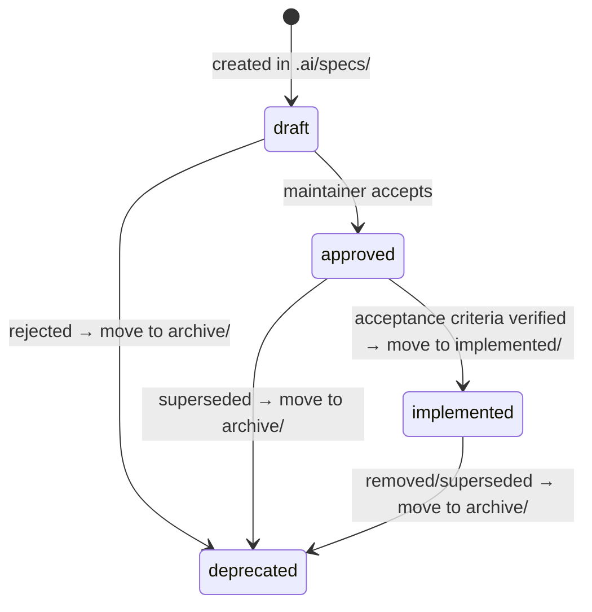

# DirectiveBench specifications

`.ai/specs/` is the canonical source of truth for **what** DirectiveBench must do: product
requirements, architecture, features and integrations. It is used for spec-driven development
(SDD): significant work starts from a specification, and the code implements it.

- **Specs** (`.ai/specs/`) say *what* the system must do.
- **ADRs** ([`../decisions/`](../decisions/README.md)) record *why* a decision was made.
- **Run logs** ([`../runs/`](../runs/README.md)) record *what an autonomous AI run did*.
- **Lessons** ([`../lessons.md`](../lessons.md)) keep durable findings for future work.
- **Code** is *how*. When code and an approved spec disagree, fix one of them in the same change.

The mandatory workflow for AI agents is defined in [`AGENTS.md`](../../AGENTS.md).

## Directory layout

```text
.ai/specs/
├── README.md                 # this index
├── YYYY-MM-DD-slug.md        # active specs: status draft or approved
├── product-brief.md          # product brief (om-discover; fixed name, see AGENTS.md §1)
├── backlog.md                # backlog record (om-backlog; fixed name)
├── research/                 # discovery interviews, decisions and capture templates
├── briefs/                   # handoff briefs from om-brainstorm (YYYY-MM-DD-slug.md), committed with their spec
├── implemented/              # specs whose acceptance criteria are verified in code and tests
└── archive/                  # deprecated or superseded specs (kept for history)
```

Templates live in [`../templates/`](../templates/).

## Naming

- File name: `YYYY-MM-DD-slug.md`. The date is the day the spec was **created** and never
  changes; `slug` is lowercase kebab-case and unique.
- Integration specs use the slug prefix `integration-` (e.g. `2026-10-14-integration-gitlab.md`).
- A file keeps its name when it moves to `implemented/` or `archive/`.
- Every spec has YAML frontmatter:

  ```yaml
  id: SPEC-123            # stable identifier, never reused (see ID ranges below)
  title: Benchmark Engine
  status: draft           # draft | approved | implemented | deprecated
  created: YYYY-MM-DD     # same date as the file name
  updated: YYYY-MM-DD
  category: feature       # foundation | feature | integration
  related: [SPEC-110]
  ```

- ID ranges: `SPEC-001…099` foundation, `SPEC-101…199` features, `SPEC-201…299` integrations.
  Use the next free number in the range; IDs are never renumbered or reused.

## Lifecycle and statuses



| Status | Location | Meaning |
| --- | --- | --- |
| `draft` | `.ai/specs/` | Proposed or under development; may change freely. Proposals for major features are drafts. |
| `approved` | `.ai/specs/` | Accepted by a maintainer. Not necessarily implemented. Agents must not contradict it. |
| `implemented` | `.ai/specs/implemented/` | Every acceptance criterion is implemented **and verified** by tests or documented checks. Interfaces or placeholder pages do not count. |
| `deprecated` | `.ai/specs/archive/` | No longer active. Add a note pointing to the replacement. |

Agents never set `approved` on their own; approval is a maintainer decision.

## Creating a spec

1. Copy a template from [`../templates/`](../templates/) (`feature-spec`, `integration-spec`
   or `proposal` for an early-stage major feature).
2. Save it as `.ai/specs/<today>-<slug>.md`, fill in the frontmatter with the next free ID and
   `status: draft`.
3. Add it to the index below in the same change.
4. Reference other specs and ADRs with relative links instead of duplicating content.

## Updating a spec

- Keep the file name and `id`; bump `updated`.
- Change the **Implementation status** section only after the behaviour has been verified.
- Moving to `implemented/` or `archive/`: `git mv` the file, update `status`, update this index
  and fix relative links (`../` prefixes change by one level).
- Significant design changes also need an ADR in [`../decisions/`](../decisions/README.md).

## Index

Specifications are drafts except SPEC-119 and SPEC-120, implemented and verified on 2026-10-23 and 2026-10-27. They were created on 2026-10-14 during the bootstrap, except
SPEC-014 and SPEC-117 (2026-10-15), SPEC-118 (2026-10-22), SPEC-119 (2026-10-23), SPEC-120 (2026-10-27) and SPEC-121 (2026-10-28).
`implemented/` contains verified specifications; `archive/` is currently empty.

### Foundation

| ID | Specification | Status |
| --- | --- | --- |
| SPEC-001 | [Project Overview](2026-10-14-project-overview.md) | draft |
| SPEC-002 | [Product Requirements](2026-10-14-product-requirements.md) | draft |
| SPEC-003 | [System Architecture](2026-10-14-system-architecture.md) | draft |
| SPEC-004 | [Technology Stack](2026-10-14-technology-stack.md) | draft |
| SPEC-005 | [Domain Model](2026-10-14-domain-model.md) | draft |
| SPEC-006 | [Database Schema](2026-10-14-database-schema.md) | draft |
| SPEC-007 | [Security and Privacy](2026-10-14-security-and-privacy.md) | draft |
| SPEC-008 | [API Architecture](2026-10-14-api-architecture.md) | draft |
| SPEC-009 | [CLI Architecture](2026-10-14-cli-architecture.md) | draft |
| SPEC-010 | [Local Installation](2026-10-14-local-installation.md) | draft |
| SPEC-011 | [Self-Hosting Architecture](2026-10-14-self-hosting-architecture.md) | draft |
| SPEC-012 | [Testing Strategy](2026-10-14-testing-strategy.md) | draft |
| SPEC-013 | [Implementation Roadmap](2026-10-14-implementation-roadmap.md) | draft |
| SPEC-014 | [Engineering Standards](2026-10-15-engineering-standards.md) | draft |

### Features

| ID | Specification | Status |
| --- | --- | --- |
| SPEC-101 | [Artifact Registry](2026-10-14-artifact-registry.md) | draft |
| SPEC-102 | [Artifact Discovery](2026-10-14-artifact-discovery.md) | draft |
| SPEC-103 | [Artifact Versioning](2026-10-14-artifact-versioning.md) | draft |
| SPEC-104 | [Repository Management](2026-10-14-repository-management.md) | draft |
| SPEC-105 | [Repository Synchronization](2026-10-14-repository-synchronization.md) | draft |
| SPEC-106 | [Category Management](2026-10-14-category-management.md) | draft |
| SPEC-107 | [Benchmark Engine](2026-10-14-benchmark-engine.md) | draft |
| SPEC-108 | [Benchmark Definition Format](2026-10-14-benchmark-definition-format.md) | draft |
| SPEC-109 | [Benchmark Builder](2026-10-14-benchmark-builder.md) | draft |
| SPEC-110 | [Benchmark Execution](2026-10-14-benchmark-execution.md) | draft |
| SPEC-111 | [Benchmark Scoring](2026-10-14-benchmark-scoring.md) | draft |
| SPEC-112 | [RED/GREEN Evaluation](2026-10-14-red-green-evaluation.md) | draft |
| SPEC-113 | [Results and Reporting](2026-10-14-results-and-reporting.md) | draft |
| SPEC-114 | [Runner Management](2026-10-14-runner-management.md) | draft |
| SPEC-115 | [Settings and Configuration](2026-10-14-settings-and-configuration.md) | draft |
| SPEC-116 | [Dashboard and Navigation](2026-10-14-dashboard-and-navigation.md) | draft |
| SPEC-117 | [Optional PostgreSQL Backend](2026-10-15-postgresql-backend.md) | draft |
| SPEC-118 | [Benchmark own skills with Claude Code against registry artifacts (S1)](2026-10-22-benchmark-own-skills-s1.md) | draft |
| SPEC-119 | [Shadcn preset design system](implemented/2026-10-23-shadcn-design-system.md) | implemented |
| SPEC-120 | [Three-layer design tokens](implemented/2026-10-27-design-tokens.md) | implemented |
| SPEC-121 | [Design-token migration and design-system guard in CI](2026-10-28-design-token-migration-and-guard.md) | draft |

### Integrations

| ID | Specification | Status |
| --- | --- | --- |
| SPEC-201 | [GitHub repository integration](2026-10-14-integration-github.md) | draft |
| SPEC-202 | [GitLab repository integration (GitLab.com and self-managed)](2026-10-14-integration-gitlab.md) | draft |
| SPEC-203 | [Claude Code agent adapter](2026-10-14-integration-claude-code.md) | draft |
| SPEC-204 | [OpenAI Codex CLI agent adapter](2026-10-14-integration-openai-codex.md) | draft |
| SPEC-205 | [Cursor Agent CLI agent adapter](2026-10-14-integration-cursor.md) | draft |
| SPEC-206 | [Anthropic API (Claude Messages API) model provider](2026-10-14-integration-anthropic-api.md) | draft |
| SPEC-207 | [OpenAI API (Responses and Chat Completions) model provider](2026-10-14-integration-openai-api.md) | draft |
| SPEC-208 | [DeepSeek API model provider](2026-10-14-integration-deepseek.md) | draft |
| SPEC-209 | [Z.AI GLM model provider (z.ai international and bigmodel.cn)](2026-10-14-integration-zai-glm.md) | draft |
| SPEC-210 | [Moonshot AI Kimi model provider](2026-10-14-integration-kimi.md) | draft |
| SPEC-211 | [Custom model providers (OpenAI-compatible and Anthropic-compatible) and the shared provider connection model](2026-10-14-integration-custom-model-providers.md) | draft |
| SPEC-212 | [Promptfoo bridge (optional)](2026-10-14-integration-promptfoo-optional.md) | draft |

