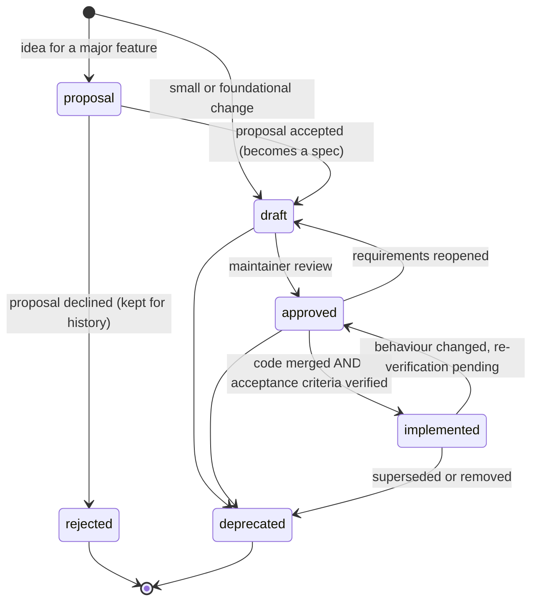
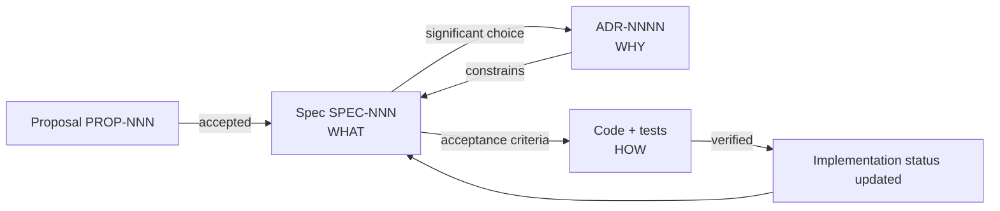

# DirectiveBench specifications

This directory is the **canonical source of truth** for what DirectiveBench does and is planned to do.

| Layer | Location | Answers |
| --- | --- | --- |
| Specifications | `.ai/specs/` | **WHAT** the system does, its contracts and acceptance criteria |
| Architecture Decision Records | [`.ai/decisions/`](../decisions/) | **WHY** a significant choice was made |
| Code and tests | `apps/`, `packages/`, `examples/` | **HOW** it is implemented, and proof that it works |

There is exactly one spec tree. Do not create competing spec or design directories (for example `docs/specs`, `design/`, `rfcs/`). User-facing documentation may live elsewhere, but it must link here instead of restating requirements.

## Directory structure

```text
.ai/specs/
├── README.md          # this index
├── foundation/        # SPEC-001…099: cross-cutting product and architecture specs
├── features/          # SPEC-101…199: user-facing capabilities
├── integrations/      # SPEC-201…299: external tools, agents, model providers, git hosts
├── proposals/         # PROP-NNN: ideas not yet accepted as specs
└── templates/         # templates for new specs and proposals
```

## Spec index

All specs start as `draft`. A status is only changed by following the [lifecycle](#lifecycle) below; the per-spec frontmatter is authoritative if this table is ever out of sync (fix the table when you notice).

### Foundation

| ID | Title | Status |
| --- | --- | --- |
| SPEC-001 | [Project overview](foundation/project-overview.md) | draft |
| SPEC-002 | [Product requirements](foundation/product-requirements.md) | draft |
| SPEC-003 | [System architecture](foundation/system-architecture.md) | draft |
| SPEC-004 | [Technology stack](foundation/technology-stack.md) | draft |
| SPEC-005 | [Domain model](foundation/domain-model.md) | draft |
| SPEC-006 | [Database schema](foundation/database-schema.md) | draft |
| SPEC-007 | [Security and privacy](foundation/security-and-privacy.md) | draft |
| SPEC-008 | [API architecture](foundation/api-architecture.md) | draft |
| SPEC-009 | [CLI architecture](foundation/cli-architecture.md) | draft |
| SPEC-010 | [Local installation](foundation/local-installation.md) | draft |
| SPEC-011 | [Self-hosting architecture](foundation/self-hosting-architecture.md) | draft |
| SPEC-012 | [Testing strategy](foundation/testing-strategy.md) | draft |
| SPEC-013 | [Implementation roadmap](foundation/implementation-roadmap.md) | draft |

### Features

| ID | Title | Status |
| --- | --- | --- |
| SPEC-101 | [Artifact registry](features/artifact-registry.md) | draft |
| SPEC-102 | [Artifact discovery](features/artifact-discovery.md) | draft |
| SPEC-103 | [Artifact versioning](features/artifact-versioning.md) | draft |
| SPEC-104 | [Repository management](features/repository-management.md) | draft |
| SPEC-105 | [Repository synchronization](features/repository-synchronization.md) | draft |
| SPEC-106 | [Category management](features/category-management.md) | draft |
| SPEC-107 | [Benchmark engine](features/benchmark-engine.md) | draft |
| SPEC-108 | [Benchmark definition format](features/benchmark-definition-format.md) | draft |
| SPEC-109 | [Benchmark builder](features/benchmark-builder.md) | draft |
| SPEC-110 | [Benchmark execution](features/benchmark-execution.md) | draft |
| SPEC-111 | [Benchmark scoring](features/benchmark-scoring.md) | draft |
| SPEC-112 | [RED/GREEN evaluation](features/red-green-evaluation.md) | draft |
| SPEC-113 | [Results and reporting](features/results-and-reporting.md) | draft |
| SPEC-114 | [Runner management](features/runner-management.md) | draft |
| SPEC-115 | [Settings and configuration](features/settings-and-configuration.md) | draft |
| SPEC-116 | [Dashboard and navigation](features/dashboard-and-navigation.md) | draft |

### Integrations

| ID | Title | Status |
| --- | --- | --- |
| SPEC-201 | [GitHub](integrations/github.md) | draft |
| SPEC-202 | [GitLab (cloud and self-managed)](integrations/gitlab.md) | draft |
| SPEC-203 | [Claude Code](integrations/claude-code.md) | draft |
| SPEC-204 | [OpenAI Codex](integrations/openai-codex.md) | draft |
| SPEC-205 | [Cursor](integrations/cursor.md) | draft |
| SPEC-206 | [Anthropic API](integrations/anthropic-api.md) | draft |
| SPEC-207 | [OpenAI API](integrations/openai-api.md) | draft |
| SPEC-208 | [DeepSeek](integrations/deepseek.md) | draft |
| SPEC-209 | [Z.AI GLM](integrations/zai-glm.md) | draft |
| SPEC-210 | [Moonshot Kimi](integrations/kimi.md) | draft |
| SPEC-211 | [Custom model providers](integrations/custom-model-providers.md) | draft |
| SPEC-212 | [Promptfoo (optional)](integrations/promptfoo-optional.md) | draft |

### Proposals and templates

- Proposals: [proposals/README.md](proposals/README.md) (currently none).
- Templates: [feature spec](templates/feature-spec.template.md), [integration spec](templates/integration-spec.template.md), [proposal](templates/proposal.template.md).

### Related ADRs

| ID | Decision |
| --- | --- |
| ADR-0001 | [Local-first architecture](../decisions/0001-local-first-architecture.md) |
| ADR-0002 | [SQLite with `node:sqlite`](../decisions/0002-sqlite-with-node-sqlite.md) |
| ADR-0003 | [Monorepo architecture](../decisions/0003-monorepo-architecture.md) |
| ADR-0004 | [Native CLI distribution](../decisions/0004-native-cli-distribution.md) |
| ADR-0005 | [Custom benchmark engine](../decisions/0005-custom-benchmark-engine.md) |
| ADR-0006 | [Agent adapters vs model providers](../decisions/0006-agent-adapters-vs-model-providers.md) |
| ADR-0007 | [Local runner execution and isolation](../decisions/0007-local-runner-execution-and-isolation.md) |
| ADR-0008 | [Secret storage and authentication](../decisions/0008-secret-storage-and-authentication.md) |
| ADR-0009 | [Self-hosted readiness](../decisions/0009-self-hosted-readiness.md) |
| ADR-0010 | [MIT license](../decisions/0010-mit-license.md) |

## Lifecycle



### Status definitions

| Status | Meaning |
| --- | --- |
| `draft` | Under discussion. May be incomplete. Code may already exist (see the spec's Implementation status), but the requirements are not yet agreed. |
| `approved` | Requirements accepted by a maintainer. Ready to implement. Changes require review. |
| `implemented` | Set **only after verification**: every acceptance criterion has been checked against the running code (tests or documented manual verification). Partial implementation stays `approved` (or `draft`) with details in the Implementation status section. |
| `deprecated` | No longer valid. Keep the file, add a note linking to the replacement spec. Never reuse its ID. |

Proposals use their own statuses: `proposal` (open), `accepted` (link to the resulting spec), `rejected` (keep the reasoning). Product decisions are never auto-approved by an agent.

## Naming conventions

- Filenames are kebab-case and describe the subject: `artifact-registry.md`, not `spec-101.md`.
- Every spec has a stable, unique `id` in frontmatter. IDs are never renumbered or reused, even after deprecation.
- ID ranges:
  - `SPEC-001`–`SPEC-099` — foundation
  - `SPEC-101`–`SPEC-199` — features
  - `SPEC-201`–`SPEC-299` — integrations
  - `PROP-001`… — proposals (`proposals/PROP-NNN-short-title.md`)
  - `ADR-NNNN` — decisions in [`.ai/decisions/`](../decisions/) (`NNNN-short-title.md`)
- Required frontmatter:

```yaml
---
id: SPEC-NNN
title: Human readable title
status: draft            # draft | approved | implemented | deprecated
created: YYYY-MM-DD
updated: YYYY-MM-DD
category: feature        # foundation | feature | integration | template | proposal
related: [SPEC-NNN, ADR-NNNN]
---
```

## Creating a new spec

1. Major new capability? Start with a [proposal](#proposals-workflow) instead.
2. Copy the matching template from [`templates/`](templates/) into the right directory with a kebab-case filename.
3. Take the next free ID in the category range (check this index and the directory; never reuse a retired ID).
4. Fill in the frontmatter (`status: draft`, today's date for `created` and `updated`) and every required section. Write "None" or "N/A — reason" rather than deleting a section.
5. Add the spec to the index table above, and add its ID to `related` of the specs it touches.

## Updating a spec

- Keep the ID and filename stable. If a rename is unavoidable, leave a stub pointing to the new path.
- Bump `updated` on every substantive change.
- Update the **Implementation status** section only after verifying the claim against code and tests. Be conservative: "implemented" means verified, not "code exists".
- If a change reverses a decision, write or supersede an ADR and link it.
- Reference other specs instead of duplicating their content. When two specs disagree, fix one of them in the same change.

## Proposals workflow

Major features (new subsystem, new integration category, data model change, anything affecting security or the public CLI) start as a proposal in [`proposals/`](proposals/) **before implementation**:

1. Copy [`templates/proposal.template.md`](templates/proposal.template.md) to `proposals/PROP-NNN-short-title.md`.
2. Discuss and refine. Record alternatives and impact.
3. Accepted → create one or more feature/integration specs (status `draft`), set the proposal status to `accepted` and link the specs. Record significant architectural choices as ADRs.
4. Rejected → set status `rejected`, keep the file with the reasoning so the idea is not re-litigated without new information.

## Specs, ADRs and code



- Specs reference ADRs for rationale; ADRs reference the specs they constrain.
- Code comments may reference spec IDs (e.g. `// SPEC-111: verdict precedence`) where the rule is non-obvious.
- Tests should map to acceptance criteria where practical.

## Rules for AI agents

1. Read this index and the relevant specs (and [`AGENTS.md`](../../AGENTS.md)) before changing behaviour.
2. Specs live **only** in `.ai/specs/`. Do not create other spec directories or duplicate requirements in READMEs.
3. Never set a status to `approved`; that is a maintainer decision. Set `implemented` only after you have verified every acceptance criterion and can cite the tests or checks.
4. Keep Implementation status sections honest: distinguish implemented, partially implemented, and not implemented. Never describe planned features as working.
5. Never invent external capabilities (provider APIs, CLI flags, auth methods). Mark unverified items "Assumption — requires validation".
6. When behaviour diverges from a spec, either fix the code or update the spec in the same change — never leave them inconsistent silently.
7. New major features go through a proposal first. New specs go into this index in the same change.
8. Bump `updated` when editing; never change an `id`.
