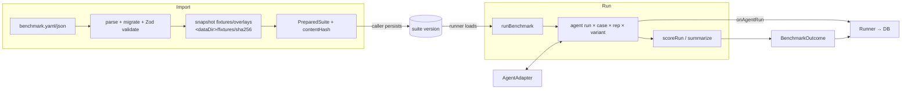

# SPEC-107 — Benchmark Engine

## 1. Summary

`@directivebench/benchmark-engine` is the library that turns a **benchmark definition** ([SPEC-108](./benchmark-definition-format.md)) and an **artifact version** ([SPEC-103](./artifact-versioning.md)) into a RED/GREEN evaluation result. It loads and validates definitions, imports suites with immutable fixture snapshots, prepares isolated workspaces, drives an `AgentAdapter` for baseline (no artifact) and candidate (artifact installed) runs, evaluates assertions, scores runs and summarises the comparison. It is pure with respect to persistence and presentation: inputs in, results and events out — no database, no UI, no job queue. Rationale for a custom engine: [ADR-0005](../../decisions/0005-custom-benchmark-engine.md).

This spec defines the engine's responsibilities, public API, entities, test types and the assertion plugin contract. Details live in sibling specs: execution pipeline [SPEC-110](./benchmark-execution.md), scoring [SPEC-111](./benchmark-scoring.md), RED/GREEN protocol [SPEC-112](./red-green-evaluation.md), runner integration [SPEC-114](./runner-management.md).

## 2. Motivation and problem statement

To know whether a skill or rule actually changes agent behaviour, the same task must be executed with and without it under controlled, recorded conditions and judged by objective checks. Generic eval frameworks focus on prompt → completion scoring, not on agents modifying repositories with artifacts installed by harness-specific conventions. A small, auditable engine that the runner, the CLI (`demo`) and tests can call identically is the core of DirectiveBench.

## 3. Goals

- One library entry point for: definition load/validate, suite import with fixture snapshots, single agent run, full RED/GREEN benchmark, scoring.
- Independence from database and UI (usable from runner, CLI, tests, future remote runners).
- Deterministic orchestration around a possibly nondeterministic agent; full traceability.
- Extensible assertions through a plugin contract; capability-checked agent adapters ([ADR-0006](../../decisions/0006-agent-adapters-vs-model-providers.md)).
- Safe defaults: no shell, env allowlist, timeouts, output limits, redaction, approval gate.

## 4. Non-goals

- Persisting anything (runner's job — [SPEC-114](./runner-management.md)).
- Scheduling/queueing, concurrency across jobs.
- Implementing agent harnesses (in `@directivebench/agent-adapters`) or model providers (future `packages/model-providers`).
- Sandboxing in the bootstrap: `local-process` is **not** a sandbox; `docker` is planned ([SPEC-110](./benchmark-execution.md), [ADR-0007](../../decisions/0007-local-runner-execution-and-isolation.md)).
- Global cross-suite rankings ([SPEC-111](./benchmark-scoring.md)).

## 5. User stories

- US-107-01: As the runner, I call `runBenchmark` with a suite version, an artifact bundle and an adapter, receive progress events and a result I can persist.
- US-107-02: As the CLI `demo` command, I import a bundled suite and run it headless with the Mock Agent using the same engine code as the UI path.
- US-107-03: As a contributor, I add a new assertion type by implementing one plugin and its Zod schema.
- US-107-04: As a suite author, I get every validation error of my YAML with its path in one pass.
- US-107-05: As a user, I can trust that a reported improvement compares identical fixtures, prompts, adapter versions and limits.

## 6. Functional requirements

| ID | Requirement |
|----|-------------|
| FR-107-01 | **Load/validate**: the engine SHALL parse YAML or JSON definitions, migrate older `schemaVersion`s forward, validate with the Zod schema `benchmarkDefinitionSchema`, and return **all** issues with dotted paths ([SPEC-108](./benchmark-definition-format.md)). |
| FR-107-02 | **Import**: given a definition file path, the engine SHALL resolve each case's `fixture.path` and `verification.overlay` relative to the definition file's directory, snapshot each directory into the content-addressed fixture store (`<dataDir>/fixtures/<sha256>/`, `snapshotDirectory`), reject symlinks/special files/escaping paths/empty fixtures and enforce file limits, and return a `PreparedSuite` (`prepareSuiteImport`). Persisting the suite version and `fixture_versions` rows is the caller's job (`importSuiteVersion`, `recordFixtureVersion` in `@directivebench/database`). |
| FR-107-03 | **Suite content hash** SHALL be `suiteContentHash` = `sha256(canonicalJson({ definition, fixtures }))` over the validated definition (defaults applied) and the fixture hash map, so changing any fixture byte or definition field yields a new suite version. |
| FR-107-04 | **Approval gate**: the engine SHALL refuse to execute setup commands or `command` assertions unless the caller passes `executionApproved: true` for the suite version ([SPEC-110](./benchmark-execution.md) FR-110-46). `definitionRunsCommands(definition)` reports whether approval is needed. |
| FR-107-05 | **Agent run**: each agent run inside `runBenchmark` SHALL execute the pipeline of [SPEC-110](./benchmark-execution.md) (fresh workspace → fixture copy + hash verify → setup → install artifact (candidate only) → before-manifest → `adapter.run` → after-manifest/changed files → verification overlay → assertions → score → cleanup) and produce an `AgentRunRecord` with exactly one execution status. (The adapter-level `AgentRunResult` from `@directivebench/agent-adapters` is one input to it.) |
| FR-107-06 | **Benchmark run**: `runBenchmark` SHALL execute every case × repetition × variant (baseline/RED and candidate/GREEN) per [SPEC-112](./red-green-evaluation.md), with identical fixture hash, prompt, adapter + version, model selection, environment kind and limits for both variants, each in an independent fresh workspace. |
| FR-107-07 | **Capabilities**: before running, the engine SHALL check the adapter's `capabilities` (`execution`, `headless`, `artifactInstallation`; `modelSelection` if `execution.model` is set) and fail fast (bootstrap: `assertRunnable` throws `BenchmarkConfigurationError`; it also checks that `definition.execution.agent === adapter.id`, that the artifact type is in `definition.artifactTypes`, approval, and that every case has a fixture snapshot). Detection-only adapters (`claude-code`, `codex`, `cursor` in bootstrap) have `execution: false`. |
| FR-107-08 | **Environment**: `local-process` runs with `sandboxed: false` recorded; `docker` SHALL be rejected with a clear "not implemented" error before any workspace is created. |
| FR-107-09 | **Events**: the engine SHALL report progress only through caller-supplied callbacks (no I/O to DB/UI). Implemented: `onAgentRun(record)` after each agent run (awaited, enabling incremental persistence). Planned: `onEvent(EngineEvent)` with `benchmark-started`, `agent-run-started`, `stage-started`, `stage-finished`, `command-output`, `warning` (serialisable JSON, ISO timestamps). |
| FR-107-10 | **Cancellation**: every public async function accepting work SHALL accept an `AbortSignal`; aborting stops further stages, kills child process groups and yields `cancelled` statuses ([SPEC-110](./benchmark-execution.md) FR-110-09). |
| FR-107-11 | **Results**: `runBenchmark` SHALL return a `BenchmarkOutcome` containing all `AgentRunRecord`s, the `ScoringSummary` (`summarize`), the comparability key (`comparabilityKey`), environment metadata and warnings (including uncontrolled differences, e.g. ambient user-level skills for real agents). |
| FR-107-12 | **Scoring** SHALL use `scoreRun`, `aggregate`, `summarize`, `confidenceFor`, `displayStatus` exactly as specified in [SPEC-111](./benchmark-scoring.md). Non-`completed` runs are excluded from quality metrics and counted in `errorRate`. |
| FR-107-13 | **Mock Agent labelling**: results produced with adapter `mock` (capability `deterministic: true`) SHALL carry `deterministicAgent: true` so consumers label them "Mock agent — not an AI evaluation". |
| FR-107-14 | **Independence**: the package SHALL depend only on `@directivebench/core`, `@directivebench/agent-adapters`, `zod`, `yaml` and Node built-ins; it SHALL NOT import `@directivebench/database`, Next.js or React. |
| FR-107-15 | **Assertions** SHALL be evaluated through the plugin contract (§8.3); every assertion of a case is evaluated even if earlier ones fail; evaluation never throws (failures become failed assertions with a message). |
| FR-107-16 | All captured process output and assertion messages SHALL be truncated to `maxOutputBytes` and secret-redacted (`redactSecrets`) before leaving the engine. |

## 7. Non-functional requirements

- NFR-107-01: Engine overhead per agent run (excluding agent/commands) < 2 s for fixtures < 10 MB.
- NFR-107-02: Deterministic for deterministic adapters: the Mock Agent example produces identical scores across runs and machines.
- NFR-107-03: Unit-testable without network or paid APIs ([SPEC-012](../foundation/testing-strategy.md)).
- NFR-107-04: Cross-platform (Linux, macOS primary; Windows best effort — process-tree kill on Windows: Assumption — requires validation).

## 8. Domain entities and contracts

Entity overview (persistence mapping in [SPEC-006](../foundation/database-schema.md); conceptual model in [SPEC-005](../foundation/domain-model.md)):

| Entity | Engine representation | Persistence (runner) |
|--------|----------------------|----------------------|
| BenchmarkSuite | `definition.id` (slug) + name/description | `benchmark_suites` |
| SuiteVersion | validated `BenchmarkDefinition` + fixture hash map + content hash | `benchmark_suite_versions` (immutable; `execution_approved_at`, `execution_approval_source`) |
| Case | `BenchmarkCase` (prompt, fixture, verification, setup, assertions, agentOptions) | inside suite version `definition` |
| Fixture | `case.fixture.path` / `case.verification.overlay` (authoring-time directories) | — |
| FixtureVersion | `Snapshot { hash, dir, fileCount, totalBytes }` | `fixture_versions` (id = sha256) + `<dataDir>/fixtures/<sha256>/` |
| ExecutionEnvironment | `definition.execution.environment { kind, image? }` + recorded `EnvironmentMetadata` | `benchmark_runs.environment` |
| Assertion | `AssertionDefinition` (discriminated union by `type`) | definition; results in `assertion_results` |
| AgentConfiguration | `{ agent (adapter id), model: ModelSelection \| null, agentOptions[adapterId] }` + adapter `capabilities`, detected version | `benchmark_runs.agent_adapter_id`, `agent_version`, `model` |
| AgentRun | one (case, variant, repetition) execution → `AgentRunRecord` | `agent_runs` |
| BenchmarkRun | one RED/GREEN evaluation of one artifact version against one suite version → `BenchmarkOutcome` | `benchmark_runs` |
| BenchmarkResult | `ScoringSummary` (aggregates, delta, verdict, confidence, candidate outcome) | `benchmark_runs.summary`, `verdict`, `comparability_key` |
| Score | assertion score ∈ [0,1] × weight → run score `Σw·s/Σw` | `assertion_results.score/weight`, `agent_runs.score/passed` |
| EvaluationTrace | ordered `TraceEvent[]` (adapter events + engine stage events, command records) | `agent_runs.trace`, `assertion_results.details` |

### 8.1 Public API

Implemented in bootstrap (`packages/benchmark-engine/src`):

```ts
// definition.ts / load.ts
const CURRENT_SCHEMA_VERSION = 1;
const benchmarkDefinitionSchema: z.ZodType<BenchmarkDefinition>;
function validateDefinition(document: unknown): ParseDefinitionResult;
function parseDefinitionText(text: string, format: 'yaml' | 'json'): ParseDefinitionResult;
function loadDefinitionFile(path: string): Promise<BenchmarkDefinition>; // throws DefinitionValidationError
function migrateDefinitionDocument(document: unknown): unknown;          // throws UnsupportedSchemaVersionError
function definitionRunsCommands(definition: BenchmarkDefinition): boolean;
type ParseDefinitionResult =
  | { success: true; definition: BenchmarkDefinition }
  | { success: false; issues: { path: string; message: string }[] };

// files.ts
function buildManifest(root: string, opts?: { limits?: FileLimits; ignore?: (p: string) => boolean }): Promise<ManifestFile[]>;
function snapshotDirectory(source: string, storeRoot: string): Promise<Snapshot>; // content-addressed, atomic rename
function diffManifests(before: ManifestEntry[], after: ManifestEntry[]): FileChange[];
const DEFAULT_FILE_LIMITS = { maxFiles: 5000, maxTotalBytes: 100 * 1024 * 1024 };

// commands.ts
function buildCommandEnv(homeDir: string, base?: NodeJS.ProcessEnv): Record<string, string>;
function runCommand(argv: readonly string[], opts: CommandOptions): Promise<CommandResult>;

// assertions.ts
function evaluateAssertion(a: AssertionDefinition, ctx: AssertionContext): Promise<AssertionResult>;

// scoring.ts
function scoreRun(assertions: ScoredAssertion[], passThreshold: number): { score: number; passed: boolean };
function aggregate(runs: RunOutcome[]): Aggregate;
function summarize(runs: RunOutcome[], opts: SummarizeOptions): ScoringSummary;
function confidenceFor(repetitions: number, unstable: boolean): { level: 'low' | 'medium' | 'high'; reason: string };
function displayStatus(verdict: string | null | undefined, candidateOutcome: string | null | undefined): DisplayStatus;
```

```ts
// import.ts
function prepareSuiteImport(definitionPath: string, fixtureStore: string): Promise<PreparedSuite>;
function suiteContentHash(definition: BenchmarkDefinition, fixtures: Record<string, CaseFixtures>): string;
interface CaseFixtures { fixture: string; overlay?: string }          // sha256 snapshot ids
interface PreparedSuite {
  definition: BenchmarkDefinition;
  fixtures: Record<string, CaseFixtures>;                             // caseId → hashes
  snapshots: (Snapshot & { sourcePath: string })[];
  contentHash: string;                                                // suiteContentHash(...)
  sourcePath: string;
}

// orchestrator.ts
function assertRunnable(input: Pick<RunBenchmarkInput, 'definition' | 'fixtures' | 'artifact' | 'adapter' | 'executionApproved'>): void; // throws BenchmarkConfigurationError
function comparabilityKey(definition: BenchmarkDefinition, fixtures: Record<string, CaseFixtures>,
  adapterId: string, adapterVersion: string | null): string;          // sha256(canonicalJson({cases, scoring, execution, fixtures, adapterId, adapterVersion}))
function runBenchmark(input: RunBenchmarkInput): Promise<BenchmarkOutcome>;

interface RunBenchmarkInput {
  definition: BenchmarkDefinition;
  fixtures: Record<string, CaseFixtures>;
  fixtureStore: string;               // <dataDir>/fixtures
  artifact: ArtifactBundle;           // @directivebench/core
  adapter: AgentAdapter;              // @directivebench/agent-adapters
  workRoot: string;                   // temp workspaces of this run
  keepWorkspaces?: boolean;
  executionApproved: boolean;
  signal: AbortSignal;
  onAgentRun?: (record: AgentRunRecord) => Promise<void>; // incremental persistence hook
}

interface BenchmarkOutcome {
  summary: ScoringSummary;            // SPEC-111
  comparabilityKey: string;
  environment: EnvironmentMetadata;   // kind 'local-process', sandboxed false, platform, arch, nodeVersion, adapter id/version, deterministicAgent, model, timeoutSeconds, repetitions
  warnings: string[];
  agentRuns: AgentRunRecord[];        // RunOutcome + fixtureHash, changedFiles, trace, usage, error, assertions
}
```

Planned additions (non-breaking; names aligned with [SPEC-110](./benchmark-execution.md) / [SPEC-112](./red-green-evaluation.md)):

```ts
// Fine-grained progress events in addition to onAgentRun (FR-107-09).
type EngineEvent =
  | { type: 'benchmark-started'; at: string; plannedRuns: number }
  | { type: 'agent-run-started'; at: string; caseId: string; variant: 'baseline' | 'candidate'; repetition: number }
  | { type: 'stage-started' | 'stage-finished'; at: string; stage: string; caseId: string; variant: string; repetition: number }
  | { type: 'command-output'; at: string; stream: 'stdout' | 'stderr'; chunk: string } // redacted, truncated
  | { type: 'warning'; at: string; message: string };
// RunBenchmarkInput.onEvent?: (e: EngineEvent) => void
// Exposed single-run entry point for tests/remote runners: runAgentRun(...)
```

### 8.2 Agent adapter contract (consumed, not owned)

Owned by `@directivebench/agent-adapters` (`src/contract.ts`): `AgentAdapter { id, displayName, capabilities: AgentCapabilities, detect(), installArtifact(workspaceDir, ArtifactBundle), run(AgentRunRequest): Promise<AgentRunResult> }` with `AgentCapabilities { execution, headless, modelSelection, artifactInstallation, structuredOutput, usageReporting, deterministic }`. The engine passes `case.agentOptions[adapter.id]` as `AgentRunRequest.options`. Mock Agent install convention: skills → `.agents/skills/<slug>/`; instructions/rules → `.agents/instructions/<slug>/` and appended to `AGENTS.md`.

### 8.3 Assertion plugin contract

Bootstrap: a `switch` in `evaluateAssertion`. Target (refactor when adding the first planned type):

```ts
interface AssertionPlugin<TDef extends { type: string; id: string; weight: number; required: boolean }> {
  type: TDef['type'];                       // discriminator in the definition
  schema: z.ZodType<TDef>;                  // merged into assertionSchema (discriminated union)
  deterministic: boolean;                   // false → affects confidence & UI labels
  executesCommands: boolean;                // true → requires suite execution approval (FR-107-04)
  requiredCapabilities?: ('network' | 'model-provider' | 'docker')[];
  evaluate(def: TDef, ctx: AssertionContext): Promise<AssertionResult>; // must not throw
}

interface AssertionContext {               // implemented (assertions.ts)
  workspaceDir: string;
  changedFiles: readonly FileChange[];     // agent changes only (SPEC-110 FR-110-10/13)
  commandEnv: Record<string, string>;
  defaultTimeoutMs: number;
  maxOutputBytes: number;
  signal: AbortSignal;
}

interface AssertionResult {                // implemented; persisted to assertion_results
  assertionId: string; type: string;
  passed: boolean; score: number;          // 0..1 (deterministic: 0 or 1)
  weight: number; required: boolean; deterministic: boolean;
  message: string; details: Record<string, unknown> | null;
}
```

| Type | Status | Semantics |
|------|--------|-----------|
| `command` | Implemented | argv run in workspace without shell; pass iff exit code = `expectExitCode` (default 0); optional `timeoutSeconds`; details: argv, exit code, signal, duration, truncated/redacted stdout/stderr. Executes commands → approval required. |
| `file-exists` | Implemented | `path` exists (or not, with `exists: false`); path confined to workspace. |
| `file-contains` | Implemented | regex `pattern` with `flags` (`i`,`m`,`s`,`u`) matches file content (≤ 2 MiB); `negate` inverts. |
| `changed-files` | Implemented | every agent-changed file matches ≥1 `allowed` glob and none match `forbidden` globs (`node:path` `matchesGlob`). |
| `json-schema` | Planned | file parses as JSON and validates against an inline/relative JSON Schema. Deterministic. |
| `unit-tests` / `integration-tests` | Planned | test-runner wrappers (e.g. `node --test`, `vitest`, `phpunit`, `pytest`) with result parsing for partial credit (`passed/total`). Executes commands. Today expressible via `command`. |
| `static-analysis` | Planned | linters/analysers (ESLint, PHPStan, PHPCS, Semgrep) with rule/severity thresholds; partial credit by findings. Executes commands. |
| `custom-script` | Planned | user script in the suite (not in the agent workspace' writable tree) receiving context JSON on stdin, returning `{ score, passed, message }`. Executes commands. |
| `llm-judge` | Planned | model-graded rubric. `deterministic: false`. MUST record judge provider + model, rubric text/hash, judge prompt template version, sampling parameters, raw judge output, numeric score and explanation in `details`. Results are flagged nondeterministic in UI; confidence is capped at `medium` unless repetitions ≥ 10 and stable (proposal, [SPEC-111](./benchmark-scoring.md)). Requires a model provider and sends workspace content to it (explicit consent, [SPEC-007](../foundation/security-and-privacy.md)). |

### 8.4 Test types

How suites express each evaluation type with format v1 ([SPEC-108](./benchmark-definition-format.md)):

| Test type | Question | v1 expression | Status |
|-----------|----------|---------------|--------|
| Static validation | Is the artifact well-formed for its format (frontmatter, description, globs)? | Not an agent run: parser warnings from [SPEC-102](./artifact-discovery.md); dedicated "static" checks without agent are planned. | Partially (parser warnings only) |
| Activation & scope | Does the artifact activate when it should (matching globs, relevant task) and stay silent otherwise? | Paired cases: one prompt touching in-scope files, one out-of-scope; assertions on resulting files. Meaningful only with real agents; the Mock Agent only checks context-phrase presence. | Expressible; real agents not implemented |
| Behavioural | Does the agent's output change in the intended direction? | Core RED/GREEN case: prompt + fixture + hidden verification overlay + `command`/`file-*` assertions. | Implemented (mock agent) |
| Regression | Does a new artifact version keep or improve results vs the previous version / baseline? | Re-run the same suite version on vN and vN-1; compare under one comparability key ([SPEC-103](./artifact-versioning.md) FR-103-14, [SPEC-111](./benchmark-scoring.md)). | Scoring implemented; version comparison UI not implemented |
| Safety & constraint | Does the agent stay within allowed files, avoid forbidden patterns/secrets? | `changed-files` (allowed/forbidden), `file-contains` with `negate: true`, `required: true` gates. | Implemented |

## 9. Data flow



## 10. API and interface design

- Package entry: `@directivebench/benchmark-engine` (`src/index.ts`, just-in-time TS package, bundled by the CLI).
- Callers: `@directivebench/runner` (job handler), `apps/cli` `demo` (headless), tests. `apps/web` imports only types and `validateDefinition` (e.g. for future upload validation) — never runs benchmarks ([SPEC-008](../foundation/api-architecture.md)).
- Errors exported: `DefinitionValidationError` (with `issues`), `UnsupportedSchemaVersionError`, `UnsafeFileError`, `BenchmarkConfigurationError` (environment, agent mismatch, capability, artifact type, approval, missing fixture), `BenchmarkCancelledError`; `UnsupportedCapabilityError`, `PathEscapeError` from adapters.

## 11. UI/UX considerations

The engine has no UI. Its outputs must enable: per-stage progress, RED vs GREEN comparison, per-assertion messages, truncated-output markers, "Not sandboxed" and "Mock agent — not an AI evaluation" labels, nondeterministic-assertion badges ([SPEC-113](./results-and-reporting.md)).

## 12. Security considerations

See [SPEC-007](../foundation/security-and-privacy.md), [ADR-0007](../../decisions/0007-local-runner-execution-and-isolation.md).
- Commands: argv only, `shell: false`, env allowlist (`PATH`, `LANG`, `LC_ALL`, `TZ`, Windows essentials) with `HOME`/`TMPDIR` redirected to a per-run directory, `CI=true`, process-group kill on timeout/cancel, output truncation + redaction.
- Approval gate for anything that executes commands (FR-107-04).
- Fixture snapshots reject symlinks, special files, path escapes; workspace writes by adapters/assertions go through `resolveInside`.
- `local-process` grants agent and commands the user's OS permissions — clearly labelled, never described as isolated.
- `file-contains` regexes come from approved definitions; read size capped at 2 MiB to bound ReDoS/memory impact (a regex timeout is an open question).

## 13. Error handling

- Definition errors → `{ success: false, issues }` (never partial definitions).
- Import errors (missing/empty fixture, symlink, limits) → thrown typed errors naming the case and path.
- Per-run failures map to execution statuses (`agent-error`, `timeout`, `cancelled`, `infrastructure-error`); a failed run never aborts the benchmark unless cancelled.
- Benchmark-level `error` status only for failures before any run (capability, environment, approval).
- Cleanup failures → warnings.

## 14. Edge cases

- Case where all assertion weights are 0 → rejected by schema.
- Repetitions = 1 → confidence `low`, still produces a verdict.
- Adapter returns `completed` but writes nothing → assertions decide; `changedFiles` empty.
- Agent modifies the installed artifact files → excluded from `changedFiles` attribution ([SPEC-110](./benchmark-execution.md) FR-110-06).
- Verification overlay overwrites a file the agent wrote → intended (hidden tests win).
- Same fixture used by several cases → stored once (content-addressed).
- Definition newer than supported `schemaVersion` → `UnsupportedSchemaVersionError` ("Upgrade DirectiveBench").

## 15. Testing strategy

Per [SPEC-012](../foundation/testing-strategy.md):
- Unit: schema (valid/invalid documents, defaults, duplicate ids, regex validation, docker without image), `migrateDefinitionDocument`, manifests and `diffManifests`, `runCommand` (timeout, cancellation, truncation, redaction, env allowlist), each assertion type, scoring functions (precedence table).
- Integration: import + run `examples/benchmarks/mock-input-validation` with the Mock Agent end-to-end in a temp dir: baseline fails hidden tests, candidate passes, verdict `improved`, deterministic across two runs.
- Security: fixture with symlink rejected; command assertion cannot see a canary env var set in the parent process; path escape attempts in playbook/overlay rejected.
- No paid APIs; real-agent adapters tested only via detection mocks.

## 16. Acceptance criteria

- [ ] `validateDefinition` returns all issues with dotted paths for an invalid document.
- [ ] Importing the mock example snapshots fixture and overlay into `<dataDir>/fixtures/<sha256>/` and returns stable hashes across machines.
- [ ] Running the mock example yields baseline score < candidate score, `verdict: improved`, `deterministicAgent: true`.
- [ ] A suite version without approval and with command assertions is refused before any workspace is created.
- [ ] `environment.kind: docker` is refused with a clear message.
- [ ] Cancelling mid-run kills child processes and yields `cancelled` runs.
- [ ] `@directivebench/benchmark-engine` has no dependency on `@directivebench/database`, Next.js or React (checked by test or lint rule).

## 17. Dependencies

[SPEC-108](./benchmark-definition-format.md), [SPEC-110](./benchmark-execution.md), [SPEC-111](./benchmark-scoring.md), [SPEC-112](./red-green-evaluation.md), [SPEC-114](./runner-management.md), [SPEC-103](./artifact-versioning.md); packages `@directivebench/core`, `@directivebench/agent-adapters`; [ADR-0005](../../decisions/0005-custom-benchmark-engine.md), [ADR-0006](../../decisions/0006-agent-adapters-vs-model-providers.md), [ADR-0007](../../decisions/0007-local-runner-execution-and-isolation.md).

## 18. Open questions

- OQ-107-01: `comparabilityKey` hashes `cases` (incl. prompts and assertions), `scoring`, `execution`, fixtures and adapter id/version — it does not take the suite version id; should the brief's definition (suite version + fixtures + adapter + model + environment + limits) be reconciled with [SPEC-111](./benchmark-scoring.md)?
- OQ-107-02: Regex execution timeout for `file-contains` (worker thread) vs size cap only.
- OQ-107-03: Should partial-credit assertion types be allowed as `required`? (Proposed: `required` means `passed === true`.)
- OQ-107-04: Should `llm-judge` results be excluded from verdicts by default and shown as a separate score?
- OQ-107-05: Static (no-agent) suites — separate suite kind or artifact lint feature?

## 19. Future extensions

- Planned assertion types (§8.3); Docker environment; real agent adapters (SPEC-203…205); custom coding harness for direct API models ([SPEC-110](./benchmark-execution.md) §19).
- Optional Promptfoo interoperability (SPEC-212).
- Remote execution via runner protocol ([SPEC-008](../foundation/api-architecture.md) §7).
- Parallel agent runs within one benchmark (bounded, with interleaving preserved).

## 20. Implementation status

- **Implemented in bootstrap** (to be verified by tests): definition schema v1, YAML/JSON parsing, migration hook (rejects newer versions), `loadDefinitionFile`, file manifests/snapshots/diff, `runCommand`/`buildCommandEnv`, assertion types `command`, `file-exists`, `file-contains`, `changed-files`, scoring (`scoreRun`, `aggregate`, `summarize`, `confidenceFor`, `displayStatus`); Mock Agent adapter and contract in `@directivebench/agent-adapters`.
- **Also implemented** (to be verified): `prepareSuiteImport`/`suiteContentHash`, `assertRunnable`, `comparabilityKey`, `runBenchmark` with `onAgentRun` callback (`src/import.ts`, `src/orchestrator.ts`).
- **Partially implemented**: progress events (only per-agent-run callback; no stage/command-output events); capability checks (only `execution`, not `headless`/`artifactInstallation`/`modelSelection`).
- **Not implemented**: `onEvent` stage events, exported `runAgentRun`, assertion plugin registry, planned assertion types (json-schema, test-runner, static-analysis, custom-script, llm-judge), docker environment, real-agent execution, static validation suites, version-over-version regression UI.
