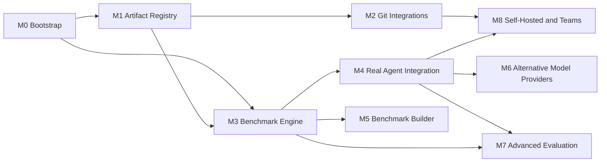

# SPEC-013 — Implementation Roadmap

## 1. Overview

Milestones are ordered by dependency, not by calendar. Each milestone ends with the [Definition of Done](#2-common-definition-of-done) plus its own criteria. Priorities: **P0** required for a useful local product, **P1** core value, **P2** extension.

| Milestone | Priority | Status |
| --- | --- | --- |
| M0 Bootstrap | P0 | In progress — see final verification |
| M1 Artifact Registry | P0 | Not started (recommended next) |
| M2 Git Integrations | P1 | Not started |
| M3 Benchmark Engine | P0 | Not started beyond the bootstrap subset in M0 |
| M4 Real Agent Integration | P1 | Not started (detection only in M0) |
| M5 Benchmark Builder | P1 | Not started |
| M6 Alternative Model Providers | P2 | Not started |
| M7 Advanced Evaluation | P2 | Not started |
| M8 Self-Hosted and Teams | P2 | Not started |

## 2. Common Definition of Done

Applies to every milestone:

- Code merged on `main`; `pnpm lint`, `typecheck`, `test`, `build`, `verify:pack` and `test:e2e` pass in CI ([SPEC-012](./testing-strategy.md)).
- No paid API calls or network access in default tests.
- Affected specs updated: acceptance criteria verified, **Implementation status** sections precise, `updated` bumped; new architectural choices recorded as ADRs.
- UI shows no non-functional controls; unimplemented areas are labelled "Planned — not implemented".
- No secrets in plaintext in the database, config or logs.

## 3. Milestones

### M0 — Bootstrap

**Status:** in progress — see final verification.
**Priority:** P0. **Dependencies:** none.
**Deliverables:** pnpm + Turborepo monorepo ([ADR-0003](../../decisions/0003-monorepo-architecture.md)); packages `core`, `database`, `agent-adapters`, `benchmark-engine`, `runner`; apps `cli`, `web`; SQLite schema + migrations; CLI `serve`/`init`/`doctor`/`demo` ([SPEC-009](./cli-architecture.md)); runner with heartbeat, cancellation and crash recovery; Mock Agent; benchmark format v1 with `command`, `file-exists`, `file-contains`, `changed-files` assertions; RED/GREEN + scoring; web UI sections per [SPEC-116](../features/dashboard-and-navigation.md); agent CLI detection; examples; specs and ADRs.
**Acceptance criteria:**
- `npx <packed tarball> demo` on a clean machine with Node 24 imports the bundled example and prints a RED/GREEN summary with verdict `improved`, labelled as mock, exit code 0.
- `directivebench` starts the UI on `127.0.0.1:4280`; `GET /api/health` returns 200; a foreign `Host` header is rejected.
- "Run benchmark" in the UI enqueues a job that reaches `completed`; cancelling a running job yields `cancelled`; killing the CLI mid-run leaves the job `interrupted` after restart.
- `pnpm verify:pack` passes.
**Risks:** Next.js standalone packaging inside an npm tarball; `node:sqlite` API stability across Node 22/24; Windows process termination semantics.

### M1 — Artifact Registry

**Priority:** P0. **Dependencies:** M0.
**Deliverables:** local repository registration ([SPEC-104](../features/repository-management.md)); artifact discovery scan of registered local directories ([SPEC-102](../features/artifact-discovery.md)); artifact registry browsing and filtering ([SPEC-101](../features/artifact-registry.md)); versioning on content change ([SPEC-103](../features/artifact-versioning.md)); category CRUD and assignment ([SPEC-106](../features/category-management.md)).
**Acceptance criteria:**
- Registering a local directory containing `.agents/skills/*/SKILL.md`, `AGENTS.md`, `.cursor/rules/*.mdc` and `.github/copilot-instructions.md` discovers each as an artifact with the correct type/format and an occurrence path.
- Re-scanning an unchanged repository creates 0 new versions; editing one file creates exactly 1 new version of that artifact.
- Identical content in two repositories is one artifact version with two occurrences.
- Removed files mark the occurrence as missing; history is retained.
- Scanning a repository with 1,000 files completes in < 5 s on a typical laptop (target).
**Risks:** ambiguous artifact classification; symlinks and very large repos; Windows path normalization.

### M2 — Git Integrations

**Priority:** P1. **Dependencies:** M1.
**Deliverables:** local git awareness (commit SHA, branch, dirty state); read-only sync from GitHub ([SPEC-201](../integrations/github.md)), GitLab.com and self-managed GitLab ([SPEC-202](../integrations/gitlab.md)) into `<dataDir>/cache/`; `directivebench sync` ([SPEC-105](../features/repository-synchronization.md)); OS-keychain secret storage ([ADR-0008](../../decisions/0008-secret-storage-and-authentication.md)).
**Acceptance criteria:**
- A public GitHub repository can be added by URL and synced without credentials; occurrences record the commit SHA.
- A private repository syncs with a token stored in the OS keychain; the token never appears in the database, config, logs or error messages (verified by test).
- Sync is incremental: an unchanged remote performs no rescan.
- Contract tests with recorded fixtures cover auth failure, rate limiting and not-found.
**Risks:** token scope confusion; keychain availability on headless Linux; API rate limits.

### M3 — Benchmark Engine

**Priority:** P0. **Dependencies:** M0, M1.
**Deliverables:** completion of [SPEC-107](../features/benchmark-engine.md), [SPEC-110](../features/benchmark-execution.md), [SPEC-111](../features/benchmark-scoring.md), [SPEC-112](../features/red-green-evaluation.md): assigning benchmarks to registry artifacts, execution approval UX for imported suites, comparability key enforcement in results, results history per artifact ([SPEC-113](../features/results-and-reporting.md)), `benchmark run|list` CLI, Docker environment (`environment.kind: docker`).
**Acceptance criteria:**
- A user-imported suite cannot execute commands until approved in the UI; approval is recorded with its source.
- Results with different comparability keys are never aggregated (verified by test).
- `directivebench benchmark run <suite> --artifact <id>` runs headless and exits non-zero on `regressed`/`failed`.
- The `wordpress-ajax-security` example runs in Docker when Docker is available and reports a clear error otherwise.
**Risks:** Docker portability (Windows/macOS); flaky verification commands; long-running cases.

### M4 — Real Agent Integration

**Priority:** P1. **Dependencies:** M3.
**Deliverables:** execution adapters for Claude Code ([SPEC-203](../integrations/claude-code.md)), OpenAI Codex ([SPEC-204](../integrations/openai-codex.md)) and Cursor Agent ([SPEC-205](../integrations/cursor.md)) using the user's locally installed CLIs and existing logins; trace capture; environment warnings for uncontrolled differences (e.g. ambient user-level skills).
**Acceptance criteria:**
- Each adapter passes the shared conformance suite against recorded fixtures.
- With the CLI installed and logged in, an opt-in live test runs one case RED/GREEN and records adapter version, model (if reported) and trace.
- Timeouts and cancellation terminate the agent process tree within 5 s.
- Results from real agents are never mixed with mock results.
**Risks:** CLI flags and output formats change without notice; subscription terms of use; agents reading ambient user configuration; cost.

### M5 — Benchmark Builder

**Priority:** P1. **Dependencies:** M3.
**Deliverables:** UI to create and edit suites, cases, fixtures and assertions ([SPEC-109](../features/benchmark-builder.md)); schema-validated YAML round-trip; dry-run validation.
**Acceptance criteria:**
- A suite created in the builder exports YAML that validates against format v1 and re-imports to an identical definition hash.
- Saving creates a new immutable suite version; editing never mutates an existing version.
- Invalid input shows field-level errors from the Zod schema.
**Risks:** UX complexity for fixtures; fixture size limits.

### M6 — Alternative Model Providers

**Priority:** P2. **Dependencies:** M4.
**Deliverables:** `packages/model-providers` with Anthropic API ([SPEC-206](../integrations/anthropic-api.md)), OpenAI API ([SPEC-207](../integrations/openai-api.md)), DeepSeek ([SPEC-208](../integrations/deepseek.md)), Z.AI GLM ([SPEC-209](../integrations/zai-glm.md)), Moonshot Kimi ([SPEC-210](../integrations/kimi.md)) and custom OpenAI/Anthropic-compatible endpoints ([SPEC-211](../integrations/custom-model-providers.md)); a minimal custom coding harness that pairs a provider with workspace tools ([ADR-0006](../../decisions/0006-agent-adapters-vs-model-providers.md)).
**Acceptance criteria:**
- Each provider passes recorded-fixture contract tests for success, auth error, rate limit and timeout.
- API keys are stored only in the OS keychain and redacted from all output.
- The same suite can be run against two providers and results are shown side by side only when comparable apart from the model.
**Risks:** provider API drift; compatibility claims of "compatible" endpoints; cost control.

### M7 — Advanced Evaluation

**Priority:** P2. **Dependencies:** M3, M4.
**Deliverables:** assertion types `json-schema`, `static-analysis`, custom script, and `llm-judge` (records judge model, rubric and prompt version); optional Promptfoo integration ([SPEC-212](../integrations/promptfoo-optional.md)); statistical reporting improvements.
**Acceptance criteria:**
- LLM-judge results are labelled nondeterministic and carry judge model, rubric and prompt version; changing any of them changes the comparability key.
- Each new assertion type has unit tests and an example suite.
**Risks:** judge bias and variance; cost; over-trusting nondeterministic scores.

### M8 — Self-Hosted and Teams

**Priority:** P2. **Dependencies:** M2, M4.
**Deliverables:** per [SPEC-011](./self-hosting-architecture.md): PostgreSQL, authentication, workspaces, roles, audit logs, `/api/v1`, standalone and remote runners with lease protocol, local export → server import.
**Acceptance criteria:**
- A remote runner behind NAT with no inbound ports executes a job leased from the server and uploads redacted results.
- A `viewer` cannot enqueue jobs; a `member` cannot approve suite execution (verified by tests).
- A local data directory exported and imported into a workspace preserves IDs, content hashes and run history.
**Risks:** security surface of a multi-user server; dual-dialect database maintenance.

## 4. Recommended next task

**Milestone 1, first slice: local repository registration + discovery.**

1. Add a `registerLocalRepository(path)` repository function and Server Action: validate the path is an existing directory, store it in `repositories` with kind `local`, reject duplicates.
2. Implement a discovery scanner in `packages/core` (pure: file list in → classified artifact candidates out) using the existing artifact path classification and parsers; ignore `node_modules`, `.git` and symlinks escaping the root.
3. Persist results: create artifacts, immutable `artifact_versions` (content hash dedup) and `artifact_occurrences`; mark missing occurrences on rescan.
4. Replace the "Planned" Repositories page with a list + "Add local repository" form + "Rescan" action.
5. Tests: scanner unit tests on a temp fixture tree; database integration test for idempotent rescans; one Playwright step adding a repository.

This slice is local-only (no network, no secrets), builds directly on M0 code, and makes the registry useful with real user content.

## 5. Implementation status

- **M0:** in progress — see final verification. Not marked complete until the M0 acceptance criteria are verified.
- **M1–M8:** not implemented. Bootstrap contains only preparatory pieces (agent CLI detection, format v1, mock-only execution, local-process environment).
