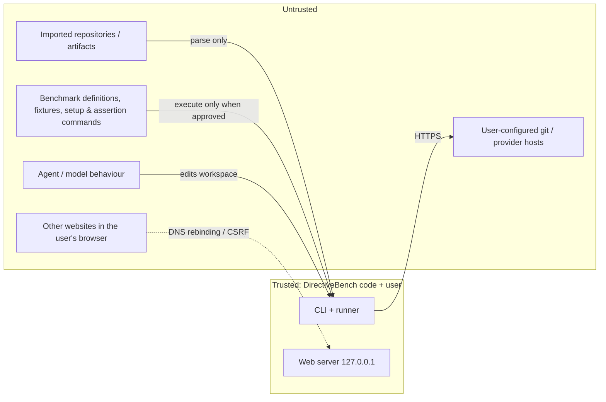

# Security and Privacy

Decisions: [ADR-0007 local runner execution and isolation](../../decisions/0007-local-runner-execution-and-isolation.md), [ADR-0008 secret storage and authentication](../../decisions/0008-secret-storage-and-authentication.md). API-level controls: [SPEC-008](./api-architecture.md). CLI flags: [SPEC-009](./cli-architecture.md).

## 1. Assets and trust boundaries

| Asset | Where |
|---|---|
| User source code and private repositories | Repository cache, workspaces, fixtures |
| Credentials (git tokens, model API keys, agent CLI logins) | OS keychain (planned), agent CLIs' own config dirs (`~/.claude`, `~/.codex`, …) |
| Benchmark results and traces | SQLite DB, logs |
| The user's machine | Everything executed by the runner |

## 2. Threat model

| ID | Threat | Vector | Primary controls |
|---|---|---|---|
| T1 | **Untrusted imported repositories** | Malicious artifact files (huge files, binary blobs, crafted frontmatter, prompt injection aimed at agents). | Parse-only (never execute repo content during discovery); path-based classification; size limits; YAML parsed without custom tags; content rendered as text/escaped markdown in UI (no raw HTML). Prompt injection inside artifacts is an inherent property of what is being evaluated — surfaced, not prevented. |
| T2 | **Untrusted benchmark scripts** | `setup` and `command` assertions run arbitrary programs; agents edit code that tests then execute. | Execution approval per suite version; argv-only; env allowlist; timeouts + process-tree kill; output limits; "Not sandboxed" labelling; Docker sandbox (planned). |
| T3 | **Malicious websites vs localhost** | DNS rebinding to `127.0.0.1:4280`; cross-site form posts / fetch to server actions or `/api/*`. | Loopback binding; Host allowlist in `proxy.ts`; Origin checks for server actions and mutating route handlers; no CORS headers; JSON content-type required for API mutations. |
| T4 | **Secret leakage** | API keys/tokens appearing in agent output, command output, traces, logs, reports, exports, error messages. | No secrets stored in bootstrap; env allowlist (secrets not forwarded to commands); `redactSecrets` on all captured output before persistence; `isSecretEnvName` filter; exports exclude secret refs. |
| T5 | **SSRF via user-configured hosts** | Self-managed GitLab / custom provider base URL pointing at internal services or cloud metadata (`169.254.169.254`). | Planned: scheme allowlist (`https`, `http` only for loopback with explicit opt-in), resolve-and-check IP (deny link-local/metadata ranges; private ranges require explicit confirmation since self-managed hosts are often private), no redirects to different hosts, response size/time limits. |
| T6 | **Path traversal & symlinks** | Fixtures, overlays, artifact file manifests, agent-written files, archive imports containing `../` or symlinks to `~/.ssh`. | Symlinks rejected at fixture/overlay snapshot and artifact import; every relative path normalized and verified to stay under root (`realpath` prefix check); artifact install writes only under the adapter's install directory. |
| T7 | **Supply chain** | Compromised npm dependency; malicious example suites. | Minimal runtime dependencies, lockfile, no install scripts in the published package, `pnpm audit` in CI, bundled examples reviewed in-repo ([SPEC-004](./technology-stack.md#4-dependency-policy)). |
| T8 | **Network exposure** | User binds to `0.0.0.0` on an untrusted network; no auth in MVP. | Non-loopback host refused without `--allow-network-access`; loud warning when enabled; Host allowlist still applies. |
| T9 | **Local agent CLI credentials** | Real agents run with the user's logged-in CLI session; a benchmark prompt or fixture could induce exfiltration. | Agents are invoked only on explicit user action; future Docker mode does not mount credentials by default (§5.3); traces redacted; documented risk. |

## 3. Controls

### 3.1 Implemented in bootstrap (per brief — verify against code)

| Control | Description |
|---|---|
| Loopback binding | Default host `127.0.0.1` (`DEFAULT_HOST`), port 4280. `isLoopbackHost()` gates the `--allow-network-access` requirement. |
| `--allow-network-access` | Required for any non-loopback `--host`; prints a warning that there is no authentication. |
| Host allowlist (`apps/web/proxy.ts`) | Requests whose `Host` header is not `127.0.0.1:<port>`, `localhost:<port>`, `[::1]:<port>` (plus the explicit `--host` value when network access is allowed) are rejected with 403. DNS-rebinding protection. |
| Server action origin checks | Next.js server actions compare `Origin` with `Host`; mutating route handlers reject requests without a same-origin `Origin`. Do not configure `serverActions.allowedOrigins` beyond the allowlist. |
| argv-only commands | `spawn(argv[0], argv.slice(1), { shell: false })`; no string commands. |
| Env allowlist | Commands receive only `PATH`, `LANG`, `TZ` and `HOME` (set to a workspace-local temp dir). Secret-like names (`isSecretEnvName`) are never forwarded. |
| Timeouts & output limits | Per-command timeout, process kill on timeout/cancel, output truncated to `maxOutputBytes`, then redacted. |
| Execution approval | Commands run only if `benchmark_suite_versions.execution_approved_at` is set. Bundled examples are approved at import with `execution_approval_source = 'bundled-example'`. User approval UX is planned. |
| Symlink & traversal rejection | Fixture and overlay snapshotting rejects symlinks and escaping paths. |
| Redaction | `redactSecrets(text, knownSecrets)` in `packages/core/src/redact.ts` (provider key shapes, GitHub/GitLab/Slack tokens, AWS key IDs, bearer headers, private-key blocks) applied before persisting traces/logs. |
| No credentials stored | Bootstrap stores no secrets anywhere; mock agent needs none. |
| Config file permissions | `config.json` written atomically with mode `0600`. |

### 3.2 Planned

- Execution approval UX: show the full list of commands (setup + assertions) with argv before approving; approval recorded per suite version; re-approval required for every new version.
- OS keychain secret storage with DB-side references only ([ADR-0008](../../decisions/0008-secret-storage-and-authentication.md)); known secret values passed to `redactSecrets`.
- SSRF controls (T5), TLS policy (§7), Docker sandbox (§5.2).
- Data-dir permission hardening (`0700` directory) and DB file `0600`.
- Content-Security-Policy headers for the web UI (no inline scripts beyond Next.js needs).

## 4. Command execution rules (normative)

1. No shell. A `command` is a non-empty string array.
2. `cwd` is the workspace root; the engine refuses to run if it cannot verify the workspace is under the OS tmp workspace root.
3. Environment = allowlist only; adapters may add documented, non-secret variables.
4. Every process has a timeout; on timeout/cancel the process (and on POSIX its process group) is killed.
5. Output capture is bounded; truncation is recorded explicitly in the result.
6. Captured output is redacted before it reaches the DB, logs or UI.
7. Workspaces are deleted after the run unless `runner.keepWorkspaces` is true.

## 5. Sandboxing

### 5.1 `local-process` is NOT a sandbox

Processes run as the user with full filesystem and network access. The controls in §4 reduce accidents and leakage; they do not contain a malicious program. The UI and reports label every such run "Not sandboxed", and `sandboxed=false` is part of recorded environment metadata.

### 5.2 Docker environment (planned)

| Setting | Value |
|---|---|
| Network | `--network none` by default; opt-in allowlisted egress per suite (later) |
| Mounts | Fixture snapshot read-only; workspace as the only writable bind mount (or a copy inside the container); no home directory, no Docker socket |
| User | Non-root UID; `--cap-drop ALL`; `--security-opt no-new-privileges`; read-only root filesystem with tmpfs `/tmp` |
| Resources | `--memory`, `--cpus`, `--pids-limit`, wall-clock timeout enforced by the runner |
| Credentials | No SSH keys, git credentials, cloud credentials or agent CLI config mounted by default |
| Images | Pinned by digest in the suite definition; pulled only with user consent |

If Docker is unavailable, the runner fails the job with a clear `infrastructure-error` — never silently falls back to `local-process`.

### 5.3 Authenticated local agent CLIs and sandboxes

Real agents (Claude Code, Codex, Cursor Agent) authenticate with credentials stored in their own user-level config, and need network access to their model APIs. Consequences:

- In `local-process`, the agent runs with the user's login and can reach anything the user can. User-level skills/instructions in the agent's own config dirs cannot be excluded and are recorded as an uncontrolled difference ([SPEC-112](../features/red-green-evaluation.md)).
- In `docker`, the agent needs (a) a token passed via an environment variable or a minimal mounted credential file, and (b) egress to its provider endpoint only. Each adapter declares the credential mechanism it supports; mounting the full `~/.claude`/`~/.codex` directory is not allowed. Per-agent support: Assumption — requires validation ([SPEC-203](../integrations/claude-code.md), [SPEC-204](../integrations/openai-codex.md), [SPEC-205](../integrations/cursor.md)).
- Setup and assertion commands always run without agent credentials, even when the agent step has them.

## 6. Privacy

- **No telemetry**, analytics, crash reporting or update pings. Next.js telemetry disabled for the spawned server.
- Nothing leaves the machine except **user-initiated** calls: git fetches to configured hosts, model/agent provider calls made by the agent or harness the user selected, and `npx` package download itself.
- All data (DB, fixtures, logs, cache) stays in the data directory; users can delete it at any time.
- Reports and exports (planned) contain artifact content and traces; they are produced only on explicit action and exclude secret references.

## 7. TLS

- Never disable certificate verification (`NODE_TLS_REJECT_UNAUTHORIZED=0` is not set, not suggested, and `doctor` warns if it is present in the environment).
- Custom CA support for self-managed GitLab / internal providers via Node's `NODE_EXTRA_CA_CERTS` or a configured CA bundle path in `config.json` (planned), applied per connection.

## 8. Credential boundaries for a future shared server

- Secrets are owned by a user or a team scope, encrypted at rest server-side, and never returned to clients after creation (write-only).
- Runners receive short-lived, job-scoped credentials only for the providers that job needs; credentials are never written to the workspace.
- Results and traces are redacted before upload; access to traces follows repository/team permissions.
- Authentication, roles and CSRF/session controls replace the loopback-only assumption. Details: [SPEC-011](./self-hosting-architecture.md).

## Implementation status

- **Implemented in bootstrap (verified in code 2026-10-14):** `DEFAULT_HOST = 127.0.0.1`, `isLoopbackHost`, `redactSecrets`, `isSecretEnvName`, atomic `config.json` writes with mode `0600` (`packages/core/src`).
- **Implemented per brief, being written concurrently (verify before changing status):** `--allow-network-access` gate, Host allowlist in `proxy.ts`, server action origin checks, argv-only command execution with env allowlist/timeouts/truncation, execution approval flag (bundled examples auto-approved), fixture symlink/traversal rejection, "Not sandboxed" labelling.
- **Not implemented:** approval UX, keychain secret storage, SSRF controls, custom CA configuration, `doctor` TLS warning, Docker sandbox, CSP headers, data-dir permission hardening, shared-server credential model.
