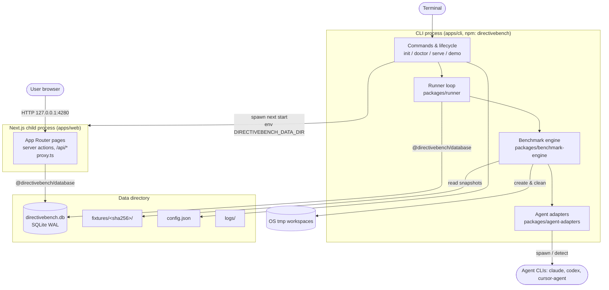
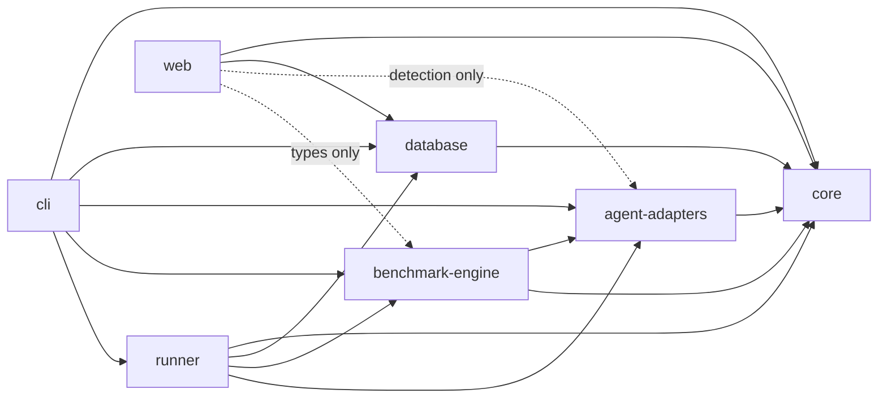
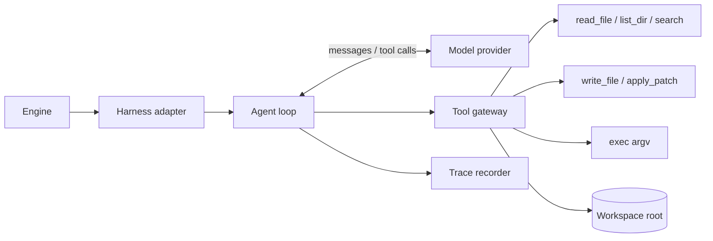

# System Architecture

Decisions behind this architecture: [ADR-0001 local-first](../../decisions/0001-local-first-architecture.md), [ADR-0003 monorepo](../../decisions/0003-monorepo-architecture.md), [ADR-0004 CLI distribution](../../decisions/0004-native-cli-distribution.md), [ADR-0005 custom benchmark engine](../../decisions/0005-custom-benchmark-engine.md), [ADR-0006 adapters vs providers](../../decisions/0006-agent-adapters-vs-model-providers.md), [ADR-0007 local runner](../../decisions/0007-local-runner-execution-and-isolation.md). Technology versions: [SPEC-004](./technology-stack.md).

## 1. Component diagram



## 2. Packages and responsibilities

| Package | Name | Responsibility | Must NOT |
|---|---|---|---|
| `apps/cli` | `directivebench` (published) | Command parsing (commander), runtime validation, data-dir init, migrations, category seeding, job recovery, runner loop host, spawning the web server, browser open, graceful shutdown. Bundled with tsup; ships `dist/cli.js`, prebuilt `dist/web`, migrations, examples. | Contain domain logic that belongs in packages. |
| `apps/web` | `@directivebench/web` (private) | UI, server actions, `/api/*` route handlers, Host allowlist in `proxy.ts`. Reads/writes via repository functions; enqueues jobs. | Execute benchmarks or spawn agent processes (except read-only CLI detection). |
| `packages/core` | `@directivebench/core` | Domain types and Zod schemas, artifact path classification and parsers, data-dir resolution, config file, hashing, secret redaction, ID generation. | Depend on any other internal package; perform DB access. |
| `packages/database` | `@directivebench/database` | Drizzle schema, generated SQL migrations, `node:sqlite` connection via Drizzle `sqlite-proxy`, repository functions (the persistence boundary). | Expose raw SQL or driver handles to apps; contain business rules beyond persistence invariants. |
| `packages/agent-adapters` | `@directivebench/agent-adapters` | `AgentAdapter` contract, Mock Agent, CLI detection descriptors (Claude Code, Codex, Cursor Agent). | Access the DB or UI. |
| `packages/benchmark-engine` | `@directivebench/benchmark-engine` | Definition format v1, loader/importer, fixture snapshotting, workspace preparation, assertions, scoring, RED/GREEN orchestration. Pure inputs → results + events. | Access the DB, UI or job state. |
| `packages/runner` | `@directivebench/runner` | Job acquisition, heartbeat, cancellation, crash recovery, bounded concurrency; bridges engine events to persistence. | Render UI; parse CLI args. |

Not created (contracts only, in specs): `packages/model-providers`, `packages/git-providers`. `packages/shared` is merged into `core`; shared tooling config lives at the repo root (`tsconfig.base.json`, ESLint config).

### 2.1 Allowed dependency directions



Rules:
- Arrows point from dependent to dependency. No cycles. `core` has no internal dependencies.
- `benchmark-engine` never imports `database` or `runner`.
- `web` imports `benchmark-engine` for **types** only (`import type`) and `agent-adapters` for detection only.
- Future `model-providers` depends on `core` only; future `git-providers` depends on `core` only; the registry sync service (in `runner` or a future `registry` package) composes them with `database`.
- Internal packages are "just-in-time" TypeScript packages (`exports` → `src`); `web` transpiles them (`transpilePackages`), the CLI bundles them. Enforcement: lint rule or dependency check in CI ([SPEC-012](./testing-strategy.md)).

## 3. Process model (local)

`directivebench serve` (default command) — full CLI behaviour in [SPEC-009](./cli-architecture.md):

1. Validate runtime (Node version, `node:sqlite` availability).
2. Ensure data directory and `config.json` ([SPEC-010](./local-installation.md)).
3. Open DB, enable WAL + `busy_timeout`, apply pending migrations.
4. Seed predefined categories (idempotent).
5. Recover jobs: `running` with heartbeat older than 30 s → `interrupted`.
6. Start runner loop in the CLI process.
7. Spawn `next start` bound to `127.0.0.1:4280` (configurable) with `DIRECTIVEBENCH_DATA_DIR`.
8. Open the browser unless `--no-open`.
9. On SIGINT/SIGTERM: abort running jobs (→ `interrupted`), stop the child, close DB.

Two OS processes share one SQLite file in WAL mode. Coordination happens exclusively through database rows (jobs table): the web process inserts `pending` jobs and sets `cancel_requested_at`; the runner polls. There is no IPC channel between web and runner.

## 4. Data flows

### 4.1 Benchmark job lifecycle

```mermaid
sequenceDiagram
  actor U as User
  participant W as Web (server action)
  participant DB as SQLite
  participant R as Runner (CLI process)
  participant E as Benchmark engine
  participant A as Agent adapter
  participant FS as Workspace (tmp)

  U->>W: Run benchmark (suite version, artifact version, agent config)
  W->>DB: INSERT job (pending) + benchmark_run (pending)
  W-->>U: redirect to run detail (polls)
  loop poll
    R->>DB: UPDATE jobs SET status='running' WHERE status='pending' ... RETURNING
  end
  R->>E: execute(definition, artifact version, adapter, AbortSignal)
  loop each case × repetition × {RED, GREEN}
    E->>FS: copy fixture snapshot; GREEN installs artifact
    E->>FS: run setup commands (argv, env allowlist, timeout)
    E->>A: run(prompt, workspace, limits)
    A-->>E: agent result + trace events
    E->>FS: copy verification overlay
    E->>FS: evaluate assertions
    E-->>R: event (agentRunCompleted)
    R->>DB: INSERT agent_run, assertion_results
  end
  par heartbeat every 5 s
    R->>DB: UPDATE jobs SET heartbeat_at
  and cancellation
    U->>W: Cancel
    W->>DB: SET cancel_requested_at
    R->>DB: read flag → AbortSignal.abort()
  end
  E-->>R: scored summary (aggregates, verdict, comparability key)
  R->>DB: UPDATE benchmark_run (summary), job → completed | failed | cancelled
  R->>FS: remove workspaces unless keepWorkspaces
```

Details: execution [SPEC-110](../features/benchmark-execution.md), RED/GREEN [SPEC-112](../features/red-green-evaluation.md), scoring [SPEC-111](../features/benchmark-scoring.md), runner [SPEC-114](../features/runner-management.md).

### 4.2 Repository sync flow (future)

```mermaid
sequenceDiagram
  participant W as Web / CLI sync
  participant DB as SQLite
  participant R as Runner
  participant G as Git provider
  participant P as Artifact parsers

  W->>DB: INSERT job (kind=repository-sync)
  R->>DB: acquire job
  R->>G: fetch/clone into cache/ (TLS verified, host checked)
  G-->>R: tree at commit SHA
  R->>P: classify paths + parse files (no symlinks, size limits)
  P-->>R: candidates {path, type, format, files, contentHash, metadata}
  R->>DB: upsert artifacts / occurrences; insert new artifact_versions by hash
  R->>DB: mark missing occurrences 'removed' (never delete versions or user metadata)
  R->>DB: INSERT sync_run summary; job completed
```

Spec: [SPEC-105](../features/repository-synchronization.md).

## 5. Cross-cutting concerns

- **Events:** the engine emits typed events (`runStarted`, `agentRunStarted`, `agentRunCompleted`, `assertionEvaluated`, `warning`, `runCompleted`). The runner persists them; the UI reads persisted state (polling; SSE optional later).
- **Errors:** engine distinguishes `agent-error`, `timeout`, `cancelled`, `infrastructure-error` per agent run; job `failed` is reserved for failures outside a single agent run.
- **Configuration:** `config.json` (Zod) with CLI flags and env vars taking precedence ([SPEC-115](../features/settings-and-configuration.md)).
- **Logging:** structured lines to `<dataDir>/logs/`; all captured process output passes through redaction ([SPEC-007](./security-and-privacy.md)).

## 6. Extension points

All contracts are TypeScript interfaces in the listed package with Zod-validated inputs/outputs. Registration is static (code-level registry) in MVP; no dynamic plugin loading.

| Extension point | Package | Contract (summary) | Status |
|---|---|---|---|
| **Agent adapter** | `agent-adapters` | `id`, `displayName`, `capabilities` (e.g. `execute`, `installSkill`, `modelSelection`, `tokenUsage`, `nonInteractive`), `detect(): {installed, version, path}`, `install(artifactVersion, workspace)` (adapter-specific convention, e.g. mock → `.agents/skills/<slug>/`), `run({prompt, workspace, model?, limits, signal}) → {status, outputs, trace, usage?}`. | Mock implemented; detection descriptors implemented; real execution not implemented. |
| **Model provider** | `model-providers` (future) | `id`, `listModels()`, `complete/stream({model, messages, tools?, signal})`, `usage`, auth mode (`api-key` via keychain ref, `none` for local endpoints), base URL for compatible endpoints. | Not implemented. Integrations SPEC-206…211. |
| **Git provider** | `git-providers` (future) | `kind` (local, github, gitlab), `validateHost(url)`, `listRepositories?()`, `fetch(repo, ref) → {commitSha, rootDir}`, auth via keychain ref. | Not implemented. Integrations SPEC-201, SPEC-202. |
| **Artifact parser** | `core` | `classifyArtifactPath(relPath) → {format, type, rootDir} | null` (path-based; arbitrary Markdown is never an artifact) and `parseArtifactFile(relPath, content) → {name, description, activation, frontmatter, body, references, warnings}`. Built-in formats: `skill-md`, `agents-md`, `claude-md`, `claude-rule`, `copilot-instructions`, `copilot-path-instructions`, `cursor-rule`, `gitlab-duo-chat-rules`. Adding a format = extend `ARTIFACT_FORMATS`, classification and parse branch in `packages/core/src/artifacts.ts`. | Implemented (parsers); used for imports. |
| **Assertion type** | `benchmark-engine` | Zod schema for config (discriminated by `type`) + `evaluate(ctx) → {score ∈ [0,1], passed, message, details}`; declares `deterministic: boolean`. | `command`, `file-exists`, `file-contains`, `changed-files` implemented; others planned. |
| **Execution environment** | `benchmark-engine` | `kind`, `sandboxed: boolean`, `prepare`, `exec(argv, opts)`, `dispose`. | `local-process` implemented; `docker` rejected with clear error. |

## 7. Future custom coding harness (design only)

A DirectiveBench-owned harness lets benchmarks evaluate **models** directly (via model providers) under a fully controlled tool set, complementing third-party agent CLIs. It is exposed as just another agent adapter (`id: directivebench-harness`).



| Concern | Design |
|---|---|
| **File read/edit** | Tools `read_file`, `list_dir`, `search`, `write_file`, `apply_patch`. Every path is resolved with `realpath` and must stay inside the workspace root; symlinks rejected; per-file and total byte limits. |
| **Command execution** | `exec` takes argv only (no shell), runs via the active execution environment (local-process or docker), env allowlist, per-command timeout, output truncation + redaction. Optional allowlist of executables per suite. |
| **Tool-call history** | Every model message and tool call/result is recorded as an ordered trace (step index, tool name, arguments, truncated result, duration) and stored with the agent run. |
| **Workspace isolation** | One fresh workspace per agent run; harness never receives paths outside it; `HOME` points to a workspace-local temp dir; network policy delegated to the environment (docker: `none`). |
| **Token usage** | Provider-reported input/output/cached tokens accumulated per run; cost estimates only when the provider publishes prices (otherwise omitted). |
| **Limits** | `maxSteps`, `maxToolCalls`, `timeoutSeconds`, `maxOutputTokens`, `maxOutputBytes`; exceeding any → run status `timeout` (time) or `agent-error` (step/token cap) with reason. All limits are part of the comparability key. |
| **Security model** | The model is untrusted: tool gateway is the only capability; no secrets in the workspace or tool outputs; provider credentials stay in the harness host process, never passed to tools. |

## 8. Future self-hosted mapping (summary)

| Local component | Self-hosted counterpart |
|---|---|
| SQLite via repository functions | PostgreSQL behind the same repository interface |
| Runner loop in CLI process | Standalone/remote runners acquiring jobs over an authenticated API |
| Loopback binding, no auth | Authentication, users, roles, CSRF/session hardening |
| OS keychain secrets | Server-side secret store; per-user credential boundaries |
| Local data dir fixtures | Object storage, content-addressed |

Full design: [SPEC-011](./self-hosting-architecture.md), [ADR-0009](../../decisions/0009-self-hosted-readiness.md).

## Implementation status

- **Implemented in bootstrap (per brief; being written concurrently — verify against code):** package layout of §2 (core, database, agent-adapters, benchmark-engine, runner, web, cli); process model §3; job lifecycle §4.1 with polling acquisition, heartbeat, cancellation, interrupted recovery; Mock Agent and CLI detection; artifact parsers; four assertion types; `local-process` environment.
- **Partially:** dependency-direction enforcement (convention; automated CI check not confirmed); engine event set (exact names to be aligned with `packages/benchmark-engine`).
- **Not implemented:** repository sync flow §4.2; model providers; git providers; real agent execution; docker environment; custom coding harness §7; self-hosted mapping §8; SSE/live updates.
