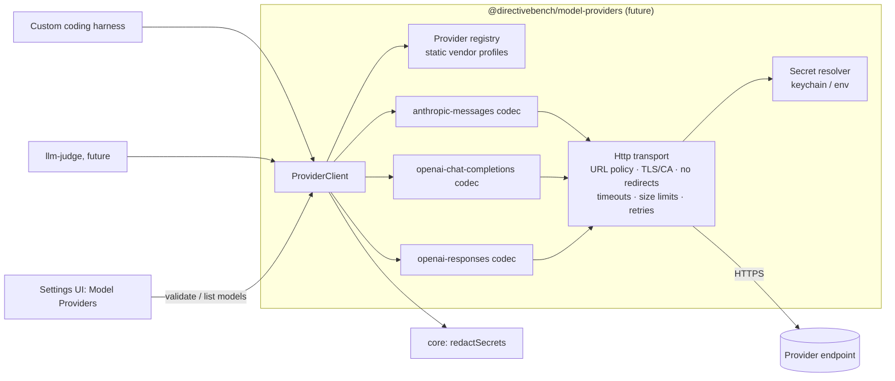
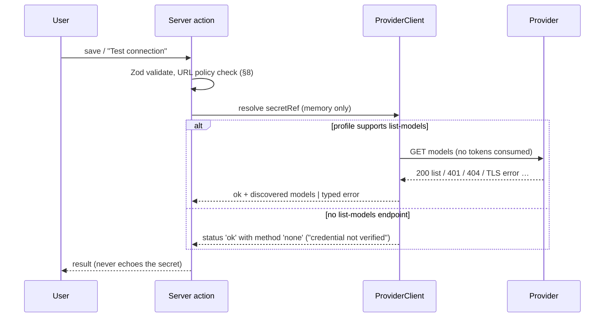

# SPEC-211 — Custom model providers and the shared provider connection model

> All "Confirmed" statements were checked against the cited official documentation on 2026-10-14.
> External APIs change; re-verify before implementation. Source keys ([S1] …) are listed in §14.

## 1. Purpose

This spec has two jobs:

1. It defines the **shared provider connection model** and protocol clients that every model
   provider integration reuses: [Anthropic](./anthropic-api.md) (SPEC-206),
   [OpenAI](./openai-api.md) (SPEC-207), [DeepSeek](./deepseek.md) (SPEC-208),
   [Z.AI GLM](./zai-glm.md) (SPEC-209) and [Moonshot Kimi](./kimi.md) (SPEC-210). Those specs only
   describe vendor-specific defaults, quirks and verified facts.
2. It specifies **custom providers**: any user-configured endpoint that speaks an OpenAI-compatible
   or Anthropic-compatible protocol, such as a self-hosted inference server, an organisation's LLM
   gateway or another vendor.

**Model providers are independent of agent harnesses** ([ADR-0006](../../decisions/0006-agent-adapters-vs-model-providers.md)).
A provider is an API endpoint family that serves models. A harness is the program that reads
instructions, edits files and runs tools. The planned consumers of a provider connection are:

| Consumer | Role | Spec |
|---|---|---|
| Future **custom coding harness** (DirectiveBench-owned agent loop with file read/edit, command execution, tool-call history, workspace isolation, token usage, step/time limits) | Primary consumer. Calls the provider directly. | [SPEC-110 §19](../features/benchmark-execution.md#19-future-extensions), [SPEC-003 §7](../foundation/system-architecture.md#7-future-custom-coding-harness-design-only) |
| Agent adapters that can be pointed at a compatible endpoint (for example Claude Code with `ANTHROPIC_BASE_URL`) | The connection supplies base URL, credential and model to the adapter's subprocess environment. The adapter decides whether it supports this. | [SPEC-203](./claude-code.md) |
| Future `llm-judge` assertion | Planned. It must record the judge provider, model, rubric and prompt version. | [SPEC-110](../features/benchmark-execution.md) |

This spec does not repeat the harness design. It only defines what the harness can expect from a
provider.

**Protocol compatibility does not guarantee behavioural compatibility.** An endpoint that accepts
OpenAI- or Anthropic-shaped requests may ignore fields, map model names silently, tokenise
differently or support tools differently. Documented examples are in §10. DirectiveBench therefore
records exactly which provider, endpoint and model served each run, and never treats two providers
as interchangeable.

## 2. Official integration options

There is no single standard. DirectiveBench supports three wire protocols. A provider type can
expose more than one.

| Protocol id | Request | Reference definition |
|---|---|---|
| `anthropic-messages` | `POST {baseUrl}/v1/messages` | Anthropic Messages API: Confirmed ([S1], 2026-10-14) |
| `openai-chat-completions` | `POST {baseUrl}/chat/completions` (base URL usually ends in `/v1`) | OpenAI Chat Completions, still supported: Confirmed ([S2], 2026-10-14) |
| `openai-responses` | `POST {baseUrl}/responses` | OpenAI Responses, "recommended for all new projects": Confirmed ([S2], 2026-10-14) |

Vendors that officially document compatible endpoints:

| Vendor / server | Chat Completions | Responses | Anthropic Messages | Source |
|---|---|---|---|---|
| Anthropic | Compatibility layer, "primarily intended to test and compare model capabilities, and is not considered a long-term or production-ready solution" | — | Native | Confirmed ([S3], 2026-10-14) |
| OpenAI | Native | Native | — | Confirmed ([S2], 2026-10-14) |
| DeepSeek | Yes | Yes (stateless) | Yes (`/anthropic`) | Confirmed, see [SPEC-208](./deepseek.md) |
| Z.AI | Yes | Yes (Coding Plan endpoint) | Yes | Confirmed, see [SPEC-209](./zai-glm.md) |
| Moonshot Kimi | Yes | Yes | Yes | Confirmed, see [SPEC-210](./kimi.md) |
| Ollama (local server) | Yes (`http://localhost:11434/v1`) | Yes (no `previous_response_id`) | Subset (`/v1/messages`) | Confirmed ([S4], [S5], 2026-10-14) |
| Other servers and gateways (vLLM, LM Studio, LiteLLM, …) | — | — | — | Assumption — requires validation per product. Users configure them as custom providers at their own risk. |

## 3. Authentication methods

| Mechanism | Wire format | Typical use |
|---|---|---|
| `bearer` | `Authorization: Bearer <secret>` | OpenAI, DeepSeek, Z.AI, Kimi, most gateways. Anthropic also accepts it: Confirmed ([S1], 2026-10-14) |
| `x-api-key` | `x-api-key: <secret>` | Anthropic (legacy fallback, still supported) and the DeepSeek Anthropic endpoint |
| `none` | No credential | Local servers. Ollama: "not required locally": Confirmed ([S4], 2026-10-14) |

Rules ([ADR-0008](../../decisions/0008-secret-storage-and-authentication.md), API Key Mode):

- The secret is referenced, never stored in SQLite or `config.json`. `secretRef` uses the
  `SecretRef` shape of [SPEC-115 FR-115-30](../features/settings-and-configuration.md):
  `{ source: 'keychain', name }` (OS credential store) or `{ source: 'env', name }` (the name of an
  environment variable). Repository credentials currently use a different shape
  (`{ kind, account | variable }`, [SPEC-104 FR-104-08](../features/repository-management.md)). The
  two should be unified before implementation; this is an open inconsistency between SPEC-104 and
  SPEC-115.
- Secrets are sent only in headers, never in URL query strings.
- Additional headers: a connection may define non-secret static headers (for example
  `anthropic-version`, `OpenAI-Project`). A header whose value is secret must also use a
  `secretRef`. Headers named `authorization`, `x-api-key`, `cookie` or `proxy-authorization`
  must not take literal values.
- OAuth or subscription logins of vendor apps are **not** a provider auth mechanism. Subscription
  use only happens through an agent CLI in Local Subscription Mode ([SPEC-203](./claude-code.md)).

## 4. Capability requirements

| Capability | Needed by the harness | Notes |
|---|---|---|
| Tool / function calling | **Required** | Without it the harness cannot read or edit files. |
| Usage reporting (input/output tokens) | **Required** for token limits and reports | If the provider does not report usage, it is recorded as `unknown`. It is never estimated silently. |
| Context window and max output tokens | **Required** metadata | Used to validate limits before a run. |
| Streaming (SSE) | Strongly recommended | Long non-streaming requests time out. Kimi returns 504 after 900 s without a response (Confirmed, [SPEC-210](./kimi.md)). Anthropic recommends streaming for long requests (Confirmed, [SPEC-206](./anthropic-api.md)). |
| Forced tool choice (`any` / `required` / named) | Optional | Not universal. See §10. The harness must work with `auto`. |
| Structured output (JSON schema) | Optional (harness); required for a future `llm-judge` | Support and strictness vary by provider. |
| Reasoning / thinking controls | Optional | Recorded in run metadata when used. |
| Image input | Not needed in v1 | — |

Each model in a connection has **capability metadata**:

```ts
interface ModelCapabilities {
  toolCalling: Tri; streaming: Tri; structuredOutput: Tri; forcedToolChoice: Tri;
  reasoning: Tri; imageInput: Tri;
  contextWindowTokens: number | null; maxOutputTokens: number | null;
  source: 'provider-api' | 'vendor-docs' | 'user' | 'unknown';   // highest-precedence source wins
  sourceRef?: string;              // doc URL for 'vendor-docs'
  verifiedAt?: string;             // ISO-8601 UTC
}
type Tri = 'yes' | 'no' | 'unknown';
```

The precedence is: provider API (for example the Anthropic Models API `capabilities`,
`max_input_tokens` and `max_tokens`; DeepSeek `context_window`; Kimi `context_length` and
`supports_reasoning`), then a curated vendor-docs table shipped with DirectiveBench (each entry with
its URL and date), then a user declaration, then `unknown`. An `unknown` capability is never assumed
to be present. The harness refuses to start when `toolCalling` is `no`, and warns when it is
`unknown`.

## 5. Architecture

Code location: the future package `packages/model-providers` (`@directivebench/model-providers`). It
depends on `core` only ([SPEC-003 §2, §6](../foundation/system-architecture.md)). The package is not
created in bootstrap.



- **Vendor profile**: static data per `providerType`. It holds the default base URLs per protocol,
  the auth mechanism, the list-models path, rate-limit header names, error-mapping hints and the
  documented quirks. Profiles are code, reviewed in-repo. They are not downloaded.
- **Codec**: translates the normalised request and response to and from one wire protocol. The
  translation is lossy, so the raw request and response (redacted, truncated) are kept in the trace
  for audit.
- **Contract** (aligns with [SPEC-003 §6](../foundation/system-architecture.md#6-extension-points)):

```ts
interface ModelProviderClient {
  connection: ProviderConnection;
  listModels(signal: AbortSignal): Promise<DiscoveredModel[]>;          // may be unsupported → throws 'unsupported'
  complete(req: ModelRequest, signal: AbortSignal): Promise<ModelResponse>;
  stream(req: ModelRequest, signal: AbortSignal): AsyncIterable<ModelStreamEvent>;
}
interface ModelRequest {
  model: string; system?: string; messages: Message[]; tools?: ToolDef[];
  toolChoice?: 'auto' | 'none' | 'required' | { name: string };
  maxOutputTokens: number; reasoning?: { effort?: string };
  providerOptions?: Record<string, unknown>;     // escape hatch; recorded in run metadata
}
interface ModelResponse {
  content: ContentBlock[]; toolCalls: ToolCall[];
  stopReason: 'end' | 'tool-use' | 'max-tokens' | 'refusal' | 'other';
  usage: { inputTokens?: number; outputTokens?: number; cacheReadTokens?: number;
           cacheWriteTokens?: number; reasoningTokens?: number; raw: unknown } | null;
  responseModel?: string;          // model id echoed by the provider
  requestId?: string;              // e.g. Anthropic `request-id`, OpenAI `x-request-id`
  rateLimit?: RateLimitSnapshot;   // parsed headers, when present
}
```

### Provider connection model (data)

A connection is stored in the database as `ProviderConnection`
([SPEC-005 §4](../foundation/domain-model.md)). The secret value is never part of it.

| Field | Type | Notes |
|---|---|---|
| `id` | `prv_…` | Prefixed random id |
| `providerType` | `anthropic` \| `openai` \| `deepseek` \| `zai` \| `moonshot` \| `openai-compatible` \| `anthropic-compatible` | Values from SPEC-005 |
| `displayName` | string | User-editable |
| `protocol` | `anthropic-messages` \| `openai-chat-completions` \| `openai-responses` | One per connection. Vendors with several protocols need several connections, because behaviour differs per protocol. |
| `baseUrl` | URL | Defaulted from the vendor profile and editable. Required for custom types. Normalised: no credentials, no query, no fragment. |
| `auth` | `{ mechanism: 'bearer' \| 'x-api-key' \| 'none', secretRef?: SecretRef }` | §3 |
| `headers` | `Record<string,string>` | Non-secret static headers only |
| `models` | `ProviderModel[]` | `{ id, displayName?, capabilities: ModelCapabilities, discovered: boolean, deprecated?: boolean }` |
| `network` | `{ allowPrivateNetwork: boolean; allowInsecureHttp: boolean; caBundlePath?: string; timeoutMs: number; maxResponseBytes: number }` | §8. Defaults: `false`, `false`, none, 600 000, 32 MiB. These defaults are Assumptions — tune after measurement. |
| `validation` | `{ status: 'never' \| 'ok' \| 'error'; code?: ProviderErrorCode; checkedAt?: string; method: 'list-models' \| 'none' }` | §5.1 |
| `rateLimitInfo` | last parsed rate-limit snapshot, plus a documentation link | Informational only |
| `experimental` | boolean | Always `true` for `*-compatible` types. The UI shows "Custom endpoint — behaviour not verified by DirectiveBench". |

### 5.1 Connection validation



Validation must never make a billable request by default. A separate, explicitly labelled
"Send test request (consumes tokens)" action may send one minimal request with a tiny
`maxOutputTokens`.

## 6. Relevant API or CLI interfaces

| Protocol | Generation | List models | Usage fields |
|---|---|---|---|
| `anthropic-messages` | `POST /v1/messages` (SSE with `stream: true`) | `GET /v1/models` (Anthropic). Other vendors: varies. | `usage.input_tokens`, `output_tokens`, `cache_creation_input_tokens`, `cache_read_input_tokens`: Confirmed ([S6], 2026-10-14) |
| `openai-chat-completions` | `POST /chat/completions` | `GET /models` | `usage.prompt_tokens`, `completion_tokens` (Confirmed via Anthropic's compatibility table [S3]). Other fields are vendor-specific. |
| `openai-responses` | `POST /responses` | `GET /models` | Vendor-specific; see SPEC-207 |

Vendor-specific endpoints, parameters and limits are in SPEC-206 to SPEC-210. For a custom provider,
DirectiveBench only assumes the request and response shapes of the chosen protocol. Everything else
is `unknown` until the user declares it or it is discovered.

## 7. Configuration

- Managed in the **Model Providers** settings page ([SPEC-115](../features/settings-and-configuration.md)).
  It is a "Planned — not implemented" page in bootstrap.
- Non-secret connection data lives in the database. Secrets live in the OS keychain, or the
  connection names an environment variable (fallback for CI and headless Linux).
- A benchmark selects a model with `execution.model: { provider, model }`. `provider` refers to a
  connection id or a unique connection name. This resolution rule is an Assumption — requires
  validation in [SPEC-108](../features/benchmark-definition-format.md). Compatibility between the
  adapter and the connection is validated before enqueue
  ([ADR-0006](../../decisions/0006-agent-adapters-vs-model-providers.md)).

Example of a custom connection (non-secret part only):

```json
{
  "providerType": "openai-compatible",
  "displayName": "Team vLLM (LAN)",
  "protocol": "openai-chat-completions",
  "baseUrl": "https://llm.internal.example/v1",
  "auth": { "mechanism": "bearer", "secretRef": { "source": "keychain", "name": "provider-prv_7h2k" } },
  "network": { "allowPrivateNetwork": true, "allowInsecureHttp": false, "caBundlePath": "/etc/ssl/company-ca.pem", "timeoutMs": 600000, "maxResponseBytes": 33554432 },
  "models": [{ "id": "my-coder-model", "discovered": true, "capabilities": { "toolCalling": "unknown", "source": "unknown" } }]
}
```

## 8. Security concerns

- **Secrets** ([ADR-0008](../../decisions/0008-secret-storage-and-authentication.md)): OS keychain
  (planned) or env reference. No plaintext by default. Secret values are resolved per request, held
  in memory only, and registered with `redactSecrets` before any output is persisted.
  `Authorization`, `x-api-key` and secret headers are never written to logs, traces, error messages
  or reports. Raw request/response capture strips all headers except an allowlist (`request-id`,
  `x-request-id`, rate-limit headers).
- **No secrets in traces**: the harness trace stores messages, tool calls and usage, never request
  headers. Provider error bodies are redacted before persistence, because some echo parts of the
  request.
- **Data egress**: prompts, artifact content and any file content the model reads are sent to the
  provider. Before the first run against a connection, the UI shows "Data will be sent to `<host>`".
  Requests are only sent on explicit user action.
- **Provider-side storage**: some APIs store requests by default. For example, OpenAI Responses
  store by default, with `store: false` to opt out (Confirmed, [SPEC-207](./openai-api.md)). Vendor
  profiles set the non-storing option where the provider documents one.
- **SSRF and user-configured URLs** (threat T5 in [SPEC-007](../foundation/security-and-privacy.md)):
  - Scheme allowlist: `https`. `http` only when `allowInsecureHttp` is set, and the UI warns that the
    secret travels unencrypted. For `localhost`/loopback, `http` is allowed with
    `allowPrivateNetwork`, because local servers commonly use it.
  - Resolve the host and check every resolved IP. Link-local and cloud metadata addresses
    (`169.254.0.0/16`, `fe80::/10`, `fd00:ec2::254`) are always denied. Loopback, RFC 1918, CGNAT
    (`100.64.0.0/10`) and IPv6 ULA (`fc00::/7`) addresses require `allowPrivateNetwork: true`, which
    the user sets explicitly. The connection then pins the checked IP, to defeat DNS rebinding.
  - **No redirects** (`redirect: 'manual'`, any 3xx is an error). A credential is never sent to a host
    other than the configured one.
  - Response size limit (`maxResponseBytes`) and timeouts (connect, first byte, total).
- **TLS**: verification is never disabled. Custom CAs come from `caBundlePath` (PEM) per connection,
  or process-wide from `NODE_EXTRA_CA_CERTS`. Node ignores both the bundled and the extra CAs when a
  `ca` option is set explicitly, so a per-connection bundle must be **appended** to
  `tls.rootCertificates`, not substituted. Node behaviour: Confirmed ([S7], 2026-10-14).
  `NODE_TLS_REJECT_UNAUTHORIZED=0` is never set or suggested ([SPEC-007 §7](../foundation/security-and-privacy.md#7-tls)).
- **Model output is untrusted**: tool calls are executed only by the harness tool gateway under
  [SPEC-110](../features/benchmark-execution.md) rules. Provider credentials are never exposed to
  tools or to the workspace environment.
- **Cost**: limits (`maxSteps`, tokens, optional `maxCostUsd`) are enforced by the harness. Cost is
  shown only when the vendor publishes prices, and is labelled as an estimate.

## 9. Error handling

Normalised error codes (`ProviderErrorCode`) reuse the reasons in [SPEC-203](./claude-code.md) where
they overlap:

| Code | Typical source | Retry | Agent run status ([SPEC-110 FR-110-22](../features/benchmark-execution.md)) |
|---|---|---|---|
| `auth-invalid` | 401; 403 permission | No | `agent-error` |
| `billing` | Quota, balance or spend cap: OpenAI `insufficient_quota` (429), Anthropic spend cap (429 without `retry-after`), DeepSeek 402, Z.AI business code 1113, Kimi `exceeded_current_quota_error` | **No** (it does not clear by waiting) | `agent-error` |
| `rate-limited` | 429 with or without `retry-after`; Kimi/DeepSeek concurrency limits | Yes, bounded | `agent-error` after retries are exhausted |
| `overloaded` | Anthropic 529, OpenAI 503, Kimi `engine_overloaded_error`, DeepSeek 503 | Yes, bounded | `agent-error` |
| `model-not-found` | 404 or unknown-model errors | No | `agent-error`. Rejected before enqueue when detectable. |
| `invalid-request` | 400, 413, 422 | No | `agent-error` (it may reveal a codec bug, so the raw body is logged redacted) |
| `server-error` | 500, 502, 504 | Yes, bounded | `agent-error` |
| `timeout` | No response within `timeoutMs` | No (counts toward wall time) | `timeout` if the run's wall clock is exceeded, otherwise `agent-error` |
| `network` | DNS, connection refused or reset | Yes, bounded | `agent-error` |
| `tls` | Certificate verification failed | No | `agent-error`, with a hint to configure a CA bundle |
| `url-policy` | SSRF rule violated, redirect received | No | Rejected at validation |
| `stream-error` | Error event after HTTP 200 (Anthropic documents mid-stream errors [S8]) | Per the inner error type | Same as the inner error |

Retry policy: exponential backoff with jitter. `retry-after` is honoured as a minimum wait. Retry
attempts and total retry time are capped (defaults: 3 attempts, 120 s — Assumption, to be tuned).
Billing and auth errors are never retried. SDK-internal retries are disabled, so that retries are
counted once. Every retry is recorded in the trace. Rate-limit headers are parsed into
`RateLimitSnapshot` when present and shown in the UI. They are not used for pre-emptive throttling in
v1.

## 10. Compatibility restrictions

Documented behaviour differences show that protocol compatibility is not behavioural compatibility.
All items below were Confirmed on 2026-10-14 from the cited vendor docs:

| Endpoint | Documented difference |
|---|---|
| Anthropic OpenAI-compat layer | "Most unsupported fields are silently ignored". `strict` on tools is ignored, `response_format` is ignored, system/developer messages are hoisted and concatenated ([S3]). |
| DeepSeek Anthropic endpoint | Unsupported model names are **automatically mapped** to `deepseek-flash`. `anthropic-version` is ignored. `budget_tokens` is ignored. `document` blocks are not supported ([SPEC-208](./deepseek.md)). |
| DeepSeek Chat Completions | `required` and named `tool_choice` are not supported in thinking mode ([SPEC-208](./deepseek.md)). |
| Z.AI Chat Completions | `tool_choice` only supports `auto` ([SPEC-209](./zai-glm.md)). |
| Kimi OpenAI endpoints | `thinking` must be passed as an extension field (`extra_body`) ([SPEC-210](./kimi.md)). |
| Ollama Anthropic subset | `tool_choice` is not supported. Token counts are approximations ([S5]). |
| Anthropic native | Some current models reject forced tool use (`tool_choice` `any`/`tool`) with 400 ([SPEC-206](./anthropic-api.md)). |

Consequences:

- Run metadata records `providerType`, `protocol`, base-URL host, requested model id,
  **provider-reported model id** (`responseModel`), the vendor profile version, and any
  `providerOptions`. All of these are part of the comparability key
  ([SPEC-111](../features/benchmark-scoring.md)). The same model name on two providers is never
  aggregated.
- If `responseModel` differs from the requested id, the run gets an `uncontrolled-difference`
  warning. Silent remapping is then visible.
- Token counts come from different tokenisers and are not comparable across providers. Reports show
  them per run only.
- Custom endpoints are labelled experimental. Any capability not declared or discovered is `unknown`.

## 11. Test strategy

Follows [SPEC-012 §6–7](../foundation/testing-strategy.md):

- **No paid API calls in CI.** The default workflow has no provider secrets.
- **Mocked HTTP**: a local `node:http` test server replays recorded request/response fixtures per
  protocol (secrets scrubbed, vendor and date recorded). Coverage: non-streaming, SSE streaming
  (including DeepSeek-style `: keep-alive` comments and blank lines, and a mid-stream error event),
  tool-call round trips, usage parsing, every row of the §9 error table, and `retry-after` handling
  with fake timers.
- **Security tests**: the URL policy (schemes, private and metadata IPs, IPv6, DNS-rebinding pin,
  3xx rejection); TLS against a throwaway CA generated at test time (fails without the bundle,
  passes with it, and the default trust store is still present); redaction (the secret never
  appears in persisted traces, logs or thrown error messages).
- **Contract conformance suite** that every vendor profile passes against its fixtures.
- **Opt-in live tests**: `DIRECTIVEBENCH_LIVE_TESTS=1` plus the provider's own key variable. They
  run only list-models and at most one minimal request with tiny `maxOutputTokens`, and assert
  structure only. They are never part of default CI.

## 12. Acceptance criteria

- [ ] AC-1: A connection can be created for each `providerType` × supported `protocol`. Saving it
  never writes the secret to SQLite, `config.json`, logs or the API response.
- [ ] AC-2: "Test connection" uses only a non-billable list-models call (or reports
  "credential not verified" when the vendor has none) and returns a typed `ProviderErrorCode` on
  failure.
- [ ] AC-3: A base URL that resolves to a private or loopback address is rejected unless
  `allowPrivateNetwork` is set. A metadata/link-local address is always rejected. A 3xx response is
  rejected and the credential is not re-sent.
- [ ] AC-4: With a self-signed endpoint, validation fails with `tls`. After configuring
  `caBundlePath` it succeeds, and public endpoints still verify.
- [ ] AC-5: Capability metadata shows its source. `unknown` capabilities are not treated as
  supported. The harness refuses `toolCalling: 'no'`.
- [ ] AC-6: Every recorded run stores provider type, protocol, host, requested and reported model,
  and they feed the comparability key. A requested/reported mismatch produces a warning.
- [ ] AC-7: Billing/quota errors are not retried. Rate-limit retries honour `retry-after` and stop at
  the cap.
- [ ] AC-8: The CI suite runs without network access to any provider.

## 13. Current implementation status

- **Implemented in bootstrap:** nothing. No `packages/model-providers` package, no provider
  connections, no secret storage, no harness.
- **Partially implemented:** none. `redactSecrets` in `@directivebench/core` exists (per
  [SPEC-007](../foundation/security-and-privacy.md)) but is not wired to any provider.
- **Not implemented:** everything in this spec. The Model Providers UI page is a "Planned — not
  implemented" placeholder.

## 14. Sources

[S1]: https://platform.claude.com/docs/en/api/overview
[S2]: https://developers.openai.com/api/docs/guides/migrate-to-responses
[S3]: https://platform.claude.com/docs/en/api/openai-sdk
[S4]: https://docs.ollama.com/api/openai-compatibility
[S5]: https://docs.ollama.com/api/anthropic-compatibility
[S6]: https://platform.claude.com/docs/en/api/rate-limits
[S7]: https://nodejs.org/api/cli.html#node_extra_ca_certsfile
[S8]: https://platform.claude.com/docs/en/api/errors

- [S1] Anthropic API overview — https://platform.claude.com/docs/en/api/overview
- [S2] OpenAI, migrate to Responses — https://developers.openai.com/api/docs/guides/migrate-to-responses
- [S3] Anthropic OpenAI SDK compatibility — https://platform.claude.com/docs/en/api/openai-sdk
- [S4] Ollama OpenAI compatibility — https://docs.ollama.com/api/openai-compatibility
- [S5] Ollama Anthropic compatibility — https://docs.ollama.com/api/anthropic-compatibility
- [S6] Anthropic rate limits (usage fields, headers) — https://platform.claude.com/docs/en/api/rate-limits
- [S7] Node.js CLI, `NODE_EXTRA_CA_CERTS` — https://nodejs.org/api/cli.html#node_extra_ca_certsfile
- [S8] Anthropic errors — https://platform.claude.com/docs/en/api/errors
