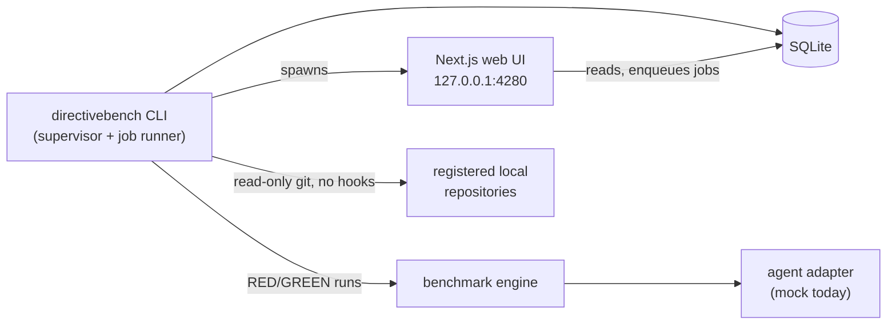

# DirectiveBench

[](https://www.npmjs.com/package/directivebench)
[](https://github.com/MetaX5/DirectiveBench/actions/workflows/ci.yml)
[](LICENSE)

DirectiveBench is a local-first, open-source workbench for discovering, organizing,
synchronizing, testing and benchmarking AI agent **skills**, **instructions** and **rules**
across repositories, coding agents and AI models.

It helps answer questions such as: *Does this skill actually improve my coding agent? Did the new
version regress? Does a rule activate only where it should? Can the result be reproduced?*

> **Project status: early (v0.1, [on npm](https://www.npmjs.com/package/directivebench)),
> building the artifact registry.** The foundation and one end-to-end vertical slice work: a
> local SQLite registry, a benchmark engine with RED/GREEN comparison, a job runner, a web UI
> and a CLI. You can register local
> repositories and public GitHub repositories (by URL, without credentials) and scan them for
> skills, instructions and rules. Benchmarks currently run only with a **deterministic mock
> agent**, which demonstrates the pipeline and is **not an AI evaluation**. Private and GitLab
> repositories, change tracking across syncs and real agent integrations are specified but not
> implemented.

## Capabilities

| Capability | Status |
| --- | --- |
| Local web UI (dashboard, repositories, artifacts, benchmarks, executions, results, run details, dark/light theme) | ✅ Implemented |
| Local repository registration by path (Git work tree or plain directory, inspected read-only by the runner; `/` rejected, home directory and overlapping paths confirmed) | ✅ Implemented |
| Scan of a registered local repository (working tree, read-only, nothing executed) | ✅ Implemented; marking deleted artifacts and cross-repository identity planned |
| Public GitHub repository by URL (no credentials; the scan downloads only candidate files into a private bare cache and records the commit; needs git ≥ 2.44) | ✅ Implemented; private repositories, branch picker and change tracking planned |
| SQLite registry with immutable artifact and benchmark-suite versions | ✅ Implemented |
| Artifact parsers: `SKILL.md`, `AGENTS.md`, `CLAUDE.md`, `.claude/rules`, Copilot instructions, Cursor `.mdc`, GitLab Duo rules | ✅ Implemented |
| Benchmark definition format v1 (YAML/JSON, Zod-validated) | ✅ Implemented |
| RED/GREEN evaluation, deterministic assertions, weighted scoring, verdicts and confidence | ✅ Implemented |
| Persistent local job queue with cancellation and crash recovery | ✅ Implemented |
| Deterministic mock agent | ✅ Implemented (clearly labelled) |
| Agent CLI detection (Claude Code, Codex, Cursor Agent) | ✅ Detection only |
| Real agent execution (Claude Code, Codex, Cursor) | 📝 Specified, not implemented |
| Private GitHub, GitLab (incl. self-managed) and commit-based local Git synchronisation | 📝 Specified, not implemented |
| Model providers (Anthropic, OpenAI, DeepSeek, Z.AI GLM, Kimi, custom) | 📝 Specified, not implemented |
| Benchmark Builder UI, category management UI, Docker sandbox, LLM-as-judge | 📝 Specified, not implemented |
| Self-hosted multi-user server and remote runners | 📝 Architecture documented only |

## Local-first architecture

Everything runs on your machine: the CLI initialises a data directory, migrates a SQLite
database (via Node's built-in `node:sqlite`, no native compilation), starts the job runner and
serves the web UI on `127.0.0.1`. No account, cloud service or external database is required,
and nothing is sent anywhere.



Data directory: `~/.local/share/directivebench` (Linux), `~/Library/Application Support/directivebench`
(macOS), `%LOCALAPPDATA%\directivebench` (Windows); override with `--data-dir` or
`DIRECTIVEBENCH_DATA_DIR`.

## Installation

Requirements: Node.js **>= 22.16** (verified on Node 24).

```bash
npx directivebench            # start the local UI on http://127.0.0.1:4280 and open a browser
npx directivebench demo       # or first try the bundled example with the mock agent
npm install -g directivebench # optional global install; then run `directivebench`
```

Releases after 0.1.0 are published from CI with
[npm provenance](https://docs.npmjs.com/generating-provenance-statements) (see
[CONTRIBUTING.md](CONTRIBUTING.md#releasing-maintainers)). To run the latest `main`, build it
from source (below).

## CLI

```bash
directivebench                 # start the UI and runner, open the browser
directivebench serve           # same, with --host, --port, --no-open, --allow-network-access
directivebench init            # create data directory, config.json and database
directivebench demo            # import the bundled example and run it with the mock agent
directivebench doctor          # diagnose Node, SQLite, data dir, database, port, agent CLIs
directivebench --help | --version
```

The server binds to `127.0.0.1` by default. Binding to another address requires
`--allow-network-access` because the local UI has no authentication.

## Development

```bash
pnpm install
pnpm dev            # runs the CLI from source: migrations, runner and `next dev`
pnpm format:check   # Prettier
pnpm lint
pnpm typecheck
pnpm test           # Vitest unit and integration tests, 100% coverage required (no credentials or paid APIs)
pnpm build          # web app + CLI bundle
pnpm verify:pack    # pack, install and smoke-test the npm tarball
pnpm test:e2e       # Playwright browser tests of the home page and management paths (after pnpm build;
                    # needs `playwright install chromium`)
```

Repository layout:

| Path | Purpose |
| --- | --- |
| `apps/cli` | The `directivebench` npm package |
| `apps/web` | Next.js App Router UI |
| `packages/core` | Domain types, artifact parsers, configuration, utilities |
| `packages/database` | Drizzle schema, migrations and repositories over `node:sqlite` |
| `packages/agent-adapters` | Agent adapter contract, mock agent, CLI detection |
| `packages/benchmark-engine` | Benchmark format, fixtures, assertions, scoring, RED/GREEN |
| `packages/runner` | SQLite-backed job runner |
| `examples/` | Executable mock benchmark and specification-only WordPress / Next.js examples |
| `.ai/` | Specifications, ADRs, AI run logs and lessons |

## Specifications and decisions

All product and technical specifications live in [`.ai/specs/`](.ai/specs/README.md); the
reasons behind major decisions are in [`.ai/decisions/`](.ai/decisions/README.md). The
milestone plan is in [the implementation roadmap](.ai/specs/2026-10-14-implementation-roadmap.md).
AI coding agents follow [`AGENTS.md`](AGENTS.md).

## Roadmap

0. **Bootstrap** — monorepo, CLI, SQLite, engine, mock benchmark, UI, specs (done)
1. **Artifact registry** — local repository registration (done), discovery, categories,
   versioning (current; backlog in [`.ai/specs/backlog.md`](.ai/specs/backlog.md))
2. Git integrations — GitHub, GitLab.com, self-managed GitLab, manual sync
3. Benchmark engine — fixture management, more assertion types, repeatable evaluations
4. Real agent integration — Claude Code, Codex, Cursor
5. Benchmark Builder
6. Alternative model providers and a custom coding harness
7. Advanced evaluation — regression tracking, reliability metrics, optional LLM judge
8. Self-hosted and teams

## Security

Imported repositories and benchmark scripts are treated as untrusted. Registered repositories
are only read: git runs read-only, with hooks and fsmonitor disabled, from an absolute path and
with an environment allowlist, and nothing in the repository is executed. The current
`local-process` execution environment is **not a sandbox**: benchmark commands run with your
user's permissions, which is why only execution-approved suites (today: the bundled example)
may run commands. See [SECURITY.md](SECURITY.md) and the
[security specification](.ai/specs/2026-10-14-security-and-privacy.md).

## Contributing

See [CONTRIBUTING.md](CONTRIBUTING.md) and the [Code of Conduct](CODE_OF_CONDUCT.md).

## License

[MIT](LICENSE)
